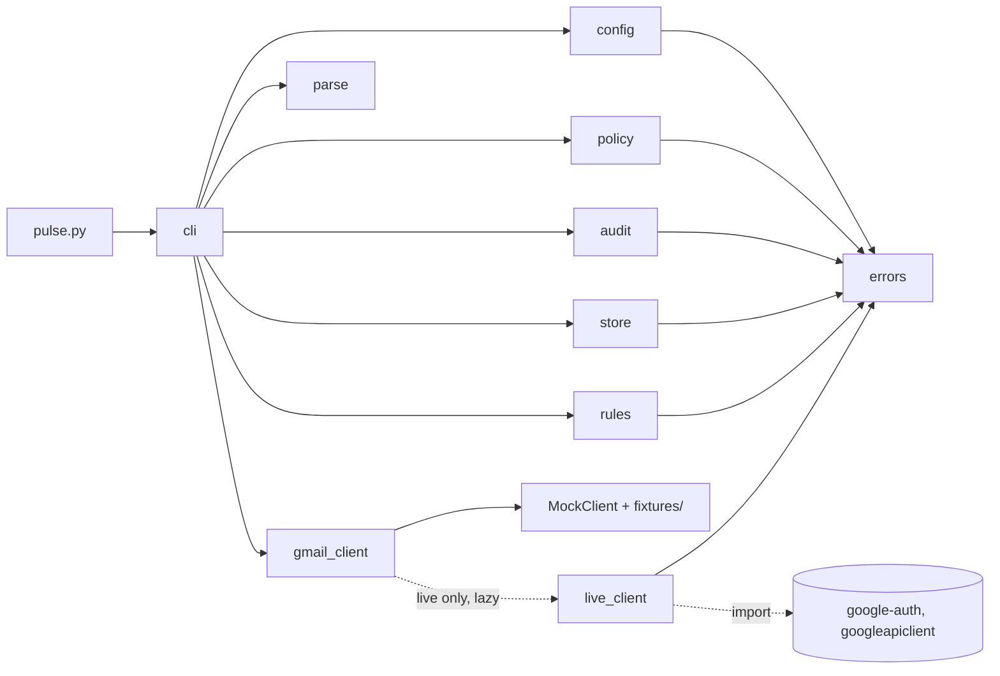
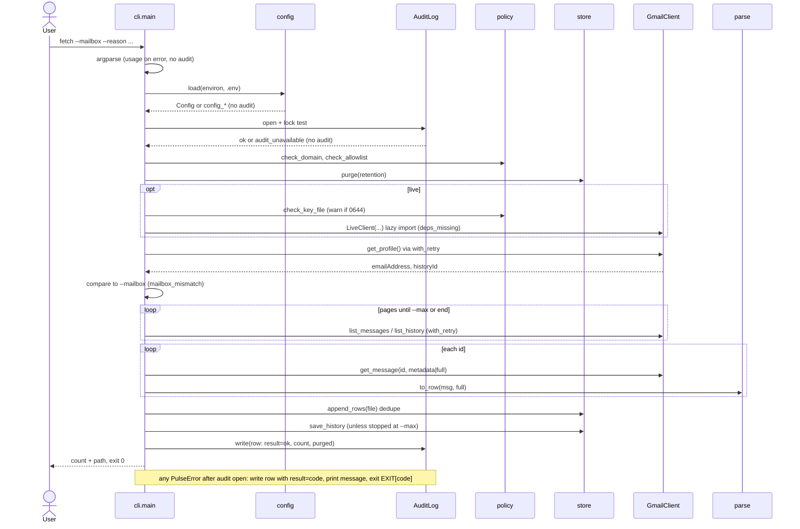
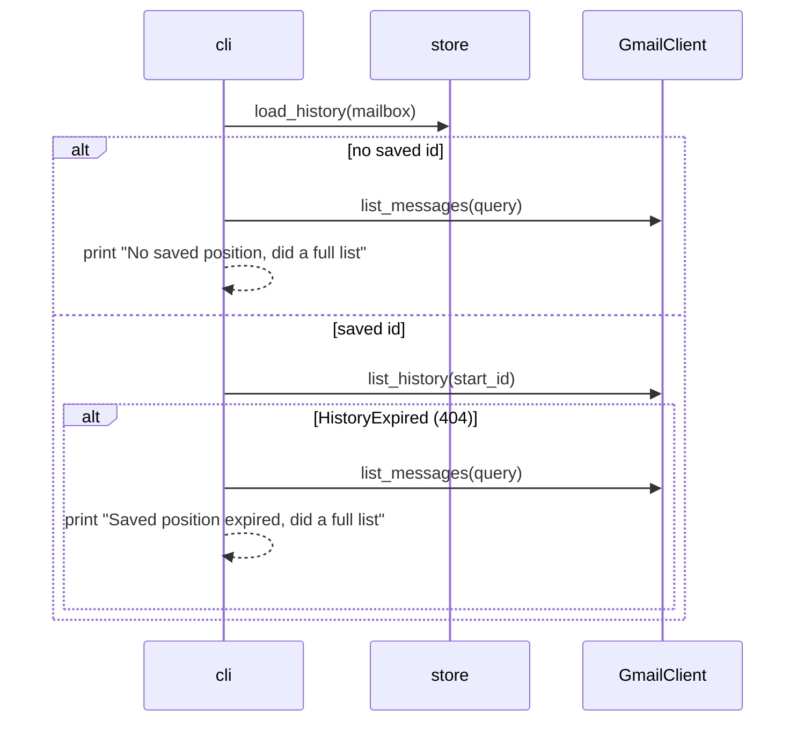

# Architecture: Sutra Pulse step 1, read-only Gmail reader

## Context
New folder `prototypes/pulse/`, a sibling of `prototypes/j2/` so it is not vendored into Sutra Pro (`sutra-pro/scripts/vendor_j2.py:47-49`). No Google code exists in the repo. Credentials arrive later, so every path except the real HTTP calls must run and be tested offline. Spec: `docs/ai/pulse-gmail-reader/spec.md` (Refined).

Conventions reused from the repo:
| Convention | Source |
|---|---|
| Flat Python modules next to a plain-script test file | `prototypes/j2/*.py`, `prototypes/j2/change_test.py` |
| Stdlib `.env` loader, non-empty shell value wins | `prototypes/j2/llm.py:21-34` |
| Append-only log with `O_APPEND` + `fcntl.flock(LOCK_EX)` | `marketplace/plugin/sutra-ui/shadow_ledger.py:191-199` |
| 0600 files, 0700 dirs, symlink refusal, fail closed | `os/charters/PRIVACY.md:14-23` |
| Per-folder `.gitignore` for `.env` | `prototypes/j2/.gitignore:1-4` |

## Approach
A small CLI (`pulse.py`) runs a fixed guard pipeline (parse, config, audit, domain, allowlist, rules, key, imports, profile) and only then calls a `GmailClient`. The client is an interface with two implementations: `MockClient` serves fixture JSON in Gmail API response shape, `LiveClient` wraps `google-api-python-client` and imports Google modules lazily. Everything above the client (parsing, storage, rules, retry, audit) is shared, so mock tests exercise the same code that runs live.

## Alternatives considered
| Alternative | Why rejected |
|---|---|
| google-auth + plain REST via `urllib` (no discovery client) | Fewer deps, but we would hand-write token refresh, pagination params and error parsing. `google-api-python-client` is the documented path and only matters in live mode. Revisit if install size matters |
| Mock at the HTTP layer (fake HTTP transport for googleapiclient) | Needs Google libs installed for tests, breaks NFR-1 |
| Package directory (`prototypes/pulse/pulse/`) | Extra nesting and `-m` invocation for 10 small modules; j2 is flat |
| pytest | Not used for prototypes; j2 tests are plain scripts and pytest collection fails on them (analysis.md) |
| YAML rules | Adds PyYAML for one file (spec Rules format) |

## Components
All new, under `prototypes/pulse/`. Line counts are estimates.

| File | Role | ~Lines |
|---|---|---|
| `CHARTER.md` | Purpose, scope, data, retention, DEC-3 rule, owner/approver | 60 |
| `.gitignore` | FR-2 | 12 |
| `.env.example` | Every config key, empty or fake | 15 |
| `requirements.txt` | `google-auth`, `google-api-python-client` (live only) | 2 |
| `errors.py` | `PulseError`, code to exit table, `map_refresh_error`, `map_http_error` (pure) | 90 |
| `config.py` | `.env` parse (no `os.environ` mutation), `Config` dataclass, validation | 110 |
| `policy.py` | Mailbox format, domain, allowlist, reason, key-file checks, perms warning | 110 |
| `audit.py` | `AuditLog`: open/lock-test, single `write(row)` | 70 |
| `gmail_client.py` | `GmailClient` Protocol, `MockClient`, `with_retry`, `make_client` | 170 |
| `live_client.py` | `LiveClient`, lazy Google imports, exception translation | 110 |
| `parse.py` | Gmail message dict to mail row; header decode; HTML to text | 140 |
| `store.py` | Safe dir/file creation, JSONL append with dedupe, history state, purge | 160 |
| `rules.py` | Load/validate rules JSON, match a row | 110 |
| `cli.py` | argparse, pipeline, commands, output, exit codes | 250 |
| `pulse.py` | Entry: `sys.exit(cli.main(sys.argv[1:]))` | 5 |
| `pulse_test.py` | unittest-based plain script | 700 |
| `fixtures/inbox.json` | Profile, `page_size: 5`, 12+ full Message resources, history records | data |
| `fixtures/scenarios.json` | Named scenario overrides | data |
| `fixtures/allowlist.txt` | Mock allowlist with DEC-3 header comment | 6 |
| `fixtures/rules.sample.json` | Rules matching exactly one fixture message | 15 |
| `README.md` | FR-32 | 150 |

Changed files: none outside `prototypes/pulse/` (NFR-8).



## Data model
No database, no migrations. Files only:
| File | Location | Format | Mode | Writer |
|---|---|---|---|---|
| Mail rows | `<OUT_DIR>[/_mock]/<mailbox>/<YYYY-MM-DD>.jsonl` | JSONL, spec "Mail row" | 0600, dirs 0700 | `store.append_rows` |
| Find rows | same dir, `<YYYY-MM-DD>.find.jsonl` | Mail row + `rules_hit`, `fields_hit` | 0600 | `store.append_rows` |
| Audit | `<STATE_DIR>/audit.jsonl` | JSONL, spec "Audit row" | 0600 | `audit.AuditLog.write` |
| History | `<STATE_DIR>/history.json` / `history.mock.json` | JSON map | 0600 | `store.save_history` |

Fixture shapes (stdlib JSON):
```json
// fixtures/inbox.json
{"profile": {"emailAddress": "ana@example.test", "messagesTotal": 12, "threadsTotal": 10, "historyId": "2000"},
 "page_size": 5,
 "messages": [ { "id": "...", "threadId": "...", "labelIds": [], "snippet": "...", "internalDate": "...",
                 "payload": { "mimeType": "...", "headers": [...], "parts": [...], "body": {"data": "<base64url>"} } } ],
 "history": {"start_id": "1500", "added": ["<message id>", "..."]}}
// fixtures/scenarios.json
{"default": {},
 "mismatch": {"profile_email": "other@example.test"},
 "history_expired": {"history_status": 404},
 "rate_limit_then_ok": {"fail": {"method": "list_messages", "statuses": [429, 429]}},
 "server_error": {"fail": {"method": "*", "statuses": "always:503"}},
 "unauthorized_client": {"auth_error": "unauthorized_client: Client is unauthorized to retrieve access tokens using this method"},
 "invalid_grant": {"auth_error": "invalid_grant: Invalid email or User ID"},
 "access_denied": {"http_error": {"status": 403, "reason": "accessNotConfigured"}},
 "boom": {"raise": "RuntimeError"}}
```
`MockClient` serves `format=metadata` by copying the message and keeping only `payload.headers` (filtered to the requested names) and `payload.mimeType`, so FR-16 is real in mock. Auth error strings run through the same `errors.map_refresh_error` the live client uses (R-12).

## Interfaces
```python
# errors.py
EXIT = {"ok": 0, "internal": 1, "usage": 2, "config_missing": 2, "config_invalid": 2, "rules_invalid": 2,
        "deps_missing": 2, "wrong_domain": 3, "not_allowlisted": 3, "mailbox_mismatch": 3,
        "audit_unavailable": 3, "unsafe_path": 3, "key_missing": 4, "key_unreadable": 4,
        "unauthorized_client": 4, "invalid_grant": 4, "access_denied": 4, "rate_limited": 5, "server_error": 5}
class PulseError(Exception):
    def __init__(self, code: str, message: str): ...        # .exit_code = EXIT[code]
class TransientError(Exception):                             # 429 / 5xx, retried by with_retry
    def __init__(self, status: int): ...
class HistoryExpired(Exception): ...                         # 404 from history.list; not an exit code
def map_refresh_error(text: str) -> PulseError               # token endpoint errors
def map_http_error(status: int, reason: str) -> PulseError | TransientError | HistoryExpired

# config.py
@dataclass(frozen=True)
class Config:
    mock: bool; domain: str; allowlist: Path; sa_key_path: Path | None
    out_dir: Path; state_dir: Path; retention_days: int; scenario: str; debug: bool
def read_env_file(path: Path) -> dict[str, str]
def load(environ: Mapping[str, str], env_file: Path, need_live_keys: bool) -> Config   # raises PulseError

# policy.py
def normalise_mailbox(raw: str) -> str                       # raises ValueError -> usage (argparse type)
def check_domain(mailbox: str, domain: str) -> None          # wrong_domain
def load_allowlist(path: Path) -> frozenset[str]             # empty set on missing/unreadable
def check_allowlist(mailbox: str, path: Path) -> None        # not_allowlisted
def check_key_file(path: Path) -> list[str]                  # key_missing / key_unreadable; returns warnings

# audit.py
class AuditLog:
    def __init__(self, state_dir: Path): ...                 # mkdir 0700, open O_APPEND|O_CREAT|O_NOFOLLOW 0600, flock test
    def write(self, row: dict) -> None                       # flock LOCK_EX, one os.write of json + "\n"
    def close(self) -> None

# gmail_client.py
class GmailClient(Protocol):                                 # bound to one mailbox at construction
    def get_profile(self) -> dict: ...                       # {emailAddress, messagesTotal, threadsTotal, historyId}
    def list_messages(self, query: str | None, page_token: str | None, max_results: int) -> dict: ...
                                                             # {"messages": [{"id","threadId"}], "nextPageToken"?}
    def get_message(self, msg_id: str, fmt: Literal["metadata", "full"]) -> dict: ...   # Gmail Message resource
    def list_history(self, start_id: str, page_token: str | None, max_results: int) -> dict: ...
                                                             # {"history": [{"messagesAdded": [{"message": {...}}]}], "nextPageToken"?}
                                                             # raises HistoryExpired on 404
class MockClient:                                            # implements GmailClient
    def __init__(self, mailbox: str, fixtures_dir: Path, scenario: str): ...
    calls: list[tuple[str, dict]]                            # recorded for tests
def with_retry(fn: Callable[[], T], sleep: Callable[[float], None], attempts: int = 5,
               base: float = 1.0, cap: float = 32.0) -> T  # raises rate_limited / server_error
def make_client(cfg: Config, mailbox: str) -> GmailClient   # MockClient or LiveClient

# live_client.py
SCOPES = ["https://www.googleapis.com/auth/gmail.readonly"]
class LiveClient:                                            # implements GmailClient
    def __init__(self, mailbox: str, key_path: Path, creds_builder=None, service_builder=None): ...
    # default builders import google.oauth2.service_account / googleapiclient.discovery here (deps_missing on ImportError)
    # creds = from_service_account_file(key_path, scopes=SCOPES).with_subject(mailbox)
    # service = build("gmail", "v1", credentials=creds, cache_discovery=False); every .execute(num_retries=0)
    # RefreshError -> map_refresh_error(str(e)); HttpError -> map_http_error(e.resp.status, reason)

# parse.py
def to_row(msg: dict, full: bool) -> dict
def decode_header_value(raw: str) -> str
def html_to_text(html: str) -> str
def split_addresses(raw: str) -> list[str]

# store.py
def mailbox_dir(out_dir: Path, mailbox: str, mock: bool) -> Path   # creates 0700 chain, unsafe_path on symlink
def append_rows(path: Path, rows: Iterable[dict]) -> int           # O_NOFOLLOW, dedupe by id, returns count written
def load_history(state_dir: Path, mock: bool) -> dict
def save_history(state_dir: Path, mock: bool, mailbox: str, history_id: str, now: datetime) -> None
def purge(out_dir: Path, retention_days: int, today: date, dry_run: bool) -> list[Path]

# rules.py
@dataclass(frozen=True)
class Rule: id: str; description: str; gmail_query: str | None; keywords: tuple[str, ...]
            regex: tuple[re.Pattern, ...]; fields: tuple[str, ...]
def load_rules(path: Path, full: bool) -> list[Rule]        # rules_invalid
def match(rule: Rule, row: dict) -> list[str]               # fields hit, [] if no match

# cli.py
def main(argv: list[str], environ: Mapping[str, str] | None = None, env_file: Path | None = None,
         client_factory: Callable[[Config, str], GmailClient] | None = None,
         sleep: Callable[[float], None] = time.sleep, now: Callable[[], datetime] | None = None,
         stdout: TextIO = sys.stdout, stderr: TextIO = sys.stderr) -> int
```

CLI contract:
```
pulse.py check  --mailbox M --reason R
pulse.py fetch  --mailbox M --reason R [--query Q] [--since Nd|Nh] [--max N] [--full] [--since-last]
pulse.py find   --mailbox M --reason R --rules FILE [--since Nd|Nh] [--max N] [--full]
pulse.py purge  [--dry-run]
```
argparse errors are routed to exit 2 `usage` (override `ArgumentParser.error`, since argparse's own exit code is also 2 but prints usage to stderr in its own format).

## Sequence diagrams
Main flow, `fetch` (live and mock share it):


`--since-last` branch:


## Cross-cutting
| Area | Design |
|---|---|
| Errors | All expected failures are `PulseError(code, message)`; `cli.main` has one `try` that maps to exit code and writes the audit row. Anything else becomes `internal` (FR-36). argparse errors map to `usage` |
| Retry | `with_retry` wraps every client call: catches `TransientError`, sleeps `min(base * 2**(n-1), cap)` for n=1..4, 5 attempts total, then `rate_limited` (last status 429) or `server_error`. Sleep injected (NFR-3) |
| Logging | No logging module. stdout: results only, first line `MOCK MODE` in mock. stderr: one or two sentences per error; traceback only with `PULSE_DEBUG=1` |
| Security | Scope constant in one place (`live_client.SCOPES`); key file never read by Pulse except `json.load` to check `type == "service_account"` and `client_email`/`private_key` keys present, then discarded; messages print the path only. No `.env` value is printed: config errors name the key, not the value. Audit row builder takes only whitelisted fields (FR-33) |
| Files | `O_NOFOLLOW` on every open for write; `os.lstat` check on each dir in the `out/<mailbox>` chain; `os.umask` not relied on, modes set explicitly with `os.open(..., 0o600)` and `os.mkdir(..., 0o700)`; history written to `tempfile.mkstemp` in the same dir then `os.replace` |
| Concurrency | Audit: `flock(LOCK_EX)` per row (NFR-6). Output JSONL: same lock around read-ids-then-append so two fetches of one mailbox do not duplicate |
| Performance | One `get_message` per id; no batching in step 1 (live targets are a non-goal). Page size `min(remaining, 100)` |
| Config | `config.load` is pure: returns a `Config` and never mutates `os.environ` (differs from j2, which sets `os.environ`; see D-4) |
| Backward compat | New tool, nothing to break. NFR-8 guards j2 and root files |

### Error taxonomy to exit codes
| Exit | Class | Codes | Raised by |
|---|---|---|---|
| 0 | Success | `ok` | - |
| 1 | Bug | `internal` | `cli.main` fallback |
| 2 | Fix your input or install | `usage`, `config_missing`, `config_invalid`, `rules_invalid`, `deps_missing` | argparse, `config`, `rules`, `live_client` |
| 3 | Refused by policy | `wrong_domain`, `not_allowlisted`, `mailbox_mismatch`, `audit_unavailable`, `unsafe_path` | `policy`, `cli`, `audit`, `store` |
| 4 | Credentials or admin setup | `key_missing`, `key_unreadable`, `unauthorized_client`, `invalid_grant`, `access_denied` | `policy`, `errors.map_*` |
| 5 | Try later | `rate_limited`, `server_error` | `with_retry` |

### Live error mapping (`errors.map_*`, unit-tested with sample shapes)
| Live signal | Code |
|---|---|
| `RefreshError` text contains `unauthorized_client` | `unauthorized_client` |
| `RefreshError` text contains `invalid_grant` | `invalid_grant` |
| other `RefreshError` | `unauthorized_client` with "could not get a token" (fail closed) |
| `HttpError` 403 | `access_denied` |
| `HttpError` 404 on `history.list` | `HistoryExpired` (internal fallback) |
| `HttpError` 429 | `TransientError(429)` |
| `HttpError` 500-599 | `TransientError(status)` |
| other `HttpError` | `internal` with status in message |
A-2: the token error strings are unverified until a key exists; live checklist item L-5 confirms them.

## Rollout and rollback
- Rollout: merge the branch; the tool does nothing until someone runs it. Live use needs admin setup (README) plus `.env` values. First live run is `check` on one allowlisted mailbox whose owner has been told (DEC-3).
- Rollback: delete `prototypes/pulse/` in a revert commit. Revoke live access by removing the client ID in Admin console > Domain-wide delegation and deleting the service-account key. Local data: `rm -rf ~/.sutra-pulse` (audit log should be archived first per DEC-1).
- Reversibility: code fully reversible; mail already read is not, which is why the allowlist, reason and audit gates sit in front of every read.

## Test strategy
| Level | What | How |
|---|---|---|
| Unit | config, policy, errors mappers, retry, parse, rules, store, audit | Direct function calls in `pulse_test.py` |
| Integration (in-process) | Every command end to end through `cli.main` against `MockClient` | `cli.main(argv, environ=..., env_file=tmp/.env, sleep=recorder, now=fixed)`; `client_factory` used only to inject stubs for live tests and `boom` |
| Integration (subprocess) | `python3 pulse.py check` smoke; NFR-6 concurrency | `subprocess.run` with an explicit env setting every `PULSE_*` key and `HOME` to temp dirs |
| Live (manual) | Real key, real mailbox | Checklist in plan.md (L-1..L-9) |
| e2e automated | None in step 1 | Needs a key and a test mailbox |

Isolation (NFR-9):
- One `tempfile.TemporaryDirectory()` per test in `setUp`, giving `out/`, `state/`, `home/`, `.env`.
- Every `cli.main` call passes `environ` with `HOME`, `PULSE_OUT_DIR`, `PULSE_STATE_DIR` inside the temp dir and `env_file` pointing at a temp `.env`, so the developer's real `prototypes/pulse/.env` is never read in-process.
- At import time the test script sets `sys.modules["google"] = None` (and `googleapiclient`) and replaces `socket.socket` with a class that raises, so any accidental network or Google import fails loudly (FR-5, NFR-2).
- Runner: `unittest` from the stdlib, invoked by `if __name__ == "__main__": unittest.main(verbosity=2)` so `python3 pulse_test.py` prints one line per test and exits 1 on any failure (FR-31).

## Traceability
| Req | Component | Test (in `pulse_test.py` unless noted) |
|---|---|---|
| FR-1 | `CHARTER.md` | AC-1 manual (`git log`), plus grep test for owner/approver/retention/DEC-3 |
| FR-2 | `.gitignore` | AC-2 manual (`git check-ignore`) |
| FR-3 | `config.py` | `test_config_shell_wins` (AC-3) |
| FR-4 | `config.py`, `cli.py` | `test_live_missing_key_config_missing`, `test_mock_ignores_live_values` (AC-4) |
| FR-5 | `gmail_client.MockClient`, test harness | `test_mock_all_commands_offline` (AC-5) |
| FR-6 | `live_client.py` | `test_live_deps_missing` (AC-6) |
| FR-7 | `live_client.SCOPES` | `test_live_scope_and_subject` (AC-7) |
| FR-8 | `policy.check_domain` | `test_wrong_domain` (AC-8) |
| FR-9 | `policy.load_allowlist/check_allowlist` | `test_allowlist_*` (AC-9) |
| FR-10 | `cli` argparse | `test_reason_validation` (AC-10) |
| FR-11 | `cli` pipeline step 8 | `test_mailbox_mismatch` (AC-11) |
| FR-12 | `cli.cmd_check` | `test_check_output_and_calls` (AC-12) |
| FR-13 | `errors.map_*`, `policy.check_key_file`, scenarios | `test_auth_scenarios`, `test_key_file_errors`, `test_error_mapper` (AC-13) |
| FR-14 | `gmail_client.with_retry` | `test_retry_429_then_ok`, `test_retry_5xx_exhausted` (AC-14) |
| FR-15 | `cli` list loop | `test_pagination_stops_at_max` (AC-15) |
| FR-16 | `cli.cmd_fetch`, `MockClient` metadata | `test_metadata_only` (AC-16) |
| FR-17 | `parse.html_to_text` | `test_full_html_body` (AC-17) |
| FR-18 | `parse.to_row` | `test_attachment_keys` (AC-18) |
| FR-19 | `parse.decode_header_value` | `test_rfc2047_subject` (AC-19) |
| FR-20 | `store.mailbox_dir/append_rows` | `test_output_path_modes_dedupe` (AC-20) |
| FR-21 | `store`, `audit` | `test_symlink_refusals` (AC-21) |
| FR-22 | `cli` since-last branch | `test_since_last_*` (AC-22) |
| FR-23 | `store.save_history` | `test_history_saved_mock_file` (AC-23), `test_since_last_truncated_keeps_position` (AC-37) |
| FR-24 | `rules.py`, `cli.cmd_find` | `test_find_sample`, `test_rules_invalid` (AC-24) |
| FR-25 | `store.purge` | `test_purge_boundaries` (AC-25) |
| FR-26 | `cli` auto purge | `test_fetch_auto_purge` (AC-26) |
| FR-27 | `audit.py`, `cli.main` | `test_audit_rows_schema_and_no_mail` (AC-27) |
| FR-28 | `audit.AuditLog.__init__` | `test_audit_unavailable` (AC-28) |
| FR-29 | `fixtures/` | `test_fixture_coverage`, `test_fixture_scan` (AC-29) |
| FR-30 | `fixtures/`, test temp key | `test_fixture_scan` (AC-29) |
| FR-31 | `pulse_test.py` | AC-30 manual |
| FR-32 | `README.md` | `test_readme_contents` (AC-31) |
| FR-33 | `audit` row builder, `cli` messages | `test_audit_rows_schema_and_no_mail` (AC-27), `test_key_file_errors` (no contents) |
| FR-34 | `policy.check_key_file` | `test_key_perms_warning` (AC-32) |
| FR-35 | `policy.normalise_mailbox` | `test_mailbox_format` (AC-35) |
| FR-36 | `cli.main` fallback | `test_internal_error` (AC-36) |
| NFR-1 | test harness blocks `google` | AC-5 |
| NFR-2 | whole suite | timed run in plan T15 |
| NFR-3 | `with_retry(sleep=)` | AC-14 |
| NFR-4 | `with_retry` | AC-14 |
| NFR-5 | argparse `--max` | `test_max_bounds` (AC-33) |
| NFR-6 | `audit.write` flock | `test_concurrent_audit` (AC-34) |
| NFR-7 | `requirements.txt` | `test_requirements_pinned_set` (reads file, exact 2 names) |
| NFR-8 | - | `git diff --stat main -- prototypes/j2 .gitignore` in T15 |
| NFR-9 | test `setUp` | AC-38 manual once, `git status` in T15 |
| NFR-10 | `README.md` | `test_readme_contents` greps "POSIX" |

## Decisions
**D-1 Client interface with Mock and Live implementations, shared pipeline above it.**
Context: no credentials; tests must be stdlib only. Alternatives: HTTP-level fakes (needs Google libs), separate mock code path (drifts from live). Consequences: `MockClient` must mimic Gmail response shapes and metadata filtering; live-only code shrinks to `live_client.py` (~110 lines), which is the only part untested until L-checklist.

**D-2 `google-api-python-client` + `google-auth` for live.**
Context: impact.md Q-1. Documented path, handles discovery, paging params and error types. Consequences: ~2 deps, larger install; isolated behind lazy import so mock is unaffected. Plain REST is the fallback if install size becomes a problem.

**D-3 Key-file checks before Google imports (spec R-3).**
Context: `key_missing`/`key_unreadable` are stdlib checks. Consequences: they are testable without Google libs and give the admin the cheaper fix first.

**D-4 Pure config loader instead of copying j2's `os.environ` mutation.**
Context: `prototypes/j2/llm.py:21-34` writes into `os.environ`. Tests run many configs in one process. Consequences: same precedence rule, but `config.load(environ, env_file)` returns a value; no global state. Small deviation from j2's pattern, deliberate.

**D-5 Mock forces `example.test` and the fixture allowlist (spec R-2).**
Consequences: a real `.env` never blocks mock; mock can never be pointed at a real domain. Allowlist parsing for custom files is tested via `policy` unit tests and live-mode refusals (which happen before any key or Google step).

**D-6 `unittest` as the runner inside a plain script.**
Context: FR-31 needs per-test pass/fail and a non-zero exit after all tests run; j2's `ok()` style exits on first failure (`prototypes/j2/change_test.py:17-20`). Consequences: stdlib, `python3 pulse_test.py` still the only command; slight style difference from j2.

**D-7 Audit row written once, at the end, from a single `finally`.**
Context: one row per invocation (FR-27). The log is opened and lock-tested at step 3 so a broken log stops the run before any read (FR-28). Consequences: a crash between reading mail and the final write leaves output without an audit row; acceptable for a CLI, since `os.write` of one line under lock is the last step and failure is surfaced as `audit_unavailable`.

**D-8 No jitter, `Retry-After` ignored.**
Context: single-user CLI, deterministic tests. Consequences: if Google sends long `Retry-After`, we may exhaust 5 attempts (~15 s) and exit 5; the user retries later. Revisit if live runs hit it.

## Risks
| Risk | Likelihood | Mitigation |
|---|---|---|
| Mock shapes drift from real Gmail responses (A-3) | Moderate | Fixtures copied from Google's documented Message resource; L-6 compares one live message's keys to fixture keys |
| Token error strings differ from assumed (A-2) | Moderate | Fallback maps unknown `RefreshError` to `unauthorized_client` (fail closed); L-5 records real strings |
| Creation guard blocks the first write if session placement is not registered | High on first run | T1 tells the developer to register placement before writing CHARTER.md |
| Creation guard hard-blocks `.gitignore` and `.env.example` as "NEW KIND" (no case matches them, `marketplace/plugin/hooks/creation-guard.sh:84-91`) | High (read from code, not run) | Plan stop point before T1: user rules on these two files; no bypass |
| `snippet` holds personal data in metadata mode (DEC-2) | Certain | Retention 30 d, 0600, outside repo; revisit before J2 |
| Audit log grows without enforced retention (DEC-1) | Certain, slow | Documented 365 d; follow-up task |
| One `get_message` per id is slow for 500 messages live | Moderate | Non-goal for step 1; batch API is a later change behind the same interface |
