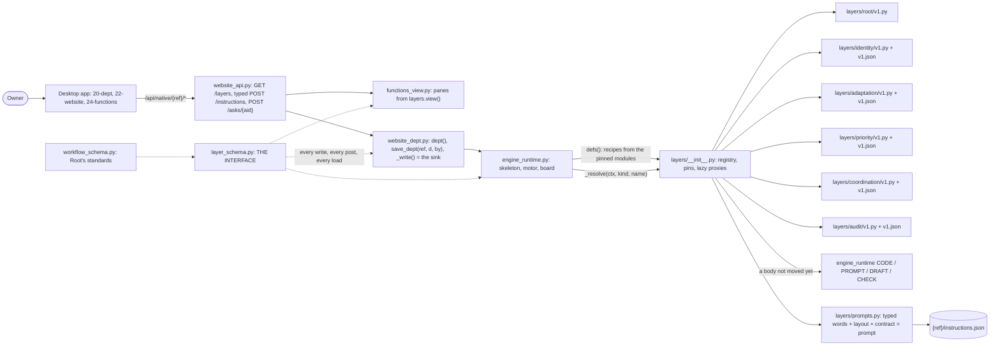

# PRD amendment A1: the interface schema layer

| Field | Value |
|---|---|
| **status** | Final, 2026-10-26: amendment A1 to [PRD-FIVE-FUNCTIONS.md](PRD-FIVE-FUNCTIONS.md) 1.0, after one review (verdict reject: 1 P0, 7 P1, 9 P2, 2 P3). Every P0 and P1 is fixed, and the P2s and P3s are taken as A1.27 says. The PRD and the decision log are updated to match, in the same commit, before any build starts |
| Direction | the owner, 2026-10-26, two messages (quoted in A1.0) |
| Overrides | the '.md files' wording of S-28 and of goal G3; decision MK-7; milestone M2 (rewritten); milestone M7 (folded into the workflow schema). Every other ruling, mark (MK) and question default (Q) stands |
| Based on | sutra main `d24a467d` (M0, M1 and its fix, M2.1 to M2.4, M3.1 to M3.7, M4.1 to M4.7, M6.1), with the verifiers' fix wave merging on top (prd/m1fix-fix1 merged as `1664e7dc`; prd/m3-fix1 and prd/m4-fix1 merge before wave 0). The fix wave changes no record shape, and wave 0 binds every definition to the writers on main as they stand when it starts. The J2 prototype `3d8d2e8`. Code is located by function name, never by line (decision C3) |
| Build | four waves of parallel developer packages, merged one at a time on a green gate (A1.26): wave 0, one package, the schema core (about 75 min); wave 1, eight packages (about 110 min); wave 2, six (about 80 min, M9 and M10); wave 3, four (about 50 min). Waves 0 and 1 end at about 3 h 05 min, wave 2 at about 4 h 25 min, wave 3 at about 5 h 15 min. Nothing is left to a later session |
| Decision log | the A1 rows of [PRD-FIVE-FUNCTIONS-DECISIONS.md](PRD-FIVE-FUNCTIONS-DECISIONS.md) |
| Pointer for code | `schemas/layers/README.md` (written in wave 0) lists, per layer, the `layer_schema` names that hold it |
| Amended by | [PRD-FIVE-FUNCTIONS-A2.md](PRD-FIVE-FUNCTIONS-A2.md), 2026-10-26: the class model of the interface layer (the interface is the base class, a layer version is a child class that may extend an earlier version, the workflow sources are a family). A2 changes no interface table; A1 stands as written except the lines marked 'Amended by A2' under A1.18 and A1.19 |

## A1.0 The direction, and how this reads it

> "The root should have this identity adaptation, all these layers in a schema format, and any kind of workflow for the department which is getting created should follow this from a coding perspective. It means that this is not something that should be managed through a .md file. It should be hard-coded within the interface schema layer. Update the PRD for that."
>
> "The J2_Prototype codebase is already updated. Also, this is going to be an iterative management kind of thing. That means the functionality of identity or adaptation can change, so we need that modularization into the layer. But the schema part and the idea of how we should be building this app as a hard-coded interface schema for these layers remain the same."

| # | Reading | Where it lands |
|---|---|---|
| 1 | Root and each of the five layers is one fixed interface, hard-coded in Python: what it holds, the department keys it owns, what it hears and sends and to whom, its verdicts, its covering checks, its settings, its prompt slots and its pane view. | `layer_schema.py` |
| 2 | Every workflow a department runs (a Library line, a fitted one, or one Adaptation shapes or makes) conforms to one workflow schema, checked in code at birth, at proposal, at registration, when the line grows, and on every write. | `layer_schema` workflow definitions; `workflow_schema.py` |
| 3 | A layer's behaviour, its recipe and its step bodies, lives in a module behind the interface: `layers/<layer>/v<N>.py` and `v<N>.json`. A version can change freely while the interface stays as it is. The interface changes only with a schema version and a migration. | `layers/` |
| 4 | No layer's structure is managed through .md files. Code compiles prompts from typed fields, and an owner's change is a typed value, checked by the schema and applied through the instructions ask. | `layers/prompts.py`, `{ref}/instructions.json` |

**The one rule of A1.** The interface is everything another layer, the screens, the tests or the owner may rely on, and it lives only in `layer_schema.py`. The implementation is everything inside a layer that produces it, and it lives only in `layers/<layer>/v<N>.*`.

| Interface (fixed; a change is a schema version and a migration) | Implementation (free to change, version by version) |
|---|---|
| The records a layer owns, with their fields and types, and the department keys it owns | How it computes them |
| The (act, word) pairs it hears, which every version must handle; what it sends, to whom, with what payload; the edges and the in-process calls | Its recipe: handlers, steps, gates, rules (`v<N>.json`) |
| Its verdict enums and covering-check names, with contract samples | The bodies of its checks, beyond the samples |
| Its settings (type, default, how changed) and constants (bounds, limits) | none |
| Its prompt slots: groups, parts, owner fields and their types, the inputs code fills, and the answer contract | Default words, the layout that arranges them, and the code that fills the inputs |
| Its pane view: the read-model shape the screens render | How it reads the record into that shape |
| The workflow schema and Root's standards; the option kinds and which layer applies each | Root's extra strictness; how an option is applied |

## A1.1 The shape



## A1.2 Files

| Path | New or changed | Wave and package | Holds |
|---|---|---|---|
| `layer_schema.py` | new | W0-SCHEMA; after wave 0, additive 'A1 interface:' commits (a package for its own layer's rows, the integrator for shared ones); W3-PROOF freezes it | The interface: constants, type constructors, the validator, DEFS, the tables, public functions, migrations, the JSON Schema generator |
| `schemas/layers/*.schema.json`, `interface.v1.json` | new, generated | W0-SCHEMA; `python layer_schema.py --write` in every 'A1 interface:' commit | JSON Schema for the screens' fixtures and the tests; never edited by hand |
| `schemas/layers/README.md`, `schemas/layers/fixtures/` | new | W0-SCHEMA (README, department fixtures); W1-ROOT (workflow fixtures) | The pointer table; examples |
| `layers/__init__.py` | new | W0-SCHEMA (proxies, `ref_to`, `recipes()`); W1-CORE (the registry); W3-PINS (pin sets per department) | The registry |
| `layers/<layer>/__init__.py`, `v1.py` | new | W0-SCHEMA (stubs); then the layer's own package in each wave | One implementation per layer |
| `layers/<function>/v1.json` | new (moved) | W0-SCHEMA moves the five function engine objects out of `engine_defs/website.json`, byte for byte; the layer's own package owns its file after that | Each function's recipe |
| `layers/prompts.py` | new | W1-CORE | Typed compile, the .md fallback, the extractor, owner values |
| `layers/contract.py`, `test_layer_contracts.py` | new | W0-SCHEMA (the helpers); W1-CORE (the compiling case) | The contract every implementation passes |
| `workflow_schema.py` | new | W1-ROOT; W2-CHECKS (artifact forms) | The code of Root's standards |
| `engine_defs/website.json` | changed | W0-SCHEMA; W3-BOARD (the edges' Engine rows) | Kinds, edges, Coordination's born table and journeys; `"engines": {}` |
| `engine_runtime.py` | changed | W0-SCHEMA (`defs`, `post`); W1-CORE (the seam, the prompt delegation, the instructions block); each layer package in its own region; W3-PINS (lookups per pin set); W3-PROOF (the dead copies) | Dispatch through the registry; the four registries stay as the fallback |
| `website_dept.py` | changed | W0-SCHEMA (`_write`, `dept`, `save_dept`, `append_row`, `rows`); W1-CORE (`option`, `options_ask`); W1-ROOT (`create`, `add_engine`); W1-PRIORITY and W2-PRIORITY (`set_envelope`) | The sink and the writers |
| `functions_view.py` | changed | W1-CORE (`_j2_part`, `function`, PAGES removed); W2-PRIORITY (cycle.ceiling) | Panes from `layers.view()` |
| `website_api.py` | changed | W1-CORE (`GET /{ref}/layers`, typed `POST /{ref}/instructions`, SchemaFault as 422); W2-SCREENS (`GET /{ref}/messages`) | The routes |
| `j2_runtime.py` | changed | W1-ROOT (`registered`, `refused`); W1-AUDIT (`on_post`, `audited`, `not_read`); W2-IDENTITY (`audited` stops deciding, `reopen`) | It records and projects; it is not a layer |
| `conftest.py` | changed | W0-SCHEMA | One autouse fixture: a test that meets a fault fails |
| `qa/walks/suites.sh` | changed | W0-SCHEMA (a lane per `test_layer_*.py` file, and one more lane); W2-PROOF (the metrics line) | The gate |
| `test_layer_*.py` | new | each package its own file | The interface's tests, the writers' tests, and each layer's |
| `qa/j2_metrics.py` | new | W2-PROOF; rerun by W3-PROOF | SM-1 to SM-13 from the record |
| `function-prompts/` | read-only fallback | deleted by W3-PROOF | Read only for a part no layer holds words for yet |

`INTERFACE-CONTRACTS.md` at the repository root is the Sutra plugin's Core-Extensions contract (DRI Sutra-OS). A1 does not touch it.

## A1.3 layer_schema.py: constants

Pure Python with no third-party import. Packages import it as `import layer_schema as S` and use exactly these names.

```python
SCHEMA_VERSION = 1
LAYER_NAMES = ('root', 'identity', 'adaptation', 'priority', 'coordination', 'audit')
FUNCTION_LAYERS = LAYER_NAMES[1:]
TITLE = {'root': 'Root', 'identity': 'Identity', 'adaptation': 'Adaptation', 'priority': 'Priority',
         'coordination': 'Coordination', 'audit': 'Audit'}
ENGINE_LAYER = {'Identity': 'identity', 'Adaptation': 'adaptation', 'Priority': 'priority',
                'Coordination': 'coordination', 'Audit': 'audit', 'Setup': 'root'}
ACTORS = ('Owner', 'Root', 'Identity', 'Adaptation', 'Priority', 'Coordination', 'Audit', 'Engine')
#   the engine_defs edge keys, plus Engine: any work engine of the line
ACTS = ('request', 'agree', 'refuse', 'propose', 'accept-proposal', 'reject-proposal', 'inform',
        'failure', 'not-understood', 'cancel')                               # == engine_runtime.ACTS
DEFAULT_PINS = {'root': 'root/v1', 'identity': 'identity/v1', 'adaptation': 'adaptation/v1',
                'priority': 'priority/v1', 'coordination': 'coordination/v1', 'audit': 'audit/v1'}
#   the release's choice of implementation per layer; changing it is not a schema change, but it
#   needs the contract and the gate (A1.21)
PER_DEPARTMENT = False   # wave 3 (W3-PINS) makes recipes and bodies per department; until then every department runs DEFAULT_PINS
IMPL_RE = r'^(root|identity|adaptation|priority|coordination|audit)/v[1-9][0-9]*$'
ITEM_RE, FINDING_RE = r'^D[1-9][0-9]?$', r'^F[1-9][0-9]{0,2}$'
NAME_RE = r"^[A-Za-z0-9][A-Za-z0-9 &'.-]{0,39}$"                      # an engine or artifact name
BOUNDS = {'hops': 4, 'seconds': 900, 'usd': 0.5}                       # == engine_runtime.BOUNDS
CHAIN_LIMIT = 12                                                       # == website_dept.CHAIN_LIMIT
REPAIRS = 2                                                            # == j2_runtime.REPAIRS
OPTIONS_MAX = 3                                                        # == website_dept.OPTIONS_MAX
DONE_ITEMS_MAX = 12                                                    # == website_dept.DONE_ITEMS_MAX
STANDARD = ('goal', 'items', 'rules', 'owner', 'budget', 'invented')   # == engine_runtime.STANDARD (MK-1)
DONE_HOW, DONE_LEVELS = ('code', 'model', 'person'), ('target', 'outcome')    # the coverings' enums (MK-2), never the store's
RULE_TAGS = ('go', 'ask', 'refuse', 'always')                                # the covering's enum, never the store's
SOURCES = ('library', 'shaped', 'fitted', 'made')     # library and shaped are written today; fitted (M5.2) and made (M6) are reserved
SEVERITIES = ('high', 'medium', 'low')
ITEM_VERDICTS = ('met', 'not_met', 'to_confirm')
CONFIDENCE = {'ask_below': 0.6, 'show_below': 0.8}                     # J2B-7 (M6.4, wave 1)
RAISE_CAP, ROUNDS_DEFAULT = 2.0, 6                                     # Q6 (M5.4, M9.2, wave 2)
QUESTION_STATUSES = ('open', 'answered', 'unanswered', 'refused')      # board/1 (M4.9, wave 3)
INTERFACE_SHA = {}                                                     # W3-PROOF sets {1: sha256 of describe()} once nothing else changes it
MODE = 'warn'          # 'warn' | 'refuse'. A code constant, never an environment variable; tests change it with monkeypatch.
                       # The integrator's 'A1 interface: refuse' commit sets 'refuse' at the end of wave 1, once the full gate
                       # shows no fault at all.
OWNERSHIP_MODE = 'warn'          # a key written by a layer that does not own it: a row only, until W3-PROOF (wave 3) makes it 'refuse'
NEVER_REFUSE = ('stopped', 'control')   # department keys whose writes always land (the owner's Stop); a fault is a row only
REFUSED = {'count': 0, 'rows': []}      # every fault this process met: the conftest fixture and SM-13 read it
```

The store's enums are deliberately loose where Identity's standard needs to see a bad value. A done-when item whose `how` is not code, model or person, a rule with no tag, and an empty goal can all be saved: those are states Identity's standard finds unmet and asks about (M3.3). The enum is the covering's job, not the store's.

## A1.4 layer_schema.py: types, validator, public functions

**Type constructors.** Each returns a JSON-Schema dict (a draft 2020-12 subset).

```python
text(max_len, min_len=0)                    # {'type':'string','minLength','maxLength'}: any text a writer stores, the owner's or a model's words included
say(max_len, min_len=0)                     # text + 'x-say': no control character except newline and tab: words the owner reads
field(max_len, min_len=1, multiline=False)  # text + 'x-field': no '{{' or '}}', no 'Return ONLY', no control character except tab,
                                            #   and a newline only when multiline: an owner-editable prompt field (A1.16)
word(pattern, max_len=40)                   # {'type':'string','pattern','maxLength'}
enum(*values); const(value); boolean(); iso()   # iso: word(r'^\d{4}-\d\d-\d\d', 40), the head of W.now()
integer(minimum=None, maximum=None); number(minimum=None, maximum=None)
items(of, max_items=None, min_items=0, unique=False)
obj(properties, required=(), open=True)     # open: unknown keys pass and are kept
map_of(value, keys=None)                    # every value is `value`; every key matches the pattern `keys`
nullable(x); any_of(*xs); ref(name)         # ref -> {'$ref': '#/$defs/' + name}
```

Only `field()` refuses '{{' and '}}'. An owner's request that contains `}}` (nested JSON, a template, pasted code) is text, and it posts and files. A test proves it.

**Validator.** `faults(schema, value, path='$') -> list[str]` supports exactly: type (string, integer, where a bool is not an integer; number, boolean, array, object, null), enum, const, minLength, maxLength, pattern (re.search), minimum, maximum, items, minItems, maxItems, uniqueItems, properties, required, additionalProperties (bool or schema), propertyNames.pattern, anyOf, $ref into DEFS, x-say and x-field. It ignores unknown keywords. A fault reads `<path>: <what is wrong>`, for example `$.options[2].label: longer than 120`.

**Faults and errors.**

```python
class SchemaFault(Exception):          # not a ValueError: an `except ValueError` path never swallows it
    def __init__(self, name, faults): ...  # .name, .faults; str() = '<name>: <first three faults>'
```

**Public functions.**

```python
def validate(name: str, value) -> list[str]                         # DEFS[name]
def check(name, value, ref=None, owner=None, never_refuse=False)    # returns value; faults -> refused(); raises SchemaFault only when
                                                                    #   MODE == 'refuse' and not never_refuse
def refused(ref, name, faults, owner=None, kept=False) -> None      # REFUSED grows; with a ref, one runs.json row by W.system_run under
                                                                    #   TITLE[owner]: 'refused a write that does not fit the interface: ...'
                                                                    #   or, kept, 'kept a record that does not fit the interface: ...'. Never raises
def expect_refused(name=None)                                       # context manager for tests: yields the list of faults met inside it,
                                                                    #   and takes them off REFUSED, so the conftest fixture lets them pass
def check_department(d, ref=None, before=None, by=None) -> dict     # the changed keys only (A1.6); stamps schema_version
def validate_record(layer, kind, value) -> list[str]                # RECORDS[layer][kind]['def']; an unknown pair is a fault
def check_record(layer, kind, value, ref=None)
def validate_act(src, dst, act, payload) -> list[str]               # A1.13
def check_act(src, dst, act, payload, ref=None)                     # validate_act's faults through check(); post() calls it
def as_workflow(engines, source, dept=None) -> dict                 # today's engine lists (names or dicts) as a DEFS['workflow'] value (A1.14)
def validate_workflow(wf, stage='shape', dept=None, ctx=None) -> list[dict]   # [{check, passed, why}] (A1.14)
def workflow_faults(wf, stage='shape', dept=None, ctx=None) -> list[str]
def validate_field(layer, group, part, field, value) -> list[str]
def validate_instructions(doc) -> list[str]
def validate_view(layer, view) -> list[str]
def edges() -> dict                    # {src: {act: [dst, ...]}} from SENDS; must equal engine_defs 'edges' for the actors it names
def hears(layer) -> list[dict]
def sends(layer) -> list[dict]
def calls() -> tuple                   # CALLS
def owner_of_key(key) -> str | None
def first_input(kind) -> str           # kinds[kind]['artifacts'][0]: Brief; Request for root
def deliverable(d) -> str | None       # the last engine's writes in d['workflows'][-1] (names looked up in defs); with no registration,
                                       #   the kind's last artifact (website Live site, default Result); else None
def describe() -> dict                 # the whole interface as JSON, for GET /layers and the README
def migrate(name, doc) -> dict         # read-time, returns a copy, never writes (A1.21)
def json_schemas() -> dict[str, dict]  # {file name: JSON Schema} for schemas/layers/ (A1.30)
def write_json_schemas(folder=None) -> list[str]   # `python layer_schema.py --write`
```

The JSON Schema files under `schemas/layers/` are generated from these definitions in wave 0 and regenerated in every commit that changes them; a test fails when they differ. The jsonschema cross-check and the frozen `INTERFACE_SHA` come last, in W3-PROOF, once nothing else changes the interface.

**Who may change the interface while A1 is built.** After wave 0, every change is additive and is an 'A1 interface:' commit. A package may add rows to its own layer's entries (HEARS, SENDS for its actor, CHECKS, CONTRACT_SAMPLES, OUTPUTS, PROMPTS, GROUPS, SETTINGS, the fields of its own view) and new DEFS that its layer alone writes. A shared definition (the department's keys, option, the workflow definitions, another layer's rows) changes only through the integrator. Nobody renames or removes a name. A conflict in the generated files is resolved by running `--write` again.

**The tables** (names are fixed; contents in A1.5 to A1.17):

```python
DEFS: dict[str, dict]
LAYERS = {layer: {'title', 'vsm', 'line', 'holds', 'hands_to', 'keeps', 'v1', 'keys', 'records', 'verdicts',
                  'checks', 'settings', 'prompts', 'view', 'options', 'recipe'}}
          # 'vsm', 'line', 'holds', 'hands_to', 'keeps' and 'v1' are functions_view.PAGES, moved here (functions_view reads them from S)
RECORDS = {layer: {kind: {'def': DEFS name, 'store': 'file and key', 'writer': 'function'}}}
DEPARTMENT_KEYS = {key: (layer, DEFS name)}; LEGACY_KEYS = ()
HEARS = {layer: [{'act', 'word', 'from': tuple, 'via': 'board' | 'call', 'payload': DEFS name, 'handler': handler name}]}
SENDS = {actor: [{'act', 'words': tuple | '(any)', 'to': tuple, 'payload': DEFS name}]}   # keys are ACTORS
CALLS = ({'from', 'to', 'what', 'site'}, ...)                     # in-process calls between layers (A1.13)
VERDICTS = {layer: {name: tuple}}
CHECKS = {layer: {name: 'what it holds'}}; SHARED_CHECKS = {name: 'what it holds'}
CONTRACT_SAMPLES = {check: {'good': [out, ...], 'bad': [out, ...]}}
OUTPUTS = {step id: tuple of out keys}                           # step outputs that code outside the layer reads
SETTINGS = {layer: {name: {'def', 'default', 'changed_by', 'says'}}}
GROUPS = {layer: {group: 'lead line'}}
PROMPTS = {layer: {group: {part: {'fields': {field: DEFS name}, 'inputs': tuple, 'returns': str | None, 'read_by': step id | None}}}}
OPTION_KINDS = {kind: {'layer', 'params': DEFS name, 'says', 'from_wave'}}
WORKFLOW_STANDARDS = ((id, says, sources, stages), ...)
VIEWS = {layer: DEFS name}            # plus 'engine_card': 'view.engine_card'
MIGRATIONS = {0: _m0_to_1}
```

## A1.5 Common definitions

```python
'name':       word(NAME_RE, 40)
'id.item':    word(ITEM_RE, 3);    'id.finding': word(FINDING_RE, 4)
'impl':       word(IMPL_RE, 24)
'envelope':   obj({'calls': integer(0), 'usd': number(0)}, required=('calls', 'usd'))
'option':     obj({'id': word(r'^[a-z][a-z0-9_]*(:[A-Za-z0-9_.-]{1,40})?$', 64), 'label': say(120, 1), 'cost': say(300),
                   'kind': enum(*OPTION_KINDS), 'params': obj({})}, required=('id', 'label', 'cost'))
'check.verdict': obj({'ok': boolean(), 'notes': items(text(600))}, required=('ok', 'notes'))   # every covering check returns this
```

The option shape is the one prd/m3 ships (`website_dept.option(oid, label, cost)`); `kind` and `params` are added as optional fields (W1-CORE fills `kind` from the id's prefix: `leave:D2` is kind `leave`).

## A1.6 The department record (dept.json) and who owns each key

Every type below is bound to the writer that exists on main. `test_layer_writers.py` (W0-SCHEMA) has one test per writer showing that its output validates.

`DEFS['department'] = obj({...}, required=('kind', 'ref', 'name'), open=False)` for the current schema version: a key no layer claims and not in `LEGACY_KEYS` is a fault. Only keys that a save changes are checked, as A1.20 describes.

| Key | Owner | Type | Writer today |
|---|---|---|---|
| schema_version | root | integer(0); absent means before A1 | save_dept stamps it (A1) |
| kind | root | text(40); semantic: a kind in engine_defs | W.create |
| ref, name | root | text(200, 1) | W.create |
| parent | root | nullable(text(200)) | W.create |
| created | root | iso() | W.create |
| runtime | root | enum(1, 2) | W.create |
| control | root | text(40) | W.create ('granted') |
| stopped | root | boolean() (never refused) | W.create, W.set_stopped |
| engines | root | items(name, 24, unique) | W.create, W.add_engine |
| artifacts | root | items(name, 32, unique) | W.create, W.add_engine |
| workflows | root | items(workflow.registration) | j2_runtime.registered |
| layers | root | root.pins; absent means DEFAULT_PINS | W.create (A1), the migration |
| org | root | obj({}) | founding.spawn |
| root | root | nullable(text(200)) | founding.spawn |
| template_ref | root | nullable(text(200)) | founding.spawn |
| templates | root | map_of(text(80)) | founding.spawn |
| founding | root | obj({'operation_id': text(80), 'checkpoints': items(text(40))}) | founding.spawn |
| events | root | items(obj({'kind': text(40)})) | founding.spawn |
| goal | identity | text(2000) (an empty goal is a standard gap, not a store fault) | W.create, founding.spawn, identity_apply |
| done | identity | text(4000) | W.create, founding.spawn, W.apply_done_items |
| done_items | identity | items(identity.done_item, DONE_ITEMS_MAX) | W.create, founding.spawn, W.apply_done_items |
| to_be_confirmed | identity | items(obj({'item': id.item, 'why': text(300)}, required=('item',))) | founding.spawn, W.apply_done_items |
| rules | identity | items(identity.rule, 64) | W.create (the kind's rules), W.rule_row through identity_apply |
| owner | identity | text(200) | W.create |
| windows | identity | map_of(integer(0, 1440)) | W.create (Plan, Write, Check and Publish for every kind), W.add_engine |
| identity_revision | identity | integer(1) | W.bump_identity |
| initial_goal_context | identity | obj({}) | founding.spawn |
| publish_asks_from | identity | integer(0) | identity_apply |
| goals | identity | items(obj({})) | identity_apply (the goal's history) |
| looked_up | identity | items(text(600)) | Identity's finding path |
| host | identity | text(200) | W.decide_ask, W.set_host |
| ladders | identity | map_of(obj({})) | R.set_ladder (the owner's ladder numbers) |
| envelopes | priority | map_of(envelope) (any name: there is no membership rule) | W.create, W.set_envelope, W.add_engine, priority_grant |
| ceiling | priority | priority.ceiling (declared in wave 0; written from wave 2) | priority/v1 (M9.2, W2-PRIORITY) |

There is no `budget` key: Identity's budget point reads Priority's envelopes, read-only, as prd/m3 does (`_standard_gaps`). Priority stays the one writer of the budget.

```python
'identity.done_item': obj({'id': id.item, 'text': text(300, 1), 'how': text(20), 'level': text(20), 'confirm': text(200)},
                          required=('id', 'text'), open=False)            # how and level as said (W.done_items)
'identity.rule':      obj({'id': text(40), 'tag': text(20), 'line': text(600), 'since': text(40), 'from': nullable(text(8000)),
                           'scope': text(20)}, required=('line',))       # W.rule_row: {id, tag, line, since, from, scope?}; a kind's rules are {tag, line}
'root.pins':          obj({l: ref('impl') for l in LAYER_NAMES}, open=False)
```

Semantic rules in `check_department`, each run only when one of its keys changed:
- `kind` is a kind in engine_defs.
- `done_items` ids run D1 to Dn in order and are unique, and every `to_be_confirmed` item names one of them.
- Every `layers` value names an implementation the registry can find (`layers.available()`).
- A new `workflows` entry validates as `workflow.registration`, and the newest one passes `validate_workflow(as_workflow(reg['engines'], reg['source'], d), 'write', d)`.

There is no rule tying `windows` or `envelopes` keys to the department's engines: every kind is born with the website windows, and that is not a fault.

## A1.7 Root

| | |
|---|---|
| Is | The organisation's own department. Its Setup makes a department and its five functions (J1) and writes the record's pins; its check holds every granted workflow to the workflow schema (J2.e) and records the registration. It never creates or starts an engine: engines come from Adaptation (S-10). |
| Recipe | The Library's Setup template (`engine-templates/setup.json`), named by `layers/root/v1.py` (`RECIPE_TEMPLATE = 'Setup'`). It is not moved in A1. |
| Keys | schema_version, kind, ref, name, parent, created, runtime, control, stopped, engines, artifacts, workflows, layers, org, root, template_ref, templates, founding, events |
| Records | `department`: DEFS department, dept.json, written by W.create and W.save_dept. `registration`: workflow.registration, dept.json workflows[n], written by j2_runtime.registered. `pins`: root.pins, dept.json layers, written by W.create. `engine`: engine.template, records-home `_library/<slug>.json`, written by R.born_template (made_by Adaptation) |
| Hears on the board | Nothing. The owner's words to a Root department arrive at its own Identity's front door. |
| Sends on the board | request, accept-proposal, reject-proposal and cancel to Identity (the Root row of engine_defs edges) |
| In-process calls | Coordination's `coord.table` and Priority's `priority.grant` (word born), from `_registered`, which `_j2_settle` calls; and Identity's `_blocked`, from `_j2_settle` (CALLS) |
| Verdicts | converse: ask, clear; route: organic, template; check: approved, sent back, blocked |
| Covering checks | facts_are_closed, said_what_it_did (shared); setup_converse_is_valid, department_is_shaped, department_is_made, filed_has_files; A1 adds workflow_meets_standards (W1-ROOT) |
| Settings | none the owner changes in A1 |
| Prompts | group setup: parts converse and shape (A1.16) |
| View | none of its own. Adaptation's view carries Root's check; GET /layers carries the standards and the pins. |
| Options it applies | root_setup (from wave 1, for M6.4's cannot path); pin (from wave 3, W3-PINS) |

`DEFS['engine.template']` types a born engine template as `born_template` writes it: `{id: 'engine/<slug>', name, version, use_case: text(300, 1), description, instruction, reads, writes, made_by: {by: const('Adaptation'), dept, at, idea}, start, steps, needs, kind}`. It is open and checked before the file is written.

## A1.8 Identity

| | |
|---|---|
| Recipe | `layers/identity/v1.json`: the Identity engine object, moved byte for byte |
| Keys | goal, done, done_items, to_be_confirmed, rules, owner, windows, identity_revision, initial_goal_context, publish_asks_from, goals, looked_up, host, ladders |
| Records | `done_item`, `rule` (dept.json); `ask`: every row of asks.json (only Identity puts a decision to the owner, whoever files it) |
| Verdicts | take: go, ask, refuse; gate: admit, wait, refuse; ruling: run, drop, ask; journey: task, query, directive, feedback, new-idea; rule: always, ask, refuse, goal; scope: standing, one-time; weigh: format, content, tone, scope, accuracy; confidence: high, moderate, low, unknown; enough: true, false, with missing taken from STANDARD |
| Covering checks | answer_names_its_source, enough_is_shaped, feedback_says_what_changes, gate_verdict_is_known, journey_is_known, rule_is_tagged, ruling_is_known, verdict_is_known; shared: facts_are_closed, gate_answer_is_known, said_what_it_did; added by W2-IDENTITY: done_is_read (M8.4) |
| Settings | windows: map_of(integer(0, 1440)), set at birth and by add_engine; no owner change path in A1 |
| Prompts | goal (does, skills, close); completeness (thin, enough); take (recognise, take, answer, rule, weigh, gate) |
| View | view.identity (A1.17) |
| Options it applies | words, leave, stop (built in M3.5, applied by `_blocked_chosen` on the stamp) |

```python
'identity.ask': obj({'id': text(40, 1), 'kind': enum(*ASK_KINDS), 'status': enum(*ASK_STATUSES), 'text': text(4000),
                     'created': text(40), 'decided': text(40), 'by': text(80), 'engine': text(60), 'thread': nullable(text(80)),
                     'options': items(ref('option'), OPTIONS_MAX),
                     'chosen': nullable(obj({'id': text(64), 'label': text(120), 'at': text(40), 'by': text(80), 'words': nullable(text(2000))})),
                     'items': items(ref('identity.done_item'), DONE_ITEMS_MAX), 'cycle_id': nullable(text(80))},
                    required=('id', 'kind', 'status'))       # open: title, who, why, if_nothing, missing, standard, points, fn, file, ...
ASK_STATUSES = ('pending', 'stamped', 'refused', 'answered', 'chosen', 'replaced')
ASK_KINDS = ('publish', 'setup', 'engine', 'envelope', 'alarm', 'finding', 'hole', 'rule', 'goal', 'rung', 'trial',
             'conflict', 'line', 'j2_identity', 'done_items', 'instructions', 'blocked')
```

W0-SCHEMA completes `ASK_STATUSES` and `ASK_KINDS` from every writer (`_put_ask`, `options_ask`, `done_items_ask`, `choose_option`, `_blocked`, `J.questioned`, and the direct asks.json write in `identity_wait_engine`), and the writer tests fail on any value left out.

**Identity hears** (each row is a handler of `identity/v1.json`; every version must handle every row):

| act | word | from | via | payload | handler |
|---|---|---|---|---|---|
| request | front | Owner, Root | board | act.words | Hear the owner at the front door |
| request | request | Owner, Root | board | act.words | Take a request |
| request | verdict | Coordination | board | act.verdict | Give a verdict |
| propose | rung | Adaptation | board | act.any | Rule on a rung |
| accept-proposal | (any) | Owner, Root | board | act.stamp | Take a stamp |
| reject-proposal | (any) | Owner, Root | board | act.stamp | Take a no |
| inform | finding | Audit | board | act.finding | Hear a finding |
| inform | alarm | Coordination | board | act.any | Hear an alarm |
| inform | idea | Adaptation | board | act.any | Hear where an idea went |
| inform | lost | Coordination | board | act.any | Hear a lost request |
| propose | engine | Adaptation | board | act.any | an engine proposed |
| propose | line | Adaptation | board | act.line | a line proposed |
| inform | conflict | Adaptation, Coordination | board | act.conflict | Close a conflict |
| inform | doubt | Adaptation | board | act.doubt | Hear a doubt (added by W1-IDENTITY, M3.9) |
| inform | reading | Audit | board | act.reading | Hear a reading (added by W2-IDENTITY, M8.4) |
| inform | round | Adaptation | board | act.round | File a granted round (added by W2-IDENTITY, M9.3) |

**Identity sends.** The rows are derived by W0-SCHEMA from every `post()` call site whose source is Identity (A1.13), with the words those sites use. **Only Identity has Owner among its destinations.**

## A1.9 Adaptation

| | |
|---|---|
| Recipe | `layers/adaptation/v1.json` |
| Keys | none. Adaptation owns no department key: it senses and proposes, and never applies |
| Records | `proposal`: act.line (board.jsonl propose/line, and the ledger's proposal.created); `idea`: adaptation.idea (open), ideas.json; `ladder`: adaptation.ladder (open), ladder.json; `round`: adaptation.round, rounds.jsonl (W2-ADAPT, M9.1) |
| Hears | request/line and request/idea from Identity; inform/rung from Identity; accept-proposal and reject-proposal with word trial, engine or line from Priority or Identity; propose/line from Priority (asked for less). Added by W2-ADAPT: request/next from Identity, and accept-proposal and reject-proposal with word round from Priority (M9.1) |
| Sends | propose (line, engine, rung or a cost word) to Priority or Identity; inform (idea, conflict) to Identity. Added by W1-ADAPT: inform/doubt to Identity (M6.4). Added by W2-ADAPT: propose/round to Priority and inform/round to Identity (M9.1) |
| Verdicts | source: SOURCES; move: down, trial, propose, end-trial |
| Covering checks | counted_the_rows, idea_has_shapes, line_is_engines (from wave 1: `validate_workflow` at the proposal stage, and J2B-4 for a made line), moves_name_their_rows; shared: facts_are_closed, said_what_it_did; added by W2-ADAPT: line_is_fitted (M5.2), round_is_new (M9.4) |
| Settings | make: boolean, default false, set by the environment variable J2_ADAPT_MAKE (Beta only; a build flag, not an interface switch) |
| Prompts | goal (does, skills); sense (shape); decide (note); make (line, refused); added: make.shape (W1-ADAPT, M6.4), make.fit and decide.next (W2-ADAPT, M5.2 and M9.1) |
| View | view.adaptation |

## A1.10 Priority

| | |
|---|---|
| Recipe | `layers/priority/v1.json` |
| Keys | envelopes, ceiling |
| Records | `envelope`: dept.json envelopes[name]; `price`: priority.price, prices.jsonl (from wave 1, M5.3); `ceiling`: priority.ceiling (from wave 2, M9.2) |
| Hears | propose (any word) from Adaptation: Answer a proposal; inform/born from Root or Identity, by call: An engine is born |
| Sends | accept-proposal, reject-proposal and propose (asked for less), to Adaptation only. Priority never orders: it sends nothing to an engine or to Coordination, and none of its words says 'order' |
| Verdicts | answer: accept, counter, reject, shown with the owner's words (owner_words.BARGAIN_WORDS: said yes, asked for less, said no); envelope: admit, wait |
| Covering checks | answer_has_its_price; shared: facts_are_closed, gate_answer_is_known, said_what_it_did; added: price_is_observed (W1-PRIORITY, M5.3), round_within_ceiling (W2-PRIORITY, M9.2) |
| Settings | envelope: DEFS envelope, default Priority's template (`engine_def('Priority').template.envelope`), changed by POST /envelope (`W.set_envelope`) |
| Prompts | goal (does, skills); bargain (line, engine, cost); the line part gains the inputs estimate and remaining (W1-PRIORITY, M5.3); bargain.round added by W2-PRIORITY (M9.2) |
| View | view.priority |
| Options it applies | raise (from wave 2, M5.4) |

## A1.11 Coordination

| | |
|---|---|
| Recipe | `layers/coordination/v1.json` |
| Keys | none in dept.json. Its record is coordination.json |
| Records | `table`: coordination.table, written by `born` and `_put_table` (from `set_line` and `grow_line`); `slot`: one row of its timetable; `question`: coordination.question, questions.json (W3-BOARD, M4.9) |
| Hears | agree/verdict and refuse/verdict from Identity; inform/born from Root or Identity, by call; added by W3-BOARD: request/question from Engine (M4.9, behind SUTRA_BOARD_QUESTIONS) |
| Sends | request/verdict to Identity and Priority; inform (alarm, lost) to Identity; added by W3-BOARD: request/question to the target engine and inform/answer to the asker (Engine) |
| Verdicts | gate: admit, wait, refuse; slot state: running, turn, waits, ran, stopped (functions_view.TT_WORDS) |
| Covering checks | chain_under_its_limit, names_who_goes_first, one_run_at_a_time; shared: facts_are_closed, gate_answer_is_known, said_what_it_did; added by W3-BOARD: question_is_bounded |
| Constants | CHAIN_LIMIT, BOUNDS |
| Settings | order: who goes first (shown, not changed in A1); windows are read from Identity's record |
| Prompts | goal (does, skills); tie (tie) |
| View | view.coordination and view.engine_card |

```python
'coordination.slot':     obj({'engine': name, 'on': text(80), 'of': name, 'checked': boolean(), 'every_s': number(0),
                              'window_min': integer(0, 1440), 'since': text(40)}, required=('engine', 'on'), open=False)   # SLOT_FIELDS
'coordination.left_out': obj({'engine': name, 'in_line': const(False), 'since': text(40)}, required=('engine',), open=False)  # LEFT_OUT_FIELDS
'coordination.table':    obj({'schema_version': integer(1), 'order': items(enum('posts', 'line', 'functions'), 3, 1, True),
                              'functions': items(enum(*TITLE.values())), 'line': items(name, 24, unique=True), 'edges': obj({}),
                              'left_out': items(ref('coordination.left_out')), 'grown': items(name, unique=True),
                              'registered': nullable(integer(0)), 'timetable': items(ref('coordination.slot')),
                              'by': enum('born', 'Coordination'), 'since': text(40), 'why': text(300)},
                             required=('order', 'line'), open=False)        # TABLE_FIELDS, plus schema_version
```

engine_runtime's `TABLE_FIELDS`, `SLOT_FIELDS` and `LEFT_OUT_FIELDS` stay where M4 put them, and a test asserts that they equal these definitions' keys. A table written before M4.1 with any other `by` reads as `Coordination` through the migration, with its `why` kept.

## A1.12 Audit

| | |
|---|---|
| Recipe | `layers/audit/v1.json` |
| Keys | none |
| Records | `finding`: act.finding on the board, and the finding ask; `reading`: audit.reading, readings.jsonl (W1-AUDIT, M8.3 and M0.3); `spot_check`: audit.spot_check, spot_checks.jsonl (W3-BOARD, M8.7) |
| Hears | nothing. It starts on a version of the deliverable (from wave 1: `$deliverable`, A1.14) |
| Sends | inform (finding; and reading, added by W1-AUDIT and posted only once Identity's recipe hears it, from wave 2) to Identity only |
| Verdicts | ok, bool; severity: SEVERITIES; item: ITEM_VERDICTS (M8.3, wave 1) |
| Covering checks | findings_name_where_and_what, has_a_verdict, picked_a_sample; shared: said_what_it_did; added: reading_is_s30 (W1-AUDIT, M8.3), spot_check_reads_only (W3-BOARD, M8.7) |
| Settings | spot_every_s: integer(3600, 604800), default 86400 (Q3; used from wave 3, M8.7) |
| Prompts | goal (does, skills); judge (judge); judge.items added by W1-AUDIT (M8.3, A1-ITEMS) |
| View | view.audit |

The checker is never the writer: Audit owns no artifact, no department key and no workflow engine, and the standard `names_unique` refuses an engine named after a function.

## A1.13 Acts, payloads, edges and in-process calls

Every payload is open: unknown keys pass, and only the fields named here are typed. Required fields are in parentheses.

| DEFS name | Fields |
|---|---|
| act.any | (word: text 40) |
| act.words | (word: front or request), words: text 8000, objective, output, may_read: [text 60], boundaries, request, about, answers |
| act.stamp | word: text 40, ask: text 40 |
| act.tell | (word: text 40), done: say 4000, card: text 40 |
| act.ask | (word: text 40), objective: say 4000, output, may_read, boundaries |
| act.verdict | (word: verdict), answer: admit, wait or refuse; why |
| act.line_request | (word: line), words, objective, faults: [text 600], practices: {rules, engines, artifacts, required, taken} (M6.3, wave 1) |
| act.line | (word: line), engines: [name or workflow.engine], 0 to 24; source: SOURCES; words, for, covers: map of D-id to [name] (M5.1, wave 1), doubt and confidence (M6.4, wave 1), fit: map of name to text 300 (M5.2, wave 2), keep: [name], why |
| act.conflict | (word: conflict), engines, source, why: text 600, bound: text 40 or null, options: [option], at most 3 |
| act.finding | (word: finding), claim: text 600, severity, where, page, item, v |

**`validate_act(src, dst, act, payload)`** checks three things:
1. The sender maps to an actor (a function's title, Owner or Root; any work engine is Engine), and every destination is in `edges()[actor][act]`.
2. When the actor's SENDS rows for that act list words, `payload['word']` is one of them. A row written `(any)` takes any text(40).
3. The payload validates against the row's DEFS.

`post()` calls `S.check_act` before the append (W0-SCHEMA). Its faults go through `S.check`, so in warn mode a bad post is a row and the post goes through, and in refuse mode it raises.

**Deriving SENDS.** W0-SCHEMA writes SENDS from every `post()` call site in engine_runtime, with the literal words each uses. `test_layer_schema.py` scans engine_runtime's source (with `ast`) for `post(ref, "<src>", <dst>, "<act>", {"word": "<w>", ...})` and fails on any (src, act, word) that SENDS does not list. A site whose word is not a literal needs an `(any)` row.

**In-process calls (CALLS).** Some decisions run another layer's handler in place, not as a post on the board. Each one is declared:

| from | to | what | site |
|---|---|---|---|
| Root | Coordination | coord.table (word born) | `_registered`, called by `_j2_settle` (the registration) |
| Root | Priority | priority.grant (word born) | `_registered` |
| Identity | Coordination | coord.table (word born) | `engine_added` (the owner's stamp, J5) |
| Identity | Priority | priority.grant (word born) | `engine_added` |
| Root | Identity | `_blocked` (the options ask) | `_j2_settle` |

A test scans engine_runtime for `_ask_rule(ref, "<step>"...)` sites whose step belongs to another layer than the caller's region, and fails on any not listed. Coordination's own rule calls (coord.edge, coord.bounds, coord.alarm, coord.verdict) are within its layer and are not CALLS.

## A1.13b Records and acts that waves 1 to 3 write first

W0-SCHEMA declares these with the rest, as typed here; the package that first writes one may correct its definition additively ('A1 interface:'). Journal rows go through `W.append_row` (A1.20).

```python
'priority.estimate': obj({'calls': integer(0), 'usd': number(0), 'basis': enum('median', 'prior', 'line'), 'runs': integer(0),
                          'per_engine': map_of(obj({'calls': integer(0), 'usd': number(0), 'basis': enum('median', 'prior'),
                                                    'runs': integer(0)}))}, required=('calls', 'usd'))
'priority.price':    obj({'schema_version': integer(1), 'id': text(40), 'at': text(40), 'cycle_id': nullable(text(80)),
                          'round': nullable(integer(1)), 'thread': text(80), 'proposal': enum('line', 'round', 'engine', 'cost'),
                          'engines': items(ref('name')), 'estimate': ref('priority.estimate'), 'room': obj({'calls': integer(), 'usd': number()}),
                          'remaining': obj({'calls': integer(), 'usd': number()}), 'answer': enum('accept', 'counter', 'reject'),
                          'keep': items(ref('name')), 'why': text(600),
                          'indices': obj({'spend_per_run': map_of(number(0)), 'checks': map_of(enum('ok', 'failed', 'none'))})},
                         required=('at', 'proposal', 'estimate', 'room', 'answer', 'why'))          # prices.jsonl (W1-PRIORITY, M5.3)
'priority.ceiling':  obj({'rounds': integer(1, 99), 'calls': integer(0), 'usd': number(0),
                          'start': obj({'rounds': integer(1), 'calls': integer(0), 'usd': number(0)}, required=('rounds', 'calls', 'usd')),
                          'raised': items(obj({'at': text(40), 'by': text(80), 'to': obj({})})), 'at': text(40)},
                         required=('rounds', 'calls', 'usd', 'start'))                                # dept.json ceiling (W2-PRIORITY, M9.2)
'audit.reading_item': obj({'id': ref('id.item'), 'subject': text(200), 'claim': text(600), 'evidence': text(1000),
                           'method': enum('code', 'model'), 'verdict': enum(*ITEM_VERDICTS), 'severity': enum(*SEVERITIES)},
                          required=('id', 'subject', 'claim', 'evidence', 'method', 'verdict', 'severity'))   # the six S-30 fields
'audit.finding':      obj({'id': ref('id.finding'), 'severity': enum(*SEVERITIES), 'claim': text(600), 'where': text(200),
                           'item': nullable(ref('id.item')), 'went_to': nullable(enum('Identity', 'Adaptation', 'you')),
                           'ask': nullable(text(40)), 'at': text(40)}, required=('id', 'severity', 'claim', 'where'))
'audit.reading':      obj({'schema_version': integer(1), 'id': word(r'^r-[0-9a-f]{8}$', 10), 'v': integer(1), 'artifact': ref('name'),
                           'cycle_id': nullable(text(80)), 'round': nullable(integer(1)), 'read': boolean(), 'why_not_read': nullable(text(300)),
                           'items': items(ref('audit.reading_item')), 'findings': items(ref('audit.finding')), 'at': text(40)},
                          required=('id', 'v', 'artifact', 'read', 'items', 'at'))                   # readings.jsonl (W1-AUDIT, M8.3, M0.3)
'adaptation.round':   obj({'schema_version': integer(1), 'round': integer(1, 99), 'at': text(40), 'cycle_id': nullable(text(80)),
                           'correction': text(600), 'fixes': items(ref('id.finding')), 'covers': items(ref('id.item')),
                           'estimate': ref('priority.estimate'), 'status': enum('proposed', 'granted', 'refused', 'filed', 'read'),
                           'reading': text(40), 'brief_v': integer(1)}, required=('round', 'correction', 'covers', 'status'))   # rounds.jsonl (W2-ADAPT, M9.1)
'coordination.question': obj({'schema': const('board/1'), 'id': word(r'^Q-[1-9][0-9]*$', 8), 'asked_by': ref('name'), 'to': ref('name'),
                              'about': text(120), 'question': text(600), 'answer': nullable(text(2000)), 'answered_by': nullable(ref('name')),
                              'status': enum(*QUESTION_STATUSES), 'reason': nullable(text(300)), 'artifact_update': nullable(obj({})),
                              'used_by': items(ref('name')), 'cycle': nullable(text(80)), 'slot': text(160), 'attempt': integer(1),
                              'run': nullable(text(40))},
                             required=('schema', 'id', 'asked_by', 'to', 'about', 'question', 'status', 'used_by'))   # questions.json (W3-BOARD, M4.9)
'audit.spot_check':   obj({'schema_version': integer(1), 'id': text(40), 'at': text(40), 'minute': integer(0, 1439),
                           'checks': items(obj({'check': text(80), 'ok': boolean(), 'why': text(300)}, required=('check', 'ok', 'why'))),
                           'findings': items(ref('audit.finding'))}, required=('id', 'at', 'checks', 'findings'))   # spot_checks.jsonl (W3-BOARD, M8.7)
'option.raise': obj({'what': enum('envelope', 'ceiling'), 'engine': ref('name'), 'calls': integer(0), 'usd': number(0), 'rounds': integer(0)},
                    required=('what',))
'option.words': obj({'words': text(4000, 1)}, required=('words',))
'option.pin':   obj({'layer': enum(*LAYER_NAMES), 'impl': ref('impl')}, required=('layer', 'impl'))
```

A reading may hold two rows for one item, one by code and one by model, when they disagree (Q4); both rows are kept and the item's verdict is the worse of the two (not met over to confirm over met): a measured failure stands over the reader's yes, and a reader's no or doubt stands over a measure that only found the record whole (A1-16).

| DEFS name | Fields (required in parentheses) | From, to | Built by |
|---|---|---|---|
| act.doubt | (word: doubt, engine: name, doubt: text 600), fallback: text 600, confidence: number 0 to 1, cannot: {engine, items: [id.item], why} or null | Adaptation to Identity, inform | W1-ADAPT posts it; W1-IDENTITY hears it (M6.4, M3.9) |
| act.reading | (word: reading, reading: text 40, artifact: name, v: integer 1 or more, read: bool, met, not_met, to_confirm: [id.item]), findings: [id.finding], high: bool | Audit to Identity, inform | W1-AUDIT posts it once Identity's recipe has the handler; W2-IDENTITY hears it (M8.4) |
| act.next | (word: next, items: [id.item] 1 or more, reading: text 40), findings, round | Identity to Adaptation, request | W2-IDENTITY, W2-ADAPT (M8.5, M9.1) |
| act.round | (word: round, round: 1 to 99), correction, fixes, covers, estimate, why, ceiling | Adaptation to Priority (propose), Priority to Adaptation (accept-proposal, reject-proposal), Adaptation to Identity (inform) | W2-ADAPT, W2-PRIORITY, W2-IDENTITY (M9.1 to M9.3) |
| act.question | (word: question, entry: coordination.question) | Engine to Coordination, request; Coordination to the target engine, request | W3-BOARD (M4.9) |
| act.answer | (word: answer, entry: coordination.question) | Coordination to Engine, inform | W3-BOARD (M4.9) |

A cross-layer act whose handler a later package builds is guarded: the sender posts it only when the receiver's recipe has a handler for it (`R._handler(R.engine_def(<title>), {...}) is not None`), so no merge order can leave an act unheard.

## A1.14 The workflow schema and Root's standards

Every department workflow conforms to one schema: a Library line as its kind brings it (website: Plan, Write, Check, Publish; default: Do; root: Setup), a fitted Library line (M5.2), a line Adaptation shapes, and a line made with no template (M6).

```python
'workflow.engine': obj({'name': name, 'does': text(300), 'reads': name, 'writes': name,
                        'covers': items(id.item, 12, unique=True), 'internet': boolean(), 'start': obj({}), 'check': text(60),
                        'envelope': ref('envelope'), 'made_by': enum('library', 'fitted', 'shaped', 'made'), 'required': boolean(),
                        'fit': text(300), 'level': enum(1, 2), 'confidence': number(0, 1), 'doubt': text(300)},
                       required=('name', 'reads', 'writes'))
'workflow': obj({'schema_version': integer(1), 'version': integer(1), 'kind': text(40), 'source': enum(*SOURCES),
                 'engines': items(ref('workflow.engine'), 24), 'deliverable': nullable(name),
                 'covers': map_of(items(name, min_items=1), keys=ITEM_RE), 'covers_by': enum('adaptation', 'default'),
                 'left_out': items(name), 'checks': items(ref('workflow.check')), 'why': text(600), 'at': text(40), 'by': text(40)},
                required=('engines', 'source'))
'workflow.check': obj({'check': enum(*[s[0] for s in WORKFLOW_STANDARDS] + ['workflow_meets_standards']), 'passed': boolean(),
                       'why': text(600)}, required=('check', 'passed', 'why'))
'workflow.registration': obj({'version': integer(1), 'engines': items(name, 24), 'source': enum(*SOURCES), 'registered': text(40),
                              'by': text(40), 'checks': items(ref('workflow.check')), 'covers': map_of(items(name), keys=ITEM_RE),
                              'fit': map_of(text(300)), 'deliverable': nullable(name), 'left_out': items(name)},
                             required=('version', 'engines', 'source', 'registered'))   # j2_runtime.registered writes the first five
```

`as_workflow(engines, source, dept)` turns today's lists (names, or the dicts a proposal carries: name, does, reads, writes, internet) into a workflow. It looks names up in `R.defs()['engines']` for reads and writes, fills `deliverable` with the last engine's writes, and inverts each engine's covers into `covers`. When no engine names any covers, every done-when item is mapped to the last engine and `covers_by` is 'default', so a line made before M5.1 still passes `items_covered`.

**Root's standards** (MK-4 taken; M7.2's eight plus the checks that ran before A1, as ids). The `says` text is what S11 and S18 show.

| id | says | sources | stages |
|---|---|---|---|
| names_an_engine | the workflow names its engines | all | proposal, registration, write, grow; birth only for a kind whose line is not empty |
| engines_known | each engine is one the Library has | library, fitted | birth, registration, write, grow |
| each_engine_named | every engine has a name | shaped, made | proposal, registration, grow |
| names_unique | no name is used twice, and none is a function's, Root's or Owner's (or Setup's, outside the root kind) | all | proposal, registration, grow |
| names_new | no name is one the Library already has (a level-1 engine keeps its Library name, reads and writes) | shaped, made | proposal, registration |
| first_reads_input | the first engine reads the kind's first artifact: the Brief, or the Request for Root | all | proposal, birth, registration |
| reads_known | each engine reads the kind's first artifact or what one before it wrote | all | proposal, birth, registration, grow |
| one_output | each engine writes something not yet written | all | proposal, birth, registration, grow |
| items_covered | every done-when item is covered by an engine | all | registration (at the proposal stage a failure is a warning row) |
| required_kept | no engine the kind requires is left out | all | proposal, birth, registration |
| size_in_range | one engine or more; more than six says why | all | proposal, registration |
| check_exists | each engine's output has a check: its artifact template's, or the Default template's | all | registration, grow |
| fits_room | Priority priced it and it fits today's room | all | registration |
| line_is_registered | Coordination's line is a registered plan plus the engines the owner added | all | write |

For a kind whose line is empty (organic), no standard applies at birth, and the birth row says so. `check_exists` passes when `artifacts.get(writes)` has a check, or else when `artifacts.default_template()` does, because a shaped engine's artifact is filed under the Default template (`born_template`). `fits_room` passes with the why 'not priced here' until Priority writes price rows (M5.3).

| Stage | Who calls | Call | On a failed row |
|---|---|---|---|
| birth | W.create and setup_make (ROOT) | `S.validate_workflow(S.as_workflow(kind line, 'library', d), 'birth', d)` | the department is not made, and department_is_made fails, naming the standard |
| proposal | Adaptation's covering line_is_engines (ADAPT) | `S.validate_workflow(wf, 'proposal', d, ctx)` | the step fails, and the existing reshape path runs (twice at most) |
| registration (J2.e) | Root's check `_root_checks` (ROOT) | `S.validate_workflow(wf, 'registration', d, {'price': ..., 'grown': ...})` | refused, naming the broken standard; reshaped at most REPAIRS times; then Identity's options ask (`_blocked`, built in M3.5) |
| grow (J5) | W.add_engine (ROOT) | `S.validate_workflow(line with the new engine, 'grow', d)` | the engine is not added, and the owner is told why |
| write | W.save_dept on a new workflows entry (W0-SCHEMA); Coordination's `set_line` (COORD) | the 'write' stage, with ctx {'line', 'grown'} | the write is refused (refuse mode) or kept with a row (warn mode) |

`validate_workflow` returns `[{check, passed, why}]` in WORKFLOW_STANDARDS order, for the standards that apply to that stage and source. It runs `workflow_schema.run(wf, stage, dept, ctx)` (W1-ROOT). Until that module is on main, it returns the shape rows only.

## A1.15 Options and asks

The ask and option contract is prd/m3's, now on main, with `kind` and `params` added as optional option fields.

| Kind (id prefix) | Applied by | Params | Says | From |
|---|---|---|---|---|
| words | identity (`_blocked_chosen`) | none: the owner's words come in `text` | change the plan in my words | built (M3.5) |
| leave | identity (`_blocked_chosen` then `W.apply_done_items`) | the item, from the id `leave:D2` | leave an item out of done-when | built (M3.5) |
| stop | identity (`J.stop` or `W.set_stopped`) | none | stop here | built (M3.5) |
| raise | priority | option.raise {what: envelope or ceiling, engine, calls, usd, rounds} | add budget, up to RAISE_CAP times where it started, else AskError OVER_CAP | wave 2 (M5.4) |
| root_setup | root | option.words {words} | set the department up again, done its own way | wave 1 (W1-ROOT applies it; M6.4 offers it) |
| pin | root, on the organisation's Root department only | option.pin {layer, impl} | run another version of one function | wave 3 (W3-PINS) |

`POST /api/native/{ref}/asks/{aid}` with `{option, text}` calls `W.choose_option(ref, aid, oid, text=None, by='the owner')`, as M3.5 built it. The errors are `W.AskError` codes UNKNOWN_OPTION, ALREADY_HANDLED and EMPTY_ANSWER (W2-PRIORITY adds OVER_CAP), as 409 `{'code': ...}` (400 for EMPTY_ANSWER). A chosen ask has status `chosen` and `chosen` `{id, label, at, by, words}`. An ask carries at most OPTIONS_MAX options, all built by code; no agent writes an option.

## A1.16 Prompt slots: what replaces the .md files

A prompt part is three interface pieces and two implementation pieces:
- **fields** (interface types; values are the implementation's defaults or the owner's): `task` field(1200, multiline=True); `guidance` field(2000, 0, multiline=True); `text` field(400) (a function's 'does'), or field(4000, 0, multiline=True) for a note; `items` items(field(160), 12, 1) (its skills).
- **inputs** (interface): the names code fills. Code must fill every input the layout uses; a marker with no value is an error, never a blank.
- **returns** (interface): the answer contract, verbatim. For an existing part it is that part's 'Return ONLY a JSON object: ...' line, copied byte for byte from the .md file (or, for Root, from the inline builder). The owner cannot edit it.
- **WORDS** (implementation): `WORDS[group][part] = {field: default value}`.
- **LAYOUT** (implementation): `LAYOUT[group][part] = template`. Its markers are `{task}`, `{guidance}`, `{text}`, `{items}` (rendered as lines '- x') and `{returns}`, and `{{name}}` for inputs. It is filled in one pass, and a value is never scanned again.

**The split rule** (how a .md part becomes WORDS and LAYOUT; `python -m layers.prompts --extract <layer>` prints them, W1-CORE):
1. A file's first paragraph is its group's lead line, `GROUPS[layer][group]` (interface text, shown on S16).
2. In a part, the line that starts 'Return ONLY' is `returns`.
3. `task` is the text before the first line that holds an input marker (`{{...}}`).
4. `guidance` is the run of lines after `returns` that hold no input marker.
5. Everything else (input lines, labels such as 'THE RECORD:', blank lines, an input after the guidance) stays in LAYOUT as written.
6. A `does` part is `{text}`; a `skills` part is `{items}`; a part with no `returns` (thin, refused) is `{task}` plus its input lines.
7. Adaptation's decide file has no part a step reads. It becomes the part `decide.note` (field `text`, read by no step), and the owner is told that no run reads it (NOT_READ, as built).

The proof is `compile(WORDS, LAYOUT, returns, inputs) == the .md part`, byte for byte, for every part (`test_layer_prompts.py`), and the M2.1a snapshot.

An owner value passes only if `S.validate_field` passes: the field's type, no '{{' or '}}', and no 'Return ONLY' (the answer's shape belongs to the app).

| layer | group: lead | part | fields | inputs | returns | read by |
|---|---|---|---|---|---|---|
| identity | goal | does | text | none | none | `card()` through `_goal_of` |
| identity | goal | skills | items | none | none | `card()` |
| identity | goal | close | task, guidance as split | dept, goal, done, rules, plan, against | verbatim | identity.close |
| identity | completeness | thin | task | none | none | feeds identity.take's completeness input |
| identity | completeness | enough | task, guidance as split | words, asked, goal, items, rules, owner, budget, confirm | verbatim | identity.enough |
| identity | take | recognise | task | goal, words, facts | verbatim | identity.recognise |
| identity | take | take | task, guidance | goal, rules, words, facts, completeness | verbatim | identity.take |
| identity | take | answer | task | question, record | verbatim | identity.answer |
| identity | take | rule | task, guidance as split | goal, rules, words | verbatim | identity.rule |
| identity | take | weigh | task | pages, words | verbatim | identity.weigh |
| identity | take | gate | task | rules, engine | verbatim | identity.gate, identity.wait_engine, identity.judge |
| adaptation | goal | does, skills | text, items | none | none | `card()` |
| adaptation | sense | shape | task, guidance as split | needs, goal, idea, library | verbatim | adapt.shape |
| adaptation | decide | note | text (note) | none | none | none (NOT_READ) |
| adaptation | make | line | task, guidance as split | dept, words, taken, out, rules, refused | verbatim | adapt.line |
| adaptation | make | refused | task | faults | none | feeds make.line's refused input |
| priority | goal | does, skills | text, items | none | none | `card()` |
| priority | bargain | line | task, guidance as split | source, engines, calls, usd, room, limit | verbatim | priority.bargain (word line) |
| priority | bargain | engine | task, guidance as split | engine, does, needs, calls, usd, room | verbatim | priority.bargain (word engine) |
| priority | bargain | cost | task, guidance as split | word, step, cost, room | verbatim | priority.bargain (cost words) |
| coordination | goal | does, skills | text, items | none | none | `card()` |
| coordination | tie | tie | task | ready, what, order, waiting | verbatim | coord.tie |
| audit | goal | does, skills | text, items | none | none | `card()` |
| audit | judge | judge | task, guidance as split | brief, filed, pages | verbatim | audit.judge |
| root | setup | converse | task (default: CONVERSE, or setup.json's converse_instruction) | examples, library, existing, conversation | verbatim from p_setup_converse | setup.converse |
| root | setup | shape | task, guidance as split | as p_setup_shape fills them | verbatim from p_setup_shape | setup.shape |

'As split' means the field set is what the split rule finds for that part; W0-SCHEMA records the result literally in `S.PROMPTS`. Root's converse part has one owner field, the task: the examples are the questions of the Library's Setup template (`clarification_questions`), which the code joins on one line and fills as the input `examples`, so they are an input and not a field. A list field is printed as lines ('- x') and could not be the same words, and a field the layout never reads would be an owner's change that does nothing (A1-D20). The interface is written into the code as literals, never read from the .md files at runtime. Every soft step's `out` keys must appear in its part's `returns` (a test).

**Parts added by later steps.** Each is added to `S.PROMPTS` by the package that builds the step, with its contract verbatim:

| layer | group | part | fields | inputs | returns | read by | Added by |
|---|---|---|---|---|---|---|---|
| adaptation | make | shape | task, guidance | dept, words, items, practices, rules, taken, out, refused | A1-SHAPE | adapt.line (J2_ADAPT_MAKE on) | W1-ADAPT (M6.4) |
| audit | judge | items | task, guidance | brief, filed, deliverable, items, measured | A1-ITEMS | audit.items | W1-AUDIT (M8.3) |
| adaptation | make | fit | task, guidance | dept, words, items, engines, rules | A1-FIT | adapt.fit | W2-ADAPT (M5.2) |
| adaptation | decide | next | task, guidance | dept, items, findings, line, last | A1-NEXT | adapt.next | W2-ADAPT (M9.1) |
| priority | bargain | round | task | round, correction, estimate, room, ceiling, remaining | A1-ROUND | priority.bargain (word round) | W2-PRIORITY (M9.2) |

The bargain line part gains the inputs estimate and remaining (W1-PRIORITY, M5.3), in a 'snapshot: M5.3' commit.

- **A1-SHAPE**: `Return ONLY a JSON object: {"engines": [{"name": str, "does": str, "reads": str, "writes": str, "covers": ["D1"], "level": 1 | 2, "confidence": number, "doubt": str, "internet": bool}]}, or {"cannot": {"engine": str, "items": ["D1"], "why": str}} when an engine the kind requires cannot serve an item.`
- **A1-ITEMS**: `Return ONLY a JSON object: {"items": [{"id": "D1", "verdict": "met" | "not_met" | "to_confirm", "claim": "what is or is not true, one line", "evidence": "what in the work shows it, one line"}], "findings": [{"where": str, "claim": str, "severity": "high" | "medium" | "low", "item": "D1" or null}]}.`
- **A1-FIT**: `Return ONLY a JSON object: {"engines": ["the Library engines to run, in their order"], "fit": {"<engine>": "one line: what this engine does differently for this goal"}, "why": "one line"}.`
- **A1-NEXT**: `Return ONLY a JSON object: {"correction": "one line: what to correct", "fixes": ["F1"], "covers": ["D2"], "why": "one line"}.`
- **A1-ROUND**: `Return ONLY a JSON object: {"answer": "accept" | "reject", "why": "one line, in money and room only"}.`

**The owner's values.** They are stored in `{ref}/instructions.json` as `DEFS['instructions'] = obj({'schema_version': const(1), 'values': map_of(map_of(map_of(map_of(obj({'value': any, 'at': text(40), 'ask': text(40)})))))})`: layer, group, part, field. They are written atomically on a stamp, through the sink. A value equal to the implementation's default is removed, so a later default reaches the department.

**The ask.** `POST /api/native/{ref}/instructions {fn, group, part, field, value}` calls `R.instructions_ask(ref, fn, group, part, field, value)`. That checks `S.validate_field` and files an ask `{kind: 'instructions', fn, group, part, field, value, text}` that Identity puts to the owner; one change waits per field. On the stamp, `_apply_instructions` checks again, writes the value and tells the owner. Errors are 400 in plain words. The old body `{fn, file, text}` gets 400 'say which part and which field'.

**M2.2 override files.** A department's `{ref}/prompts/<fn>/<file>.md` (made under M2.2) is kept as the owner's note: it is read by no run, and Identity tells the owner once per department, "Your earlier change to <Function>'s <file> is kept as a note; change the field again in Settings to use it." There is no automatic decompile (review P2). The records home on this machine holds no department today, so nothing is lost.

**Fallback until every layer holds its words.** While a pinned implementation has no WORDS for a part, `layers.prompt()` reads the bundle's .md through the old `_parts()` reader. By the end of wave 1 every default pin holds every part, and from the integrator's refuse commit a part on the fallback fails the contract. W3-PROOF deletes `function-prompts/`.

**The snapshot discipline** (review P2). `test_function_prompts.py` renders through `R._resolve` with the fixture department's pins, so it tests what really runs. A words-migration commit must pass the unchanged snapshot. A prompt changed on purpose (M5.1 adds done-when items to adapt.line) regenerates the snapshot only in a commit of its own, named 'snapshot: <reason>', whose diff the integrator reviews.

## A1.17 Views (bound to the read models on main)

`functions_view.function(ref, fn)['j2'] = layers.view(ref, layer, d, events, asks)`, validated against `VIEWS[layer]`. A view that fails is replaced by today's part with `j2_faults` added, and the read never raises. Each view below is today's read model, typed as it is. Later milestones add fields, never rename them.

**view.identity** (S5; `functions_view._identity_part`, M3.7):

| key | type |
|---|---|
| standard | {met: bool, missing: [STANDARD point], rows: [{id: goal, items, rules, owner_budget or invented; says; state: met, not_met, to_confirm or reading; note}]} |
| goal, done | text or null |
| done_items | [{id, text, how, level, confirm: text or null}] |
| rules | [{tag, line, by: 'yours' or 'the template', since: text or null}] |
| open_question | null or {id, text, why, missing, asked, standard, points} |
| conflicts | [{at, who, split, plan, ruling, ruled, why, asked_you: bool}], six at most |

**view.adaptation** (S8): `{proposal: null or {workflow: [name], source, at}, root_checks: [{summary, at, passed}], rounds: []}`. W1-ADAPT adds `coverage: null or {items: [D], uncovered: [D], by: 'adaptation' or 'default'}` (M5.1) and, from W1-ROOT's event rows, `checks: [{check, says, passed, why}]` on each root_checks entry (M7.3). W2-ADAPT adds `round` and `rounds` (M9.1, M9.6).

**view.priority** (S9): `{bargains: [{said: 'said yes', 'asked for less' or 'said no'; summary; at}], envelopes: [{engine, calls, usd, calls_limit, usd_limit, share}]}`. W1-PRIORITY adds `prices: [{at, proposal, answer, said, estimate: {calls, usd}, room: {calls, usd}, why}]` (M5.3); W2-PRIORITY adds `ceiling` and `spend_by_round` (M9.2, M9.6).

**view.coordination** (S7; `functions_view.coordination`, M4.5): exactly COORDINATION_FIELDS: `line`, `registered`, `timetable` (rows of TIMETABLE_ROW: engine, on, starts, window_min, since, state, word, why, at, last {at, status, wrote} or null), `left_out` [{engine, since}], `holds` [{engine, why}], `handoffs`, `chain`, `alarms` [{engine, text, at}], `ties`. Their inner fields are typed as functions_view writes them.

**view.engine_card** (S17; `functions_view.engine_card`, M4.7): exactly ENGINE_CARD_FIELDS: `engine`, `head` {state, word, why, at, round}, `motor` {slot, starts, once, says, window_min, today}, `five` [ENGINE_FIVE_ROW: fn, state, says, at, share].

**view.audit** (S12): `{readings: [{summary, at}], findings: [{text, at}], spot_checks: []}`. W1-AUDIT adds `latest: null or {artifact, v, at, items: [{id, verdict, method, evidence, claim}]}` and each reading's `{artifact, v, read, why_not_read, verdicts}` (M8.3); W3-BOARD fills `spot_checks` (M8.7).

**view.coordination** gains `questions: [coordination.question]` from W3-BOARD (M4.9); it is `[]` until then.

Every text on a view is in the owner's words: no paths (`_clean`), no GRANT, COUNTER or REFUSE, and never 'charter'.

## A1.18 Layer modules, the recipe in the module, and the registry

**The module contract**: `layers/<layer>/v<N>.py` (and, for a function layer, `v<N>.json`), with `layers/<layer>/__init__.py` empty.

```python
from layers import R, W, J, S, FV, ref_to   # lazy proxies: tests reload engine_runtime, so never hold a module object
LAYER = 'identity'                           # one of S.LAYER_NAMES
VERSION = 1                                  # the implementation id is 'identity/v1'
IMPLEMENTS = 1                               # the S.SCHEMA_VERSION it was written against; must equal it
RECIPE = 'v1.json'                           # the function engine object beside it; root names RECIPE_TEMPLATE = 'Setup' instead
CODE, PROMPT, DRAFT, CHECK = {}, {}, {}, {}  # registry name -> callable, as engine_runtime's own registries take them
WORDS, LAYOUT = {}, {}                       # A1.16
def view(ref, d, events, asks) -> dict: ...  # validates as S.VIEWS[LAYER] (function layers)
```

Rules for every implementation:
- Its recipe handles every row of `S.HEARS[LAYER]`, and every handler in it is a HEARS row.
- It provides every code, prompt, draft and check name its recipe names, in its four dicts or by leaving the name to engine_runtime's legacy registries. It may provide a name by reference (`CODE['identity_read'] = ref_to('identity_read')`) or by holding a body that has moved.
- It holds no module-level mutable state besides these dicts.
- It talks to another layer only on the board, or through a CALLS row.

**The recipe moves with the module** (review P1). In wave 0 the five function engine objects leave `engine_defs/website.json` (which keeps kinds, edges, coordination and journeys, with `"engines": {}`) and become `layers/<layer>/v1.json`, byte for byte. `R.defs()` assembles them from `layers.recipes()`. A version therefore brings its own recipe and bodies together. `def_version` stays in website.json, and the integrator bumps it when any `v<N>.json` changes. From W1-CORE's seam, every step and gate row carries `impl` (for example 'identity/v1'), so the record says which version made each decision (review P2).

**The rule that keeps old pins working** (review P1: a per-department pin over a global recipe).
1. A pin names a whole version of a layer: its recipe (`v<N>.json`, for a function layer) and its bodies (`v<N>.py`), which the contract tests together.
2. A department runs the recipe and the bodies of the version it pins, never one without the other, so it can never meet a step name its version lacks.
3. A version that a released app has run is frozen: a bug fix may keep every name and every output, but a new step, a new handler or a changed output is a new version.
4. Every version keeps the interface of the SCHEMA_VERSION it IMPLEMENTS: it handles every HEARS row, returns every OUTPUTS key another layer reads, and passes the CHECKS samples.
5. A pin that the registry cannot load, or whose IMPLEMENTS is not the current SCHEMA_VERSION, runs that layer's default version, with one row; a schema version's migration re-pins those departments in the record.

Rules 1 and 2 hold by construction once W3-PINS (wave 3) makes `defs()` assemble per pin set: a context variable, set from the department's pins at each entry point (the motor's slot, a board delivery, an API handler), chooses the set, and the assembly is cached per pin tuple. W3-PINS also reads Root's pin from the organisation's Root department, never from the child it governs; keys ladder entries per (step, impl), so a rung learned under v1 is not applied to v2; and adds the pin option. Until then every department runs DEFAULT_PINS, so there is one version per layer and nothing can mismatch. v1 is not frozen until it ships to stable, which is why waves 1 and 2 may still add handlers to it. The iterative path the owner asked for is then: write identity/v2 beside v1, pass the contract, and switch it on for one department by a stamped pin, or for all by DEFAULT_PINS.

**The registry**: `layers/__init__.py` (W0-SCHEMA writes the proxies, `ref_to` and `recipes()`; W1-CORE the rest).

```python
R, W, J, S, FV = (_Lazy('engine_runtime'), _Lazy('website_dept'), _Lazy('j2_runtime'), _Lazy('layer_schema'), _Lazy('functions_view'))
def ref_to(name, module='engine_runtime') -> callable     # late-bound delegate to a body that has not moved; .legacy = (module, name)
def available() -> dict[str, list[str]]                   # {'identity': ['identity/v1'], ...}, found as layers/<layer>/v<N>.py
def load(impl_id) -> module | None                        # imports, checks LAYER, VERSION, IMPLEMENTS; cached; None when absent
def recipes() -> dict[str, dict]                          # {'Identity': the v1.json object, ...} for DEFAULT_PINS' function layers
def pins(ref=None, d=None) -> dict                        # DEFAULT_PINS (PER_DEPARTMENT is False); a record naming another: one row
def impl(ref, layer, d=None) -> module | None
def layer_of(engine) -> str | None                        # S.ENGINE_LAYER; a work engine -> None
def resolve(ref, engine, kind, name, legacy, d=None) -> callable   # kind in 'code', 'prompt', 'draft', 'check'
def names(kind) -> set[str]                               # every name any discovered implementation provides
def call(ref, layer, name, *args, **kwargs)               # the pinned implementation's attribute, else engine_runtime's
def view(ref, layer, d, events, asks) -> dict | None
```

`resolve` takes `layer = layer_of(engine)`. If there is one and `impl(ref, layer, d)` provides `name` in its `kind.upper()` dict, it returns that callable; otherwise it returns `legacy[name]`. Nothing in `layers/__init__.py` imports engine_runtime at import time.

*Amended by A2 ([PRD-FIVE-FUNCTIONS-A2.md](PRD-FIVE-FUNCTIONS-A2.md)): a version above 1 may name the version it extends (`PARENT = 'identity/v1'`) and write only what differs. `layers.inherit` merges its four tables, words, layout and surface functions; its recipe is a patch over its parent's (`layers.recipe`, and `recipes()` asks it for a default pin that has a patch and no whole file); `chain`, `definition_faults` and `unchanged_steps` join the registry. The module contract above is unchanged; "write identity/v2 beside v1" below reads "write identity/v2 as a child of v1"; the contract of A1.21 gains cases 9 to 13; W3-PINS assembles recipes with `layers.recipe`. Rule 3 stays a review rule: no frozen manifest is built.*

## A1.19 How engine_runtime dispatches (the seam)

W1-CORE (its first merge, K1) changes only the seam; W0-SCHEMA has already made `defs()` assemble the recipes (item 4) and `post()` check its acts (item 6). With every module holding empty dicts, the app behaves exactly as before.
1. A new helper, `_resolve(ctx, kind, name, engine=None)`, returns `layers.resolve(ctx.get('ref'), engine or ctx.get('engine'), kind, name, {'code': CODE, 'prompt': PROMPT, 'draft': DRAFT, 'check': CHECK}[kind], d=ctx.get('dept'))`.
2. `_code`, `_soft`, `_stamped`, `_person`, `run_step` (only_if and check) and `_trial` look names up through it.
3. `blocked` resolves each gate's code and check with the gate's function as the engine. `_run_rule` and `_ask_rule` take the engine from `step_def`, and `_gate_row` from its fn parameter.
4. `defs()` assembles the function engines from `layers.recipes()`.
5. `validate()` accepts a name found in the legacy dict or in `layers.names(kind)`. It also checks that `d['edges']` equals `S.edges()` for the actors defs lists, that every function handler (msg_type, word) is in `S.hears(layer)`, and that every check a function step names is in `S.CHECKS[layer]` or `S.SHARED_CHECKS`.
6. `post()` calls `S.check_act` (validate_act's faults through `S.check`) before the append, after `may_post`.
7. Step and gate rows carry `impl`.
8. `_prompt`, `_goal_of` and `bundle_faults` delegate to `layers.prompts` (W1-CORE, K1).

Nobody edits the four registry literals before W3-PROOF. A name a layer changes is copied into its v1 and changed there (move on touch); engine_runtime's copy stays until W3-PROOF deletes the dead copies.

*Amended by A2 ([PRD-FIVE-FUNCTIONS-A2.md](PRD-FIVE-FUNCTIONS-A2.md)): the seam is unchanged. A child's chain is flattened into its module's four dicts when it is imported, so `_resolve`, `resolve`, `names` and `call` read it as they read any module. Item 4's `layers.recipes()` resolves a patch child's recipe, and item 5's `validate()` is the definition law that contract case 13 and the pin check (W3-PINS) reuse; it gains an optional `provided` argument for the contract's fixtures.*

## A1.20 Every write validates: the sink

The review found that 'every write validates' did not hold by construction: some writes bypass `_put_ask`, the department object was open, and one code path wrote engine templates directly. A1 now validates at the sink.

**`website_dept._write(p, obj)`** looks the file up in `S.SINK` (by name, under the department's folder) before it writes:

| File | DEFS | What is checked |
|---|---|---|
| dept.json | department | Written only by `save_dept`; a direct `_write` of dept.json is a fault in itself |
| asks.json | identity.ask | Each row that is new or changed against the stored rows (so `identity_wait_engine`'s direct write is checked too) |
| coordination.json | coordination.table | The whole table |
| instructions.json | instructions | The whole document (from wave 1) |

**`save_dept(ref, d, by=None)`** reads the stored record and calls `S.check_department(d, ref, before=stored, by=by)`. Only keys whose value changed are checked, so one legacy fault never blocks a later save. A write of a NEVER_REFUSE key (stopped, control) always lands, and its faults are rows only. With `by`, a changed key owned by another layer is a row (OWNERSHIP_MODE warn) until W3-PROOF (wave 3) makes it a refusal. Each layer package passes `by` at its own `save_dept` calls in wave 1.

**Other interface writes:**

| Record | Where checked | Package |
|---|---|---|
| board posts | `R.post`: `S.check_act` | W0-SCHEMA |
| born engine templates (`_library/<slug>.json`) | `R.born_template`: `S.check('engine.template', t)` before the file is written; `engine_templates()` on load records a fault as a row and keeps today's refusals | W1-ROOT |
| the registration | `save_dept` (workflow.registration and the 'write' stage) | W0-SCHEMA, W1-ROOT |
| Coordination's line | `set_line`: the 'write' stage (line_is_registered) | W1-COORD |
| a grown line (J5) | `W.add_engine`: the 'grow' stage | W1-ROOT |
| readings, prices, rounds, spot checks (`*.jsonl`) | `W.append_row(ref, name, row)` (W0-SCHEMA), through `S.SINK_JOURNALS`; `W.rows(ref, name)` reads them | written by W1-AUDIT, W1-PRIORITY, W2-ADAPT and W3-BOARD |
| questions.json | the sink, as coordination.question entries | W3-BOARD |

**Not interface records in A1** (runtime bookkeeping, unchecked): runs.json, steps.jsonl, exchanges.json, verdicts.json, requests.json, j1-state.json, step outputs, and the J2 ledger (j2.event.v1 stays j2_runtime's own schema). ladder.json and ideas.json are Adaptation's open records, listed in RECORDS; their writers are checked once W1-ADAPT binds them.

**Modes.** In warn mode a fault is a row and a REFUSED entry, and the write goes through. In refuse mode the write is refused with `SchemaFault` after the row is written. A caller that swallows the exception still leaves the row and the count, so SM-13 sees it. No environment variable can switch the interface off.

**The test rule** (review P0, P2). `conftest.py` gains one autouse fixture: when `layer_schema` is loaded and the test met a fault outside `S.expect_refused()`, the test fails and names the fault. Waves 0 and 1 therefore run in warn mode for the app and strictly for the tests. At the end of wave 1 the integrator's 'A1 interface: refuse' commit sets `MODE = 'refuse'`, once the full gate shows zero rows. SM-13 (new) counts refused-write rows; its target is 0.

## A1.21 Versioning, migration, contract tests

- **The interface is versioned as one.** `SCHEMA_VERSION = 1`. A change to DEFS, the tables, the constants, the prompt fields, inputs or returns, or the views needs `SCHEMA_VERSION + 1`, a `MIGRATIONS[n]` function, and every implementation's `IMPLEMENTS` brought up to date. Until A1 ships to stable, additive changes keep version 1 and are 'A1 interface:' commits, made as A1.4 says (a package for its own layer's rows; the integrator for shared definitions), each regenerating the JSON Schema files.
- **Implementations version freely.** `layers/identity/v2.py` and `v2.json` may be added at any time with no schema change, and must pass the contract. Switching to it means changing DEFAULT_PINS for every department, or, from W3-PINS, a stamped pin for one (A1.18's rule).
- **Migration rules** (the style of schemas/MIGRATIONS.md):
  - Normalisation happens at read time only; a read never writes.
  - The next write writes it back (save_dept stamps schema_version).
  - The records home is never rewritten in bulk.
  - Unknown keys are kept on read.
  - `_m0_to_1('department', d)` adds `schema_version` 1 and `layers` DEFAULT_PINS, and makes `done_items` from `done` when they are absent (D1, its how from the kind, level outcome, as `W.done_items` does).
  - `_m0_to_1('coordination.table', t)` maps any `by` other than born or Coordination to Coordination, keeping `why`.
- **Contract tests** (`layers/contract.py`, run by `test_layer_contracts.py` for every discovered implementation):
  1. LAYER, VERSION and IMPLEMENTS are right, and the recipe is there.
  2. The recipe handles every HEARS row of its layer, and every handler is a HEARS row.
  3. Every code, prompt, draft and check name the recipe uses is provided by the module or the legacy registries. The count by reference is reported, not gated.
  4. Every check the recipe names is in CHECKS[layer] or SHARED_CHECKS. Each check with CONTRACT_SAMPLES accepts every good sample and refuses every bad one.
  5. Every PROMPTS part has WORDS that pass validate_field and a LAYOUT; it compiles with sample inputs, contains returns verbatim, and leaves no marker. A part still on the .md fallback is reported; from the integrator's refuse commit at the end of wave 1 it fails.
  6. view() on the contract fixture department validates as VIEWS[layer].
  7. No ref_to points at an engine_runtime attribute that is itself a delegate.
  8. Every OUTPUTS step the recipe provides declares or returns those keys.

`CONTRACT_SAMPLES` (W0-SCHEMA writes at least these):

```python
{'verdict_is_known': {'good': [{'verdict': 'go', 'why': 'inside the goal'}, {'verdict': 'ask', 'why': 'it reaches outside'}],
                      'bad': [{'verdict': 'maybe', 'why': 'x'}]},
 'ruling_is_known': {'good': [{'ruling': 'drop', 'why': 'the goal does not need it'}], 'bad': [{'ruling': 'perhaps', 'why': 'x'}]},
 'answer_has_its_price': {'good': [{'answer': 'accept', 'why': 'fits today: 9 calls of 30'}],
                          'bad': [{'answer': 'accept', 'why': ''}, {'answer': 'grant', 'why': 'x'}]},
 'findings_name_where_and_what': {'good': [{'ok': True, 'findings': []}],
                                  'bad': [{'ok': False, 'findings': [{'claim': 'x'}]}, {'ok': False, 'findings': 'none'}]},
 'enough_is_shaped': {'good': [{'enough': True, 'missing': [], 'question': ''}],
                      'bad': [{'enough': 'yes', 'missing': []}, {'enough': False, 'missing': ['colour'], 'question': 'x?'}]}}
```

W0-SCHEMA checks each sample against the check body on main, and keeps only the samples whose verdict does not need a department in the context.

## A1.22 How the existing typed layers fit (reused, not duplicated)

| Existing | Role in A1 |
|---|---|
| `function_templates.py`, `function-templates/*.json` (13 keys, the narrowing-only law) | Kept as the owner-pickable use-case templates of each function's card. They never define a verdict, a check or a slot: the interface's CHECKS are authoritative, and a template's `checks` lines are display text. |
| `engine_defs/website.json` (def_version 13) and `engine_runtime.validate(defs())` | Keeps the kinds (with `required`, from M4.4), the edges, Coordination's born table and the journeys. The function engines move to the layer modules. validate() also checks the assembled definitions against the interface (A1.19). |
| The CHECK table and covering steps in engine_runtime (M2.4) | Stay as the legacy registry. Each check name is listed in S.CHECKS or S.SHARED_CHECKS, and a body moves into its layer's CHECK dict when it is touched. |
| `TABLE_FIELDS`, `SLOT_FIELDS`, `LEFT_OUT_FIELDS` (M4), `COORDINATION_FIELDS`, `TIMETABLE_ROW`, `ENGINE_CARD_FIELDS`, `ENGINE_FIVE_ROW` (M4.5, M4.7) | Bound: the interface's DEFS name the same fields, and a test keeps them equal. The comment beside TABLE_FIELDS already says 'the layer schema binds it'. |
| `schemas/*.schema.json`, `schemas/MIGRATIONS.md` | The style followed. JSON Schema files under `schemas/layers/` are generated from layer_schema.py from wave 0 and never hand-edited; the migration rules M-1 to M-4 are reused. |
| `j2_runtime.py` ledger (j2.event.v1) | Stays j2_runtime's own schema. j2_runtime records and projects and is not a layer; the interface names its event names and never owns them. |
| `artifacts.py` | The artifact side of the workflow schema: `check_exists` reads it, with the Default template as the fallback. |
| The prototype's `j2_schema.py` (atom/1) and `j2_board.py` (board/1) | Their pattern is adopted: one schema constant per record, statuses as tuples, pure validators. After the refuse commit, Sutra's validators refuse where the prototype's only warn. |

## A1.23 Screens A1 changes

| Screen | Change |
|---|---|
| S16 Settings > Instructions | Changed (W1-UI). Groups in the order the function's page names them, each with its lead line; inside each, its parts. A part shows its owner fields (the task, the guidance, what it does, its skills), each with Change, plus two quiet notes: 'filled by the app: the goal, the rules, the request' (its inputs, in words) and 'answers with: verdict, why' (the step's out keys). Change opens a sheet with a textarea and a length counter for a text field, or a list editor for skills. 'Your change waits for your stamp' sits beside the field. A part no run reads says so. There is no whole-file editing, and the answer's shape is never shown or editable. An earlier whole-file change shows once as 'kept as your note'. |
| S18 Root settings > Standards | New, small (W1-UI). A read-only list of the WORKFLOW_STANDARDS 'says' text, in order, with the line 'These are part of how the app is built; they change only with a new version of the app.' |
| Each function's Settings head | One quiet line, 'Runs version 1', from GET /layers (W1-UI). |
| S11 Root's check row | Changed (wave 1: W1-ROOT's rows, W1-UI's dots). One dot per standard that applied, titled with its 'says' text; a refusal names the broken standard by its words. |
| S6, S10 option cards | No change: the buttons M3.5 built render typed options as they are. |
| S8, S9, S10, S12, S14, S4's round dots | Grow to the new view fields in wave 2 (W2-SCREENS: M5.6, M8.8, M9.7). |
| S13 Internal messages | Built in wave 2 (W2-SCREENS, M10.1); rows for questions between engines in wave 3 (W3-BOARD). |
| S17 engine card | Rows for questions between engines in wave 3 (W3-BOARD). |
| S1 Map | The WORK row as a metro line in wave 3 (W3-MAP, M1.11). |

```
S16 (changed)
+-------------------------------------------------------------------------------------------+
| ([Id] Identity)  (?) waits on you                       [Identity][Chat][Settings]        |
| Runs version 1                                                                            |
| +- HOW TO JUDGE A REQUEST: GO, ASK OR REFUSE ------------------------------------------+ |
| | take       the task      Judge one request from the owner.                  [Change] | |
| |            the guidance  go: do it. ask: it reaches outside what the ...     [Change] | |
| |            filled by the app: the goal, the rules, the request, what code read       | |
| |            answers with: verdict, why, unsure, rule, thin                            | |
| |  (~) the guidance: your change waits for your stamp · 11:02                          | |
| | recognise  the task      Recognise what kind of words the owner has given.  [Change] | |
| +- WHEN THE DEPARTMENT HAS ENOUGH TO WORK; WHAT TO ASK IF NOT ------------------------+ |
| +- WHAT IDENTITY IS FOR, AND THE RULES IT KEEPS ---------------------------------------+ |
| | does       holds the goal and the rules, judges every effect...         [Change]     | |
| | skills     recognise a task...; judge a request...; gate an effect...   [Change]     | |
| +- TEMPLATE -----------------+ +- TODAY'S LIMIT ----------------------------------------+ |
+-------------------------------------------------------------------------------------------+
S18 (new)
+-------------------------------------------------------------------------------------------+
| Root · Settings                                                                           |
| +- STANDARDS EVERY PLAN MEETS --------------------------------------------------------+  |
| | the workflow names its engines                                                       |  |
| | each engine reads the kind's first artifact or what one before it wrote              |  |
| | every done-when item is covered by an engine      ... (in order)                     |  |
| | These are part of how the app is built; they change only with a new version of the app. |
| +--------------------------------------------------------------------------------------+  |
+-------------------------------------------------------------------------------------------+
```

## A1.24 What A1 replaces

| Before | After |
|---|---|
| S-28 and G3: 'version 1 of each function is one agent with .md files inside its covering' | One agent with typed instruction fields inside its covering; code compiles its prompts (A1.16) |
| MK-7's default, 'today's prompts, byte for byte', as .md content | The same words, byte for byte, as WORDS defaults in each layer's v1, proved by the split test and the snapshot |
| M2.1 function-prompts/<fn>/<file>.md; M2.2 {ref}/prompts/*.md overrides; M2.3 whole-file editing | M2.5 typed WORDS and LAYOUT; M2.6 typed owner values in instructions.json, with old override files kept as notes; M2.7 field editing (S16) |
| M7.1 standards/workflow-v1.json, changed by the owner through an ask | WORKFLOW_STANDARDS in the interface, with their code in workflow_schema.py; read-only in Root settings (S18); changed only with a new schema version |
| The function engine objects in engine_defs/website.json | Each layer's recipe in `layers/<layer>/v1.json`, assembled by `defs()` |
| envelopes._goal for the goal's ceiling (PRD 9.2, M9.2) | dept.ceiling, Priority's (priority.ceiling), from wave 2 (W2-PRIORITY) |
| Root's check names ('names an engine', 'one to six engines', ...) | Standard ids (A1.14); Q11's 'no hard cap' replaces 'one to six' with size_in_range |
| _j2_part's per-function branches | Each layer's view(), under VIEWS, bound to the same read models |
| functions_view.PAGES | S.LAYERS (vsm, line, holds, hands_to, keeps, v1) |

## A1.25 The rulings, kept as interface tests (test_layer_schema.py)

| Ruling | Test |
|---|---|
| Only Identity speaks to the owner (S-29, SM-4) | Of all SENDS rows, only Identity's have Owner as a destination; at runtime validate_act refuses any other sender to Owner |
| Priority prices and holds, never orders (S-05) | SENDS['Priority'] go only to Adaptation; no Priority word contains 'order'; Priority templates hold no 'order' or 'what runs next' (built in M4.6) |
| Root makes the department and never creates or starts engines (S-10) | Root's SENDS hold no propose; engine.template's made_by.by is const Adaptation |
| Adaptation proposes and never applies | DEPARTMENT_KEYS give Adaptation no key; its SENDS are propose and inform only |
| Audit's checker is never the writer (R8) | Audit owns no key and no artifact; names_unique refuses an engine named after a function |
| Bounded threads | S.BOUNDS == R.BOUNDS; S.CHAIN_LIMIT == W.CHAIN_LIMIT; S.REPAIRS == J.REPAIRS |
| No engine is mandatory unless its kind says so (S-06, S-21) | required_kept reads only the kind's `required` list |
| Cross-layer calls are declared | Every cross-layer `_ask_rule` site is a CALLS row |

## A1.26 The build: waves and what each delivers

Parallel developer agents, each in its own git worktree with its own files, merged into main one at a time by an integrator on a green gate, then verified. A wave starts when the one before it has merged.

| Wave | Packages (parallel), in merge order | What it delivers | Wall clock |
|---|---|---|---|
| 0 | W0-SCHEMA, alone | The interface in code, bound to the writers on main; warn mode at every write point and on every post; the generated JSON Schema files; the recipes in `layers/<layer>/v1.json`; the contract helpers; the conftest fixture. No behaviour changes. | about 75 min |
| 1 | W1-CORE K1, W1-ROOT, W1-COORD, W1-IDENTITY, W1-PRIORITY, W1-CORE K2, W1-AUDIT, W1-ADAPT, W1-UI; then the integrator's 'A1 interface: refuse' commit | The registry, the seam and the typed prompt compiler; every built milestone (M0 to M4) bound to the interface, each layer behind its own module with its words typed byte for byte; typed owner instructions (S16), S18, S11's dots and GET /layers; Root's check as the workflow schema (M7.1 to M7.4); M3.9; M5.1 and M5.3; the no-template workflows M6.3 to M6.5; M8.1 to M8.3 | about 110 min |
| 2 | W2-PRIORITY, W2-IDENTITY, W2-CHECKS, W2-ADAPT, W2-SCREENS, W2-PROOF | M9 (pursue until done), M10 (Internal messages, one API family, the proof run, SM-13), and M5.2, M5.4 to M5.6, M7.5, M8.4 to M8.6, M8.8 | about 80 min |
| 3 | W3-PINS, W3-BOARD, W3-MAP, W3-PROOF | Per-department versions by A1.18's rule (M2.11); board/1 questions between engines as charged runs (M4.9); spot checks (M8.7); the metro WORK row (M1.11); retiring the .md files and the dead copies, the jsonschema cross-check, the frozen hash and ownership refused (M2.10); the proof rerun | about 50 min |

**Time.** Waves 0 and 1 end at about 3 h 05 min: by then the owner's direction itself is built (the interface, the layer modules, typed instructions, Root's check as the workflow schema) and every built milestone is bound to it. Wave 2 ends at about 4 h 25 min and wave 3 at about 5 h 15 min. The owner asked for 3 to 4 hours, so the window closes inside wave 2; waves 2 and 3 run straight after in the same build, not in a later session.

**Integrator rules.** One merge at a time, each on a green gate. At a wave's cut-off the integrator merges whole steps (every package commits one step at a time); a step not merged becomes the first step of the same layer's package in the next wave. The integrator bumps `def_version` when a recipe changes, makes the shared 'A1 interface:' changes, resolves a conflict in the generated schema files by regenerating them, and makes the 'A1 interface: refuse' commit after wave 1, once the full gate shows no fault.

**The gate** (every merge): `qa/walks/suites.sh`, which from wave 0 also runs each `test_layer_*.py` file in a lane of its own and test_runtime_characterization.py, test_function_templates.py and test_prd_docs.py in one more lane; then `node test_panel.js` and `node test_nav.js`.

## A1.27 How the review was resolved

| Finding | Resolution |
|---|---|
| P0 The types refused shapes main writes (windows, how, level, tags, by 'born', m3's options and asks); one legacy fault blocked every save, including Stop | Verified in code (`W.create` windows; `W.done_items` keeps how and level as said; `W.rule_row` writes since and from; `born()` writes by 'born'; m3's `option`, `options_ask`, `choose_option`). Every DEFS entry is now bound to its writer (A1.6, A1.8, A1.11, A1.15), with one test per writer (`test_layer_writers.py`). The standard-not-met states are valid in the store. The windows and envelopes membership rule is dropped. by takes born. Asks take chosen with an object. Only changed keys are checked, and Stop and control always land. Wave 0 ships warn mode with a conftest fixture that fails any test meeting a fault; refuse mode comes only after the full gate shows zero rows. |
| P1 A stale baseline would rebuild merged work with other shapes | A1 is rebased on main `d24a467d`, where M3.1 to M3.7 and M4.1 to M4.7 are merged. VIEWS are the merged read models (`_identity_part`, `coordination`, `engine_card` and their field tuples). The ask and option contract is m3's. The rebuild steps are gone; each is replaced by binding the existing record or read model to the interface, with its contract test. UI's wave 1 is S16, S18 and the version line, since M3.5's option buttons exist. |
| P1 The schedule's K1 critical path was not credible | Wave 0 is one package, the schema core (layer_schema.py with its definitions bound to the writers, the validator in warn mode, the generated JSON Schema files, the contract helpers, the conftest fixture), merged before anything else. In wave 1 W1-CORE's registry, seam and prompt compiler merge first (K1, about 40 min); the layer packages bind and build first and migrate their words after rebasing on K1, so none waits idle. Nothing is left to a later session: waves 2 and 3 hold the rest, and A1.26 gives the honest time, about 5 h 15 min, with waves 0 and 1 inside 3 h 05 min. |
| P1 Per-department pins against a global recipe | A1.18's rule: a pin names a whole version, recipe and bodies together; a department runs only what its pin names; a released version is frozen; every version keeps the interface of the schema it implements; a pin that cannot run falls back to the default with a row. The recipes move into `layers/<layer>/v1.json` in wave 0, so once W3-PINS makes `defs()` assemble per pin set the rule holds by construction; until then every department runs DEFAULT_PINS. The interface fixes the HEARS pairs, the OUTPUTS another layer reads and the CHECKS. Each layer package owns its own recipe file, so five packages no longer edit one JSON file. |
| P1 The standards failed the root kind and every shaped line | `first_reads_input` takes the kind's first artifact (Request for root). `check_exists` falls back to the Default template. Birth checks skip a kind with an empty line. Workflow fixtures cover all four kinds at every stage (W1-ROOT). |
| P1 Paths bypassed 'every write validates' | Validation is at the sink (`W._write`, A1.20), which catches `identity_wait_engine`'s direct asks write. The department object is closed, with LEGACY_KEYS. `save_dept(ref, d, by)` checks ownership (warn now, refuse in wave 3). A 'grow' stage checks J5. `engine.template` is checked in `born_template`. The mode is a code constant, never an environment variable. SchemaFault is not a ValueError, and every fault leaves a row and a count even when a caller swallows it. |
| P1 x-plain on every text() would refuse the owner's '}}' | `text()` has no content rule. `field()` (prompt fields only) refuses markers, and `say()` refuses control characters. A test posts an owner request containing '}}'. |
| P1 The PRD update the owner asked for came last | This amendment, the PRD's revised milestones and screens, and the decision-log rows are one commit on main before wave 0. W3-PROOF only writes the final status lines. |
| P2 Root pinned by the department it governs | Pins are global until wave 3. W3-PINS reads Root's pin from the organisation's Root department and applies a root pin only there. |
| P2 Provenance across a pin change | Step and gate rows carry `impl` from W1-CORE's seam (wave 1). W3-PINS keys ladder entries per (step, impl). |
| P2 HEARS left out inform/born; undercounted in-process calls | HEARS has the born rows (via call), and CALLS declares every cross-layer in-process call (`_registered`, `engine_added`, `_blocked`), with a test that finds no others. |
| P2 The prompt snapshot would erode | It renders through `R._resolve` with the fixture's pins. Words-migration commits must pass it unchanged, and regeneration needs its own 'snapshot:' commit. |
| P2 board/1's uncredited synchronous call | board/1 is built in wave 3 (W3-BOARD), and its answer is a run of the target engine in its own slot, started by Coordination's post, charged to that engine's envelope and gated like any other run; never the prototype's uncredited call. |
| P2 Over-building | No decompile: an old override file is kept as the owner's note, with one tell. The JSON Schema files are generated in wave 0, as the owner's direction asks; an additive change regenerates them in the same commit, and a conflict is resolved by regenerating. The jsonschema cross-check and the frozen hash are W3-PROOF. M5.5, M8.6, M8.7, M1.11 and M10 stay in the build, since the owner asked for all of it: waves 2 and 3. |
| P2 Two sources of truth for the budget | There is no dept.budget. Identity's budget point reads Priority's envelopes, as m3 does. |
| P2 Test lanes | One lane per `test_layer_*.py` file. test_runtime_characterization, test_j2_identity and test_covering_checks are in the gate. The fault counter is process-level and read by the conftest fixture. |
| P2 Ownership holes and the save_dept workflow check | `option`, `options_ask` and `_line_request` belong to W1-CORE. Adaptation's start key belongs to W1-ADAPT. save_dept runs the 'write' stage only when workflows changed, with Coordination's line in the context. |
| P3 The pointer in INTERFACE-CONTRACTS.md | The pointer table lives in `schemas/layers/README.md`; the OS-level file is left alone. |
| P3 Naming | SENDS keys are the engine_defs actor names, plus Engine. functions_view.PAGES moves into S.LAYERS. |

## A1.28 Prototype adoption (J2 prototype 3d8d2e8)

The prototype moved 45 commits since `564e3a7`. What the Sutra build takes from it:

| Feature | Decision |
|---|---|
| board/1 message board (j2_board.py: a blocked workflow agent asks the one that knows, which answers; the asker resumes; later builders reuse the answer) | Adopted in wave 3 (W3-BOARD, M4.9) as the shape of questions between engines: coordination.question takes the entry's fields (schema 'board/1', id, asked_by, to, about, question, answer, answered_by, status open, answered, unanswered or refused, artifact_update, used_by, cycle, attempt) and its rules (one question per engine per slot, only to an engine earlier in the line that has filed, never a repeat, an unanswered question falls back to the normal path, reuse is recorded). Not adopted: the prototype's synchronous, uncredited answer call; in Sutra the answer is a run of the target engine in its own slot, started by Coordination's post, charged to its envelope and gated like any other run. Behind SUTRA_BOARD_QUESTIONS, off by default. Sutra's FIPA board with A2A threads stays the one message log, and asks to the owner stay Identity's alone; Internal messages (S13, M10.1, wave 2) shows its rows from wave 3. |
| The Map as a metro line (side jobs as branches, status-only colours, chip row, an outcome line naming open items) | Adopted in part in wave 3 (W3-MAP, M1.11): the WORK row as a trunk in the registered line's order with the deliverable last; engines the plan left out on a hollow branch; status-only colour in WORK; the NOW line naming open items. Not adopted: personas, team rings, 'given to' arcs and send branches (Sutra has no send engines). |
| Status-only colours | Adopted as a rule; it is the existing token rule (a function colour says who, a state colour says how, never colour alone); W3-MAP applies it to the WORK row. |
| Rail navigation (Chat opens the Simple view) | Not adopted: Sutra's shell rail is ruled, Chat is already the department's first row, and Sutra has no Simple and Detailed split. |
| Milestone emails as dry-run deeds (one per goal reached, opt-in, test address only, masked receipts) | Not adopted: Sutra has no send engine, and anything that reaches outside goes through Identity's gate (J2.6, Q14). When a send engine exists it will be a workflow engine gated by Identity, with masked receipts as the prototype does them. |
| Phone-width check (360 px frame, rail along the bottom) | Not adopted as a test: the window is at least 900×600 and S1 already becomes a card list below 600 px; kept as one Human Simulation item in M10.4 (nothing past either edge at the narrowest viewer). |
| J2_FORCE_QUESTION test switch | Adopted as a test-only stub in W3-BOARD's tests, never as an app setting. |
| atom/1 module style (j2_schema.py: a schema constant per record, statuses as tuples, pure validators) | Adopted as the pattern of layer_schema.py, with one difference: after the refuse commit at the end of wave 1, Sutra refuses a write that does not fit, where the prototype only warns. The make/do verb of atom/1 is not adopted. |
| The needs-you outcome line | Adopted in the NOW words with M1.11 (W3-MAP): the open items are named. |
| The reference run's cost handoff (500 credits, 114 calls, per-stage split) | Used as evidence for the SM-9 baseline and the ceiling default (Q6). No code. |

## A1.29 Decisions

| Id | Decision | Reason | Consequence |
|---|---|---|---|
| A1-D1 | `layer_schema.py` is the only home of Root's and the five layers' structure: records and department keys, acts, edges and in-process calls, verdicts, covering checks, settings, prompt slots, views, the workflow schema and its standards, option kinds | The owner: layer structure is hard-coded in an interface schema, not managed through .md files | One place to read; one version number; every package codes against the same names |
| A1-D2 | The types are JSON-Schema-shaped Python dicts with a built-in validator; JSON Schema files are generated from them from wave 0 | No new runtime dependency (jsonschema stays optional, for a cross-check in tests); the screens' fixtures and the tests read the same shapes | Every interface change regenerates the files in the same commit; a conflict is resolved by regenerating |
| A1-D3 | A layer's behaviour, its recipe and its bodies together, lives in `layers/<layer>/v<N>.py` and `v<N>.json`; the five recipes move there in wave 0 | The owner: the functionality of identity or adaptation can change, so it is modular, while the interface stays | A v2 brings its own recipe; each layer package owns its own recipe file |
| A1-D4 | The rule that keeps old pins working (A1.18): a pin names a whole version; a department runs only what its pin names; a released version is frozen; every version keeps its schema's interface; a pin that cannot run falls back to the default with a row. Per-department assembly comes in wave 3 (W3-PINS); every department runs DEFAULT_PINS until then | The review: a per-department body over a global recipe would crash an older pin on a newer step | Root's version is read from the organisation's Root; ladders are kept per version |
| A1-D5 | The strangler: engine_runtime's four registries stay as the fallback; layers register by reference and move a body only when they change it | Behaviour stays the same while every layer moves at once, in parallel | W3-PROOF deletes the dead copies once |
| A1-D6 | Typed instruction fields replace the .md files, overriding S-28's '.md files' wording, goal G3 and MK-7; inputs and the answer contract are interface, words and layout implementation | The owner's direction | Prompts stay byte for byte as today, proved by the split test and the snapshot; an owner change is a typed value through the instructions ask |
| A1-D7 | M7 folds into the workflow schema: WORKFLOW_STANDARDS with their code in workflow_schema.py, checked at birth, proposal, registration, grow and write; read-only for the owner (S18) | A standard is part of how the app is built | standards/workflow-v1.json is not built; Q11's no hard cap becomes size_in_range |
| A1-D8 | Validation at the sink and on every post; warn mode with strict tests first (a conftest fixture fails any test that meets a fault); refuse mode after a clean gate, at the end of wave 1. The mode is a code constant, never an environment variable | The review's P0: the types must match the writers before they refuse | SM-13 (writes refused) is measurable from wave 0, and its target is 0 |
| A1-D9 | Only the department keys a save changes are checked; Stop and control always land; the store's enums are loose where Identity's standard must see a bad value | One legacy fault must never block a later save, least of all the owner's Stop; a rule with no tag must be savable for Identity to ask about it | The coverings hold the enums |
| A1-D10 | There is no dept.budget; Identity's budget point reads Priority's envelopes | One writer for money; a copy would go stale after the first change | The standard's budget point never goes stale |
| A1-D11 | The goal's ceiling is dept.ceiling, Priority's, from wave 2; envelopes._goal is not built | envelopes holds engines and functions only | The migration moves any _goal it finds |
| A1-D12 | The pane views are the read models already merged (M3.7, M4.5, M4.7), typed as they are; later steps add fields and never rename them | No rebuild of S5, S7 or S17 | The UI codes against views.schema.json and fixtures, in parallel with the layers |
| A1-D13 | An old whole-file override (M2.2) is kept as the owner's note, with one tell; no decompile | The records home holds no department today; the cost is not worth it | One tell per department |
| A1-D14 | board/1 is adopted as the shape of questions between engines, built in wave 3 behind SUTRA_BOARD_QUESTIONS; its answer is a charged, gated run of the target engine in its own slot | The prototype's uncredited synchronous call would spend outside Priority's envelopes and run inside another engine's slot | Sutra's board stays the one message log; asks to the owner stay Identity's |
| A1-D15 | Parallel build rules: disjoint files and regions; nobody edits the four registry literals or def_version (the integrator bumps it); each layer owns its own `v1.json`; a package adds its own layer's interface rows additively, and shared definitions change only through the integrator | Merges one at a time on a green gate, with no integrator bottleneck | Clean merges; the interface grows without renames |
| A1-D16 | A cross-layer act whose handler a later package builds is posted only when the receiver's recipe has the handler | No merge order can leave an act unheard | Packages in one wave can merge in any order the gate allows |
| A1-D17 | At a wave's cut-off the integrator merges whole steps; a step not merged becomes the first step of the same layer's package in the next wave | The owner asked for all of it in 3 to 4 hours; an overrun must slide forward, never drop | No step is lost or left to a later session |
| A1-D18 | Four waves: 0 (one package, the schema core), 1 (eight), 2 (six: M9, M10 and what wave 1 could not hold), 3 (four); about 5 h 15 min in all, with waves 0 and 1 inside 3 h 05 min | The review's schedule, with nothing deferred to a later session | The owner's window holds the direction itself and every built milestone rebound to it; waves 2 and 3 run straight after |
| A1-D19 | Every write path is closed: the department object is closed with LEGACY_KEYS; save_dept takes by and reports a foreign key (warn until W3-PROOF, then refuse); a grow stage checks J5; engine.template is checked before born_template writes; SchemaFault is not a ValueError | The review: paths bypassed 'every write validates' | The workflow schema holds 'from a coding perspective' on every path |
| A1-D20 | `root.setup.converse` has one owner field, the task; the examples are the input `examples`, and A1.16's `items (the examples)` is withdrawn | The code joins the examples on one line, so an `items` field (printed as lines) cannot reproduce p_setup_converse byte for byte, and a field the layout never reads is an owner's change that does nothing (layers.prompts.layout_faults, contract case 5) | The one removal of a name A1-D15 allows, recorded here and as A1-15 in the decision log; no consumer reads the field |

## A1.30 Schema files

| Path (under marketplace/plugin/sutra-ui) | Purpose |
|---|---|
| `layer_schema.py` | The interface, hard-coded: constants, type constructors, the built-in validator, DEFS, the tables (LAYERS, RECORDS, DEPARTMENT_KEYS, LEGACY_KEYS, HEARS, SENDS, CALLS, VERDICTS, CHECKS, SHARED_CHECKS, CONTRACT_SAMPLES, OUTPUTS, SETTINGS, GROUPS, PROMPTS, OPTION_KINDS, WORKFLOW_STANDARDS, VIEWS, SINK, SINK_JOURNALS), the public validators, describe(), migrate() and MIGRATIONS, json_schemas() and INTERFACE_SHA. Written in wave 0 (W0-SCHEMA). |
| `workflow_schema.py` | The code behind Root's standards: STANDARD_CHECKS {id: fn(wf, dept, ctx) -> (passed, why)} and run(wf, stage, dept, ctx) for the stages birth, proposal, registration, grow and write. layer_schema.validate_workflow delegates to it (W1-ROOT). |
| `layers/__init__.py` | The registry: lazy proxies R, W, J, S and FV, ref_to and recipes() (wave 0); available, load, pins, impl, layer_of, resolve, names, call and view (W1-CORE); pin sets per department (W3-PINS). |
| `layers/prompts.py` | Typed prompt compiling (compile_layout, prompt, words), owner values in {ref}/instructions.json, the extractor for the split rule, and the .md reader kept as the fallback until W3-PROOF (W1-CORE). |
| `layers/contract.py` | The contract every implementation passes, cases 1 to 8 of A1.21 (W0-SCHEMA's helpers; W1-CORE's compiling case). |
| `layers/{root,identity,adaptation,priority,coordination,audit}/v1.py, layers/{identity,adaptation,priority,coordination,audit}/v1.json` | Implementation 1 of each layer: its CODE, PROMPT, DRAFT and CHECK dicts, WORDS and LAYOUT, view(), apply_option() where it applies options, and each function's recipe, moved out of engine_defs/website.json. |
| `schemas/layers/department.schema.json` | Generated: dept.json as the interface types it, with each key's owner in x-owner. |
| `schemas/layers/workflow.schema.json` | Generated: workflow, workflow.engine, workflow.registration and workflow.check. |
| `schemas/layers/records.schema.json` | Generated: every layer record ($defs keyed '<layer>.<kind>'): asks, done-when items, rules, Coordination's table and slots, prices, the ceiling, readings, findings, rounds, board/1 questions, spot checks, engine templates. |
| `schemas/layers/acts.schema.json` | Generated: every board act's payload (act.*), and the edges. |
| `schemas/layers/instructions.schema.json` | Generated: {ref}/instructions.json and the field types of every prompt part. |
| `schemas/layers/views.schema.json` | Generated: the pane read models (view.identity, view.adaptation, view.priority, view.coordination, view.engine_card, view.audit) that the UI renders and its fixtures are checked against. |
| `schemas/layers/interface.v1.json` | Generated: describe(), the whole interface as JSON. GET /api/native/{ref}/layers serves the parts the screens need; W3-PROOF freezes its sha256 as INTERFACE_SHA[1]. |
| `schemas/layers/README.md` | The pointer table: per layer, the layer_schema names that hold it; and the rule that the generated files are never edited by hand. |
| `schemas/layers/fixtures/` | department.v0.json (before A1) and department.v1.json (after the migration), by W0-SCHEMA; workflow.<kind>.good.json for the four kinds and one workflow.bad.<standard>.json per standard, by W1-ROOT. |
| `test_fixtures/function-engines.base.json` | The five function engines as defs() assembled them before the move, so the move is proved byte for byte (W0-SCHEMA). |
| `{ref}/instructions.json (records home)` | The owner's typed instruction values, written only on a stamped instructions ask (A1.16). |
| `{ref}/readings.jsonl, prices.jsonl, rounds.jsonl, spot_checks.jsonl, questions.json (records home)` | The layer records written first in waves 1 to 3 (A1.13b), each row checked on write. |
| `test_layer_schema.py, test_layer_writers.py, test_layer_contracts.py, test_layer_registry.py, test_layer_prompts.py, test_layer_<layer>.py` | The interface's own tests, one test per writer on main, the contract for every discovered implementation, and each package's tests; each file runs in a lane of its own. |

## A1.31 Rework of what is built

Nothing merged is rebuilt: each built record, read model and contract is bound to the interface as it is.

| Area | Change |
|---|---|
| M0.1 test lanes (built) | qa/walks/suites.sh runs each test_layer_*.py file in a lane of its own, since those fixtures reload modules, and one more lane runs test_runtime_characterization.py, test_function_templates.py and test_prd_docs.py (W0-SCHEMA). |
| M0.3 an unread version is never clean (built) | A version Audit did not read is also an audit.reading row with read false and why_not_read in readings.jsonl, checked on write (W1-AUDIT, with M8.3). Offline, nothing reaches goal.reached (kept as a done check). |
| M0.4, M0.5, M3.4, M3.5 asks (built) | Every asks.json row passes the sink as identity.ask, including identity_wait_engine's direct write (W0-SCHEMA). Options keep m3's shape {id, label, cost} with kind and params added as optional fields (W1-CORE); choose_option, status 'chosen', chosen as an object and 409 {code} stay as built. |
| M0.7 the Root-check event (built) | Each row becomes a workflow.check {check: standard id, passed, why} in WORKFLOW_STANDARDS order; 'one to six engines' becomes size_in_range (Q11); test_m0_7_* assert ids (W1-ROOT). |
| M1.7 the panes' page fields (built) | functions_view.PAGES moves into S.LAYERS (wave 0 copies it, W1-CORE reads it and deletes PAGES); the hears and checks rows read S.hears() and S.CHECKS. |
| M1.10 panes from views (new) | _j2_part delegates to layers.view(); each v1 returns the merged read model by reference; an invalid view falls back with j2_faults (W1-CORE and each layer). |
| M2.1 prompts in function-prompts/*.md (built) | The .md parts become WORDS and LAYOUT in each layer's v1, byte for byte by the split rule, proved by the split test and the snapshot rendered through the registry (W1-CORE and each layer package); the folder is the fallback until W3-PROOF deletes it. |
| M2.2 owner overrides as files (built) | Owner changes become typed values in {ref}/instructions.json through the same instructions ask; an existing override file is kept as the owner's note with one tell (W1-CORE). |
| M2.3 whole-file Settings > Instructions (built) | S16 becomes per-field rows (the task, the guidance, what it does, its skills), each with Change; inputs and answer keys are quiet notes (W1-UI on W1-CORE's typed API). |
| M2.4 covering checks (built) | Every check is listed in S.CHECKS or S.SHARED_CHECKS with contract samples for the context-free ones (W0-SCHEMA); a failed check still fails its step. |
| M3.1 and M3.2 the record and done-when items (built) | dept.json is checked on every save, changed keys only (W0-SCHEMA); W.create also writes layers and schema_version (W1-ROOT); the setup prompts become root/v1 WORDS byte for byte (W1-ROOT). |
| M3.3 Identity's standard (built) | The completeness parts become typed parts of identity/v1; STANDARD and RULE_TAGS read S; the budget point keeps reading Priority's envelopes (W1-IDENTITY). |
| M3.6 one voice (built) | The ruling 'only Identity sends to the owner' is also an interface test on SENDS and a runtime check in check_act (W0-SCHEMA). |
| M3.7 Identity's pane (built) | _identity_part is typed as view.identity (W0-SCHEMA) and returned by identity/v1.view (W1-IDENTITY); S5 renders unchanged. |
| M4.1 registration by the right functions (built) | The in-process born calls are declared as CALLS, and the inform/born handlers are HEARS rows via call (W0-SCHEMA). |
| M4.2 and M4.3 the line and the timetable (built) | coordination.json is checked at the sink as coordination.table (by 'born' or 'Coordination'), with slots as SLOT_FIELDS; set_line runs the workflow write stage (W1-COORD). |
| M4.4 required engines (built) | The standard required_kept reads the kinds' required list (W1-ROOT); the counter's conflict stays as built. |
| M4.5 and M4.7 Coordination's pane and the engine card (built) | functions_view.coordination and engine_card are typed as view.coordination and view.engine_card (W0-SCHEMA) and returned by coordination/v1 (W1-COORD); S7 and S17 render unchanged. |
| M4.6 Priority never orders (built) | The ruling is also an interface test on SENDS['Priority'] (W0-SCHEMA). |
| M6.1 the desk spike (built) | Its engine shape (J2B-4) is the workflow.engine definition; make.md's shaping part becomes adaptation.make.shape (W1-ADAPT); the Pages form (J2B-3) is W2-CHECKS' form check. The J2B document is unchanged. |
| engine_defs/website.json | The five function engine objects move into layers/<layer>/v1.json byte for byte (W0-SCHEMA); website.json keeps kinds, edges, Coordination's born table and journeys; def_version is bumped only by the integrator. |
| function-templates (13 keys, narrowing only) | Unchanged in law: the owner-pickable use cases of each function's card; their checks lines are display text, and the interface's CHECKS are authoritative. |
| PRD and decision log | Updated in this commit, before any build: the A1 note, the revised milestones M0 to M10 with their waves, S16 and S18, the components and data tables, and the A1 rows of the decision log. W3-PROOF only writes the final status lines. |
| INTERFACE-CONTRACTS.md (repository root) | Untouched: it is the plugin's Core-Extensions contract (DRI Sutra-OS). The pointer for A1 is schemas/layers/README.md. |
