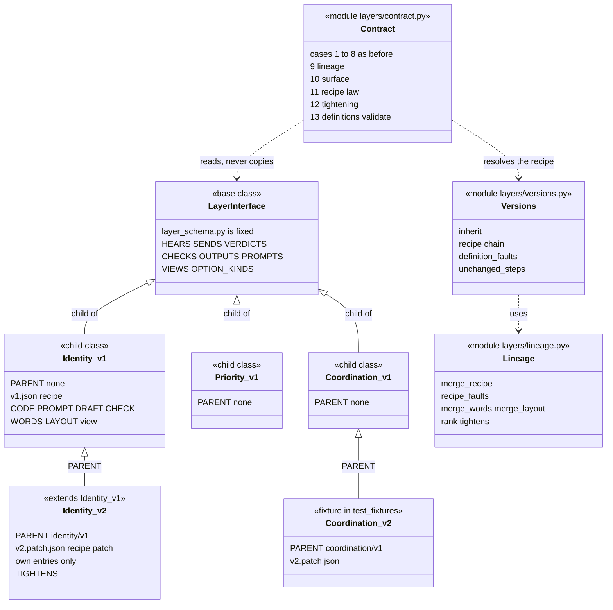
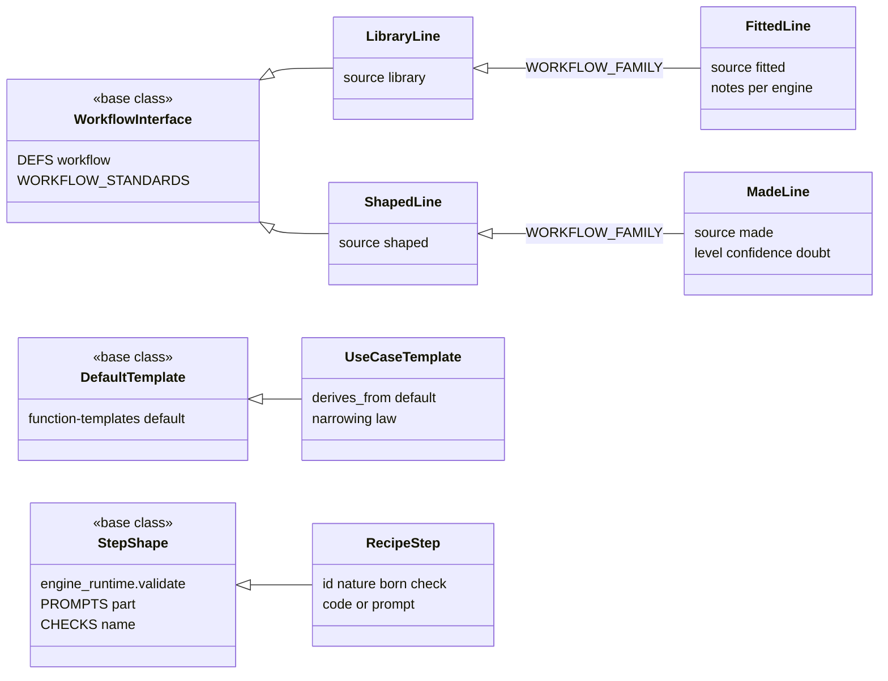
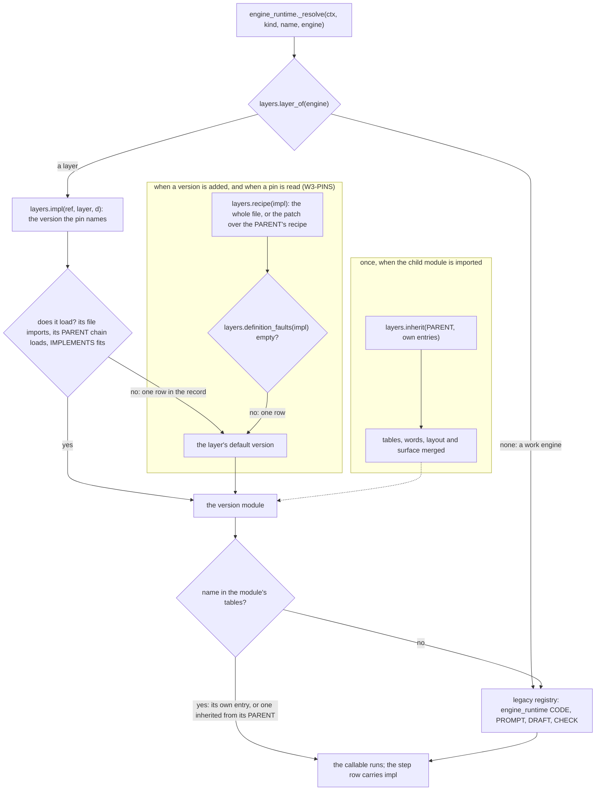

# PRD amendment A2: the class model of the interface layer

| Field | Value |
|---|---|
| **status** | Final, 2026-10-26: amendment A2 to [PRD-FIVE-FUNCTIONS.md](PRD-FIVE-FUNCTIONS.md) 1.1 and to [A1](PRD-FIVE-FUNCTIONS-A1.md), after one review (verdict approve-with-changes: 5 P1, 6 P2, 3 P3). Every P1 is fixed, and the P2s and P3s are taken as A2.13 says. A1 stands as written; A2.11 lists the only three places it is amended. Built, 2026-10-27 (W3-PROOF): function-prompts/ and its reader are deleted, and 37 dead copies leave engine_runtime's registries (165 entries to 128); the interface is frozen at schema version 1 (INTERFACE_SHA[1] = e23aeacef66e..., the sha256 of schemas/layers/interface.v1.json) and a key another layer owns is refused; the journeys' status lane reads 62 rows, 60 proven, 2 partly (J2.7 on BL-4b, J4.4 on BL-2b), 0 wanted, 0 faults (J1 16 proven; J2 15 proven, 1 partly; J3 18 proven; J4 11 proven, 1 partly). The proof run reads SM-1 0, SM-3 0, SM-4 0, SM-6 0, SM-13 0 on the scenario suite (212 departments, 97 tests in 4 lanes, models stubbed, C2, the interface in refuse mode), and SM-14 0 journey rows unproven. SM-6 is 0 by a ruling (W3-PROOF): 9 cycles stand unread for want of a live reader (no model in the stubbed suite, or the old sampler a test puts back), are listed in the report and not counted, and a live read decides; Identity files no ask for a cycle Audit could not read, which stays a product gap outside this build. The J2 prototype and the site are untouched; the nine live Beta runs, the Human Simulation walk and SM-5 on a Beta walk stay pending under C2. The owner has not shipped version 1 of any layer, so no `released/<layer>-v1` tag is made (A2-D7 builds no frozen manifest; a manifest of recipe hash and name set is a follow-up now that X1 has deleted the copies of moved bodies) |
| Direction | the owner, 2026-10-26: "Where in the PRD we have base class and child class ideation?" and "Since this is mostly interface and class ideation, it should be there.", the request to put the synonym words in the PRD and the shared page, "An interface is basically a template. So for each step, internally also there is a template / interface present", and that J1 to J4 are part of a template too (A2.0; the journeys and the template levels beyond the step are A3's) |
| Overrides | nothing. A2 amends A1.18 and A1.19 by one line each, and the W3-PINS package by the lines in A2.11. Every ruling, mark and default stands |
| Based on | sutra main `827fe38f` (M0 to M4; A1 wave 0, K1, Root and Coordination merged, and the rest of wave 1 merging one package at a time), the A1 document, and the J2 prototype `3d8d2e8`. Code is located by function name, never by line (decision C3). This document holds no per-layer counts: they are read from the interface |
| Build | two developer packages, about 105 minutes of work in all (A2.12): A2-LAW, new files only, merges any time; A2-INHERIT, merges between wave 2 and wave 3. No wave waits for A2, and A2 touches no file a wave-1 package owns |
| Decision log | the A2 rows of [PRD-FIVE-FUNCTIONS-DECISIONS.md](PRD-FIVE-FUNCTIONS-DECISIONS.md) |
| Pointer for code | `layers/lineage.py` (the law, A2-LAW), `layers/versions.py` (inherit and resolve, A2-INHERIT), `layers/contract.py` cases 9 to 13 |
| Amended by | [PRD-FIVE-FUNCTIONS-A3.md](PRD-FIVE-FUNCTIONS-A3.md), 2026-10-26: the levels beyond the layers (the step, the function template, the engine and artifact templates, the kind, the ask) and the user journey are built and numbered there (L0 to L6). A3 changes no rule of A2; the lines marked 'Amended by A3' are under A2.2, A2.9 and A2.15. Also [PRD-FIVE-FUNCTIONS-A4.md](PRD-FIVE-FUNCTIONS-A4.md), 2026-10-27: the owner's own models are a second base-and-child pair; A4 changes no rule of A2, and the lines marked 'Amended by A4' are under A2.2 and A2.7 |

## A2.0 The direction, and how this reads it

> "Where in the PRD we have base class and child class ideation?" ... "Since this is mostly interface and class ideation, it should be there."
>
> The owner then asked for the synonym words to be added to the PRD and to the shared page: base class (also parent class, superclass, abstract base) and child class (also subclass, derived class, implementation).
>
> "What is a template here:- Its the structured way of working anything. It basically means the interface base class implementation that we are doing. An interface is basically a template. So for each step, internally also there is a template / interface present, check and update the PRD for same as well."
>
> "J1, J2, J3, J4 are also part of another template. Add that as part of template implementation of user journey in this PRD. Update the PRD first and then later implement it."

The answer to the first question is that the idea was already in A1.0, under the names Interface and Implementation, and was never called by the names a programmer looks for. A2 gives it those names, makes it findable, and adds the one thing A1 left out: a version that extends an earlier version.

| # | Reading | Where it lands |
|---|---|---|
| 1 | The base class is the interface: `layer_schema.py`, fixed, never run by itself. A child class is an implementation: a layer version (`layers/identity/v1.py` with its `v1.json`). A1's Interface and Implementation columns are this pair. | A2.1, A2.2, the PRD glossary |
| 2 | A child may be extended in turn. A later version names the version it extends (`PARENT`), writes only what differs, and the contract proves it can stand where its parent stood. This is the owner's iterative change, made cheap and safe. | A2.4 to A2.7, `layers/lineage.py`, `layers/versions.py`, contract cases 9 to 13 |
| 3 | Workflows are a family under one base: a Library line, a fitted line (extends the Library line), a shaped line and a made line (extends the shaped line). | A2.8, `S.WORKFLOW_FAMILY` |
| 4 | A template is the interface at its level. The same base and child pair repeats at each level, down to the step. | A2.2, A2.9 |
| 5 | The owner also asked that J1, J2, J3 and J4 be part of a template (a user-journey template), with the PRD updated first and the build after. That, and the other templates in detail (function, engine, artifact, kind, ask), is amendment A3's. A2 gives them their place in the table of levels and the pattern they follow, and builds none of them. | A2.2, A2.9, A3 |

## A2.1 The words: a glossary for readers from other backgrounds

A reader who knows object-oriented programming, a type system, database schemas or plain contracts should find the same idea under their own word. The first two rows are the pair the owner named.

| Term | Also called | What it means in this system |
|---|---|---|
| **Base class** | parent class, superclass, abstract base | The fixed shape that others must satisfy, never run by itself. Here: the interface, `layer_schema.py`. At another level it is that level's template (A2.2). |
| **Child class** | subclass, derived class, implementation | A concrete thing written to satisfy a base, free to differ in how it works. Here: a layer version module, a workflow of one source, a use-case template. |
| **Interface** | template, contract, schema | Everything another layer, a screen, a test or the owner may rely on, written only in code. The owner's definition: a template is the structured way of working, and an interface is a template. |
| **Implementation** | child class | Everything inside a layer that produces what the interface promises. Free to change, version by version (A1.0). |
| **Version class** | version, implementation id | One implementation as the registry names it (`identity/v1`). It is a module with module-level names, not a Python `class` statement (A2-D1). The word class is the idea. |
| **PARENT** | extends, predecessor | The module attribute `PARENT = 'identity/v1'`: the version this version extends. Absent or None for a version that stands on the interface alone. |
| **Inheritance** | extending, reuse | A child takes what its parent has and writes only the difference. Here: `layers.inherit` for the four tables, the words, the layout and the surface functions; a patch for the recipe. |
| **Override** | replace, shadow | A child gives its own entry under a name it inherited (a body, a word, a step's code). The parent is not changed. |
| **Substitutability** | "stands where its parent stood" | Anything that works with the parent works with the child, without noticing. Contract cases 1 to 13 are its test. |
| **Variant** | specialisation | A version that only some departments pin. It is a version, pinned for those departments; there is no separate level of variant classes (A2-D8). |
| **Late binding** | virtual call, dynamic dispatch | A parent's code calling a helper that a child replaced. Not provided across versions (A2-D12). |
| **Recipe patch** | diff, delta | The difference between a child's recipe and its parent's, as keyed overlays and inserts (A2.5). |
| **Workflow classes** | source | The four sources of a workflow: library, fitted, shaped, made. Fitted extends library; made extends shaped (A2.8). |
| **Template classes** | | A function's Default template (the base) and a use-case template (its child, `derives_from`). Others are A3's (A2.9). |

**How the words are used in this PRD.** "Base class" always means the interface. "Parent" with no other word means `PARENT`, the version a version extends. The two meet without clashing: version 1 is a child of the interface, and version 2 is a child of version 1, which makes version 1 its parent and the interface its base. Where it could confuse, the text says "extends" or "predecessor" for a version, and "the interface" for the fixed contract.

## A2.2 The levels: the same pair at every level

Each row is a template (a base class) and what implements it (a child class). A3 numbers and details the rows that are not built here.

| Level | Base class (the interface or template; fixed) | Child class (the implementation) | The rule a child keeps | Held by | State |
|---|---|---|---|---|---|
| Layer | A layer's entries in `layer_schema.py`: HEARS, SENDS, VERDICTS, CHECKS, OUTPUTS, PROMPTS, VIEWS, OPTION_KINDS | A version module `layers/<layer>/v<N>.py` with its `v<N>.json` | Handles every HEARS row, returns every OUTPUTS key, passes its checks, compiles its words, publishes its view | contract cases 1 to 8 | built (A1) |
| Version | A version of a layer, for example `identity/v1` | The version that extends it, `identity/v2`, naming it in `PARENT` | Keeps every inherited name, every step id and handler, and what the steps fix; never drops a gate or a rule; the definitions still validate | contract cases 9 to 13, `layers/lineage.py` | A2 |
| Step | The step shape: what `engine_runtime.validate` demands of every step (id, name, nature, born, a check, code or a prompt with its draft and the shape of its answer; a unit starts and ends with a step by code), plus the step's prompt part (`S.PROMPTS`) and check name (`S.CHECKS`) | A step of a recipe | The same demands; on an inherited step the fixed fields are the parent's | `engine_runtime.validate` (case 13), `STEP_FIXED` | built; A2 names it, A3 types it |
| Workflow | `DEFS['workflow']` and `WORKFLOW_STANDARDS` (A1.14) | A source: library, fitted, shaped, made | A child source is held to every standard its parent source is | `S.validate_workflow`, a test over `S.WORKFLOW_FAMILY` | built (A1.14); A2 adds the family |
| Function template | A function's Default template (`function-templates/<fn>/default.json`) | A use-case template (`derives_from`) | Adds floor lines, keeps the Default's checks (the narrowing law) | `test_function_templates.py::test_narrowing_only` | built; A3 |
| Engine and artifact template | The Library's engine template (`engine.template`) and the Default artifact template | A born engine template (`made_by`), a typed artifact template | The template's shape; a check exists | `born_template`, `artifacts.faults` | built; A3 |
| Department kind | A kind in `engine_defs/website.json` (a department template, TPL-1) | A department made of the kind | The kind's line, required engines and function templates | `engine_runtime.validate` | built; A3 |
| User journey | A journey template | J1 to J4 (and the declared J5 to J7), each a child; a run of one is a child of that | A3 | A3 | A3 |

**The pattern that adds a level.** A level is added the same way each time, and this is what A3 builds on: (1) the base is a typed definition in the interface (a DEFS name and its tables, or a data schema); (2) its children are modules or data files that conform; (3) one sentence states what a child may do (add or tighten) and may not (drop or loosen); (4) one contract case or test enforces that sentence; (5) the child declares what it extends (`PARENT`, `derives_from`, `WORKFLOW_FAMILY`) so the sentence can be measured.

*Amended by A3 ([PRD-FIVE-FUNCTIONS-A3.md](PRD-FIVE-FUNCTIONS-A3.md), A3.1): the levels of the table are built and numbered there: the user journey L0, the department kind L1, the function L2, the engine and workflow L3, the step L4, the artifact L5, the ask L6. At L2 the base is the layer interface extended by `S.FUNCTION_TEMPLATE` and the typed `goal` parts, and its children are the versions (`PARENT`); the Default and use-case pair of this table is a separate data line, called by those names and never 'function template'. The user journey is held by `journeys/contract.py` cases JC-1 to JC-12.*

*Amended by A4 ([PRD-FIVE-FUNCTIONS-A4.md](PRD-FIVE-FUNCTIONS-A4.md), A4.4): the owner's own models are a second pair, in data: a core base (`OwnerRecord`, or a template that A4.5.7 names) and the children the owner makes, compiled to pydantic classes and held to the same sentence (add or tighten, never drop or loosen), checked on the classes themselves.*

## A2.3 The class diagram

The first diagram is the layer and its versions. The second is the other levels that are built today. Nothing in either is a runtime Python class: the arrows are the relations the rules in A2.7 hold.





## A2.4 A child version: what it writes and what it inherits

A new version is written in five moves:

1. Write `layers/<layer>/v<N>.py` with `LAYER`, `VERSION`, `IMPLEMENTS` (the schema version) and `PARENT = '<layer>/v<M>'` (a lower number of the same layer). Version 1 names none. A version above 1 must name one (A2-R1).
2. Call `layers.inherit(PARENT, code=..., prompt=..., draft=..., check=..., words=..., layout=...)` and assign the result to the module's own names. It returns the four registry tables, the words and the layout, merged (the parent's entries, then the child's over them), and the parent's surface functions.
3. Name the recipe: a patch beside the module (`RECIPE_PATCH = 'v2.patch.json'`, A2.5), a whole file (`RECIPE = 'v2.json'`, held to the same law), or nothing, which inherits the parent's recipe.
4. If the child replaces the code or the check of a gate or a rule, list it in `TIGHTENS` with the test that proves it (A2-R6).
5. Pass the contract: cases 1 to 13 run on it with no change to the test file.

| Thing | How a child gets it | What the child writes |
|---|---|---|
| CODE, PROMPT, DRAFT, CHECK | Per registry name: the child's entry replaces the parent's; a name the child does not mention is inherited, as the same callable (a `ref_to` delegate stays by reference). Nothing is removed. | Only the names it changes or adds. A name a new step uses must be a CHECK the interface lists (`S.CHECKS` or `S.SHARED_CHECKS`). |
| WORDS | Per (group, part, field): the child's value replaces; the other fields of the part are inherited. | Only the fields it changes. |
| LAYOUT | Per (group, part): the child's template replaces; a part whose words changed and whose layout did not keeps the parent's layout. | Only a layout it changes. |
| view, engine_card, apply_option, standards | The parent's, unless the child defines its own. | Only an override. |
| The recipe | A2.5. | A patch. |
| IMPLEMENTS, LAYER, VERSION | Declared by the child. | Three lines. |

The merge is made once, when the child module is imported, so the child's four tables are real dicts with a stable identity, like any module's (the registry and its tests read and patch them in place). A parent that does not load makes the child not load: `layers.load` returns None and the department runs the layer's default version, with one row (A1.18 rule 5).

## A2.5 The recipe: the parent's recipe plus a keyed patch

A child's recipe is resolved, never written out: `layers.recipe(impl_id)` returns the whole file if the version has one, else its `RECIPE_PATCH` merged over its `PARENT`'s resolved recipe, else its parent's. A patch is JSON, and holds only the difference:

```json
{"parent": "coordination/v1",
 "set": {"description": "..."},
 "on": [{"when": {"msg_type": "inform", "word": "born"},
         "steps": [{"id": "coord.probe", "name": "Probe", "nature": "transform", "born": "C2",
                    "code": "coord_probe", "check": "said_what_it_did", "after": "coord.table"},
                   {"id": "coord.table", "name": "Write the table, version 2"}]}]}
```

The merge, exactly (`layers.lineage.merge_recipe`, a pure function; a malformed patch is a `ModelFault`):

- **Keys.** A patch holds only `parent` (which must equal the version's `PARENT`), `set`, `gates`, `rules`, `steps` and `on`. `set` may change `description` and `skills`, and nothing else: the start, the template and what an engine reads are fixed.
- **Keyed by id.** In `gates`, `rules`, `steps` and in a handler's `steps`, an item whose id exists overlays that step in place; an item whose id is new is inserted `after` or `before` a step of the same list, or appended. There is no way to drop a step (A2-D3): removing behaviour takes a replacement body, not a deletion.
- **Handlers** are named by their `when` (msg_type, and word or any), the same pair the contract uses for HEARS. A patch carries `when` and `steps` for a handler the parent has; it cannot add a handler, because the parent already hears every HEARS row (A2-R4).
- **Two lists of step fields**, and a field in neither is refused. *Fixed* on an inherited step (a patch must leave it as the parent has it; `out` may gain keys, but every enum keeps exactly the parent's values): `nature`, `check`, `answer`, `out`, `or`, `only_if`, `stringency`, `each`, `files`, `by_hand`. *Free*: `name`, `born`, `code`, `prompt`, `draft`, `ceiling`, `facts`, `tools`, `timeout_s`, `below`. Changing what a step is for, how it is judged or when it runs is a new step, not an overlay.
- **A new step carries what the definitions require**: id, name, nature (one of the engine's natures), born (a rung), a check, and either code or a prompt with its draft and the shape of its answer.

**Two laws judge a recipe, one after the other.** `lineage.recipe_faults(parent, child, layer)` is the substitutability law: the handlers are the parent's, every parent step is still there, the fixed fields hold, the gates and rules are all there, ids are unique, no `only_if` points at a missing step. It cannot see the runtime's own rules. Checked on main with a reference sketch: a soft step inserted before the first step of a handler, or after the last, passes `recipe_faults` and makes `engine_runtime.defs()` raise 'the engine definitions are refused', because a unit starts and ends with a step by code; so does a new id another layer uses. That is the second law, `layers.definition_faults(impl_id)`: it puts the child's resolved recipe in its layer's place in the assembled definitions and runs `engine_runtime.validate`, the same function `defs()` raises on. It is contract case 13 for every version, and W3-PINS runs it again when a pin is read, so a bad pin falls back to the default with one row instead of taking every department down.

## A2.6 Resolution: nothing in the seam changes



`layers.resolve`, `names`, `call`, `view`, `impl`, `load` and `pins` are unchanged. A child's chain is flattened into the module's own tables at import, so the registry reads a child as it reads any module. `recipes()`, which assembles the default pins' recipes for `defs()`, asks `layers.recipe` when a default pin is a version with a patch and no whole file; for a whole file it reads it as before (and the missing-recipe refusal `test_s7` pins is unchanged). `functions_view._j2_part` dispatches to the pinned version's `view` and guards re-entry (`_VIEWING`, with today's body in `_j2_body`, K2); a child inherits its parent's view, so it is reached the same way.

## A2.7 The rules a child keeps, and what enforces each

| Id | Rule | Enforced by |
|---|---|---|
| A2-R1 | **Lineage.** A version above 1 names the version it extends in `PARENT`: the same layer's, a lower number, one only; it loads, the chain is at most 8 deep with no repeat. Version 1 names none. | case 9 |
| A2-R2 | **Inheritance.** A child holds every entry of its parent's four tables, every part of its parent's words and layout, and every surface function the parent publishes (view, engine_card, apply_option, standards). It adds and replaces; it removes nothing. | cases 9 and 10 |
| A2-R3 | **Same schema.** IMPLEMENTS is the schema version, on the child and on every ancestor. | case 1, `layers.load`; case 9 for the ancestors |
| A2-R4 | **Handlers.** The resolved recipe handles every HEARS row of the layer and no other. A child adds no handler: a new row is an 'A1 interface:' commit that gives the parent its handler first. | cases 2 and 11 |
| A2-R5 | **Steps.** A child keeps every step id of its parent. On an inherited step the fixed fields are the parent's (A2.5); the free fields may change. A new step carries what the definitions require. Ids are unique and no `only_if` points at a missing step. | the patch merge (a `ModelFault`) and case 11, which also judges a whole-file child |
| A2-R6 | **Gates and rules.** Never dropped. A gate or rule whose code or check entry the child replaces is listed in `TIGHTENS` as `{step id: 'test_file.py::test_name'}`, and that test shows the replacement lets through nothing the parent held back (for a gate that answers admit, wait or refuse, `lineage.tightens` ranks admit below wait below refuse). | case 12 checks the declaration and that the named test exists; the test itself proves it |
| A2-R7 | **Outputs and checks.** Every OUTPUTS step is still there and returns its keys; every check the recipe names is the layer's or shared, and those with samples judge them as before. | cases 8 and 4, on the resolved recipe and the merged tables |
| A2-R8 | **Words.** Words merge by field and layout by part; every part of the merged words passes its field types and compiles. | case 5, on the merged words |
| A2-R9 | **The definitions validate.** With the child's resolved recipe in its layer's place, `engine_runtime.validate` finds nothing. | case 13; and at pin time (W3-PINS) |
| A2-R10 | **The carrier.** A version is a dict-form module `layers/<layer>/v<N>.py`, VERSION the file's number; nothing in `layers/` imports the runtime at import time; its four tables are real dicts. | case 1, `test_s7`, an AST test in `test_layer_inherit.py` |
| A2-R11 | **Workflows.** A child source is held to every standard its parent source is. A fitted line is an in-order subsequence of the kind's line that holds every required engine; every key of `fit` is an engine of the line; every note is at most 300 characters. Every workflow of every source is checked through `S.validate_workflow`, and nothing else calls `workflow_schema.run`. | a family test and an AST test in `test_layer_inherit.py`; `line_is_fitted` (W2-ADAPT) for the fitted line |
| A2-R12 | **Templates.** A use-case template derives from its function's Default in one level, adds floor lines and keeps the Default's checks. | `test_function_templates.py::test_narrowing_only` (built) |

The contract's new cases return [] for a version with no parent where they have nothing to compare (all six v1 modules pass them unchanged), never raise on a stub, and name the impl id and the row in every fault, as cases 1 to 8 do. Case 9 is the only one that requires a `PARENT` of a version above 1; without it a whole-file v2 would escape the step law.

*Amended by A4 ([PRD-FIVE-FUNCTIONS-A4.md](PRD-FIVE-FUNCTIONS-A4.md), A4.4.2): rules R1 to R3 and R10 of A4 are A2-R2's sentence checked on classes, for the versions of a model, where `parent` names the previous version as `PARENT` does here.*

## A2.8 The workflow classes

The base class is the workflow interface: `DEFS['workflow']`, `DEFS['workflow.engine']`, `DEFS['workflow.registration']` and `WORKFLOW_STANDARDS` in `layer_schema.py` (A1.14). A workflow's source is its class.

| Source (class) | Extends | What it adds | Made by | Held to |
|---|---|---|---|---|
| library | the interface | nothing: the kind's line as the Library brings it | `W.create`, `setup_make`; a grown line, `W.add_engine` | every standard that lists 'library' |
| fitted | library | a note per engine (`fit`); it may leave out engines the kind does not require, in order | Adaptation's `adapt.fit` (M5.2, W2-ADAPT) | everything library is, and `line_is_fitted` (Adaptation's covering) |
| shaped | the interface | engines new to the Library, each born as a template | `adapt.line`, `adapt_line_offer` | every standard that lists 'shaped' |
| made | shaped | level, confidence and doubt per engine | the make module (M6, `J2_ADAPT_MAKE`) | everything shaped is |

The family is written once in the interface, as `S.WORKFLOW_FAMILY` (child source to parent source; None for a source that extends the interface directly), and one test over `WORKFLOW_STANDARDS` proves rule A2-R11's first sentence: a standard that lists the parent also lists the child. Today it holds (engines_known lists library and fitted; each_engine_named and names_new list shaped and made; the rest list every source).

**The fitted line is M5.2's, not 'the same as the Library line'.** M5.2 says Adaptation may drop engines that are not required. So a fitted line is valid when its names are an in-order subsequence of the kind's line that holds every required engine; it is invalid if it adds an engine outside the line, reorders, drops a required engine, notes an engine that is not in the line, or carries a note over 300 characters. `line_is_fitted`, Adaptation's covering check, enforces that, and A2 does not restate it in a second place.

**One entry, no bypass.** `S.validate_workflow(wf, stage, dept, ctx)` is what birth, proposal, registration, grow and write already call (A1.14). One caller stood outside it: `engine_runtime._line_notes` calls `workflow_schema.run` directly to read the proposal-stage rows of a line that has no department behind it. A2-INHERIT points it at `S.validate_workflow(wf, 'proposal', None, {})` (the `LINE_STANDARDS` filter already drops the shape row, so the result is the same) and adds an AST test that finds no other call of `workflow_schema.run` or reference to `STANDARD_CHECKS` outside `workflow_schema.py`, `layer_schema.py` and the tests.

**Not built, on purpose.** No `workflow_model.py` and no Python class per source. The data already carries what a class would: the source enum, the limits on `fit`, `level`, `confidence` and `doubt` in `DEFS`, the applicability of each standard in `WORKFLOW_STANDARDS`, and the check bodies in `workflow_schema.py` (W2-CHECKS' file). A class family on top would restate all of it, and the interface file would then delegate to an implementation module.

## A2.9 How templates fit

- **A template is the interface at its level** (the owner's definition). So each row of A2.2 is a template, and what implements it is a child. The layer's interface is one; the step shape is another (its rules are `engine_runtime.validate`'s: A2 names them and case 13 reuses them, and A3 may type them as `DEFS['step']`); a function's Default template is another.
- **Built today, unchanged by A2.** A function's use-case templates (`function-templates/<fn>/*.json`, thirteen keys each) are children of the function's Default, held by the narrowing law in `test_narrowing_only`. A1.22 keeps them as the owner-pickable use cases of a function's card; they never define a verdict, a check or a slot. The engine templates (the Library's, and the ones Adaptation births, tagged `made_by`) and the Default artifact template are children of their bases in the same way. A kind in `engine_defs/website.json` is a department template (TPL-1).
- **Goals.** A template holds things like goals. Today a function's own goal sits in several places that A3 folds into the function's template: the recipe's `description` and `skills`, the typed words `goal.does` and `goal.skills`, the interface's one-line description of the layer, and the floor lines of its use-case templates. A department's goal is a different thing (`dept.goal`, and `kinds[k].goal` as its template). A2 only fixes that the function's template is a base at its level.
- **What A3 builds on, from A2:** the pair and its pattern (A2.2), the names in A2.15, the rule that a level states one sentence and has one case, and `PARENT` as the declared link. A3 owns the details of the function, engine, artifact, kind and ask levels and the journey level J1 to J4. *Amended by A3: A3 built them, A3.1 to A3.8.*

## A2.10 Migration and the strangler

Nothing is converted. The six dict-form v1 modules that wave 1 merges are the final form, and they stay so: a child takes their tables with `layers.inherit`, and a `ref_to` entry is inherited as a `ref_to` entry, so a body that still lives in `engine_runtime` is reached by the child through the same late-bound delegate.

| When | Who | What |
|---|---|---|
| Now (wave 1 merging) | nobody, then A2-LAW | No wave-1 file changes. A2-LAW is built from main and merges whenever the gate is green: it adds new files only. |
| Wave 2 | the four layer packages (Priority, Identity, Checks, Adaptation) | They keep the shared rules of A2.12 and add to v1 (v1 is not frozen until the owner ships, A1.18 rule 3). The screens and proof packages touch no layer module. Nothing waits for A2. |
| Between wave 2 and wave 3 | A2-INHERIT | It merges: the registry helpers, contract cases 9 to 13, the fixture child, the workflow family and the one-entry fix. |
| Wave 3 | W3-PINS, W3-PROOF | W3-PINS assembles recipes with `layers.recipe`, checks a pin with `layers.definition_faults`, carries a learned rung over with `layers.unchanged_steps`, and reuses A2-INHERIT's fixture child. W3-PROOF treats a legacy body as live while any discovered version's table reaches it. |
| The first real v2 | whoever needs it | A child (a patch, `inherit`, tests), judged by the contract. No v2 is planned or shipped by A2. |
| Release | the integrator | A released version is marked by a local git tag, `released/<layer>-v<N>`; the wave packages check for it before they edit a version. No manifest is built (A2-D7). |

## A2.11 How A1 and the packages are amended

| Where | What changes | How it is marked |
|---|---|---|
| A1 header | A row 'Amended by' pointing here. | one table row |
| A1.18 | A module may carry `PARENT` and `RECIPE_PATCH`; `layers.inherit`, `layers.recipe`, `layers.chain`, `layers.definition_faults` and `layers.unchanged_steps` join the registry; `recipes()` asks `layers.recipe` for a default pin that has a patch and no whole file; 'write identity/v2 beside v1' reads 'write identity/v2 as a child of v1'; the contract of A1.21 gains cases 9 to 13. Rule 3 (a released version is frozen) stays a review rule: no manifest is built. | one 'Amended by A2' line under A1.18 |
| A1.19 | The seam is unchanged. `defs()` assembles recipes through `recipes()`, which now resolves a patch; `validate()` is the definition law that case 13 reuses. | one 'Amended by A2' line under A1.19 |
| A1.14 | The workflow family and the one entry (A2.8). | A2 only; A1.14's table stands |
| W3-PINS | N1 uses `layers.recipe`; N2 and N4 add the definition check and the 'parent does not load' case; N3 carries a rung over for a step the child inherits unchanged; the stub child is A2-INHERIT's fixture. | the spec file, 'A2 adjustment' |
| W2-PRIORITY, W2-IDENTITY, W2-CHECKS, W2-ADAPT, W3-BOARD | The shared rules of A2.12 (keep step ids, handler keys and registry names; no v2.py; v1 stays dict-form); W2-ADAPT also states the fitted line as A2.8 does, and W2-CHECKS keeps `workflow_schema.run`'s signature. | the spec files, 'A2 adjustment' |
| W3-PROOF | X1 counts a body as dead only if no discovered version's table reaches it. | the spec file, 'A2 adjustment' |
| W1-CORE | Nothing. K1 is merged and K2's re-entry guard is built as it is. | none |

## A2.12 The packages and where they run

| Package | What it builds | Files (all new unless named) | Build | Merge | Time |
|---|---|---|---|---|---|
| **A2-LAW** | The law as pure functions: words and layout merge, recipe patch merge, `recipe_faults` with the fixed and free lists, gate ranking and `tightens` | `layers/lineage.py`, `test_layer_lineage.py`, `test_fixtures/lineage/` | now, off main, alongside wave 1 | any time on a green gate: it touches no file another package owns | about 40 min |
| **A2-INHERIT** | `layers.inherit`, `layers.recipe`, `chain`, `definition_faults`, `unchanged_steps`; contract cases 9 to 13; the fixture child end to end; `S.WORKFLOW_FAMILY` and the one-entry fix | `layers/versions.py`, `test_layer_inherit.py`, `test_fixtures/layers_lineage/`; edits to `layers/__init__.py` (five wrappers and the body of `recipes()`), `layers/contract.py`, `layer_schema.py` (the family constant, additive), `engine_runtime.py` (`_line_notes`, and an optional `provided` argument of `validate`) | against A2-LAW's names, alongside wave 2 | after the last wave-2 package and before W3-PINS starts | about 65 min |

**No wave waits for A2.** Wave 2 does not depend on either package, and A2-INHERIT's shared-file edits are small and sit between the waves, where no other package is editing `layers/__init__.py` or `layers/contract.py`. W3-PINS and W3-PROOF build on A2-INHERIT and are the only ones that wait.

**The shared rules for the wave packages** (appended to W2-PRIORITY, W2-IDENTITY, W2-CHECKS, W2-ADAPT and W3-BOARD as 'A2 adjustment'). They keep a child written against today's v1 valid, and cost nothing:
1. Keep every step id and every handler key (msg_type, word) of your `v1.json`; a new step gets a new id.
2. Keep registry names stable: a name you add to CODE, PROMPT, DRAFT or CHECK is what a child will inherit, spelled so.
3. Keep v1 dict-form. Do not import `layers.lineage` or `layers.versions` in a v1 module, and do not turn it into a Python class.
4. Add no `layers/<layer>/v2.py` (`test_every_layer_has_its_version_1_on_disk`). The fixture child lives under `test_fixtures/layers_lineage/`.
5. A handler you add to v1 comes with its HEARS row, in the same commit, so the parent's handlers stay equal to the interface's.
6. A step field the recipes do not use yet is a decision for the law: A2-LAW's classification test names it, and a line in `layers/lineage.py` makes it fixed or free.
7. v1 is not frozen until the owner ships; if the integrator has tagged a layer's v1 `released/<layer>-v1`, a change to it is a child, not an edit.

## A2.13 How the review was resolved

| Finding | Resolution |
|---|---|
| P1 The runtime class machinery (LayerBase, six bases, adopt, publish, a CLI) is not needed; the plan is one small package | Re-scoped. The class model is vocabulary, two diagrams and rules (A2.1 to A2.3, A2.7). What a v2 needs is pure functions plus `PARENT` and a small `inherit`. LayerBase, the six layer bases, adopt, publish, `describe` and the CLI are not built until a child needs late binding (A2-D1, A2-D12). Two packages, one of them new files only (A2.12). |
| P1 The recipe law is not the runtime's definition law, so a child can pass the cases and still make `defs()` raise | Case 13 and `layers.definition_faults` run `engine_runtime.validate` with the child in place; `merge_recipe` requires of a new step what `validate` requires; W3-PINS runs the same check at pin time (A2.5, A2-R9). Verified on main with a reference sketch: the soft step before or after a unit and a clashing id pass `recipe_faults` and fail the definitions. |
| P1 FittedWorkflow contradicts M5.2 | The fitted line is stated as M5.2 states it (A2.8, A2-R11). The invariant stays in `line_is_fitted`. The W2-ADAPT adjustment no longer says a dropped Library engine fails. |
| P1 The K2 premise is stale | The W1-CORE adjustment and its decision are deleted. K2's guard (`_VIEWING`, `_j2_body`) is referenced where views are described (A2.6). The baseline is current main. No per-layer count appears in this document. |
| P1 The owner's synonym words are missing and the vocabulary collides | A2.1 is the glossary, repeated in the PRD's glossary. The base class is the interface; PARENT is a version's predecessor; the text says 'extends' where 'parent' could confuse. The Python sketches stay in the developer specs. |
| P2 The workflow class family duplicates `validate_workflow` and the schema | No `workflow_model.py`, no Python class per source, no 'one constructor' claim. The family is one constant in the interface plus one test; the one real change is `_line_notes` through `S.validate_workflow` and an AST test (A2.8). |
| P2 'Tighten, never loosen' cannot be ranked for every rule | Gates that answer admit, wait or refuse are ranked; every replacement is declared in `TIGHTENS` with a named test, and case 12 checks the declaration and the test's existence (A2-R6). The proof is the author's test and is a review item (A2.15). |
| P2 The step law leaves levers free and tombstones have no user | Two explicit lists, fixed and free, and a field in neither is refused; `set` is limited to description and skills; no drop in the first cut (A2.5, A2-D3). |
| P2 The frozen manifest gives false assurance | Not built. By-reference bodies are not frozen by a recipe hash until X1, and a words hash is stricter than A1.18 rule 3 (A2-D7). |
| P2 Package order, coupling and overlap | A2-LAW is new files only; A2-INHERIT merges between waves 2 and 3; the eight wave adjustments become one shared-rules paragraph plus three real ones (W3-PINS, W3-PROOF, W2-ADAPT's fitted line). The template law and its class (the draft's A2.9) move to A3. |
| P2 A template or interface per step is not modelled | The Step row in A2.2: its base is what `engine_runtime.validate` demands plus the step's prompt part and check; case 13 reuses it; A3 may type it. |
| P3 Substitutability only holds for a declared parent | Case 9 requires a `PARENT` of every version above 1 (A2-R1). |
| P3 Shim edges and naming traps | No adoption, so no shim: cases are tolerant of stubs and never raise; the fixture is registered in `layers._LOADED` and loaded under its module name; per-version KINDS is dropped (A2-D8). |
| P3 Document hygiene | One A2 document; A1 is touched in three places only (a header row and one line under A1.18 and under A1.19); the PRD gets a note, M2.12, a component row and the glossary terms; the Python sketches stay in the developer specs; the decision count here is the count in the log; the learned-rung default is explicit (A2-D13). |

## A2.14 Decisions

| Id | Decision | Reason | Consequence |
|---|---|---|---|
| A2-D1 | The class model is the reading of the code (A2.1 to A2.3) plus rules and checks. The base class is the interface; the child class is the implementation. A version stays a dict-form module; no `LayerBase`, no six layer bases, no `adopt`, `publish` or CLI. | Everything a v2 needs is pure functions over dicts plus a `PARENT` string; a base class would hold only `LAYER = x`. The owner asked for the idea to be findable, and it now is. | Less to build and nothing in flight is touched; a layer is converted to a Python class only on touch, by a package that needs late binding (A2-D12). |
| A2-D2 | A version names the version it extends in `PARENT` and writes only what differs, through `layers.inherit`. Every version above 1 names a parent. | The owner's iterative change; case 9 can measure a child only against a declared parent. | A bad child is caught by the contract; a parent that does not load makes the child not load and the pin falls back. |
| A2-D3 | A child's recipe is a whole file or a keyed patch over its parent's, resolved by `layers.recipe` and never written to disk. A patch overlays and inserts; it cannot drop a step, add a handler, or set anything but description and skills. Step fields are two explicit lists, fixed and free. | Precise enough to code, small enough to prove, and it holds for the real recipes (checked). | Large changes ship as a whole file, held to the same law. Removing behaviour takes a replacement body. |
| A2-D4 | Two laws judge a recipe: `lineage.recipe_faults` (child against parent) and `layers.definition_faults` (the runtime's own `validate` with the child in place), the second as case 13 and again at pin time. | The first cannot see the unit-shape rule or an id used by another layer; a miss would take every department down when the child is the default. | A bad pin falls back to the default with one row. |
| A2-D5 | Gates and rules are never dropped. A replacement is declared in `TIGHTENS` with the test that proves it; `lineage.tightens` ranks admit, wait, refuse. | A body's behaviour cannot be proved structurally, and the interface has no gate samples. | The author's test is the proof; case 12 forces the declaration and the test to exist. |
| A2-D6 | Words merge by field and layout by part. | A v2 that changes one prompt part must not copy every part. | Case 5 on the merged words is the whole check. |
| A2-D7 | No frozen manifest is built. A1.18 rule 3 stays a review rule, and the integrator marks a release with a local git tag `released/<layer>-v<N>`. | A recipe hash would give false assurance while bodies are by reference; the words hash is stricter than rule 3. A default: the owner may ask for it at the end of wave 3. | After W3-PROOF X1, a manifest (recipe hash and name set) can be added without changing a child. |
| A2-D8 | No variant level and no per-version KINDS. A variant is a version pinned for some departments. A kind defaulting a whole pin set is not built (a default: pins stay per department). | The kinds differ in data, not in layer behaviour; no version needs a kind. | W3-PINS stays as specified; the question can be reopened by the owner. |
| A2-D9 | The workflow family is two relations in the interface (`S.WORKFLOW_FAMILY`): fitted extends library, made extends shaped. A child source keeps its parent's standards. The fitted line's invariant stays M5.2's, in `line_is_fitted`. | The data already carries the classes; a Python family would restate it. | One constant, one test. |
| A2-D10 | One entry for the standards: `S.validate_workflow`. `_line_notes` moves onto it, and an AST test forbids a direct `workflow_schema.run`. | The one real bypass; the claim 'one constructor' was false and is not made. | W2-CHECKS keeps `workflow_schema.run`'s signature. |
| A2-D11 | The step is a level, named in the table (its base is `engine_runtime.validate`'s rules). The other template levels and the journeys J1 to J4 are A3's. | The owner's 'each step has a template' is met by naming what exists; typing the rest is a separate amendment. | A3 builds on the pair, the pattern and the names in A2.15. |
| A2-D12 | Late binding across versions is not provided. A child that needs another helper overrides the bodies that call it; a layer that needs more is converted to a class on touch. | The alternative is rewriting every wave-1 module, and nothing needs it yet. | The first such child decides whether a layer converts. |
| A2-D13 | A learned rung carries over to a child for a step it inherits unchanged (`layers.unchanged_steps`), read through from its parent's ladder key and never written there. | Otherwise every version bump resets every step to its born rung. A default: the owner may ask for a reset on every bump. | W3-PINS N3 reads the parent's key when the child has none for such a step. |
| A2-D14 | Root keeps the Library's Setup as its recipe. A Root child changes bodies, words, `standards()` and `apply_option`, not steps. | The Library holds one Setup; moving Root's steps is outside A2. | A root/v2 with other steps waits for a second Library template. |
| A2-D15 | 'Base class' always means the interface; `PARENT` is 'extends' or 'predecessor' in prose. The glossary is in A2.1 and in the PRD's glossary. | The owner's glossary makes the interface the base; a version's predecessor is a different relation. | One table to copy to the shared page. |
| A2-D16 | A2-LAW merges any time; A2-INHERIT merges between wave 2 and wave 3; no wave waits for A2. | The review: serial gated merges in front of wave 2 for no use. | Only W3-PINS and W3-PROOF depend on A2-INHERIT. |

## A2.15 Risks, and what A2 does not build

**Names A3 builds on.** Base classes: the interface (`layer_schema.py`: `S.LAYERS`, `S.HEARS`, `S.VERDICTS`, `S.CHECKS`, `S.OUTPUTS`, `S.PROMPTS`, `S.VIEWS`, `S.OPTION_KINDS`), the workflow interface (`DEFS['workflow']`, `S.WORKFLOW_STANDARDS`), the step shape (`engine_runtime.validate`), a function's Default template. Child classes: a version module `layers/<layer>/v<N>.py` with `PARENT`; a workflow source (`S.SOURCES`, `S.WORKFLOW_FAMILY`); a use-case template (`derives_from`). Functions: `layers.inherit`, `layers.recipe`, `layers.chain`, `layers.definition_faults`, `layers.unchanged_steps`, `layers.load`, `layers.resolve`, `layers.call`, `layers.view`, `S.validate_workflow`; in `layers/lineage.py`: `merge_recipe`, `recipe_faults`, `merge_words`, `merge_layout`, `rank`, `tightens`, `ModelFault`, `STEP_FIXED`, `STEP_FREE`; the contract cases 9 to 13.

| Risk | Mitigation |
|---|---|
| The proof that a gate or rule was not loosened is the child author's test. | Case 12 forces the declaration and checks the named test exists; the first real gate override is a review item and must show fixtures from `contract.fixture_department`. Gate samples in the interface would be an 'A1 interface:' change, not proposed. |
| The merged tables are a snapshot taken when the child imports; a test that patches the parent's dict afterwards is not seen by the child. | Production never patches; the child's own tables are live, so `monkeypatch.setitem` on them steers `layers.resolve`. |
| Late binding across versions is not provided (A2-D12). | The first child that must change a helper used by several parent bodies overrides each body, or its layer is converted to a class on touch. |
| The fixed and free lists are the law's whole vocabulary; a package may add a step field (as `or` was added). | A2-LAW's classification test goes red until the field is classified, by design, and the wave packages are told (A2.12 rule 6). |
| A rung carries over by comparing the callable an entry holds (the same object, or a `ref_to` with the same target); a child that replaces a body or wraps it counts as changed. | The safe direction: when in doubt the step resets to its born rung. |
| No frozen manifest. A released version is protected by A1.18 rule 3 and review. | Revisit after W3-PROOF X1 (A2-D7). |
| Patch merging expresses overlay and insert only. | A large change ships as a whole file, held to the same law. |
| A2-INHERIT edits `layers/__init__.py`, `layers/contract.py`, `layer_schema.py` (one constant), and in `engine_runtime.py` `_line_notes` and the signature of `validate`, all shared with wave 3. | It merges between the waves; W3-PINS and W3-PROOF are written against it. |
| The shared page (the artifact) is owned elsewhere and must take the glossary from the PRD. | The glossary text is final in A2.1 and in the PRD's section 16. |

**Not built:** `LayerBase` and the six layer bases, `adopt`, `publish`, a CLI (`--list`, `--show`, `--freeze`); a frozen manifest; variant classes and per-version KINDS; a kind that defaults a pin set; `workflow_model.py` and Python workflow classes; template classes and the template rule language (A3); *(Amended by A3: built by A3, A3.1 to A3.8.)* tombstones (a `drop` list); late binding across versions; any real `v2`.

## A2.16 Files

| Path (under marketplace/plugin/sutra-ui) | Package | Holds |
|---|---|---|
| `layers/lineage.py` | A2-LAW | `ModelFault`, `merge_recipe`, `recipe_faults`, `merge_words`, `merge_layout`, `rank`, `tightens`, and the lists `STEP_FIXED`, `STEP_FREE`, `TOP_SET`, `PATCH_KEYS`, `GATE_ORDER` |
| `layers/versions.py` | A2-INHERIT | `inherit`, `chain`, `recipe_of_module`, `recipe`, `definition_faults`, `unchanged_steps`, `SURFACE` |
| `layers/__init__.py` | A2-INHERIT | Five thin wrappers (`inherit`, `recipe`, `chain`, `definition_faults`, `unchanged_steps`, lazy calls like `prompt` and `words`), and `recipes()` asking `recipe` for a patch child |
| `layers/contract.py` | A2-INHERIT | `recipe_of` through the patch; cases 9 to 13 |
| `layer_schema.py` | A2-INHERIT | `WORKFLOW_FAMILY` (an additive 'A1 interface:' commit; the generated files regenerated) |
| `engine_runtime.py` | A2-INHERIT | `_line_notes`; `validate` gains an optional `provided` argument (names a version outside `layers/` brings, for the contract's fixtures) |
| `test_layer_lineage.py`, `test_fixtures/lineage/` | A2-LAW | The law's tests and the patch fixtures |
| `test_layer_inherit.py`, `test_fixtures/layers_lineage/coordination/v2.py`, `v2.patch.json` | A2-INHERIT | The registry, contract, fixture-child, workflow-family and no-bypass tests; the fixture child of `coordination/v1` |
