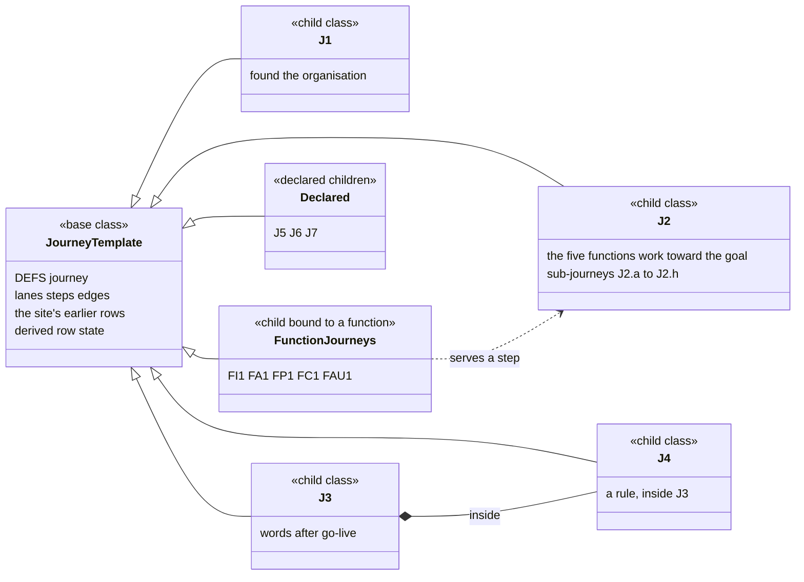
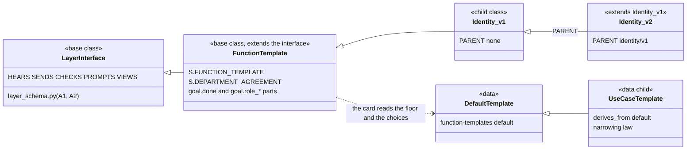
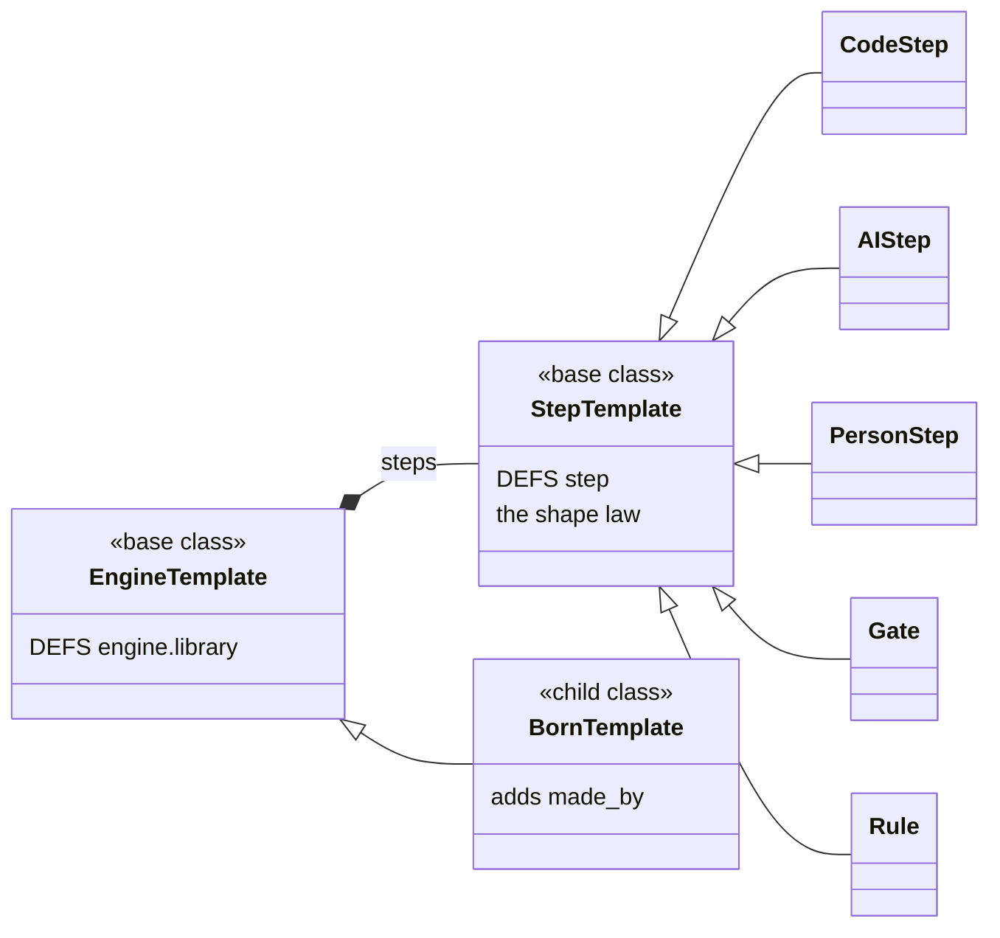

# PRD amendment A3: a template at every level, and the user-journey template

| Field | Value |
|---|---|
| **status** | Final, 2026-10-26: amendment A3 to [PRD-FIVE-FUNCTIONS.md](PRD-FIVE-FUNCTIONS.md) 1.1, to [A1](PRD-FIVE-FUNCTIONS-A1.md) and to [A2](PRD-FIVE-FUNCTIONS-A2.md), after one review (verdict approve-with-changes: 1 P1, 9 P2, 7 P3). The P1 and every P2 are fixed, and the P3s are taken as A3.13 says. A1 and A2 stand as written; A3.11 lists the only places they are touched, each by one line |
| Direction | the owner, 2026-10-22 to 2026-10-26, in three directions (quoted in A3.0): the prototype's five function templates, with their goals, are to be analysed, written into the PRD and then built; a template is the interface, the base class and its implementation, and every step has one; J1, J2, J3 and J4 are part of another template, the user journey, to be written into the PRD first and built after, and verified |
| Overrides | nothing. A3 adds levels and cases to the pattern A2 named (A2.2) and builds no new mechanism. It amends the three places A3.11 lists in A1 and A2 by one line each, and adds a milestone (M11), a subsection (M2.13) and a section (9.5) to the PRD. Every ruling, mark and default stands |
| Based on | sutra main `a660b5a2` (M0 to M4; A1 wave 0 and wave 1 merged, core-k2 included; the UI port merging), the A1 and A2 documents (A2 is committed as `f81e8b88`; its packages are not built yet), the site's department page (`journeys.json` 2.4, saved in full) and five function pages (`functions.json` 1.5), and the J2 prototype `f9ceba1`. Code is located by function name, never by line (decision C3). Counts are read from the interface and the data on the day they are used; the ones stated here (93 steps, 62 rows of J1 to J4) were run on the main above, and the 99 existing tests the four journeys list were run on it and pass |
| Build | five developer packages, about 8 hours of work in all (A3.12): A3-CORE (types, merges first), A3-JOURNEYS (the machinery), A3-FUNCTIONS (the function template, after wave 2), A3-J12 and A3-J34 (the journeys). Nothing in wave 2 waits for A3; W3-PINS and W3-PROOF X2 wait for the packages A3.12 names |
| Decision log | the A3 rows of [PRD-FIVE-FUNCTIONS-DECISIONS.md](PRD-FIVE-FUNCTIONS-DECISIONS.md) |
| Pointer for code | `layer_schema.py` (its A3 section: the step, kind, engine, artifact and journey definitions, the function template's constants), `template_checks.py`, `journeys/` (the loader, the cases, the state, the walk helper, the data), `qa/journey_status.py`, `layers/contract.py` case 14 |
| Amended by | nothing yet |

## A3 at a glance

| Question | Answer |
|---|---|
| What is a template? | The owner's word: the structured way of working anything, which is the interface, the base class that implementations fill in. A3 says it at seven levels: the user journey (L0), the department kind (L1), the function (L2), the engine and workflow (L3), the step (L4), the artifact (L5) and the ask (L6) (A3.1). |
| What is built, what is new? | Levels L1, L3, L5 and L6 exist as data and rules and are typed here. The step (L4) is typed. The function template (L2) and the journey template (L0) are new. Nothing is a runtime Python class; every level is a typed definition in `layer_schema.py` and a case that fails when a child breaks its sentence. |
| The journeys | J1 to J4 are written in full from the site: 62 rows (steps and IF IT GOES WRONG edges). Today 49 are proven by a passing test, 8 are built with a named gap, 3 are built and unproven, 2 are wanted. After A3 and before wave 2 binds its rows: 54 proven, 7 built with a named gap, 1 wanted (J2.8, wave 2's). A row's state is computed from the last test run, never typed (A3.6). J5 to J7 and the 14 function journeys (132 rows) are declared as further children, not built (A3.8). |
| The one new behaviour | A department's rule can only tighten an inherited one (J4.4), stated at the strength the code can prove: by normalised line, so its row stays "built with a gap" (A3.7, A3.9). |
| The function template | Each function's own goal and done are typed words; its boundaries (what it is not, what it never does, the working agreement) are interface constants; how it decides is the version's words. Every rule of the five official role files has a recorded home, or is left with a reason (A3.4). The card sends it to every function step (default on, one code constant turns it off). |
| What it does not do | No screen (the journeys reach the UI port as data only), no change to the J2 prototype's UI, no planner, judge, stage table or rate card from the prototype (A3.4.9), no typing of J5 to J7 beyond a declaration, no typing of the work engines' prompts (A3.15). |

## A3.0 The direction, and how this reads it

> "In the J2 prototype, five functions also has its own template, that is not present in the PRD; update the same in the PRD after analysing and then implement it as well. Templates contain things like goals; check that."
>
> "What is a template here: it is the structured way of working anything. It basically means the interface / base class / implementation that we are doing. An interface is basically a template. So for each step, internally also, there is a template / interface present; check and update the PRD for the same as well."
>
> "J1, J2, J3, J4 are also part of another template. Add that as part of template implementation of user journey in this PRD. Update the PRD first and then later implement it. You already have an idea on how to implement anything and then verify it."

The owner's earlier directions stand and A3 keeps them at every new level: the shape of each layer is hard-coded in the interface and not managed through .md files (A1); the functionality can change version by version while the schema and the idea stay (A1, A2); the UI is the J2 prototype's, ported exactly (the UI-port packages); and the build is not blocked on the owner, so every open point takes the decision log's default (A3.14, A3.15).

| # | Reading | Where it lands |
|---|---|---|
| 1 | A template is an interface is a base class, at every level. It is fixed, never run by itself, and written only in code. What fills it is a child class (also subclass, derived class, implementation): a module or a data file that conforms. This is A2's pair, repeated seven times. | A3.1 |
| 2 | Every step has a template too. A2 named the step level and left it untyped; A3 types it (`DEFS['step']`, closed, with its row and its trigger). | A3.3 |
| 3 | The prototype's five function templates (`agents/j2/<fn>.md` composed with `team.md`) are analysed row by row: what each part is, where Sutra already holds it, what is adopted, adapted or left, and why. A function's own goal and done become typed template parts, and the boundaries of the official role files become interface constants. | A3.4 |
| 4 | J1, J2, J3 and J4 are children of a journey template: typed in `layer_schema.py`, written out in full from the site (every step, every IF IT GOES WRONG edge, the quotes, the rulings, the earlier rows the site keeps), each row bound to the code and the tests that prove it or marked wanted with its smallest behaviour. The status is computed from passing tests and never typed. Each journey has a scenario that runs the real flow with a stubbed model. | A3.6, A3.7 |
| 5 | The journeys the owner did not name (J5 to J7, and the five functions' own journeys) are declared as further children of the same template, with every row the site lists, and not built here. This is said so, not hidden. | A3.8 |
| 6 | "Implement it and verify it" is the way A1 did it: a hard-coded interface in code, typed definitions as data that conform, contract tests every definition must pass with a failing example for each rule, and scenario tests that run the real flows. A journey's status (built or wanted) comes from passing tests, never from prose. | A3.1, A3.6, A3.12 |

## A3.1 The definition, and the levels: the same pair at every level

> "It is the structured way of working anything. It basically means the interface / base class / implementation that we are doing. An interface is basically a template."

So in this PRD, at every level: **a template is an interface is a base class.** It is fixed, never run by itself, and written only in code. What fills it is a **child class** (also subclass, derived class, implementation): a module or a data file that conforms. The words follow A2.1: "base class" always means the interface or template; `PARENT`, `derives_from` and `WORKFLOW_FAMILY` name what a child extends, and are called "extends" or "predecessor" in prose.

**The pattern that adds a level (A2.2), applied seven times.** (1) The base is a typed definition in the interface: a `DEFS` name and its tables in `layer_schema.py`. (2) Its children are modules or data files that conform. (3) One sentence says what a child may add or tighten and may not drop or loosen. (4) One contract case or test enforces that sentence, and has a failing example. (5) The child declares what it extends, so the sentence can be measured. A3 adds levels and cases. It adds no mechanism.

### The table of levels

Level numbers are A3's (A2 left them open). "Today" is the file and function that act as the template now.

| Level | Base class (the interface; fixed) | Child classes (the implementations) | The sentence a child keeps | Held by |
|---|---|---|---|---|
| **L0 User journey** | `DEFS['journey']` and its parts (lane, step, edge, sub-journey, ruling, quote, scenario, the site's earlier rows); the derived row state | J1, J2, J3 (with J4 inside it) and J4, built here. J5, J6, J7 and the functions' own journeys (FI1.., FA1.., FP1.., FC1.., FAU1..): declared. A run of a journey (J2's `cycle_id`) is a child of that journey and is not stored | A journey may add steps, edges, sub-journeys, tests, rulings and quotes. It may not drop, move or re-word a row the site lists (a row leaves only by the owner's mark `drop`), may not carry a status (it is computed), and every row either binds to code and passing tests or says it is wanted and names its smallest behaviour | `journeys/contract.py` cases JC-1 to JC-12; `qa/journey_status.py --check`; `test_layer_journeys.py` |
| **L1 Department kind** | `DEFS['kind']` | The four kinds in `engine_defs/website.json` (website, root, default, organic). A department made of a kind is an instance, not a child | A kind names its line of work engines, the ones `required` inside the line, its artifacts, a goal, rules (each tagged), a use case, and a `functions_template` that every function has | `engine_runtime.validate` (the `kinds, X: ...` faults) and `test_layer_templates.py::test_every_kind_conforms` |
| **L2 Function** | The layer's interface (A2.2, row "Layer") extended by the function template: `S.FUNCTION_TEMPLATE[layer]` (role phrase, what it is not, what it never does, who it hands on to), `S.DEPARTMENT_AGREEMENT` (six lines), and the typed word parts `goal.done` and `goal.role_is`, `goal.role_may`, `goal.role_procedure`, `goal.role_patterns` with the layout part `goal.role_block` | The layer's versions (`identity/v1`, a later `identity/v2` with `PARENT`). A second, separate line of inheritance in data: each function's **Default template** (`function-templates/<fn>/default.json`) and its **use-case templates** (`derives_from`), which the owner picks for a department | A version places the interface's role phrase, "is not" and "never" lines and the agreement (its layout must hold all eight inputs), supplies every typed word within its limits, and uses no banned word. A use-case template adds floor lines and keeps the Default's checks (the narrowing law, unchanged) | contract case 14 (a version); `test_function_templates.py::test_narrowing_only` (a use-case template) |
| **L3 Engine and workflow** | `DEFS['engine.library']` (the shipped Library template) with `DEFS['engine.start']`; `DEFS['workflow']`, `DEFS['workflow.engine']`, `WORKFLOW_STANDARDS` (A1.14, A2.8) | The shipped templates (plan, write, check, publish, do, setup); a born template (`engine.template`, which adds `made_by`); a workflow of one source: library, fitted, shaped, made (`S.WORKFLOW_FAMILY`) | A template names an id, name, use case, what it reads and writes (artifacts that have templates), a start (trigger kinds that exist, blockers that are gates) and steps that conform to the step template (L4); a born template adds `made_by` | `engine_runtime.engine_templates()`, `born_template`, `S.validate_workflow`, `test_layer_templates.py::test_e1_*` |
| **L4 Step** | `DEFS['step']` (closed; each field fixed or free), `DEFS['step.row']`, `S.STEP_KINDS`, `S.step_kind()`; the step's prompt part (`S.PROMPTS`) and check name (`S.CHECKS`) | A code step, an AI step, a person step, a gate, a rule (Coordination's own) | Identity (id, name), nature, born rung, a registered check, and a body (code; or a prompt with its draft and the shape of its answer; or `by_hand`). A unit starts and ends with a step by code. Ids are unique. Only the free fields change between versions | `engine_runtime.validate` (case 13), `layers/lineage.py`'s fixed and free lists, `test_layer_templates.py::test_st*` |
| **L5 Artifact** | `DEFS['artifact.template']` | The ten shipped templates; a template an app brings (`kind: app`) | A template names id, name, kind, use case, files, checks that exist in `artifacts.CHECKS`, `counts_after` (filing or stamp), and `operations` that are engines | `artifacts.faults`, `test_layer_templates.py::test_ar*` |
| **L6 Ask** | `DEFS['identity.ask']` with `S.ASK_KINDS`, `S.ASK_STATUSES`, `S.OPTION_KINDS`; `S.ASK_FORMS` | One form per ask kind | An ask has a kind from the list, at most three options each of a known kind, is filed only by Identity to the owner, and has a status from the list | `S.check_record('identity.ask')`, `test_layer_templates.py::test_as*` |

**Two lines of inheritance at L2, kept apart.** A2.2 names a function's Default template as the base of a use-case template, and calls the pair the "Function template" level. That pair is a data line, and A3 calls it by its own names ("Default template", "use-case template"), never "function template". The **function template** is the layer's interface extended by `S.FUNCTION_TEMPLATE` and the typed parts: its children are the versions. A department runs one version of each function and one use-case template of each, and the function's card is where both reach the agent. The same split reconciles the founder's two rulings: 2026-09-28, "never one template for all five" (one shared instance would be wrong), and 2026-09-30, "one template for all five" (one shape, each function its own goal, workflows and journeys): one shape, five templates.

### What each level looks like today, what was missing, and what A3 builds

| Level | Today in Sutra | Prototype (J2_Prototype) | Gap before A3 | A3 builds |
|---|---|---|---|---|
| L0 | Nothing typed. The site's `journeys.json` (prose); `engine_defs/website.json` key `journeys` (a different thing: Identity's five recognitions); `functions_view.PAGES[fn]['journeys']` tuples with a hard-coded `built` word; `j2_runtime.JOURNEY` (1 to 8 mapped to J2.a to J2.h) | `docs/j2-test-plan.md` T1 to T15 (setting, brief, answers, expected path, checks); `j2_flow_test.py` | Status is prose; the 62 rows of J1 to J4 are bound to no test; no edge table in code | A3-CORE (types), A3-JOURNEYS (machinery), A3-J12 and A3-J34 (data, scenarios, missing tests) |
| L1 | `kinds` in `engine_defs/website.json`, read by `engine_runtime.validate` | none (one kind of team) | Untyped; the rules live only in `validate` | `DEFS['kind']` and a test that every kind conforms and that `validate` agrees (A3-CORE C2) |
| L2 | `layer_schema` `LAYERS/_PAGES/PROMPTS`, `layers/<fn>/v1.py` (WORDS, LAYOUT), `function-templates/<fn>/default.json` (13 keys), `engine_runtime.card` | `agents/j2/<fn>.md` composed with `team.md` in `j2.system_prompt`; `builder.md` a sixth, for a workflow agent | A function's own goal and done are not typed fields; the agent never reads the "is not" half, the prohibitions or the procedure; the pane's goal reads the recipe's description; the card cuts a use case's floor to its first three lines | A3-FUNCTIONS (A3.4) |
| L3 | `engine-templates/*.json` (6), `engine_runtime.engine_templates()`, `born_template`, `S.validate_workflow` | the workflow proposal (YAML), `builder.md`; `stages.json` (33 stage templates) | `engine.template` requires `made_by`, so shipped templates have no type; `start` and `steps` are `obj({})` | `DEFS['engine.library']`, `DEFS['engine.start']` (A3-CORE C2). The work engines' prompts stay untyped (gap L-1) |
| L4 | Step objects in `layers/<fn>/v1.json` and `engine-templates/*.json`; the rules in `engine_runtime.validate`; `run_step`, the registries. 93 steps on the main above: 62 code, 21 AI, 4 gate, 6 rule, none born at the person's rung | `stages.json` stage templates; `atom/1` (`j2_schema.py`); `conditions/*.json` | Untyped; keys the runtime reads are validated nowhere | `DEFS['step']` and the classification kept equal to A2-LAW's lists (A3-CORE C1) |
| L5 | `artifact-templates/*.json` (10), `artifacts.py` (Default template, `check`, `faults`) | `artifacts/types.json`, `conditions/*.json` | Typed only by `artifacts._load` (id, name, kind) | `DEFS['artifact.template']` (A3-CORE C2) |
| L6 | `website_dept.options_ask`, `_put_ask`, `decide_ask`; the `asks.json` sink | the owner question (`ASK_CEO` message) | Kinds and options are typed; the form of each kind (who files it, what it says first) is not | `S.ASK_FORMS` and the levels table `S.TEMPLATE_LEVELS` (A3-CORE C4) |

### How the levels map to the site's structure (S-31)

S-31 says one system of the same shape at every level, in three faces (PARTS, LIFE, MEETINGS) and six levels (organisation, department, function, engine, workflow, atom). A3's levels are not the six renamed, so the mapping is stated.

| A3 level | S-31 level | S-31 face | Note |
|---|---|---|---|
| L0 user journey | across levels (a journey crosses the organisation, the department and the functions) | MEETINGS ("journeys and goals: with the system J1, J2 ...") | The face the owner named when asking for the user-journey template |
| L1 kind | department | PARTS | |
| L2 function | function | PARTS | Root is the organisation's own department: its template is interface-only |
| L3 engine and workflow | engine, workflow | PARTS | |
| L4 step | atom | PARTS | A step's output and its own check |
| L5 artifact | (between engines; not a level) | PARTS | |
| L6 ask | (an interaction; not a level) | MEETINGS | |

### The class diagrams







### The rules of each level, with the case that holds them and a failing example

Every rule has one enforcing case and one example that fails it. The ids are used in the packages and in the traceability of A3.12. The journey rules (JC-1 to JC-12) are in A3.6.

**L1 Kind**

| Id | Rule | Failing example |
|---|---|---|
| K-1 | Each kind fits `DEFS['kind']`: `line` names work engines, `required` is inside `line`, `artifacts`, `goal`, `rules` (each `{tag, line}` with a tag from `S.RULE_TAGS`), `use_case`, `functions_template` (a template every function has), and a pair `done_words` | a kind whose `required` names an engine outside its line |
| K-2 | `S.validate('kind', k)` and `engine_runtime.validate` agree: a kind one rejects, the other rejects | the same bad kind through both |

**L2 Function**

| Id | Rule | Failing example |
|---|---|---|
| FT-1 | A function layer has an entry in `S.FUNCTION_TEMPLATE` with a role phrase, an "is not" text, 3 to 10 "never" lines and a "hands on to" line | a function with no "never" line |
| FT-2 | Every version supplies the typed words `goal.does`, `goal.skills`, `goal.done`, `goal.role_is`, `goal.role_may`, `goal.role_procedure`, `goal.role_patterns`, within their limits | `goal.role_may` with 13 lines |
| FT-3 | Every version's layout for `goal.role_block` places the eight inputs, so the "is not", the "never" lines and the agreement are always sent | a layout without `{{never}}` |
| FT-4 | Two lists of banned words. Words the owner reads on the pane (`goal.done`, a use-case template, a journey's `golden` and `reword`) keep the screen list (`S.TEMPLATE_BANNED`: charter, CEO, requester, grant, counter, refuse, internal system). Words only the agent reads (the role words and the constants) keep the agent list (`S.TEMPLATE_BANNED_AGENT`: charter, CEO, requester, internal system) and use the contract's words where they sit beside an answer shape (accept, counter, reject; go, ask, refuse). Priority's words never say it orders | `goal.role_is` containing "charter"; a Priority word "said yes" beside the answer shape accept/counter/reject |
| FT-5 | The compiled role block is at most 3,600 characters | a version that doubles `goal.role_procedure` |
| FT-6 | `goal.does`, `goal.done` and `goal.role_is` are one clause with no line break | a `goal.done` with two lines |
| FT-7 | A use-case template derives from its function's Default in one level, carries every floor line word for word, adds at least one, and keeps every check (the narrowing law, unchanged) | a template that rewords a floor line |
| FT-8 | The picked template's whole floor (at most eight lines) reaches the function's card | a pick whose added line, or the Default's last line, is missing from the card |
| FT-9 | No `goal.role_may` or `goal.role_procedure` line says what a "never" line forbids (compared by normalised words). Checked in case 14 for the default words and by the instructions ask for the owner's | a `role_may` line "raise a limit" under Identity |
| FT-10 | The "hands on to" line names only layers, Root or the owner, each a destination of that layer's `S.SENDS` rows or an in-process call it makes | Audit "hands on to" Priority |

**L3 Engine and workflow**

| Id | Rule | Failing example |
|---|---|---|
| E-1 | Every shipped engine template fits `DEFS['engine.library']`; `engine.template` is that plus a required `made_by` | a template with no use case |
| E-2 | `start.on` holds triggers of kind `version`, `post` or `timer`, with their keys (a version trigger's `of` is a name, or `$deliverable`, the department's last artifact); `start.unless` names gates | a trigger of kind `cron` |
| E-3 | Each step of a template fits `DEFS['step']` | a step with no `check` |
| E-4 | The workflow rules of A2.8 stand: a child source keeps its parent source's standards | unchanged; held by A2's family test |

**L4 Step** (full text in A3.3)

| Id | Rule | Failing example |
|---|---|---|
| ST-1 | A step fits `DEFS['step']`: no field outside the classified list | a step with a field `colour` |
| ST-2 | Every field is classified `fixed` or `free`, and the classification equals A2-LAW's `STEP_FIXED` and `STEP_FREE` | a new field in neither |
| ST-3 | A step has exactly one kind (`S.step_kind`): code, ai, person, gate or rule | a step with both `by_hand` and a prompt and a code body |
| ST-4 | The body matches the kind: a code step has `code`, born `C2`, no prompt; an AI step has `prompt`, `draft` and `out`; a person step is born `P` with `by_hand`, `draft` and `out`; a gate or rule has `code` | an AI step without `draft` |
| ST-5 | A unit starts and ends with a code step (the SHAPE law, in `engine_runtime.validate`) | a soft step first in a handler |
| ST-6 | A function's AI step is the `read_by` of one prompt part of its layer, and every `read_by` is a step | an AI step with no part |
| ST-7 | A step's `out` keys appear in its part's `returns` | an `out` key the contract does not say |
| ST-8 | A row of `steps.jsonl` fits `DEFS['step.row']` (mode `slot`, `gate` or `mark`), and the `ctx` handed to a body has only keys of `S.STEP_CTX` | a row with no `engine` |
| ST-9 | Ids are unique across engines; a name a step uses is registered | a `check` that ships nowhere |

**L5 Artifact**

| Id | Rule | Failing example |
|---|---|---|
| AR-1 | Every artifact template fits `DEFS['artifact.template']`; a template of kind `app` also names `screen` and `reads` | a template with `counts_after: later` |
| AR-2 | Every check a template names is in `artifacts.CHECKS`; every `operations` name is an engine | a check that does not ship |

**L6 Ask**

| Id | Rule | Failing example |
|---|---|---|
| AS-1 | Every kind in `S.ASK_KINDS` has a form in `S.ASK_FORMS` (who files it: always Identity; the options it may carry; the lead it says first), and every option kind is in `S.OPTION_KINDS` | a kind with no form |
| AS-2 | Every ask a scenario files fits `identity.ask` and the kinds of way out its form names (`template_checks.ask_faults`; the lead stays the writer's own words and is not checked) | a fourth option; a `rule` ask that carries a `raise` |

## A3.2 What was found, and what stays open

These are what the readers and the review found when the code was checked against the site and the prototype. Each has a decision in A3.14.

| Id | Finding | Evidence | What A3 does |
|---|---|---|---|
| F1 | A function's agent reads only the first three floor lines and three choices of its template. The lines a use-case template adds, and the tail of the Default's own floor, never reach a step prompt | `engine_runtime.card` appends `floor[:3]` and `choices[:3]`. For all ten use-case templates `floor[:3]` equals the Default's, because the narrowing law puts the parent's lines first. `test_85` pins only the choices | The card reads the picked template's whole floor, at most eight lines (A3-FUNCTIONS, rule FT-8) |
| F2 | Template text can contradict the recipe and nothing checks it | Adaptation's template `schedule` ("Weekly, and whenever a pattern reaches three repeats in seven days") against its recipe, which starts on a post or a checked Live site | Recorded. `schedule` stays display text (A1.22) |
| F3 | A function's own goal sits in six places and they disagree | The recipe's `description` (`layers/<fn>/v1.json`); `WORDS['goal']['does']`; `_PAGES[layer]['line']`; the use-case `floor`; the pane field `goal`, which reads the recipe's `description`; the prototype's `role:`. Adaptation's typed goal is the old ladder text ("reads the department's own rows and proposes one rung up, or steps one down"); the site says "decide how the department reaches its goal, and keep changing how as it learns". The old text is also pinned by `test_c3_the_goal_of_a_function_is_what_its_definition_says`, `test_layer_adaptation.py`, `function-prompts/adaptation/goal.md`, `function-engines.base.json` and the prompt snapshot | `goal.does` is the one typed field; the pane reads it; Adaptation's is corrected as a step of its own that edits all six places together (A3.4.6, F2 of A3-FUNCTIONS) |
| F4 | A function's `done` is always `None` | `functions_view.function()`; `test_m17_every_function_has_its_page_fields_recipe_journeys_and_version_one` pins `placeholder is True` | `goal.done` becomes a typed field with a default proposal; the pane shows it as "not set yet" until the owner marks it (the site's rule for a field the founder has not ruled) |
| F5 | "Journey" means two things in the code | `engine_defs/website.json` key `journeys` and `S.VERDICTS['identity']['journey']` are the five recognitions (task, query, directive, feedback, new idea). J1 to J7 are the user journeys | The five are called recognitions in prose, with the constant `S.RECOGNITIONS`; no key is renamed (the fixture pins it) |
| F6 | The site is stale on J1 and J2, and Sutra's own docs lag | J1 steps 3 and 4 and edges J1.1, J1.2, J1.5 and J1.9, and J2 steps 1 to 5 and edges J2.1, J2.3, J2.4 are built and proven. `docs/department/birth.md` v2 records J1; the others are v1 of 2026-09-29 | The journey data states the proven state; A3.9 lists the rows for the owner to re-mark |
| F7 | J4.4 "built" on the site is false | `identity_apply`'s rule branch compares nothing with an ancestor's rules; `_effective_rules` serves the birth gate only; Root's kind carries the born rule "A child's rules can only tighten this one's", which the model reads on its card | Built in A3 at the strength the code can prove (BL-2); the row stays "built with a gap" because the check is by normalised line (BL-2b) |
| F8 | A journey's status is prose in the code | `functions_view.PAGES[fn]['journeys']` holds "built", "partly built", "not built yet" or "later"; the edges FI1.1 and the like are in no table | Status of J1 to J4 is derived from passing tests (JC-7, JC-8). The function journeys are declared; their words stay the pages' own until a later amendment binds their rows (BL-14) |
| F9 | The prototype's function template is four layers composed at call time, and its role files have no goal, done or settings field | `j2.system_prompt`: `team.md` plus the role file (planning block stripped) plus "You are X" plus the reply format (plus per-call state). The front matter's four keys are free text and never parsed | A3.4 |
| F10 | `adaptation.md` is the official head (lines 1 to 69, identical to `1d12c6d`) plus 319 lines added on 2026-10-26 by the prototype's authors, and the prototype now runs them by default | `j2.py` `realization_on()` returns true unless `J2_REALIZATION=0`; commit `60f1ecc` | Judged on its merits, left, and recorded as a candidate child version with the rules that are adapted (A3.4.9) |
| F11 | The prototype's role files and `team.md` collide in places, and `team.md` wins | Audit's role file sends defects to Adaptation; `team.md` and the code send every finding to Identity. "Ask the CEO" becomes "ask the Requester" | Sutra's interface already says what `team.md` says (`S.SENDS['Audit']` is Identity only) |
| F12 | The site's numbering is not consistent for Coordination | FC1 "Who goes first" says it serves "J2 step 3"; the J2 table puts Coordination's order at step 6, and step 3 is Priority's bargain | The data keeps the site's words as `site_serves` and serves step 6 |
| F13 | An older ruling says the opposite of the site's template ruling | `static/js/22-website.js` quotes a founder ruling of 2026-09-28, "never one template for all five", meaning one shared limit instance; the site's "One template for all five" is of 2026-09-30 | One template shape (the interface), five templates (its children) (A3.1) |
| F14 | The journeys are proven in the tests, but nobody lists which test proves which row | J1 to J4 have 62 rows (J3's branches 4a to 4e are rows): 49 proven, 8 built with a named gap, 3 built and not proven (J3.2, J3.4, J4.1), 2 wanted (J2.8, J4.4) | The journey data binds each row to its tests; the state is computed (A3.6, A3.9) |
| F15 | The first typing of the journey data lost rows the site keeps for J1 and J2, and anchored many edges under the wrong step | The site's data file holds, for J2, an object `was` of 13 earlier steps (0a, 0b, 1 to 11) and 20 earlier edges, and `today` blocks on J1 and J2, each with its sources; 22 of the edges' `at` anchors differ (J1.1 hangs under step 4, J1.7 under step 2, J1.8 under step 5, and so on). Every other word of the 194 rows matches | The journey type carries `tag`, `today`, `was` and the site's status words and Code column; `at` is taken from the site's file by a script; contract case JC-9 compares against a saved copy of the site's own data file, not against the journey data (A3.6) |
| F16 | A new group of prompt parts breaks A1's machinery; a part added to an existing group does not | `layers/prompts.py` `extract` and `instruction` read `<group>.md` for every group of `S.PROMPTS[layer]`, and five tests pin each layer's parts list. `S.ADDED_PARTS` exempts a part inside a group that has a file (the precedent is Adaptation's `make.shape`). Checked in a scratch copy of main: parts added to the `goal` group pass `test_engine_runtime` (112), `test_layer_prompts`, `test_function_prompts`, `test_functions_view`, `test_function_templates`, `test_layer_schema` and `test_layer_contracts`, with five one-line exemptions in the layer tests and one in `layers/contract.py` | The new parts are parts of the `goal` group (A3.4.2) |

### Corrections to the earlier reader notes that matter

| The note said | Found | Effect |
|---|---|---|
| J1 steps 3 to 5 and edges J1.1, J1.2, J1.5, J1.9 are still wanted on the site | Built and proven (`test_j1.py`, `test_website.js` W45 and W46) | The site is stale, not the code |
| J3.4: with the chip off the words go to Root, which answers a query | The words go to the only department, or Root says "Say which department: ..."; a new department only for setup words, with no department yet, or while a question is open (`identity_route`, `identity_hand`) | The site row is re-worded; two untested paths get tests |
| `team.md` is not a placeholder | It carries its own PLACEHOLDER header, and the prototype's README says so | The role-file heads are official; `team.md`, `builder.md`, `rates.json` are working drafts |

### Gaps A3 names and does not build

| Id | Gap | Why not now |
|---|---|---|
| L-1 | The work engines' prompts (`p_plan_pages`, `p_write_page`, `p_check_rules`, `p_do_need`, `p_do_make`, `p_do_pages`, `p_do_page`) are inline strings, outside A1.16's typing | W2-ADAPT edits two of them for the fit note; typing them is the next amendment's, on the same pattern |
| L-2 | The ask has no typed lead text per kind beyond the journeys' golden leads | `S.ASK_FORMS` holds who files and which options; the wording stays in the builders |
| L-3 | A workflow agent per workflow (`builder.md`) | Left: the engine is the unit (A3.4.9) |
| L-4 | J5, J6, J7, S2, U1, U2 | Declared, not built (the owner named J1 to J4) |
| L-5 | The site's rows are not edited by A3 | The site belongs to the founder's repo; A3.9 lists what to re-mark |

## A3.3 The step template (L4)

The owner: "for each step, internally also, there is a template / interface present." S-23 says the same of the site's box: every engine and function is a black box with a covering of code (typed input, the check, the row, the trigger, the gates) and an inside of AI, "the same shape at two levels, engine and step". A2 named the step level, with its base as "what `engine_runtime.validate` demands of every step, plus the step's prompt part and check name", and left it untyped. A3 types it. Nothing in `engine_runtime.validate` changes; the new types describe what it enforces and add what it lacks, a shape that a screen, a test and a generated JSON Schema can read.

| Part of the box | In Sutra today | Typed by A3 as |
|---|---|---|
| Typed input | the `ctx` dict (`ref, dept, engine, def, slot, inp, post, run, bag, how, spend`, `peek`, and for Coordination `table, rs, done, ready`), the `item` of a fan-out | `S.STEP_CTX` (a tuple, derived from a recorded run) and a test that a body is never handed a key outside it |
| Body, soft or code | `CODE`, `PROMPT`, `DRAFT` (name to callable); a layer module's own dicts first (`layers.resolve`) | `DEFS['step']` fields `code`, `prompt`, `draft`, `out` |
| Covering check | `CHECK[name]` returning `{ok, notes}`; names in `S.CHECKS[layer]` or `S.SHARED_CHECKS` | `DEFS['step'].check` and the existing `DEFS['check.verdict']` |
| Row | a line of `steps.jsonl` written by `run_step` (mode `slot`), by a gate's decision (`gate`) and by the owner's mark (`mark`) | `DEFS['step.row']` |
| Trigger | the engine's `start.on` (version, post, timer); a handler's `when` | `DEFS['engine.start']` |
| Gate | `start.unless` names gates; a gate answers admit, wait or refuse | step kind `gate`, `S.GATE_ANSWERS` |
| Rung | `born`, `ceiling`, `below`, the ladder (`P`, `C0`, `C1`, `C2`) | `DEFS['step']` fields and `S.RUNGS` |

### The base class: `DEFS['step']`

Twenty-three properties: every key the recipes and templates use, among them `or` and the two A3 classifies because A2-LAW's lists omit them (`may_end`, fixed; `side_by_side`, free). Each is **fixed** (a child version must keep the parent's value) or **free** (a child may change it): the same two lists as A2-LAW's `STEP_FIXED` and `STEP_FREE`, held in the interface so the law reads one source. All 93 steps of the five function recipes and the six engine templates on main fit it.

```python
# layer_schema.py, A3 section (additive; an 'A3 interface:' commit)
RUNGS = ('P', 'C0', 'C1', 'C2')                       # == engine_runtime.RUNGS
NATURES = ('transform', 'check', 'decide', 'make')    # == engine_runtime.NATURES
GATE_ANSWERS = ('admit', 'wait', 'refuse')            # == VERDICTS['identity']['gate']
STEP_KINDS = ('code', 'ai', 'person', 'gate', 'rule')
STEP_CTX = ('ref', 'dept', 'engine', 'def', 'slot', 'inp', 'post', 'run', 'bag', 'how', 'spend',
            'table', 'rs', 'done', 'ready', 'item', 'peek')    # derived from a recorded run; 'peek' is on Coordination's rule context and every gate context

DEFS['step'] = obj({
    'id':           word(r'^[a-z][a-z0-9]*\.[a-z0-9_.]+$', 60),                       # '<engine prefix>.<name>', unique across all engines
    'name':         _law('free',  say(160, 1)),
    'nature':       _law('fixed', enum(*NATURES)),
    'born':         _law('free',  enum(*RUNGS)),
    'ceiling':      _law('free',  enum('C0', 'C1', 'C2')),
    'below':        _law('free',  enum('P', 'C0', 'C1')),
    'check':        _law('fixed', text(60, 1)),                                        # a name in S.CHECKS[layer], S.SHARED_CHECKS, or the legacy CHECK
    'code':         _law('free',  text(60, 1)),
    'prompt':       _law('free',  text(60, 1)),
    'draft':        _law('free',  text(60, 1)),                                        # the answer when no model is there
    'out':          _law('fixed', map_of(any_of(text(20), items(text(40), 12, 1)))),   # {key: 'str'|'list'|'bool'|'dict'} or {key: [enum values]}
    'answer':       _law('fixed', text(40, 1)),                                        # the key whose value a table can answer (rung C2 as a table)
    'facts':        _law('free',  items(text(40), 12)),
    'stringency':   _law('fixed', enum('high', 'low')),
    'only_if':      _law('fixed', text(120, 1)),                                       # '<step id>.<key>' or '<step id>.<key>=<value>'
    'each':         _law('fixed', text(60, 1)),                                        # fan out over the items another step listed
    'side_by_side': _law('free',  integer(1, 16)),
    'files':        _law('fixed', boolean()),
    'may_end':      _law('fixed', boolean()),                                          # 'not needed' ends the run ok
    'by_hand':      _law('fixed', text(600, 1)),                                       # the ask's text when the step falls to the person
    'tools':        _law('free',  items(enum(*MODEL_TOOLS))),                          # == website_dept.MODEL_TOOLS
    'timeout_s':    _law('free',  number(0)),
    'or':           _law('fixed', ANYTHING),
}, required=('id', 'name', 'nature', 'born', 'check'), open=False)
```

`open=False` is deliberate. A step field the interface does not name is refused, which turns A2's rule 6 ("a step field the recipes do not use yet is a decision for the law") into a type error: the new field is added here, classified, and A2-LAW's lists are told in the same commit. `may_end` and `side_by_side` are added to `layers/lineage.py`'s lists by A3-CORE with a one-line edit (A2.12 rule 6 allows it).

```python
STEP_ROW = ('id', 'run', 'engine', 'step', 'item', 'mode', 'slot', 'impl', 'asked_rung', 'rung', 'miss', 'by', 'agent', 'applied',
            'read', 'facts', 'in_sig', 'usd', 'calls', 'def_version', 'started', 'status', 'why', 'answer', 'out_hash',
            'out_shape', 'check', 'trial', 'ended', 'ms')
DEFS['step.row'] = obj({'id': text(40, 1), 'engine': text(80, 1), 'step': text(60, 1), 'mode': enum('slot', 'gate', 'mark'),
                        'rung': nullable(enum(*RUNGS)), 'status': text(20, 1), 'check': nullable(ref('check.verdict')),
                        'impl': nullable(ref('impl')), 'usd': number(0), 'calls': integer(0), 'started': text(40), 'ended': text(40)},
                       required=('id', 'engine', 'step', 'status'))          # open: every other key of STEP_ROW passes; a mark row has run None

DEFS['engine.start'] = obj({
    'on': items(obj({'kind': enum('version', 'post', 'timer'), 'of': any_of(ref('name'), const('$deliverable')), 'checked': boolean(),
                     'every_s': number(1)}, required=('kind',)), min_items=1),
    'unless': items(text(60)),                                              # gate ids (engine_runtime.start_faults names the rest)
}, required=('on',), open=False)
```

`mode` is `slot` for an ordinary step, `gate` for a gate's decision and `mark` for the owner's mark row; a rule step is written as a `slot` row or by a gate row, never as a mode of its own. `$deliverable` is the department's last artifact, whatever its kind (Adaptation's and Audit's start). `engine_runtime.start_faults` stays the law (a version trigger names what it is a version of; a post trigger needs a handler; a timer names its period; a blocker is a gate of an internal system). The row does not hold the prompt text (the ladder's evidence uses `in_sig`, `out_hash`, `out_shape`), so nothing stored depends on prompt wording. A3 adds no journal sink for rows (`S.SINK_JOURNALS` is not changed): the test of ST-8 runs a scenario and checks every row it wrote.

### The children, and the sentence each keeps

`S.step_kind(step, group)` returns the kind; `group` is where the recipe holds the step: `'gates'`, `'rules'`, or `'steps'` (also a handler's steps).

| Child | What it is | Real examples | It keeps (rule ST-4) |
|---|---|---|---|
| **Code step** (62) | The covering: reads typed input, does a plain computation or a write, never calls a model | `identity.read`, `coord.ready`, `check.rules_of`, `check.build` (with `files`), `setup.say` (with `may_end`) | Has `code` (registered) and `check`; born `C2`; no `prompt`, `draft` or `out`. A model call in a code step is a fault the runtime already refuses |
| **AI step** (21) | An inside: a prompt, the plain draft it falls back to, and the shape of the answer | `identity.recognise`, `identity.take`, `priority.bargain`, `adapt.shape`, `adapt.line`, `audit.judge`, `audit.items`, `coord.tie`, `check.rules`, `setup.shape`, `write.page` | Has `prompt`, `draft` and `out`; born `C0` or `C1`; may carry `ceiling`, `facts` and `answer` (to climb to code as a table, only when it names all three), `tools`, `by_hand`. For a function layer the prompt is the `read_by` of one part of `S.PROMPTS[layer]` (ST-6) and every `out` key is in that part's `returns` (ST-7) |
| **Person step** (none born so; any AI step can fall to it) | The person's rung: the step files a `step` ask and the draft stands once the owner stamps it | a ladder move down (`BELOW`) | Born `P` has `by_hand`, `draft` and `out`. The type exists so a recipe may declare one; none does |
| **Gate** (4) | A code decision that blocks another engine's start: admit, wait or refuse | `identity.gate`, `identity.wait_engine`, `coord.chain`, `priority.envelope` | Lives in `gates`; has `code` returning an answer of `GATE_ANSWERS`; check `gate_answer_is_known`; every decision is a row with `mode: 'gate'`; A2's `tightens` ranks admit below wait below refuse for a child version |
| **Rule** (6) | Coordination's own checks, code only | `coord.busy`, `coord.edge`, `coord.verdict`, `coord.bounds`, `coord.alarm`, `coord.pick` | Lives in `rules`; has `code`; never dropped (A2-R6) |

The prototype's `stages.json` stages and `atom/1` are a different thing: a stage is a kind of thinking a plan may use, and an atom is a unit of a workflow with its own verification. They are L3 and L4 vocabulary of the prototype's, not step kinds, and are left (A3.4.9).

**The rung, in the template.** The rung is where a step runs now: `P` person, `C0` improvised call, `C1` checklist, `C2` code. A step is born on one (`born`), may climb to its `ceiling` as a trial earns it (`ladder.json`; W3-PINS keys it by step and version), and falls one rung when it meets what it has no rule for (`below`, else `BELOW`). A child version may change `born`, `ceiling`, `below` and `facts` (free) and may not change `nature`, `check`, `answer`, `out`, `only_if`, `stringency`, `each`, `files`, `may_end` or `by_hand` (fixed): changing what a step is for, how it is judged or when it runs is a new step. A step's covering is mandatory at every rung (S-23): there is no step without `check`.

**Two laws, not one.** `engine_runtime.validate` stays the definition law (names that must exist, ids unique across engines, handlers that are rows of what a layer hears, edges equal to the interface's). `DEFS['step']` is the shape law (what a step may hold). They do not duplicate: the shape law has no registry in it, and the definition law reads no type. Contract case 13 (A2) runs the second on a child version; `test_every_step_conforms` runs the first on every step of every recipe and template.

**What changes in the repository.** `layer_schema.py` (the A3 section; `describe()` and `json_schemas()` carry it), `schemas/layers/templates.schema.json` (generated), `template_checks.py`, `test_layer_templates.py`, `test_layer_schema.py` (its list of generated files and the keys of `describe()`), and two words in `layers/lineage.py`. `engine_runtime.py` does not change. The constants `RUNGS`, `NATURES` and `MODEL_TOOLS` are copies of the runtime's, and a test keeps them equal, as `BOUNDS` and `CHAIN_LIMIT` are kept equal (A1.3).

## A3.4 The function template (L2)

The owner: in the J2 prototype the five functions have a template of their own that the PRD lacks; "templates contain things like goals; check that." The site's five function pages say the same of the box: "One template for all five (founder, 2026-09-30): each function is a system of its own, with its own goal, workflows and journeys, in the box shape; version 1 is one AI agent with .md files inside the covering (S-28)" (A1 replaced the .md files by typed fields). This section analyses what the prototype has (A3.4.1), types the function template (A3.4.2), shows how it reaches each agent (A3.4.3), places it in A2's base and child terms (A3.4.4), gives each function's template in full (A3.4.5), says what changes in what exists (A3.4.6), maps the prototype's output formats to Sutra's records (A3.4.7), gives the contract, the tests, the migration and the rollout (A3.4.8), and decides what else of the prototype's is adopted now, later or left (A3.4.9).

### A3.4.1 What the prototype has, verified at `f9ceba1`

`agents/j2/` holds, per function, a role file with a front matter (`agent`, `role`, `reads`, `writes`, four free-text keys that no code parses) and these parts: a system instruction (two paragraphs), "Your decisions" (what it may, what it may not), a decision procedure (4 to 8 steps), a fixed output format (a proposal of 13 fields, an envelope of 7, a finding of 8, the owner question; Coordination has none), boundaries, and five failure patterns. `j2.py` composes a function's instruction as `team.md`, then the role file with its planning block stripped, then "You are X" and the reply format, then per-call state. There is no goal field, no done field and no settings field in a role file; the department's goal is the charter.

| File | Size | What it holds | Standing |
|---|---|---|---|
| `identity.md`, `priority.md`, `coordination.md`, `audit.md` | 1,851 to 2,328 bytes each | the role file above | official: unchanged since `1d12c6d` |
| `adaptation.md` | 23,054 bytes | the official head (lines 1 to 69, identical to `1d12c6d`) and 319 lines added on 2026-10-26: the realization and certainty planning block | the head is official; the block is the prototype's own design, on by default there since `60f1ecc` |
| `team.md` | 4,423 bytes | the roster, nine working rules, the J2 flow (J2.a to J2.h), the hand-off table | its own header says PLACEHOLDER |
| `builder.md` | 986 bytes | the workflow agent: one agent per workflow, owning one marked section of one file | working draft |
| `confidence-judge.md` | 5,123 bytes | 11 yes/no questions with weights; a code-computed score; threshold 0.80 | working draft |
| `stages.json` | 14,647 bytes | 33 stage templates in five groups | working draft |
| `rates.json` | 1,089 bytes | Priority's rate card, off unless realization is on | working draft |
| `_placeholders/` | | superseded drafts, loaded by no code | dead |

Sutra has its own function templates and prompts: `function_templates.py` and `function-templates/<fn>/<name>.json` (thirteen keys each: floor, choices, reads, may_propose, schedule, checks, chat brief, and so on; the narrowing law; fifteen templates), and A1 turned each layer's words into typed WORDS and LAYOUT in `layers/<layer>/v<N>.py`. What it lacks is the prototype's content: what a function *is not*, what it *never does*, how it *decides*, what it *avoids*, and its own goal and done as fields. A3 takes that content, row by row, in Sutra's form.

### A3.4.2 The typed function template

**Who may change what.** The owner: "the functionality of identity or adaptation can change ... but the schema part ... remain[s] the same." So each part of a function is one of three things, and the split is the design:

| Kind | What it is | Where it lives | Who changes it |
|---|---|---|---|
| **Constant** | a boundary: what the function is not, what it never does, who it hands on to, and the working agreement | `S.FUNCTION_TEMPLATE[layer]` and `S.DEPARTMENT_AGREEMENT` in `layer_schema.py` | nobody in a field. A tighter boundary is a rule (go, ask, refuse, always), not a field; the owner cannot loosen one (approvals only tighten, S-08) |
| **Word** | behaviour: the function's own goal and done, what it is, what it may do, how it decides, what it avoids | typed fields of the `goal` group in `S.PROMPTS[layer]`, with the words in the version's WORDS and its arrangement in LAYOUT | a later version (`PARENT`, merged by field), or the owner, through an instructions ask |
| **Derived** | hears, writes, checks, envelope, settings, formats, journeys | read from `S.HEARS`, `S.SENDS`, `S.RECORDS`, `S.CHECKS`, `S.SETTINGS`, the `DEFS` and `journeys/` | nobody: they are written once, so they cannot drift |

**The parts: every part the site lists, and every part the prototype's role file has.**

| Part | The site's field | The prototype's part | Kind | Home | Limit | Owner can change |
|---|---|---|---|---|---|---|
| **goal** (the function's own, one clause after "it") | `goal` | `role:` and paragraph one of the system instruction | word | `goal.does` (exists) | 400 characters, one line | yes (S16) |
| **skills** | the recipe's skills | n/a | word | `goal.skills` (exists) | 12 lines of 160 | yes |
| **done** (when the function's own work is done) | `done` (a placeholder for four functions) | none (`charter.done_when` belongs to the department) | word | `goal.done` (new) | 400 characters, one line | yes; shown as "not set yet" until the owner marks it |
| **role** (a label) | the page's one line | `role:` front matter | constant | `FUNCTION_TEMPLATE[layer]['role']` | 80 characters | no |
| **is** | the page's lead | system instruction, paragraph one | word | `goal.role_is` (new) | 400 characters, one line | yes |
| **is not** | "What it is not" in the chat brief | system instruction, paragraph two | constant | `FUNCTION_TEMPLATE[layer]['is_not']` | 600 characters | no |
| **may** | `choices` of the use-case template | "Your decisions: you may" | word | `goal.role_may` (new) | 12 lines of 160 | yes |
| **never** | `keeps` | "You may not", boundaries | constant | `FUNCTION_TEMPLATE[layer]['never']` | 3 to 10 lines of 160 | no |
| **procedure** | none | decision, operating, scheduling or audit procedure | word | `goal.role_procedure` (new) | 12 lines of 160 | yes |
| **patterns** | none | "Failure patterns to avoid" | word | `goal.role_patterns` (new) | 12 lines of 160 | yes |
| **hands on to** | `hands_to` | the hand-off table of `team.md` | constant | `FUNCTION_TEMPLATE[layer]['hands_on']` | 400 characters | no |
| **agreement** (shared) | none | `team.md`'s working rules | constant | `S.DEPARTMENT_AGREEMENT` | 4 to 8 lines of 200 | no |
| **hears** | `hears` | `reads:` | derived | `S.HEARS[layer]` and the recipe's `start` | n/a | no |
| **writes** | `writes` | `writes:` | derived | `S.SENDS[title]`, `S.RECORDS[layer]` | n/a | no |
| **checks** (covering) | `checks (covering)` | none (failure patterns are anti-checks in prose) | derived | `S.CHECKS[layer]`, `S.SHARED_CHECKS`, `S.CONTRACT_SAMPLES` | n/a | no |
| **envelope** | `envelope` | Priority's `## Envelope` | derived | `DEFS['envelope']`, `S.SETTINGS['priority']['envelope']` | n/a | no |
| **settings** | `settings` | none (`J2_*` variables) | derived | `S.SETTINGS[layer]` | n/a | no |
| **formats** | none | proposal, envelope, finding, owner question | derived | `act.line`, `envelope`, `audit.finding`, `audit.reading_item`, `identity.ask` | n/a | no |
| **recipe** | "Its recipe, as an engine box" | n/a | version | `layers/<layer>/v<N>.json` | n/a | by version |
| **journeys** | "Its journeys" (FI1..) | n/a | derived | `journeys/functions/<fn>.json` (A3.8) | n/a | no |

**The interface code** (an 'A3 interface:' commit in A3-CORE for the constants; an 'A3 interface: function parts' commit in A3-FUNCTIONS for the parts).

```python
# layer_schema.py, A3 section: constants (A3-CORE C5)
ROLE_INPUTS = ('agreement', 'is', 'is_not', 'may', 'never', 'procedure', 'patterns', 'hands_on')   # the inputs of goal.role_block
ROLE_BLOCK_MAX = 3600                              # characters of the compiled block
ROLE_IN_CARD = True                                # a code constant, never an environment variable (A1-4's rule for MODE)
ROLE_BLOCK_LAYOUT = ('It is: {{is}}.\nIt is not: {{is_not}}\nIt may: {{may}}\nIt never: {{never}}\nHow it decides: {{procedure}}\n'
                     'It avoids: {{patterns}}\nIt hands on to: {{hands_on}}\nAll five functions keep: {{agreement}}')
TEMPLATE_BANNED = r"\b(charters?|ceo|requesters?|grant(?:s|ed)?|counter(?:s|ed)?|refus\w*|internal systems?)\b"      # re.I; the screen's words
TEMPLATE_BANNED_AGENT = r"\b(charters?|ceo|requesters?|internal systems?)\b"                                       # re.I; words only the agent reads
TEMPLATE_NEVER_SAY = {'priority': r"order|what runs next"}                                                           # re.I; a substring, as test_priority_never_orders has it (S-05)

DEPARTMENT_AGREEMENT = (                           # the base text every function keeps: what team.md's working rules say that the interface cannot
    "Only Identity speaks to the owner; any other function that needs something from the owner tells Identity.",
    "The department's goal and its done-when are the reference for every decision you make.",
    "Disagree with a reason tied to the goal, the limits or the rules, and move when someone gives a better reason.",
    "If two functions cannot settle a disagreement in four exchanges, it goes to Identity with both positions.",
    "A fact only the owner knows is Identity's question to the owner; until it is answered the item is to be confirmed, and it is not met.",
    "The work is finished only when Audit has read every done-when item and none is unmet or to be confirmed; a limit reached ends in an ask to the owner through Identity, never in silence.",
)

FUNCTION_TEMPLATE = {                              # per layer: role (label), is_not, never (the lines no version drops), hands_on, in_card
    'identity': {...}, 'adaptation': {...}, 'priority': {...}, 'coordination': {...}, 'audit': {...},      # the exact values are in A3.4.5
    'root': {'role': 'makes departments and checks plans',
             'is_not': "It never creates or starts an engine: engines come from Adaptation. It does not do a department's work or speak for its functions.",
             'never': ('create or start an engine: engines come from Adaptation', 'register a plan that does not meet the standards',
                       "let a department's rules loosen its own"),
             'hands_on': "Identity: the owner's words for a department, and a plan it could not register. Coordination and Priority: a registered plan.",
             'in_card': False},                    # Root's Setup prompts use no card: its template is interface-only
}

# layer_schema.py, A3-FUNCTIONS: the new parts are parts of the existing goal group of each function layer (not a new group)
_ROLE_PARTS = {
    'done':           {'fields': {'text': 'field.text'},   'inputs': (), 'returns': None, 'read_by': None},
    'role_is':        {'fields': {'text': 'field.text'},   'inputs': (), 'returns': None, 'read_by': None},
    'role_may':       {'fields': {'items': 'field.items'}, 'inputs': (), 'returns': None, 'read_by': None},
    'role_procedure': {'fields': {'items': 'field.items'}, 'inputs': (), 'returns': None, 'read_by': None},
    'role_patterns':  {'fields': {'items': 'field.items'}, 'inputs': (), 'returns': None, 'read_by': None},
    'role_block':     {'fields': {},                       'inputs': ROLE_INPUTS, 'returns': None, 'read_by': None},
}
for _layer in FUNCTION_LAYERS:
    PROMPTS[_layer]['goal'].update(_ROLE_PARTS)
ADDED_PARTS = ADDED_PARTS + tuple((l, 'goal', p) for l in FUNCTION_LAYERS for p in _ROLE_PARTS)
```

No new field type is needed: `field.text`, `field.items` and the compiler's markers exist. The part `role_block` has no owner field, like `bargain.line`: its words are its layout.

**Why the goal group, and not a new group.** The first design added a group `role`. The review showed that cannot work: `layers/prompts.py` reads `function-prompts/<layer>/<group>.md` for every group of `S.PROMPTS[layer]` (`extract`, `instruction`), and five tests pin each layer's parts list; `S.ADDED_PARTS` exempts only a part inside a group that has a file. The group `goal` has a file in every layer, its lead ("What X is for, and the rules it keeps") fits the new parts, and Adaptation's `make.shape` is the precedent. Checked in a scratch copy of main with the words of A3.4.5: `test_engine_runtime` (112), `test_layer_prompts`, `test_function_prompts`, `test_functions_view`, `test_function_templates`, `test_layer_schema` and `test_layer_contracts` all pass, with six edits the package makes: one exemption of `S.ADDED_PARTS` in each of five layer tests (identity i2, coordination k2, audit u2, priority p2, p2), and one in `layers/contract.py`'s `on_the_md_fallback` (an added part has no .md to fall back to). The generated schema files are regenerated.

**The working agreement** is the part of `team.md` that the interface cannot say, in six lines. The rest of `team.md` is either structure that already is structure, or left (A3.4.4). The first line is one sentence that is true for every function, Identity included (an earlier draft told Identity to "tell Identity").

### A3.4.3 The compile order: what each function's agent is sent

A function's agent is sent `card(ctx)` and then the step's prompt. The card has seven lines today (who it is, what it does, its skills, the picked template's floor and choices, the department's rules, the closing line). A3 adds **one block after the skills line**, for a function engine only, and reads the picked template's whole floor.

The order, from the typed words to the call:

| # | Step | Where | Note |
|---|---|---|---|
| 1 | The version's WORDS and LAYOUT for each `goal` part are merged with its `PARENT`'s (`layers.inherit`, A2), per field and per part | the registry, at import | a child writes only what differs |
| 2 | The owner's stamped values lay over the words (`layers.prompts.owner_values(ref, layer, group, part)`) | per department | a field the owner never changed reads the version's default |
| 3 | `engine_runtime._role_block(ref, name, e)` builds the eight inputs: the owner-or-default words (`is`, `may`, `procedure`, `patterns`), the constants (`is_not`, `never`, `hands_on`) and the agreement | at each call | `''` for a work engine, for Root, and when `S.ROLE_IN_CARD` is false |
| 4 | `layers.prompt(ref, fn, 'goal', 'role_block', **inputs)` compiles the layout of the block in one pass, with the same compiler as every other prompt (a value is never scanned again) | `layers/prompts.py` | a marker with no value is an error, never a blank |
| 5 | `card()` places the block after line 3, before the template lines, and outside the `if tid:` guard (a department with no template pick still gets it), inside its own `try` (a missing block never stops a step) | `engine_runtime.card` | |
| 6 | The template lines: "It always:" the picked template's whole floor (at most eight lines), "It decides:" its first three choices | `card()` | the floor fix (A3.4.6) |
| 7 | The department's rules, the closing line, a blank line, then the step's own prompt | `card()`, the step | |

```
You are the agent of Identity, one engine of the department "Thread & Loom".        (1, today)
What Identity does: it holds the goal and the rules, judges every effect, ...        (2, today)
Its skills: recognise a task, ...; put a question to the owner.                      (3, today)
It is: ...                                                                           (the role block, new: eight lines)
It is not: ...
It may: ...
It never: ...
How it decides: ...
It avoids: ...
It hands on to: ...
All five functions keep: ...
It always: <the picked template's whole floor>                                        (4, today; the floor fix)
It decides: <the first three choices>                                                (5, today)
The department's rules, which you follow: (go) ...; (ask) ...                        (6, today)
You answer for this engine only, in the exact shape asked, and you state nothing you were not given.   (7, today)

<the step's own prompt>
```

Sizes, measured on the words of A3.4.5: Identity 2,889 characters, Adaptation 3,013, Priority 2,728, Coordination 2,466, Audit 2,445; the cap is 3,600 (FT-5). That is about 600 to 750 tokens added to every soft call of a function engine. A work engine's calls are unchanged. No stored value depends on prompt wording (the step row keeps `in_sig`, `out_hash` and `out_shape`, not the prompt), so the ladder's evidence is unaffected. The block is not sent to a work engine (Plan, Write, Check, Publish, Do) and Root's Setup prompts use no card.

**What the cost buys, and how it is measured.** The prototype sends the whole role file to every call and ran 46 live runs. Nothing in Sutra can show, offline, that the block helps or hurts a real model: the scripted-model suites prove structure, not behaviour. So the package ships a comparison script (`qa/role_block_ab.py`): the same two or three J2 scenarios with `S.ROLE_IN_CARD` on and off, on whatever model is configured, printing per arm the check pass rate, the answers outside the contract and the prompt size. With the offline model it proves the script; the live numbers are listed as pending in the build report, as the decision log's C2 says of every live run, and go into the merge message when someone runs them. The default stays on (A3-D10); flipping the constant and regenerating the snapshot is the veto.

**The owner's path is unchanged.** S16 (Settings > Instructions) lists the new parts of the `goal` group automatically, since it is derived from `S.PROMPTS`; each is changed through an instructions ask, as every other field. A field-level rule keeps the constants honest: an owner's `role_may` or `role_procedure` line that says what a "never" line forbids is refused in plain words (FT-9, in `S.validate_field`, so the ask and case 14 share it).

### A3.4.4 The base and its children, in A2's terms

| In A2's words | Base class (the interface; fixed) | Child class (the implementation) | Prototype piece it takes |
|---|---|---|---|
| The function template | the layer's interface extended by `S.FUNCTION_TEMPLATE` and the six `goal` parts | `identity/v1` ... `audit/v1`, and any later version that names its `PARENT` | each role file |
| The working agreement | `S.DEPARTMENT_AGREEMENT` (placed in every role block; not a base class of its own) | n/a | the rules of `team.md` that are words |
| The use-case line (data) | a function's Default template | a use-case template (`derives_from`) | none (Sutra's own) |
| The workflow agent | not a child of the function template. The nearest thing is the engine (L3) with its covering, whose rules are code: run as declared, inside the limit, retry within it (`priority_envelope`, `REPAIRS`, `_send_back`) | the shipped engine templates | `builder.md` |

`team.md` becomes the agreement and the interface's own tables; its parts are placed one by one:

| `team.md` part | Decision | Where it goes |
|---|---|---|
| The roster: five functions, a workflow agent per workflow, a code validator, the Requester, "there is no CEO", the department's job is the website | ADAPT | The roster is `S.LAYER_NAMES`; the validator is Root's check; "no CEO: Identity asks the Requester" is Sutra's rule that only Identity speaks to the owner (`S.SENDS`); the website job belongs to the website kind's `goal` |
| "How we work": nine rules | ADAPT six, LEAVE three | Six are `S.DEPARTMENT_AGREEMENT`. Left: "keep messages to 1 to 3 sentences" (the answer shape is typed in `returns`), "address by @name" (a post names its recipient in `dst`), "the website is plain HTML in one file" (the website kind's Write engine) |
| "The flow (J2.a to J2.h)" | ADAPT as data | It is journey J2: `journeys/J2.json` holds the eight sub-journeys, their owners and steps (A3.7). The agent is not sent it; each function is sent what it hands on to |
| "Who speaks next" (the hand-off table) | LEAVE as text | `S.SENDS` and the engine edges hold it, typed and enforced (`may_post`); `test_layer_schema` keeps them equal. A prose copy would drift |

Root is the organisation's own department, not one of the five, and its Setup prompts use no card: its template is **interface-only** (`in_card: False`), with constants and no role words. Its goal is `S.LAYERS['root']['line']` and its done is the root kind's `done` ("Every department the owner asked for is set up and On"); both are derived. The third "never" line is the root kind's born rule, "A child's rules can only tighten this one's", which J4.4 now checks in code at the strength A3.7 states.

### A3.4.5 Each function's template in full

For each function: what its sources say, the site's seven parts and where each is typed, the typed template as code (the constants for `layer_schema.py`, the words for `layers/<fn>/v1.py`), what the model is sent, every rule of the official role file and its home, the output format, and the journeys. Vocabulary is translated, not copied (A3.10): the owner, not the CEO or the Requester; the goal, the done-when and the rules, never "charter"; accept, counter and reject in the contract. The executable copy of every word below, with the limit checks, is `ref/ft_content.py` in the package folder; the developer's words are these.

**How to read the rule tables.** *Home*: **word** is in the version's typed words (a version may change it); **constant** is in `S.FUNCTION_TEMPLATE` (a version cannot drop it); **left** is not taken, with its reason. *Held by* names the code that also holds the rule. The ids are those of `test_fixtures/templates/role-rules.json`, which carries for each rule a key phrase that must appear in the line it names, so that a rule cannot be weakened without the test saying so (A3.4.8).

#### Identity (VSM S5: identity and policy)

Identity is the department's voice and conscience. Its official role file, `identity.md` (70 lines, unchanged since `1d12c6d`), has `role: charter guardian and conflict closer`, a two-paragraph instruction, seven "may" lines and six "may not" lines, a five-step procedure, the question format for the owner (the file says CEO) and five failure patterns. `team.md` adds that there is no CEO: where a role file says ask the CEO, Identity asks the Requester, and no other function may. The prototype's code gives Identity the most call sites (intake, resolve, question, approval, audit, requester_answered) and checks that each message has its audience.

**The site's seven parts, and where each is typed**

| Part | The site says | Typed home | After A3 |
|---|---|---|---|
| goal | "hear the person, judge every request against the goal and the rules, keep the rules, give verdicts (from the function template)" | `goal.does` (exists): "holds the goal and the rules, judges every effect, and is the one the owner speaks with" | kept; the pane reads it |
| done | placeholder | `goal.done` (new, a proposal) | shown as "not set yet" until the owner marks it |
| hears | "a post addressed to it: your words, a hand-over from Sutra, a finding from Audit, a priced proposal from Adaptation, a stamp or a refusal" | `S.HEARS['identity']` (14 rows) | derived |
| writes | "the Brief and its versions; rules with their tag; asks; tells and hand-offs" | `S.SENDS['Identity']`, `S.RECORDS['identity']` | derived |
| checks (covering) | "the journey is one of five (task, query, directive, feedback, idea); a verdict is go, ask or refuse" | `S.CHECKS['identity']` (`journey_is_known`, `verdict_is_known`, 6 more) | derived |
| envelope | "the template's default" | `S.SETTINGS['priority']['envelope']` (Identity has none of its own) | derived |
| settings | placeholder | `S.SETTINGS['identity']` (`windows`) | derived |
| version 1 files | goal.md, completeness.md, take.md, journeys.md | `PROMPTS['identity']`: goal, completeness, take (the .md files are retired by A1) | plus the six parts A3 adds to the group `goal` |

**The typed template**

```python
# layer_schema.py (the base: interface constants)
FUNCTION_TEMPLATE['identity'] = {
    'role': 'keeps the goal, the done-when and the rules, and closes conflicts',
    'is_not': (
        'It does not design workflows, give out limits, schedule work, do the work or read results. It '
        'rules only when a proposal touches a rule, when Priority and Adaptation cannot agree, when '
        'Audit reports something that matters, or when the department may be done.'
    ),
    'never': (
        'invent a new goal or a new rule',
        'choose tools or the steps of the work',
        'raise a limit',
        'say which workflow runs first',
        'rewrite a proposal to make it acceptable',
        'ask the owner only because functions disagree',
        'make anything itself: the maker is an engine',
        'loosen a rule: approvals only tighten',
    ),
    'hands_on': (
        'Adaptation: a request for a line, and the next thing to correct. Coordination: verdicts on '
        'gates. The owner: questions, tells and asks, since Identity is the only function that speaks '
        'to the owner.'
    ),
    'in_card': True,
}

# layers/identity/v1.py (the child: this version's words), parts of the goal group (S.ADDED_PARTS)
WORDS['goal']['done'] = {'text': (
    'every request has a verdict and every effect a gate answer, and the goal is said to be reached '
    "only from Audit's reading of every done-when item"
)}
WORDS['goal']['role_is'] = {'text': (
    "the department's voice and conscience; it keeps the department aligned with its goal, its "
    'done-when, its rules and the boundary of what it may decide, and it is the only function that '
    'speaks to the owner'
)}
WORDS['goal']['role_may'] = {'items': [
    'rule that a proposal fits the goal and the rules, or does not',
    'settle a disagreement between Adaptation and Priority within the goal and the rules',
    'say what an existing rule means',
    'stop an action that is unsafe or that no rule lets through',
    'decide whether a finding that matters needs the work done again',
    "say the goal is reached, when Audit's reading of every done-when item supports it",
    'put one question to the owner, with its ways forward, when the goal and the rules cannot decide',
]}
WORDS['goal']['role_procedure'] = {'items': [
    'Name the goal item or the rule that applies.',
    'Separate what is known from what is assumed.',
    'Decide with the authority you already have when you can.',
    'If the evidence is missing but another function can get it, ask for that evidence before asking the owner.',
    (
        'Ask the owner only when the choice changes the purpose, the risk, a commitment outside the '
        'department, or a trade-off of values.'
    ),
]}
WORDS['goal']['role_patterns'] = {'items': [
    'Becoming a general manager who comments on every message.',
    'Treating a personal preference as a rule.',
    'Escalating without giving the ways forward.',
    'Quietly changing what done-when means.',
    "Doing Adaptation's or Audit's work.",
]}
WORDS['goal']['role_block'] = {}
LAYOUT['goal'].update({'done': '{text}', 'role_is': '{text}', 'role_may': '{items}', 'role_procedure': '{items}',
                      'role_patterns': '{items}', 'role_block': S.ROLE_BLOCK_LAYOUT})
```

**What the model is sent** (after the skills line)

```
It is: the department's voice and conscience; it keeps the department aligned with its goal, its done-when, its rules and the boundary of what it may decide, and it is the only function that speaks to the owner.
It is not: It does not design workflows, give out limits, schedule work, do the work or read results. It rules only when a proposal touches a rule, when Priority and Adaptation cannot agree, when Audit reports something that matters, or when the department may be done.
It may: rule that a proposal fits the goal and the rules, or does not; settle a disagreement between Adaptation and Priority within the goal and the rules; say what an existing rule means; stop an action that is unsafe or that no rule lets through; decide whether a finding that matters needs the work done again; say the goal is reached, when Audit's reading of every done-when item supports it; put one question to the owner, with its ways forward, when the goal and the rules cannot decide.
It never: invent a new goal or a new rule; choose tools or the steps of the work; raise a limit; say which workflow runs first; rewrite a proposal to make it acceptable; ask the owner only because functions disagree; make anything itself: the maker is an engine; loosen a rule: approvals only tighten.
How it decides: 1) Name the goal item or the rule that applies. 2) Separate what is known from what is assumed. 3) Decide with the authority you already have when you can. 4) If the evidence is missing but another function can get it, ask for that evidence before asking the owner. 5) Ask the owner only when the choice changes the purpose, the risk, a commitment outside the department, or a trade-off of values.
It avoids: Becoming a general manager who comments on every message; Treating a personal preference as a rule; Escalating without giving the ways forward; Quietly changing what done-when means; Doing Adaptation's or Audit's work.
It hands on to: Adaptation: a request for a line, and the next thing to correct. Coordination: verdicts on gates. The owner: questions, tells and asks, since Identity is the only function that speaks to the owner.
All five functions keep: <the six lines of the working agreement, A3.4.2>
```

**Every rule of the official role file, and its home**

| Id | The official text | Home | Held by |
|---|---|---|---|
| ID-S1 | "Keep the department aligned with its goal, done-when condition, rules and authority boundary." | word `goal.role_is` | the whole function; `identity.gate`, `identity.take` |
| ID-S2 | "You do not design workflows, allocate resources, schedule work, execute work or perform Audit." | constant `is_not` | `S.SENDS['Identity']` holds no run and no limit; limits are Priority's (`CALLS` `priority.grant`) |
| ID-S3 | "You rule only when a proposal touches policy, when Priority and Adaptation cannot agree, when Audit reports a material violation, or when the department may be done." | constant `is_not` | `S.HEARS['identity']`: propose line, engine and rung; inform conflict, finding, alarm; `identity_closed`, `identity_finding` |
| ID-M1 | "rule that a proposal is consistent or inconsistent with the charter;" | word `goal.role_may` 1 | `identity.close` (ruling run, drop or ask), `identity.take` (go, ask or refuse); checks `ruling_is_known`, `verdict_is_known` |
| ID-M2 | "resolve a bounded Adaptation-Priority conflict;" | word `goal.role_may` 2 | `identity_closed` (J2.d); `S.BOUNDS` (4 hops, 900 s, 0.5 USD) |
| ID-M3 | "interpret an existing rule;" | word `goal.role_may` 3 | `identity.rule`, `identity.answer`; checks `rule_is_tagged`, `answer_names_its_source` |
| ID-M4 | "stop an unsafe or unauthorized action;" | word `goal.role_may` 4 | the gates `identity.gate`, `identity.wait_engine` (admit, wait, refuse) |
| ID-M5 | "decide whether a material Audit finding requires rework;" | word `goal.role_may` 5 | `identity.finding` (today two-way; the three-way weighing is M8.5, W2-IDENTITY J3) |
| ID-M6 | "declare that done-when holds when supported by evidence;" | word `goal.role_may` 6 | `identity.done` (M8.4, W2-IDENTITY J2); today `j2_runtime.audited` |
| ID-M7 | "ask the CEO one decision-ready question when existing authority is insufficient." | word `goal.role_may` 7 (the owner, not the CEO) | the ask with options (`identity.ask`, `_blocked`, `identity_closed`); only Identity has Owner among its destinations in `S.SENDS` |
| ID-N1 | "invent a new goal or rule;" | constant `never` 1 | a rule exists only on a stamp (`identity_apply`); the standard's point `invented` (MK-1) |
| ID-N2 | "choose tools or implementation steps;" | constant `never` 2 | recipes are Library data; Identity posts no step |
| ID-N3 | "increase an envelope;" | constant `never` 3 | `priority_grant`; the owner's `raise` option is applied by Priority (`S.OPTION_KINDS`) |
| ID-N4 | "choose which workflow runs first;" | constant `never` 4 | Coordination's table (S-05) |
| ID-N5 | "rewrite a proposal to make it acceptable;" | constant `never` 5 | Identity's rulings on a line are run, drop or ask (`S.VERDICTS['identity']['ruling']`) |
| ID-N6 | "ask the CEO merely because agents disagree." | constant `never` 6 | `identity_closed` asks only when `identity.close` returns ask, after the goal and the rules |
| ID-N7 | (Sutra's `keeps`) never makes anything; the maker is an engine | constant `never` 7 | `_PAGES['identity']['keeps']` |
| ID-N8 | (S-08) approvals only tighten | constant `never` 8 | `_PAGES['identity']['keeps']`; the narrowing law |
| ID-P1 | "Name the exact charter clause or rule that applies." | word `goal.role_procedure` 1 | `identity.take` guidance |
| ID-P2 | "Separate facts from assumptions." | word `goal.role_procedure` 2 | the standard's point `invented`; `to_be_confirmed` |
| ID-P3 | "Decide with existing authority when possible." | word `goal.role_procedure` 3 | `identity.close` before any ask |
| ID-P4 | "If the evidence is insufficient but obtainable by another function, request that evidence rather than asking the CEO." | word `goal.role_procedure` 4 | `identity.finding` (a hole goes to the engine that reaches the web once, else to the owner) |
| ID-P5 | "Ask the CEO only when the choice changes purpose, risk authority, external commitment or an unresolved value trade-off." | word `goal.role_procedure` 5 | `identity_gate` (`_reaches`), the first-publish ask (Q14) |
| ID-F1..F5 | the five failure patterns | word `goal.role_patterns` 1 to 5 | none (advice) |
| ID-O1 | the CEO question format | see A3.4.7 | `identity.ask` |
| ID-X1 | `team.md`: "Only Identity talks to the Requester" | constant `S.DEPARTMENT_AGREEMENT` 1 | `S.SENDS` (SM-4 is 0) |

**The output format**

**The owner question.** The prototype's `message` (from, to, act, thread, summary, claims, evidence, requested_action, blocking) against Sutra's ask (`identity.ask`, built by `website_dept.options_ask`, posted `request/<kind>` from Identity to the Owner as `act.ask`):

| Prototype field | Sutra | Decision |
|---|---|---|
| `from: identity` | the poster is Identity; only Identity has Owner among its destinations | kept (structural) |
| `to: CEO` | the Owner | ADAPT: the owner |
| `act: ASK_CEO` | `request` with the ask's kind (`S.ASK_KINDS`) | ADAPT |
| `thread` | `thread` of the ask and its post | kept |
| `summary: one bounded decision` | `text` (and `title`) | kept |
| `claims: Option A, Option B (consequence, cost and risk)` | `options[]` `{id, label, cost}`, at most three (`OPTIONS_MAX`), each of a known kind (`S.OPTION_KINDS`) | kept: the label is the choice, the cost line holds consequence, cost and risk |
| `evidence: why the charter cannot decide` | `why` (an open key of `identity.ask`) | kept |
| `requested_action: Choose A or B` | `act.ask.output` ("a stamp or a refusal") and the chosen option | kept |
| `blocking: true` | `status: pending`, `if_nothing`, and the cycle state `blocked` or `waiting` | kept |

The prototype's other Identity replies (intake, resolve, question, approval, audit, requester_answered) are Sutra's `completeness.enough`, `goal.close`, `take.answer`, the gates and `identity_finding`, each with its `returns` contract. The prototype's charter format (`statement`, `site_name`, `audience`, `standards`, `rules`, `done_when`, `core`, `business_type`, `visitor_needs`, `to_be_confirmed`, `dropped_from_brief`, `facts`) is Sutra's `dept.goal`, `done_items`, `rules` and `to_be_confirmed`; LEFT: `core` (which items make a site workable; in Sutra every item must be met), the website-specific `site_name`, `business_type`, `visitor_needs` (the website kind's Brief). The prototype checks that every fact is copied character for character from the brief (`_fact_problems`); Sutra's equivalent is the standard's point `invented`.

**Journeys, roadmap and use cases**

| Item | Content |
|---|---|
| Journeys (bound to Identity) | FI1 Enough to work? (serves J2 step 1); FI2 Words after go-live (serves J3); FI3 The gates (serves J2 step 6); FI4 Closes a conflict (serves J2 step 4). Their steps and edges are in `journeys/function-journeys.md` |
| Roadmap on the site | R1 the completeness loop (M3.3, built); R2 the default ask before the first publish (Q14: keep as built); R3 the .md files (retired by A1) |
| Screens on the site | 1 Chat (Identity speaks to you here throughout J2). In the app: S5, S6, S15; replaced by the J2 view of the UI port; A3 adds no screen |
| Use-case templates | `identity/default.json`, `money-movement.json`, `product-build.json`; the narrowing law is unchanged |

#### Adaptation (VSM S4: outside and future)

Adaptation is the department's intelligence for change. Its official head, `adaptation.md` lines 1 to 69 (unchanged since `1d12c6d`), has `role: sense the goal gap and propose how to close it`, a two-paragraph instruction, the proposal format (13 fields), a seven-step procedure, seven "may not" lines and five failure patterns. The 319 lines added on 2026-10-26 (the realization and certainty planning block) are the prototype's own design, stripped from every normal call and read only by its planner and judge; they are judged piece by piece below. The site's page lists seven parts, "six parts inside the loop" (sense and decide, then make, crystallize, grow, learn), the Make module's three levels and a compass of six families.

**The site's seven parts, and where each is typed**

| Part | The site says | Typed home | After A3 |
|---|---|---|---|
| goal | "decide how the department reaches its goal, and keep changing how as it learns (founder, 2026-09-30)" | `goal.does` | **corrected** (F3): the typed text was the old ladder text ("reads the department's own rows and proposes one rung up, or steps one down") |
| done | "Identity's done line holds (S-06: the department's own done line)" | `goal.done` | shown as "not set yet" until the owner marks it (the site's text is the proposal's meaning) |
| hears | "a new Brief (birth); a checked result (every one, once Pursue is built); an idea from Identity; enough rows to read" | `S.HEARS['adaptation']` (10 rows) | derived |
| writes | "workflows on the record, through Root; proposals (a step's move, a department); asks" | `S.SENDS['Adaptation']`, `S.RECORDS['adaptation']` | derived |
| checks (covering) | "a made workflow passes Root's standards (placeholder: the list); a proposal names its rows" | `S.CHECKS['adaptation']`, `S.WORKFLOW_STANDARDS` (the list is no longer a placeholder, MK-4) | derived |
| envelope | "the template's default" | `S.SETTINGS['priority']['envelope']` | derived |
| settings | placeholder | `S.SETTINGS['adaptation']` (`make`) | derived |
| the six parts: sense, decide, make | sense.md, decide.md, make.md | `PROMPTS['adaptation']`: sense, decide, make (exist) | kept |
| the four hands: crystallize, grow, learn, and the compass | crystallize.md, grow.md, learn.md, compass.md ("later; placeholder") | `S.FUNCTION_TEMPLATE['adaptation']['reserved']` | **recorded** as `reserved` in the interface (a test keeps the list equal to the site's); not built, not shown |
| the Make module: three levels | "level 1 the workflow, level 2 its steps, level 3 the how; going down is the only move when not confident (S-26)" | M6 (J2B) and `S.CONFIDENCE` | unchanged; A3 adds nothing |

The corrected `goal.does` replaces the text that named only the ladder; the skills (count from the rows, keep the ladder, propose a change, shape a new idea and park it) are kept. The site's roadmap stands where the PRD put it: R1 Pursue (M9), R2 the Make module (M6), R3 the call to Root (M7); Learn, Grow as a move of its own, crystallize beyond the rung proposal, the compass and learning from an ask to its kind are later and placeholders. The words say "again after each reading until the done-when holds" because Pursue is W2-ADAPT's and A3-FUNCTIONS merges after it; if Pursue did not merge, the package leaves those clauses out of `role_is`, `role_may` 5 and `role_procedure` 7 and puts them back with Pursue.

**The typed template**

```python
# layer_schema.py (the base: interface constants)
FUNCTION_TEMPLATE['adaptation'] = {
    'role': 'senses the gap to the goal and proposes how to close it',
    'is_not': (
        'It designs; it does not approve its own proposal. Priority gives the limits, Identity holds '
        'the rules, Coordination keeps the order and Audit judges the results.'
    ),
    'never': (
        'give itself resources',
        "say a plan passed Root's check",
        'schedule a run',
        'say its own result is right',
        'ask the owner directly: only Identity does',
        'hide a capability or a permission a plan depends on',
        'widen the scope to make a proposal look more valuable',
        'apply a change itself: every proposal passes Priority first',
    ),
    'hands_on': (
        'Priority: every proposal and every round. Identity: conflicts, and a round Priority accepted, '
        'to file. Root: the line Priority accepted, for its check.'
    ),
    'in_card': True,
    'reserved': ('crystallize', 'grow', 'learn', 'compass'),     # the site's parts that are placeholders: recorded, not built
}

# layers/adaptation/v1.py (the child: this version's words), parts of the goal group (S.ADDED_PARTS)
WORDS['goal']['does'] = {'text': (
    'decides how the department reaches its goal and keeps changing how as it learns: it proposes the '
    "workflows the goal needs, from the Library or shaped fresh, and a step's move up or down the "
    'ladder'
)}      # corrected (A3.4.6)
WORDS['goal']['done'] = {'text': "Identity's done-when holds on Audit's reading, and Adaptation has nothing more to propose"}
WORDS['goal']['role_is'] = {'text': (
    "the department's intelligence for change; it reads where the department stands against its goal "
    'and proposes the smallest useful workflow or change that closes the gap, and again after each '
    'reading until the done-when holds'
)}
WORDS['goal']['role_may'] = {'items': [
    'reuse a workflow of the Library when it fits the goal',
    'propose the smallest new workflow that can be tested, when none fits',
    'accept an ask for less from Priority, or revise the proposal, and say which',
    "correct only what Root's check named, and send the plan again",
    "propose the next round when Audit's reading is not done and the correction advances the goal",
    'leave out an engine its template does not mark required',
    'shape a new idea the owner floats, and park it',
    "propose a step's move up or down the ladder",
]}
WORDS['goal']['role_procedure'] = {'items': [
    'Name the gap between where the department is and its goal, and cite the record that shows it.',
    'Reuse a workflow of the Library when one fits.',
    'Otherwise propose the smallest new workflow that can be tested.',
    'Send it to Priority for its limit and its price.',
    'When Priority asks for less, accept or revise, and say which.',
    "When Root's check names errors, correct only those and send the plan again.",
    "When Audit's reading is not done, propose a correction only if it moves the goal.",
    'Look a fact up before you ask for it; what only the owner knows goes to Identity as a question.',
]}
WORDS['goal']['role_patterns'] = {'items': [
    'Redesigning again and again without testing.',
    'Treating more work as more progress.',
    'Turning down every ask for less from Priority.',
    'Writing a done check nobody can test.',
    'Proposing a workflow that needs access it did not declare.',
]}
WORDS['goal']['role_block'] = {}
LAYOUT['goal'].update({'done': '{text}', 'role_is': '{text}', 'role_may': '{items}', 'role_procedure': '{items}',
                      'role_patterns': '{items}', 'role_block': S.ROLE_BLOCK_LAYOUT})
```

**What the model is sent** (after the skills line)

```
It is: the department's intelligence for change; it reads where the department stands against its goal and proposes the smallest useful workflow or change that closes the gap, and again after each reading until the done-when holds.
It is not: It designs; it does not approve its own proposal. Priority gives the limits, Identity holds the rules, Coordination keeps the order and Audit judges the results.
It may: reuse a workflow of the Library when it fits the goal; propose the smallest new workflow that can be tested, when none fits; accept an ask for less from Priority, or revise the proposal, and say which; correct only what Root's check named, and send the plan again; propose the next round when Audit's reading is not done and the correction advances the goal; leave out an engine its template does not mark required; shape a new idea the owner floats, and park it; propose a step's move up or down the ladder.
It never: give itself resources; say a plan passed Root's check; schedule a run; say its own result is right; ask the owner directly: only Identity does; hide a capability or a permission a plan depends on; widen the scope to make a proposal look more valuable; apply a change itself: every proposal passes Priority first.
How it decides: 1) Name the gap between where the department is and its goal, and cite the record that shows it. 2) Reuse a workflow of the Library when one fits. 3) Otherwise propose the smallest new workflow that can be tested. 4) Send it to Priority for its limit and its price. 5) When Priority asks for less, accept or revise, and say which. 6) When Root's check names errors, correct only those and send the plan again. 7) When Audit's reading is not done, propose a correction only if it moves the goal. 8) Look a fact up before you ask for it; what only the owner knows goes to Identity as a question.
It avoids: Redesigning again and again without testing; Treating more work as more progress; Turning down every ask for less from Priority; Writing a done check nobody can test; Proposing a workflow that needs access it did not declare.
It hands on to: Priority: every proposal and every round. Identity: conflicts, and a round Priority accepted, to file. Root: the line Priority accepted, for its check.
All five functions keep: <the six lines of the working agreement, A3.4.2>
```

**Every rule of the official role file, and its home**

| Id | The official text | Home | Held by |
|---|---|---|---|
| AD-S1 | "Read the current state, compare it with the charter's goal and propose the smallest useful workflow or change that reduces the gap." | word `goal.role_is` | `adapt.sense`, `adapt.line`, `adapt.shape` |
| AD-S2 | "You design; you do not authorize your own proposal. Priority controls resources, Identity controls policy, Coordination controls order and Audit judges results." | constant `is_not` | `S.SENDS['Adaptation']`: every proposal goes to Priority (and Identity); `line_is_registered` |
| AD-O1 | the proposal format | see A3.4.7 | `act.line`, `workflow` |
| AD-P1 | "Observe the goal gap and cite record evidence." | word `goal.role_procedure` 1 | `adapt.sense`; `adaptation.round.correction` cites the reading |
| AD-P2 | "Reuse an existing workflow when it fits." | word `goal.role_procedure` 2 | `adapt.source` (the Library line when the kind has one); W2-ADAPT `adapt.fit` |
| AD-P3 | "Otherwise propose the smallest new workflow that can be tested." | word `goal.role_procedure` 3 | `adapt.line` (`line_is_engines`: one to six engines) |
| AD-P4 | "Send it to Priority for an envelope decision." | word `goal.role_procedure` 4 | `adapt.lineoffer` (propose/line to Priority) |
| AD-P5 | "On a counter, accept or revise explicitly." | word `goal.role_procedure` 5 | `adapt.linecounter` |
| AD-P6 | "On validator errors, correct only the named errors and resubmit." | word `goal.role_procedure` 6 | `_j2_settle` (REPAIRS = 2), `adapt.line`'s `refused` input |
| AD-P7 | "On an Audit finding, propose rework only when it advances the goal." | word `goal.role_procedure` 7 | W2-ADAPT `adapt.next`, check `round_is_new` |
| AD-P8 | (from the prototype's planning block: "Never ask the Requester for something you can look up") | word `goal.role_procedure` 8 | the `question` of `adapt.shape` goes through Identity |
| AD-N1 | "grant your own resources;" | constant `never` 1 | Priority prices (`S.CALLS`) |
| AD-N2 | "claim a workflow passed validation;" | constant `never` 2 | Root's check is the only caller of the standards (A2-R11) |
| AD-N3 | "schedule a run;" | constant `never` 3 | Coordination |
| AD-N4 | "declare your result correct;" | constant `never` 4 | Audit |
| AD-N5 | "ask the CEO directly;" | constant `never` 5 | `S.SENDS['Adaptation']` has no Owner destination |
| AD-N6 | "hide a capability or permission dependency;" | constant `never` 6 | `workflow.engine.internet`, `needs` |
| AD-N7 | "expand scope to make your proposal appear more valuable." | constant `never` 7 | `items_covered`, `size_in_range` standards |
| AD-N8 | (Sutra's `keeps`) never applies; every proposal passes Priority first | constant `never` 8 | `_PAGES['adaptation']['keeps']` |
| AD-F1..F5 | the five failure patterns | word `goal.role_patterns` 1 to 5 | none (advice) |

**The planning block of `adaptation.md`, piece by piece (decision FT-9k, FT-9l):**

| Id | Piece | Decision | Reason and cost |
|---|---|---|---|
| PB-1 | Two axes: realization (where to cut) and certainty (what kind of cut) | LEAVE | The Make module (M6, J2B) is Sutra's answer to J2.b, with levels and a confidence; the prototype's axes are a different design for the same step. Recorded as a candidate child of `adaptation/v1` behind a setting |
| PB-2 | Stages (33 in five groups), factors, rules R1 to R6 | LEAVE | A stage is a kind of thinking a website team does; Sutra's unit is a Library engine. Cost if adopted: a 30,382-character planner prompt on the first plan, plus the judge |
| PB-3 | Four certainty zones and five signals (broken, reaction, facts_given, known_pattern, open_choices) | LEAVE | `S.CONFIDENCE` and `act.doubt` (J2B-7) are the confidence rule Sutra took (MK-3) |
| PB-4 | "Never ask the Requester for something you can look up. Never probe for something already known." | ADAPT | procedure line AD-P8 |
| PB-5 | "Low confidence changes the plan. It is never a reason to do less or to refuse." | ADAPT | already J2B-7's rule; not repeated as a line |
| PB-6 | Three gap routes: a requester fact is asked via Identity; a world fact is researched; a reaction is probed | ADAPT in part | the first is AD-P8; research and probes are not Sutra engines (the internet is given to every step, founder 2026-09-29) |
| PB-7 | Missing facts: blocking or not (a hold, or an assumption written down) | ADAPT | Sutra's `to_be_confirmed` and the standard's point `invented` |
| PB-8 | The judge: 11 fixed questions, weights, score, revise below 0.80 up to three rounds | LEAVE | The judge scores a plan's confidence with weighted yes/no questions. Sutra already gives a plan a confidence (a model-stated 0 to 1 with a doubt, J2B-7) and a revision loop through Root's check; a second scoring path would double both, at three more calls. The rule "a check is never a score" (S-30) is about verifying work and is not the reason |
| PB-9 | `stages.json`'s consumers: the planner's table, the plan check, the Map's labels | LEAVE | The UI port's Map is the prototype's own `j2_map.py`; its stage labels read the prototype's file there, not Sutra's interface |

**The output format**

**The proposal.** The prototype's 13 fields against Sutra's `act.line` (posted `propose/line` by `adapt_line_offer`) and `workflow`:

| Prototype field | Sutra | Decision |
|---|---|---|
| `id` | the engine `name`, the thread id, the board number, the registration `version` | LEAVE: Sutra keys a proposal by its thread, not by a separate id |
| `goal_gap` | `does` (300), `fit` (300), `adaptation.round.correction` (600) | ADAPT |
| `expected_outcome` | `does` | ADAPT |
| `inputs` | `workflow.engine.reads` | kept |
| `outputs` | `workflow.engine.writes` | kept |
| `steps` | a workflow names engines; a born template holds the steps (`engine.template.steps`) | ADAPT |
| `trigger` | `workflow.engine.start` | kept |
| `completion_check` | `workflow.engine.check` (a name, 60) and `covers` (done-when item ids) | kept |
| `capabilities` | `needs` (only `internet`) | ADAPT |
| `dependencies` | the chain of `reads` and `writes` | kept |
| `estimated_resources {money, calls, time_minutes}` | `priority.estimate {calls, usd, basis, runs, per_engine}`, which Priority reads from observed spend; Adaptation does not estimate | ADAPT: the price is Priority's; `time_minutes` is Identity's `windows` setting |
| `risks` | `workflow.engine.doubt` (300) | ADAPT |
| `authority_touched` | none | LEAVE: Identity's gate decides by the owner's rules (S-18, `_reaches`); a proposer stating its own authority is a proposer approving itself, and the prototype's own code drops the field |

The prototype's code adds `parts` and `covers`, `fixes`, `revises` and `atoms`: `covers` is Sutra's `workflow.covers`, `fixes` is `adaptation.round.fixes`, and `revises` and `atoms` are left (a Sutra round never rewrites a section of a file; per-step verification is S-30's reading).

**Journeys, roadmap and use cases**

| Item | Content |
|---|---|
| Journeys (bound to Adaptation) | FA1 The first workflows (serves J2 steps 2 to 5); FA2 Pursue until done (serves the J2 loop); FA3 Crystallize a step (serves the ladder); FA4 Grow the department out (serves J6); FA5 Learn (serves J3 feedback) |
| Roadmap on the site | R1 Pursue (M9); R2 the Make module (M6); R3 the call to Root (M7); R4 Learn; R5 Grow as a move of its own; R6 Crystallize beyond the rung proposal; R7 the compass; R8 the .md files (retired by A1); R9 Learn from an ask to its kind |
| Use-case templates | `adaptation/default.json`, `money-movement.json`, `product-build.json`; the Default's `schedule` names a weekly cadence its recipe does not have (F2, recorded) |

#### Priority (VSM S3: inside and now)

Priority is the department's budget bargain. Its official role file, `priority.md` (61 lines, unchanged since `1d12c6d`), has `role: resource bargain and envelope authority`, a two-paragraph instruction, the envelope format (7 fields), a six-step procedure, six "may not" lines and five failure patterns. The prototype's code makes the three verdicts GRANT, COUNTER and REFUSE (an unknown one becomes REFUSE; a GRANT over the remaining budget becomes REFUSE), bounds the bargain at four attempts, 15 minutes and 8 calls, stores five of the envelope's seven fields and enforces three; its rate card is off unless realization is on. Priority never orders (S-05): no word of its template says it does, and its role words use the contract's accept, counter and reject beside the answer shape, so a model that copies the procedure's wording still answers in the shape `answer_has_its_price` checks.

**The site's seven parts, and where each is typed**

| Part | The site says | Typed home | After A3 |
|---|---|---|---|
| goal | "hold the budget; price what is proposed; admit each run inside its envelope (from the function template)" | `goal.does`: "grants each engine its envelope and answers proposals that cost something" | kept |
| done | placeholder | `goal.done` | shown as "not set yet" until the owner marks it |
| hears | "a proposal from Adaptation; every start, as the envelope gate (covering)" | `S.HEARS['priority']` | derived |
| writes | "the answer: accept, reject, a price; the envelope on a new workflow" | `S.SENDS['Priority']`, `S.RECORDS['priority']` | derived |
| checks (covering) | "the answer is accept or reject with a price; spend today is within the envelope" | `S.CHECKS['priority']` (`answer_has_its_price`, `price_is_observed`) | derived |
| envelope | "its own: the template's default" | `DEFS['envelope']`, `S.SETTINGS['priority']['envelope']` | derived |
| settings | "an engine's limits (calls, USD a day) on its Settings tab; the rest placeholder" | `S.SETTINGS['priority']` | derived |
| version 1 files | goal.md, bargain.md, journeys.md | `PROMPTS['priority']`: goal, bargain | plus the six parts A3 adds to the group `goal` |

**The typed template**

```python
# layer_schema.py (the base: interface constants)
FUNCTION_TEMPLATE['priority'] = {
    'role': 'the budget bargain and the limit of each engine',
    'is_not': (
        'It does not choose strategy, design workflows, decide who goes first, judge the quality of '
        'content or read the rules. A proposal can be attractive and still not affordable, or cheap '
        'and still beside the goal; whether it fits the goal is for Identity and Adaptation.'
    ),
    'never': (
        'say which accepted workflow runs first',
        'reject a proposal because it dislikes a method that fits the limit',
        'give a limit that is not declared, or no limit at all',
        "change the department's goal",
        'ask the owner directly: only Identity does',
        'turn a question of money into a question of policy',
        'start a run',
    ),
    'hands_on': (
        "Adaptation: accept, counter or reject, with the price. Identity: through Adaptation's "
        'conflict, when a limit is hit.'
    ),
    'in_card': True,
}

# layers/priority/v1.py (the child: this version's words), parts of the goal group (S.ADDED_PARTS)
WORDS['goal']['done'] = {'text': 'every proposal has an answer with its price, and no run went past its limit without a hold and an ask'}
WORDS['goal']['role_is'] = {'text': (
    "the department's keeper of the budget; it decides whether a proposal deserves resources now, and "
    'the limit inside which each engine may run'
)}
WORDS['goal']['role_may'] = {'items': [
    'accept a proposal, counter it with a smaller limit or scope, or reject it, always with its price',
    'give an engine the limit it runs within: calls and money a day',
    'hold a run that is over its limit, and say what is over',
    'price a proposal from what runs have really cost, and say on what it rests',
    'bargain with Adaptation for up to four exchanges',
    'send an unsettled disagreement to Identity with both final positions',
]}
WORDS['goal']['role_procedure'] = {'items': [
    'Check that the proposal says what it costs and what it will make.',
    'Compare it with what is already committed.',
    'Think about what accepting it would push out.',
    (
        'Give exactly one answer: accept, with its limit; counter, with a smaller limit or scope; or '
        'reject, with a reason about the room.'
    ),
    'Bargain with Adaptation for at most four exchanges.',
    'If you cannot agree, send the disagreement to Identity with both final positions.',
]}
WORDS['goal']['role_patterns'] = {'items': [
    'Rejecting by habit to save everything.',
    'Treating an estimated cost as a known cost.',
    'Making it cheap instead of making it move the goal.',
    'Managing the steps of a workflow.',
    'Forgetting what accepting a proposal pushes out.',
]}
WORDS['goal']['role_block'] = {}
LAYOUT['goal'].update({'done': '{text}', 'role_is': '{text}', 'role_may': '{items}', 'role_procedure': '{items}',
                      'role_patterns': '{items}', 'role_block': S.ROLE_BLOCK_LAYOUT})
```

**What the model is sent** (after the skills line)

```
It is: the department's keeper of the budget; it decides whether a proposal deserves resources now, and the limit inside which each engine may run.
It is not: It does not choose strategy, design workflows, decide who goes first, judge the quality of content or read the rules. A proposal can be attractive and still not affordable, or cheap and still beside the goal; whether it fits the goal is for Identity and Adaptation.
It may: accept a proposal, counter it with a smaller limit or scope, or reject it, always with its price; give an engine the limit it runs within: calls and money a day; hold a run that is over its limit, and say what is over; price a proposal from what runs have really cost, and say on what it rests; bargain with Adaptation for up to four exchanges; send an unsettled disagreement to Identity with both final positions.
It never: say which accepted workflow runs first; reject a proposal because it dislikes a method that fits the limit; give a limit that is not declared, or no limit at all; change the department's goal; ask the owner directly: only Identity does; turn a question of money into a question of policy; start a run.
How it decides: 1) Check that the proposal says what it costs and what it will make. 2) Compare it with what is already committed. 3) Think about what accepting it would push out. 4) Give exactly one answer: accept, with its limit; counter, with a smaller limit or scope; or reject, with a reason about the room. 5) Bargain with Adaptation for at most four exchanges. 6) If you cannot agree, send the disagreement to Identity with both final positions.
It avoids: Rejecting by habit to save everything; Treating an estimated cost as a known cost; Making it cheap instead of making it move the goal; Managing the steps of a workflow; Forgetting what accepting a proposal pushes out.
It hands on to: Adaptation: accept, counter or reject, with the price. Identity: through Adaptation's conflict, when a limit is hit.
All five functions keep: <the six lines of the working agreement, A3.4.2>
```

**Every rule of the official role file, and its home**

| Id | The official text | Home | Held by |
|---|---|---|---|
| PR-S1 | "Decide whether a proposal deserves resources now and define the envelope inside which it may operate." | word `goal.role_is` | `priority.bargain`, `priority.grant` |
| PR-S2 | "You do not choose strategy, design workflows, schedule runs, judge content quality or interpret policy. A proposal can be strategically attractive and still unaffordable; it can be cheap and still irrelevant, but goal relevance is Identity and Adaptation's responsibility." | constant `is_not` | `S.SENDS['Priority']` (answers Adaptation only) |
| PR-E1 | the envelope format | see A3.4.7 | `DEFS['envelope']` |
| PR-P1 | "Check that the proposal estimates resources and expected outcome." | word `goal.role_procedure` 1 | `priority.read` |
| PR-P2 | "Compare it with resources already committed." | word `goal.role_procedure` 2 | `priority.estimate`, the room read |
| PR-P3 | "Consider what granting it displaces." | word `goal.role_procedure` 3 | the `keep` list of a counter |
| PR-P4 | "Return exactly one verdict: GRANT with an envelope; COUNTER with a smaller envelope or scope constraint; REFUSE with a resource-based reason." | word `goal.role_procedure` 4 | `S.VERDICTS['priority']['answer']` (accept, counter, reject: the procedure line uses the contract's words); check `answer_has_its_price` |
| PR-P5 | "Bargain with Adaptation for at most four exchanges." | word `goal.role_procedure` 5 | `S.BOUNDS['hops']` |
| PR-P6 | "If no agreement is possible, send the disagreement to Identity with both final positions." | word `goal.role_procedure` 6 | `_line_conflict` (act.conflict) |
| PR-N1 | "say which accepted workflow runs first;" | constant `never` 1 | S-05; `test_priority_never_orders` |
| PR-N2 | "reject a proposal because you dislike its method when it fits the envelope;" | constant `never` 2 | check `price_is_observed` (a no stands only on the room) |
| PR-N3 | "grant undeclared or unlimited resources;" | constant `never` 3 | `DEFS['envelope']` (calls and usd required) |
| PR-N4 | "change the department goal;" | constant `never` 4 | `S.SENDS['Priority']` has no write of the goal |
| PR-N5 | "ask the CEO directly;" | constant `never` 5 | no Owner destination |
| PR-N6 | "convert a resource decision into a policy decision." | constant `never` 6 | the answer is a price, not a rule |
| PR-N7 | (Sutra's `keeps`) never starts a run | constant `never` 7 | the engine starts itself in its slot (2026-09-27) |
| PR-F1..F5 | the five failure patterns | word `goal.role_patterns` 1 to 5 | none (advice) |

**The output format**

**The envelope and the verdict.** Against `DEFS['envelope']` `{calls, usd}`, `priority.price` and the verdicts:

| Prototype field | Sutra | Decision |
|---|---|---|
| `proposal_id` | the envelope is keyed by engine name (`dept.json envelopes[name]`) | LEAVE |
| `money_limit` | `usd` | kept |
| `model_call_limit` | `calls` | kept |
| `time_limit_minutes` | Identity's `windows` setting, minutes per engine | ADAPT (it is Identity's, set at birth) |
| `retry_limit` | the constant `S.REPAIRS` (2) | LEAVE as a per-envelope field: Sutra bounds repairs once |
| `valid_until` | none | LEAVE: the prototype's code does not have it either |
| `stop_loss` | none | LEAVE: stored only and never enforced in the prototype |
| GRANT / COUNTER / REFUSE | `accept` / `counter` / `reject` in the contract; **said yes / asked for less / said no** on screen | ADAPT (`owner_words.BARGAIN_WORDS`) |
| a COUNTER's "smaller envelope or scope constraint" | `keep: [engine names]` and the price of what is kept | kept |
| a REFUSE's "resource-based reason" | `why`, held by `answer_has_its_price` and `price_is_observed` | kept |

**Journeys, roadmap and use cases**

| Item | Content |
|---|---|
| Journeys (bound to Priority) | FP1 The envelope (serves every start of J2, step 6); FP2 The bargain with Adaptation (serves J2 step 3) |
| Roadmap on the site | R1 settings: what a person may set beyond one engine's limits (S-15); R2 the .md files (retired by A1) |
| Use-case templates | `priority/default.json`, `money-movement.json`, `product-build.json`; no field of any says it orders (`test_priority_never_orders`, now read from `S.TEMPLATE_NEVER_SAY`) |

#### Coordination (VSM S2: timetables and standards)

Coordination is the department's operating timetable, code first: only the tie between equally ready functions is asked of a model (`coord.tie`). Its official role file, `coordination.md` (48 lines, unchanged since `1d12c6d`), has `role: ordering, dependencies, handoffs and collision prevention`, a two-paragraph instruction, a seven-step scheduling procedure, the "executability objection", six "may not" lines and five failure patterns; it has no fixed output format. The prototype's code replies `{say, rule, order, holds, next}`, posts `HOLD {id}: {missing}`, and sends a workflow held twice to Audit; "alarms" in its `writes:` has no counterpart there.

**The site's seven parts, and where each is typed**

| Part | The site says | Typed home | After A3 |
|---|---|---|---|
| goal | "keep the timetable: one run at a time, who goes first, chains and windows (from the function template)" | `goal.does` (the longer existing text) | kept |
| done | placeholder | `goal.done` | shown as "not set yet" until the owner marks it |
| hears | "the motor's tick; a post addressed to it; two workflows equally ready" | `S.HEARS['coordination']` and the recipe's `start` | derived |
| writes | "the slot; the table; a lost request closed" | `S.SENDS['Coordination']`, `S.RECORDS['coordination']` | derived |
| checks (covering) | "one run at a time; the chain under twelve" | `S.CHECKS['coordination']` | derived |
| envelope | "the template's default" | `S.SETTINGS['priority']['envelope']` | derived |
| settings | "the table (who goes first): placeholder (S-15)" | `S.SETTINGS['coordination']['order']` | derived |
| version 1 files | goal.md, tie.md, journeys.md | `PROMPTS['coordination']`: goal, tie | plus the six parts A3 adds to the group `goal` |

**The typed template**

```python
# layer_schema.py (the base: interface constants)
FUNCTION_TEMPLATE['coordination'] = {
    'role': 'order, dependencies, hand-offs and keeping work apart',
    'is_not': 'It does not give limits, decide the goal, design workflows or judge the quality of results.',
    'never': (
        'raise a limit',
        'decide that an expensive workflow is not worth it',
        'settle a question of rules',
        'change the steps of a workflow',
        'say a result is right',
        'ask the owner directly: only Identity does',
        'start a run: the engine starts itself in its slot',
    ),
    'hands_on': 'Identity: alarms, lost requests and verdict asks. Priority: verdict asks.',
    'in_card': True,
}

# layers/coordination/v1.py (the child: this version's words), parts of the goal group (S.ADDED_PARTS)
WORDS['goal']['done'] = {'text': (
    'every ready engine had its turn by the rule the table declares, one run at a time, and no chain, '
    'window or lost request went unanswered'
)}
WORDS['goal']['role_is'] = {'text': (
    "the department's operating timetable; it decides which registered engine is ready, what must "
    'happen before it, and how work that happens at the same time stays apart'
)}
WORDS['goal']['role_may'] = {'items': [
    'name which ready engine goes first, and the rule it used',
    'hold a run and say exactly what is missing',
    'schedule another ready engine instead of stopping the department when one is held',
    'give each engine a slot, and record who makes and who reads each thing',
    'raise an alarm to Identity when a run is past its window, and say a request nobody answered back',
]}
WORDS['goal']['role_procedure'] = {'items': [
    'Consider only workflows that are registered and have a limit.',
    'Check their triggers and what they wait for.',
    'Check locks, shared writers and actions that cannot happen together.',
    'Pick the next one by the rule the table declares.',
    'Record its slot, its hand-offs and what blocks it.',
    'If it cannot run, hold it and name the exact condition that is missing.',
    'If another ready workflow exists, schedule it rather than stopping the department.',
]}
WORDS['goal']['role_patterns'] = {'items': [
    'Scheduling something that is not registered.',
    "Taking 'most important' as permission to break a dependency.",
    'Stopping all work because one workflow is held.',
    'Choosing who goes first without saying the rule.',
    'Becoming a project manager who changes scope.',
]}
WORDS['goal']['role_block'] = {}
LAYOUT['goal'].update({'done': '{text}', 'role_is': '{text}', 'role_may': '{items}', 'role_procedure': '{items}',
                      'role_patterns': '{items}', 'role_block': S.ROLE_BLOCK_LAYOUT})
```

**What the model is sent** (after the skills line)

```
It is: the department's operating timetable; it decides which registered engine is ready, what must happen before it, and how work that happens at the same time stays apart.
It is not: It does not give limits, decide the goal, design workflows or judge the quality of results.
It may: name which ready engine goes first, and the rule it used; hold a run and say exactly what is missing; schedule another ready engine instead of stopping the department when one is held; give each engine a slot, and record who makes and who reads each thing; raise an alarm to Identity when a run is past its window, and say a request nobody answered back.
It never: raise a limit; decide that an expensive workflow is not worth it; settle a question of rules; change the steps of a workflow; say a result is right; ask the owner directly: only Identity does; start a run: the engine starts itself in its slot.
How it decides: 1) Consider only workflows that are registered and have a limit. 2) Check their triggers and what they wait for. 3) Check locks, shared writers and actions that cannot happen together. 4) Pick the next one by the rule the table declares. 5) Record its slot, its hand-offs and what blocks it. 6) If it cannot run, hold it and name the exact condition that is missing. 7) If another ready workflow exists, schedule it rather than stopping the department.
It avoids: Scheduling something that is not registered; Taking 'most important' as permission to break a dependency; Stopping all work because one workflow is held; Choosing who goes first without saying the rule; Becoming a project manager who changes scope.
It hands on to: Identity: alarms, lost requests and verdict asks. Priority: verdict asks.
All five functions keep: <the six lines of the working agreement, A3.4.2>
```

**Every rule of the official role file, and its home**

| Id | The official text | Home | Held by |
|---|---|---|---|
| CO-S1 | "Decide which registered and funded workflow is ready, what must happen before it, and how simultaneous work avoids collisions." | word `goal.role_is` | `coord.ready`, `coord.pick`, `coord.busy` |
| CO-S2 | "You do not allocate budgets, decide the goal, design workflows or judge result quality." | constant `is_not` | `S.SENDS['Coordination']` |
| CO-P1 | "Consider only workflows that are registered and have a valid envelope." | word `goal.role_procedure` 1 | `coord.table` (the line is the registered plan), `priority.envelope` |
| CO-P2 | "Check triggers and dependencies." | word `goal.role_procedure` 2 | `coord.ready` |
| CO-P3 | "Check locks, shared writers and incompatible simultaneous actions." | word `goal.role_procedure` 3 | `coord.busy` (one run at a time) |
| CO-P4 | "Select the next executable workflow using the declared scheduling rule." | word `goal.role_procedure` 4 | `coord.pick`, `coord.tie`; `S.SETTINGS['coordination']['order']` |
| CO-P5 | "Record its slot, expected handoffs and blocking dependencies." | word `goal.role_procedure` 5 | `coord.record`; `coordination.slot` |
| CO-P6 | "If it cannot run, use HOLD with the exact missing condition." | word `goal.role_procedure` 6 | `view.coordination.holds[].why` |
| CO-P7 | "If another ready workflow exists, schedule it instead of blocking the department." | word `goal.role_procedure` 7 | `coord.pick` |
| CO-X1 | the executability objection: during J2.e it may report that a proposed workflow cannot be scheduled, as evidence for the validator or Adaptation, not authority to approve or rewrite | left | No Coordination report path exists: Root's check refuses a plan that cannot run (`S.WORKFLOW_STANDARDS`), and `coord.tie` is Coordination's only model step, so a word in `may` would promise a call nobody makes. Candidate for a later amendment: an `inform/conflict` act from Coordination to Identity before registration |
| CO-N1 | "increase an envelope;" | constant `never` 1 | `S.SENDS['Coordination']` |
| CO-N2 | "decide that an expensive workflow is not worthwhile;" | constant `never` 2 | Priority's price |
| CO-N3 | "resolve a policy conflict;" | constant `never` 3 | Identity |
| CO-N4 | "modify the workflow steps;" | constant `never` 4 | a plan is Root's record |
| CO-N5 | "mark a result correct;" | constant `never` 5 | Audit |
| CO-N6 | "ask the CEO directly." | constant `never` 6 | no Owner destination |
| CO-N7 | (Sutra's `keeps`) the engine starts itself in its slot | constant `never` 7 | the motor; no model call inside a tick |
| CO-F1..F5 | the five failure patterns | word `goal.role_patterns` 1 to 5 | none (advice); the fourth is the prototype's "Ordering work without stating the scheduling rule", worded "Choosing who goes first without saying the rule" |

**The output format**

**No fixed format in the role file.** The prototype's code replies `{say, rule, order, holds, next}`. Sutra's records hold the same: the table (`coordination.table`: order, line, edges, left_out, grown, registered, timetable), the slot (`coordination.slot`), the pane's `holds` (`{engine, why}`, the exact missing condition), `ties` (`{pick, said, why}`, the rule stated) and `alarms`. The step `coord.tie` answers `{answer, why}` (`S.OUTPUTS`). Nothing is added.

**Journeys, roadmap and use cases**

| Item | Content |
|---|---|
| Journeys (bound to Coordination) | FC1 Who goes first (the site says it serves "J2 step 3"; the J2 table puts Coordination's order at step 6, so the data serves step 6 and keeps the site's words as `site_serves`); FC2 A lost request (serves the J1 edge J1.7) |
| Roadmap on the site | R1 the table as a setting (S-15); R2 the .md files (retired by A1) |
| Use-case templates | `coordination/default.json`, `money-movement.json`, `product-build.json` |

#### Audit (VSM S3*: sporadic direct inspection)

Audit is the department's independent second pair of eyes. Its official role file, `audit.md` (51 lines, unchanged since `1d12c6d`), has `role: independent evidence-based check`, a two-paragraph instruction whose "you do not" paragraph is its boundary list, the finding format (8 fields), a seven-step audit procedure, the J2.e boundary and five failure patterns. The prototype's verdicts are PASS, PASS_WITH_WARNING, NEEDS_REVISION, BLOCKED_BY_EVIDENCE and POLICY_CONCERN (plus code-set TO_BE_CONFIRMED and UNPAID); its role file sends defects to Adaptation while `team.md` and its code send every finding to Identity, and Sutra's interface already says Identity only. Audit's "is not" paragraph is the one place its prohibitions live, so its "never" list holds only the lines that paragraph does not say.

**The site's seven parts, and where each is typed**

| Part | The site says | Typed home | After A3 |
|---|---|---|---|
| goal | "read the work against the brief; file findings; never touch a workflow or a version (from the function template)" | `goal.does`: "drops in on what went live and checks claims against the record" | kept; the "never touch" half is in the constants |
| done | placeholder | `goal.done` | shown as "not set yet" until the owner marks it |
| hears | "a new version of the kind's last artifact that passed its check" | the recipe's `start` (`S.HEARS['audit']` is empty by design) | derived |
| writes | "a finding to Identity, with severity" | `S.SENDS['Audit']`, `S.RECORDS['audit']` | derived |
| checks (covering) | "a finding names where and what" | `S.CHECKS['audit']` (`findings_name_where_and_what`) | derived |
| envelope | "the template's default" | `S.SETTINGS['priority']['envelope']` | derived |
| settings | placeholder | `S.SETTINGS['audit']` (`spot_every_s`) | derived |
| version 1 files | goal.md, judge.md, journeys.md | `PROMPTS['audit']`: goal, judge | plus the six parts A3 adds to the group `goal` |

**The typed template**

```python
# layer_schema.py (the base: interface constants)
FUNCTION_TEMPLATE['audit'] = {
    'role': 'an independent check on the evidence',
    'is_not': (
        'It does not design the workflow, repair the result, give limits, schedule rework or decide '
        'policy. Its job is to make a difference visible, with the evidence.'
    ),
    'never': (
        'touch a workflow or a version',
        "approve a proposed workflow because it can picture auditing its output: Root's check registers it",
        'turn a check into a score',
    ),
    'hands_on': 'Identity only: readings and findings.',
    'in_card': True,
}

# layers/audit/v1.py (the child: this version's words), parts of the goal group (S.ADDED_PARTS)
WORDS['goal']['done'] = {'text': (
    'every version of the deliverable was read item by item, and every finding went to Identity, '
    'saying where it is and what it claims'
)}
WORDS['goal']['role_is'] = {'text': (
    "the department's independent second pair of eyes; it judges what was actually made against the "
    'goal, the done-when, the rules and the evidence'
)}
WORDS['goal']['role_may'] = {'items': [
    'read the result itself, not only the report of the engine that made it',
    'run the mechanical checks first',
    'check each claim that matters against the evidence',
    'file one finding for each separate issue, saying where it is and what it claims',
    'mark an item to be confirmed when the evidence is missing, and say so instead of guessing',
    'say whether a done check can be audited',
    'drop in unannounced on the state of the engines',
]}
WORDS['goal']['role_procedure'] = {'items': [
    'Read the result itself, not only what its maker said.',
    'Run the mechanical checks first.',
    'Check each claim that matters against the evidence you have.',
    'Compare the result with the done check and the goal and rules that apply.',
    'File one finding for each separate issue.',
    (
        'Send what is a matter of the rules, and what can be put right, to Identity, which decides '
        'what goes back to Adaptation.'
    ),
    'When the evidence is missing, mark the item to be confirmed; do not guess.',
]}
WORDS['goal']['role_patterns'] = {'items': [
    'Rewriting the work while auditing it.',
    'Taking a matter of taste for a failure.',
    'Inventing evidence.',
    'Giving a mark without naming the criterion that failed.',
    'Letting having taken part in the discussion bias the verdict.',
]}
WORDS['goal']['role_block'] = {}
LAYOUT['goal'].update({'done': '{text}', 'role_is': '{text}', 'role_may': '{items}', 'role_procedure': '{items}',
                      'role_patterns': '{items}', 'role_block': S.ROLE_BLOCK_LAYOUT})
```

**What the model is sent** (after the skills line)

```
It is: the department's independent second pair of eyes; it judges what was actually made against the goal, the done-when, the rules and the evidence.
It is not: It does not design the workflow, repair the result, give limits, schedule rework or decide policy. Its job is to make a difference visible, with the evidence.
It may: read the result itself, not only the report of the engine that made it; run the mechanical checks first; check each claim that matters against the evidence; file one finding for each separate issue, saying where it is and what it claims; mark an item to be confirmed when the evidence is missing, and say so instead of guessing; say whether a done check can be audited; drop in unannounced on the state of the engines.
It never: touch a workflow or a version; approve a proposed workflow because it can picture auditing its output: Root's check registers it; turn a check into a score.
How it decides: 1) Read the result itself, not only what its maker said. 2) Run the mechanical checks first. 3) Check each claim that matters against the evidence you have. 4) Compare the result with the done check and the goal and rules that apply. 5) File one finding for each separate issue. 6) Send what is a matter of the rules, and what can be put right, to Identity, which decides what goes back to Adaptation. 7) When the evidence is missing, mark the item to be confirmed; do not guess.
It avoids: Rewriting the work while auditing it; Taking a matter of taste for a failure; Inventing evidence; Giving a mark without naming the criterion that failed; Letting having taken part in the discussion bias the verdict.
It hands on to: Identity only: readings and findings.
All five functions keep: <the six lines of the working agreement, A3.4.2>
```

**Every rule of the official role file, and its home**

| Id | The official text | Home | Held by |
|---|---|---|---|
| AU-S1 | "Evaluate observable results against the charter, workflow completion check, rules and source evidence." | word `goal.role_is` | `audit.judge`, `audit.items` |
| AU-S2 | "You do not design the workflow, repair the result, assign resources, schedule rework or decide policy. Your job is to make discrepancies visible with evidence." | constant `is_not` | `S.SENDS['Audit']` (informs Identity only) |
| AU-O1 | the finding format | see A3.4.7 | `audit.finding`, `audit.reading_item` |
| AU-P1 | "Read the result directly, not only the producing agent's report." | word `goal.role_procedure` 1 | `audit.pick`, `audit.mechanical` read the pages |
| AU-P2 | "Run mechanical checks first." | word `goal.role_procedure` 2 | `audit.mechanical` (code) before `audit.judge` |
| AU-P3 | "Check each material claim against available evidence." | word `goal.role_procedure` 3 | `audit.judge`; `reading_item.evidence` |
| AU-P4 | "Compare the outcome with the declared completion check and relevant charter clauses." | word `goal.role_procedure` 4 | `audit.items` (item by item against done-when) |
| AU-P5 | "File one finding per distinct issue." | word `goal.role_procedure` 5 | `audit.file`; check `findings_name_where_and_what` |
| AU-P6 | "Send policy concerns to Identity and correctable defects to Adaptation." | word `goal.role_procedure` 6, **adapted**: both go to Identity, which sends the next thing to correct to Adaptation | `S.SENDS['Audit']` is Identity only; `team.md` and the prototype's code say the same (F11) |
| AU-P7 | "Use BLOCKED_BY_EVIDENCE when evidence is absent; do not guess." | word `goal.role_procedure` 7 | verdict `to_confirm` (`S.ITEM_VERDICTS`) |
| AU-X1 | the J2.e boundary: "Do not pre-approve a proposed workflow merely because you could imagine auditing its output. Mechanical workflow validation belongs to the simulator. You may advise whether its completion check is auditable, but you cannot register it." | constant `never` 2 and word `goal.role_may` 6 | Root's check registers (A2-R11) |
| AU-N6 | (Sutra's `keeps`) never touches a workflow or a version | constant `never` 1 | `_PAGES['audit']['keeps']` |
| AU-N8 | (Sutra's `keeps`) a check is a check, never a score | constant `never` 3 | `test_a_check_is_never_a_score` |
| AU-F1..F5 | the five failure patterns | word `goal.role_patterns` 1 to 5 | none (advice); the fifth is "Letting having taken part in the discussion bias the verdict" |

**The output format**

**The finding.** The prototype's eight fields against Sutra's finding (`audit.finding`: id F#, severity, claim, where, item D#, went_to, ask, at) and reading item (`audit.reading_item`: id D#, subject, claim, evidence, method, verdict, severity):

| Prototype field | Sutra | Decision |
|---|---|---|
| `id` | `finding.id` (F#) | kept |
| `subject` | `reading_item.subject`, `finding.where` | kept |
| `criterion` | `finding.item` (a done-when item id) | kept |
| `evidence` | `reading_item.evidence` (a finding names where and what; the evidence is on the item) | ADAPT |
| `verdict` PASS, PASS_WITH_WARNING, NEEDS_REVISION, BLOCKED_BY_EVIDENCE, POLICY_CONCERN | `reading_item.verdict` met, not_met, to_confirm. PASS is met; PASS_WITH_WARNING is met with a low finding; NEEDS_REVISION is not_met; BLOCKED_BY_EVIDENCE is to_confirm; POLICY_CONCERN is a finding Identity weighs against the rules | ADAPT |
| `severity` low, medium, high, critical | high, medium, low (`S.SEVERITIES`) | LEAVE `critical` (S-30 keeps three; the prototype's critical is Sutra's high) |
| `confidence` | none | LEAVE: nothing downstream reads it; `method` (code or model) is recorded |
| `consequence` | none | LEAVE: `claim` covers it |
| the prototype's UNPAID (an item passes but no built workflow paid for it) | the `items_covered` standard (every done-when item is covered by an engine) | kept in Root's check |
| the rubrics R-1 to R-7 (website), D-1 to D-5 (documents) | the website kind's Check and the browser-free checks of M8.6 | LEAVE: they are the website's and the document builders'; the browser checks are parked |

**Journeys, roadmap and use cases**

| Item | Content |
|---|---|
| Journeys (bound to Audit) | FAU1 Read the result (serves J2 step 7) |
| Roadmap on the site | R1 the .md files (retired by A1) |
| Use-case templates | `audit/default.json`, `money-movement.json`, `product-build.json` |

### A3.4.6 What changes in what exists: the pane, the goal and the floor

**The pane (data, no new screen).** `functions_view.function()` returns the seven page fields the site lists. A3 changes what two of them read.

| Field | Today | After |
|---|---|---|
| `goal` | the recipe's `description` | `layers.words(ref, fn, 'goal', 'does')['text']`, the typed goal (F3) |
| `done` | `None` | `value`: the owner's stamped `goal.done` when there is one (read with `layers.prompts.owner_entry(ref, fn, 'goal', 'done', 'text')`, which is None while the owner has not changed it), else None; `proposal`: the version's default; `placeholder`: true until the owner marks it. `test_m17_every_function_has_its_page_fields_recipe_journeys_and_version_one` keeps passing |
| `hears`, `writes`, `checks`, `envelope`, `settings` | derived from the interface and the template | unchanged |

**Adaptation's goal, a step of its own (F3).** The old text is in six places: the recipe's `description` (`layers/adaptation/v1.json`), `WORDS['goal']['does']`, `function-prompts/adaptation/goal.md` (until W3-PROOF X1 deletes it), `test_fixtures/function-engines.base.json`, `test_layer_adaptation.py` and the prompt snapshot; and A1 requires a function's goal words to equal its recipe's description (`test_c3_the_goal_of_a_function_is_what_its_definition_says`). So the fix edits all six in one step, with its own commit `snapshot: Adaptation goal`, so that the later `snapshot: A3 role block` differs from main only by the block. W2-ADAPT also edits `v1.json` and `test_layer_adaptation.py`: the step is sequenced after it. The new text promises nothing unbuilt.

**The floor (F1).** `card()` reads `floor[:3]` and `choices[:3]` of the picked template. For all ten use-case templates the first three floor lines are the Default's (the narrowing law puts the parent's lines first), so what a use case adds never reaches a step, and the tail of the Default's own floor (four or five lines) is cut as well: Priority's "Never reads a check to set pay, budget or rank", Coordination's stalled hand-off line, the last lines of Identity and Adaptation. The card now reads the picked template's **whole floor** (the Default's lines, then the lines it adds; the longest is seven, the cap eight). `choices[:3]` stays. The effect is one to four more lines (100 to 400 characters) per function step, on top of the block; the snapshot differs for the keys of a function whose template has more than three floor lines, in its own commit. Revert is one commit.

**One copy of the banned words.** `test_function_templates.py` holds its own copies of the banned screen words and of Priority's "never orders" pattern (`test_screen_words`, `test_priority_never_orders`); it now reads `S.TEMPLATE_BANNED` and `S.TEMPLATE_NEVER_SAY`. Its founder-only-id pattern (`FORBIDDEN_WORD`) is not a word list and stays.

**Two records kept equal.** `layer_schema._PAGES[layer]['keeps']` already says in prose what the template's "never" lines say. They are not derived from each other, so the test fixture marks, for each "never" line that is one of Sutra's `keeps`, the phrase of `keeps` it comes from, and a test asserts the phrase is in the page text. `functions_view.PAGES[fn]['journeys']` holds the function journeys' ids and names as tuples with a hard-coded `built` word; until BL-14 binds them, a test asserts its ids equal those of `journeys/functions/<fn>.json`.

### A3.4.7 The typed output records: the prototype's formats against Sutra's

Each fixed format of the role files has a Sutra record. Nothing is added to Sutra's records; fields the prototype has and Sutra deliberately lacks are left with a reason.

| Prototype output | Sutra record | Decision |
|---|---|---|
| The question to the CEO (`from, to, act, thread, summary, claims, evidence, requested_action, blocking`) | `identity.ask` with `options[]` (at most three, each of a known kind) built by `website_dept.options_ask`; posted `request/<kind>` from Identity to the owner | ADAPT: the owner, not the CEO; the cost line of an option holds consequence, cost and risk |
| The charter (`statement, site_name, audience, standards, rules, done_when, core, business_type, visitor_needs, to_be_confirmed, dropped_from_brief, facts`) | `dept.goal`, `done_items`, `rules`, `to_be_confirmed` (`DEFS['department']`) | ADAPT. Left: `core` (every item must be met in Sutra), and the website-specific `site_name`, `business_type`, `visitor_needs` (the website kind's Brief). Sutra's equivalent of "every fact is copied from the brief" is the standard's point `invented` |
| The proposal (13 fields) | `act.line` (posted `propose/line`), `workflow`, `workflow.engine` | ADAPT. Left: `id` (a proposal is keyed by its thread), `authority_touched` (a proposer stating its own authority is a proposer approving itself; Identity's gate decides by the owner's rules, and the prototype's own code drops the field) |
| The envelope (`money_limit, model_call_limit, time_limit_minutes, retry_limit, valid_until, stop_loss, ...`) | `DEFS['envelope']` `{calls, usd}`, `priority.price`, Identity's `windows` setting, `S.REPAIRS` | ADAPT. Left: `valid_until`, `stop_loss` (the prototype's code does not enforce them), `retry_limit` as a per-envelope field (Sutra bounds repairs once) |
| The verdicts GRANT, COUNTER, REFUSE | `accept`, `counter`, `reject` in the contract (`S.VERDICTS['priority']['answer']`); said yes, asked for less, said no on screen (`owner_words.BARGAIN_WORDS`) | ADAPT |
| Coordination's reply `{say, rule, order, holds, next}` | `coordination.table`, `coordination.slot`, the pane's `holds`, `ties`, `alarms`; `coord.tie` answers `{answer, why}` | kept; nothing added |
| The finding (`id, subject, criterion, evidence, verdict, severity, confidence, consequence`) | `audit.finding` (id F#, severity, claim, where, item D#, went_to, ask, at) and `audit.reading_item` (id D#, subject, claim, evidence, method, verdict, severity) | ADAPT. PASS is met; PASS_WITH_WARNING is met with a low finding; NEEDS_REVISION is not_met; BLOCKED_BY_EVIDENCE is to_confirm; POLICY_CONCERN is a finding Identity weighs against the rules. Left: `critical` (S-30 keeps three levels), `confidence`, `consequence` (nothing downstream reads them). UNPAID is the `items_covered` standard in Root's check |

### A3.4.8 Contract case 14, the tests, the migration and the rollout

**Case 14** (`layers/contract.py`, after A2-INHERIT's case 13), per function version: `case_14_function_template(impl_id)` returns [] for Root and for a version with nothing to compare, and otherwise one plain sentence naming the impl id and the part for each fault of FT-1 to FT-6, FT-9 and FT-10: a missing word part; a word over its limit or with a line break where one line is required; a layout of `goal.role_block` that does not hold all eight inputs; a compiled sample block over `ROLE_BLOCK_MAX`; a screen-banned word in `goal.done`, an agent-banned word in a role word or a constant (not in `goal.does` and `goal.skills`, which are older prompt text read by the pane through `_plain`); for Priority, a word that says it orders or a screen phrase beside the answer shape; a `role_may` or `role_procedure` line that says what a "never" line forbids; a `hands_on` that names a receiver the layer does not send to; an interface entry that is unsound (fewer than three or more than ten "never" lines, a line over 160 characters, an agreement of fewer than four or more than eight lines, a line over 200). It never raises on a stub.

| Test (`test_layer_function_template.py`, one lane) | Covers |
|---|---|
| `test_every_function_version_passes_case_14` | FT-1 to FT-6, FT-9, FT-10 for all five v1 |
| `test_a_failing_example_for_each_fault_of_case_14` | one stub version per fault |
| `test_the_card_carries_the_role_block_for_a_function_and_not_for_a_work_engine` | FT-3, A3.4.3 |
| `test_a_stamped_role_field_reaches_the_next_card` | the owner path |
| `test_an_owner_line_that_says_what_a_never_line_forbids_is_refused` | FT-9 at the ask |
| `test_a_child_version_overlay_changes_one_field_and_keeps_the_boundaries` | A2 with FT-3 |
| `test_the_pane_goal_reads_the_typed_goal_and_done_is_a_proposal` | F3, F4 |
| `test_the_picked_templates_whole_floor_reaches_the_card` | FT-8, F1 |
| `test_function_templates_read_the_interface_banned_words` | the single copy |
| `test_adaptations_goal_is_the_sites_and_the_six_places_agree` | F3 |
| `test_every_rule_of_the_five_official_role_files_has_a_home` | the preservation test, with key phrases |
| `test_the_keeps_and_the_journey_ids_of_the_pages_equal_the_interface` | the two records kept equal |

`test_every_rule_of_the_five_official_role_files_has_a_home` is the guard for "preserve every rule of the five official role files". `test_fixtures/templates/role-rules.json` holds every rule of A3.4.5 as data: id, the prototype's text, the home kind (word, constant, derived, code, left), the line it names, **a key phrase that must be in that line**, the code that holds it, and for `left` a reason. The test checks that every constant and word it names exists in the interface and the version and contains its phrase, that every code home names a function or step that exists, and that every `left` has a reason.

**The prompt snapshot.** `test_fixtures/function-prompts.snapshot.json` (29 keys, each the card plus a step's prompt; Root's 8 keys are in `root-prompts.snapshot.json` and do not change) is regenerated in three commits, each with `FUNCTION_PROMPTS_SNAPSHOT=write`: `snapshot: Adaptation goal`, `snapshot: A3 floor` (only if keys change), `snapshot: A3 role block`. In the last, every key differs from the one before only by the block, and a test strips the block and compares. The scripted models in `test_engine_runtime.py`, `test_j2.py`, `test_j2_identity.py` and `test_layer_root.py` read labels from the first occurrence (`THE WORDS: `, `THE DIRECTIVE: `, `THE FEEDBACK: `, `THE IDEA: `, `THE REQUEST: `, `THE ENGINE: `, `THE OWNER'S WORDS: `, `DEPARTMENTS THIS ROOT ALREADY HAS: `, `THIS PAGE: `, `index.html`, `- Summary:`, `- Publish:`, `THE OWNER: none`) and key on the words "New website", "algebra" and "bakery": no word of A3.4.5 contains any of them (checked), and a new word must not.

**Migration.** Nothing is converted and no stored record changes shape. The new words are in each `v1` module; a department runs `DEFAULT_PINS` until W3-PINS, so every department gets them; an owner's stamped value for an existing part is untouched, and `instructions.json` gains a key only on a stamp. A department whose owner stamped Adaptation's `goal.does` keeps the stamp. W3-PINS reads the role words as part of a version (a department pinned to a later version gets that version's words; one on v1 does not), and runs `case_14_function_template` beside `definition_faults` when it reads a pin, so a pinned child whose resolved words break the template runs the default with one row. S16 lists the new parts through `S.PROMPTS`; `test_website.js` renders the part lists from it, so its expectations are regenerated, not hand-edited.

**Rollout and rollback.**

| Step | Flag | Rollback |
|---|---|---|
| The types, the words and case 14 (A3-FUNCTIONS F1, F3) | none: additive, read only by the pane and the contract | revert the commits |
| Adaptation's goal (F2) | none | revert the commit and its snapshot |
| The role block in the card (F4) and its snapshot | the code constant `S.ROLE_IN_CARD`; with it false the card is as it was | flip the constant, regenerate the snapshot |
| The floor fix (F5) | none | revert the commit |

### A3.4.9 The supporting templates: what is adopted now, what later, what is left

ADOPT is taken in Sutra's words; ADAPT is taken as an idea in another form; LEAVE is not taken, with its reason. The first row is the one the owner is most likely to overturn.

| Id | Element of the prototype | Decision | Reason, cost, and what would reopen it |
|---|---|---|---|
| FT-9l | The realization and certainty block of `adaptation.md` (the planner), on by default in the prototype since 2026-10-26 | ADAPT three rules (one as a procedure line, two already Sutra's), LEAVE the rest, record the rest as a candidate `adaptation/v2` | Taken: "look a fact up before you ask for it; what only the owner knows goes to Identity as a question" as `role_procedure` 8; "low confidence changes the plan and never means doing less" is already J2B-7's rule and is not repeated; a fact still missing is marked to be confirmed (Sutra's `to_be_confirmed` and the standard's `invented`). Left: the two axes, the four zones (operate, analyze, experiment, stabilize) and five signals, the stages and factors, the three gap routes beyond the first, the judge. Reason: Sutra's units are Library engines that Adaptation fits (M5.2) or makes (M6, the Make module, MK-3), and its plan already has a confidence and a revision loop through Root's check; adopting the planner means a 30,382-character planner prompt on the first plan, the judge call (12,112 characters) and up to three revisions, five to seven more calls on a first plan against a target of 40 for a whole website (SM-9). The adapted rules and the four zones are recorded here so that nothing is lost silently; if the owner wants the planner, it is a child of `adaptation/v1` (a version with `PARENT`) behind a setting, with its own words and a stage table in `engine-templates` terms. Reopened by: the owner, or an SM-9 measurement that leaves room |
| FT-9a | The four-layer composition (`team.md`, role file, "You are X" and reply format, per-call state) | ADAPT | Sutra composes the same four things differently: the agreement and the role block (layers 1 and 2) go into the card; layers 3 and 4 are the step prompt (`returns`, the typed inputs). The prototype's "blind Identity" (it is not shown the budget) is already structural: Identity's prompts take no budget input |
| FT-9b | Front matter `agent`, `role`, `reads`, `writes` | ADAPT | `agent` is the layer name; `role` is a one-phrase label in the interface; `reads` and `writes` are derived from `S.HEARS`, `S.SENDS`, `S.RECORDS`, so they are never written twice and never drift |
| FT-9c | The system instruction | ADOPT | `goal.role_is` (word) and `is_not` (constant) |
| FT-9d | "Your decisions" and the boundaries | ADOPT | `goal.role_may` (word) and `never` (constant). Identity's seven "may" lines are the prototype's; for the other four, which the prototype states only in its procedure, the lines are derived from the procedure and from the Default template's `choices` |
| FT-9e | The decision procedure | ADOPT | `goal.role_procedure`. Sutra's recipe holds the order of steps, not the reasoning; this gives the reasoning |
| FT-9f | The failure patterns (five each) | ADOPT | `goal.role_patterns`, five in each default |
| FT-9g | The output formats | ADAPT | A3.4.7 |
| FT-9h | `team.md` | ADAPT | A3.4.4 |
| FT-9i | `builder.md` and the PRD, HLD and LLD builder strings | LEAVE | One agent per workflow, owning one marked section of one file, is the prototype's way to run a website. Sutra's unit is the engine, with a covering and an envelope; the rules of `builder.md` that matter are code (run as declared, inside the limit, retry within it). Gap L-1 records that the work engines' prompts are untyped. A workflow agent is not a child of the function template (A3.4.4) |
| FT-9j | `confidence-judge.md`: 11 yes/no questions, weights, a code-computed score, threshold 0.80 | LEAVE | It scores a plan's confidence. Sutra gives a plan a confidence already (a model-stated 0 to 1 with a doubt: `act.doubt`, `S.CONFIDENCE`, J2B-7) and a revision loop through Root's check; a second scoring path would double both at three more calls. "A check is never a score" (S-30) is about verifying work, and is not the reason |
| FT-9k | `stages.json`: 33 stages in five groups | LEAVE now; a candidate child version | The stage roles (Business Strategist, Legal Counsel and the like) are a website team's. Sutra's units are Library engines (`use_case`) that Adaptation fits or shapes. If wanted, it is a child of `adaptation/v1` behind a setting (FT-9l) |
| FT-9m | `rates.json` | LEAVE | Off by default in the prototype when realization is off; Sutra prices from observed spend (`priority.price`, basis median, prior or line) |
| FT-9n | `_placeholders/*` | LEAVE | Superseded drafts, loaded by no code |

## A3.5 The other levels: kind, engine and workflow, artifact, ask (L1, L3, L5, L6)

Each is a template that already acts as one, in data and in the rules of `engine_runtime.validate`, `engine_templates()`, `born_template` and `artifacts.faults`. A3 types each as a `DEFS` name, so a test, a screen and a generated JSON Schema can read the shape, and adds one test that every shipped file conforms and that the typed shape and the runtime's rules agree. A definition is written against the shipped files, never narrower than one of them: a bound a shipped file exceeds is widened in the definition. Run against main `a660b5a2`: all four kinds, six engine templates and ten artifact templates validate, and so do all 93 steps and every start (the recipes of Adaptation and Audit start on `$deliverable`, which the definition allows).

```python
# layer_schema.py, A3 section (A3-CORE C2)
DEFS['kind'] = obj({
    'line': items(ref('name')), 'required': items(ref('name')), 'artifacts': items(ref('name'), 32, 1),
    'goal': text(2000, 1), 'done': text(200), 'done_words': items(text(80), 2, 2),
    'rules': items(obj({'tag': enum(*RULE_TAGS), 'line': text(2000, 1)}, required=('tag', 'line'))),
    'say': text(200), 'use_case': text(400, 1), 'functions_template': word(r'^[a-z][a-z-]*$', 40),
}, required=('line', 'artifacts', 'goal', 'rules', 'use_case', 'functions_template'), open=False)

DEFS['engine.library'] = obj({                     # a shipped Library template; engine.template is this plus a required made_by (the born child)
    'id': word(r'^engine/[a-z0-9][a-z0-9-]*$', 80), 'name': text(40, 1), 'version': integer(1), 'use_case': text(400, 1),
    'description': text(400), 'skills': items(text(200)), 'reads': ref('name'), 'writes': ref('name'),
    'start': ref('engine.start'), 'steps': items(ref('step')), 'kind': const('work'),
    'instruction': text(4000), 'needs': items(text(40)),
}, required=('id', 'name', 'version', 'use_case', 'kind', 'description', 'reads', 'writes', 'start', 'steps'))     # open: Setup's converse_instruction and clarification_questions pass

DEFS['artifact.template'] = obj({
    'id': word(r'^artifact/[a-z0-9-]+$', 60), 'name': ref('name'),
    'kind': enum('text', 'plan', 'pages', 'build', 'site', 'record', 'app'), 'use_case': text(400, 1), 'files': items(text(80), 16),
    'checks': items(text(60)), 'written_by': items(text(60)), 'counts_after': enum('filing', 'stamp'), 'put_back': boolean(),
    'operations': items(ref('name')), 'made_from': items(text(80)), 'version': integer(1),
    'screen': text(200), 'reads': items(ref('name')), 'form': text(60),         # an app template brings screen and reads; W2-CHECKS adds form
}, required=('id', 'name', 'kind', 'use_case', 'files', 'counts_after'))
```

**L1 Kind.** The four kinds (website, root, default, organic) are department templates (TPL-1). A department made of a kind is an instance of it, not a child. `required` is inside `line`; every kind names the `functions_template` every one of its functions has. Rules K-1 and K-2.

**L3 Engine and workflow.** A Library engine template is the base; the templates Adaptation births are its children (`made_by`); the workflow's four sources are A2's family (`S.WORKFLOW_FAMILY`), unchanged. The step is L4; the start is typed (`DEFS['engine.start']`, A3.3). The work engines' prompts (`p_plan_pages`, `p_write_page`, `p_check_rules`, `p_do_*`) stay inline strings: typing them is gap L-1, on the pattern of A1.16.

**L5 Artifact.** The Default artifact template (`artifacts.py`) and the ten shipped templates are the base and the children in the same way; a template an app brings is a child of kind `app`. W2-CHECKS adds a `form` key to `artifact-templates/pages.json`; the definition allows it from the start.

**L6 Ask.** The kinds (20, in `S.ASK_KINDS`), the statuses and the option kinds were typed by A1. A3 adds the form of each kind:

```python
ASK_FORMS = {kind: {'by': 'identity',                        # who files it: always Identity (only Identity speaks to the owner)
                    'options': (<the option kinds the writers attach to it>),
                    'lead': <the golden lead it says first, or None>} for kind in ASK_KINDS}
# blocked: ('words', 'leave', 'stop'); conflict: ('words', 'leave', 'stop', 'raise'); envelope: ('raise', 'leave', 'stop') (M5.4 uses them); () for the rest
# leads: publish "Publish: go live for the first time"; rule "A rule, as understood"; request "Your words reach outside the site"; None for the rest
```

The package checks the table against the writers (`website_dept.options_ask`, `_put_ask`, `decide_ask`) and widens it to what they attach; it never narrows a writer. `S.TEMPLATE_LEVELS` is the table of A3.1 as data (level, name, base, children, the sentence, the rule ids), so `describe()` and the generated `templates.schema.json` carry it, and a test asserts that every level names a base that exists.

## A3.6 The journey template (L0)

A user journey is a template (A2.2, last row), so it follows the pattern A1 used for the layers and A2 named: **a base class in the interface, children that conform, one sentence about what a child keeps, a contract that fails on a lie.** "Implement it" means the journeys are written down as typed definitions in code, each step bound to the real act or step that does it, each edge bound to the code and the test that prove it or marked wanted, and the status of every row computed from passing tests and never typed. "Verify it" is the contract and a scenario for each journey that runs the real flows with a stubbed model.

### What a journey is, and what it is not

The site draws a journey three ways from one data file (`system/journeys.json`, version 2.4): a block diagram, a swimlane per journey (the happy path by lane, and under it in red where it goes wrong, by row), and tables (each step with its function and code; each edge with what the code does and a cell for the owner's mark). The file's keys per journey are `id, title, steps, edges, tag, lead, build, today, was, said, sub`; a step is `n, lane, short, status, text, function, code`; an edge is `id, at, short, edge, code_does, mark`; the file also holds `directed` (the owner's directions D-a to D-f), the lanes and the rulings. The template is a superset, so the site's renderer could read it, and **no part the site lists is dropped**.

| The site's shape | The template's field |
|---|---|
| journey `id` (J1), `title`, `lead`, `tag` ("THE FLOW YOU WANT ...") | `id`, `title`, `lead`, `tag`; `goal` (one line) and `ends_when` are the author's, from the lead |
| `today` ("How it runs today, before this change", with its sources) | `today {text, sources}` |
| `was` (J2: the earlier version of the flow, "The department's first breath, then the first site": 13 steps 0a, 0b, 1 to 11, and 20 edges) | `was {title, lanes, steps, edges}`: the site's words, kept as history, with no state and no tests (BL-16) |
| lanes of the swimlane (YOU, ROOT, IDENTITY ...) | `lanes [{id, label, kind}]` |
| step `n`, `lane`, `short`, `text` | `steps[].n`, `lane`, `short`, `text` |
| step `function` | `steps[].site_function` |
| step `status` (BUILT, TO BUILD, "built, stamp to remove" ...) | `steps[].site_status` (the normalised word) and `site_says` (the site's own words); the site's claim, never the state |
| step `code` (the Code column) | `steps[].site_code` (verbatim) beside `code` (names that resolve) and `binds` (acts, steps, events, routes, symbols) |
| edge `id`, `at`, `short`, `edge` | `edges[].id`, `at` (taken from the site's file, never typed by hand), `short`, `trigger` |
| edge `code_does` with its prefix (Built:, Wanted:, Today:, Open:, Partly built, Not built) | `edges[].site {status, text}` (the site's own words) and `code_does` (what the code does, verified) |
| edge `mark` (keep / change / drop) | `edges[].disposition` (empty is unmarked, taken as keep, the decision log's default) |
| `directed` D-a ... | `directions` |
| J1's "How this gets built" B1 ... | `build_rows` |
| "Founder said (verbatim)" (`said`) | `quotes` |
| the ruling table S-nn | `rulings` (the ones the journey rests on) |
| `sub` (J2.a to J2.h) | `sub` |
| rows "not found in the docs set" | `read: false` |

It is not three other things that carry the word. **Identity's five recognitions** (task, query, directive, feedback, new idea) are a verdict of Identity's covering (`S.VERDICTS['identity']['journey']`, `engine_defs/website.json` key `journeys`): they are the branches 4a to 4e of J3, and A3 calls them *recognitions* (`S.RECOGNITIONS`). **A run** of a journey (J2's `cycle_id`, J1's `j1-state.json`, a board thread) is a child of the journey in A2.2's table and is not a stored record of A3: its conformance is the trace check in the walk. **A screen** is not a journey: the journeys reach the UI port as data only.

### The base class: `DEFS['journey']` and its parts

An 'A3 interface:' commit adds the following to `layer_schema.py` (A3-CORE C3). It is written on the module's own constructors, and it was run against J1 to J7 and the 14 function journeys (every definition validates; `ref/journey_defs.py`, `ref/verify_json.py`, `ref/site/fill_site_fields.py`).

```python
JOURNEY_KINDS = ('person', 'system', 'function')
LANE_KINDS = ('person', 'root', 'function', 'engine')
STEP_ACTS = ('say', 'ask', 'tell', 'stamp', 'file', 'read', 'run', 'check', 'post', 'decide')
BIND_KINDS = ('act', 'step', 'event', 'api', 'ui', 'person')
OUTCOME_KINDS = ('tell', 'ask', 'file', 'hold', 'refuse', 'block', 'retry', 'none')
OUTCOME_VOICES = ('Identity', 'Root', 'Coordination', 'none')
SITE_STATUS = ('built', 'wanted', 'today', 'open', 'directed', 'partly', 'not_built', 'to_build', 'none')
DISPOSITIONS = ('keep', 'change', 'drop')
ROW_STATES = ('proven', 'partly', 'failing', 'unproven', 'wanted', 'dropped', 'fault')     # derived, never in a definition
READ_STATES = ROW_STATES + ('unknown',)                                                     # what the read model says before a run
RULING_STATUS = ('RULED', 'OPEN', 'PARKED')
JOURNEY_ID = r'^(J[1-9][0-9]?|S[1-9]|U[1-9]|F(?:I|A|P|C|AU)[1-9])$'
SUB_ID = r'^J[1-9][0-9]?\.[a-z]$'
STEP_N = r'^([0-9]|[1-9][0-9])[a-e]?$'                       # 0a and 0b are the earlier rows of J2
EDGE_ID = r'^(J[1-9][0-9]?|F(?:I|A|P|C|AU)[1-9])\.[1-9][0-9]?$'
LANE_ID = r'^[a-z][a-z0-9_]{0,15}$'
BACKLOG_ID = r'^BL-[1-9][0-9]?[a-z]?$'                       # BL-2b
SAME_AS = r'^J[1-9][0-9]?/(step/[1-9][0-9]?[a-e]?|edge/J[1-9][0-9]?\.[1-9][0-9]?)$'
SYMBOL = r'^([A-Za-z_][A-Za-z0-9_]*\.)?[A-Za-z_$][A-Za-z0-9_$]*$'              # a name, or module.name
TEST_REF = r'^(js:[A-Za-z0-9_.-]+\.js#[A-Za-z0-9_.-]+|[A-Za-z0-9_.-]+\.py::([A-Za-z_][A-Za-z0-9_]*::)?[A-Za-z_][A-Za-z0-9_]*)$'
STEP_REF = r'^J[1-9][0-9]?:[1-9][0-9]?[a-e]?$'                                  # 'J2:6' = step 6 of J2
RULING_ID = r'^(S|Q|MK|D|A1|A2|A3)-?[A-Za-z0-9]{1,4}$'

DEFS['journey.lane'] = obj({'id': word(LANE_ID, 16), 'label': say(40, 1), 'kind': enum(*LANE_KINDS),
                            'function': nullable(enum(*FUNCTION_LAYERS))}, required=('id', 'label', 'kind'), open=False)
DEFS['journey.bind'] = obj({'kind': enum(*BIND_KINDS), 'src': enum(*ACTORS), 'act': enum(*ACTS), 'word': text(40), 'dst': enum(*ACTORS),
                            'id': text(60), 'action': text(60), 'method': enum('GET', 'POST'), 'path': text(120), 'symbol': text(80),
                            'what': text(200), 'optional': boolean()}, required=('kind',), open=False)
DEFS['journey.step'] = obj({'n': word(STEP_N, 3), 'lane': word(LANE_ID, 16), 'short': say(60, 1), 'text': say(1500, 1),
                            'site_function': say(200), 'site_status': enum(*SITE_STATUS), 'site_says': say(120), 'site_code': say(600),
                            'act': enum(*STEP_ACTS), 'binds': items(ref('journey.bind'), 8), 'code': items(word(SYMBOL, 80), 12),
                            'tests': items(word(TEST_REF, 200), 12), 'branches': items(ref('journey.branch'), 6),
                            'child': nullable(word(JOURNEY_ID, 6)), 'read': boolean(), 'backlog': nullable(word(BACKLOG_ID, 6)),
                            'same_as': nullable(word(SAME_AS, 24))}, required=('n', 'lane', 'short', 'text'), open=False)
DEFS['journey.edge'] = obj({'id': word(EDGE_ID, 8), 'at': text(20, 1), 'short': say(60, 1), 'trigger': say(400, 1),
                            'site': obj({'status': enum(*SITE_STATUS), 'text': say(1500)}, required=('status',), open=False),
                            'code_does': say(1500), 'outcome': ref('journey.outcome'), 'binds': items(ref('journey.bind'), 8),
                            'code': items(word(SYMBOL, 80), 12), 'tests': items(word(TEST_REF, 200), 12),
                            'backlog': nullable(word(BACKLOG_ID, 6)), 'disposition': nullable(enum(*DISPOSITIONS)),
                            'rulings': items(word(RULING_ID, 8), 8), 'read': boolean(), 'truncated': boolean(),
                            'reword': nullable(say(700)), 'same_as': nullable(word(SAME_AS, 24))},
                           required=('id', 'at', 'short', 'trigger', 'site'), open=False)
DEFS['journey.was'] = obj({'title': say(120, 1), 'lanes': items(word(LANE_ID, 16), 10), 'steps': items(ref('journey.step'), 24),
                           'edges': items(ref('journey.edge'), 30)}, required=('title', 'steps', 'edges'), open=False)
DEFS['journey'] = obj({'schema_version': integer(1), 'id': word(JOURNEY_ID, 6), 'title': say(120, 1), 'kind': enum(*JOURNEY_KINDS),
                       'inside': nullable(word(JOURNEY_ID, 6)), 'bound_to': nullable(enum(*FUNCTION_LAYERS)),
                       'serves': items(word(STEP_REF, 8), 6), 'site_serves': nullable(say(40)), 'declared': boolean(),
                       'goal': say(300, 1), 'lead': say(1500), 'ends_when': say(400), 'flag': nullable(text(40)), 'tag': say(200),
                       'today': obj({'text': say(1500, 1), 'sources': text(200)}, required=('text',), open=False), 'was': ref('journey.was'),
                       'site': obj({'page': text(200), 'data_version': text(8), 'as_of': iso()}, open=False),
                       'helper': obj({'site': text(20), 'screen': text(20), 'code': text(20)}, open=False),
                       'lanes': items(ref('journey.lane'), 10), 'steps': items(ref('journey.step'), 24), 'edges': items(ref('journey.edge'), 24),
                       'sub': items(ref('journey.sub'), 10), 'children': items(word(JOURNEY_ID, 6), 10),
                       'directions': items(ref('journey.direction'), 12), 'build_rows': items(ref('journey.build_row'), 12),
                       'rulings': items(ref('journey.ruling'), 24), 'decisions': items(text(12), 24), 'quotes': items(ref('journey.quote'), 12),
                       'scenarios': items(ref('journey.scenario'), 12), 'invariants': items(text(60), 8),
                       'backlog': items(ref('journey.backlog'), 24), 'site_ids': items(text(32, 1), 100, unique=True)},
                      required=('schema_version', 'id', 'title', 'kind', 'goal', 'lanes', 'steps', 'edges', 'site_ids'), open=False)
# also, as in ref/journey_defs.py: journey.branch, outcome, sub, ruling, quote, scenario, backlog, direction, build_row, file (a function's file holds a list)

# one status document per journey, journeys/status/<id>.json: its own hash, so two packages never conflict on one file
DEFS['journey.status'] = obj({'schema_version': integer(1), 'id': word(JOURNEY_ID, 6), 'definitions_sha': text(64, 1),
                              'state': enum(*(ROW_STATES + ('declared', 'unknown'))), 'counts': map_of(integer(0)),
                              'tests': map_of(enum('passed', 'failed', 'missing')), 'rows': map_of(ref('journey.row_status')),
                              'drift': items(obj({'row': text(40, 1), 'site': enum(*SITE_STATUS), 'state': enum(*(READ_STATES + ('declared',)))},
                                                 required=('row', 'site', 'state'), open=False))},
                             required=('schema_version', 'id', 'definitions_sha', 'state', 'counts', 'tests', 'rows'), open=False)

LEDGER_ACTIONS = ('proposal.requested', 'proposal.created', 'proposal.granted', 'proposal.countered', 'proposal.refused', 'proposal.accepted',
                  'workflow.validated', 'workflow.registered', 'workflow.blocked', 'timetable.written', 'envelope.granted', 'envelope.held',
                  'slot.assigned', 'run.started', 'run.completed', 'run.failed', 'artifact.filed', 'audit.finding_filed', 'audit.not_read',
                  'identity.assessed', 'identity.questioned', 'identity.ruled', 'conflict.raised', 'ask.created', 'ask.answered', 'goal.reached',
                  'cycle.stopped', 'cycle.resumed', 'cycle.reopened', 'check.failed')   # == the dotted literals of j2_runtime.py (A1.22: the interface names them; j2_runtime owns them)
RECOGNITIONS = VERDICTS['identity']['journey']          # task, query, directive, feedback, new-idea: Identity's, not the user journeys
```

Notes on the types. `journey` is closed: an unknown field is a fault, so the template cannot grow by accident, as `DEFS['step']` cannot. **A state is never in a definition**: `ROW_STATES` and `READ_STATES` exist for the status document and the read model only. `site_status`, `site_says` and `site.status` are the site's claim, kept so the drift is visible; they never decide a state. A `tests` entry has one grammar for all test kinds: `file.py::test`, `file.py::Class::test`, `js:file.js#W45` (every test of the node suite whose name starts with `W45:` or `W45 ` must pass, and at least one must exist); a parametrised pytest test is named without its bracket and all its cases must pass. `code` names resolve by name across the code roots (the Python files of the plugin folder outside `test_*.py`, `layers/**`, and `static/js/*.js`), with `module.name` when a bare name is ambiguous, so a row stays valid when a package moves a body into its layer module on touch. A `bind` has a kind: `act` (src, act, word, dst: a row of `S.SENDS`), `step` (an engine step id of the assembled definitions), `event` (a ledger action in `S.LEDGER_ACTIONS`), `api`, `ui` (a JS symbol), `person` (the owner's own action); `optional: true` marks a bind on a branch the walk does not take. `same_as` makes a row the same row as one of another journey and takes its state. A test keeps `LEDGER_ACTIONS` equal to the set of ledger actions in `j2_runtime.py` (an AST scan), and a package that adds a ledger action adds it to the list in the same commit.

### The state of a row: computed, never typed

Two inputs: the definition (has the row code? tests? a backlog entry?) and the **results** of the last run of its tests (`passed`, `failed`, `missing`). The function is pure (`journeys/status.py::row_state(row, results)`).

| State | Rule |
|---|---|
| `declared` | the journey is declared (`declared: true`): no state is computed |
| `dropped` | the row's `disposition` is `drop` (the owner's mark): it counts for nothing |
| (the state of another row) | the row has `same_as`: it takes that row's state |
| `wanted` | the row has no code and no traceable binds, and has a `backlog` entry. It lists no tests |
| `fault` | the row has no code and no backlog entry, or a wanted row lists tests |
| `unproven` | the row has code and no tests (a fault in J1 to J4) |
| `failing` | a listed test failed, or was not found when the run asked for it |
| `partly` | every listed test passed, and the row names a `backlog` entry for the part not built |
| `proven` | every listed test passed, and the row has no backlog entry |
| `unknown` | (read model only) no run is recorded for a row that lists tests |

A journey's state is: `declared`; else `failing` if any row is; else `fault` if any row is a fault or unproven; else `partly` if any row is partly or wanted; else `proven`. The site's words follow: **proven is "built", wanted is "wanted"**, partly is "partly built"; `unproven` is "built, not yet proven" and is a fault. The rows of `was` are history and take no state. **Drift** is the list of rows whose `site_status` says one thing and whose state says another (the site says wanted, the row is proven; the site says built, the row is wanted). It is a report, not a fault: the evidence for re-marking the site (A3.9).

**Where the results come from.** Not from a file written by hand. `qa/journey_status.py` runs exactly the tests the non-declared journeys list, one process per test file, and writes one document per journey, `journeys/status/<id>.json`, each with the hash of its own journey file. The read model and the API read them, mark a journey `stale` when its hash is not the current one, and compute no state of their own. A row's state therefore cannot be edited: it changes only when a listed test changes its result or a package changes the row. Whoever changes a journey file or renames a listed test regenerates that journey's file (`--write <id>`); a conflict in a status file is resolved by regenerating, never by hand.

### The children

| Child | Kind | Rows | In this amendment |
|---|---|---|---|
| **J1** Found the organisation; the helper asks, then makes the first department | person | 7 steps, 9 edges; 7 build rows, 6 directions | typed in full, proven (A3.7) |
| **J2** The five functions work toward the identity's goal | person | 8 steps (the sub-journeys J2.a to J2.h), 8 edges, 8 quotes; the earlier rows `was` (13 steps, 20 edges) | typed in full; four rows wave 2's |
| **J3** Words after go-live | person | 9 steps (3 to 5 and 4a to 4e), 9 edges | typed in full |
| **J4** A rule (inside J3) | system | 6 steps, 6 edges | typed in full; J4.4 built by A3 at a stated strength |
| **J5** An engine from an idea, **J6** A second department, **J7** Stop, start, an update, an end | system, person, person | 10 + 10, 5 + 6, 5 + 6 | **declared** (A3.8) |
| The functions' own journeys FI1.. FA1.. FP1.. FC1.. FAU1.. | function | 14 journeys, 90 rows | **declared**, bound to one function, each serving a step of a user journey (A3.8) |
| S1, S2, U1, U2 | n/a | n/a | named on the site's map; S1 is steps 5 and 6 of J1; the others are "ruled, to design" or "later": not typed |
| A run of a journey (a `cycle_id`) | run | n/a | not stored; checked by the walk |

### The law and its twelve cases

**The sentence a child keeps.** A journey may add steps, edges, sub-journeys, tests, rulings and quotes. It may not drop, move or re-word a row the site lists (a row leaves only by the owner's mark `drop`, which keeps the row and removes its weight), may not carry a status (the status is computed), and every row either binds to code and to passing tests, or says it is wanted and names its smallest behaviour. The review rule behind "proven": **each test a row lists must assert the effect the row's `code_does` states**; a test that only runs through the path is not listed.

The cases are in `journeys/contract.py`, one function each, returning a list of plain sentences that name the journey and the row (the style of `layers/contract.py`); they never raise. `qa/journey_status.py --static` and `test_layer_journeys.py` run JC-1 to JC-7 and JC-9 to JC-12; JC-8 needs a run.

| Id | Case | How it is checked | Failing example |
|---|---|---|---|
| JC-1 | Shape | every file under `journeys/` is a journey or a `journey.file` and fits `S.validate('journey', ...)`; a file that does not parse refuses the load with a named fault | a step with no `lane`; an unknown field |
| JC-2 | Ids | journey ids are unique across files; step numbers and edge ids are unique in a journey, and in `was` on their own (`was` edges reuse J2.1 to J2.20); an edge id begins with its journey's id; a sub-journey id begins with its parent's | two edges `J1.5`; edge `J2.9` in J1 |
| JC-3 | Places | `inside`, `children`, `child` and `serves` resolve to a journey and a step that exist; `sub[].step` is a step of the journey; no journey is inside itself; a function journey has `bound_to` and a user journey has none | `serves: ["J9:1"]` |
| JC-4 | Binds | every `act` bind is a row of `S.SENDS`; every `step` is an id of the assembled definitions; every `event` is in `S.LEDGER_ACTIONS`; every `api` is a route of the app; every `ui` symbol is defined in `static/js`; and a journey that is not declared has, for every step, a traceable bind (act, step or event) or a `ui`, `api` or `person` bind | a step bound to (Audit, request, x, Owner) |
| JC-5 | Code | every name in `code` resolves | rename `setup_say` in a copy: J1.1 fails |
| JC-6 | Tests | every test reference exists (AST for Python, a regex over the node suite) | `test_j1.py::test_no_such` |
| JC-7 | Wanted or proven | in a journey that is not declared, a row without `same_as` or `drop` either has code, at least one test and, for an edge, a `code_does`, or has no code and a `backlog` that some journey defines, and then lists no test | J3.2 with no tests (unproven); a wanted row with a test |
| JC-8 | The run | **dynamic.** The state of each row is computed from the results; a `failing` row, or an `unproven` or `fault` row in J1 to J4, fails the lane; each `journeys/status/<id>.json` equals the computed document | a listed test turned red |
| JC-9 | Fidelity | against the **saved copy of the site's own data file** (`test_fixtures/journeys/site-journeys-2.4.json`), never against the journey data: every row the site lists is there (steps, edges, build rows, directions, sub-journeys, quotes, the rows of `was`, `today`); each edge hangs under the same step (`at`); each step and edge carries the site's words, status words (`site_says`) and Code column (`site_code`); `tag`, `today` and `was` are the site's; the token `{helper}` counts as the site's word Sutra. A row leaves only with `disposition: "drop"` | delete J1.3; move J1.7 under step 3 |
| JC-10 | Golden leads | an edge whose `outcome` is an ask or a tell has its `golden` lead in the source of the code that says it (checked by search), and the scenario that proves the edge asserts it | change the ask text without the data |
| JC-11 | Screen words | `outcome.golden` and `reword`, the strings an owner may read, do not contain the screen-banned words (`S.TEMPLATE_BANNED`); the site's own labels (`short`, `trigger`, `site.text`) are data and may say "refuse" | a golden string with "charter" |
| JC-12 | Function journeys | `bound_to` is one of the five functions; `same_as` resolves to a row that exists and is not itself a `same_as`; `serves` is a step of a user journey; the journey is declared or every row is proven | `bound_to: "marketing"` |

`site-journeys-2.4.json` is the saved file itself (75 KB), and `journeys/site.py` reads it with the generator `ref/site/site_rows.py`; `ref/site/fill_site_fields.py` fills `at`, `site_says`, `site_code`, `site_ids`, `tag`, `today` and `was` of a journey file from it and checks the rest. When the owner publishes version 2.5, the new file replaces the saved copy in the same commit as the journey data that follows it, and the drift list is the to-do.

### The scenario suites: each journey run end to end with a stubbed model

A scenario is a test that drives the real flows (founding, the board, the motor, the runtime) with a model that is a function from a step id to an answer (`test_j1._model`, `test_j2._model`, `test_engine_runtime.Model`), reads only the record afterwards, and then asks one question: **did the journey happen the way its definition says?** `journeys/walk.py` gives it two functions:

```python
def trace(W, R, J, *refs) -> dict      # {'board': [...], 'steps': [...], 'events': [...], 'asks': [...]} from the record only (R.board, R.step_rows, J.events, W.asks), in the order each source wrote them
def follows(journey, trace, walks) -> list[str]   # faults; [] when the journey was followed
```

`follows(journey, trace, walks)` takes the steps named in the scenario's `walks`, and for each: every bind that is not `optional` and is traceable (act, step, event) must appear in the trace; at least one traceable bind must appear; and within one source the first appearances follow the order of the steps. `ui`, `api` and `person` binds are proved by the node and API tests the row lists, not by the trace. A fault names the step and the bind. An act is matched on source, act, word and destination; a step on its id with a status that is not `failed`. The scenario's own assertions carry the golden strings and the counts. The walk proves the steps: each step lists its journey's walk test, so the step is proven only while the walk passes. An edge is proven by the test that provokes it (an existing test where there is one, a new one where A3.7 says **new**). A walk may find that the data names a sender or a step the code does not use; the package then corrects **the data** (or writes the finding down), never the walk.

| Journey | Scenario file | Walk tests | New edge tests |
|---|---|---|---|
| J1 | `test_layer_journey_j1.py` | `test_j1_walk_found_ask_decide_build_tell` | `test_j1_8_the_waits_are_30_120_and_600_seconds` |
| J2 | `test_layer_journey_j2.py` | `test_j2_walk_from_the_identity_to_the_goal` | `test_j2_2_the_clock_and_the_spend_bounds_also_go_to_identity`, `test_j2_7_a_failed_run_is_one_run_failed_event_on_the_ledger` |
| J3 | `test_layer_journey_j3.py` (`TestJ3Walks`, `TestJ3Edges`) | six: `test_walk_a_task`, `test_walk_through_roots_chat`, `test_walk_a_query`, `test_walk_a_directive`, `test_walk_feedback`, `test_walk_a_new_idea` | `test_j3_2_a_refused_take_tells_the_owner_why_and_files_nothing`, `test_j3_4_chip_off_goes_to_the_only_department`, `test_j3_4_chip_off_with_two_departments_says_which` |
| J4 | `test_layer_journey_j4.py` (`TestJ4Walks`, `TestJ4Edges`) | `test_walk_a_rule_is_born_kept_read_and_enforced` | `test_j4_1_a_rule_the_department_already_has_is_said_back_and_not_added`, `test_j4_4_a_looser_tag_on_an_inherited_line_is_refused`, `test_j4_4_a_stricter_or_unrelated_rule_is_written` |

The files are named `test_layer_*.py` so that `qa/walks/suites.sh` runs each in a lane of its own (its fixtures reload the runtime) with no change to the gate. The J3 and J4 files subclass `test_engine_runtime.Base` (imported by name), so the scripted model of that file is reused, not copied.

### The status runner and the gate

`qa/journey_status.py` has four modes: `--static` (the cases that need no run; seconds), `--check` (the gate's lane: static, then the run, then the comparison with `journeys/status/*.json`; exit 1 on a failing row, an unproven or fault row in J1 to J4, a static fault, or a stale or different status file), `--check --no-run` (static, and the staleness of each status file by hash; no tests are run: the fallback if the full lane would exceed the gate's budget), and `--write [id]` (the same as `--check`, then writes the files; whoever changes a journey or a listed test name runs it for that journey).

The run: it lists the tests of the non-declared journeys, groups them by file, runs each Python group as `python -m pytest -q -p no:cacheprovider --junitxml <tmp> <ids>` with a fresh `SUTRA_NATIVE_HOME` (as the gate's `lane()` does), parses the JUnit file (a parametrised test folds to its base name; the unittest classes of `test_engine_runtime.py` arrive as `classname.test`), runs `node <file>` once for the node suites and reads its lines (`ok   <name>` or `FAIL <name>`), and marks a listed test no result mentions as `missing`. The documents are deterministic (sorted keys, no clock). In the gate: one line after the `test_layer_*` loop of `qa/walks/suites.sh`. It runs the listed tests once more (about 125 distinct ones, about 40 of them in `test_engine_runtime.py`; all but the new scenarios are also run by other lanes), so the package **measures the gate's time before and after and writes the numbers in its merge message** (on the main this was written on, the existing listed tests ran in about 50 seconds and the node suite in about 3); the budget is three minutes on the integrator's machine, and over it the lane runs `--check --no-run` and the full run moves to the integrator's check before a merge.

### The read model and the API: data only

The journeys reach the UI port as **data**: no screen, no adapter field, and the J2 view of the UI port neither reads nor shows them (the words "J2 view" are the prototype's UI, never the journeys; `UIPORT-plan.md` section 8). Two read-only routes in `website_api.py`, registered before the `{ref}` routes, both global (a journey is not a department's record):

| Route | Returns |
|---|---|
| `GET /api/native/journeys` | `{schema_version, journeys: [{id, title, kind, inside, bound_to, declared, state, stale, counts}]}` in id order |
| `GET /api/native/journeys/{id}` | the definition, with `status`: `{state, stale, rows: {"step:1": {state, proven_by, failing, site, drift}, "edge:J1.5": {...}}, drift}`; 404 `{code: "UNKNOWN_JOURNEY"}` for an id that is not a journey |

`journeys.view(jid=None)` builds both from `journeys.load()` and the status files. A journey is `stale` when its file's hash is not the current one or its status file is missing; then every row that lists tests reads `unknown`. Nothing is written by a read, and no string contains an act id, a path or a banned word (`{helper}` is replaced by `Root`, the screen word, in the read model). `functions_view`'s function pages keep their journey rows, their live statuses ("done", "waiting", "let through") and their `built` words: **those words stay the page's own until a later amendment binds the function journeys' rows** (BL-14); the status that is computed from tests is that of J1 to J4, and this is said, not hidden.

### How it fits what exists

- **`team.md`'s flow (J2.a to J2.h)** is J2's `sub` list; `j2_runtime.JOURNEY` is checked equal to it by a test, so the eight names cannot drift.
- **`engine_defs/website.json`'s `journeys` key** is the recognitions; it is untouched, and `journey_is_known` still names them.
- **The interface's `describe()`** carries the journey definitions and `LEDGER_ACTIONS`; `schemas/layers/journeys.schema.json` is generated.
- **Waves.** The journey files are not pinned per department (one set per release); they are data under `journeys/`, shipped in the bundle like `engine-templates/`.
- **The prototype.** `docs/j2-test-plan.md` T1 to T15 is the shape of a `scenario` and of the manual script behind it; A3.9 maps each T to the rows it exercises. The prototype's path vocabulary (Yes, No, Grant, Counter, Refuse, Allowed, Over limit, Passed, Failed) is the `branches` of a step.

## A3.7 J1 to J4 as children of the journey template

Each journey is written in full from the site: every step, every IF IT GOES WRONG edge, the build rows and directions J1 keeps, the quotes and rulings, the earlier rows. Each row is bound to the code and the tests that prove it, or is wanted and names its smallest behaviour (A3.9). **How to read the tables.** *The site says* is the site's own claim, kept so the drift is visible. *True today* is the state the named tests give on main `a660b5a2`. *After A3* is the state once the tests this amendment writes (marked **new**) pass, before wave 2 binds the rows it delivers. *Proof* lists the tests; a test marked **new** is written by the package that builds the journey, and the row is typed with it so the lane fails until it passes. *Gap or backlog* names what is not built. Test names are by file and name, never by line; `test_engine_runtime.py::Class::test` is written in full. The typed content of each journey is one JSON file, `journeys/J<n>.json`, delivered to the package pre-filled (`waves/A3-specs/data/`), with `at`, the status words, the Code column, `today` and `was` set from the saved site file by `ref/site/fill_site_fields.py`; after the build the file in the repository is the record.

### A3.7.1 J1: Found the organisation; Sutra asks, then makes the first department

J1 is the first of the four journeys the owner named. It is the whole of a person's first minutes: found the organisation, be asked until it is clear, and have the first department made. The site's page (`department.html#j1`, journeys.json v2.4) calls it "THE FLOW YOU WANT (S-20, S-21) · each step says built or to build". Of its 16 rows, the site marks six as wanted or to build (steps 3 and 4; edges J1.1, J1.2, J1.5, J1.9) that are built and proven, so this file is also the evidence for re-marking the page (A3.9). Build rows B1 to B7 and the owner's directions D-a to D-f of 2026-09-29 are part of the page's J1 block and are kept here. J1 and J2 also carry the site's block "How it runs today, before this change" (`today`, with its sources), which the first draft had dropped.

**The journey**

| Field | Value |
|---|---|
| Goal (the flow you want) | You type the organisation's name; {helper} asks what you want to create until it is clear, decides the department itself, builds it with its five functions from the template that fits, hands your words over and tells you. No stamp at birth. |
| Kind, inside | person |
| Ends when | The department is made under the organisation with its five functions from the template, your words are its goal, and you have been told what it made and what happens first. |
| Rollback flag | J1_FLOW_V1 |
| Lanes | You, Root |
| Rulings it rests on | S-06, S-08, S-10, S-18, S-19, S-20, S-21, S-24 |
| Decisions of the log | Q12, Q13, Q14, MK-4 |
| Site version | journeys.json 2.4, 2026-10-01 |
| Helper | the site says Sutra, the code says Root, the screen says Root for now; the text below carries `{helper}` |

**Status.** 16 rows (7 steps, 9 edges). **True today** (a named test passes on main): 15 proven, 1 partly. **After A3** (derived from the data and the tests the package writes, before wave 2 binds its rows): 16 proven.

**Step by step**

| Row | The site says | True today | After A3 (derived) | Proof | Gap or backlog |
|---|---|---|---|---|---|
| 1 Type the name; Found | built | proven | proven | `js:test_website.js#W10b`; `js:test_website.js#W41`; `js:test_website.js#W44`; `test_website_dept.py::test_found_gives_an_org_its_one_root_and_root_sets_up_the_website_department_the_owner_asks_for`; `test_engine_runtime.py::TestOrganicRootAndShape::test_61_root_spawns_a_department_from_clear_owner_words_without_a_default_stamp`; **new** `test_layer_journey_j1.py::test_j1_walk_found_ask_decide_build_tell` |  |
| 2 {helper} appears | built | proven | proven | `js:test_website.js#W42`; `js:test_website.js#W45`; **new** `test_layer_journey_j1.py::test_j1_walk_found_ask_decide_build_tell` | the name stays Root by decision |
| 3 {helper} asks until clear | to_build | proven | proven | `test_j1.py::test_j1_s3_the_questions_are_the_models_not_a_list_in_code`; `test_j1.py::test_j1_s3_s4_vague_words_ask_one_question_and_survive_reload`; **new** `test_layer_journey_j1.py::test_j1_walk_found_ask_decide_build_tell` |  |
| 4 You answer | to_build | proven | proven | `test_j1.py::test_j1_s3_s4_vague_words_ask_one_question_and_survive_reload`; `test_j1.py::test_j1_1_and_j1_2_answer_then_just_do_it_are_one_conversation`; `test_j1.py::test_j1_s4_an_answer_reaches_the_open_question_when_a_department_already_exists`; **new** `test_layer_journey_j1.py::test_j1_walk_found_ask_decide_build_tell` |  |
| 5 {helper} decides | built | proven | proven | `test_j1.py::test_j1_s1_to_s7_clear_request_builds_once_without_default_stamp`; `test_j1.py::test_j1_s5_the_shape_a_live_model_gave_makes_the_department`; `test_j1.py::test_j1_s5_a_shape_the_library_cannot_build_tells_the_owner_and_closes_the_request`; **new** `test_layer_journey_j1.py::test_j1_walk_found_ask_decide_build_tell` | the stamp is gone |
| 6 {helper} builds it | built | proven | proven | `test_j1.py::test_j1_s1_to_s7_clear_request_builds_once_without_default_stamp`; `test_j1.py::test_j1_9_interrupted_founding_reconciles_the_same_child`; **new** `test_layer_journey_j1.py::test_j1_walk_found_ask_decide_build_tell` |  |
| 7 {helper} tells you | built | proven | proven | `test_j1.py::test_j1_9_crash_before_final_tell_replays_that_tell_once`; `test_j1.py::test_j1_7_the_birth_is_told_once_when_setup_the_sweep_and_the_next_due_read_race`; `js:test_website.js#W45`; `js:test_website.js#W46`; **new** `test_layer_journey_j1.py::test_j1_walk_found_ask_decide_build_tell` |  |

**Edge by edge (IF IT GOES WRONG)**

| Row | The site says | True today | After A3 (derived) | Proof | Gap or backlog |
|---|---|---|---|---|---|
| J1.1 Answers still say nothing | wanted | proven | proven | `test_j1.py::test_j1_s3_s4_vague_words_ask_one_question_and_survive_reload`; `test_j1.py::test_j1_s3_the_questions_are_the_models_not_a_list_in_code` |  |
| J1.2 Just do it | wanted | proven | proven | `test_j1.py::test_j1_1_and_j1_2_answer_then_just_do_it_are_one_conversation`; `test_j1.py::test_j1_2_just_do_it_overrules_a_model_that_keeps_asking`; `test_j1.py::test_j1_2_just_do_it_without_any_intent_still_asks_for_the_goal` |  |
| J1.3 The name exists | built | proven | proven | `test_j1.py::test_j1_3_retry_message_and_compatible_repeat_do_not_duplicate`; `test_engine_runtime.py::TestTheFrontDoor::test_95_a_second_department_takes_a_new_name_and_an_existing_name_is_said_back_with_the_words_handed_on` |  |
| J1.4 No template fits | built | proven | proven | `test_j1.py::test_j1_4_no_fitting_template_uses_explicit_organic_route`; `test_engine_runtime.py::TestTheFrontDoor::test_84_root_uses_the_explicit_organic_route_when_no_template_fits`; `test_engine_runtime.py::TestRunFive::test_110_a_department_born_with_no_line_gets_one_from_adaptation_on_the_owners_stamp_and_the_site_goes_live` |  |
| J1.5 Two departments | wanted | proven | proven | `test_j1.py::test_j1_5_two_departments_create_only_first_and_leave_suggestion`; `js:test_website.js#W46` |  |
| J1.6 Ask me first | built | proven | proven | `test_j1.py::test_j1_6_matching_ask_rule_waits_before_creating`; `test_j1.py::test_j1_6_inherited_ask_rule_with_plain_wording_is_effective`; `test_j1.py::test_j1_6_unrelated_ask_rule_does_not_gate_department_birth`; `test_j1.py::test_j1_6_a_refused_preview_closes_the_request` |  |
| J1.7 No answer in 60 s | built | proven | proven | `test_engine_runtime.py::TestTheFrontDoor::test_65_words_never_lost_a_front_post_nobody_answers_in_time_is_said_back_and_shows_as_waiting`; `test_j1.py::test_j1_7_unanswered_question_stays_waiting_without_a_child` |  |
| J1.8 Model away | built | partly | proven | `test_j1.py::test_j1_8_model_away_retries_three_times_then_retains_request`; **new** `test_layer_journey_j1.py::test_j1_8_the_waits_are_30_120_and_600_seconds` | the retry values 30, 120 and 600 seconds are not asserted; the existing test sets WAITS to zero |
| J1.9 You leave mid-questions | wanted | proven | proven | `test_j1.py::test_j1_s3_s4_vague_words_ask_one_question_and_survive_reload`; `test_j1.py::test_j1_9_completed_request_state_survives_reload_without_rebirth`; `test_j1.py::test_j1_9_interrupted_founding_reconciles_the_same_child`; `test_j1.py::test_j1_9_crash_before_final_tell_replays_that_tell_once` |  |

**The scenario that runs it end to end**

**`test_layer_journey_j1.py::test_j1_walk_found_ask_decide_build_tell`** (new). With the stubbed model of `test_j1.py` (`setup.converse` answers ask once, then clear; `setup.shape` returns a website shape), the test:

1. founds the organisation (`founding.found_structure`) and says vague words with `W.owner_ask(root, "Build me a website")` (steps 1 and 2);
2. runs the motor to idle and asserts one question (exactly one `?`) and that no department exists (step 3);
3. says the answer with `W.owner_ask(root, "It teaches algebra to Class 8 students ...")` (step 4);
4. runs to idle and asserts one child of kind `website`, no `setup` ask (step 5: no stamp), five functions, the born rules and limits (step 6), and one final tell that names the department and the first move (step 7);
5. calls `journeys.walk.follows(J1, trace)` where `trace` is Root's board, the child's board, the step rows of both, and the ledger: every step's `act` and `step` binds appear, in the order the steps give, within each source. Steps 1 and 2 carry `ui` binds that are proved by the `js:` tests; `follows` skips `ui`, `api` and `person` binds.

Golden strings asserted: "That is clear. I am shaping the department now." (step 5), "is set up with" (step 7), "Just doing it. Defaults used:" (J1.2). **`test_j1_8_the_waits_are_30_120_and_600_seconds`** (new, in the same file) asserts `engine_runtime.WAITS == (30, 120, 600)` and that a soft step with the model away waits those seconds in turn (the model stub raises, `time.sleep` is replaced, the three waits are recorded) and then files an ask of kind `model`.

**Notes**

**Site rows to re-mark** (the page is the founder's; A3 does not edit it): steps 3, 4 and 5 are built (5: the stamp is gone); edges J1.1, J1.2, J1.5 and J1.9 are built; steps 2 and 7: the name is Root by decision (founder, 2026-10-07: "For now it should show as root"), so the wording stays "Root" on screen and the page's "NAME TO CHANGE" and "WORDING TO CHANGE" are decisions, not work; B1, B2, B3, B5, B6 are built; B4 (Adaptation's overlay at every birth, D-e) is wanted (BL-9, M5.2 in W2-ADAPT); B7 is the page itself.

**What is not in the code and stays wanted.** B4 only. D-b, D-d, D-e and D-f are the owner's directions set against the code (the page tags them); they are kept as `directions`, with the page's own words, and are not states.

**S1 (Root makes the department, "inside J1", built on the site's map)** is steps 5 and 6 of this journey; it is not a separate file.

### A3.7.2 J2: The five functions work toward the identity's goal

J2 is the department's life: the five functions working toward the identity's goal. Its eight sub-journeys J2.a to J2.h are the eight steps one for one (the owner: "keep these eight journeys"; "all nine steps, the ninth step is not clear"), with the same owner and the same code, so they are typed as the `sub` list of this journey, not as eight journeys; `j2_runtime.JOURNEY` ({1: 'J2.a' ... 8: 'J2.h'}) already stamps every ledger event with them, and a test keeps the two equal. The site's edges J2.1 to J2.8 and eight founder quotes (the last two dated 2026-10-01) are kept. Of its 16 rows, 10 are proven today, 5 are built with a named gap (step 7's three-way weighing, step 8's next round, the clock and spend paths of J2.2, J2.5's amounts and options, J2.7's ledger event and options ask) and one is wanted (J2.8). A3's tests close J2.2; the rest are wave 2's (M8.5, M9, M5.4, M9.5, M9.8). The site also keeps the earlier version of this flow under `was` ("The department's first breath, then the first site": 13 steps, 0a, 0b and 1 to 11, and 20 edges, the website line's own life from the first breath to the first site). It is carried as history in the journey file, in the site's words with its `tag` and `today`, and takes no state (BL-16); it is not counted in the rows below.

**The journey**

| Field | Value |
|---|---|
| Goal (the flow you want) | The five functions work toward the identity's goal: Adaptation proposes, Priority answers from the budget, Identity closes a conflict, you close what Identity cannot; what is granted runs, Audit reads it against the identity, and the loop goes on until the goal holds. |
| Kind, inside | person |
| Ends when | The identity's done-when holds on Audit's reading of every item, and Identity tells you the goal is reached; Adaptation stops proposing. |
| Rollback flag | J2_FLOW_V1 |
| Lanes | Root, Identity, Priority, Coordination, Adaptation, Audit |
| Rulings it rests on | S-05, S-18, S-21, S-22, S-23, S-25, S-26, S-28, S-29, S-30 |
| Decisions of the log | MK-1, MK-3, MK-4, Q5, Q6, Q7, Q8, Q11, Q13, Q14 |
| Site version | journeys.json 2.4, 2026-10-01 |
| Helper | the site says Sutra, the code says Root, the screen says Root for now; the text below carries `{helper}` |

**Status.** 16 rows (8 steps, 8 edges). **True today** (a named test passes on main): 10 proven, 5 partly, 1 wanted. **After A3** (derived from the data and the tests the package writes, before wave 2 binds its rows): 11 proven, 4 partly, 1 wanted.

**Step by step**

| Row | The site says | True today | After A3 (derived) | Proof | Gap or backlog |
|---|---|---|---|---|---|
| 1 Identity good enough? | partly | proven | proven | `test_j2.py::test_j2_1_identitys_question_takes_words_once_and_the_standard_is_read_again`; `test_j2.py::test_j2_1_thin_first_words_are_asked_about_and_nothing_starts`; `test_j2.py::test_m0_5_thin_words_are_an_open_question_and_the_answer_box_starts_step_2`; `test_j2_api.py::test_j2_api_starts_takes_the_answer_once_lists_activity_stops_and_resumes`; `test_j2_identity.py::test_m3_3_words_the_standard_finds_thin_get_a_question_and_the_answer_is_read_again`; `js:test_website.js#W47`; `js:test_website.js#W48`; **new** `test_layer_journey_j2.py::test_j2_walk_from_the_identity_to_the_goal` |  |
| 2 Adaptation proposes | built | proven | proven | `test_j2.py::test_steps_1_to_5_a_library_kind_is_proposed_granted_checked_and_registered`; `test_j2.py::test_step_2_with_no_template_adaptation_shapes_the_line_and_the_owner_stamps_nothing`; `test_j2.py::test_j2_b_a_second_shaped_department_takes_names_the_library_does_not_have`; `test_j2.py::test_j2_b_a_line_that_cannot_be_shaped_is_tried_again_then_said`; **new** `test_layer_journey_j2.py::test_j2_walk_from_the_identity_to_the_goal` |  |
| 3 Priority answers | partly | proven | proven | `test_j2.py::test_step_3_priority_counters_and_adaptation_takes_the_counter`; `test_j2.py::test_steps_1_to_5_a_library_kind_is_proposed_granted_checked_and_registered`; `test_engine_runtime.py::TestTheBoard::test_16_a_thread_is_closed_at_its_hop_bound_with_the_outcome_it_named`; `test_engine_runtime.py::TestTheBoard::test_17_a_thread_past_its_time_is_closed_and_a_stopped_department_freezes_it`; **new** `test_layer_journey_j2.py::test_j2_walk_from_the_identity_to_the_goal` | the price is now Priority's observed one (priority-2 merged) |
| 4 Identity closes a conflict | to_build | proven | proven | `test_j2.py::test_step_4_a_refusal_goes_to_identity_and_what_it_cannot_settle_is_one_ask`; `test_j2.py::test_j2_3_the_owner_refuses_the_plan_and_nothing_runs`; `test_j2.py::test_step_4_identity_rules_from_the_goal_and_the_rules_without_asking`; `test_j2.py::test_step_4_identity_lets_a_refusal_stand`; `test_j2_identity.py::test_m3_5_a_blocked_plan_is_an_ask_with_options` |  |
| 5 Root checks, registers | to_build | proven | proven | `test_j2.py::test_steps_1_to_5_a_library_kind_is_proposed_granted_checked_and_registered`; `test_j2.py::test_j2_4_roots_refusal_goes_back_to_adaptation_and_registers_nothing`; `test_j2.py::test_m0_7_the_validated_event_lists_the_checks_that_ran_for_a_library_and_a_shaped_line`; `test_j2.py::test_m4_4_a_plan_without_check_is_refused_by_roots_check`; **new** `test_layer_journey_j2.py::test_j2_walk_from_the_identity_to_the_goal` | the standards list is S.WORKFLOW_STANDARDS, no longer a placeholder |
| 6 Coordination orders; the work runs | built | proven | proven | `test_j2.py::test_steps_6_to_8_the_runs_the_audit_and_the_goal_are_on_the_ledger`; `test_j2.py::test_d2_no_workflow_runs_before_root_registers_it`; `test_j2.py::test_m4_1_root_records_the_plan_coordination_writes_its_table_and_priority_gives_each_new_engine_its_limit`; `test_j2.py::test_m4_3_coordinations_timetable_is_one_slot_for_each_engine_and_a_grown_engine_adds_one`; `test_j2.py::test_m4_3_no_scenario_clashes_in_a_slot_on_any_kind`; **new** `test_layer_journey_j2.py::test_j2_walk_from_the_identity_to_the_goal` |  |
| 7 Audit reads the result | built | partly | partly | `test_j2.py::test_steps_6_to_8_the_runs_the_audit_and_the_goal_are_on_the_ledger`; `test_j2.py::test_step_7_a_finding_keeps_the_loop_open`; `test_j2.py::test_m0_3_an_offline_department_never_reaches_its_goal`; `test_j2.py::test_m0_3_every_version_is_read_in_a_cycle_and_an_unsampled_v4_is_never_clean`; **new** `test_layer_journey_j2.py::test_j2_walk_from_the_identity_to_the_goal` | backlog BL-10. Identity weighs a reading two ways: holes become a question, high severity a finding ask, the rest is noted; sending the rest back to Adaptation as the next thing is not built |
| 8 Next proposal, until done | to_build | partly | partly | `test_j2.py::test_steps_6_to_8_the_runs_the_audit_and_the_goal_are_on_the_ledger`; `test_j2.py::test_step_7_a_finding_keeps_the_loop_open`; **new** `test_layer_journey_j2.py::test_j2_walk_from_the_identity_to_the_goal` | backlog BL-5. done is proven; the priced next round is not built |

**Edge by edge (IF IT GOES WRONG)**

| Row | The site says | True today | After A3 (derived) | Proof | Gap or backlog |
|---|---|---|---|---|---|
| J2.1 Identity not good enough | wanted | proven | proven | `test_j2.py::test_j2_1_identitys_question_takes_words_once_and_the_standard_is_read_again`; `test_j2.py::test_j2_1_thin_first_words_are_asked_about_and_nothing_starts`; `test_j2_identity.py::test_m3_3_still_too_little_is_asked_again_through_the_answer_box`; `test_j2_identity.py::test_m3_3_just_do_it_starts_step_2_and_the_tell_names_the_defaults`; `test_engine_runtime.py::TestWhatTheOwnerSees::test_91_what_the_person_is_not_sure_of_stays_out_and_is_asked_about_before_anything_is_built_from_it` |  |
| J2.2 The limit is hit | today | partly | proven | `test_j2.py::test_j2_2_a_bargain_at_its_bound_goes_to_identity`; **new** `test_layer_journey_j2.py::test_j2_2_the_clock_and_the_spend_bounds_also_go_to_identity` | hops are proven; the clock and spend paths are not |
| J2.3 Identity cannot close it | wanted | proven | proven | `test_j2.py::test_step_4_a_refusal_goes_to_identity_and_what_it_cannot_settle_is_one_ask`; `test_j2.py::test_j2_3_the_owner_refuses_the_plan_and_nothing_runs`; `test_j2_identity.py::test_m3_5_a_blocked_plan_is_an_ask_with_options` |  |
| J2.4 Root refuses the workflow | wanted | proven | proven | `test_j2.py::test_j2_4_roots_refusal_goes_back_to_adaptation_and_registers_nothing`; `test_j2.py::test_j2_4_after_two_repairs_the_owner_is_told_and_nothing_runs`; `test_j2.py::test_j2_4_a_plan_without_an_engine_covering_d6_is_refused_naming_items_covered`; `test_j2.py::test_j2_4_the_third_refusal_leaves_one_options_ask_naming_the_standard_and_its_options_apply` |  |
| J2.5 Over the envelope | built | partly | partly | `test_j2.py::test_m0_4_an_envelope_hold_is_one_event_and_one_ask_however_often_it_is_asked`; `test_engine_runtime.py::TestTheRulingsOfTheAfternoon::test_55_the_limits_come_from_priorities_template_and_the_owner_sets_a_departments_own`; `test_engine_runtime.py::TestActivation::test_47_a_blocker_holds_its_own_engine_and_no_other` | backlog BL-6. it holds and asks; the ask does not name the amounts, the next action and the options (M5.4) |
| J2.6 Goes outside | built | proven | proven | `test_engine_runtime.py::TestTheRulingsOfTheAfternoon::test_54_the_first_publish_asks_where_the_site_is_served_from_and_keeps_the_answer`; `test_engine_runtime.py::TestTheFiveJourneys::test_39_a_directive_on_the_goal_changes_the_goal_and_the_first_publish_asks_again`; `test_engine_runtime.py::TestTheGates::test_28_the_rule_in_code_is_the_floor_a_soft_gate_never_lets_a_first_publish_through`; `test_j2.py::test_steps_6_to_8_the_runs_the_audit_and_the_goal_are_on_the_ledger` | as built; S-18 and Q14 keep it as the one default ask |
| J2.7 Fails its check | built | partly | partly | `test_engine_runtime.py::TestTheFrontDoor::test_72_a_rule_the_person_stamped_is_a_check_the_line_runs_and_a_build_that_breaks_it_never_goes_live`; **new** `test_layer_journey_j2.py::test_j2_7_a_failed_run_is_one_run_failed_event_on_the_ledger` | backlog BL-4. sent back twice, then told; no test asserts the run.failed event, and the end is a tell, not an options ask (M9.5) |
| J2.8 You change the goal | open | wanted | wanted | (none) | backlog BL-1. no reopen |

**The scenario that runs it end to end**

**`test_layer_journey_j2.py::test_j2_walk_from_the_identity_to_the_goal`** (new). With the stubbed model of `test_j2.py` (`audit.judge` answers `{"ok": True, "findings": []}`; every other step falls to its draft) the test:

1. builds a department the way a person does (`_born`: found, say the words, Root sets it up) and stamps the first-publish ask (`_stamp_all`);
2. asserts the ledger holds, in order and stamped with the sub-journey of `j2_runtime.JOURNEY`: `identity.assessed` (J2.a), `proposal.requested` and `proposal.created` (J2.b), `proposal.granted` (J2.c), `workflow.validated`, `workflow.registered`, `timetable.written` (J2.e), `slot.assigned`, `run.started`, `artifact.filed`, `run.completed` for each engine of the line (J2.f), `audit.finding_filed` (J2.g) and `goal.reached` (J2.h) once;
3. asserts the board holds the acts the steps name: Identity to Adaptation request/line, Adaptation to Priority propose/line, Priority to Adaptation accept-proposal/line, Audit to Identity inform/finding;
4. calls `journeys.walk.follows(J2, trace)`.

**`test_j2_2_the_clock_and_the_spend_bounds_also_go_to_identity`** (new) sets `BOUNDS` for a department (seconds then usd, through the department's own `bounds` key) and asserts a `conflict.raised` event and a held line with `bound` naming which. **`test_j2_7_a_failed_run_is_one_run_failed_event_on_the_ledger`** (new) breaks a stamped rule and asserts one `run.failed` event for the failed build. The three wanted rows get their tests from wave 2 (names in `adjustments/`): J2.8 `test_layer_identity.py::test_j2_8_a_stamped_goal_rule_reopens_the_cycle_at_step_1` (BL-1), step 8's next round `test_layer_pursue.py::test_pursue_a_not_met_item_gets_a_priced_round` (BL-5), step 7's weighing `test_layer_identity.py::test_j2_g_a_reading_is_weighed_three_ways` (BL-10).

**Notes**

**Site rows to re-mark:** steps 1 to 5 are built (1: the loop is the standard of M3.3; 2: for every kind; 3: for the line; 4 and 5: built); edges J2.1, J2.3 and J2.4 are built; J2.2: the hop path is built and now tested for the clock and spend; J2.5 to J2.7 stand as built with their gaps named. J2.8 stays open (Q7's default: Identity takes it as a goal rule you stamp, which reopens a cycle; BL-1).

**After wave 2 the data changes in three places, all by the package that builds them** (it replaces `backlog` with `code` and `tests` and runs the lane): J2.8 (BL-1), step 7 (BL-10), step 8 (BL-5). Edges J2.5 and J2.7 follow BL-6 and BL-4. A row never leaves `partly` or `wanted` by editing prose: it needs the named test to pass.

**S-25 to S-28** are cited on the page and their rows are not in the saved ruling table; they are typed from the page's own text and flagged in `rulings` (S-25 has no date).

### A3.7.3 J3: Words after go-live: a change, a question, a correction, an idea

J3 is what a person says after go-live: a change, a question, a correction, an idea. Identity recognises which of five things the words are (its recognitions: task, query, directive, feedback, new idea), and the journey branches at step 4: 4a task, 4b query, 4c directive (which is J4), 4d feedback, 4e new idea (which is J5). The site's J3 has no status column ("RECORD · from the docs set"), so the site's claim column is `none` for every row; the truth is in the tests. Of its 18 rows (9 steps, 9 edges), 16 are proven today, J3.2 is thinly proven and J3.4 differs from the site.

**The journey**

| Field | Value |
|---|---|
| Goal (the flow you want) | After go-live you speak, on Root's chat or inside the department; Identity recognises what kind of words they are and does the right thing: files a task, answers a question, restates a rule, weighs a correction, or hands an idea to Adaptation. |
| Kind, inside | person |
| Ends when | The words have been answered, filed, asked about or handed on, and the function's chat keeps them and what came of them. |
| Rollback flag | none |
| Lanes | You, Root, Identity |
| Rulings it rests on | S-07, S-18, S-30 |
| Decisions of the log | Q8 |
| Site version | journeys.json 2.4, 2026-10-01 |
| Helper | the site says Sutra, the code says Root, the screen says Root for now; the text below carries `{helper}` |

**Status.** 18 rows (9 steps, 9 edges). **True today** (a named test passes on main): 16 proven, 2 unproven. **After A3** (derived from the data and the tests the package writes, before wave 2 binds its rows): 18 proven.

**Step by step**

| Row | The site says | True today | After A3 (derived) | Proof | Gap or backlog |
|---|---|---|---|---|---|
| 1 You speak | none | proven | proven | `js:test_website.js#W25`; `js:test_website.js#W34`; `js:test_website.js#W40`; `test_engine_runtime.py::TestTheFrontDoor::test_81_the_persons_front_turn_carries_the_department_it_reached`; `test_engine_runtime.py::TestWhatTheOwnerSees::test_82_a_functions_chat_exists_from_birth_and_is_its_turns_and_thinking`; **new** `test_layer_journey_j3.py::TestJ3Walks::test_walk_a_task`; **new** `test_layer_journey_j3.py::TestJ3Walks::test_walk_through_roots_chat` |  |
| 2 Root hands the words on | none | proven | proven | `test_engine_runtime.py::TestTheFrontDoor::test_63_the_person_speaks_with_root_and_root_hands_the_words_to_the_department`; `test_engine_runtime.py::TestTheFrontDoor::test_66_one_place_to_read_the_departments_own_asks_and_answers_sit_in_its_chat_beside_roots`; **new** `test_layer_journey_j3.py::TestJ3Walks::test_walk_through_roots_chat` |  |
| 3 Identity recognises | none | proven | proven | `test_engine_runtime.py::TestTheFiveJourneys::test_34_the_first_words_are_the_goal_and_need_no_recognising`; `test_engine_runtime.py::TestTheFiveJourneys::test_43_words_that_are_none_of_the_five_go_to_the_owner_as_one_question`; **new** `test_layer_journey_j3.py::TestJ3Walks::test_walk_a_task`; **new** `test_layer_journey_j3.py::TestJ3Walks::test_walk_through_roots_chat` |  |
| 4a Task: go, ask or refuse | none | proven | proven | `test_engine_runtime.py::TestTheFiveJourneys::test_35_a_task_goes_to_the_line`; `test_engine_runtime.py::TestWhatTheOwnerSees::test_33_a_request_that_reaches_outside_the_site_is_put_back_to_the_owner`; `test_engine_runtime.py::TestWhatTheOwnerSees::test_91_what_the_person_is_not_sure_of_stays_out_and_is_asked_about_before_anything_is_built_from_it`; **new** `test_layer_journey_j3.py::TestJ3Walks::test_walk_a_task` |  |
| 4b Query: answered | none | proven | proven | `test_engine_runtime.py::TestTheFiveJourneys::test_36_a_query_is_answered_with_its_source_and_changes_nothing`; `test_engine_runtime.py::TestRunThree::test_108_a_question_is_answered_from_what_the_department_filed_not_only_from_its_counts`; **new** `test_layer_journey_j3.py::TestJ3Walks::test_walk_a_query` |  |
| 4c Directive: a rule | none | proven | proven | `test_engine_runtime.py::TestTheFiveJourneys::test_37_a_directive_is_restated_put_back_and_kept_only_on_a_stamp`; `test_engine_runtime.py::TestTheFiveJourneys::test_38_a_directive_for_this_once_is_applied_and_not_kept`; **new** `test_layer_journey_j3.py::TestJ3Walks::test_walk_a_directive` |  |
| 4d Feedback: weighed | none | proven | proven | `test_engine_runtime.py::TestTheFiveJourneys::test_40_feedback_corrects_the_work_now_and_counts_against_the_step_that_made_it`; `test_engine_runtime.py::TestTheFiveJourneys::test_41_feedback_carried_forward_is_a_rule_only_if_the_owner_says_it_sticks`; **new** `test_layer_journey_j3.py::TestJ3Walks::test_walk_feedback` |  |
| 4e New idea: to Adaptation | none | proven | proven | `test_engine_runtime.py::TestTheFiveJourneys::test_42_a_new_idea_is_shaped_and_parked_never_built_and_never_lost`; **new** `test_layer_journey_j3.py::TestJ3Walks::test_walk_a_new_idea` |  |
| 5 The function's chat keeps it | none | proven | proven | `test_engine_runtime.py::TestWhatTheOwnerSees::test_82_a_functions_chat_exists_from_birth_and_is_its_turns_and_thinking`; `test_engine_runtime.py::TestRunThree::test_100_what_came_of_words_said_to_a_function_lands_in_its_chat`; `test_engine_runtime.py::TestWhatTheOwnerSees::test_92_the_same_thought_twice_in_a_row_is_one_line_of_a_functions_chat`; **new** `test_layer_journey_j3.py::TestJ3Walks::test_walk_a_task` |  |

**Edge by edge (IF IT GOES WRONG)**

| Row | The site says | True today | After A3 (derived) | Proof | Gap or backlog |
|---|---|---|---|---|---|
| J3.1 Words reach outside | built | proven | proven | `test_engine_runtime.py::TestWhatTheOwnerSees::test_33_a_request_that_reaches_outside_the_site_is_put_back_to_the_owner`; `test_engine_runtime.py::TestWhatTheOwnerSees::test_93_an_ask_never_says_the_words_need_the_internet_and_the_stamp_files_them`; `test_engine_runtime.py::TestTheFrontDoor::test_76_what_reaches_outside_is_named_in_the_persons_words`; `test_engine_runtime.py::TestTheFrontDoor::test_73_a_stamp_on_an_ask_inside_the_department_is_a_turn_of_the_chat_inside_and_on_root` |  |
| J3.2 The take refuses | none | unproven | proven | `test_functions_view.py::test_m17_every_tab_of_every_functions_pane_says_the_owners_words`; **new** `test_layer_journey_j3.py::TestJ3Edges::test_j3_2_a_refused_take_tells_the_owner_why_and_files_nothing` | a test asserts a refuse post from Identity to the owner, inside a large pane test; none asserts that the owner is told why and that nothing is filed |
| J3.3 A rule inside a task | built | proven | proven | `test_engine_runtime.py::TestRunThree::test_102_words_identitys_take_calls_a_rule_are_filed_as_a_rule_not_as_a_request` |  |
| J3.4 The chip is off | none | unproven | proven | `test_engine_runtime.py::TestTheFrontDoor::test_63_the_person_speaks_with_root_and_root_hands_the_words_to_the_department`; `test_engine_runtime.py::TestTheFrontDoor::test_95_a_second_department_takes_a_new_name_and_an_existing_name_is_said_back_with_the_words_handed_on`; `js:test_website.js#W25`; **new** `test_layer_journey_j3.py::TestJ3Edges::test_j3_4_chip_off_goes_to_the_only_department`; **new** `test_layer_journey_j3.py::TestJ3Edges::test_j3_4_chip_off_with_two_departments_says_which` | built differently from the site: the words go to the only department, or Root asks which; the two paths are untested Site row to re-word. |
| J3.5 You name a department | none | proven | proven | `test_engine_runtime.py::TestTheFrontDoor::test_63_the_person_speaks_with_root_and_root_hands_the_words_to_the_department` |  |
| J3.6 The words name nothing | none | proven | proven | `test_engine_runtime.py::TestRunThree::test_107_words_that_name_nothing_to_build_from_get_a_question_not_a_site`; `test_j2.py::test_j2_1_thin_first_words_are_asked_about_and_nothing_starts` |  |
| J3.7 Just this once | none | proven | proven | `test_engine_runtime.py::TestTheFiveJourneys::test_38_a_directive_for_this_once_is_applied_and_not_kept` |  |
| J3.8 A born engine's words again | none | proven | proven | `test_engine_runtime.py::TestRunThree::test_103_an_engine_that_reads_the_brief_runs_again_only_when_the_words_ask_for_its_work`; `test_engine_runtime.py::TestRunThree::test_104_a_search_that_runs_again_reads_what_it_filed_last_time`; `test_engine_runtime.py::TestTheFrontDoor::test_67_a_step_not_needed_this_time_never_fails_a_run` |  |
| J3.9 An engine ask is pending | none | proven | proven | `test_engine_runtime.py::TestRunThree::test_96_the_line_waits_while_an_engine_ask_the_goal_needs_is_pending_and_says_so` |  |

**The scenario that runs it end to end**

**`test_layer_journey_j3.py::TestJ3Walks`** (new; subclasses `test_engine_runtime.Base`, imported by name, so the scripted `Model` is reused and not copied). One method per recognition, each on a live department (`self.live()`), each asserting the board acts its branch names and calling `journeys.walk.follows` for the steps it walks:

| Method | Words | Walks | Asserts |
|---|---|---|---|
| `test_walk_a_task` | "Add a Careers page", said inside the department | 1, 3, 4a, 5 | recognition `task`; Brief +1; Live site +1; the tell "filed in the Brief" |
| `test_walk_through_roots_chat` | "Add a Careers page", said on Root's chat with the department's chip | 1, 2, 3 | Owner to Identity request/front on Root's board; Root to Identity request/request on the department's; the answer back onto Root's board |
| `test_walk_a_query` | "How many pages are live?" | 1, 3, 4b | recognition `query`; Identity to Owner inform/answer with source and confidence; nothing filed, no ask |
| `test_walk_a_directive` | "From now on, never state a number the brief does not give" | 1, 3, 4c | recognition `directive`; one ask of kind `rule` whose text starts "A rule, as understood" |
| `test_walk_feedback` | "The contact page is too long" | 1, 3, 4d | recognition `feedback`; a `mark` row on `write.page`; "Correct this on Contact" in the Brief |
| `test_walk_a_new_idea` | "What if patients could book a visit on the site" | 1, 3, 4e | Identity to Adaptation request/idea, Adaptation to Identity inform/idea, Identity to Owner inform/idea |

**`TestJ3Edges`** (new) holds the tests the edges lack: `test_j3_2_a_refused_take_tells_the_owner_why_and_files_nothing` (the model stub returns `refuse` with a why; asserts Identity to Owner refuse with that why and no new Brief version), `test_j3_4_chip_off_goes_to_the_only_department` (one department, no chip: handed to it) and `test_j3_4_chip_off_with_two_departments_says_which` (two departments, none named: the tell starts "Say which department:"). The Root-level walks use `test_engine_runtime.TestTheFrontDoor`'s setup for the two J3.4 tests.

**Notes**

**Site rows to re-word.** J3.4: the site says the words go to Root itself (a new department, or a query Root answers). The code (and now the data's `reword`) says: with the chip off the words go to the department they name, or to the only department; with several and none named Root asks which; a new department is made from words that ask for one (the setup words, a Root with no department, or while Root's own question is open); Root answers no question. The code governs: the page is a record of the code (the page says "RECORD · from the docs set + DIRECTED rows"), and Root making departments and Identity answering questions is S-10. No code change.

**Children.** Step 4c's `child` is J4 and step 4e's is J5; both are `inside` J3. J5 is declared (`journeys/J5.json`, text only).

### A3.7.4 J4: A rule

J4 is a rule: a directive you say becomes one rule with a tag and a scope, kept only on your stamp, shown to every agent, read against every page, and enforced (a build that breaks it is sent back and never goes live). It sits inside J3 (step 4c). Of its 12 rows, 8 are proven today, J4.1 is built but untested, step 6 and J4.6 end in a tell where M9.5 will make an options ask, and **J4.4 is wanted: the site marks it built and it is not.** J4.4 is the one new behaviour A3 builds in the journeys (BL-2), and it ends partly built (BL-2b).

**The journey**

| Field | Value |
|---|---|
| Goal (the flow you want) | A directive you say becomes one rule with a tag and a scope, kept only on your stamp, shown to every agent, read against every page, and enforced: a build that breaks it goes back to be rewritten and never goes live. |
| Kind, inside | system, inside J3 |
| Ends when | The rule is on the record and enforced by the line, or you refused it and nothing was kept. |
| Rollback flag | none |
| Lanes | You, Identity, Coordination, Engines |
| Rulings it rests on | S-08, S-18 |
| Decisions of the log | Q7, Q12 |
| Site version | journeys.json 2.4, 2026-10-01 |
| Helper | the site says Sutra, the code says Root, the screen says Root for now; the text below carries `{helper}` |

**Status.** 12 rows (6 steps, 6 edges). **True today** (a named test passes on main): 8 proven, 2 partly, 1 unproven, 1 wanted. **After A3** (derived from the data and the tests the package writes, before wave 2 binds its rows): 9 proven, 3 partly.

**Step by step**

| Row | The site says | True today | After A3 (derived) | Proof | Gap or backlog |
|---|---|---|---|---|---|
| 1 You say a directive | none | proven | proven | `test_engine_runtime.py::TestTheFiveJourneys::test_37_a_directive_is_restated_put_back_and_kept_only_on_a_stamp`; **new** `test_layer_journey_j4.py::TestJ4Walks::test_walk_a_rule_is_born_kept_read_and_enforced` |  |
| 2 Identity restates it | none | proven | proven | `test_engine_runtime.py::TestTheFiveJourneys::test_37_a_directive_is_restated_put_back_and_kept_only_on_a_stamp`; `test_j2_identity.py::test_m3_4_a_rule_given_as_an_answer_keeps_its_tag_through_the_rule_ask`; **new** `test_layer_journey_j4.py::TestJ4Walks::test_walk_a_rule_is_born_kept_read_and_enforced` |  |
| 3 You stamp; it is on the record | none | proven | proven | `test_engine_runtime.py::TestTheFiveJourneys::test_37_a_directive_is_restated_put_back_and_kept_only_on_a_stamp`; **new** `test_layer_journey_j4.py::TestJ4Walks::test_walk_a_rule_is_born_kept_read_and_enforced` |  |
| 4 Every card shows the rules | none | proven | proven | `test_engine_runtime.py::TestTheFiveJourneys::test_37_a_directive_is_restated_put_back_and_kept_only_on_a_stamp`; **new** `test_layer_journey_j4.py::TestJ4Walks::test_walk_a_rule_is_born_kept_read_and_enforced` |  |
| 5 Check reads the pages | none | proven | proven | `test_engine_runtime.py::TestTheFrontDoor::test_72_a_rule_the_person_stamped_is_a_check_the_line_runs_and_a_build_that_breaks_it_never_goes_live`; **new** `test_layer_journey_j4.py::TestJ4Walks::test_walk_a_rule_is_born_kept_read_and_enforced` |  |
| 6 Sent back, twice at most | none | partly | partly | `test_engine_runtime.py::TestTheFrontDoor::test_72_a_rule_the_person_stamped_is_a_check_the_line_runs_and_a_build_that_breaks_it_never_goes_live`; **new** `test_layer_journey_j4.py::TestJ4Walks::test_walk_a_rule_is_born_kept_read_and_enforced` | backlog BL-4. the end is a tell; M9.5 makes it an options ask |

**Edge by edge (IF IT GOES WRONG)**

| Row | The site says | True today | After A3 (derived) | Proof | Gap or backlog |
|---|---|---|---|---|---|
| J4.1 The rule is already there | built | unproven | proven | **new** `test_layer_journey_j4.py::TestJ4Edges::test_j4_1_a_rule_the_department_already_has_is_said_back_and_not_added` | built; no test says "the department already has this rule" |
| J4.2 The rule is tagged goal | built | proven | proven | `test_engine_runtime.py::TestTheFiveJourneys::test_39_a_directive_on_the_goal_changes_the_goal_and_the_first_publish_asks_again` |  |
| J4.3 You refuse the rule ask | built | proven | proven | `test_engine_runtime.py::TestTheFiveJourneys::test_41_feedback_carried_forward_is_a_rule_only_if_the_owner_says_it_sticks`; `test_j2_identity.py::test_m3_4_a_refused_rule_answer_asks_the_question_again` |  |
| J4.4 A child's rule is looser than Root's | built | wanted | partly | **new** `test_layer_journey_j4.py::TestJ4Edges::test_j4_4_a_looser_tag_on_an_inherited_line_is_refused`; **new** `test_layer_journey_j4.py::TestJ4Edges::test_j4_4_a_stricter_or_unrelated_rule_is_written` | today: nothing compares a child's rule with an ancestor's, and the site says built. After BL-2 the check by normalised line is built and proven; the row stays `partly` on BL-2b (a looser rule that differs in wording, not in meaning, is not caught; Root's own born rules are always and go, so today the check reaches a rule an ancestor stamped). Site row to re-word |
| J4.5 A rule the take reads out of a task | built | proven | proven | `test_engine_runtime.py::TestRunThree::test_102_words_identitys_take_calls_a_rule_are_filed_as_a_rule_not_as_a_request` |  |
| J4.6 Still breaks after two returns | built | partly | partly | `test_engine_runtime.py::TestTheFrontDoor::test_72_a_rule_the_person_stamped_is_a_check_the_line_runs_and_a_build_that_breaks_it_never_goes_live` | backlog BL-4. the end is a tell; M9.5 makes it an options ask |

**The scenario that runs it end to end**

**`test_layer_journey_j4.py::TestJ4Walks::test_walk_a_rule_is_born_kept_read_and_enforced`** (new; subclasses `test_engine_runtime.Base`, as `test_72` does). On a live department: say "From now on, every page ends with: Call 108." (step 1); assert the ask of kind `rule` with text starting "A rule, as understood" (step 2); stamp it and assert the rule on the record with its id, tag and line and "A rule, from now on:" in the Brief (step 3); assert the next page prompt carries "The department's rules, which you follow:" and the rule, and the row's `applied` lists the rule id (step 4); with `self.M.broken` set, ask for a new page and assert `check.rules_of`, `check.rules` and `check.build` rows and a failed Build (step 5); assert three failed builds, no new Live site, two "Sent back to be rewritten." tells and a last one ending "two rewrites did not mend it. Say the rule another way, or drop it." (step 6). Then `journeys.walk.follows(J4, trace)`.

**`TestJ4Edges`** (new): `test_j4_1_a_rule_the_department_already_has_is_said_back_and_not_added` (say the same directive twice; the second is answered "the department already has this rule: ..." and the rules list is unchanged); `test_j4_4_*` (below).

**J4.4, the smallest correct behaviour (BL-2), and what it does not do (BL-2b).** A new pure module, `layers/identity/tighten.py`, holds `normalise(line)` (case folded; punctuation and a leading "always", "never", "do not" or "don't" taken off; whitespace collapsed), `rank(tag, line)` (`go` 0, `ask` 1, `refuse` 2; an `always` rule ranks 2 only when its line is a prohibition, that is, starts with never, do not or don't, and is otherwise not compared; `goal` is never compared) and `rule_faults(inherited, line, tag)` (one sentence for each inherited rule whose normalised line equals the new rule's and whose rank is higher). It has two call sites: `_rule_ask`, before the ask is filed (the owner is never asked to stamp a rule that would be refused: Identity says "Root's rule stands: a department's rules can only tighten it" and files nothing), and `identity_apply`'s rule branch, before the rule is written (an ancestor's rule can change between the ask and the stamp; nothing is written, and a `system_run` row is). The inherited rules are `_effective_rules(ref, dept)` less the department's own. The failing test has an ancestor's charter carry `refuse: Never publish prices`, asks for `go: Never publish prices` and asserts no ask, no write and the tell; the passing tests write a stricter tag and an unrelated line, and with no inherited rule check nothing. **What it does not do:** it compares by normalised line, not by meaning, and Root's own born rules are `always` and `go`, so today it reaches a rule an ancestor stamped. The row therefore ends **partly built** with backlog BL-2b and is not proven; a stricter law (a model reading of looseness) is a later amendment. It is a separate commit, so it can be reverted alone.

**Notes**

**After BL-2** the J4.4 row (the package replaces the wanted row; `backlog` moves from BL-2 to BL-2b) lists the code `identity_apply`, `_rule_ask`, `rule_faults`, `_effective_rules` and the two tests `test_j4_4_a_looser_tag_on_an_inherited_line_is_refused` and `test_j4_4_a_stricter_or_unrelated_rule_is_written`; its `code_does` says "a rule that matches an inherited ask or refuse rule with a looser tag is not asked for and not written; matching is by normalised line"; its outcome is a refusal in Identity's voice with the golden lead "a department's rules can only tighten it"; and its `reword` is the words the site row should say.

**The rule tags** are `always`, `ask`, `refuse`, `goal` in the contract (`S.VERDICTS['identity']['rule']`) and `go`, `ask`, `refuse`, `always` in the store (`S.RULE_TAGS`); strictness is defined among `go`, `ask`, `refuse`, and for an `always` rule only when its line is a prohibition. **Why not the birth gate's reading.** `_effective_rules` is reused as it is (a registry read with the department's own rules first); the new check only reads it.

## A3.8 The declared children: J5 to J7 and the functions' own journeys

The owner named J1 to J4. The site's department page also holds J5 (an engine from an idea), J6 (a second department) and J7 (stop, start, an update, an end), and each of the five function pages has journeys of its own. A3 **declares** them as further children of the same template: each has a file in the template's shape with every step and edge of the site in the site's words, so that no row is lost and the next amendment starts from typed rows. They are **not built here**: no step is bound to code and no edge to a test, and the lane gives them no state (`declared: true`; JC-7 and JC-8 do not apply). This is said so, not hidden.

| Journey | Inside | Goal on the site | Rows | Notes |
|---|---|---|---|---|
| **J5** An engine from an idea | J3 (4e) | An idea you float becomes an engine: Adaptation shapes it, Priority prices it, Identity puts it to you, and on your stamp the engine joins the line | 10 steps, 10 edges | J5.9 (the same idea floated twice) is `read: false`: the page says it was never read in the code; J5.10 is a DIRECTED row (an engine from the onboarding answers or from what repeats: not built) |
| **J6** A second department | J1 | A second department is made under the organisation | 5 steps, 6 edges | J6.5 is a DIRECTED row |
| **J7** Stop, start, an update, an end | | The owner stops, starts, updates or ends a department | 5 steps, 6 edges | J7.6 is a DIRECTED row |

The site's map names four more that are not journeys of this template yet: **S1** (Root makes the department, "inside J1", built; it is steps 5 and 6 of J1), **S2** (verification: Audit checks every outcome, S-30, "ruled, to design"), **U1** (the site's visitor, "needs to be filled") and **U2** (several things in one place, "later, unruled"). They are named here and nowhere typed.

**The functions' own journeys.** Each function's page has journeys of its own, "the meta journey step each serves". In the template they are children **bound to one function** (`kind: "function"`, `bound_to` the layer) that `serves` a step of a user journey (`J2:6` is step 6 of J2). They are typed from the swimlanes of the saved pages (the lanes, the numbered steps, the edge labels); the pages cut an edge's label at about 22 characters (`truncated: true`), and where the PRD gives the full words they are used. They are declared: `functions_view`'s `built` words on the function pages ("built", "partly built", "not built yet", "later") stay the page's own until a later amendment binds their rows, and their live statuses ("done", "waiting", "let through") are read from the ledger as before (BL-14). A row that is the very same row as a row of a user journey says so (`same_as`) and will take that row's state when it has one; `serves` says which step of a user journey a function journey is part of, which is not the same as being built (FA5 "Learn" serves J3's feedback step, which is proven, and is itself to build). One inconsistency is kept, not fixed: FC1 "Who goes first" says it serves "J2 step 3" on the site, but the J2 table puts Coordination's order at step 6; the data serves `J2:6` and keeps the site's words as `site_serves`.

| Journey | Function | Serves | Site status | Steps | Edges | Rows that are another journey's row |
|---|---|---|---|---|---|---|
| FI1 Enough to work? | identity | J2:1 | partly built | 5 | 2 | 2 = J2 step 1; FI1.1 = J2.1 |
| FI2 Words after go-live | identity | J3:1 | built | 5 | 2 | 1 = J3 step 1; 2 = J3 step 3; 4 = J3 step 4a; FI2.1 = J3.1; FI2.2 = J3.2 |
| FI3 The gates | identity | J2:6 | built; the default ask is your open call | 4 | 2 | none |
| FI4 Closes a conflict | identity | J2:4 | to build | 4 | 1 | 2 = J2 step 4 |
| FA1 The first workflows | adaptation | J2:2 to J2:5 | built for the organic kind; the module a placeholder; the call to Root to build | 6 | 3 | 1, 2, 3, 4, 6 = J2 steps 1, 2, 3, 5, 6; FA1.1 = J2.4; FA1.2 = J2.2 |
| FA2 Pursue until done | adaptation | J2:8 | to build (the name Pursue: your call) | 6 | 4 | none |
| FA3 Crystallize a step | adaptation | J2, the ladder | built as the rung proposal you stamp | 4 | 1 | none |
| FA4 Grow the department out | adaptation | J6 | in its chat tools; not a move of its own | 4 | 1 | none |
| FA5 Learn | adaptation | J3:4d | to build | 5 | 2 | none |
| FP1 The envelope | priority | J2:6 | built | 3 | 2 | FP1.1 = J2.5 |
| FP2 The bargain with Adaptation | priority | J2:3 | built for an idea; to build for the line | 4 | 2 | 2 = J2 step 3; FP2.1 = J2.2 |
| FC1 Who goes first | coordination | J2:6 | built | 4 | 3 | none |
| FC2 A lost request | coordination | J1 edge J1.7 | built | 4 | 0 | none |
| FAU1 Read the result | audit | J2:7 | built | 5 | 2 | none |

Each function has one file, `journeys/functions/<function>.json`, an object `{"journeys": [...]}`. **What a later amendment adds to turn a declared journey into a built child:** for each step, `binds`, `code` and `tests`; for each edge, `outcome`, `binds`, `code`, `tests`, or a `backlog` entry with its smallest behaviour from the decision log; a scenario with its walk test, in the pattern of J1 to J4; then `declared: false`, and from that commit the lane gives it a state and an unproven row is a fault. J5 is the nearest to ready: its code names are on the page, J5.1 to J5.8 are described as built, and `test_engine_runtime.py::TestTheFiveJourneys::test_42` already walks its first steps. J6 and J7 are largely screen and record rows.

## A3.9 The journey backlog, the prototype's test plan, and the site rows to re-mark

### What the code reading changed

The site's J1 and J2 tables are from 2026-10-01. The code read on 2026-10-26 shows that most of what the site calls wanted is **built and proven**, so implementing the journeys is mostly *proving* them, and the new behaviour is small. Of the 62 rows of J1 to J4:

| State today | Rows | Which |
|---|---|---|
| proven | 49 | all of J1 but J1.8; J2 steps 1 to 6, edges J2.1, J2.3, J2.4, J2.6; all of J3 but J3.2 and J3.4; J4 steps 1 to 5, edges J4.2, J4.3, J4.5 |
| built with a named gap (`partly`) | 8 | J1.8; J2 steps 7 and 8, edges J2.2, J2.5, J2.7; J4 step 6 and edge J4.6 |
| built, not proven (`unproven`) | 3 | J3.2, J3.4, J4.1 |
| wanted | 2 | J2.8, J4.4 |

The examples listed as wanted that are in fact built and proven: J1.5 (two departments offered as a chip: `test_j1_5_...`, node W46), J1.9 (resume mid-question: `test_j1_9_...` three tests), J2.3 (an ask to you when Identity cannot close a conflict: `test_step_4_a_refusal_goes_to_identity_and_what_it_cannot_settle_is_one_ask`). J2.8 (changing the goal) is wanted and wave 2's (BL-1).

### The entries

Each entry is an edge or step the site calls wanted, or that the code does not do, with the smallest correct behaviour taken from the decision log's default. "Proof" is the test that turns the row to proven (or to partly, where it says so); a package that finds the test under another name binds the real name.

| Id | Row | What the site says | What the code does (verified) | The smallest correct behaviour (decision-log default) | Built by | Proof |
|---|---|---|---|---|---|---|
| **BL-1** | J2.8 You change the goal | "Open: through Root again (a new stamp on the identity), or Identity takes your words directly." | No reopen. A goal-tagged directive replaces the goal, keeps `goals[]`, bumps `identity_revision` and re-arms the publish ask; the cycle is untouched | **Q7: Identity takes it as a goal rule you stamp, which reopens a cycle.** On a stamped goal-tagged rule or a `done_items` change, `j2_runtime.reopen(ref)` writes a `goal.revised` event with the old and new `identity_revision`, starts a new `cycle_id` at step 1, holds admissions while the new cycle is below step 6, and lets in-flight work finish. Identity says old goal to new goal in one line. (Refusing a proposal made under an older revision is not required by Q7 and stays unbuilt: `_j2_settle` is W2-CHECKS' region) | W2-IDENTITY J6 (M9.8) | `test_layer_identity.py::test_j2_8_a_stamped_goal_rule_reopens_the_cycle_at_step_1` |
| **BL-2** | J4.4 A child's rule is looser than Root's | "Built: Identity's own check at birth keeps the child's rules within the parent's (a born Root rule)" | **Not built.** `identity_apply`'s rule branch compares nothing with an ancestor's rules; `_effective_rules` serves the birth gate only | **S-08 and the born Root rule.** A rule asked for or stamped whose normalised line equals the line of an inherited rule that forbids it (tagged `refuse`, or a prohibition tagged `always`) or asks first (tagged `ask`), and whose own tag is lower (go below ask below refuse), is not asked for and not written: Identity says "Root's rule stands: a department's rules can only tighten it" and a `system_run` row is written. Checked in `_rule_ask` (the owner is never asked to stamp a rule that would be refused) and in `identity_apply` (an ancestor's rule may change between the ask and the stamp). A pure module `layers/identity/tighten.py`, two call sites, a separate revertible commit | **A3-J34** P5 | `test_layer_journey_j4.py::TestJ4Edges::test_j4_4_a_looser_tag_on_an_inherited_line_is_refused`, `::test_j4_4_a_stricter_or_unrelated_rule_is_written` |
| **BL-2b** | J4.4 (what BL-2 does not do) | | Matching is by normalised line, not by meaning. Root's own born rules are `always` and `go`, so the practical reach today is a rule an ancestor stamped | The row ends **partly**, not proven, so the computed state does not overstate it. A stricter law (a model reading of looseness; a positive `always` against a `go`) is a later amendment | a later amendment | none |
| **BL-3** | J3.4 You take the chip off on Root's chat | "The words go to Root itself: a new department, or a query Root answers." | The words go to the department they name, or the only department; with several and none named Root says "Say which department: ..."; a new department only for setup words, with no department yet, or while Root's question is open. Root answers no query | **No behaviour change.** The page is a record of the code; Root making departments and Identity answering questions is S-10. The site row is re-worded (below); the two untested paths get tests | **A3-J34** P2 | `test_layer_journey_j3.py::TestJ3Edges::test_j3_4_chip_off_goes_to_the_only_department`, `::test_j3_4_chip_off_with_two_departments_says_which` |
| **BL-4** | J2.7 and J4.6 (and J4 step 6): a result fails its check | "Built: sent back, twice at most, then you are told (_send_back)." | Sent back twice, then a tell: "... two rewrites did not mend it. Say the rule another way, or drop it." No ask | **Q6: no silent end; three priced options.** At the second send-back, Identity files an options ask through `_blocked`: say it another way; leave this rule out (removes the rule from the department's rules); stop. A failed run never ends only in a tell | W2-IDENTITY J5 (M9.5) | `test_layer_identity.py::test_j2_7_the_second_send_back_files_an_options_ask` |
| **BL-5** | J2 step 8 Next proposal, until done | "TO BUILD: the loop; today Adaptation wakes only on a checked last artifact or an idea." | The done branch is built (`goal.reached`, once). Not done: state `pursuing`; a finding ask, then "Correct this" in the Brief; no priced next round, no loop to step 2 | **Q6: no "done with open items"; a ceiling of six rounds; at the ceiling three priced options, capped at twice the budget.** Identity posts `request/next`; Adaptation proposes a priced correction round; Priority prices it inside the ceiling; Identity files it as "Correct this" with no stamp unless a rule says ask | W2-IDENTITY J3 and J4, W2-ADAPT F3 and F5, W2-PRIORITY (M9.1 to M9.4) | `test_layer_pursue.py::test_pursue_a_not_met_item_gets_a_priced_round` |
| **BL-6** | J2.5 Over the day's calls or money | "Built: held; an ask goes up (priority.envelope)." | Held, one ledger event per slot, one escalated envelope ask; the ask does not name the amounts, the next action and the options | **M5.4.** The ask names the limit, what was used and what may happen next, and carries the options raise (up to twice the start), leave out, stop | W2-PRIORITY (M5.4) | `test_layer_priority.py::test_j2_5_the_envelope_ask_names_the_limit_the_use_and_the_options` |
| **BL-7** | J2.6 A workflow wants to send something outside | "Built: the first time asks once (the born rule). Your ruling S-18 says no ask unless a rule says so: open." | `identity_gate` asks at Publish or any last engine whose artifact counts after a stamp; it does not read the rule tag | **Q14: keep it as built, as the one default ask.** Nothing wanted; if the owner lifts it, `identity_gate` reads the stamped rule for sends. No row depends on it | none | none (the row is proven as built) |
| **BL-8** | Test debt | rows built but unproven or thinly proven | J1.8 (the 30, 120 and 600 seconds are not asserted), J2.2 (the clock and spend bounds), J2.7 (the `run.failed` event), J3.2 (the text and "nothing filed"), J3.4 (two paths), J4.1 ("already has this rule") | Add the test; fix the code only if the test finds a fault | A3-J12 (J1.8, J2.2, J2.7), A3-J34 (J3.2, J3.4, J4.1) | the **new** tests of A3.7 |
| **BL-9** | J1 build row B4 (D-e) | "Adaptation's overlay at every birth." | The kind's line runs as shipped from the first Brief; Adaptation wakes only on a checked Live site or an idea | **MK-9: build as the PRD specifies (M5.2).** Between birth and the first run Adaptation's `adapt.fit` step may only narrow the template's engines to the use case; the engines the kind marks required stay (Check). One path for every kind | W2-ADAPT F1 (M5.2) | `test_layer_adaptation.py::test_j1_b4_adaptation_fits_the_templates_line_before_the_first_run` |
| **BL-10** | J2 step 7 Audit reads; Identity weighs | "Identity weighs it three ways: a missing fact only you know becomes a question to you; a wrong that needs your yes becomes an ask; anything else goes back to Adaptation as the next thing to do." | Two ways: holes become a facts question, high severity a finding ask, the rest is noted; "back to Adaptation" is not built | **M8.5.** A reading's to-confirm items become one question; a finding that needs the owner's consent an ask; every other not-met item `request/next` to Adaptation (posted only when Adaptation's recipe has the handler) | W2-IDENTITY J3 (M8.5) | `test_layer_identity.py::test_j2_g_a_reading_is_weighed_three_ways` |
| **BL-11** | The site page | stale rows (below) | | The owner (or whoever edits `system/journeys.json`) re-marks and re-words the rows listed; the version becomes 2.5 | the page's owner | the status files' `drift` is the evidence |
| **BL-12** | J5.9 The same idea floated twice | "Not found in the docs set: whether a parked idea is matched before a new shape. Open." | Not read in the code either | Stays open (`read: false`); J5 is declared | none | none |
| **BL-13** | D-b, D-d, D-e, D-f (the directions of 2026-09-29) | DIFFERS, PARTLY, NOT BUILT, PARTLY | as the page says | The page tags them "not on the Native to-build list until you mark them"; they stay `directions` with the page's words; D-e is BL-9, the others wait for the owner's mark | the owner | none |
| **BL-14** | The function journeys FI1.. to FAU1 | each function's page has its journeys with a hard-coded `built` word (F8) | `functions_view.PAGES[fn]['journeys']` holds the strings "built", "partly built", "not built yet", "later"; the edges FI1.1.. are in no table. A3 types the 14 journeys and 90 rows as **declared** | Bind each row (`same_as` where it is another journey's row; `code` and `tests` otherwise), set `declared: false`, and make `functions_view` read the word from the row states. Until then the words are the pages' own | a later amendment | none |
| **BL-15** | Disputes between other pairs (the prototype's T11) | n/a | Sutra has one conflict path: the bargain between Adaptation and Priority (`_line_conflict`, J2.2). A hold by Coordination is not disputed; an Audit finding is weighed by Identity (BL-10) | **Left.** Sutra's function pairs meet through the interface (`S.SENDS`); a dispute path for another pair is a later amendment, if the owner wants one | none | none |
| **BL-16** | The earlier rows of J2 (`was`, 13 steps and 20 edges) | "The department's first breath, then the first site": the website line's own life, including health, the waits and the send-back | Mostly built (WAITS, `_send_back`, `health`), described in the site's words with the code names | Carried as history with the site's words; they take no state. A later amendment may bind them (several are the same as rows of J1 and J2: J2.3 of `was` is J1.8) | a later amendment | none |

### The order, against the waves in flight

| When | What | Why |
|---|---|---|
| Now (alongside wave 2) | A3-CORE, then A3-JOURNEYS, A3-J12 and A3-J34 | New files and additive types; no wave-2 package waits for them |
| Inside wave 2 | BL-1, BL-4, BL-5, BL-6, BL-9, BL-10 | They are already steps of W2-IDENTITY, W2-ADAPT and W2-PRIORITY; A3 only names the tests (the "A3 adjustment" of each spec) |
| After wave 2 merges | A3-J12 and A3-J34 bind the rows that wave 2 delivered (set `code` and `tests`, delete `backlog`) | A row never changes by prose; if a wave-2 step did not merge, its row stays wanted or partly |
| Any time after A3-J12 | BL-2 (A3-J34 P5) | New code, a pure function and two call sites |

### The prototype's test plan against the rows

`J2_Prototype/docs/j2-test-plan.md` has fifteen tests T1 to T15 (setting, brief, answers, expected path, checks). They are the shape of a scenario; here is what each exercises in Sutra, the test that holds it, and what is not carried.

| T | The prototype's test | Rows | Held by | Not carried |
|---|---|---|---|---|
| T1 | Happy path: grant, done | J2 walk (steps 1, 2, 3, 5, 6, 7, 8) | `test_j2_walk_from_the_identity_to_the_goal` (new) | |
| T2 | Not enough information: asks twice | J2.1 | `test_j2_1_*`, `test_m3_3_still_too_little_is_asked_again_through_the_answer_box` | |
| T3 | Counter loop | J2 step 3 | `test_step_3_priority_counters_and_adaptation_takes_the_counter` | |
| T4 | Refuse: Adaptation reshapes or parks | J2 steps 3 and 4 | `test_step_4_a_refusal_goes_to_identity_and_what_it_cannot_settle_is_one_ask` | |
| T5 | No agreement: Identity resolves from the goal, no question to you | J2 step 4, J2.2 | `test_step_4_identity_rules_from_the_goal_and_the_rules_without_asking`, `test_j2_2_a_bargain_at_its_bound_goes_to_identity` | |
| T6 | Identity cannot resolve: asks you | J2.3 | `test_step_4_a_refusal_goes_to_identity_and_what_it_cannot_settle_is_one_ask`, `test_m3_5_a_blocked_plan_is_an_ask_with_options` | |
| T7 | The validator rejects: Adaptation fixes only that | J2.4 | `test_j2_4_*` | |
| T8 | Envelope over limit: hold, others keep running | J2.5 | `test_m0_4_*`, `test_47_a_blocker_holds_its_own_engine_and_no_other`; options: BL-6 | |
| T9 | Audit fails: finding goes back, rework | J2 steps 7 and 8 | BL-10 and BL-5 (wave 2) | |
| T10 | Done-when does not hold: back to step 2 | J2 step 8 | BL-5 (wave 2) | "Identity compares the site against done-when itself, not just Audit's verdict": Sutra's design is the reverse, on purpose (Audit reads each item; Identity says done from the reading, M8.4) |
| T11 | Conflicts between other pairs | none | BL-15 | left |
| T12 | Only Identity may talk to you | the invariant `only_identity_speaks_to_the_owner` in every journey | `S.SENDS` and the board's route check | |
| T13 | A change after the goal is reached | J3 step 4a | `test_walk_a_task` | "only the new section changes" is a content check, not asserted |
| T14 | The budget runs out: the run ends with a report | J2.5, J2.7 | BL-6 and BL-4 (wave 2) | the final report naming the open done-when items is Identity's tell (M9.5) |
| T15 | An unhelpful answer to Identity | J2.1 | `test_m3_3_just_do_it_starts_step_2_and_the_tell_names_the_defaults`; a fact not given is marked to be confirmed, never invented (the standard's point `invented`) | |

### The site rows to re-mark and re-word (for the owner; A3 edits nothing on the site)

| Journey | Row | The site says | Should say | Evidence |
|---|---|---|---|---|
| J1 | steps 3, 4 | TO BUILD | BUILT | `test_j1_s3_the_questions_are_the_models_not_a_list_in_code`, `test_j1_1_and_j1_2_...` |
| J1 | step 5 | BUILT, STAMP TO REMOVE | BUILT (the stamp is gone) | `test_j1_s1_to_s7_clear_request_builds_once_without_default_stamp` |
| J1 | steps 2, 7 | NAME TO CHANGE; WORDING TO CHANGE | BUILT; the screen says Root for now (founder, 2026-10-07) | node W45 |
| J1 | edges J1.1, J1.2, J1.5, J1.9 | Wanted | Built | `test_j1_*`, node W46 |
| J1 | build rows | B1 to B7 as listed | B1, B2, B3, B5, B6 built; B4 wanted (BL-9); B7 is the page | |
| J2 | steps 1 to 5 | PARTLY BUILT; BUILT FOR THE ORGANIC KIND; BUILT FOR AN IDEA, TO BUILD FOR THE LINE; TO BUILD; TO BUILD | BUILT (step 5's standards list is `S.WORKFLOW_STANDARDS`) | `test_j2.py`, `test_j2_identity.py` |
| J2 | edges J2.1, J2.3, J2.4 | Wanted | Built | `test_j2_1_*`, `test_step_4_*`, `test_j2_4_*` |
| J2 | edge J2.2 | Today: refuse, nothing goes up | Built for hops, clock and spend (A3 adds the clock and spend tests) | `test_j2_2_*` |
| J2 | step 7, step 8, J2.5, J2.7, J2.8 | as listed | step 7 and J2.5 partly (BL-10, BL-6); step 8 partly (BL-5); J2.7 partly (BL-4); J2.8 wanted (BL-1) | the status files |
| J3 | edge J3.4 | "The words go to Root itself: a new department, or a query Root answers." | the `reword` text of J3.4 in `journeys/J3.json` | `identity_route`, `identity_hand` |
| J3 | all rows | (no status column) | add one; all rows are built and proven once A3's tests land | |
| J4 | edge J4.4 | "Built: Identity's own check at birth keeps the child's rules within the parent's" | Wanted until BL-2 lands; then built for a rule an ancestor stamped (BL-2b) | `engine_runtime.identity_apply` |
| FC1 | the page's "serves" | J2 step 3 | J2 step 6 | the J2 table |
| all | edges' `at` | 22 edges hung under a different step in the first typing of the data than on the site | none: the journey data now takes `at` from the site's file | `ref/site/fill_site_fields.py --check` |
| all | data file version | 2.4 | 2.5 | |

## A3.10 Vocabulary: what a word means in the prototype, on the site and in Sutra

The owner reads the screen; the contract reads the interface. A word that is right in one is often wrong in the other. `S.TEMPLATE_BANNED` and `S.TEMPLATE_BANNED_AGENT` in `layer_schema.py` hold the banned words; contract case 14 and `test_function_templates.py` read them.

### Translation of the prototype's words

| Prototype word (where) | Sutra in the interface or the contract | What the owner reads | Rule |
|---|---|---|---|
| CEO (`identity.md`, `adaptation.md`, `priority.md`, `coordination.md`) | the Owner (`S.ACTORS`) | "you" / the owner | `team.md` already says: there is no CEO, Identity asks the Requester. In Sutra only Identity has the Owner among its destinations (`S.SENDS`), so "ask the CEO directly" becomes "ask the owner directly: only Identity does" |
| Requester (`team.md`, the planning block) | the Owner | "you" | the same |
| `ASK_CEO`, `ASK_REQUESTER`, `POLICY_QUESTION` | `request` with an ask kind (`S.ASK_KINDS`); a policy question is Adaptation's `question` through Identity | the question card | no act of these names exists |
| charter (`identity.md`, `CHARTER_FMT`) | `dept.goal`, `done_items`, `rules`, `to_be_confirmed` | "the goal, the done-when and the rules" | never "charter" on screen or in a role word (`test_function_templates.py::FORBIDDEN_WORD`, W9) |
| GRANT / COUNTER / REFUSE | `accept` / `counter` / `reject` (`S.VERDICTS['priority']['answer']`) | said yes / asked for less / said no (`owner_words.BARGAIN_WORDS`) | never GRANT, COUNTER, REFUSE on screen. In a role word beside the answer shape, the contract's own words (accept, counter, reject) |
| envelope; `money_limit`, `model_call_limit` | `DEFS['envelope']` `{calls, usd}`; `S.SETTINGS['priority']['envelope']` | the limit: calls and money a day | "envelope" is the code's word; the owner reads "limit" |
| `time_limit_minutes` | `S.SETTINGS['identity']['windows']`, minutes per engine | the window | set at birth |
| `retry_limit` | `S.REPAIRS` (2) | n/a | one constant, not a field |
| `valid_until`, `stop_loss` | none | n/a | left (the prototype's code does not enforce them) |
| work credits, budget | `usd` and `calls` | money and calls | there is no unit called credits |
| W-n Builder; workflow agent; `builder.md` | the engine (Plan, Write, Check, Publish, Do) and its covering | the engine's name | left (FT-9i) |
| HOLD (Coordination, Priority, a plan) | a hold with its reason: `view.coordination.holds[].why`; slot state `waits` | "waits", "held" | |
| REQUEST_APPROVAL | an `envelope` ask to the owner, filed by Identity | a card with options | |
| finding verdicts PASS, PASS_WITH_WARNING, NEEDS_REVISION, BLOCKED_BY_EVIDENCE, POLICY_CONCERN | `met`, `not_met`, `to_confirm` (`S.ITEM_VERDICTS`); a finding with a severity | met, not met, to confirm | PASS_WITH_WARNING is met plus a low finding; BLOCKED_BY_EVIDENCE is to confirm |
| severity `critical` | `high` (`S.SEVERITIES`) | | S-30 keeps three levels |
| finding id `F-n` (n is the charter item) | `F#` (a finding) and `D#` (a done-when item) | | two ids, not one |
| validator, simulator | Root's check (`workflow_schema`, `S.validate_workflow`) | "Root's review" | only `S.validate_workflow` calls the standards (A2-R11) |
| stamp (the prototype's charter check, `_stamp_check`) | a different thing: the owner's stamp on an ask | | do not mix the two |
| the planning block's realization, certainty, stage, zone, factor | none | none | left; a candidate `adaptation/v2` (FT-9l) |
| lesson, playbook (`memory/*.jsonl`) | none | none | not in Sutra |
| persona labels (Client Lead, Strategist, Prioritiser, Scheduler, Quality Reviewer) | none | the J2 view of the UI port shows them, as the prototype does | display only, not in the interface |
| Pursue (the loop) | the "next round" | "next round" | MK-10 |

### Words that mean two things in Sutra

| Word | First meaning | Second meaning | Rule |
|---|---|---|---|
| **journey** | A user journey: J1 to J7 on the site, typed in `journeys/` by A3 | Identity's five recognitions of a request: task, query, directive, feedback, new idea (`engine_defs/website.json` key `journeys`, `S.VERDICTS['identity']['journey']`, the check `journey_is_known`) | In prose "journey" is the first; the second is a **recognition**. `S.RECOGNITIONS` names the five. No key is renamed (the fixtures pin it) |
| **template** | The interface at a level, in the owner's definition (A2.1, A3.1) | Five things the repository already calls a template: function-template files, engine templates, artifact templates, a department kind, and the rule origin "the template" | The first is meant everywhere in this PRD; the five are named in A3.1 and not renamed. A function's *Default template* and *use-case template* are data; the *function template* is the interface (A3.1) |
| **rule** | A rule the owner stamped (go, ask, refuse, always, goal) | A line of the working agreement (`S.DEPARTMENT_AGREEMENT`) or a "never" line of a function's template | The owner's rules are `dept.rules`. The agreement is "the working agreement"; a function's boundaries are "never" lines |
| **floor** | The lines of a use-case template that a child must carry (the narrowing law) | n/a | A "never" line is not a floor line: floors are duties, "never" lines are prohibitions |
| **official** | A role-file head: `identity.md`, `priority.md`, `coordination.md`, `audit.md`, and lines 1 to 69 of `adaptation.md` | The rest of `agents/j2/` is the prototype's working draft | A3 treats the first as rules and the second as input judged on its merits |
| **base class**, **parent**, **child** | A2.1: the base class is the interface; `PARENT` is the version a version extends | n/a | text says "extends" or "predecessor" for a version |
| **helper** | The site calls it Sutra | The code calls it Root, and the screen says Root for now (founder, 2026-10-07; `WB_HELPER`) | A journey's text carries the token `{helper}`; the data holds `helper: {site: Sutra, screen: Root, code: Root}` |
| **sub-journey** | J2.a to J2.h inside J2 | The site's S1 (Root makes the department, inside J1), J4 (a rule, inside J3), J5 (inside J3) | `inside` in the data |

### The banned words, and where they are checked

Two lists, because two kinds of text. `S.TEMPLATE_BANNED` is for what the owner reads on screen (`goal.done`, a use-case template's strings, a journey's `outcome.golden` and `reword`): charter(s), CEO, requester(s), grant(s, ed), counter(s, ed), refus*, internal system(s). `S.TEMPLATE_BANNED_AGENT` is for what only the agent reads (the role words and the constants): charter(s), CEO, requester(s), internal system(s); the contract's words (accept, counter, reject; go, ask, refuse) are allowed there, and are the ones to use where a word sits beside an answer shape. `S.TEMPLATE_NEVER_SAY['priority']` is the letters "order" anywhere (so "orders", "ordering" and "border" too, as `test_priority_never_orders` already reads them) and "what runs next", for every Priority word. They do not apply to a `returns` contract, which carries the enum values, nor to the owner's own typed values.

### Journey words

The site's words for a row's state are kept in the data as the site's claim: `built`, `wanted`, `today`, `open`, `directed`, `partly`, `not_built`, `to_build`, and the verbatim words (`site_says`). The state A3 computes is a different word set: `proven`, `partly`, `failing`, `unproven`, `wanted`, `fault`. The pane and the API say "built" for proven and "wanted" for wanted, as the site does; an unproven row is "built, not yet proven" and counts as a fault in J1 to J4.

| Site word | Meaning on the site | A3's reading |
|---|---|---|
| BUILT, `Built:` | the code does it today | a claim; true only if the row is proven |
| TO BUILD, `Wanted:` | the owner's flow, not in code | wanted: no code, a backlog entry |
| `Today:` | what the code does instead of the wanted flow | recorded in `site.text` beside `Wanted:` |
| `Open:` | no ruling | recorded; the row's `disposition` is empty |
| DIRECTED | the owner's direction set against the code; not built, and says so | a `directions` entry; wanted |
| keep / change / drop | the owner's mark on a row | `disposition`; unmarked rows are treated as keep (the decision log's default) |
| RULED / OPEN / PARKED | the status of a ruling | `rulings[].status` |

## A3.11 How A1, A2, the PRD, the decision log and the packages are amended

A3 changes no rule of A1 or A2. The documents it touches are touched by additions, and A1 and A2 by one line each, marked "Amended by A3" and nothing else.

| Where | What changes | How it is marked |
|---|---|---|
| `PRD-FIVE-FUNCTIONS.md` | Status line (version 1.2) and the amended line; the A3 banner after the A2 banner; G3 gains a clause and a new G6; a non-goal bullet; section 6 gains a paragraph and two rows per function, and a sentence under each function's journeys; three rows in section 7; the components, data and APIs of section 9 and a note under 9.4; a new 9.5; M2.13, M11 and a dependency edge and a "How it is built" bullet in section 10; a note in section 14; glossary rows in section 16; sources in section 17 | the A3 banner and the "A3" marks in the rows |
| `PRD-FIVE-FUNCTIONS-A1.md` | The header row "Amended by" gains A3; one line under A1.16 and one under A1.22 | one 'Amended by A3' line each |
| `PRD-FIVE-FUNCTIONS-A2.md` | The header gains an "Amended by" row; one line under A2.2 (the function level's base is the layer interface extended by `S.FUNCTION_TEMPLATE`; the Default and use-case pair is a data line; the state of each level), one under A2.9 and one under A2.15 | one 'Amended by A3' line each |
| `PRD-FIVE-FUNCTIONS-DECISIONS.md` | Header status v4; a new section with the A3 rows and a provenance line | no existing row changes (MK-7 stays as A1-1 overrode it) |
| The wave specs `W2-IDENTITY`, `W2-ADAPT`, `W2-PRIORITY`, `W2-CHECKS`, `W2-SCREENS`, `W2-PROOF`, `W3-PINS`, `W3-BOARD`, `W3-PROOF`, and `A2-INHERIT` | An "A3 adjustment (2026-10-26)" section each: the tests they are asked to name so a journey row can bind them, the names A3 reserves (the `goal` parts, the ledger actions), and the order | the spec files; they stay out of the repository, as A2's did |
| The site's `journeys.json` | The owner's edits (A3.9); A3 writes nothing on the site | the status files' `drift` |

**A1.16 note (one line).** Each function layer gains the part `goal.done` and the role parts `goal.role_is`, `role_may`, `role_procedure`, `role_patterns` (owner fields) and `role_block` (a layout over eight inputs), all in `S.ADDED_PARTS`; the interface also holds, as constants, what a function is not and never does and the working agreement (`S.FUNCTION_TEMPLATE`, `S.DEPARTMENT_AGREEMENT`); a version's layout must place them (contract case 14); the card sends the block to function engines only.

**A1.22 note (one line).** Function templates stay the owner-pickable use cases and never define a boundary; the banned screen words are stated once, in the interface; the card reads the picked template's whole floor, at most eight lines, not its first three.

**A2.2 note (one line).** The function level's base is the layer interface extended by `S.FUNCTION_TEMPLATE` and the typed `goal` parts, and its children are the versions (`PARENT`); the Default and use-case pair is a separate data line, named by those names and never "function template"; the step, function, engine and artifact template, kind and ask rows are built and numbered L4, L2, L3 and L5, L1 and L6 by A3.1, and the user journey is L0.

## A3.12 The packages, the critical path and where they run

Five developer packages, each its own branch off main, merged one at a time on a green gate (A1.26). The specs are working papers outside the repository (`waves/A3-specs/`), as A2's were; this section is what they promise.

| Package | What it builds | Files (all new unless named) | Build | Merge | Time |
|---|---|---|---|---|---|
| **A3-CORE** | The templates' types: the step, kind, Library engine template, artifact template, the journey definitions, the function template's constants, the levels and the ask forms, the generated schemas | `layer_schema.py` (the A3 section, `describe()`, `json_schemas()`), `schemas/layers/` (regenerated), `template_checks.py`, `test_layer_templates.py`, `test_layer_schema.py` (its list of generated files), `test_fixtures/templates/`, `test_fixtures/journeys/good.json`, `layers/lineage.py` (two words) | after wave 1 has merged **including core-k2** | at the first green gate after the integrator's 'A1 interface: refuse' commit, **before wave 2's first merge** | about 75 min |
| **A3-JOURNEYS** | The loader, the twelve cases, the computed state, the walk helper, the status runner and the gate line, the data-only API | `journeys/__init__.py`, `site.py`, `status.py`, `contract.py`, `walk.py`, `README.md`, `qa/journey_status.py`, `test_layer_journeys.py`, `test_fixtures/journeys/` (with the saved site file); `website_api.py` (two routes), `qa/walks/suites.sh` (one line) | after A3-CORE, alongside wave 2 | on any green gate after A3-CORE and core-k2 | about 100 min |
| **A3-FUNCTIONS** | The function template in the five layers: the `goal` parts and the role words, case 14, Adaptation's goal, the role block in the card, the floor fix, the pane, the preservation test, the comparison script | `layer_schema.py` (the `PROMPTS`, `ADDED_PARTS`, `ROLE_*` lines, `validate_field`), `layers/<fn>/v1.py` (the new names, and Adaptation's `goal.does`; its `v1.json` description), `layers/contract.py` (case 14, `on_the_md_fallback`), `engine_runtime.py` (`card`, `_role_block`, `_floor_lines`), `functions_view.py` (`goal` and `done`), five layer tests (one exemption each), `test_layer_function_template.py`, `test_fixtures/templates/role-rules.json`, `test_function_templates.py`, `function-prompts/adaptation/goal.md`, `test_fixtures/function-engines.base.json`, `qa/role_block_ab.py`, `function-templates/README.md` | after A3-CORE | **after the last wave-2 layer package and A2-INHERIT, before W3-PINS starts** | about 130 min |
| **A3-J12** | J1 and J2 as children: data, scenarios, the missing tests, the rows wave 2 delivered | `journeys/J1.json`, `J2.json`, `journeys/status/J1.json`, `J2.json`, `test_layer_journey_j1.py`, `test_layer_journey_j2.py` | after A3-JOURNEYS | after the last wave-2 package, so the rows it delivers can be bound | about 90 min |
| **A3-J34** | J3 and J4 as children, J4.4, J5 to J7 and the function journeys declared | `journeys/J3.json` to `J7.json`, `journeys/functions/`, `journeys/status/`, `test_layer_journey_j3.py`, `test_layer_journey_j4.py`, `layers/identity/tighten.py`, two call sites in the rule path of Identity | after A3-JOURNEYS | after A3-J12 and W2-IDENTITY | about 100 min |

**The critical path, stated truthfully.** No wave-2 package waits for A3: A3-CORE adds types and constants only, merges before the first wave-2 merge so the wave-2 packages rebase on it once (the generated files are regenerated, never merged by hand), and the rest builds alongside. But A3 is not independent of what follows: **A3-FUNCTIONS waits for wave 2 and A2-INHERIT** (it edits `layers/<fn>/v1.py`, which four wave-2 packages also edit, and `layers/contract.py`, whose case list A2-INHERIT rewrites), **W3-PINS waits for A3-FUNCTIONS** (the role words are part of a version, so a pin carries them, and its pin check runs case 14), and **W3-PROOF X2 (the interface freeze) waits for A3-CORE and A3-FUNCTIONS**. The path is: wave 2, A2-INHERIT, A3-FUNCTIONS, wave 3. A3-JOURNEYS, A3-J12 and A3-J34 are off that path.

### What each package builds

**A3-CORE.** C1 the step template (`DEFS['step']`, its row, the start, the kinds, the ctx); C2 kind, engine and artifact templates; C3 the journey definitions; C4 the levels table and the ask forms, the generated schemas; C5 the function template's constants (`FUNCTION_TEMPLATE`, the agreement, the banned lists, the role inputs).

**A3-JOURNEYS.** Q1 the loader, the hash and the read model; Q2 resolution of code and test names and the state of a row; Q3 the twelve cases with a failing example each; Q4 the walk helper; Q5 the status runner, its modes and the gate line; Q6 the two read-only routes; Q7 the README.

**A3-FUNCTIONS.** F1 the parts and the words (interface and five versions), with the five test exemptions; F2 Adaptation's goal, with its snapshot commit; F3 contract case 14 and the instructions-ask rule; F4 the role block in the card, with its snapshot commit; F5 the floor fix; F6 the pane reads the typed goal, and done is a proposal; F7 one copy of the banned words, the preservation test, the two records kept equal; F8 the comparison script; F9 the README.

**A3-J12.** P1 J1 as data (from the filled files, with the site's fields); P2 the J1 scenario and the J1.8 test; P3 J2 as data (`was`, `today`); P4 the J2 scenario and the two missing tests; P5 bind the rows wave 2 delivered; P6 the status files.

**A3-J34.** P1 J3 as data; P2 the six J3 walks and the two missing edge tests; P3 J4 as data; P4 the J4 walk and the J4.1 test; P5 J4.4 as its own revertible commit; P6 the declared journeys; P7 bind the J4 rows wave 2 delivered; P8 the status files.

### Traceability: rules to packages to tests

| Rules | Package, step | Held by |
|---|---|---|
| ST-1 to ST-4, ST-9 | A3-CORE C1 | `test_layer_templates.py::test_st1_*`, `test_st3_*`, `test_st4_*`, `test_st2_*` |
| ST-5 to ST-7 | existing | `engine_runtime.validate`, `test_every_ai_step_of_a_function_has_its_part` |
| ST-8 | A3-CORE C1 | `test_st8_a_row_a_run_wrote_fits_the_row_definition` (runs the J1 fixture, asserts every row of `R.step_rows` fits), `test_ctx_keys_are_closed` |
| K-1, K-2, E-1 to E-3, AR-1, AR-2 | A3-CORE C2 | `test_k1_*`, `test_e1_*`, `test_e2_*`, `test_ar1_*`, `test_ar2_*` |
| AS-1, AS-2 | A3-CORE C4 | `test_as1_*` (the forms), `test_as2_*` (`template_checks.ask_faults`: every ask a run files fits `identity.ask` and the options its form names) |
| FT-1, FT-4 (constants) | A3-CORE C5 | `test_ft1_*`, `test_no_constant_says_a_banned_word`, `test_priority_says_nothing_about_ordering` |
| FT-2, FT-3, FT-5, FT-6, FT-9, FT-10 | A3-FUNCTIONS F1, F3 | contract case 14; `test_every_function_version_passes_case_14`, `test_a_failing_example_for_each_fault_of_case_14` |
| FT-7 | existing | `test_function_templates.py::test_narrowing_only` |
| FT-8 | A3-FUNCTIONS F5 | `test_the_picked_templates_whole_floor_reaches_the_card` |
| F3, F4 (the pane) | A3-FUNCTIONS F6 | `test_the_pane_goal_reads_the_typed_goal_and_done_is_a_proposal` |
| JC-1 to JC-12 | A3-JOURNEYS Q2 to Q5 | `test_layer_journeys.py` (a failing example each), `qa/journey_status.py --check` |
| J1, J2 rows | A3-J12 | the scenario files and the existing tests the rows list |
| J3, J4 rows, BL-2 | A3-J34 | the scenario files; `test_j4_4_*` |
| Every rule of the five official role files | A3-FUNCTIONS F7 | `test_every_rule_of_the_five_official_role_files_has_a_home` |

## A3.13 How the review was resolved

One review, verdict approve-with-changes: 1 P1, 9 P2, 7 P3. Every finding was checked against the code; where a finding disputes a fact, the fact was re-run.

| Finding | Resolution |
|---|---|
| P1 A new prompt group `role` breaks A1's machinery (red gate, broken Settings page) and the package owned none of the files that would have to change | Confirmed in `layers/prompts.py` (`extract` and `instruction` read a `<group>.md` for every group) and by the tests the reviewer ran. The parts are now parts of the existing `goal` group, in `S.ADDED_PARTS` (precedent: Adaptation's `make.shape`). Verified in a scratch copy of main: the full engine-runtime suite (112), prompts, function prompts, functions view, function templates, schema and contract suites pass, with six one-line exemptions the package owns (five layer tests, `on_the_md_fallback`). The claim "test_layer_prompts passes unchanged" is deleted (A3.4.2, F16) |
| P2 `DEFS['step.row']` types `mode` as step, gate or rule; the runtime writes slot, gate and mark | Confirmed (`run_step`, `_gate_row`, `_mark`). The mode is `slot`, `gate` or `mark`; a rule step is a slot or gate row. The ST-8 test runs the J1 fixture and asserts every row fits, so the writer holds the type (A3.3) |
| P2 Definitions verified on a stale main; the unowned tests that pin shapes | Re-run on `a660b5a2`: 93 steps (62 code, 21 AI, 4 gate, 6 rule), 108 node tests. `engine.start.of` allows `$deliverable`; `S.STEP_CTX` includes `peek` and is derived from a recorded run; A3-CORE owns `test_layer_schema.py`'s list of generated files and the keys of `describe()` |
| P2 Adaptation's `goal.does` is pinned in five other places | Confirmed (six, with the snapshot). It is a step of its own that edits all six together with its own snapshot commit, sequenced after W2-ADAPT; the text promises nothing unbuilt (A3.4.6) |
| P2 The role block puts owner-screen words into the agent prompt, addresses the agent as "You", sends "tell Identity" to Identity, and nothing measures the cost | Priority's words use the contract's accept, counter, reject; two banned lists (screen and agent); `hands_on` is a constant in agent words naming "the owner"; the agreement's first line is true for Identity too; a comparison script, `qa/role_block_ab.py`, measures the block on and off (live numbers pending, as C2 says) (A3.4.2, A3.4.3, A3-D20 to A3-D22) |
| P2 J4.4 does not protect the case it names, and would be "proven" | Confirmed from the kind rules (Root's are always and go). J4.4 ends `partly`, with BL-2b naming what the check cannot see; the check runs at ask time as well as at the stamp; `always` against a prohibition is ranked by polarity (A3.7, A3.9) |
| P2 The journey template drops site content; "superset" and "independent copy" are false | Confirmed, and wider than the review saw: the site's file holds 13 earlier steps and 20 earlier edges of J2 (`was`), two `today` blocks, status words, a Code column and a `tag`, and 22 edges hung under a different step in the first draft. The type carries all of it; `at` is taken from the site's file; JC-9 compares against a saved copy of the site's own file (A3.6, F15) |
| P2 A2 class names: the function-template base is redefined | The function level's base is stated once: the layer interface extended by `S.FUNCTION_TEMPLATE`; the Default and use-case pair is a data line with its own names; the "shared base" and "data base" wordings are gone ("base class" means the interface only). A2.2 is annotated, not rewritten (A3.1, A3.11) |
| P2 Duplicate records without an equality test (`keeps`, the function journeys' ids, the reserved parts) | A test ties each "never" line that is one of Sutra's `keeps` to its phrase in the page text; a test asserts the page journeys' ids equal the declared files'; the reserved parts are recorded in the interface and not promised on the pane (A3.4.6) |
| P2 Committed status file with one global hash | One status document per journey (`journeys/status/<id>.json`) with its own hash; a conflict is resolved by regenerating; `--check --no-run` is the fallback; the gate's time is measured and the budget is three minutes (A3.6) |
| P3 Package ordering contradicts "no wave waits for A3" | The critical path is stated as it is (A3.12). A3-CORE is gated on core-k2 explicitly; F6 uses `owner_entry(ref, layer, group, part, field)` |
| P3 Role-file rules weakened silently; the preservation test checks an index, not meaning | Identity's `role_is` keeps "the boundary of what it may decide" (ID-S1); Coordination's executability objection is left with a reason because no code path reports it (CO-X1); Audit's "is not" and "never" no longer repeat each other; `role-rules.json` asserts a key phrase per rule |
| P3 The prototype's planning block is left although the prototype now runs it by default | Left, with the reason rewritten (planning confidence is not a verification score), the costs stated, and a candidate `adaptation/v2` recorded; first in the owner's veto table (A3.4.9, A3.15) |
| P3 Owner-editable role words can contradict the constants | FT-9: a `role_may` or `role_procedure` line that says what a "never" line forbids is refused at the ask and by case 14 |
| P3 Spec details that trip the developer (the `try` guard in `card`, a missing layout part, `owner_values`' signature, the snapshot comparison) | Fixed in the packages: the block sits outside `if tid`; every part has its layout; `owner_entry` is used; the snapshot is regenerated in separate commits |
| P3 Journey proof quality; the prototype's T1 to T15 are not mapped | The rule that a listed test must assert the row's `code_does` is in JC-7's text and the packages' review step; T1 to T15 are mapped in A3.9, with BL-15 for the one the prototype tests that Sutra does not |
| P3 Documentation duplicates and a stale baseline | The committed design is this amendment only (no `design/a3/` copy); journey data lives once, in `journeys/*.json`; "Based on" names the main it was run on |

## A3.14 Decisions

A3-D1 and A3-D2 state the owner's direction; every other row is a default taken without the owner, as the decision log's rule allows, and the owner can change any of them (A3-D10, A3-D9, A3-D13 and A3-D11 are the likeliest). The decision log's rows are A3-1 to A3-19 and say the same in the log's format, with the id of each decision here in brackets.

| Id | Decision | Reason | Consequence |
|---|---|---|---|
| A3-D1 | A template is an interface is a base class, at every level: the user journey (L0), the department kind (L1), the function (L2), the engine and workflow (L3), the step (L4), the artifact (L5) and the ask (L6). Each level uses A2's pair and pattern (a typed base, conforming children, one sentence, one case, a declared extends). A3 adds levels and cases, no mechanism. | The owner's definition, and A2.2's pattern. | One table (A3.1), one sentence and one case per level; no runtime Python class. |
| A3-D2 | The user journeys J1 to J4 are a template (L0): `DEFS['journey']` in the interface, J1 to J4 typed in full from the site's rows (every step, every IF IT GOES WRONG edge, the build rows, the directions, the quotes, the rulings, the earlier rows the site keeps), each row bound to the code and tests that prove it or marked wanted with its smallest behaviour. J5 to J7 and the functions' own journeys are declared. | The owner: "J1, J2, J3, J4 are also part of another template ... Update the PRD first and then later implement it." | A3.6 to A3.9; four journey files with scenarios; the rest declared. |
| A3-D3 | A journey is a **JSON file** under `journeys/`, conforming to `DEFS['journey']`; it is not a Python module and not a .md file. Code and tests are referenced by name. | The site's data file is the same shape, so its renderer could read ours; editing a row is a data edit; the schema, not prose, is the authority (A1). Cost: references are by name, held by JC-5 and JC-6. | `journeys/*.json`; `journeys/contract.py`. |
| A3-D4 | One template shape, five templates: the function template is the interface; each function's template is its child (its version). | Reconciles the founder's ruling of 2026-09-28 ("never one template for all five", one shared instance) with that of 2026-09-30 ("one template for all five", one shape). | A3.1, A3.4. |
| A3-D5 | A row's state is computed from the last run of the tests it lists and is never typed: proven, partly, failing, unproven (a fault in J1 to J4), wanted, dropped. `qa/journey_status.py --check` is a lane of the gate; the status files are generated. | The owner: status (built or wanted) must come from passing tests, never from prose. | A3.6. |
| A3-D6 | A step of a journey is proven by a **walk**: a scenario with a stubbed model that checks, from the record, that the step's bound acts, steps and events happened in order. An edge is proven by the test that provokes it. | A bind checked only against the interface proves that the act could happen, not that it did. | `journeys/walk.py`; one walk per journey (six for J3). |
| A3-D7 | The step is typed as `DEFS['step']`: closed, each property classified fixed or free (the same lists as A2-LAW), five kinds (code, AI, person, gate, rule), a row, a trigger, a rung. `engine_runtime.validate` stays the definition law; the new type is the shape law. | A2 named the step level and left it untyped; a closed type turns A2's rule 6 into a type error. | A3.3; ST-1 to ST-9. |
| A3-D8 | The function template is split by who may change it: the boundaries (what it is not, what it never does, who it hands on to, the working agreement) are **interface constants**; its behaviour (own goal, done, what it is, may, procedure, patterns) is the **version's typed words**; its hears, writes, checks, envelope and settings are **derived**. `team.md` becomes the six-line agreement, the J2 journey and the interface's own tables. | The owner: the functionality may change, the schema stays. The prohibitions of the official role files are what must not drift when behaviour changes. | A3.4; FT-1 to FT-10. |
| A3-D9 | A function's own goal is its existing typed `goal.does` (Adaptation's corrected, the others kept); its done is a new `goal.done` with a default **proposal**, shown as "not set yet" until the owner marks it. | The site: a field the founder has not ruled says placeholder; the PRD's rule: a mark owed is a proposal. MK-7 left open where a function's own done lives. | The pane's `goal` reads the typed words; `done` keeps `placeholder: true` and gains `proposal`. |
| A3-D10 | The role block (2.4 to 3.0 KB) is sent in the card of every function engine's soft steps, default on, after the skills line; a work engine's card and Root's prompts are unchanged. A code constant, `S.ROLE_IN_CARD`, turns it off. The snapshot is regenerated in its own commit. | The prototype sends the whole role file to every call and ran 46 live runs; the cost is 600 to 750 tokens a call and no stored value depends on prompt wording. | A3-FUNCTIONS F4; revert is one commit. Confidence is moderate until a live run shows the effect (A3-D22). |
| A3-D11 | The prototype's planner (realization and certainty), confidence judge, 33-stage table, rate card, per-workflow agent and placeholder drafts are **left**; the adapted rules are recorded, and the planner and stage table are a candidate child version of `adaptation/v1` behind a setting. | Sutra's units are Library engines; its plan already has a confidence and a revision loop; the planner costs five to seven calls on a first plan against a target of 40 for a website (SM-9); the rate card is off by default in the prototype too. | A3.4.9; no code. First in the owner's veto table. |
| A3-D12 | The card reads the picked template's whole floor (at most eight lines), not its first three. | The narrowing law puts the parent's lines first, so a use case's own lines never reached a step, and the tail of every Default's floor was cut (F1). | A3-FUNCTIONS F5; revert is one commit. |
| A3-D13 | J4.4 is built as the smallest check that does not guess meaning, in two places, and its row ends `partly`. J3.4's site row is re-worded and the code is not changed. J2.8 is left to wave 2 (Q7's default). | The site marks J4.4 built and it is not; the check cannot see a difference of meaning, and Root's own rules are always and go; the page is a record of the code (J3.4); Q7. | BL-2, BL-2b, BL-3, BL-1. |
| A3-D14 | The rows the site calls wanted are mostly built: implementing the journeys is mostly proving them. 49 of the 62 rows of J1 to J4 are proven today; J1.5, J1.9 and J2.3 are built and proven. | The code and tests were run on main. | The backlog is small and exact (A3.9). |
| A3-D15 | The journeys reach the UI port as data only: two read-only routes, no screen, no adapter field; "J2 view" is the prototype's UI and is never used for a journey. | The owner's UI ruling (a verbatim port) and the UI plan's section 8. | A3-JOURNEYS Q6. |
| A3-D16 | A3-CORE merges first (after core-k2, before wave 2's first merge); A3-JOURNEYS after it; A3-FUNCTIONS after the last wave-2 layer package and A2-INHERIT and before W3-PINS; A3-J12 and A3-J34 after wave 2, J34 after J12. W3-PROOF X2 follows all of them. No wave-2 package waits for A3; W3-PINS and W3-PROOF X2 wait for A3-FUNCTIONS. | The interface freeze needs every type in before it; the layer files are quiet after wave 2. | A3.12. |
| A3-D17 | The functions' own journeys are **declared**: typed from the pages' swimlanes (90 rows), a row that is a user journey's row says so (`same_as`), and their `built` words on the function pages stay the pages' own until a later amendment binds their rows. | `serves` is not "built": FA5 Learn serves J3's feedback step, which is proven, and is itself to build. | BL-14; stated, not hidden. |
| A3-D18 | The words: "recognition" for Identity's five (the key `journeys` is not renamed); "working agreement" for `team.md`'s shared rules (so it is not confused with the owner's rules); the screen words are stated once. | Two meanings of "journey" and of "rule" in the code. | A3.10; FT-4, JC-11. |
| A3-D19 | The function template's new parts are parts of the existing `goal` group of each function layer, in `S.ADDED_PARTS` (`done`, `role_is`, `role_may`, `role_procedure`, `role_patterns`, `role_block`), not a new group. | A new group has no .md file and breaks `extract`, `instruction` and five parts-list tests; a part added to a group that has a file is the supported case (Adaptation's `make.shape`). Verified in a scratch copy of main. | Six one-line exemptions in tests and the contract; the generated schema is regenerated. |
| A3-D20 | Two banned-word lists: the screen list for what the owner reads (`goal.done`, a use case's strings, a journey's golden lead and reword) and a shorter agent list for what only the agent reads (charter, CEO, requester, internal system). Role words beside an answer shape use the contract's words (accept, counter, reject; go, ask, refuse). | A model that copies "said yes" from a procedure line then answers outside the contract; the screen words belong on the screen. | `S.TEMPLATE_BANNED`, `S.TEMPLATE_BANNED_AGENT`; FT-4; a Priority test. |
| A3-D21 | The working agreement's first line is one sentence true for all five functions; each function's "hands on to" is its own constant in agent words (the owner is "the owner", never "You"), checked to name only actors the layer sends to. | The agent read the page's "You" as itself; Identity was told to tell Identity. | `FUNCTION_TEMPLATE[layer]['hands_on']`; FT-10. |
| A3-D22 | A comparison script (`qa/role_block_ab.py`) measures the role block on and off on whatever model is configured; the live numbers are pending (C2) and go in the merge message. The default stays on. | Nothing offline shows that 600 to 750 tokens a call help a real model; the owner decided not to be blocked. | The veto is the constant and a regenerated snapshot. |
| A3-D23 | Adaptation's goal is corrected as a step of its own that edits the six places the old text lives (recipe description, words, the .md, the base fixture, a test, the snapshot) with its own snapshot commit, after W2-ADAPT. The new text promises nothing unbuilt. | A1 requires a function's goal words to equal its recipe's description; one edit would fail five checks and leave the sources disagreeing. | A3.4.6. |
| A3-D24 | J4.4's check runs when the rule is asked for and again when it is stamped; it compares by normalised line; `refuse` ranks above `ask` above `go`; an `always` rule is a prohibition (and ranked as `refuse`) only when its line starts with never, do not or don't. The row ends partly (BL-2b). | Root's born rules are always and go, so a check that ranks only ask and refuse would never fire in practice; the computed state must not overstate it. | A3.7; a separate revertible commit. |
| A3-D25 | The journey type carries everything the site lists: `tag`, `today`, the earlier rows `was` (J2: 13 steps, 20 edges), the site's own status words and Code column per step. An edge's `at` is taken from the site's file by a script. JC-9 compares against a saved copy of the site's own data file, not against the journey data. | The first draft lost the earlier rows and anchored 22 edges under the wrong step; a fidelity copy generated from the draft cannot catch what the draft lost. | A3.6; F15; `ref/site/`. |
| A3-D26 | One status document per journey (`journeys/status/<id>.json`), each with its own hash; `--check` runs the listed tests once; `--check --no-run` is the fallback; the gate's time is measured and the budget is three minutes. | One global hash would make every package that touches any journey conflict on one file. | A3.6. |
| A3-D27 | The function level's base is the layer interface extended by `S.FUNCTION_TEMPLATE`; the Default and use-case pair is a data line with its own names. "Base class" means the interface only. A2.2 is annotated, not rewritten. | A2 named the Default as the base of the function level; A3 had made a second base for one level. | A3.1, A3.11. |
| A3-D28 | The critical path is stated: wave 2, A2-INHERIT, A3-FUNCTIONS, wave 3. A3-CORE is gated on core-k2. | "No wave waits for A3" was false for W3-PINS and W3-PROOF X2. | A3.12. |
| A3-D29 | The prototype's T1 to T15 are mapped to the rows they exercise; the one Sutra does not carry (disputes between other pairs, T11) is left as BL-15. | The prototype's own test plan covers J2 edges the site does not. | A3.9. |
| A3-D30 | The earlier rows of J2 (`was`) are carried as history in the site's words and take no state (BL-16). | They are rows the site lists; dropping them would lose content, and binding them is a later amendment's. | A3.6, A3.9. |

### Points for the owner, none blocking (each has its default)

| Point | Default taken | Veto point |
|---|---|---|
| Adopt the prototype's planner (realization and certainty), stage table and judge? (It is on by default there since 2026-10-26; five to seven more calls on a first plan, the planner prompt 30,382 characters.) | no (A3-D11): three rules adapted, the rest recorded as a candidate `adaptation/v2` | ask for the child version behind a setting; it is a version, so nothing else changes |
| Should the role block be in every function step (600 to 750 tokens a call)? | yes | flip `S.ROLE_IN_CARD`, regenerate the snapshot |
| Is a function's done a proposal until you mark it? | yes, shown as "not set yet" | stamp a `goal.done` value in Settings > Instructions |
| J3.4: re-word the site, or change the code so Root answers a question itself? | re-word the site (S-10: Root makes departments; Identity answers) | say so; it is a code change in `identity_hand` |
| J4.4: is a same-line check enough? | yes, stated as partly built; a meaning check stays with the model reading the rule on every card | a stricter law is a later amendment |
| The screen name of the helper in journey text: Root or Sutra? | Root for now (founder 2026-10-07); the data keeps both | change `helper.screen` |
| Q14, the first-publish ask (J2.6) | keep as built | S-18 and Q14 |

## A3.15 Risks, and what A3 does not build

| Risk | Mitigation |
|---|---|
| Interface freeze timing: A3-CORE must merge before wave 2's first merge, and A3-CORE plus A3-FUNCTIONS before W3-PROOF X2 | A3-CORE is types and constants only; A3-FUNCTIONS is on the stated critical path (A3.12) |
| The role block changes the prompt of every function step, so all 29 snapshot keys change; the call costs 600 to 750 tokens more | Regenerated in separate commits (goal, floor, block); the scripted model's label strings are not used in any new word; the comparison script measures the effect; revert is one constant and one regeneration |
| A3-FUNCTIONS conflicts with wave-2 packages on `layers/<fn>/v1.py` and the five layer tests, and with A2-INHERIT on `layers/contract.py` | It merges after them, rebases right before, and keeps both sides of any WORDS or LAYOUT literal; its edits to the tests are one line each |
| The status runner adds a gate lane | Only the listed tests run, once; the time is measured; `--check --no-run` is the fallback; it passes on an empty folder |
| Wave-2 test names must match the names the adjustments use, or the rows wave 2 delivers cannot be bound | The names are in each adjustment; a package that must use another says so in its commit; a row stays partly or wanted until a named test passes |
| A walk may reveal binds that do not match the real record | The rule is to fix the data (or write the finding down), not the walk; a code fix belongs to its layer's package |
| J4.4's check does not catch rules that differ in meaning | Stated, and the row ends partly (BL-2b); it is a separate commit and can be reverted alone |
| The function journeys' built words remain prose (BL-14); declared rows can be mistaken for built ones if `serves` is read as built | Stated in A3.8 and in the read model (`declared: true`, no state) |
| Main is moving, so every package must rebase and regenerate `schemas/layers/` rather than merge it by hand | Said in every package; the counts here are read on the day they are used |
| The site is edited and the saved copy is stale | The saved copy is the reference of JC-9; a new version replaces it in the same commit as the data that follows it; A3 writes nothing on the site |
| A listed test proves less than its row says | The review rule (each listed test asserts the row's `code_does`); a walk checks the steps against the record |
| An owner default taken has a veto point; a late flip changes the snapshot and the pane again | The veto table above names each point and its cost |

**Not built, on purpose.** A Python class per template or per journey; a journeys screen or any change to the J2 prototype's UI; the prototype's planner, confidence judge, 33-stage table, rate card and per-workflow agent (recorded in A3.4.9); a typed lead text for every ask (L-2); typing the work engines' prompts (L-1); binding J5 to J7, the function journeys and the earlier rows of J2 (BL-14, BL-16); a model reading of whether a rule is looser than its parent's (BL-2b); disputes between pairs other than the bargain (BL-15); any edit of the site (A3.9 lists what the owner re-marks).

## A3.16 Files

| Path (under marketplace/plugin/sutra-ui) | Package | Holds |
|---|---|---|
| `layer_schema.py` (the A3 section; `PROMPTS`, `ADDED_PARTS`, `ROLE_*` and `validate_field` for the function template) | A3-CORE, A3-FUNCTIONS | the definitions of A3.3, A3.5, A3.6; `FUNCTION_TEMPLATE`, `DEPARTMENT_AGREEMENT`, the banned lists; the parts of A3.4.2 |
| `schemas/layers/templates.schema.json`, `journeys.schema.json`, `interface.v1.json`, `README.md` | A3-CORE | generated; regenerated with `python layer_schema.py --write` |
| `template_checks.py`, `test_layer_templates.py`, `test_layer_schema.py`, `test_fixtures/templates/`, `test_fixtures/journeys/good.json` | A3-CORE | the pure checks for the step and the kind, the tests of ST, K, E, AR, AS |
| `layers/lineage.py` | A3-CORE | `may_end` in `STEP_FIXED`, `side_by_side` in `STEP_FREE` (two words) |
| `journeys/__init__.py`, `site.py`, `status.py`, `contract.py`, `walk.py`, `README.md` | A3-JOURNEYS | the loader, the site reader, the state, the twelve cases, the walk helper |
| `qa/journey_status.py`, `qa/walks/suites.sh` (one line), `website_api.py` (two routes), `test_layer_journeys.py`, `test_fixtures/journeys/` (with `site-journeys-2.4.json`) | A3-JOURNEYS | the runner, the gate line, the data-only API, the contract's tests |
| `layers/<fn>/v1.py` (the new names; Adaptation's `goal.does`), `layers/adaptation/v1.json` (description), `layers/contract.py` (case 14, `on_the_md_fallback`) | A3-FUNCTIONS | the words and the case |
| `engine_runtime.py` (`card`, `_role_block`, `_floor_lines`), `functions_view.py` (`goal`, `done`), `qa/role_block_ab.py` | A3-FUNCTIONS | the role block in the card, the floor, the pane, the comparison script |
| `test_layer_function_template.py`, `test_fixtures/templates/role-rules.json`, `test_function_templates.py`, `test_layer_{identity,coordination,audit,priority}.py` (one exemption each), `test_layer_adaptation.py` (the goal text), `function-prompts/adaptation/goal.md`, `test_fixtures/function-engines.base.json`, `test_fixtures/function-prompts.snapshot.json` (only in the snapshot commits), `function-templates/README.md` | A3-FUNCTIONS | the tests and the fixtures |
| `journeys/J1.json`, `J2.json`, `journeys/status/J1.json`, `J2.json`, `test_layer_journey_j1.py`, `test_layer_journey_j2.py` | A3-J12 | J1 and J2 |
| `journeys/J3.json` to `J7.json`, `journeys/functions/{identity,adaptation,priority,coordination,audit}.json`, `journeys/status/`, `test_layer_journey_j3.py`, `test_layer_journey_j4.py`, `layers/identity/tighten.py` | A3-J34 | J3 and J4, the declared journeys, BL-2 |
| `design/PRD-FIVE-FUNCTIONS-A3.md` and the lines in the PRD, A1, A2 and the decision log | the integrator, one commit | this amendment |
