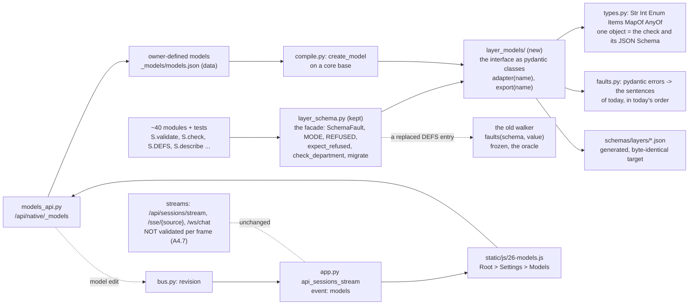
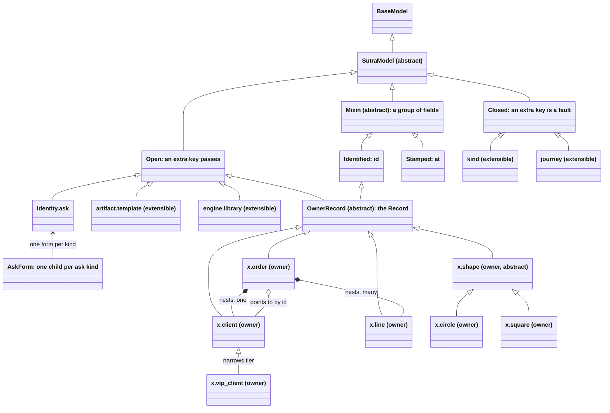
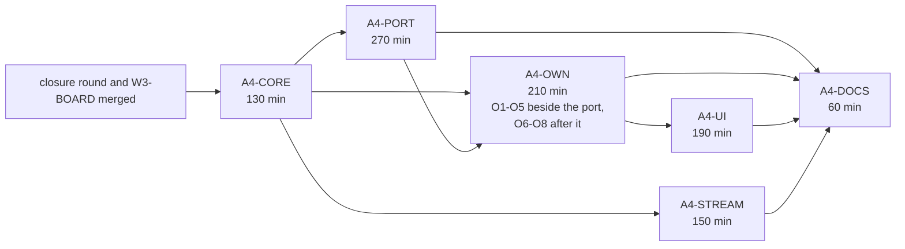

# PRD amendment A4: the interface layer in pydantic, owner-defined models, and the Models editor

| Field | Value |
|---|---|
| **status** | Final, 2026-10-28: amendment A4 to [PRD-FIVE-FUNCTIONS.md](PRD-FIVE-FUNCTIONS.md) 1.2, to [A1](PRD-FIVE-FUNCTIONS-A1.md), [A2](PRD-FIVE-FUNCTIONS-A2.md) and [A3](PRD-FIVE-FUNCTIONS-A3.md). Built and merged on main in six packages: A4-CORE (`32312056`), A4-PORT (`dc27f685`), A4-STREAM (`8f7c98f5`), A4-OWN (`429e0966`, fix round `c737ee65`), A4-UI (`698d9874`) and A4-DOCS. The port is proved equal to the walker: 1,291,018 inputs at the nightly size (`qa/a4_equiv.py --check --fuzz 5000`), 0 verdict differences and 0 sentence differences. `INTERFACE_SHA[1]` is still `e23aeace...`: A4 changed no byte of `describe()` (`test_a4_changes_no_byte_of_the_interface`). The owner has not shipped A4 to stable: no release script was run by the build. From here a change to the interface is schema version 2 with a migration (A1.21), whether or not A4 has shipped; A4 added nothing to the interface |
| Direction | the owner, 2026-10-27, one message (quoted in A4.0) |
| Overrides | A1.4's sentence "the types are JSON-Schema-shaped dicts with a validator built in: no third-party import" (the validator and the types become pydantic; the old walker stays as the oracle); nothing else. A4 keeps W3-PROOF's freeze whole: it changes no byte of `describe()` (A4.3.8). Every ruling, mark and default stands. A4 adds one milestone (M12) and eight screens (S19 to S26) and builds no other mechanism |
| Based on | sutra main `fbfcd53c` (M0 to M4; A1 and the UI port merged; A2 and A3 merged; wave 2, W3-BOARD and W3-PROOF merged; the closure round still merging), the A1, A2 and A3 documents, `layer_schema.py` as it is on that main (130 definitions, `MODE = 'refuse'`, `OWNERSHIP_MODE = 'refuse'`, `INTERFACE_SHA[1]` frozen), the installed pydantic 2.13.5 (python 3.11.14), and the scratch proofs listed in A4.3.9 and A4.7.5. Code is located by function name, never by line (decision C3) |
| Build | six developer packages, about 1,010 minutes of developer time in all, about 640 minutes on the critical path (A4.9). A4-CORE first; A4-PORT and A4-OWN alongside; A4-STREAM any time after A4-CORE; A4-UI after A4-OWN; A4-DOCS last. Nothing starts before the closure round and W3-BOARD have merged (A4.8) |
| Decision log | the A4 rows of [PRD-FIVE-FUNCTIONS-DECISIONS.md](PRD-FIVE-FUNCTIONS-DECISIONS.md) |
| Pointer for code | `layer_models/` (the pydantic models, new), `layer_schema.py` (the facade, kept), `layer_consts.py` (the constants the models read, moved out of the facade), `models_api.py` (the Models routes), `static/js/26-models.js` (the Models screens), `qa/a4_equiv.py` (the equivalence proof), `qa/stream_bench.py` (the streaming gate) |
| Amended by | nothing. Its "Amended by A4" lines in A1 (A1.4, A1.21), A2 (A2.2, A2.7) and A3 (A3.1) were checked against what was built on 2026-10-28 and stand as written |

## A4 at a glance

| Question | Answer |
|---|---|
| What changes? | The interface (all 130 definitions of `layer_schema.py`, and the records, acts, asks, verdicts, readings, workflow, journey and template definitions among them) becomes pydantic v2 models in a new package, `layer_models/`, one module per layer. `layer_schema.py` stays the one public facade: every name the code and the tests use today (`validate`, `check`, `describe`, `json_schemas`, `expect_refused`, `DEFS`, `SchemaFault`, `MODE`, ...) keeps its meaning, so nothing that calls it changes. |
| Does what the interface accepts change? | No. The old walker stays as a frozen oracle, and the port must pass a differential proof: the same accept or reject, the same fault sentences in the same order, and the same JSON Schema, over every sample, every writer's real output and a seeded fuzz corpus. The trial on six definitions found 0 differences in 20,941 inputs and exported 12 definitions byte for byte (A4.3.9). |
| Is the freeze (W3-PROOF) broken? | No. W3-PROOF has pinned `INTERFACE_SHA[1]` (`e23aeace...`), and its test fails on any change to `describe()`. A4 changes no byte of it: the port exports the same dicts (the trial: 12 definitions byte for byte), and everything new lives beside the interface (A4.3.8). A second pin, `CORPUS_SHA`, freezes the behaviour the port has to keep. |
| What can the owner change? | In a new Models screen (Root > Settings > Models, in the app's own style) the owner adds models and changes the ones they added: fields, constraints, nesting, links by id, enable and disable, versions. Their models are data, compiled when the app starts or when they save into real pydantic classes that inherit a core base, so they inherit its validation (A4.5). |
| What can the owner not change? | The core models, their types and bounds, who owns what, the step law, the ask kinds, acts, edges, verdicts, check names, the freeze, the list of places a model may be built on, the field vocabulary and the limits (A4.5.8). |
| OOP | Inheritance (a child may add or tighten, never drop or loosen: checked on the classes), composition (nest a model, a list of models), links by id with dangling and cycle checks, polymorphism by discriminated union, mixins, abstract bases, enable and disable with defined meaning, versions with `PARENT` as in A2. Twelve rules, each with the test that enforces it (A4.4). |
| Streaming | Not touched. No validation, schema build or model compile on the hot path of a stream; the existing frames stay byte for byte; new frames are validated once where they are made. Partial validation of a model's streamed answer uses pydantic's `experimental_allow_partial` where it works (an array of models) and a completed-units reader where it does not (an object); both were run (A4.7). A benchmark and ten guards are in the gate. |
| Order | A4-CORE, then A4-PORT and A4-OWN side by side, A4-STREAM beside them, A4-UI, A4-DOCS (A4.9). |
| What needs the owner? | Nothing blocks. Three defaults are the likeliest to change: the models are for the whole organisation, not per department (A4-9); a change that lets in more values waits for the owner's stamp (A4-10); the request models of `org_api.py` stay at the HTTP edge (A4-6). |

## A4.0 The direction, and how this reads it

> "All interface layer should be pydantic. Another option I need from the UI for now, that we can customize this pydantic layers from sutra UI, addition and updation of some of this pydantic layers can happen in the UI. We can enable / disable / create linkages / nesting of such pydantic models (concept of OOPS). make sure you adhere to that. Having pydantic models should not also affect streaming responses, so let's make sure we have streaming present as well."

The owner's earlier directions stand: PRD first, then build and verify; the interface is hard-coded in code and not in .md files (A1); the interface is the base class and a layer version is a child class (A2); a template is an interface (A3); the department's UI is the J2 prototype's page, ported unchanged, while screens only Sutra has stay in the app's own style (S16, S18); merge to local main only, never push; do not block on the owner (the decision log's default is taken and recorded).

| # | Reading | Where it lands |
|---|---|---|
| 1 | "All interface layer should be pydantic." Every definition of the interface is a pydantic v2 model (or a type a model holds), in code. The hand-written validator is not thrown away: it becomes the oracle the port is proved against. | A4.3 |
| 2 | "Customize this pydantic layers from sutra UI... addition and updation of some of this." Some, not all: the core stays hard-coded and frozen (the owner's standing rule); the owner builds children on the places the code declares extensible, and edits only those. | A4.5 |
| 3 | "Enable / disable / create linkages / nesting of such pydantic models (concept of OOPS)." Such models are the owner-defined ones. The concept is object-oriented design applied to them and to the core: inheritance, composition, references, polymorphism, mixins, abstract bases, and a defined meaning for on and off. | A4.4 |
| 4 | "Having pydantic models should not also affect streaming responses." A stream is neither slowed nor reshaped by validation, and a model's streamed answer can be checked as it arrives. | A4.7 |
| 5 | "From the UI." A Sutra-only screen, reached from Settings next to Instructions and Standards, in the app's own style. Every write follows the rulings: no ask unless a rule says so, and a change that lets in more waits for the stamp. | A4.6 |

## A4.1 What was found in the code (verified on `371ca4b1`)

| # | Finding | Consequence |
|---|---|---|
| F1 | `layer_schema.py` is hand-written: constants, 16 type constructors that return JSON-Schema dicts, a walker `faults(schema, value, path)` that supports 18 keywords and the markers `x-say` and `x-field`, `DEFS` with 130 entries (84 objects: 55 open and 29 closed; 5 maps; 11 arrays; 17 strings; the rest enums, integers, booleans, `anyOf` and `$ref`), the tables (RECORDS, HEARS, SENDS, CALLS, VERDICTS, CHECKS, OUTPUTS, PROMPTS, VIEWS, OPTION_KINDS, CONTRACT_SAMPLES, ...), `describe()` (about 143 KB of JSON), migrations, and the JSON Schema files under `schemas/layers/` written by `python layer_schema.py --write`. | The port is of `DEFS` and the walker. The tables are data and stay. |
| F2 | The public surface is wide: `S.validate` (233 call sites), `S.PROMPTS`, `S.DEFAULT_PINS`, `S.expect_refused` (73), `S.validate_view`, `S.DEFS` (54, many tests read `S.DEFS[name]["properties"]`, `["kind"]["enum"]`, or monkeypatch an entry with `monkeypatch.setitem`), `S.SchemaFault`, `S.REFUSED`, `S.check_department`, and so on, in about 40 modules. | The facade must keep every name and the dict shape of `DEFS`. A test that replaces a `DEFS` entry must still change what `validate` does (A4.3.5). |
| F3 | `MODE = 'refuse'` since the commit "A1 interface: refuse". W3-PROOF X2 has merged (`fbfcd53c`): `OWNERSHIP_MODE = 'refuse'`, `INTERFACE_SHA = {1: 'e23aeace...'}`, `interface_sha()` (the sha256 of `describe()` as sorted JSON, the hash of the bytes of `schemas/layers/interface.v1.json`), and `test_x2_the_interface_is_frozen_at_schema_version_1`, which fails on any change to what `describe()` holds: "the way out is not a new hash for this version but schema version 2 and a migration". | A4 is built against the freeze and changes no byte of `describe()` (A4.3.8). |
| F4 | pydantic appears only in `org_api.py` (13 `BaseModel` request classes) and `org2_api.py` (1), as FastAPI request bodies. It is installed through `fastapi==0.128.8` (2.13.5 here) and is not in `requirements.txt`. The other routers take plain dicts. A route that writes through the sink answers `SchemaFault` as 422 `NOT_IN_SCHEMA` with the first three faults (`interface_http.py`). | Pin pydantic in `requirements.txt` (A4-24). |
| F5 | Streaming is SSE and WebSocket, not one channel. (a) `app.py` `api_sessions_stream`: `StreamingResponse(text/event-stream)`, frames made by `_sse_event`, poll every `SESSION_POLL_S` = 1.5 s, keep-alive `tick` every `SESSION_HEARTBEAT_S` = 25 s, read by `EventSource` in `static/js/09-tail.js` (`startSessionStream`). (b) `app.py` `sse` (`/sse/{source}`, about lines 1599 to 1624): the log tail. This is the stream the request called the "board/ledger stream": the department's board and ledger are not streamed, they are read by polling routes. (c) The model's output reaches the screen over a WebSocket, `/ws/chat`: `session_runtime.Runtime._demux_turn_inner` reads the persistent `claude -p --output-format stream-json --include-partial-messages` process line by line, parses each line with `json.loads`, and emits `{"type":"token","text":...}` through `ws.send_json`; Codex and ACP run through `provider_adapters.run_turn`. | A4 names all three, and guards all three (A4.7). |
| F6 | An agent step does not stream. `website_dept.model_json` runs `claude -p ... --output-format json` with `subprocess.run`, waits for the whole answer, extracts the first `{...}` and `json.loads` it. Its callers validate afterwards. | Incremental validation of a step's answer needs an opt-in streaming call; A4 specifies it and wires it to nothing that exists (A4.7.6). |
| F7 | The records home is `W.home()` (`~/.sutra-ui/native`, redirected under every test); small JSON stores use `json_store.read_json` and `write_json` (atomic, 0600). A department ref is a `W.slug`, which never starts with an underscore; the home already holds `_library/` and `_model/`. | Owner models live in `<home>/_models/`, and their routes under `/api/native/_models`, which no department ref can shadow (A4.5.3, A4.6.5). |
| F8 | The Settings screens of the pane are in `static/js/22-website.js` (`wbInsHtml` for S16 and `wbStandardsHtml` for S18 on `wbRootPaneHtml`), built with `dpCard`, `wbBtn`, `wbEsc`, tokens in `static/panel.css`, tested by `test_website.js`. The J2 page (`j2ui_*`) imports nothing of `layer_schema`. | The Models editor joins Root's pane in the app's own style; the J2 page is untouched. |
| F9 | Each `test_layer_*.py` file runs in its own lane in `qa/walks/suites.sh`; the JS tests run in a loop at its end (`test_website.js`, `test_dept.js`, `test_org2.js`, `test_j2view.js`). `install.sh` stages the plugin folder with `rsync`, so a new package folder is carried without a list. | New tests are named `test_layer_models_*.py` and join the gate without an edit to `suites.sh`. |
| F10 | `test_layer_schema.py` holds `SAMPLES`, one (good, bad) pair for every definition (and for every department key), and `test_s2_the_samples_name_every_definition` fails when a definition lacks one; `test_fixtures/templates/samples.json` holds the A3 definitions' pairs; `test_layer_writers.py` has a test for every writer. | These are the seed of the equivalence corpus (A4.3.7). |
| F11 | `layers/lineage.py` holds `STEP_FIXED` and `STEP_FREE`, and `DEFS['step']` carries the same classification as `x-law` on each property, read by `template_checks.step_law`. | The classification is a `Law` annotation on the step's fields; `lineage.py` is not touched (A4.3.4). |

## A4.2 The design

### A4.2.1 Where it fits



### A4.2.2 The approach

The interface becomes classes. `layer_models/` holds one module per layer (identity, root, workflow, coordination, adaptation, priority, audit, options, acts, fields, settings, views, department, templates, journey) and a small core (`base`, `types`, `faults`, `schema`, `rules`, `registry`). A definition is a class that inherits `Closed` (extra keys are a fault) or `Open` (extra keys pass and are kept), and its fields are typed with annotation objects (`Str(40, 1)`, `Enum('a', 'b')`, `Items(max_items=12)`). Each annotation object is the one place that knows both how to check a value and what JSON Schema it writes, so the check and the schema cannot drift. A fault is translated into the sentence the hand-written walker writes today (`$.items[2].text: longer than 300`), in the same order, so SchemaFault, the REFUSED rows and the 422 answers read as they do now.

`layer_schema.py` is the facade. Its constants move to `layer_consts.py` (so the models can read them without a circular import) and are re-exported unchanged; `DEFS` becomes the export of the classes (the same dicts, key for key, as the proof shows); `validate(name, value)` asks the class's adapter; everything else (the modes, the rows, the department sink, the migrations, `describe()`, `json_schemas()`) is untouched code. The old walker, with the 130 literal definitions, moves to `layer_models/legacy.py` as a frozen oracle: the equivalence proof runs it beside the port, and it serves a test that replaces one `DEFS` entry.

The owner's models are data. A model spec (itself a pydantic model) names a base, fields drawn from a closed vocabulary, links and nests. It is compiled with `pydantic.create_model` on a core base, so it is a real pydantic class that inherits the base's validation, and it is held to the same child rules as a core child: it may add and tighten, never drop or loosen. A change that only tightens is the owner's own act and takes effect at once, with an undo; a change that lets in more waits for the owner's stamp, as an ask Identity puts on Root. Nothing the owner writes is ever executed: types and constraints come from an allow-list.

Streams stay as they are. Their producers are not made to validate; new frames are validated where they are made; a model's streamed answer is checked as it arrives by a reader that works on completed units (pydantic's partial flag does not reach inside a model, which was run and is in the docs) and checked once more, whole, at the end.

### A4.2.3 Alternatives considered

| Option | Trade-off | Why not |
|---|---|---|
| **Generate pydantic classes from the existing `DEFS` dicts at import** (`create_model` over the 130 dicts) | Smallest change; nothing hand-ported | The result is pydantic in name only: no class statements, no inheritance, no mixins, no IDE, no review of a definition as code, and the owner asked for the concept of OOP in the models. The dicts would stay the source of truth. |
| **Use pydantic's own constraints** (`Field(min_length=...)`, `StringConstraints`, `Literal`) and its error messages | Least code; the usual way | Three differences were found by running it. Pydantic's pattern is Rust `regex`, which rejects `"abc\n"` for `^[a-z]+$` where Python's `re.search` (the walker's) accepts it. It stops at the first failure of a value where the walker lists every one (`"A"` against a minimum of 3 and `^[a-z]+$`: pydantic says "at least 3 characters" and stops, the walker says shorter than 3 and does not match). Its sentences are different ("String should have at most 40 characters") and the owner reads ours; its JSON Schema carries none of the interface's own keywords (`x-say`, `x-field`, `x-owner`, `x-law`). A translator could not restore a fault a built-in check never reported. |
| **Keep the walker and put pydantic only at the edges** (HTTP bodies, owner models) | No risk to the interface | Not what was asked: "all interface layer should be pydantic". Two validators for one interface would also drift. |
| **Annotation objects over pydantic** (chosen) | The classes are real pydantic models; every check carries the owner's sentence; the schema is generated from the same object; the oracle proves the port | One more small layer (`types.py`, `faults.py`) to keep, about 400 lines, tested field by field against the old constructors. |
| **Per-department owner models** instead of one set for the organisation | Matches "a department's own record" | Two scopes double the rules (a department child of an organisation model, a disabled base in one place) for a feature nobody has asked to be per department. A4-9 takes the organisation and leaves the scope as a field to add later. |

## A4.3 Pydantic as the interface

### A4.3.1 The layout

```
sutra-ui/
  layer_schema.py          the facade (kept). Constants moved out; DEFS is the export; validate asks the classes
  layer_consts.py          NEW (A4-PORT P1). The constants the definitions read (ASK_KINDS, ITEM_RE, SOURCES, RUNGS, WORKFLOW_STANDARDS,
                           OPTION_KINDS, STEP and JOURNEY enums, bounds ...), moved unchanged and re-exported by layer_schema.py.
                           Imports nothing of the app: it is what lets layer_models read them without a circle (A4.3.5)
  layer_models/            NEW. The interface as pydantic classes
    __init__.py            adapter(name), sentences(name, value), export(name), export_all(), classes(), load()
    base.py                SutraModel, Closed, Open, the abstract guard, mixins            (A4-CORE)
    types.py               Str Int Num Bool Enum Const Anything Items MapOf AnyOf Tagged DefRef Bare Owner Law   (A4-CORE)
    faults.py              explain(), sentences(), the table of pydantic error types       (A4-CORE)
    schema.py              Dialect, export(), export_all(), interface_sha helpers           (A4-CORE)
    rules.py               narrows(), child_faults(), cycles, abstract, mixin conflicts    (A4-CORE)
    registry.py            DEF_CLASS, adapter cache, resolve(), the hook table            (A4-CORE; A4-OWN adds the owner side)
    bus.py                 the revision counter a model edit bumps and the stream reads    (A4-CORE)
    legacy.py              the 130 literal definitions and the old walker, frozen: the oracle   (A4-PORT)
    defs.py                imports the modules below in order and registers every class    (A4-PORT)
    common.py identity.py root.py workflow.py coordination.py adaptation.py priority.py
    audit.py options.py acts.py fields.py settings.py views.py department.py templates.py
    journey.py unions.py   the 130 definitions, one module per layer or level            (A4-PORT)
    spec.py compile.py store.py owner_rules.py hooks.py impact.py graph.py               (A4-OWN)
    frames.py stream.py                                                                  (A4-STREAM)
    README.md                                                                            (A4-DOCS)
  models_api.py            the Models routes under /api/native/_models                  (A4-OWN)
  qa/a4_equiv.py           the equivalence proof: corpus, differential, benchmark       (A4-CORE; A4-PORT fills it)
  qa/stream_bench.py       the streaming gate                                           (A4-STREAM)
  schemas/models/          generated: the spec definitions, the core class tree, the frames   (beside schemas/layers/, outside the freeze)
```

The package is `layer_models`, not `models`: `models` is a common top-level name in the packages a user's Python may hold, and the owner reads "Models" on the screen, not in an import. The definitions group as the interface does:

| Module | Definitions (130 in all) |
|---|---|
| `common` | `name`, `id.item`, `id.finding`, `impl`, `envelope`, `option`, `check.verdict` (7) |
| `identity` | `identity.done_item`, `identity.rule`, `identity.ask` (3) |
| `root` | `root.pins`, `engine.template` (2) |
| `workflow` | `workflow.engine`, `workflow`, `workflow.check`, `workflow.registration` (4) |
| `coordination` | `coordination.slot`, `.left_out`, `.table`, `.question` (4) |
| `adaptation`, `priority`, `audit` | `adaptation.idea/.ladder/.round` (3); `priority.estimate/.price/.ceiling` (3); `audit.reading_item/.finding/.reading/.spot_check` (4) |
| `options` | `option.raise`, `option.words`, `option.pin` (3) |
| `acts` | the 17 `act.*` payloads |
| `fields` | `field.task/.guidance/.text/.note/.items`, `instructions` (6) |
| `settings` | `setting.windows/.make/.order/.spot_every_s` (4) |
| `views` | the 7 `view.*` read models |
| `department` | the 38 `department.<key>` definitions and `department` (39) |
| `templates` | `step`, `step.row`, `engine.start`, `engine.library`, `kind`, `artifact.template` (6) |
| `journey` | `journey` and its 17 parts (18) |

### A4.3.2 The types: one object, the check and its schema

A scalar or a container is an annotation object in `Annotated[...]`. It implements `__get_pydantic_core_schema__` (how a value is checked) and `__get_pydantic_json_schema__` (what the file says), so the two are written once. Every failure carries the sentence of today's walker.

| Today (`layer_schema.py`) | In `layer_models/types.py` | Notes |
|---|---|---|
| `text(max, min)` | `Annotated[str, Str(max, min)]` | reports every failure of a value in one error (shorter, longer, pattern, control character), as the walker does |
| `say(max, min)` | `Str(max, min, say=True)` | JSON Schema carries `x-say: true` |
| `field(max, min, multiline)` | `Str(max, min, field={'multiline': b})` | `x-field`; the four refusals ('{{' or '}}', 'Return ONLY', control character, line break) stay |
| `word(pattern, max)` | `Str(max, pattern=p, word=True)` | the walker's `word` writes no `minLength`; `word=True` keeps the file identical |
| `iso()` | `Str(40, pattern=r'^\d{4}-\d\d-\d\d', word=True)` | |
| `integer(lo, hi)`, `number(lo, hi)` | `Int(lo, hi)`, `Num(lo, hi)` | an integer is a whole number, and 3.0 is one; a bool is neither; 'is not a whole number', 'below N', 'above N' |
| `boolean()` | `Bool()` | |
| `enum(*v)`, `const(v)` | `Enum(*v)`, `Const(v)` | True is never 1; 'is not one of a, b, c' (at most 8 shown) |
| `items(of, max, min, unique)` | `Annotated[list[X], Items(max, min, unique)]` | a tuple is a list; length, uniqueness and every item's faults are reported together |
| `map_of(value, keys)` | `Annotated[dict[str, V], MapOf(keys)]` | 'the key does not match P' and the value's faults, in key order |
| `nullable(x)`, `any_of(*xs)` | `Annotated[Union[X, None], AnyOf()]` | 'fits none of its shapes (<the first shape's first fault>)' |
| `obj(props, required, open=True)` | a class that inherits `Open` | unknown keys pass and are kept (`extra='allow'`) |
| `obj(..., open=False)` | a class that inherits `Closed` | 'is not a field here' (`extra='forbid'`) |
| `obj({})` | `Annotated[dict[str, Any], Bare()]` | an object with no declared field; writes the walker's `{type, properties: {}, required: [], additionalProperties: true}` |
| `ref('name')` | the class (when it is a definition) or `DefRef('name', body)` (when it is a named scalar such as `name` or `id.item`) | the file keeps `{"$ref": "#/$defs/id.item"}` |
| `ANYTHING` | `Annotated[Any, Anything()]` | |

A field that is absent is not a field that is null: `x: T = None` means the key may be missing, and a present `null` is still checked as `T`. Declaring `Optional[T]` is right only where the walker's schema is `nullable(T)`. (The first slip of the trial was exactly this, on `option.params`, found by the proof in 8 of 10,100 inputs; the second was a required field that the walker's object does not require. A4.3.9.)

**Names that a class cannot hold.** The 130 definitions have 368 distinct property names; four cannot be a Python attribute: `from` (`adaptation.ladder` history, `identity.rule`), `for` (`act.conflict`, `act.line`) and `or` (`step`) are keywords, and `schema` (`coordination.question`) is an attribute of `BaseModel`. Each is declared with a trailing underscore and an alias (`from_: ... = Field(alias='from')`); the path in a fault, the key a closed object accepts and the property in the JSON Schema are the alias, as run (`proof`): `{'from': 5, 'zz': 1}` gives `$.from: is not a string` and `$.zz: is not a field here`, and `{'from_': 'a'}` is 'not a field here', as the walker says of any other key. A lint (`test_field_names_are_the_interface_names`) lists exactly these four and fails on a name that is a keyword or a `BaseModel` attribute without an alias.

A discriminated union (A4.4, rule R8) uses pydantic's own `Field(discriminator=...)`, whose discriminator field is a `Literal`; its tag errors are translated like the rest (A4.3.3).

### A4.3.3 The sentences

`ValidationError.errors()` is translated by `layer_models/faults.py` into the lines the walker writes, `<path>: <what is wrong>`, with the path in the walker's form (`$`, `.key`, `[2]`).

| Pydantic error type | Sentence |
|---|---|
| `sutra_type` (raised by the annotation objects) | the type's own: 'is not a string', 'is not a whole number', 'is not a number', 'is not true or false', 'is not a list', 'is not an object', 'is not one of ...', 'is not ...' |
| `sutra_faults` (one error that carries a list) | each sentence it carries, at its own place or at a place below it: 'shorter than N', 'longer than N', 'does not match P', 'holds a control character', 'below N', 'above N', 'fewer than N items', 'more than N items', 'holds an item twice', 'the key does not match P', 'fits none of its shapes (...)' |
| `missing` | 'is missing' |
| `extra_forbidden` | 'is not a field here' |
| `model_type`, `model_attributes_type`, `dict_type` | 'is not an object' |
| `list_type` | 'is not a list' |
| `union_tag_invalid`, `union_tag_not_found` | 'is not one of <the tags>' at the discriminator; 'is missing' |
| any other type | `UNMAPPED`: a test fails on it; in the running app it reads 'does not fit' and leaves one row in REFUSED, so a gap is never silent |

Three rules make the lines the same as today's, not only the same kind:

1. **Order.** The walker lists, inside an object, the missing keys first and then each key in the order the input has them; inside a list by index; a container's own fault before its members'. Pydantic lists them in field order. `explain()` sorts by walking the input along each error's location (a key the input lacks sorts first, by arrival). The proof compared the lists, not the sets.
2. **Tags.** A union puts its branch tag into the location (`('rule', 'line')`). A location step that is not a key or an index of the input at that depth, and is not the last step, is a tag and is dropped.
3. **One error, many sentences.** Pydantic stops at the first failure of a value. The annotation objects check everything and raise one `sutra_faults` error that carries the list; a container catches its members' errors, translates them, and raises one error that carries its own sentences and theirs.

`SchemaFault`, `refused()`, `report()`, `check()`, the REFUSED rows and the 422 answer are not touched: they receive the same lists. Pydantic's own message and the input it quotes never reach a log or an owner: every model is built with `hide_input_in_errors=True`, and no code prints `str(ValidationError)`.

### A4.3.4 How today's features map

| Today | In A4 | Test |
|---|---|---|
| `x-say`, `x-field` | `Str(say=True)`, `Str(field=...)`; the same keywords in the file | `test_layer_models_types.py`: every constructor against its annotation, over a grid of arguments and a grid of values |
| closed and open objects | `Closed` (`extra='forbid'`), `Open` (`extra='allow'`) | the corpus: an extra key on every object |
| `required` | a field with no default; **required fields are declared first, in the interface's own `required` order** (two of 153 objects, `workflow` and `engine.library`, list `required` in another order than their properties; the walker reports a missing key in `required` order) | `test_required_come_first_in_the_interface_order`, a lint over every class |
| fixed or free field of a step (A2 `STEP_FIXED`, `STEP_FREE`) | `Law('fixed')` or `Law('free')` on each field of `Step`, written as `x-law` in the file as today; `layers/lineage.py` and `template_checks.step_law` still read the exported `DEFS['step']` | `test_layer_lineage.py`, `test_layer_templates.py` unchanged |
| `x-owner` and `DEPARTMENT_KEYS` | `Owner('identity')` on each field of `Department`; `DEPARTMENT_KEYS`, `LAYERS[...]['keys']` and `owner_of_key` are derived from the class, so the owner of a key is written once | `test_s2_every_department_key...`, `test_s3_the_tables_name_only_known_definitions_and_layers` unchanged |
| changed keys only on a save (`check_department`) | unchanged code. Each `department.<key>` has its own adapter (built from the field's annotation, once), so a save still checks only the keys that changed | `test_s4_check_department_checks_only_the_changed_keys...` unchanged |
| `MODE` warn or refuse, the REFUSED row and count, `SchemaFault`, `NEVER_REFUSE`, `OWNERSHIP_MODE`, `expect_refused`, the conftest fixture | unchanged code in `layer_schema.py`; only the engine behind `validate()` changes | every test that uses them, unchanged |
| migrations (`MIGRATIONS[0]`, `migrate`) | unchanged: a dict is migrated before it is validated | `test_s4_migrate_*` unchanged |
| `CONTRACT_SAMPLES` (a good and a failing example for each covering check) | unchanged data and unchanged contract case 4. The definitions' own good and failing examples (`SAMPLES` in `test_layer_schema.py`, `samples.json`) become the seed of the corpus (A4.3.7) | `test_s2_*` unchanged |
| the generated JSON Schema files | `json_schemas()` unchanged; it reads `DEFS`, which is now the export of the classes. Target: the files do not change by a byte | `test_s6_the_files_on_disk_are_what_the_definitions_generate` unchanged |
| `describe()` | unchanged code; `defs` is the export, so the document is the same bytes. Nothing of A4 is added to it (A4.3.8) | `test_s4_describe_is_the_whole_interface_as_json` |
| `INTERFACE_SHA`, `interface_sha()`, `OWNERSHIP_MODE` | unchanged, in `layer_schema.py` (W3-PROOF's); `test_x2_*` is the witness that `describe()` is the same bytes (A4.3.8) | `test_x2_the_interface_is_frozen_at_schema_version_1`, `test_x2_the_hash_moves_with_the_interface_and_with_nothing_else` unchanged |
| `faults(schema, value)` and the type constructors | stay; `faults` gains an optional `defs` argument so the oracle can run on the frozen literal definitions | `test_layer_schema.py` S1 tests unchanged |

### A4.3.5 The facade

`layer_schema.py` keeps every public name; the snapshot is a test (`test_fixtures/models/facade_names.json`, taken from main before the port: the sorted names of the module and their kind, and the test fails when one is gone or changes kind).

| Name | In A4 |
|---|---|
| `DEFS` | a `dict` subclass holding the export of the classes: the same keys and, entry for entry, the same dicts. Tests read `S.DEFS[name]["properties"]` and replace entries with `monkeypatch.setitem`; both keep working |
| `validate(name, value)` | `DEFS` unchanged since it was built: the class's adapter (`layer_models.sentences`), then the hooks (A4.5.7). `DEFS` changed since (one entry replaced by a test): the old walker over `DEFS`, exactly as today, because a `$ref` is followed at call time in the walker. The dict subclass tracks whether any entry is not the exported object (a flag recomputed on each set or delete, never on a read), so a `monkeypatch.setitem` that is undone restores the fast path |
| `check`, `report`, `refused`, `expect_refused`, `Met`, `SchemaFault`, `MODE`, `REFUSED`, `NEVER_REFUSE` | unchanged |
| `check_department`, `validate_record/act/field/instructions/view/workflow`, `as_workflow`, `migrate` | unchanged; they call `validate` |
| constructors `text`, `say`, `obj` ... and `faults` | unchanged; used by tests, by the oracle and by anything that builds a one-off schema |
| `describe`, `json_schemas`, `write_json_schemas` | unchanged code |

**No import circle.** The classes need the constants (`S.ASK_KINDS`, `S.ITEM_RE`, ...) when the class is made. Those constants move, byte for byte, to `layer_consts.py`, which imports nothing of the app; `layer_schema.py` imports it first and re-exports it. The definition modules import `layer_consts` and `layer_models.types`, never `layer_schema`. `layer_schema.py` imports `layer_models.defs` after its tables. `INTERFACE_SHA`, `OWNERSHIP_MODE`, `MODE`, `NEVER_REFUSE`, `REFUSED` and `ANY` stay in `layer_schema.py`. A test imports each module in a fresh interpreter, in both orders.

### A4.3.6 The JSON Schema

`export(cls, names)` returns the dict `layer_schema.DEFS` holds for a class: pydantic's schema for the class through the `Dialect` generator (no `title`, no null default), with a nested class that is a definition kept as `{"$ref": "#/$defs/<name>"}` and any other nested class written inline, `DefRef` written as a `$ref` (pydantic cannot be handed a `$ref` of its own: the annotation writes a marker, `x-defref`, and `export` rewrites it; this is in the trial), and `required` always written for an object that has properties. The files under `schemas/layers/` are regenerated with `python layer_schema.py --write`.

The dialect differences that exist between the two, and what closes each: pydantic names a definition by its class (closed by `export`, which keeps the interface's names); it writes `title` (dropped); it writes `default: null` for an optional field (dropped: absent is not a value here); it omits `required: []` and `properties: {}` (written back); it writes an enum as `enum` (the same); a nullable as `anyOf: [X, {type: null}]` (the same as `nullable()`); a closed object as `additionalProperties: false` (the same). Measured on 12 definitions: identical (A4.3.9). If a definition cannot be exported identically, the difference is written in `schemas/layers/A4-DIFF.md` and the pin is re-pinned in the same commit (A4.3.8).

### A4.3.7 The equivalence proof (`qa/a4_equiv.py`)

The proof compares the port with the oracle (`layer_models/legacy.py`: the 130 literal definitions and the walker, frozen, with a sha256 of the literal in a test so that nobody edits it) on four sources of input:

| Source | What | Stored |
|---|---|---|
| Samples | the good and the failing example of every definition and every department key (`SAMPLES`, `DEPARTMENT`, `DEPARTMENT_BAD` in `test_layer_schema.py`; `test_fixtures/templates/samples.json`) | read from those files |
| Mutants | from each good sample: every path set to each of 21 values of the wrong kind (null, true, 0, 7, -1, 2.5, 3.0, '', 'x', 'D1', [], [1], {}, {'a': 1}, 5,000 characters, a control character, a line break, '{{x}}', 'Return ONLY', 'abc\n', NaN); an extra key, a key that is not a word, the keys reversed, each key dropped; a list doubled, padded to 30, emptied, given a null; each string given a line break, a control character, '{{', '}}', 'Return ONLY', 400 and 5,000 characters, emptied; each number set to -1, 0, 2, 99, 100, 1e9, 0.5, 1.0; a list turned into a tuple | generated each run (1,800 to 4,400 distinct inputs for each of the six trial definitions, 3,000 random pairs among them) |
| Writers' output | every value the existing suite passes to `S.validate` or `S.check` and every record a writer files, recorded by a spy (`qa/a4_equiv.py --record` runs the lanes with it), deduplicated, at most 200 values of at most 8 KB for a definition | `test_fixtures/models/corpus/writers/<definition>.jsonl` |
| Fuzz | seeded (20261027): one or two paths replaced by a random JSON value; the gate runs 500 per definition, the nightly 5,000 | generated each run |

**Gates of the proof.**

| Id | Gate | Test |
|---|---|---|
| P1 | The same accept or reject on every input, for all 130 definitions | `test_layer_models_equiv.py::test_same_verdict` |
| P2 | The same list of sentences, in the same order, on every input. No allow-list of differences exists, and none is added | `::test_same_sentences` |
| P3 | `DEFS` equals the oracle's literal definitions entry for entry (so `describe()` and the generated files do not change) | `::test_export_is_the_oracle` |
| P4 | Every keyword of every definition is exercised: the harness counts, per definition, the rejecting inputs for each keyword kind it uses (type, enum, const, length, pattern, range, items, unique, required, closed, key pattern, any-of, x-say, x-field) and fails on a keyword with none. A harness that finds nothing proves nothing | `::test_every_keyword_is_hit` |
| P5 | The facade's names are all there (A4.3.5) | `test_layer_models_port.py::test_facade_names` |
| P6 | Not slower: for each definition the port's median time on its good sample is at most the oracle's (the trial: 2.8 to 3.5 times faster) | `qa/a4_equiv.py --bench` in the gate |
| P7 | `import layer_schema` takes at most 250 ms and no module has a circle | `test_import_budget`, `test_import_in_both_orders` |
| P8 | The staged copy imports `layer_models` (the install stage is an `rsync` of the folder) | `test_kit_packaging.py` unchanged; `test_layer_models_port.py::test_stage_carries_the_package` |
| P9 | The golden corpus (a file per definition with at most 150 lines: each sentence template once, and 30 seeded values) is unchanged: `CORPUS_SHA` | `::test_corpus_sha` |

### A4.3.8 The freeze, and what A4 does to it

W3-PROOF has merged (`fbfcd53c`). `INTERFACE_SHA` is `{1: 'e23aeacef66e0d6da6b455d6e9bfba0ddac0b626197eada1ea078d2d99bacbb6'}`, the sha256 of `describe()` as sorted JSON; `test_x2_the_interface_is_frozen_at_schema_version_1` fails when what `describe()` holds changes, and says that the way out is schema version 2 and a migration, not a new hash. The freeze is on the **contract**, and A4 reads the contract as two things and keeps both whole:

| Pin | What it holds | Set by | In A4 |
|---|---|---|---|
| `INTERFACE_SHA[1]` | the sha256 of `describe()`: the structure, every definition as JSON Schema | W3-PROOF X2 (done) | **Never changes.** The port exports the same dicts, so `describe()` is the same bytes, and `test_x2_*` passes unchanged: it is the port's witness (gate P3) |
| `CORPUS_SHA` | the sha256 of the golden corpus: for each definition, its inputs and the sentences the oracle gives. It is the behaviour | A4-PORT P0, from the oracle, before any definition is ported (the mechanism is A4-CORE C6) | **Never changes.** The port has to pass it |

**Nothing of A4 is in `describe()`.** The freeze allows no new hash for schema version 1, so A4 is built to need none:

1. The port is an identical export (P3). A definition that cannot be exported identically means the port is not done: the fix is in the port, never in the oracle and never in the pin.
2. What A4-OWN adds lives beside the interface. The spec definitions (`model.spec`, `model.field`, `model.link`, `model.file`, `model.history_row`) are classes in `layer_models/spec.py` with their own adapters, not entries of `DEFS` or `RECORDS`; their generated documents are in `schemas/models/` (written by `python -m layer_models.schema --write`), not in `schemas/layers/`, which the freeze test and its README describe; the core class tree is `layer_models.describe_models()`.
3. The hook's `model` key is an envelope key of the hook, not a field of a definition. The router takes it out (and the fields the child added) before the base is checked, so `artifact.template`, `engine.library`, `kind` and `journey` are not changed (A4.5.7).
4. The owner's stamp is not an ask. A new ask kind would change `ASK_KINDS` and `identity.ask`, which `describe()` holds. A change that lets in more is kept as a pending change in the Models store and stamped on the Models screen (A4.6.3, A4-10).
5. `test_a4_changes_no_byte_of_the_interface` (A4-OWN O7, again in A4-DOCS D4): after all of A4 is imported and owner models are made, edited and turned off, `interface_sha() == INTERFACE_SHA[1]`.

**The one allowed exception.** The owner said that `INTERFACE_SHA` is re-pinned in the port's own commit, with the reason, if the port has to change it. That stays available once, and expected unused: a commit named 'A4 interface: <why>' that writes the difference in `schemas/layers/A4-DIFF.md`, changes `INTERFACE_SHA[1]` (and `interface.v1.json`) in the same commit, adds a row `{from_sha, to_sha, commit, reason}` to a new list `layer_schema.INTERFACE_REPINS`, and updates `test_x2_*` to read the chain. `test_interface_pin_chain` then checks that the first `from_sha` is `e23aeace...`, that each row starts where the last ended, and that `INTERFACE_SHA[1]` is the last `to_sha`. Nothing creates the list otherwise. `SCHEMA_VERSION` stays 1 and no migration is written.

**Order against W3-PROOF.** None: it is on main. A4-CORE touches none of its files. The constants that W3-PROOF's tests patch (`ROUNDS_DEFAULT`, `MODE`, `OWNERSHIP_MODE`) stay readable as `S.<name>`, and `describe()` still reads them from `layer_schema`'s own globals, so `test_x2_the_hash_moves_with_the_interface_and_with_nothing_else` holds (A4.3.5).

### A4.3.9 What the trial proved, and what it found

Built in a scratch folder outside the repository (`proof/` beside the package specs), on the installed pydantic 2.13.5 and python 3.11.14: the annotation objects of A4.3.2, the translator of A4.3.3 and, in two rounds, six real definitions chosen for what each adds. Round one: `identity.done_item` (a closed record), `identity.ask` (open, with `option`, nullable objects, an any-of and the done items) and `workflow` (with `workflow.engine`, `workflow.check`, a map with a key pattern, integer enums, a number range). Round two, the attack: `act.conflict` (a keyword field name, `for`, and an any-of of a name and a model), `coordination.table` (closed, a unique list of enum values, a nullable integer, nested closed objects) and `adaptation.ladder` (nested optional objects, a keyword field name, `from`, null enums).

| Measure | Result |
|---|---|
| Inputs compared | 20,941 distinct over six definitions (1,843; 4,345; 3,912; 2,660; 3,774; 4,407), of which the oracle rejects 19,279 |
| Differences, accept or reject, and sentence lists, in order | 0. Each round's first run found some, and every one was a slip of the port, not of the design: `option.params` typed nullable (8 inputs), and `trial.rung` made required when the walker's object has no `required` (the first run of round two). The harness found both, which is its use |
| JSON Schema | 12 definitions (`identity.done_item`, `option`, `envelope`, `workflow.check`, `workflow.engine`, `workflow`, `identity.ask`, `act.conflict`, `coordination.left_out`, `.slot`, `.table`, `adaptation.ladder`) equal the oracle's dict, key for key, after three devices: `DefRef` for a named scalar, `Bare` for `obj({})`, and `word` writing no `minLength` |
| Time of one validation (median of 2,000) | `identity.ask`: 80.0 us before, 22.6 us after; `workflow`: 167.0 us before, 60.4 us after; a failing `identity.ask`: 78.9 us before, 28.4 us after with the sentences |
| Cost of a class | about 0.6 ms (11 classes in 6 ms); `create_model` with 12 fields on a core base 0.56 ms; `import pydantic` 33 ms. About 105 classes: about 65 ms at import |
| Owner models | a compiled class is a pydantic model on a core base; a child that narrows is accepted, a child that loosens is found with five sentences; a nest cycle is found; a reserved field name is refused (A4.5, `proof/ownerdef.py`) |

What the trial found, each now a rule above or below:

| # | Finding | Handling |
|---|---|---|
| G1 | Pydantic's pattern is Rust `regex`: `"abc\n"` fails `^[a-z]+$` there and passes under `re.search`. `regex_engine='python-re'` has the walker's meaning but is a setting of each model, one more thing every class must carry | `Str` checks its pattern with Python `re.search` itself (A4-3) |
| G2 | Lax `int` takes `True`, `'3'` and `3.0`; strict `int` refuses `3.0`; the walker takes `3.0`, refuses `True` and `'3'` | `Int` is a plain check |
| G3 | One failure per value; the walker lists all | `Str`, `Items`, `MapOf` raise one error that carries the list |
| G4 | Pydantic lists errors in field order | `explain()` sorts into the walker's order (A4.3.3) |
| G5 | `required` order differs from property order in 2 of 153 objects | required fields first, in the interface's order; a lint |
| G6 | A union tag appears in the location | stripped |
| G7 | `Optional[T]` is not "may be absent" | A4.3.2: the proof found the one slip |
| G8 | A wrapper that returns its input instead of the inner result leaves raw dicts in the model (the first run printed serializer warnings) | wrappers return the inner validator's result |
| G9 | `__get_pydantic_json_schema__` cannot return a `$ref` of its own (a `KeyError` in pydantic's reference handling) | a marker keyword, rewritten by `export` |
| G10 | `BaseModel` does not support partial validation | A4.7.5 |
| G11 | A custom `__init__` is called by the adapter too, so an abstract class cannot be validated against as well as instantiated (a `TypeError`) | R4 |
| G12 | Four of the 368 property names (`from`, `for`, `or`, `schema`) cannot be attributes | an underscore name with an alias (A4.3.2) |

### A4.3.10 The request models of `org_api.py` and `org2_api.py`

They stay at the HTTP edge (A4-6). They are 14 FastAPI request bodies (`ClassifyRequest`, `SettingsRequest`, `FsWriteRequest`, `RequestBody`, ...); their errors are FastAPI's own 422 `RequestValidationError`, which the panel's JS and several tests read as it is; and they are not records, acts or views of the interface. A4 pins pydantic in `requirements.txt` (they depend on it already), leaves them untouched, and adds a test that none of them is in `DEFS`. They may join `layer_models` in a later amendment if the owner asks, with the 422 shape kept.

### A4.3.11 Performance and cost on writes

Validation is on every write that goes through the sink and on every post. The trial measured the port at 2.8 to 3.5 times faster than the walker on the definitions tried, and P6 keeps it from becoming slower: a gate, not a promise. The cost that grows is import time (about 65 ms for the classes, P7) and the size of `describe()` is unchanged. Model classes are built once, at import; an adapter for a type that is not a class (a list of a model) is built once and cached (A4.7).

## A4.4 Object-oriented design in the models

The owner's words: "enable / disable / create linkages / nesting of such pydantic models (concept of OOPS). make sure you adhere to that." This section is the design of the classes; A4.5 is how the owner's own models are made from it. Every rule is checked on the classes themselves, at the moment a class is made (the core, at import; an owner model, when it is compiled), and has a test with a failing example.

### A4.4.1 The classes



Solid arrows with a closed head are inheritance; `*--` is a nest (the child is a value inside the parent); `o--` is a link by id (the parent holds the child's id); the dotted arrow is a polymorphic family.

### A4.4.2 The twelve rules

| Id | Rule | Where it is made to hold | Test (in `test_layer_models_rules.py` unless named) | Failing example |
|---|---|---|---|---|
| **R1** | **Inherit.** A child has every field of every base it names: none is dropped. | `rules.check_class`, called from `SutraModel.__init_subclass__` (core and owner) | `test_r1_a_child_keeps_every_field_of_its_base` | an owner spec for `x.vip_client` whose compiled class lacks `name`: 'name: dropped' |
| **R2** | **Narrow, never loosen.** For each inherited field the child's type is as tight or tighter: a text no longer, no shorter-allowed, with the pattern and the `say` and `field` rules kept; a number inside the range; a choice among the base's choices; a list no longer, no emptier, and unique if the base is; required stays required; a field that was never empty is never empty; an inherited nested model is the same model or a child of it. A child of a closed base is closed too: it may add fields of its own and no other key. The validators a child adds are the ones in the vocabulary, which only reject. | `rules.narrows(child_type, base_type)` over the annotation objects, which carry their bounds | `test_r2_one_loosening_each` (a parametrised test: one failing child per kind of loosening) | `tier` given a choice the base lacks: 'tier: adds platinum to the choices'; `name` allowed 500 characters: 'name: allows more than 80 characters'; a required field made optional: 'name: was required and is now optional' |
| **R3** | **Substitute.** Any value a child accepts, with the fields the child added taken out, its base accepts (as a subclass instance, seen as its base, ignores the attributes it added). R2 is the proof by form; R3 is the proof by run. | `rules.substitutable(child, base, n)` generates values from the child (the corpus generator of A4.3.7) and validates them with the base's adapter | `test_r3_a_value_the_child_takes_the_base_takes` over every core pair that is declared a child and over the owner fixtures | a hand-built child that passes R2 by a bug in `narrows` and accepts a value its base rejects fails here |
| **R4** | **Abstract.** An abstract class (`__abstract__ = True`) is never made: instantiating it, or validating a value against its adapter, raises `TypeError('<name> is abstract')`; it is not a leaf of the registry (`validate(name)` on it is a fault); a child sets `__abstract__ = False` to be concrete. `OwnerRecord`, `Closed`, `Open` and every mixin are abstract. | the guard in `SutraModel.__init__` (a custom `__init__` is called by the adapter too, which is how validating against an abstract class is stopped, G11) | `test_r4_an_abstract_class_is_never_made` | `OwnerRecord(id='a')`: 'OwnerRecord is abstract' |
| **R5** | **Mixins.** A mixin is an abstract group of fields (`Identified`, `Stamped`). A class that takes two mixins, or a mixin and a base, with the same field name and different types is refused when it is made. A mixin is adopted only where a field group is byte-identical in three or more definitions (`qa/a4_equiv.py --mixins` lists the candidates); it is never adopted to save lines at the price of a looser type. | `rules.check_class` (field conflict across bases) | `test_r5_two_bases_that_disagree_on_a_field_are_refused`, `test_r5_a_mixin_is_never_a_definition` | `class Both(Identified, OtherIdentified)` with `id` text(40) and text(64): 'id: the bases disagree' |
| **R6** | **Nest, never in a circle.** A field may hold another model, a list of it, a map of it, or it or nothing. The nest graph (field type to model) has no cycle and is at most 4 deep, in the core (checked once at import) and among an owner's models (checked at save and at load). | `rules.nest_cycle(graph)` and `rules.nest_depth(graph)` | `test_r6_a_nest_cycle_is_found_and_named`, `test_r6_the_core_nest_graph_has_no_cycle` | `order` nests `line`, `line` nests `order`: 'order, line, order: a circle' |
| **R7** | **Refer by id.** A link by id holds the id of the target, typed as the target's id (a word of the target's pattern), and nothing else. Its target is looked up in the registry when a resolver is given (a write); a link whose target is missing, off or retired is reported, never broken: the stored value stays and a read never fails on it. References in a cycle are fine (a graph, not a structure). | `types.Ref` (the id type) and `registry.links_report()` | `test_r7_a_link_is_an_id_and_a_dangling_one_is_reported_not_raised` | `client_id: 'C 1'` fits no id: 'client_id: does not match ...'; a link to a model that was turned off is in the report as 'off' and the value still validates |
| **R8** | **Polymorphism by tag.** A family is an abstract base, a discriminator (a field every child holds with exactly one value), and its concrete children; the union of the enabled children is a discriminated union (`Field(discriminator=...)`). A value with a tag that is no child's is 'is not one of circle, square' at the discriminator; a value with none is 'is missing'. Children are listed in the order they were made; the union is rebuilt when a child is made, turned on or off. The core has one: `AskForm`, a child of `identity.ask` for each ask kind, which adds the tag and nothing that rejects (so `identity.ask` itself does not change, A4-18). | `unions.py` (core) and `compile.py` (owner) | `test_r8_a_family_dispatches_by_tag`, `test_r8_a_new_child_joins_the_union_and_an_unknown_tag_reads_as_a_list`, `test_r8_ask_form_adds_no_rejection` | `{kind: 'zzz'}` against the family: 'is not one of circle, square' |
| **R9** | **On and off.** A model has its own switch; it is *effectively on* when its switch and its base's effective switch are on. A model that is effectively off is not offered (not listed as a base to build on, not a link target, not accepted by a template that newly names it, not in the polymorphic union); its stored data stays, is never rewritten, and still validates against it when asked directly; a template or a filing that already names it is reported ('uses Client, which is off'), never failed; its children turn off by effect (their own switches are not touched, so turning the base on again restores them). A field has the same: **retired** (the key stays accepted, it is no longer required, and it is not offered; a rename keeps the old name as an alias). Core models have no switch. | `registry.effective(key)`; `compile.py` (retired fields compile optional, aliased fields get `validation_alias`) | `test_r9_off_means_not_offered_and_not_broken`, `test_r9_children_follow_their_base_without_losing_their_own_switch`, `test_r9_a_retired_field_is_never_required_and_still_read`, `test_r9_a_rename_keeps_the_old_name` | turning on `x.vip_client` while `x.client` is off: 409 `BASE_OFF`; a filing that names a model that is off: passes, with the note 'Client is off' |
| **R10** | **Versions.** A model has a version number; version N+1 names version N as its `parent` (A2's `PARENT`) and is a child of it under R1 to R3: it adds or tightens and loses nothing. A record names `x.client` (the latest enabled version) or `x.client/v1` (exact). Versions are never deleted; an old one can be turned off. A change in place (same version) may only tighten or leave what is accepted as it was; a change that lets in more is a new version, or waits for the stamp (A4-10). | `rules.version_chain(specs)`; the class of N+1 is a subclass of the class of N | `test_r10_a_new_version_is_a_child_of_the_last`, `test_r10_a_change_in_place_that_loosens_is_not_in_place` | version 2 that raises `name` to 120 characters: 'name: allows more than 80 characters' |
| **R11** | **Names and the vocabulary.** An owner model's name is `^[a-z][a-z0-9_]{1,30}$`, is not taken (a retired or off name stays taken), and does not begin with a core definition's head; its key is `x.<name>`; a field name is `^[a-z][a-z0-9_]{0,30}$`, is not a Python keyword, not a name pydantic's `BaseModel` has, and not `model`. A field's type and constraints come from the closed vocabulary (A4.5.2); a pattern is one of the named patterns. | `owner_rules.names`, `ModelSpec` itself | `test_r11_names_and_vocabulary` | field `json`, `class`, `model_dump`, `__x`: refused; a regex pattern in a spec: 'is not a named pattern' |
| **R12** | **The core is not the owner's.** A spec cannot name a core model as the one it edits, cannot shadow a core name, and cannot reach a core model that is not declared extensible or nestable. A spec records the sha of its base at compile time; when a core base changes, the spec is held to R1 to R3 again (A4.5.6). | `registry.CORE`, `owner_rules.base_ok`, `rebase()` | `test_r12_the_core_is_not_the_owners`, `test_r12_a_changed_base_is_checked_again` | a spec with base `core:identity.ask`: 'identity.ask cannot be built on' |

### A4.4.3 What each concept is, in the codebase's terms

| Concept | In A4 |
|---|---|
| **Base class and child** | `OwnerRecord` and the four extensible core definitions (`ArtifactTemplate`, `EngineLibrary`, `Kind`, `Journey`) are the bases the owner may build on; an owner model is a class made by `create_model(..., __base__=<base>)`. The inheritance is Python's: `issubclass(XVip, XClient)` is true, `isinstance(vip_value, XClient)` is true, and a vip value validates as a client. |
| **Composition** | A `nest` link is a field whose type is the target class (one) or a list of it (many), optional or required. The target's validation runs inside, and its faults come out at the nested path (`$.lines[1].sku: is missing`). |
| **Reference** | A `refer` link is a field typed as the target's id. It does not load the target; the registry resolves it on a write when a resolver is given (the Models screen and the artifact check give one). |
| **Polymorphism** | R8. A nest or a link may name an abstract base that has a discriminator; the field then accepts any enabled child and dispatches by its tag. |
| **Interface and implementation** | Unchanged from A2: the core interface is the base; a layer version is a child; a template is an interface. A4 adds the second meaning the owner now asks for, the model, and keeps the two apart: a layer version is a module and `PARENT` names it; a model is a class and `parent` names its previous version. |
| **Encapsulation** | An owner model is reached through the registry (`registry.adapter('x.client')`), never by import; its compiled class is private to `layer_models`; its stored spec is the only thing the screen reads and writes. |
| **Core classes that are declared children today** | A2 and A3 say `engine.template` is "the child of `engine.library`", and the Default artifact template the base of the ten. In the port a class statement is written only where R1 to R3 hold for the shipped data; where the shipped definition is wider than its parent (`engine.template`'s `reads` is text(200), `engine.library`'s is a name) it stays a sibling, and the sentence in A3.5 is read as "same fields, a required `made_by`". The port finds the pairs by running R2 on each candidate; a pair that fails is listed in `layer_models/README.md`, not forced. |

## A4.5 Core and owner-defined

### A4.5.1 Two kinds of model

| | Core | Owner-defined |
|---|---|---|
| Where it lives | Python classes in `layer_models/`, in the repository | A record in the records home, `<home>/_models/models.json` |
| Who changes it | A developer, in a commit; the interface changes only as A1.21 says | The owner, in the Models screen |
| What guards it | The freeze: `CORPUS_SHA` and `INTERFACE_SHA` (A4.3.8), the 12 rules at import | The 12 rules at save and at load; the vocabulary and the limits |
| Is it a pydantic class? | Yes | Yes: made by `create_model` on a core base, so it inherits that base's validation |
| In `describe()` and the generated files? | Yes | No. It is data; a new model changes no pin |
| Switch | None | On and off (R9) |

### A4.5.2 The stored shape

A spec is itself a core definition (`model.spec`, a `Closed` class, with `model.field` and `model.link`), so a hand-edited file is checked like any other record, and its JSON Schema is generated like the others. Shown here by its fields; the types are the annotation objects of A4.3.2.

```
ModelSpec (Closed)                     one entry of models.json, keyed 'name/vN'
  schema_version  Const(1)
  name            word ^[a-z][a-z0-9_]{1,30}$            the key is 'x.<name>' (latest) or 'x.<name>/v<N>'
  version         Int(1, 20)                              N
  parent          null | 'x:<name>/v<N-1>'                A2's PARENT; required when version > 1
  label           say(60, 1)                              the owner's word for it ("Client")
  about           say(300)                                one line
  base            'core:record' | 'core:artifact.template' | 'core:engine.library' | 'core:kind' | 'core:journey' | 'x:<name>/v<N>'
  abstract        bool                                    a base that is only built on (R4)
  discriminator   null | field name                       on an abstract base: the field whose value picks a child (R8)
  enabled         bool                                    the model's own switch (R9)
  fields          list[FieldSpec], at most 40
  links           list[LinkSpec], at most 10
  base_sha        null | sha256 (64)                      the sha of the base's export when this was last compiled (A4.5.6)
  created, updated  iso; by 'the owner'

FieldSpec (Closed), a union tagged by `type`; every kind has
  name word ^[a-z][a-z0-9_]{0,30}$ · label say(60, 1) · about say(200) · required bool · nullable bool
  retired bool (R9) · aliases list of names, at most 3 (the names it used to have)
  and, by type, the constraints below

  type            owner's word    constraints (all optional, all bounded)           compiles to
  text            text            max_len 1..2000 (200), min_len, pattern (a named one)    Str(max, min, say=True, pattern)
  long_text       long text       max_len 1..20000                                          Str(max, say=True)
  whole           whole number    minimum, maximum in -10^9..10^9                           Int(min, max)
  number          number          minimum, maximum in -10^9..10^9                           Num(min, max)
  yesno           yes or no       none                                                      Bool()
  choice          one of          choices: 1..12 words of at most 40 characters, distinct   Enum(*choices); one choice on a discriminator -> Literal
  words           list of words   max_items 1..100 (20), unique, each word at most 80      Items(max, 0, unique) of Str(80, 1, say=True)
  date            date            none                                                      Str(10, pattern=date)

LinkSpec (Closed)
  name word · label say(60, 1) · mode 'nest' | 'refer' · to 'x:<name>[/v<N>]' | 'core:<nestable>'
  many bool · required bool · max Int(1, 100) (many only) · enabled bool
```

The **named patterns** are `slug` (`^[a-z0-9][a-z0-9-]*$`), `code` (`^[A-Z0-9][A-Z0-9_-]*$`) and `date` (`^\d{4}-\d\d-\d\d`). There is no free pattern: a regular expression the owner types is code the app would run on every value, and a bad one can stall the loop (A4-13). The **nestable core models** are `envelope`, `identity.done_item` and `option`: a model of the owner's may hold these as values; none may be extended.

**No defaults.** A default is data written on the owner's behalf. A field is required, or it may be missing.

**The limits** (A4-14), checked by the spec itself and by the store: at most 60 models and 20 versions of one; 40 fields and 10 links a model; names, labels and choices as above; a nest at most 4 deep; one spec at most 64 KB; the file at most 2 MB; a request at most 128 KB; at most one write a second from the screen.

### A4.5.3 Where it is kept

```
<records home>/_models/
   models.json      {"schema_version": 1, "rev": 14, "models": {"client/v1": ModelSpec, "vip_client/v1": ModelSpec, ...}}
   history.jsonl    one line for each change, append only, never rewritten
   pending.json     [{id, op, key, spec, base_rev, says, class, at}]: changes that let in more, waiting for the owner's stamp (A4.6.3)
```

`rev` is a whole number that grows by one with each change. A history line is `{rev, at, by, op, key, says, class, before_sha, after_sha, spec}`: `op` is `create`, `edit`, `enable`, `disable`, `revert`, `stamp`, `rebase` or `base_changed`; `says` is the change in the owner's words ('added the field phone'); `class` is `tightens`, `same`, `widens` or `mixed` (A4.6.4); `spec` is the whole spec after the change, so a revert needs no diff. The file is read and written with `json_store.read_json` and `write_json` (atomic, 0600); a write takes a process lock and refuses with `STALE_REV` when the file's `rev` is not the one the caller read (the app has one process; the atomic replace makes the rare second one safe, the check makes it honest). History past 5 MB rolls to `history.1.jsonl`; the screen reads the last 500 revisions.

The records home is per machine and per user, as every record is. Models belong to the organisation (Root): A4-9.

### A4.5.4 Compile, cache, invalidate

1. **Load.** `store.load()` reads `models.json`, checks the document as `model.file`, and each spec as `model.spec`. A spec that fails is kept as it is, marked *needs a look* with the first fault, and left out of the compile with everything built on it. Nothing is deleted or rewritten by a load.
2. **Rules.** `owner_rules.check(all)` runs A4.5.5 over the whole set (it needs the whole set: cycles, bases, versions).
3. **Order.** Bases and nests first (a topological sort; R6 has already refused a circle).
4. **Make.** For each model: the field annotations are built from the vocabulary (the only constructors that exist are the annotation objects of A4.3.2; there is no `eval`, `exec`, `import` or `getattr` on anything the owner wrote); links become fields; a retired field is optional, a renamed one gets `validation_alias=AliasChoices(new, *aliases)`; then `pydantic.create_model('X_<name>_v<N>', __base__=<base class>, __module__='layer_models.owner', **fields)`, `__def__ = 'x.<name>'`, `__abstract__` and `__version__` set, and `rules.check_class` (R1 to R3, R5) run as for a core class. The measured cost is 0.56 ms for 12 fields.
5. **Adapters.** One `TypeAdapter` for each class (and one union adapter for each family), built here and held in the registry. Never built where a value is checked.
6. **Swap.** The registry is an immutable object; `registry.current` is replaced as a whole, and `bus.bump()` raises the revision the streams read (A4.7.4).

**Invalidation.** A save in this process rebuilds from the file and swaps the registry (about 1 ms per model, 60 models at most). Another process, which the app does not have today, is picked up by a stat of `models.json` (mtime and size) at most once a second. A reader that holds a registry keeps using that one: **a stream, a validation in flight and a screen's "try a sample" pin the registry they began with** (STR-7), so an edit never changes the rules under a value that is half checked.

### A4.5.5 Rules at save and at load

Each is a code in a 409 body `{"detail": {"code": ..., "faults": [sentence]}}`; the spec's own shape fails as 422 `NOT_IN_SCHEMA` (A4.6.5).

| Code | When | Sentence (owner's words) |
|---|---|---|
| `NAME_TAKEN` | the name is in use, retired and off ones included | 'a model called Client is already there' |
| `NAME_RESERVED` | the name begins with a core definition's head (`identity`, `act`, `journey`, ...) or is a reserved word | 'that name belongs to the app' |
| `BASE_UNKNOWN` | the base is not in the registry, or not extensible | 'Ask cannot be built on' |
| `BASE_OFF` | the model is on and its base is effectively off | 'Client is off; turn it on first' |
| `CORE_LOCKED` | an edit names a core model | 'Record is part of the app and cannot be changed' |
| `LOOSENS_BASE` | R2: a field loosens its base's | the sentences of R2 ('tier: adds platinum to the choices') |
| `FIELD_NAME` | a field name that is reserved, odd or twice | 'json is a name the app keeps' |
| `CYCLE`, `TOO_DEEP` | R6 | 'Order, Line, Order: a circle' |
| `LINK_TARGET` | a link to a model that is unknown, off, abstract with no children, not nestable, or itself nested in a circle | 'Line is off' |
| `DISCRIMINATOR` | R8: a child of a family lacks the one-value field, or two children share a value | 'Circle and Disc both say kind is round' |
| `VERSION_PARENT` | R10: version N has no version N-1 as its parent | 'there is no version 1 to build version 2 on' |
| `FIELD_TYPE_FIXED` | a saved field's type is changed in place | 'a field keeps its type; make a new model' |
| `FIELD_DROPPED` | a revision lacks a field the last one had | 'a field is retired, never removed' |
| `TOO_BIG`, `TOO_MANY` | A4.5.2 limits | 'a model holds at most 40 fields' |
| `STALE_REV` | the `rev` the caller sent is not the file's | 'something changed since you looked; reload' |
| `UNKNOWN_MODEL`, `UNKNOWN_PENDING` | (404) no such model, or no such change waiting | |

### A4.5.6 When a core base changes

A spec keeps `base_sha`, the sha256 of the base's export at the last compile. On load, when the base's export has another sha, the stored fields are checked against the new base under R1 to R3. If they still hold (the usual case: the freeze lets the core change only additively), `base_sha` is updated and a `rebase` line is written, with no word to the owner. If they do not (a core field was tightened under a looser child), the model is marked *needs a look* with the sentence of the first fault, with everything built on it, and a `base_changed` line is written; the model stays as it was, nothing is deleted, and the screen offers to fit it to its base. A core change that removes or renames a field the owner's models use is a schema version, a migration and a decision in a later amendment, not an event this section handles.

### A4.5.7 Where an owner-defined model is accepted

The five layers' own definitions are the app's. They are what every other layer, every screen and every test relies on, and an owner field added to them would be read by nothing and relied on by no one. They stay fixed. A model is accepted where the code says so.

| Hook | Core base | An owner child may | What a child does in A4 |
|---|---|---|---|
| Record kinds | `OwnerRecord` (abstract, open, `id`) | any field of the vocabulary, links and nests | The record shape of filed work (below); "try a sample"; the target of links |
| Artifact | `artifact.template` | add fields | A template that names `"model": "x.client"` has every JSON file of a version checked against it by a new check, `fits_model`, when the version is filed |
| Engine | `engine.library` | add fields | A template file that names a model is validated as that child at load. No runtime reads the added fields |
| Department kind | `kind` | add fields | Same |
| Journey | `journey` (and `journey.file`: each journey of the list) | add fields | Same; `journeys.load()` validates through `S.validate` |
| Ask, act, edge, verdict, reading, workflow, department record, view, step, setting, prompt part, check, option | none | nothing | Fixed (A4-8). Asks are Identity's voice and the ask kinds are code; acts and edges are Coordination's table; a view is what a screen renders |

**Routing.** `S.validate(name, value)`: when `name` is one of `artifact.template`, `engine.library`, `kind`, `journey`, `journey.file` and the value (or a journey of it) holds a `model` key, the base is checked first, as it is now, on the value without the `model` key and without the fields the child added (a closed base would refuse both, and the four definitions are not changed to know about either, A4.3.8), and when it passes the named child is checked on the whole value and its faults are added at their paths. The child is a narrowing of the base, so the second check can only add faults. A `model` that names nothing that was ever made is a fault ('$.model: Client is no model of yours'); a model that is **off** is not a fault: the value passes and `hooks.report()` lists 'uses Client, which is off' (R9).

**`fits_model`.** `artifacts.check(name, files)` runs the template's checks; when the template names a model it also calls `layer_models.hooks.fits_model(model, files)`: each `.json` file is one value, or a list of values, checked with the model's adapter; a file that is not JSON, or does not fit, fails the check with the sentence of the first fault and the file's name; a model that is off or unknown passes with a note. The check returns the same `{ok, notes}` as the others, so a version that does not fit is filed and never read as passed, as for any check.

**What A4 adds beside the interface, and what it leaves alone.** `describe()`, `DEFS`, `RECORDS`, `ASK_KINDS` and the other tables are not changed (A4.3.8). Beside them: the spec definitions (classes in `layer_models/spec.py`, with their generated documents in `schemas/models/`), the pending-change record, `layer_models.describe_models()` (the core class tree and the extension points above, never the owner's models), and the envelope key `model`.

### A4.5.8 What the owner cannot change, and the security of a model

**Cannot change:** any core model; a core field's type, bound or owner; `x-owner`, `x-law`; the step law; the ask kinds, the acts, the edges, the verdicts, the check names, `MODE`, the freeze; the list of extensible bases and nestable core models; the vocabulary and the named patterns; the limits; the switch of a core model (there is none); a model's name once made (a rename is a new label; the key stays).

**Security.** The owner's input is a spec, and a spec is data.

| Risk | Control |
|---|---|
| Code run from a spec | None can: types come from the allow-list; the only constructors are the annotation objects; no `eval`, `exec`, `import`, `getattr` or `__import__` is reachable from a spec; a test greps `compile.py` and `spec.py` for them |
| A pattern that stalls the loop (ReDoS) | No free pattern. The three named ones are fixed and linear |
| A name that shadows or breaks a class (`model_dump`, `json`, `class`, `__x`) | R11: pydantic's attribute names, Python keywords and anything beginning with an underscore are refused; the trial showed all five tried names refused |
| A huge spec or a storm of edits | The limits; 128 KB a request; one write a second; 413 above the size |
| A hostile word on screen (`<script>`, a long word, a line break) | A model's labels are the owner's words: the screen renders them with `textContent` (`wbEsc`), never as HTML; `say` rejects control characters; `test_models.js` runs the hostile strings of `test_j2ui_xss.py` through every screen |
| A sample nested thousands deep, to exhaust the stack | the route refuses a sample deeper than 32 levels before it validates it, and a body over 128 KB is 413 |
| A value quoted in an error leaking | `hide_input_in_errors=True`; the sentences name a path and a rule, not a value |
| A model that makes data unreadable | R9: nothing is deleted; off hides, never removes; a revert is a new revision |
| A spec edited by hand in the file | The same checks run at load; a failing spec is kept, marked, and left out |

### A4.5.9 How a model is used by the five layers and by workflows

The five layers read and write their own records and acts, which are core and fixed; they do not know about owner models. A workflow reaches an owner model one way: an **artifact**. A workflow's engines read and write artifacts by name (`workflow.engine.reads`, `.writes`), and an artifact template may name a model; so an engine that files a record is held to the owner's shape for it when it files (`fits_model`), and an engine that reads one can rely on the shape the check has held. The same model is the type of a nested value in another model, and the target of a link by id. Nothing else in A4 reads an owner model at run time (A4-8); a later amendment may let an engine's step declare a model as its answer's shape.

## A4.6 The Models editor

A Sutra-only screen, so it is in the app's own style, as S16 (Settings > Instructions) and S18 (Root settings > Standards) are: the pane frame, `dpCard`, `wbBtn`, `wbEsc`, tokens only in `static/panel.css` (test V12), plain words, no counts at rest, status never by colour alone (a word and a glyph always go with it; amber means "needs you" only, with the "?" badge of S16). It is not part of the J2 page, which imports nothing of the interface and is not touched.

### A4.6.1 Where it is

On Root's pane (`wbRootPaneHtml`), under the card "Standards every plan meets" (S18), a card:

```
+- MODELS ----------------------------------------------------------------------------------+
| The shapes your records and templates have. Yours: Client, VIP client, Order, Line.         |
| (~) Client: a change waits for your stamp                                      [Open models]|
+--------------------------------------------------------------------------------------------+
```

`Open models` opens the Models pane (`data-wbtab="models"`), with a quiet `Back to Root`. The card says names, never a count; with no model of the owner's it says "You have not made a model yet." The card and the pane read `/api/native/_models`.

### A4.6.2 The screens

Sample data throughout is Thread & Loom, 10:24: the owner has made Client, VIP client (a kind of Client), Order (nests Line, points to Client by its id) and Line, and has turned off Visit note. `[lock]` is the glyph with the word "Built in".

**S19 · Models: the list**

| | |
|---|---|
| **Milestone** | M12 (M12.6) |
| **Where** | Root > Settings > Models |
| **Purpose** | See what the owner has made and what can be built on; add a model; open one. |
| **Layout** | A quiet line, then the card YOURS (a row for each model, a model that is built on another indented under it: its label, "a kind of <base>", a state word with its glyph, Open), `Add a model`; the card BUILT IN, CAN BE BUILT ON (the five bases, each with one plain line, locked); a link `Show everything built in` (names by layer, locked); `Structure and history`. |
| **Sample data** | Yours: Client, a kind of Record, On. VIP client, a kind of Client, On. Order, a kind of Record, On. Line, a kind of Record, On. Visit note, a kind of Record, Off. Survey answer, a kind of Record, Needs a look: "its base changed: 'tier' now allows fewer values". A waiting stamp under Client. |

```
+----------------------------------------------------------------------------------------------+
| Root · Models                                                                 [Back to Root] |
| What your records and templates are shaped like. Built-in models are part of how the app is   |
| built; you can build your own on the ones marked "can be built on".                           |
| +- YOURS ----------------------------------------------------------------[Add a model]----+ |
| | Client              a kind of Record     (v) On             [Open]                       | |
| |   VIP client        a kind of Client     (v) On             [Open]                       | |
| | Order               a kind of Record     (v) On             [Open]                       | |
| | Line                a kind of Record     (v) On             [Open]                       | |
| | Visit note          a kind of Record     ( ) Off            [Open]                       | |
| | Survey answer       a kind of Record     (!) Needs a look   [Open]                       | |
| |   its base changed: "tier" now allows fewer values                                       | |
| | (~) Client: this change lets in longer names · waits for your stamp · 11:02  [Stamp][No] | |
| +-------------------------------------------------------------------------------------------+ |
| +- BUILT IN, CAN BE BUILT ON -----------------------------------------------------------+   |
| | [lock] Record            a record with an id                                             |   |
| | [lock] Artifact template what a kind of filed work holds                                 |   |
| | [lock] Engine template   how a piece of work is done                                     |   |
| | [lock] Department kind   the line, the files and the rules of a kind of department       |   |
| | [lock] Journey           a way a person goes through the app                             |   |
| +-------------------------------------------------------------------------------------------+ |
| [Show everything built in]   [Structure and history]                                          |
+----------------------------------------------------------------------------------------------+
```

**States:** Loading (skeleton rows) · Empty ("You have not made a model yet." and Add a model) · Normal · A model needs a look (why, in a quiet line) · A stamp waits (the amber row, with Stamp and No) · Off (hollow glyph and the word Off) · Read error ("Could not read · Try again") · Changed since opened (the `models` event: a quiet line "Models changed · Reload"). **Interactions:** Open goes to S20; Add a model opens S21; Stamp and No post to the pending route (`/api/native/_models/pending/{id}`, `approve` true or false).

**S20 · A model's page**

| | |
|---|---|
| **Milestone** | M12 (M12.6) |
| **Where** | S19 > Open |
| **Purpose** | See a model whole and change it: its fields, what it is built on, what is built on it, what it links and nests, where it is used. |
| **Layout** | Header: label, "a kind of <base>" (each link in the chain opens that page), version, state word, `Turn off` or `Turn on`, `Undo last change`. Cards: FIELDS (the inherited ones first, locked, with "from <base>"; then its own, each with Change, Rename, Retire; `Add a field`), LINKS (points out; pointed at by; `Link or nest`), BUILT ON IT, WHERE IT IS USED, and the buttons `Try a sample`, `See its shape`, `New version`. |
| **Sample data** | Client, version 1, On. id (text, up to 40, required, from Record, locked); name (text, 1 to 80, required); tier (one of gold, silver, bronze); phone (text, up to 30, "was: tel"). Points out: none. Pointed at by: Order, by id. Built on it: VIP client. Used by: the artifact template Client list; the filed work Client list v3 in Thread & Loom Website. |

```
+----------------------------------------------------------------------------------------------+
| Root · Models · Client                                         [Undo last change] [Turn off] |
| a kind of Record · version 1 · (v) On                                                        |
| +- FIELDS ----------------------------------------------------------------------------+     |
| | [lock] id     text, up to 40, required                            from Record        |     |
| |        name   text, 1 to 80, required                  [Change] [Rename] [Retire]    |     |
| |        tier   one of: gold, silver, bronze             [Change] [Rename] [Retire]    |     |
| |        phone  text, up to 30   (was: tel)              [Change] [Rename] [Retire]    |     |
| |        [Add a field]                                                                 |     |
| +- LINKS ---------------------------------------------------------------------------+       |
| | points out: nothing yet            pointed at by: Order (by its id)    [Link or nest]|      |
| +- BUILT ON IT: VIP client ------------------+ +- WHERE IT IS USED ------------------+      |
| |                                            | | Client list (artifact template)     |      |
| |                                            | | Client list v3 · Thread & Loom      |      |
| +--------------------------------------------+ +-------------------------------------+      |
| [Try a sample]  [See its shape]  [New version]                                               |
+----------------------------------------------------------------------------------------------+
```

**States:** Loading · Normal · A built-in model (a lock and the line "Part of the app: you can look, not change." No buttons except Try a sample, See its shape, and Build on it where it is extensible) · Off (a quiet banner: "Off. Nothing new is offered. What is stored stays.") · Needs a look (the sentence, and `Fit it to its base`) · A stamp waits (amber) · A retired field (the word "Retired" beside it, never colour alone) · Read error. **Interactions:** each button opens its sheet; `Undo last change` posts the undo.

**S21 · Add a model (a sheet)**

| | |
|---|---|
| **Milestone** | M12 (M12.6) |
| **Where** | S19 > Add a model; S20 > a base's `Build on it` |
| **Purpose** | Make a model: choose what it is built on, name it, give it fields. |
| **Layout** | Three steps on one sheet: (1) "Build it on" (radio rows of the bases that can be built on, with the owner's own models that are on); (2) "Call it" (the label, one line about it; the key is shown quiet: "kept as x.client"); (3) "Its fields" (a row each, with Add a field, which opens S22). `Make it` at the end. |
| **Sample data** | Build it on: Client. Call it: VIP client; "a client with a long history". Fields: tier, one of gold (it can only be narrower than Client's). |

```
+- ADD A MODEL ------------------------------------------------------------------------[x]--+
| 1  Build it on     (o) Client      ( ) Record     ( ) Artifact template   ( ) Journey ...   |
| 2  Call it         [VIP client                        ]   kept as x.vip_client              |
|                    [a client with a long history                                  ]         |
| 3  Its fields      id    from Record          [lock]                                        |
|                    name  from Client          [lock]                                        |
|                    tier  one of: gold         narrower than Client's       [Change]         |
|                    [Add a field]                                                            |
| This only narrows what Client allows: nothing is let in that Client would turn away.   (v)  |
|                                                                [Cancel]  [Make it]          |
+---------------------------------------------------------------------------------------------+
```

**States:** Step 1 with nothing chosen (Make it off) · A name that is taken ("a model called Client is already there", under the field) · A base that is off (that row is not offered) · Saving · A fault from the server under the field it names (the sentences of A4.5.5). **Interactions:** Make it posts; the model opens on S20.

**S22 · Change a field (a sheet)**

| | |
|---|---|
| **Milestone** | M12 (M12.6) |
| **Where** | S20 > Change, Rename, Retire, Add a field |
| **Purpose** | Add a field, change a constraint inside the narrowing rule, rename it keeping its old name, or retire it. |
| **Layout** | The field's label and name; its type (a choice from the vocabulary, fixed once the model has been saved); the constraints for the type; `required`; and a live line that says what the change does to what fits, from the preview: "Tightens: fewer values fit", "No change in what fits" or "Lets in more: waits for your stamp". For a field inherited from a base, the controls only go as far as the base allows (the limit is shown: "the base allows up to 80"). |
| **Sample data** | Client > name, Change: text; up to 80 -> 60. Live line: "Tightens: names longer than 60 no longer fit. Client list v3 holds none." Then name up to 120: "Lets in more: names up to 120. This waits for your stamp." (VIP client, which is built on Client, keeps its own tighter bound.) |

```
+- CHANGE A FIELD: name -----------------------------------------------------------------[x]--+
| Label  [Name                    ]     Kept as: name         Type: text  (fixed)                |
| Up to  [ 60 ] characters   At least [ 1 ]    Pattern [ none        v]   [x] required           |
| (v) Tightens: names longer than 60 no longer fit. Nothing filed is longer.                      |
|                                                    [Rename...] [Retire]   [Cancel]  [Save]     |
+-------------------------------------------------------------------------------------------------+
   widening:  (~) Lets in more: names up to 120. This waits for your stamp.        [Cancel] [Save for my stamp]
```

**States:** Valid (the live line, Save on) · Invalid (the sentence under the control: "up to 3000 is more than a text holds") · Beyond the base (the control stops at the base's bound and says so) · A widening (the amber line; the button reads `Save for my stamp`) · Previewing (a quiet "Checking...") · Saving · Server fault. **Interactions:** the preview posts after a pause of 300 ms; `Rename` asks for the new name and says "The old name keeps working"; `Retire` says "It stays readable and is never asked for" and, for a required field, that this lets in more.

**S23 · Turn a model on or off (a sheet)**

| | |
|---|---|
| **Milestone** | M12 (M12.6) |
| **Where** | S20 > Turn off / Turn on |
| **Purpose** | Say, before it happens, what the switch does. |
| **Layout** | One paragraph of what changes and what does not, and the names it touches: what turns off with it (built on it), what stops being offered, and what keeps its data. `Turn off` / `Keep it on`. |
| **Sample data** | Client off: "Client stops being offered. VIP client turns off with it. Order points to Client; it keeps its links and nothing is lost. Client list (the artifact template) and Client list v3 keep what they hold and are noted as using a model that is off. Nothing is deleted." |

```
+- TURN OFF CLIENT -------------------------------------------------------------------[x]--+
| Client stops being offered when you build, link or file.                                    |
| It turns off with it:   VIP client                                                          |
| Still there, nothing lost:   Client list v3 (Thread & Loom Website) · Order's links         |
| Noted as using a model that is off:  the artifact template Client list                      |
| You can turn it on again; everything comes back as it was.                                  |
|                                                             [Keep it on]   [Turn off]       |
+---------------------------------------------------------------------------------------------+
```

**States:** Normal · Turn on with its base off ("Client is off; turn it on first", no button) · Saving · Fault. **Interactions:** Turn off posts at once (a tightening, undoable).

**S24 · Link or nest (a sheet)**

| | |
|---|---|
| **Milestone** | M12 (M12.6) |
| **Where** | S20 > Link or nest |
| **Purpose** | Hold another model inside this one, or point to it by its id. |
| **Layout** | "What does it hold": the target (a list of the owner's models that are on, and the nestable built-in ones); "How": `Hold it inside` (nest) or `Point to it by its id` (refer); "How many": one or many (and at most); `required`; a field name. The circle check is live. |
| **Sample data** | Order > Line, hold inside, many, at most 5, required, field lines. Order > Client, point by id, one, required, field client_id. |

```
+- LINK OR NEST -----------------------------------------------------------------------[x]--+
| Holds        [ Line            v]      Field name  [lines          ]                        |
| How          (o) Hold it inside    ( ) Point to it by its id                                |
| How many     (o) many, at most [ 5 ]    ( ) one          [x] required                       |
| (v) No circle: Line does not hold Order.                                                    |
|                                                                   [Cancel]  [Add the link]  |
+---------------------------------------------------------------------------------------------+
```

**States:** Normal · A circle ("Order, Line, Order: a circle", Add off) · A target that is off (not offered) · Saving. **Interactions:** posts the model with the link added (a change like a field).

**S25 · Try a sample, and see the shape**

| | |
|---|---|
| **Milestone** | M12 (M12.6) |
| **Where** | S20 > Try a sample, See its shape; also inside S21 and S22 for the model being made |
| **Purpose** | Know what fits before filing anything: paste a value and read why it does not, in the words the app uses. |
| **Layout** | Tabs: `Try a sample` (a textarea for JSON, `Make an example`, `Check`; the result: "It fits." or the sentences, one a line, at most twelve), `Shape` (the JSON Schema, read only, copy), `Example` (a generated value). It uses the draft being edited when a sheet is open, and the saved model otherwise. |
| **Sample data** | Client, sample `{"id": "C 1", "name": "", "tier": "platinum"}` -> "$.id: does not match ^[a-z0-9][a-z0-9_-]*$ · $.name: shorter than 1 · $.tier: is not one of gold, silver, bronze". |

```
+- CLIENT · TRY A SAMPLE ---------------------------------------------------[Shape][Example]-+
| {"id": "C 1", "name": "", "tier": "platinum"}                         [Make an example]    |
|                                                                                [Check]      |
| (!) It does not fit:                                                                        |
|   $.id: does not match ^[a-z0-9][a-z0-9_-]*$                                                |
|   $.name: shorter than 1                                                                    |
|   $.tier: is not one of gold, silver, bronze                                                |
+---------------------------------------------------------------------------------------------+
```

**States:** Empty (a hint) · Not JSON ("That is not JSON: <where>") · Fits · Does not fit (the sentences; "and more" past twelve) · The model is off ("Client is off; this checks it anyway") · Read error. **Interactions:** Check posts to `/_models/validate`; nothing is stored.

**S26 · Structure and history**

| | |
|---|---|
| **Milestone** | M12 (M12.6) |
| **Where** | S19 > Structure and history |
| **Purpose** | See how the models hang together (built on, held inside, pointed to), and the story of the changes, with a way back. |
| **Layout** | Tab `Structure`: a drawing (SVG: boxes for models, a solid line with a closed head for "is a kind of", a thick line for "holds", a dashed line for "points to by id"; built-in models are drawn locked and grey with the word), and, under it, the **same content as a list in words** (the accessible equivalent: "VIP client is a kind of Client. Order holds Line, many. Order points to Client by its id."); every box is a link to S20; over thirty models the drawing is replaced by the list and a filter. Tab `History`: a row each change (when, what, "Tightens" / "No change" / "Lets in more" with its word), `Restore this` on each. |
| **Sample data** | Structure as the mermaid diagram of A4.4.1 (the owner's part). History: "11:02 · You asked to let Client's names run to 120 · Lets in more · waits for your stamp"; "10:31 · You added the field phone to Client · Tightens"; "10:24 · You made Client". |

```
+- STRUCTURE ----------------------------------------------------------------[Structure][History]-+
|   [Record]--(is a kind of)--[Client]--(is a kind of)--[VIP client]                                |
|        \                       ^ points to by id                                                  |
|         \--[Order] ============> holds, many: [Line]                                              |
|  solid: is a kind of    thick: holds    dashed: points to by its id    grey + lock: built in      |
|  In words:                                                                                        |
|   Client is a kind of Record.  VIP client is a kind of Client.  Order is a kind of Record.        |
|   Order holds Line, many.  Order points to Client by its id.                                      |
+---------------------------------------------------------------------------------------------------+
```

**States:** Loading · Normal · Many models (list and filter only) · History empty ("Nothing has changed yet") · A restore that waits for a stamp (amber) · Read error. **Interactions:** a box opens S20; `Restore this` posts the revert (preview first, as S22).

**Words on screen.** The owner's words and the app's: "model", "built on", "a kind of", "holds", "points to by its id", "On", "Off", "Needs a look", "Built in", "Tightens", "No change in what fits", "Lets in more", "waits for your stamp". Never "charter" or "internal system"; never "grant", "counter" or "refuse" in any form (the banned screen words of A3.4.5, `S.TEMPLATE_BANNED`); no count at rest; no path or file name; no pydantic, class, schema or JSON jargon outside the two tabs that exist to show the shape (`Shape`, `Example`). The words of a model (its label, its field names, its choices) are the owner's: the screen shows them as they are written, always as text.

### A4.6.3 Who acts, and when the owner's stamp is needed

The owner is the actor on this screen, so the screen acts directly and says so afterwards, with an undo. There is no ask for a change that only tightens or leaves what fits as it was (S-18: no ask unless a rule says so). A change that **lets in more** loosens a boundary the owner or a filing relied on; approvals only tighten (S-08), so it waits for the owner's stamp. The stamp is not a second question for the same click and it is not an ask: the sheet says "Lets in more" before Save, the button then reads `Save for my stamp`, the change is kept as a pending change in the Models store, and the Stamp and No buttons are on the list and the page where the amber note is. (A new ask kind would change `ASK_KINDS` and `identity.ask`, which the freeze holds, A4.3.8; the stamp is the owner's own confirmation, kept in the history as `stamp`.)

| Operation | What fits afterwards | Path |
|---|---|---|
| Make a model | nothing is stored under it yet | direct; undo |
| Turn on, turn off | the same values fit; a model that is off is not offered | direct; undo |
| Change a label or a line about it | the same | direct |
| Add a field that may be missing, on an open model | tighter (that key is now typed) | direct |
| Add a field that may be missing, on a closed model | wider (a key that was turned away is let in) | stamp |
| Add a required field | tighter (a value without it no longer fits; the sheet lists the filed work that would not) | direct; the preview warns |
| Narrow a bound, a choice list, a pattern; make a field required | tighter | direct |
| Widen a bound or choices; drop a pattern; make a field optional; allow empty | wider | stamp |
| Rename a field (the old name is kept as an alias) | the same | direct |
| Retire a field that may be missing | the same (it keeps its type) | direct |
| Retire a required field | wider | stamp |
| Change a field's type | not in place | `FIELD_TYPE_FIXED`: build a new model |
| New version | a child of the last (R10): tighter or the same | direct |
| Undo the last change | the exact state before it, which the owner had | direct |
| Restore an older revision | by comparison | direct if tighter or the same, else stamp |
| Anything on a core model | | `CORE_LOCKED` |
| Loosen below the base | | `LOOSENS_BASE`; no stamp can allow it |

**The comparison** (`rules.compare(old, new)` -> `same`, `tightens`, `widens` or `mixed`) is the narrowing algebra of R2 run both ways on the two compiled classes: `new` narrows `old` and not the reverse is `tightens`; `old` narrows `new` and not the reverse is `widens`; each narrows the other is `same`; neither is `mixed`, which is treated as `widens` (a change that tightens one field and loosens another needs the stamp). A new field adds `tightens` if it is required, and `widens` when the model is closed. The same function gives the preview its words and the store its path. A change that is `tightens` or `same` is applied and written to the history at once; a change that is `widens` or `mixed` is written to `pending.json` with the whole new spec and the `rev` it was made against, one row is left on Root's runs ("the owner asked to let Client's names run to 120 characters; it waits for the owner's stamp"), and nothing changes until the stamp. On the stamp (`POST /_models/pending/{id}`), `store.apply_pending` checks the `rev` (a stale one drops the pending change and says so), applies the spec, writes a history line (`stamp`) and bumps the revision. On No the pending change is dropped and nothing has changed.

Every applied change leaves a row in Root's runs through `W.system_run` (as `W.set_host` does: "the owner changed Client: added the field phone"), so Audit's spot checks and the Internal messages see it.

### A4.6.4 The read models

All JSON, all `Cache-Control: no-store`, all passed through `owner_words` where a sentence is the owner's. The state of a model is one of `on`, `off`, `needs_a_look`; `class` is `tightens`, `same`, `widens` or `mixed`.

`GET /api/native/_models` (the list, S19 and the card):

```json
{"schema_version": 1, "rev": 14, "root": "thread-and-loom-root",
 "yours": [
  {"key": "x.client", "name": "client", "label": "Client", "version": 1, "base": "core:record", "base_label": "Record",
   "state": "on", "why": null, "abstract": false, "children": ["x.vip_client"],
   "pending": {"id": "p-3fa1c9e2", "says": "let Client's names run to 120 characters", "at": "2026-10-27T11:02:00+05:30"}},
  {"key": "x.survey_answer", "label": "Survey answer", "state": "needs_a_look", "why": "its base changed: \"tier\" now allows fewer values"}],
 "buildable": [{"key": "core:record", "label": "Record", "says": "a record with an id"},
               {"key": "core:artifact.template", "label": "Artifact template", "says": "what a kind of filed work holds"}],
 "built_in": null}
```

`?all=1` fills `built_in` with `[{layer, models: [{key, label}]}]`. `GET /api/native/_models/{key}` (the page, S20) returns the model with `fields` (each `{name, label, type, says, required, nullable, retired, aliases, from, locked}`), `base` and its chain, `children`, `links: {out, in}`, `used_by` (`[{kind: 'artifact_template'|'filed', name, art, v, dept}]`), `rev`, `history_tail`. `GET .../{key}/shape` returns `{schema, example}`. `GET .../graph` returns `{nodes: [{key, label, core, state}], edges: [{from, to, kind: 'extends'|'nests'|'refers', many, required}], text: [sentence]}`. `GET .../{key}/history` and `GET /api/native/_models/links` (the report of links whose target is off or missing, R7).

### A4.6.5 The routes

All under `/api/native/_models`, registered **before** any `/{ref}` route (a department's ref is a `W.slug`, which cannot begin with an underscore, so no ref is shadowed), on a router with `InterfaceRoute`, so a `SchemaFault` is the same 422 `NOT_IN_SCHEMA` as everywhere (`interface_http.refusal`).

| Method and path | Body | Answer |
|---|---|---|
| `GET /_models`, `GET /_models/{key}`, `/{key}/shape`, `/{key}/history`, `/graph`, `/links` | | the read models above; 404 `UNKNOWN_MODEL` |
| `POST /_models/preview` | `{op: 'edit'\|'enable'\|'disable'\|'revert', key, spec?, to_rev?}` | `{ok, class, faults: [sentence], affects: {turns_off: [..], used_by: [..], would_not_fit: [..], unchecked: bool}, needs_stamp, says}`; reads, writes nothing. `would_not_fit` is a bounded scan of the newest version of each filed work that names the model (at most 200 files, 2 s; `unchecked: true` when cut short) |
| `POST /_models/validate` | `{key}` or `{spec}`, and `{sample}` | `{ok, faults: [sentence]}` (all faults, the sentences of A4.3.3); a `spec` is compiled for the call and kept nowhere |
| `POST /_models` | `{spec}` | 200 `{ok: true, rev, model}`; 409 with a code of A4.5.5; 422 `NOT_IN_SCHEMA` for a spec that is not a `model.spec` |
| `POST /_models/{key}` | `{spec, rev}` | 200 `{ok: true, rev, class, model}` (applied); 200 `{ok: true, pending: true, class, pending_id, says}` (waits for the stamp); 409 as above |
| `POST /_models/{key}/enabled` | `{enabled, rev}` | as the edit |
| `POST /_models/{key}/undo`, `/{key}/revert` | `{rev}`; `{to_rev, rev}` | as the edit |
| `POST /_models/pending/{id}` | `{approve}` | 200 `{ok: true, rev, model}` (stamped and applied) or `{ok: true, dropped: true}` (No); 409 `STALE_REV`; 404 `UNKNOWN_PENDING` |

409 bodies are `{"detail": {"code": "BASE_OFF", "faults": ["Client is off; turn it on first"]}}`, as `UNKNOWN_OPTION` is `{"detail": {"code": ...}}`. A body over 128 KB is 413; more than one write a second is 429 `SLOW_DOWN`.

### A4.6.6 Open clients

A save, a stamp, an undo and a revert call `bus.bump()` and the `models` event is sent to every open client over the stream it already has, `/api/sessions/stream` (A4.7.4): `event: models`, `data: {"rev": 15, "keys": ["x.client"]}`. The screen on S19 or S20 shows the quiet line "Models changed · Reload" and does not redraw under the owner's hands; the card on Root's pane refreshes. The handler is added to `startSessionStream` in `static/js/09-tail.js`.

### A4.6.7 Effect on the J2 page, the Map and the journeys

None. The J2 page (`j2ui_*`) imports nothing of `layer_schema`; the Map reads the department's record; the journeys (A3) are data validated by `DEFS['journey']`, which has one optional new field, `model`. A4 adds no journey row. The Models editor is outside the J2 prototype's screens and outside the ported page's pin (`f9ceba1`).

## A4.7 Streaming must not break

### A4.7.1 The streams, as they are (verified)

| Stream | Producer | Consumer | Frames | Validated today |
|---|---|---|---|---|
| Sessions | `app.py` `api_sessions_stream` -> `StreamingResponse(gen(), text/event-stream)`; polls `sr.index()` every `SESSION_POLL_S` (1.5 s), a keep-alive `tick` every `SESSION_HEARTBEAT_S` (25 s) | `EventSource` in `static/js/09-tail.js` (`startSessionStream`) | `event: sync` (the whole index first), `changed`, `vanished`, `tick`; made by `_sse_event(event, data)` | no |
| Log tail | `app.py` `sse` (`/sse/{source}`): the last 50 rows, `: backlog-end`, then a 0.5 s poll with truncation and partial-line handling | none in `static/js` today; served and guarded | unnamed `data: {row}` frames from `_sse(row)` | no |
| Chat (the model's tokens) | `app.py` `ws_chat` -> `adapter.run_turn` -> `session_runtime.Runtime._demux_turn_inner`: reads the persistent `claude -p --output-format stream-json --include-partial-messages` process line by line, `json.loads` each, and emits `{"type":"token","text":...}`, `session`, `thinking`, `tool`, `notice`, `done`, `error` through `ws.send_json`; Codex and ACP through `prompt_turn` | the chat pane (`static/js/01-state.js`, the socket's frame handler) and the observers (`_notify_subscribers`) | the frame vocabulary in the `ws_chat` docstring | no |
| Agent step answers | `website_dept.model_json`: one `claude -p --output-format json` call, the whole answer | the step | none: a result `(object, usd, why)` | after, by the caller |

The board and the ledger are not streams: the screens poll their routes. (The request called the log tail "the board/ledger stream"; this table is the corrected reading.)

### A4.7.2 The rules

Each has a test, in `test_layer_models_guard.py` (static, over the source with `ast`, in the manner of `test_sessions_stream.py`) or `test_layer_models_stream.py` (run).

| Id | Rule | Test |
|---|---|---|
| **STR-1** | **Nothing is built in a stream.** No `TypeAdapter(...)`, `create_model`, `model_json_schema`, `json_schema`, registry compile or `store.load` appears in the body of a stream producer: `api_sessions_stream` and its `gen`, `sse` and its `gen`, `ws_chat`, `session_runtime.Runtime._demux_turn_inner` and `demux_turn`, and the `prompt_turn` of the Codex and ACP runtimes. | `test_str1_no_build_in_a_stream_body` (AST over the five files, a forbidden-name list) |
| **STR-2** | **Nothing is validated per frame in the existing streams.** Those bodies hold no call to `S.validate*`, `S.check*`, `layer_models.*`, `model_validate*` or `validate_python/json`, except `layer_models.bus.revision()` (a read of an integer) in `api_sessions_stream`. The existing frames are made as they are made. | `test_str2_no_validation_in_the_existing_stream_bodies` |
| **STR-3** | **Validate once, where a value is made.** A new frame is a pydantic model (`layer_models/frames.py`); it is built (and so validated) where the producer makes it, and goes out with `TypeAdapter(Frame).dump_json` from an adapter built at import. It is never validated again on the way out, and never through a `response_model`. | `test_str3_a_new_frame_is_made_once_and_dumped` |
| **STR-4** | **No `response_model` on a streaming route.** FastAPI would validate and buffer the body. The Models routes return `JSONResponse(content=...)` of a dict that the read model made; they are not streams. | `test_str4_no_response_model_on_a_streaming_route` (AST over every route that returns a `StreamingResponse`, in every router) |
| **STR-5** | **The existing frames are byte for byte as before.** The sessions stream, the log tail and the chat's frames, for the same input, are the same bytes. | `test_str5_frames_are_byte_identical` against goldens taken from unchanged main (T1) |
| **STR-6** | **A large value does not hold the loop.** A value over 64 KB is validated in `layer_models.stream.validate_off_loop` (a worker thread, `anyio.to_thread.run_sync`) or in slices of at most 500 items with an `await asyncio.sleep(0)` between; a value up to 64 KB (about 20 to 60 us for the records of the interface) is validated in place. Measured on this machine (60,000 engines, 8 MB, 443 ms of validation): on the loop, the worst delay of a 5 ms ticker was 391 ms; in a thread 48 ms; in slices of 500 with a yield 18 ms. | `test_str6_a_big_value_does_not_stall_another_stream` |
| **STR-7** | **Adapters are built once, and a stream keeps the registry it began with.** Core adapters at import; an owner model's at compile (A4.5.4); an adapter for a type that is not a class (a list of a model) on first use, cached by (definition, revision). A stream takes `registry.current` when it starts and uses that object to its end; an edit swaps `registry.current` for new streams only. | `test_str7_no_adapter_is_built_per_chunk` (counts `TypeAdapter.__init__` over 1,000 chunks: 0), `test_str7_an_edit_does_not_change_a_stream_in_flight` |
| **STR-8** | **A closed connection leaves nothing.** A generator closed by the server leaves no task and no buffer behind: the reader is discarded with it. | `test_str8_a_closed_stream_leaves_no_task` |
| **STR-9** | **Memory is bounded.** The reader keeps at most 256 KB of text for progress; past that it reports no more progress and the final check, which the caller runs on the whole text it holds, still happens. | `test_str9_the_reader_is_bounded` |
| **STR-10** | **First byte and keep-alive are unchanged.** `SESSION_POLL_S`, `SESSION_HEARTBEAT_S`, the `Cache-Control: no-cache` and `X-Accel-Buffering: no` headers, the opening `sync` frame are as they are; `test_sessions_stream.py` stays green and gains no weaker form. | `test_sessions_stream.py` unchanged; `qa/stream_bench.py --check` |

### A4.7.3 Frames as models

`layer_models/frames.py` has a pydantic model for every frame the app sends: `Sync`, `Changed`, `Vanished`, `Tick` (sessions), `Row` (log tail), and for chat `Start`, `Session`, `Token`, `Thinking`, `Tool`, `Notice`, `Done`, `Error`, `Stopped`, `Handed`, `Queued`, `ModeNote`, `Chat`, as a union discriminated by `type` (`ChatFrame`); the test scans `app.py`, `session_runtime.py` and the Codex and ACP runtimes for every frame `type` they emit, and fails on one that is in no model. They exist to be the contract: a generated `schemas/models/frames.schema.json` (written by `python -m layer_models.frames --write`, beside `schemas/layers/` and outside the frozen `describe()`: the frames are not part of the interface the freeze pins), and a test that every frame the chat tests capture fits `ChatFrame`. **The producers do not build them.** The chat's frames stay dicts made as they are made (STR-2, STR-5); serialising them through pydantic would change nothing the owner sees and risk a byte (key order, escapes, floats), and a model per token is the one thing a stream must not do. The frames that A4 adds are made as models (STR-3): `Models` (`{"rev": 15, "keys": ["x.client"]}`) on the sessions stream, and `Progress` (A4.7.5) for a consumer to send.

### A4.7.4 A model edit reaches open clients

`layer_models/bus.py` holds an integer `revision()` and `bump(keys)`; a save, stamp, undo or revert calls `bump`. `api_sessions_stream`'s loop already wakes every `SESSION_POLL_S`; it keeps the revision it last told this client and, after its existing work, if `revision()` is newer, yields one `_sse_event("models", ...)` with the new revision and the keys changed since. That is one integer comparison in a loop that already runs, no I/O, no validation. The frame is made by `frames.Models(...)` (STR-3); the sessions frames for the same index are untouched (STR-5 holds with no edit; with an edit the only difference is the added frame). A client that connects late learns no past edit: it reads the list when it opens.

### A4.7.5 Validating a streamed answer as it arrives

**What pydantic 2.13.5 does** (read in its docs and run, `proof/partial2.py` and `proof/walker.py`):

| Root of the streamed JSON | `experimental_allow_partial` | Observed |
|---|---|---|
| a list of models (`TypeAdapter(list[WFEngine])`) | works; the last, incomplete item is dropped | the engines of a streamed array arrived whole at 66, 192 and 300 characters, each validated with the interface's custom types |
| a list or dict of plain values, a `TypedDict` | works | as documented |
| a `BaseModel` (an object such as `Workflow`) | **does not reach inside**: the docs say "BaseModel doesn't (yet) support partial validation", and the run gave the model's own `missing` and nested faults for a half-streamed engine | the flag is not used for objects |
| any, with `'trailing-strings'` | includes a cut-off final string, which is then validated as a whole value (a half-written choice fails its enum) | not used for anything that is checked |

**So the stream module has two readers** (`layer_models/stream.py`):

1. `ListReader(adapter)`: for an answer that is an array (a proposed line's engines, a list of findings). It calls `adapter.validate_json(text, experimental_allow_partial=True)` on the text so far and reports the items that are whole. Pydantic ignores every error in the last element, so an error in an earlier element is reported as soon as the next element starts, one element late (observed: a bad `level` in element 0 appeared when element 1 began).
2. `ObjectReader(adapter)`: for an answer that is an object. It reads the text so far with `pydantic_core.from_json(text, allow_partial=True)` (a stable function; the Rust parser), **trims the right-most spine** (the last key of each object and the last item of each list on the path to the cut, which may still be growing), validates what is left with the full adapter, and sorts the faults: the sentences `is missing` and `fewer than N items` are *pending* (the rest has not arrived), every other sentence is a **fault in a completed part**, certain because nothing in the trimmed value is cut. It reports `arrived` (the top-level keys whose value is whole: every key of the text so far but the last, which may be growing), `counts` (the whole items of each list: all but the last), `faults` (early) and `pending`. Run on a 1,435-character workflow in chunks of 24 characters, it gave a progress event as each key was seen (`schema_version` at 48 characters, `source` at 72, `engines` begun at 96, `deliverable` and `covers` at 1,176; the trial also listed the growing key at once, which the specification above does not), an early fault `$.engines[1].level: is not one of 1, 2` at 840 characters of 1,435, and then the final validation, whole, said the same; per chunk the median was 32 us, the p95 68 us and the worst 109 us (1.9 ms for the whole stream).

**Finding the JSON in the text.** A model's answer is prose, a code fence and JSON. `stream.Scanner` finds the first `{` or `[` and the end of its value, string- and escape-aware, one character at a time (O(1) per character); the readers are fed the text from the start to the current character, and stop when the value ends. A stream that ends with no end found (the model stopped mid-object) is a final fault: 'the answer stopped before it was whole'.

**Throttle and bounds.** The reader validates at most once per 100 ms and always at the end of a chunk that closes a value (a `}` or `]` or `,` at depth 1 or 2); the text kept for progress is capped at 256 KB (STR-9).

**What the UI is shown.** A half-streamed object is never shown as data and never validated as if it were whole: the reader's `Progress` carries names and counts, `{arrived: ["engines"], counts: {engines: 2}, faults: [], pending: ["deliverable"], done: false}`, and a screen turns it into words ("Adaptation has written two engines so far"). It is the value the caller's `on_progress` gets and, when a caller chooses, a `Progress` frame on a channel it already has (never a new frame type on `/ws/chat`, whose client has no handler for one). A fault found early is advice: it may be shown ("one engine has a level it cannot have"); it does not stop the stream unless the caller sets `abort_on_fault`, which no caller sets in A4.

**The end.** When the scanner finds the end of the value, or the process ends, the whole text is validated once, with the same adapter, by `validate_json` of the value's span: `final(ok, faults)`. This is the verdict. If it fails, the caller does exactly what it does today for an answer of the wrong shape (the repair rounds, `REPAIRS`, then the person); the early faults were advice and the final decides. If the final passes after an early fault was shown, the early fault is withdrawn (it cannot happen for a completed part; the test asserts it never does).

### A4.7.6 Structured outputs from agent steps

Today a step's answer is waited for (F6). A4 adds the wire and no consumer: `website_dept.model_json(prompt, timeout, tools, on_progress=None)`. With `on_progress=None` the code is today's, line for line. With a callback it runs the same command with `--output-format stream-json --include-partial-messages` (the arguments the chat already uses), reads the lines as `_demux_turn_inner` does, collects the `text_delta` text, feeds a `Scanner` and an `ObjectReader` (or a `ListReader` where the caller names an array), calls `on_progress` when the progress changes, and takes the final text from the same `result` event. The return value is the same `(object, usd, why)`: the object from the same extraction and, now, the same final validation; the cost from the same `total_cost_usd`. If the stream cannot be read (an old CLI, a line that is not JSON), the call falls back to today's blocking call, once. **No function step passes `on_progress` in A4.** The first one to do so is a one-line change at its call site and a line of words on the run row, and is left to the amendment that wants it, so the five functions' behaviour stays byte for byte what A1 to A3 proved.

### A4.7.7 Measurable acceptance

`qa/stream_bench.py --check` runs in the gate (one lane line in `qa/walks/suites.sh`, about 20 s) and prints one line of numbers. The baseline is measured **before any change**, on unchanged main, in T1, and kept in `test_fixtures/stream/baseline.json` with the machine's name and core count; on another machine the absolute thresholds are skipped with a printed line and the in-process A/B (below) still runs.

| Measure | How | Threshold |
|---|---|---|
| Time to first byte of `/api/sessions/stream` | a real local server (`uvicorn` in a thread, the app with `sr.index` stubbed to 200 sessions), a raw socket, 20 connections, the median and p95 of the time to the first `sync` byte | median at most max(1.5 x baseline, baseline + 15 ms) |
| Inter-frame gap | 20 generators at once, 200 sessions, 3 s, with a 100 Hz ticker on the same loop; the ticker's lag, p99 | at most max(1.5 x baseline, 25 ms) |
| Events a second | frames a generator yields with the sleeps patched out, same load | at least 90% of baseline |
| Memory | `tracemalloc` peak growth over the run | at most baseline + 8 MB |
| In-process A/B | the same load with `bus.revision` patched to a constant | within 5% on events a second |
| A slow validator beside a stream | stream A at 5 ms cadence; stream B validates a 5 MB value through `validate_off_loop`, and a deliberately slow custom validator (0.5 s) | A's gap p99 at most 60 ms (B's work is off the loop) |
| A large compile beside a stream | 60 models of 40 fields compiled in the save route's worker | A's loop lag at most 50 ms |
| Chat frames | the chat's frames from a recorded stream-json turn through `demux_turn` | byte for byte equal to the golden (STR-5) |

The goldens (T1) are the sessions stream (a scripted `sr.index` over four polls, with the `sync`, `changed`, `vanished` and `tick` frames), the log tail (a temp file: backlog, an appended row, a truncation), and the chat (a recorded turn from `qa/fake_claude_agent.py`: a session, text deltas, a thinking block, a tool call and its result, a result, with and without partial deltas). They are taken first, in their own commit, so every later commit is held to them.

## A4.8 Compatibility and migration

### A4.8.1 Nothing in flight breaks

| Condition | How it is kept |
|---|---|
| The closure round (`wf_b9e0277c-8a9`) and W3-BOARD are still merging | W3-BOARD is on main (`e855459b`, `1f88141d`). **No A4 package starts until the closure round's last merge has landed** (its journal says finished, no "closure round" merge for 30 minutes, no `CLO-*` branch in `git worktree list`, the merge lock free). Each package spec opens with that check |
| W3-PROOF has frozen the interface (merged, `fbfcd53c`) | A4.3.8: A4 changes no byte of `describe()`. `test_x2_*` passes unchanged and is the port's witness; nothing of A4 adds to `DEFS`, `RECORDS` or `ASK_KINDS` |
| Other packages edit `layer_schema.py` | The port changes it in one place, the DEFS blocks, and moves the constants once, in P1, early in the package and in a commit of its own; the merge of A4-PORT is an integrator's merge on a green gate like any other, and its rebase onto a moved main is by regenerating `schemas/layers/` and re-running `qa/a4_equiv.py`, never by hand |
| The prompt snapshot, the contract cases 1 to 14, the journey status lane | untouched: A4 changes no prompt, no recipe, no journey |

### A4.8.2 The strangler, step by step

1. **Additive.** A4-CORE adds `layer_models/` and the harness, and changes nothing that runs.
2. **Frozen before it moves.** A4-PORT P0 and P2 take the picture of the old interface (the facade's names, the golden corpus, `CORPUS_SHA`, the oracle) before any definition is ported.
3. **Behind equal.** P3 to P6 port the definitions; each commit adds the classes and the per-definition proof, and `layer_schema.py` still runs on the old dicts.
4. **One swap.** P7 makes `DEFS` the export and `validate` ask the classes, in one commit that can be reverted alone. The code constant `VALIDATOR` (`'models'` or `'walker'`, like `MODE`: a constant, never an environment variable) lets a test, and a hotfix, run the old path.
5. **Then the new.** A4-OWN and A4-UI add the owner's models on the swapped facade; A4-STREAM runs beside.

### A4.8.3 What the existing tests do

No assertion of an existing test is weakened or removed, and none is rewritten to pass.

| Tests | Change | Why it is not a loosening |
|---|---|---|
| `test_layer_schema.py` (S1 to S7: the walker, the samples, the tables, the files) | none | the walker stays; the samples run through the new engine; the files must still equal `json_schemas()` |
| Tests that replace a `DEFS` entry (`test_layer_core.py`, `test_function_prompts.py`) | none | the dict subclass makes `validate` follow the replaced entry (A4.3.5) |
| `test_layer_templates.py`, `test_layer_lineage.py`, `template_checks` | none | they read the exported `DEFS['step']` and its `x-law`, which are the same dicts |
| `test_x2_the_interface_is_frozen_at_schema_version_1`, `test_x2_the_hash_moves_with_the_interface_and_with_nothing_else` | none | they are the witness that A4 changed no byte of `describe()`; the second passes through the `Defs` dict subclass (a definition added and removed moves the hash and restores it) |
| `test_sessions_stream.py` | one test added | the structural and behavioural checks stay as they are |
| `test_layer_contracts.py` | one case added (15, A4-DOCS) | a case added, none relaxed |
| `qa/walks/suites.sh` | one lane line (the stream bench) and one name in the JS loop (`test_models.js`) | lanes added |
| `test_prd_docs.py` | none | it reads the J2B proposal and one decision row |

New tests are in new files named `test_layer_models_*.py` (so the existing `test_layer_*.py` loop runs them, each in a lane of its own) and `test_models.js`.

### A4.8.4 Data

Nothing existing is migrated. `SCHEMA_VERSION` stays 1 (A4.3.8). The records home gains `_models/` the first time the owner makes a model; a home without it is a home with no models. A department's records are read and written as they are.

## A4.9 The packages

Six developer packages, each its own branch off main (`a4/<key>`), merged one at a time by the integrator on a green gate (A1.26), none pushed. The specs are working papers outside the repository (`waves/A4-specs/<key>.md`, with `A4-packages.json`), as A2's and A3's were; this section is what they promise. A step is one commit, 'A4 <id>: <title>', leaves the build green, and names its tests.



| Package | Builds | Owns (all new unless named) | Time | Build after | Merge after |
|---|---|---|---|---|---|
| **A4-CORE** | The base classes, the annotation objects, the translator, the export, the class rules, the bus, the harness | `layer_models/{__init__,base,types,faults,schema,rules,registry,bus}.py`, `qa/a4_equiv.py`, `test_layer_models_core.py`, `_types.py`, `_rules.py`, `_equiv.py`, `test_fixtures/models/`, `requirements.txt` (one line) | 130 min | the closure round and W3-BOARD | any green gate |
| **A4-PORT** | The 130 definitions as classes, `layer_consts.py`, the oracle, the facade swap, the proof at scale | `layer_models/{legacy,defs,common,identity,root,workflow,coordination,adaptation,priority,audit,options,acts,fields,settings,views,department,templates,journey,unions}.py`, `layer_consts.py`, `layer_schema.py` (the constants, the DEFS blocks, `validate`, `faults(defs=)`), `schemas/layers/` (regenerated, expected unchanged), `test_layer_models_port.py`, `test_layer_models_equiv.py` (extended), `test_fixtures/models/corpus/` | 270 min | A4-CORE merged | A4-CORE |
| **A4-OWN** | The spec models, compile, rules, store with pending changes, routes, hooks, the documents beside the interface | `layer_models/{spec,compile,store,owner_rules,hooks,impact,graph}.py`, `models_api.py`, `app.py` (one `include_router` line), `artifacts.py` (`check`: the model call), `schemas/models/` (generated), `test_layer_models_owner.py`, `_api.py`, `_hooks.py` | 210 min | A4-CORE for O1 to O5; A4-PORT for O6 to O8 | A4-PORT |
| **A4-STREAM** | The goldens and baseline, the guards, the frames, the readers, the `models` event, the opt-in streaming call, the bench | `layer_models/{frames,stream}.py`, `app.py` (`api_sessions_stream`: the event), `website_dept.py` (`model_json`: `on_progress`), `qa/stream_bench.py`, `qa/walks/suites.sh` (one lane line), `test_layer_models_stream.py`, `_guard.py`, `test_sessions_stream.py` (one test added), `test_fixtures/stream/` | 150 min | A4-CORE merged | any green gate after A4-CORE |
| **A4-UI** | The Models screens, the card, the stream handler, the tests | `static/js/26-models.js`, `static/js/22-website.js` (the card and the tab, in `wbRootPaneHtml`), `static/js/09-tail.js` (the `models` handler), `static/panel.css` (one block, tokens only), `static/panel.html` (a script tag), `test_models.js`, `qa/walks/suites.sh` (one name in the JS loop) | 190 min | A4-OWN's O5 (the routes) | A4-OWN |
| **A4-DOCS** | The READMEs, contract case 15, the status lines, the staged-copy check, the final numbers | `layer_models/README.md`, `schemas/layers/README.md`, `README.md`, `layers/contract.py` (case 15), `test_layer_contracts.py`, `design/*` (status lines only), `test_layer_models_docs.py` | 60 min | all five merged | last |

**Critical path:** CORE 130, then PORT 270, then OWN's O6 to O8 and the merge, then UI 190 (it can build from OWN's branch once O5 is committed, so it ends when OWN does), then DOCS 60: about 640 minutes when UI waits for OWN's merge, about 535 when it does not. STREAM (150) and OWN's first five steps (155) run beside PORT.

### What each step does

**A4-CORE**

| Id | Step | Done check |
|---|---|---|
| C1 | `pydantic==2.13.5` in `requirements.txt`; `base.py` (`SutraModel`, `Closed`, `Open`, the abstract guard, `hide_input_in_errors`); `bus.py` | R4; `Closed` refuses an extra key and `Open` keeps it; the pin is in the file |
| C2 | `types.py` scalars and the three devices (`DefRef`, `Bare`, `Owner`, `Law`) | every constructor of `layer_schema` against its annotation over a grid of arguments and values: same verdict, same sentences, same dict (`test_layer_models_types.py`) |
| C3 | `faults.py` (`explain`, the table, order, tags) and the containers (`Items`, `MapOf`, `AnyOf`) | the ordering cases, the tag case, a pydantic type with no sentence fails the build |
| C4 | `schema.py` (`Dialect`, `export`) | the three trial definitions (recreated as classes in the test) export identical dicts |
| C5 | `rules.py` (R1 to R6, `narrows`, `compare`, cycles, abstract, mixin conflict) and `registry.py` | one failing example for every kind of loosening; the trial's owner cases |
| C6 | `qa/a4_equiv.py` (corpus builder, the recorder, the differential runner, `--bench`, `--mixins`) and the oracle accessor | P1, P2 and P4 over the three trial definitions; the golden corpus mechanism and `CORPUS_SHA` |

**A4-PORT**

| Id | Step | Done check |
|---|---|---|
| P0 | the old picture: `facade_names.json`, the writers' recorded corpus, the golden corpus and `CORPUS_SHA` for all 130, from unchanged main | the files exist and the oracle reproduces them |
| P1 | `layer_consts.py`; `layer_schema.py` re-exports | `describe()` is byte for byte what it was; both import orders work (P7) |
| P2 | `layer_models/legacy.py`: the literal definitions and the walker, frozen; `faults(..., defs=None)` | the sha of the literal is pinned in a test; the S1 tests pass |
| P3 | `common`, `identity`, `root`, `workflow`, `options` | per-definition P1, P2, P3 for these |
| P4 | `coordination`, `adaptation`, `priority`, `audit`, `acts`, `fields`, `settings` | same |
| P5 | `department` (38 keys, `Owner`, `DEPARTMENT_KEYS` derived) and `views` | same; `check_department` tests unchanged |
| P6 | `templates` (`Law`), `journey`, `unions` (`AskForm`) | same; `test_layer_templates.py`, `test_layer_lineage.py` unchanged |
| P7 | the swap: `DEFS` the export (dict subclass, dirty flag), `validate`, `VALIDATOR`, the literals out of `layer_schema.py`, `schemas/layers/` regenerated | the files do not change; the full gate is green; the commit reverts alone |
| P8 | the proof at scale: the recorded writers, fuzz, all of P1 to P9, the bench | zero differences; `import layer_schema` at most 250 ms; the port not slower |

**A4-OWN**

| Id | Step | Done check |
|---|---|---|
| O1 | the spec models, the vocabulary, the named patterns, the limits | a spec with a free pattern, a 41st field or a reserved name is refused as `model.spec`; the trial's names |
| O2 | `compile.py`, the owner registry, adapters, unions for families, the swap and `bus.bump` | the trial's compile; R1 to R3 at compile; R8 dispatch; R9 off and retired; a rename keeps the old key |
| O3 | `owner_rules.py` and `rules.compare` | every code of A4.5.5 with a failing example; the classification table of A4.6.3, row by row |
| O4 | `store.py`: files, history, `rev`, stale check, rate limit, undo, revert, `rebase`, `apply_pending` | a history line for each change; a stale `rev` is `STALE_REV`; a core change that breaks a child marks it, deletes nothing |
| O5 | `models_api.py`, the read models, `preview` with the bounded scan, `validate`, `graph`, `links`; the pending route; `W.system_run` rows | the routes of A4.6.5 with their errors; a widening is a pending change and nothing changes until the stamp |
| O6 | the hooks: routing in `S.validate`, `fits_model` in `artifacts.check`, `hooks.report()` | a template that names a model fails a filing that does not fit it; a model that is off passes with a note |
| O7 | the documents beside the interface (`schemas/models/`, `describe_models()`) and the proof that nothing moved | `interface_sha() == INTERFACE_SHA[1]` after owner models are made, edited and turned off |
| O8 | R6 to R12 tests, the security grep, hostile strings through the read models | A4.5.8 row by row |

**A4-STREAM**

| Id | Step | Done check |
|---|---|---|
| T1 | the goldens and `baseline.json`, taken on unchanged main, in a commit of their own | the three goldens are written by the code as it is |
| T2 | the guards STR-1, STR-2, STR-4 | each fails on a planted violation |
| T3 | `frames.py`, `frames.schema.json`, the chat contract test | every frame the chat tests capture fits `ChatFrame` |
| T4 | `stream.py`: `Scanner`, `ListReader`, `ObjectReader`, `validate_off_loop`, caps | the trial's cases; a cut-off stream; the bound |
| T5 | STR-7 and STR-8 tests | no adapter built over 1,000 chunks; a stream in flight keeps its registry |
| T6 | the `models` event in `api_sessions_stream` | STR-5 with no edit; the only difference with an edit is the added frame |
| T7 | `model_json(on_progress=)` | the fake agent: progress, the same return value, the fallback |
| T8 | `qa/stream_bench.py`, the lane, STR-6, STR-9, STR-10 | the thresholds of A4.7.7 |

**A4-UI**

| Id | Step | Done check |
|---|---|---|
| U1 | `26-models.js` skeleton, state and loaders, the card on Root's pane, the tab, the `models` handler, the script tag, the CSS block | the card reads names, no count; V12 (tokens only) |
| U2 | S19 | W-claims for every state |
| U3 | S20 and S23 | a built-in model has no change button; the off banner |
| U4 | S21 and S22 with the live preview line | the three classes read their three sentences; the stamp button reads `Save for my stamp` |
| U5 | S24 | the circle is shown before Save |
| U6 | S25 | the sentences are the server's, as written |
| U7 | S26 | the words list equals the drawing's edges; over thirty models, list and filter only |
| U8 | `test_models.js`, the words, hostile strings, tokens, keyboard order, the suites line | no banned word, no count at rest, no path, text rendered as text |

**A4-DOCS**

| Id | Step | Done check |
|---|---|---|
| D1 | `layer_models/README.md` (the layout, the rules, how to add a definition), `schemas/layers/README.md`, `README.md` | the READMEs name every module |
| D2 | contract case 15: for each discovered version, its `view()` on the contract fixture department validates the same through both engines | the case has a failing example |
| D3 | the status lines of A4, the PRD, M12; `test_prd_docs.py` and the A3 document tests pass | |
| D4 | the staged copy imports `layer_models`; the whole gate; the final numbers | the numbers are in the merge message |

## A4.10 Traceability

| Id | Requirement | Where | Test |
|---|---|---|---|
| RQ-1 | Every definition of the interface is a pydantic model, in code | `layer_models/*` | `test_layer_models_port.py::test_every_definition_has_a_class` |
| RQ-2 | The same verdicts and the same sentences in the same order | `faults.py`, `types.py` | P1, P2 (`test_layer_models_equiv.py`) |
| RQ-3 | The same JSON Schema and `describe()` | `schema.py` | P3; `test_s6_*` |
| RQ-4 | The facade is stable | `layer_schema.py` | P5; every existing test |
| RQ-5 | The freeze is on the contract | `CORPUS_SHA`, `INTERFACE_SHA`, the ledger | P9; `test_interface_pin_chain` |
| RQ-6 | Object-oriented rules R1 to R12 | `rules.py`, `compile.py` | `test_layer_models_rules.py`, `_owner.py` |
| RQ-7 | An owner model is a pydantic class on a core base, held to the rules | `spec.py`, `compile.py`, `owner_rules.py` | `test_layer_models_owner.py` |
| RQ-8 | Append-only history, undo, revert, stale check, atomic write | `store.py` | `test_layer_models_owner.py` |
| RQ-9 | A tightening is the owner's own act; a loosening waits for the stamp | `rules.compare`, `store.py`, `models_api.py` | `test_layer_models_api.py` (the table of A4.6.3, row by row) |
| RQ-10 | The Models screens S19 to S26 in the app's own style | `26-models.js` | `test_models.js` |
| RQ-11 | A model is accepted at the hooks and only there | `hooks.py`, `artifacts.py` | `test_layer_models_hooks.py` |
| RQ-12 | The streams are not slowed or reshaped | STR-1 to STR-10 | `test_layer_models_guard.py`, `_stream.py`, `qa/stream_bench.py` |
| RQ-13 | A streamed answer is validated as it arrives and once whole | `stream.py` | `test_layer_models_stream.py` |
| RQ-14 | An owner's spec cannot run code, stall the loop or break a class | A4.5.8 | `test_layer_models_owner.py` (the security rows) |
| RQ-15 | Nothing in flight breaks, no test is loosened | A4.8 | the gate |
| NFR-1 | Not slower than the walker; `import layer_schema` at most 250 ms; the gate gains at most 90 s | P6, P7 | `qa/a4_equiv.py --bench` |
| NFR-2 | Memory of a stream is bounded | STR-9 | `test_str9_the_reader_is_bounded` |
| NFR-3 | pydantic is pinned | `requirements.txt` | `test_layer_models_core.py::test_the_pin` |

## A4.11 How A1, A2, A3, the PRD, the decision log and the packages are amended

A4 changes no rule of A1, A2 or A3. It overrides one sentence of A1.4 and sets the way A1's freeze is read. The documents are touched by additions, and A1, A2 and A3 by one line each, marked "Amended by A4".

| Where | What changes | How it is marked |
|---|---|---|
| `PRD-FIVE-FUNCTIONS.md` | Version 1.3 and the amended line; the A4 banner after the A3 banner; one row in 9.1 (the pydantic interface and the Models editor); the diagram of 9; milestone M12 and its row, its dependency edge and a "How it is built" bullet in 10; screens S19 to S26 named in 11; glossary rows in 16 (pydantic model, owner-defined model, discriminated union, partial validation); sources in 17 | the A4 banner and "A4" in the rows |
| `PRD-FIVE-FUNCTIONS-A1.md` | The header row "Amended by"; one line under A1.4 (the types and the validator are pydantic; the old walker is the oracle) and one under A1.21 (the freeze is on the contract: `CORPUS_SHA`, the ledger) | 'Amended by A4' lines |
| `PRD-FIVE-FUNCTIONS-A2.md` | The header row; one line under A2.2 (the owner's models are a second pair, a core base and its owner-defined children) and one under A2.7 (the rules R1 to R3 are checked on classes, for versions of a model) | 'Amended by A4' lines |
| `PRD-FIVE-FUNCTIONS-A3.md` | The header row "Amended by" (it said "nothing yet"); one line under A3.1 (the four extensible levels L1, L3, L5, L0 accept an owner-defined child that names itself with `model`) | 'Amended by A4' line |
| `PRD-FIVE-FUNCTIONS-DECISIONS.md` | Header status v5; a new section with the A4 rows and a provenance line | no existing row changes |

## A4.12 Decisions

The owner's direction is A4-1; every other row is a default taken without the owner, as the rule of the decision log allows, and the owner can change any of them (A4-9, A4-10 and A4-6 are the likeliest).

| Id | Decision | Reason | Consequence |
|---|---|---|---|
| A4-1 | All of the interface layer is pydantic and stays hard-coded in code; the owner customises some of it from the UI (adds and updates models, turns them on and off, links and nests them), with the object-oriented rules, and streaming is kept | the owner, 2026-10-27 | A4 |
| A4-2 | `layer_schema.py` stays the one public facade. `layer_models/` is the source of the definitions. The old walker and the 130 literal definitions are kept, frozen, as the oracle and for a test that replaces a `DEFS` entry | strangler: nothing that calls the interface changes; two validators are only a risk if one of them can change | A4.3.5 |
| A4-3 | The types are annotation objects that carry the check and the schema. A pattern is checked by Python `re.search` in the object, not by pydantic's Rust engine. A fault is translated into today's sentence in today's order. There is no allow-list of differences | the trial: Rust `regex` rejects `"abc\n"` where the walker accepts it; pydantic stops at the first failure; the owner reads today's words | A4.3.2, A4.3.3 |
| A4-4 | The package is `layer_models` and its tests `test_layer_models_*.py` | `models` is a common top-level name; the tests join the gate's loop | A4.3.1 |
| A4-5 | The freeze is kept whole: A4 changes no byte of `describe()` and `INTERFACE_SHA[1]` stays as W3-PROOF set it. The port is an identical export; what A4-OWN adds lives beside the interface; a second pin, `CORPUS_SHA`, freezes the behaviour. The owner's "re-pin in the port's own commit" stays available once, as a recorded exception (`INTERFACE_REPINS`), and is expected unused. `SCHEMA_VERSION` stays 1 | the freeze test forbids a new hash for version 1; the trial exports 12 definitions identically; the owner allowed a re-pin with the reason | A4.3.8 |
| A4-6 | The 14 request models of `org_api.py` and `org2_api.py` stay at the HTTP edge | they are request bodies with FastAPI's own 422; changing them changes a shape clients read | A4.3.10 |
| A4-7 | An owner-defined model is data in the records home, compiled with `create_model` on a core base, and held to the same child rules as a core child | the owner: the interface stays hard-coded, the owner builds on it | A4.5 |
| A4-8 | A model is accepted at five places: records (`OwnerRecord`), artifact templates, engine templates, department kinds and journeys. Asks, acts, edges, verdicts, readings, the workflow, the department record, views, the step, settings and prompt parts stay fixed. In A4 a child is validated where it is named, and the artifact check is the one place a run reads it | the fixed ones are what every layer, screen and test relies on; Identity alone speaks to the owner | A4.5.7 |
| A4-9 | Models belong to the organisation: one set, kept under `<home>/_models/`. A per-department scope is not built | two scopes double the rules for a need nobody has stated | A4.5.3 |
| A4-10 | A change that tightens, or leaves what fits as it was, is the owner's own act and applies at once, with an undo. A change that lets in more waits for the owner's stamp: it is kept as a pending change in the Models store and stamped on the Models screen. It is not an ask, because a new ask kind would change the frozen interface. Undo of the last change is direct. No stamp can loosen a model below its base | S-18 (no ask unless a rule says so) and S-08 (approvals only tighten); the freeze | A4.6.3 |
| A4-11 | Nothing is deleted. A model is turned off, a field is retired, a name is never reused, history is append only | stored data must stay readable | R9 |
| A4-12 | An owner model's key is `x.<name>` (latest) or `x.<name>/v<N>`; names that begin with a core definition's head are reserved | no collision with 130 core names | R11 |
| A4-13 | The vocabulary is closed: eight types, three named patterns, no free pattern, no default, no code | a free pattern is code the app runs on every value; a default is data the owner did not write | A4.5.2 |
| A4-14 | The limits: 60 models, 20 versions, 40 fields, 10 links, nest depth 4, a spec 64 KB, a request 128 KB, a write a second | a spec is untrusted input | A4.5.2 |
| A4-15 | A new version is a child of the last (R10); a field's type cannot change in place | A2's `PARENT`; a changed type makes stored data unreadable | R10 |
| A4-16 | A model is effectively on when its switch and its base's are on; children follow their base by effect, without losing their own switch | reversible, no data change | R9 |
| A4-17 | A link is a nest (the target held inside; no circle, at most 4 deep) or a refer (the target's id; resolved on a write; a dangling one is reported, never broken) | a structure cannot be endless; a graph can | R6, R7 |
| A4-18 | Polymorphism is a discriminated union over an abstract family. The core's `AskForm` adds the tag and rejects nothing more, so `identity.ask` does not change | the ask's accept-or-reject is frozen | R8 |
| A4-19 | The existing streams are not made to validate and their frames are byte for byte as before; frames are models as a contract and for new frames only | a model per token is the one thing a stream must not do | A4.7.3 |
| A4-20 | For streamed answers: `experimental_allow_partial` for an array root; a completed-units reader for an object; the whole answer validated once at the end, and that decides | `BaseModel` does not support partial validation (docs and run) | A4.7.5 |
| A4-21 | Adapters are built once; a stream pins the registry it began with; an edit swaps the registry for new streams | no rule changes under a value half checked | STR-7 |
| A4-22 | A model edit is announced as `event: models` on the sessions stream | the stream every open panel already holds; one integer compared per poll | A4.7.4 |
| A4-23 | A value over 64 KB is validated off the loop or in slices of 500 | measured: 391 ms worst delay on the loop, 48 ms in a thread, 18 ms in slices | STR-6 |
| A4-24 | `pydantic==2.13.5` is pinned in `requirements.txt`. An upgrade is its own change and passes the equivalence harness and the stream bench | the experimental partial flag may change; error types may change | NFR-3 |
| A4-25 | Pydantic's messages and inputs never reach a log or an owner (`hide_input_in_errors`); an error type with no sentence reads 'does not fit' and leaves a row | owner words must not change | A4.3.3 |
| A4-26 | The port is held to not slower than the walker, `import layer_schema` at most 250 ms, the gate gaining at most 90 s | the trial measured 2.8 to 3.5 times faster; a budget keeps it so | NFR-1 |
| A4-27 | An owner's labels are text, never HTML; a spec is data; the controls are the table of A4.5.8 | the screen shows the owner's words | A4.5.8 |
| A4-28 | The Models screens are on Root's pane next to Standards, in the app's own style, with a words list for the structure drawing | S16 and S18 are the pattern; status never by colour alone | A4.6 |
| A4-29 | No A4 package starts before the closure round and W3-BOARD have merged. W3-PROOF is on main; A4-PORT leaves its pin whole; the swap is one commit; `VALIDATOR` is the code constant that runs the old path | the owner: do not break what is in flight | A4.8 |
| A4-30 | The streaming call for agent steps (`on_progress`) is built and tested and no function step uses it in A4 | the five functions' behaviour stays what A1 to A3 proved | A4.7.6 |
| A4-31 | The streams are named as they are: the log tail is `/sse/{source}`, not a board stream; the model's tokens are a WebSocket; agent steps do not stream | the request described them differently; the guards must name the right functions | A4.7.1 |

## A4.13 Risks, and what A4 does not build

| Risk | Likelihood | Mitigation |
|---|---|---|
| A sentence or its order differs on a rare composition | medium | the harness has four sources, a check that every keyword is hit (P4), no allow-list, 500 fuzz cases a definition in the gate and 5,000 nightly; the trial's first run found a real slip |
| Two sources of truth while the port is staged | medium | the oracle is frozen (a sha in a test); the swap is one commit; P0 takes the picture before anything moves |
| A4 moves a byte of `describe()` by accident | low | `test_x2_*` is in the gate and fails; `test_a4_changes_no_byte_of_the_interface` makes owner models and checks the pin; the port's gate P3 compares every entry |
| A streaming regression (an unseen validation on the loop, a changed byte) | low | STR-1 to STR-10, the goldens taken first, the bench; the existing streams are not touched except one added event |
| pydantic's experimental partial flag changes | medium | not used for objects; the list helper has a test; the version is pinned |
| An owner's spec as hostile input | medium | A4.5.8: allow-lists, limits, no code, text rendering, `hide_input_in_errors` |
| Import time and memory grow | low | about 105 classes, about 65 ms measured; the budget is 250 ms |
| The Models screens confuse | medium | plain words, a live line that says what a change does before Save, an undo, a structure list in words |
| The oracle is kept for ever | low | it is a frozen module (the literal definitions and the walker) that nobody edits; a later amendment may retire it once the stored corpus has been the proof for a release |

**A4 does not build:** a per-department scope; a free pattern, a default or any expression the owner types; deleting a model; extension of the core records, acts, asks, verdicts, views, the step or the workflow; any runtime that reads the fields an owner added to a template, a kind or a journey (the artifact check is the one reader); a step that uses `on_progress`; the request models of `org_api.py` as interface; a change to any existing frame; a change to the J2 page or the Map; a migration of `SCHEMA_VERSION`.

## A4.14 Points for the owner, none blocking

| Point | Default taken | Veto point |
|---|---|---|
| Are models for the whole organisation, or for each department? | the organisation (A4-9) | say so; the spec has room for a scope field and the registry for a second layer |
| A change that lets in more waits for your stamp (A4-10). Should the Models screen let you do it at once? | stamp, as the rulings say (approvals only tighten) | say so; one branch in `models_api.py` |
| Should the request models of `org_api.py` join the interface (A4-6)? | no | say so; a later amendment keeps FastAPI's 422 |
| Should each department's Settings also show the Models card? | no; Root's pane only | one card in `wbSettingsHtml` |
| Should a function step show its answer's progress ("two engines so far") now (A4-30)? | not yet | one `on_progress=` at the call site and one line of words |

## A4.15 Files

| Path (under `marketplace/plugin/sutra-ui/`) | Purpose |
|---|---|
| `design/PRD-FIVE-FUNCTIONS-A4.md` | this document |
| `layer_models/` | the pydantic interface, the owner's models, the stream helpers (A4.3.1) |
| `layer_consts.py` | the constants the definitions read, moved out of `layer_schema.py` |
| `layer_schema.py` | the facade (kept) |
| `models_api.py` | the Models routes, `/api/native/_models` |
| `static/js/26-models.js`, `static/panel.css`, `static/panel.html`, `static/js/22-website.js`, `static/js/09-tail.js` | the Models screens, their styles and the stream handler |
| `qa/a4_equiv.py`, `qa/stream_bench.py` | the equivalence proof; the streaming gate |
| `test_layer_models_{core,types,rules,equiv,port,owner,api,hooks,stream,guard,docs}.py`, `test_models.js` | the tests |
| `test_fixtures/models/` (corpus, `CORPUS.sha`, `facade_names.json`), `test_fixtures/stream/` (goldens, baseline) | fixtures |
| `schemas/models/frames.schema.json` | generated; the frames (written by `python -m layer_models.frames --write`; outside `describe()`) |
| `schemas/models/` | generated; the spec definitions and the core class tree (`python -m layer_models.schema --write`); beside `schemas/layers/`, not in it |
| `<records home>/_models/models.json`, `history.jsonl` | the owner's models (data, not in the repository) |
| `waves/A4-specs/` (outside the repository) | the six package specs, `A4-packages.json` and `proof/`, the scratch proofs this document cites |
