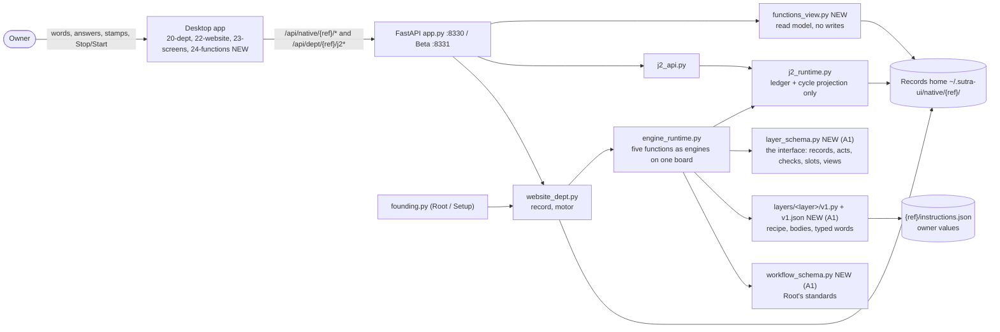
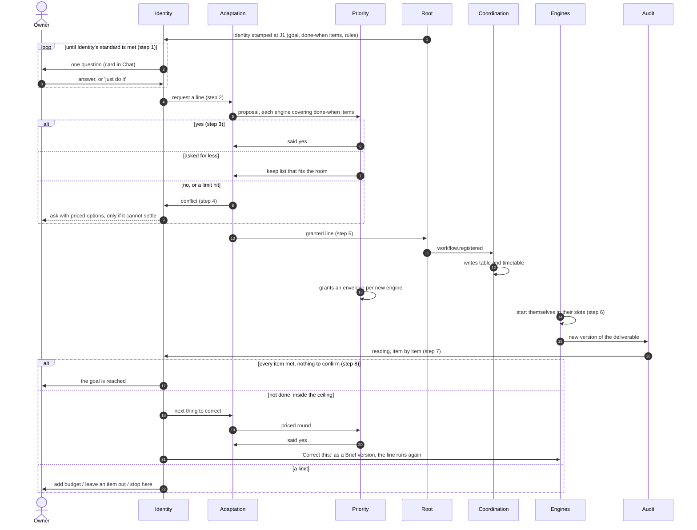
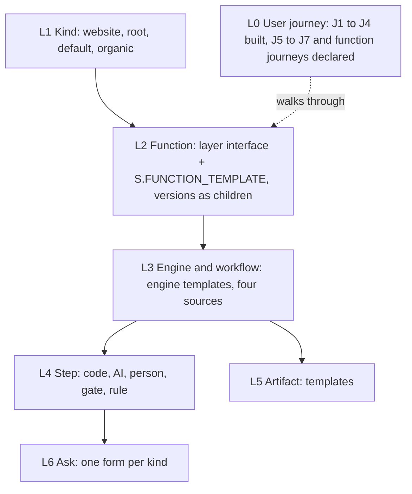
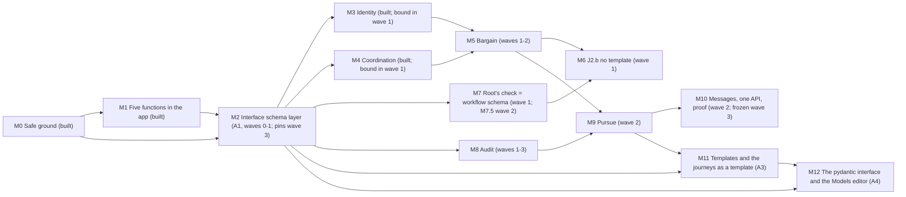

# PRD: The department and its five functions, in the Sutra app

_Status: Final for team review · Version 1.3 (1.0 of 2026-10-22, amended by A1, A2 and A3 on 2026-10-26 and by A4 on 2026-10-27) · Written by: solution architect · Rulings and marks by: the owner (founder) · Built, 2026-10-27 (W3-PROOF): function-prompts/ and its reader are deleted, and 37 dead copies leave engine_runtime's registries (165 entries to 128); the interface is frozen at schema version 1 (INTERFACE_SHA[1] = e23aeacef66e..., the sha256 of schemas/layers/interface.v1.json) and a key another layer owns is refused; the journeys' status lane reads 62 rows, 60 proven, 2 partly (J2.7 on BL-4b, J4.4 on BL-2b), 0 wanted, 0 faults (J1 16 proven; J2 15 proven, 1 partly; J3 18 proven; J4 11 proven, 1 partly). The proof run reads SM-1 0, SM-3 0, SM-4 0, SM-6 0, SM-13 0 on the scenario suite (212 departments, 97 tests in 4 lanes, models stubbed, C2, the interface in refuse mode), and SM-14 0 journey rows unproven. SM-6 is 0 on the record, with no cycle exempted: Identity files one card (words, stop) for a version Audit did not read, so an unread cycle holds a next move for the owner (W3-PROOF fix round 1, W3P-5 and W3P-7); nine unread cycles that stood so with no card in the first proof run now hold one. The J2 prototype and the site are untouched; the nine live Beta runs, the Human Simulation walk and SM-5 on a Beta walk stay pending under C2_  
_Based on: the Native site (department page, journeys.json v2.4; the five function pages, functions.json 1.5); Sutra `6bb38ec6` (2.306.25); the J2 prototype `564e3a7`._  
_Amended: A1, 2026-10-26 (the interface schema layer), on Sutra main `d24a467d` and the J2 prototype `3d8d2e8`; A2, 2026-10-26 (the class model of the interface layer), on Sutra main `827fe38f`; A3, 2026-10-26 (a template at every level, and the user-journey template), on Sutra main `a660b5a2` and the J2 prototype `f9ceba1`; A4, 2026-10-27 (the interface layer in pydantic, owner-defined models and the Models editor), on Sutra main `371ca4b1`. See [PRD-FIVE-FUNCTIONS-A1.md](PRD-FIVE-FUNCTIONS-A1.md), [PRD-FIVE-FUNCTIONS-A2.md](PRD-FIVE-FUNCTIONS-A2.md), [PRD-FIVE-FUNCTIONS-A3.md](PRD-FIVE-FUNCTIONS-A3.md) and [PRD-FIVE-FUNCTIONS-A4.md](PRD-FIVE-FUNCTIONS-A4.md)._

> **Amendment A1 (2026-10-26).** The owner directed that Root and the five layers (Identity, Adaptation, Priority, Coordination, Audit) be one hard-coded interface schema in code, that every department workflow conform to it from a coding perspective, that nothing about a layer's structure be managed through .md files, and that each layer's behaviour be a module that can change version by version behind the fixed interface. A1 does this: `layer_schema.py` holds the interface, from which JSON Schema files are generated; `layers/<layer>/v<N>.py` and `v<N>.json` hold each layer's recipe and bodies, pinned per department by a rule that keeps old pins working; `workflow_schema.py` holds Root's standards; typed instruction fields replace the .md files. It overrides the '.md files' wording of S-28 and G3 and the decision MK-7, rewrites M2, and folds M7 into the workflow schema. Section 10 below is revised for A1 and for what is built on main (M0, M1, M2.1 to M2.4, M3.1 to M3.7, M4.1 to M4.7, M6.1); every step says which wave builds it. Wave 0 is one package (the schema core), waves 1 to 3 run packages in parallel, and nothing is left to a later session (A1.26). Screens S11 and S16 change and S18 is new. Everything else in this page stands.

> **Amendment A2 (2026-10-26).** The owner asked where the base class and child class ideation is in this PRD, and said that as this is mostly interface and class ideation, it should be there. A2 writes it down. The interface (`layer_schema.py`) is the base class (also parent class, superclass, abstract base) and each layer version (`layers/<layer>/v<N>.py` with its `v<N>.json`) is a child class (also subclass, derived class, implementation). A later version can extend an earlier one: it names it in `PARENT`, writes only what differs (`layers.inherit` for the tables, words and layout; a patch for the recipe), and passes the same contract with five more cases, one of which runs the runtime's own definition check. The workflow sources are a family (fitted extends library, made extends shaped). The same base and child pair repeats at every level of template, down to the step; the other templates and the user journeys J1 to J4 as a template are amendment A3's. A2 changes no interface table, builds no runtime Python class, and amends A1 only by a header row and one line under A1.18 and under A1.19. See M2.12, the class model row in section 9.1, and the glossary (section 16).

> **Amendment A3 (2026-10-26).** The owner said that a template is the structured way of working anything, that is, the interface, the base class and its implementations; that every step has one; that each of the five functions has a template of its own in the J2 prototype, with a goal in it, which this PRD lacked; and that J1, J2, J3 and J4 are part of another template, the user journey, to be written into the PRD first and built after. A3 does it. A template is an interface is a base class at every level: the user journey (L0), the department kind (L1), the function (L2), the engine and workflow (L3), the step (L4), the artifact (L5) and the ask (L6), each with its children, the one sentence a child keeps, and a case that fails when it does not (A3.1). The step and the journey are typed in `layer_schema.py`. A function's template carries its own goal and done, its role words and the boundaries of the five official role files, sent in every function's card (A3.4). The journeys J1 to J4 are written out in full, every step and every IF IT GOES WRONG edge of the site and the earlier rows it keeps, each bound to the code and the tests that prove it, and their status is computed from passing tests and never typed: of 62 rows, 49 are proven today, 11 are built with a named gap or unproven, and 2 are wanted (J2.8 is wave 2's; J4.4 is built by A3 and stays partly built). J5 to J7 and the functions' own journeys are declared, not built. The journeys reach the UI port as data only. A3 changes no rule of A1 or A2 and amends them by one line each. See [PRD-FIVE-FUNCTIONS-A3.md](PRD-FIVE-FUNCTIONS-A3.md), M2.13, M11, section 9.5 and the glossary (section 16).

> **Amendment A4 (2026-10-27).** The owner directed that all of the interface layer be pydantic, that the owner be able to add and change some of those pydantic layers from the Sutra UI (enable and disable them, link and nest them, with the concept of object-oriented design), and that this must not affect streaming. A4 does it. The 130 definitions of `layer_schema.py` become pydantic v2 classes in a new package, `layer_models/`; `layer_schema.py` stays the one public facade, so nothing that calls it changes; the hand-written validator stays as a frozen oracle, and the port is proved equal to it (the same verdicts, the same sentences in the same order, the same JSON Schema) over the samples, every writer's output and a seeded fuzz, so the W3-PROOF freeze holds on the contract. The owner's models are data in the records home, compiled with `create_model` on a core base and held to twelve rules (a child may add or tighten, never drop or loosen; nest without a circle; link by id; polymorphism by tag; on and off with a defined meaning; versions with `PARENT`). A Models screen on Root's pane (S19 to S26, in the app's own style) edits them: a change that tightens is the owner's own act, with an undo, and a change that lets in more waits for the stamp. The existing streams are not made to validate and their frames stay byte for byte; a model's streamed answer is validated as it arrives and once whole. A4 changes no rule of A1, A2 or A3 and amends them by one line each. See [PRD-FIVE-FUNCTIONS-A4.md](PRD-FIVE-FUNCTIONS-A4.md), M12, section 9.1 and the glossary (section 16).

> **The J2 page in the app (2026-10-26).** The owner directed that the department's UI be the J2 prototype's page, in the exact same fashion, with no change. The screen steps of this PRD (S1 to S18 and the panes they name) are carried by that page or kept in records mode; [PRD-FIVE-FUNCTIONS-J2UI.md](PRD-FIVE-FUNCTIONS-J2UI.md) is the design of record, and its section 6 gives the disposition of each step. The decision rows it settles are listed at the end of [PRD-FIVE-FUNCTIONS-DECISIONS.md](PRD-FIVE-FUNCTIONS-DECISIONS.md).

> Build the department's five functions (Identity, Adaptation, Priority, Coordination, Audit) into the Sutra desktop app. Each one does its J2 job honestly for every kind of department, the owner sees the five working as one system, and the owner hears one voice: Identity's.

> **How to read this page**
> - **Milestones** are `M0` to `M12`, in dependency order. Every step has an id such as `M3.2`, with What, How, Where and a testable Done check.
> - **Screens** are `S1` to `S26`. Each has sample data from one department (Thread & Loom Website, 10:24, round 2) and a wireframe.
> - **Marks (`MK-n`)** are proposals for things the owner marked 'needs to be filled', 'marks owed' or 'placeholder'. A step that depends on a mark ships to stable only after the owner marks it. **Questions (`Qn`)** have defaults; the build may go ahead on a default behind the milestone's flag, in Beta only.
> - **Code short names:** R = `engine_runtime.py`, W = `website_dept.py`, J = `j2_runtime.py`, P = `J2_Prototype/j2.py`; all Sutra paths are under `sutra/marketplace/plugin/sutra-ui/`. `Lnnn` is a line of the department page text.
> - **Sizes:** S = up to 1 day · M = 2 to 4 days · L = 5 days or more. VSM labels are written 'VSM S5' so they are not confused with screen ids.

## 1. Context

The owner's design is on the Native site: the department page (journeys J1 to J7; J2 is the five functions working toward the identity's goal) and one page per function. The screenshot attached to the request shows the site's own menu, 'A department > The five functions > Identity, Adaptation, Priority, Coordination, Audit'. This PRD is therefore built around those five pages: each function's version 1 (founder, 2026-09-30), its journeys (FI, FA, FP, FC, FAU) and its J2 steps. Sutra 2.306.25 (6bb38ec6) already runs the five as engines on one board, and J2 steps 1 to 5 shipped on 2026-10-07. The J2 prototype (564e3a7) proved the loop with AI agents outside Sutra over 46 live runs and has a Map of the five. Rule for this document: anything the owner marked 'needs to be filled', 'marks owed' or 'placeholder' appears here as a proposal awaiting the owner's mark, never as a decision.

## 2. Problem

The five functions exist in code, but they do not tell the truth and they are not visible. Audit can report 'goal reached' on a version it never read: an unsampled version's judge is skipped, the skip returns no findings (R:1325-1326), and 'no findings' counts as done (J:445-461). Audit also reads only website output. When Priority counters on a Library kind, the engines it cut still run (R:3819-3839, J:130-140). Identity's standard only checks that fields exist, and every kind fills them, so it never asks (J:146-160). A blocked plan is a dead end. Budget holds never reach the ledger, because J.on_held is never called. A thin-words question cannot be answered through the API, because no ask is filed (J:440-442). On screen, function cards read the old registry instead of the runtime (dept_api.py:696-1161), only Map v2 shows the five together, and the site gives four of the five functions no designed screen yet.

## 3. Goals and non-goals

**Goals**

- G1 Each function does its J2 job for every kind (website, default, organic). 'Goal reached' is never claimed without Audit's reading of every done-when item.
- G2 The owner sees the five functions in the app as one system: what each is doing, who it waits on and what it spends. The owner hears only Identity, in plain words.
- G3 Each function reaches the version 1 the founder defined: one agent inside a code covering (S-28), its structure a hard-coded interface (`layer_schema.py`) and its instructions typed fields that code compiles into prompts (A1; no .md files). The owner can read its instructions in the app and change a field through an ask. Every level of the department has a template that is its interface (A3).
- G4 Every claim can be proved: the test lanes run what they say, the ledger records every step, and every reading carries evidence.
- G5 Reuse Sutra's runtime. Port only the prototype's tested parts: the map read model, priced questions, measurable checks, and the done verdict as a covering check.
- G6 Each journey the owner named (J1 to J4) is a typed template whose status comes from passing tests, never from prose (A3).

**Non-goals**

- Growth steps 9 to 14 (grow from repeats, two writers, rules from stamps, context packs, harden, split). Growth is paused after step 8 (founder, 2026-09-27).
- Adaptation's compass, Learn, Grow as a move, lessons and playbooks. Their logic is 'named and empty', and prototype memory was polluted (109 mock playbooks). Whether the Make module's levels belong in version 1 is open (MK-3).
- Spinning out child departments (D-f). Parked with growth.
- Priority's figures (actuality, capability, potentiality). They need run history; M5.3 keeps per-run spend and the check verdict as Priority's first indices.
- A content model for locks and shared standards. It is designed but has no content model yet. Coordination's timetable is in scope (M4.3).
- Per-department engine definitions. That would refactor the global definitions model. The default for Q5 keeps born engines in the records-home Library, tagged made_by. (A1 adds per-department versions of each function layer in wave 3, W3-PINS, by the rule in A1.18; the Library's work engine definitions stay global.)
- The six-tab department screen. Set aside by the founder on 2026-09-29.
- Porting the prototype's AI scheduler or its one-loop relay. Coordination alone cost 25 to 32 percent of input tokens there.
- Migrating to the .ds-* design tokens (T15 is dead). U1 (the site's visitor) and U2 (several things in one place), which are not filled on the site.
- Browser-driven Audit checks (overflow at 360 and 1280 px, script errors). Parked; only browser-free checks ship (M8.6).
- The prototype's Adaptation planner (realization and certainty), its confidence judge, its 33-stage table, its rate card and its per-workflow agents: judged in A3.4.9 and left, with the planner recorded as a candidate child version of `adaptation/v1`. Typing J5 to J7 and the functions' own journeys beyond a declaration, and typing the work engines' prompts (A3.15).

## 4. Who it is for

| Who | Need |
|---|---|
| The owner: one person running organisations and departments in the desktop app | Give words, answer one question at a time, see the five functions working, and trust 'goal reached'. |
| The founder: rules on design and marks proposals | One list of marks and questions, each with what it blocks and a default to accept or change. |
| Backend developer | The exact modules, functions, data shapes and tests for each step, with cited lines. |
| Frontend developer | The screens, the read model behind each one, the tokens, and the tests that pin them down. |
| Designer | Screens with sample data, states and wireframes; one colour table; the word rules; which screens are ruled and which are proposals. |
| QA and Human Simulation | A done-check per step, scenario tests for rare branches, and a proof run with metrics. |

## 5. Success metrics

| Metric | Target | How measured |
|---|---|---|
| SM-1 'Goal reached' claimed without a reading of every done-when item for that version | 0 | qa/j2_metrics.py (M10.4) matches every goal.reached event to a readings.jsonl row for the same version, with every item met. Runs over the scenario suite and every Beta department. |
| SM-2 Test lanes that report PASS with 0 tests run | 0; test_j2, test_j2_api and test_j1 run in the department suite | Output of run-tests.sh and qa/walks/suites.sh (M0.1). The publish gate (pytest -q over all files) already collects them. |
| SM-3 Runs of an engine that is not on a registered line and was not stamped through J5 | 0 | Compare the engines in runs.json with the union of dept.workflows and J5-stamped engines, plus the five functions. |
| SM-4 Posts to the owner from anyone but Identity | 0 (regression check; the edges table already refuses them) | Scan board.jsonl for posts with dst Owner and src not Identity. |
| SM-5 Freshness of the five-function view | On screen within 3 s of the record change, for 95 percent of changes | JS test with a timer stub (2.5 s poll), plus timestamps from a Beta walk. |
| SM-6 Dead-end states | 0 states where the owner has no next move | Scenario suite: every end state that is not done has a pending ask with options. |
| SM-7 Kinds that reach a real 'done' | 3 of 3 (website, default, organic) | Scenario suite plus the M10.4 proof runs. |
| SM-8 Owner effort from birth to goal | Median 3 or fewer questions and asks (proposed, Q15) | asks.json across the 9 proof runs. |
| SM-9 Cost of a website department from birth to goal | Median 40 or fewer model calls and 3 USD or less (proposed, Q15) | Spend in runs.json per department across the proof runs. |
| SM-10 Ledger append time | p95 5 ms or less at 10,000 events | Benchmark test (M0.2). It records the figure but does not gate the build. |
| SM-11 Reversal trigger of the 2026-09-27 decision | Fewer than 1 run in 5 overspends its envelope or clashes in a slot, over the first 4 weeks on Beta | runs.json against envelopes. A clash is two runs on one slot id, or a start while another run of the department is open. |
| SM-12 Marks before stable | 100 percent of MK rows marked before the step that depends on them ships to stable | The open questions table at each milestone's review. |

## 6. The five functions (the heart of the department)

The screenshot shows the site's menu: _A department > The five functions > Identity, Adaptation, Priority, Coordination, Audit_. Each function below is traced from its site page (journeys and edges) to the steps and screens of this PRD.

| Function | VSM | In one line |
|---|---|---|
| Identity | VSM S5: identity and policy; closes the system | The department's voice and conscience. It hears you, checks that the identity is good enough, gates every effect by rule, closes conflicts, and says when the goal is reached. |
| Adaptation | VSM S4: outside and future; intelligence | Decides how the department gets there. It proposes the workflows the goal needs, from the Library, fitted, or made fresh. After each reading it proposes the next round, until the goal holds. |
| Priority | VSM S3: inside and now; the resource bargain | Prices every proposal against the room actually left and holds the budget. It answers yes, asks for less, or says no. It never orders. |
| Coordination | VSM S2: anti-oscillation; timetables and standards | Keeps the timetable: a slot for each engine, who goes first, one run at a time, hand-offs, a chain that stops at twelve, and an alarm past a window. It judges nothing about content. |
| Audit | VSM S3*: sporadic direct inspection | The second pair of eyes. It reads what the department actually filed, item by item against done-when, with code checks first, and it also drops in unannounced. Its findings go to Identity. |

**Each function is a template (A3.4).** The site's seven fields (goal, done, hears, writes, checks, envelope, settings) are the parts of one template that all five share, each with its own values. Goal and done are typed words (`goal.does`, `goal.done`); the other five are read from the interface. What a function is not and never does are constants of the interface; how it decides, what it may do and what it avoids are its version's words; and every rule of the prototype's five official role files has a recorded home (A3.4.5). The function's own journeys (FI1.., FA1.., FP1.., FC1.., FAU1..) below are children of the journey template, bound to the function (A3.8).

### Identity

| | |
|---|---|
| **VSM** | VSM S5: identity and policy; closes the system |
| **One line** | The department's voice and conscience. It hears you, checks that the identity is good enough, gates every effect by rule, closes conflicts, and says when the goal is reached. |
| **Its own goal** | It holds the goal and the rules, judges every effect, and is the one the owner speaks with. (Typed as `goal.does`; A3.4.) |
| **Done when** | Every request has a verdict and every effect a gate answer, and the goal is said to be reached only from Audit's reading of every done-when item. (A proposal, typed as `goal.done`: the site says placeholder until you mark it; A3.4.) |
| **Holds** | Goal, done-when items, rules (go, ask, refuse, always), budget, owner and parent, each engine's window, and 'done, read against filed work'. After M3.1 these live in one record, dept.json. |
| **Hands to** | Adaptation: a request for a line; the next thing to correct; Coordination: verdicts on gates; You: the only function that speaks to you (edges table; _tell, R:2048) |
| **Rules it keeps** | Never makes anything; the maker is an engine. Asks only when a rule says ask (S-18); approvals only tighten (S-08). Never invents a goal or a rule; asks one decision-ready question at a time. Never writes the word 'charter' on screen. |
| **Status today** | Take, answer, rule and weigh are built, and so is closing a conflict (the code is ahead of the site). The standard checks presence only and never fires. Thin words ask a question but file no answerable ask. A rule given as an answer is tagged go. Blocked has no way out. Version 1 on its page: the words become the Brief, one question on thin words, the first-publish ask, a tell. The completeness loop is R1, marked 'later'. |
| **In the app** | First box on the Map. Its pane (S5) shows Enough to work?, the goal, done-when items, rules and conflicts closed. Chat speaks as the department with Identity's mark (S15). Settings > Instructions shows goal, completeness and take (S16). |

**Its journeys, traced** (page journey and edges > PRD steps > screens). These are declared children of the journey template (A3.8); a row that is a user journey's row says which:

- FI1 Enough to work? (J2 step 1; edges FI1.1 'still too little: ask again' and FI1.2 'J1 already answered it: no question') > M0.5, M3.2, M3.3 > screens S5, S6
- FI2 Words after go-live (J3; FI2.1 reaches outside: an ask; FI2.2 refuse: told why) > built; one voice in M3.6 > screen S15
- FI3 The gates (J2 step 6; FI3.1 no rule: goes and tells; FI3.2 refused: never goes) > built; the first-publish ask stays the one default (Q14) > screen S15
- FI4 Closes a conflict (J2 step 4; FI4.1 settled: no ask) > code shipped 2026-10-07; way out of blocked in M3.5, priced options in M5.4 > screens S5, S10
- Declares done from Audit's reading (J2 step 8) as a code check in its covering > M8.4 > screen S14

### Adaptation

| | |
|---|---|
| **VSM** | VSM S4: outside and future; intelligence |
| **One line** | Decides how the department gets there. It proposes the workflows the goal needs, from the Library, fitted, or made fresh. After each reading it proposes the next round, until the goal holds. |
| **Its own goal** | It decides how the department reaches its goal and keeps changing how as it learns: it proposes the workflows the goal needs, from the Library or shaped fresh, and a step's move up or down the ladder. (Typed as `goal.does`; A3.4.) |
| **Done when** | Identity's done-when holds on Audit's reading, and Adaptation has nothing more to propose. (A proposal, typed as `goal.done`: the site says placeholder until you mark it; A3.4.) |
| **Holds** | Its proposals on the board, ideas.json, ladder.json and its rounds. From M5.1, every proposal names the done-when items each engine covers. |
| **Hands to** | Priority: every proposal and every round (a required wire); Identity: conflicts, and a granted round to file; Root: a granted line, for its check |
| **Rules it keeps** | Senses and proposes; never applies. Every proposal passes Priority first. May drop an engine unless the template marks it required (S-06, S-21); may reword inside model steps without an ask (S-07). Engines come from Adaptation, never from Root (S-10). |
| **Status today** | Proposing a line is partly built: a Library line is taken word for word, and offline the shaped line is a fixed draft. Taking a counter and reshaping twice are built. The next move is missing. Version 1 on its page (2026-09-30) is 'two to five workflows... no loop, no Make module'. J2 step 8 (2026-10-01) asks for the loop; Q2 settles which governs. |
| **In the app** | A box on the Map. Its pane (S8) shows the latest proposal or round, a table of which engine covers which item, Root's check, reshapes and the next round. Settings > Instructions shows goal, sense, decide and make. |

**Its journeys, traced** (page journey and edges > PRD steps > screens). These are declared children of the journey template (A3.8); a row that is a user journey's row says which:

- FA1 The first workflows (J2 steps 2 to 5; FA1.1 refused: reshape; FA1.2 no agreement: to Identity; FA1.3 not confident: ask) > M5.1, M5.2 > screen S8
- J2.b No template fits: make the workflows from the identity, the goal and the practices in place. The owner's focus; 'needs to be filled' > M6 (spike, marks, build) > screen S8
- FA2 Pursue until done (J2 step 8; FA2.1 budget out: waits; FA2.2 chain at 12: stops; FA2.3 no move left: an ask; FA2.4 you say Stop) > M9 > screens S4, S8, S10
- FA3 Crystallize a step (built as the rung proposal you stamp) > kept; plain words in M10.3
- FA4 Grow out and FA5 Learn > later (growth paused; Learn is a placeholder)

### Priority

| | |
|---|---|
| **VSM** | VSM S3: inside and now; the resource bargain |
| **One line** | Prices every proposal against the room actually left and holds the budget. It answers yes, asks for less, or says no. It never orders. |
| **Its own goal** | It grants each engine its envelope and answers proposals that cost something. (Typed as `goal.does`; A3.4.) |
| **Done when** | Every proposal has an answer with its price, and no run went past its limit without a hold and an ask. (A proposal, typed as `goal.done`: the site says placeholder until you mark it; A3.4.) |
| **Holds** | One envelope per engine (calls and USD a day) and the bargain threads. From M5.3 it also holds per-run spend and the check verdict as its indices; from M9.2, the ceiling for the goal. |
| **Hands to** | Adaptation: said yes, asked for less, or said no; Identity: through Adaptation's conflict post when a limit is hit |
| **Rules it keeps** | Prices and holds the budget; never orders (S-05). Never starts a run; never rejects over method. Never changes the goal or speaks to you. |
| **Status today** | The bargain is a stub: 'room' means 1 to 6 engines and the cost is a constant. The envelope gate is built, but its holds never reach the ledger. A counter on a Library kind has a bug. All three templates say it orders the queue. Version 1 on its page: 'the envelope gate, as built. Nothing else.' |
| **In the app** | Its pane (S9) shows the bargain as a timeline with three limit bars, today's budget as bars, and spend by round. Settings shows limits and Instructions (goal, bargain). |

**Its journeys, traced** (page journey and edges > PRD steps > screens). These are declared children of the journey template (A3.8); a row that is a user journey's row says which:

- FP1 The envelope on every start (FP1.1 over: held, asks; FP1.2 you set a new limit) > built; holds reach the ledger in M0.4 > screens S9, S10
- FP2 The bargain with Adaptation (J2 step 3; FP2.1 at the limit: to Identity; FP2.2 refused: idea parked) > M5.3, M5.4 > screen S9
- Grants an envelope to each newly registered engine (move 4 of the nine) > M4.1
- Holds the goal's ceiling (rounds, calls, USD) as a gate in its covering > M9.2

### Coordination

| | |
|---|---|
| **VSM** | VSM S2: anti-oscillation; timetables and standards |
| **One line** | Keeps the timetable: a slot for each engine, who goes first, one run at a time, hand-offs, a chain that stops at twelve, and an alarm past a window. It judges nothing about content. |
| **Its own goal** | It keeps what engines share: one run at a time, who goes first when several are ready, who may post to whom, the chain's limit, a thread's bounds, and the alarm. Its own agent says who goes first when several functions are ready at once. (Typed as `goal.does`; A3.4.) |
| **Done when** | Every ready engine had its turn by the rule the table declares, one run at a time, and no chain, window or lost request went unanswered. (A proposal, typed as `goal.done`: the site says placeholder until you mark it; A3.4.) |
| **Holds** | coordination.json: the order, the line, the timetable (from M4.3) and who may post to whom. Also the run rows and thread bounds. |
| **Hands to** | Identity: alarms, lost requests, verdict asks; Priority: verdict asks |
| **Rules it keeps** | No model call inside a tick; a missed slot runs once; one run per slot. The engine starts itself in its slot (2026-09-27). Never changes envelopes, scope or quality calls. |
| **Status today** | Ordering, the chain limit, bounds, the alarm and the in-app motor are built. The line is not rebuilt from the registered workflow. Hand-offs are hard-coded for the website kind. There is no timetable record. Version 1 on its page: 'as built'. |
| **In the app** | Its pane (S7) shows the timetable, what is waiting and why, who makes and who reads each thing, the chain bar, alarms and ties. The engine card (S17) carries the motor. Settings shows who goes first, who may message whom, and Instructions (goal, tie). |

**Its journeys, traced** (page journey and edges > PRD steps > screens). These are declared children of the journey template (A3.8); a row that is a user journey's row says which:

- FC1 Who goes first (FC1.1 a tie: one AI call; FC1.2 a held one holds the ones after it; FC1.3 past its window: an alarm) > built; reasons and ties shown in M4.5 > screen S7
- FC2 A lost request (J1 edge) > built > screen S15
- Writes its own table and a slot for each engine when a plan is registered (move 5 of the nine) > M4.1 to M4.3 > screen S7
- Carries an alarm straight to Identity past an engine's window > built (run window, 30 minutes by default)

### Audit

| | |
|---|---|
| **VSM** | VSM S3*: sporadic direct inspection |
| **One line** | The second pair of eyes. It reads what the department actually filed, item by item against done-when, with code checks first, and it also drops in unannounced. Its findings go to Identity. |
| **Its own goal** | It drops in on what went live and checks claims against the record. (Typed as `goal.does`; A3.4.) |
| **Done when** | Every version of the deliverable was read item by item, and every finding went to Identity, saying where it is and what it claims. (A proposal, typed as `goal.done`: the site says placeholder until you mark it; A3.4.) |
| **Holds** | Its readings (readings.jsonl, from M8.3) and its findings. |
| **Hands to** | Identity only: readings and findings |
| **Rules it keeps** | The checker is never the writer (R8); it never touches a workflow or a version. A check is a check, never a score. Reads what the department did, never only its goal (POSIWID). |
| **Status today** | Works for websites only, and starts only on a checked Live site. It samples v1 to v3 and then every third version, and a skipped version counts as clean. The judge checks facts only, and there is no reading per item. Version 1 on its page: 'as built: read the live site against the words'. |
| **In the app** | A box on the Map. Its pane (S12) shows done-when as read, readings per version, findings and where each went, and spot checks. Settings > Instructions shows goal and judge. |

**Its journeys, traced** (page journey and edges > PRD steps > screens). These are declared children of the journey template (A3.8); a row that is a user journey's row says which:

- FAU1 Read the result (J2 step 7; FAU1.1 a hole: asks you; FAU1.2 a workflow with web tools looks it up) > M0.3, M8.1 to M8.3, M8.6 > screen S12
- Sporadic, unannounced spot checks of engine state (ruled 2026-09-27) > M8.7 > screen S12
- Verification in the S-30 shape (ruled; marks owed) > reading format in M8.3; levels and angles wait for MK-2

## 7. Principles and rulings every build keeps

| Rule | Source |
|---|---|
| One system of five functions, with no system above them. j2_runtime records and projects; it never rules. | Department page, internal systems (L1000); internal-system page, 'regress stop' |
| Only Identity speaks to you, in plain words, and it asks only when a rule says ask. | J2 lead (L557); S-29; S-18. Q1 is open against AMEND-2026-09-21-01 |
| The engine starts its own runs, Coordination keeps the timetable, and Priority grants budgets and never starts a run. | Decision of 2026-09-27 (L1081), with its reversal trigger |
| Coordination keeps the table and the tie. Priority prices and holds the budget, and never orders. | S-05 |
| Root makes the department and its five functions, then hands over. It never creates or starts engines; engines come from Adaptation. | S-10; D-b |
| The AI may act unless a person narrows it with a rule, a Stop or a refusal. | S-18 |
| Approvals are set per department and may only tighten. | S-08 |
| No engine is mandatory unless its template says so. | S-06; S-21 |
| Every engine and function is a code covering around an AI inside. Code verdicts live only in the covering. | S-22; S-23 |
| Version 1 of each function is one agent with typed instruction fields inside its covering. Its structure is the interface in `layer_schema.py`; its behaviour is a module behind it. No layer's structure is managed through .md files. | S-28, as amended by A1 (owner, 2026-10-26); each function page |
| Every workflow a department runs conforms to the workflow schema, checked in code at birth, at proposal, at registration, when the line grows, and on every write. | A1 (owner, 2026-10-26) |
| A layer's version may change freely behind its interface; the interface changes only with a new schema version and a migration. | A1 (owner, 2026-10-26) |
| Adaptation and Priority bargain, Identity closes their conflicts, and what Identity cannot settle goes to you. | S-29 |
| A verification names subject, claim, evidence, method, verdict and severity. | S-30 (ruled; marks owed) |
| Adaptation senses and proposes and never applies; every proposal passes Priority first. | Internal-system invariant; S3-S4 wire (2026-09-27) |
| Audit is its own system, sporadic and unannounced. The checker is never the writer, and a check is never a score. | Founder 2026-09-27 (L1243-1244); R8 |
| Every thread between functions is bounded by 4 hops, 15 minutes and a spend limit. At a limit, it goes to Identity. | Engines page s5; J2 step 3 |
| The motor makes no model call inside a tick. A missed slot runs once, and each slot runs once. | Department page, the motor |
| Growth is paused after step 8. | Founder, 2026-09-27 |
| Mark before build: anything the owner marked 'needs to be filled' ships only after the owner marks it. | Department page L285; the screens process |
| Fit the existing Mac app. The Map is closed except for its ruled additions. Status folds into the NOW line, Motor into the engine card, and the Board is renamed Internal messages. | Founder 2026-09-29; current-state |
| Never 'charter' or 'internal system' on screen. No counts at rest; names, never paths; status never shown by colour alone. | Words rule 2026-09-21; A28; tests W9 and W19 |
| Show 'Root' for now. | Founder 2026-10-07 (PRD-1007 section 6); WB_HELPER |
| Components only render; every write is an ask the owner stamps; CSS uses tokens only. | ADR-023; test_website V12 |
| Born engine templates stay local, and workflows register on the department's record. | S-12; S-25 (Q5) |
| A template is an interface is a base class, at every level; a child keeps one stated sentence, and a case fails when it does not. | A3 (owner, 2026-10-26); A2.2 |
| A journey's status is computed from passing tests; a row either binds to code and tests or says it is wanted. | A3 (owner, 2026-10-26) |
| A function's boundaries are the interface's; its behaviour is its version's words. | A3.4 |
| The interface is pydantic, in code; the owner builds only on the places the code declares, tightening by their own act, and a change that lets in more waits for the stamp. | A4 (owner, 2026-10-27); A4-7, A4-10 |
| A stream is never slowed or reshaped by validation: nothing is built or validated per frame in an existing stream, and its frames stay byte for byte. | A4 (owner, 2026-10-27); STR-1 to STR-10 |

## 8. Where things stand today

_As of 2026-10-26, Sutra main `d24a467d` holds M0, M1 and its fix, M2.1 to M2.4, M3.1 to M3.7, M4.1 to M4.7 and M6.1; section 10 marks each step built or to build. The lists below are the state this PRD started from (2.306.25)._

**Built in Sutra (2.306.25)**

- The five functions run as engines on one append-only board, with FIPA acts, A2A thread states and bounds of 4 hops, 900 s and 0.5 USD (R:62-69, R:626-677).
- Only Identity may post to the owner: the edges table refuses any other post (engine_defs edges; R:634).
- The J2 cycle and its ledger sit behind J2_FLOW_V1, which is on by default. Steps 1 to 5 shipped on 2026-10-07, including closing a conflict and Root's check (j2_runtime.py; R:3785-3953).
- J1 birth is a conversation: Setup's converse step (B1) and no stamp at birth (B2) are built (setup.json; R:3045; R:1746-1749).
- An in-app motor ticks every 3 s, with code-first Coordination: one run at a time, a chain limit of 12, a run-window alarm and thread bounds (W:911; R:798-1087).
- An envelope gate per engine, with an escalated envelope ask (R:1823-1834).
- Identity's take, answer, rule and weigh, plus its gates: first publish, setup when a rule says ask, wait for an engine (R:2122-2266, R:1701-1749).
- Audit's pick, mechanical, judge and file steps run on a checked Live site (R:2882-2948).
- 15 function templates picked at birth, under a narrowing-only law (function-templates/; test_function_templates.py).
- In the app: each function's pane (template framework, Chat, Settings), Map v2 with five function boxes, the Agent activity J2 card, and the organisation row as Root's chat (FE20, FE22, FE23).
- The publish gate runs pytest -q over every test file (PUBLISH-CHECK.md step 4).

**Built and measured in the J2 prototype (564e3a7)**

- The full J2 loop, with AI agents for the five functions, builders and a code validator, over 46 live runs (j2.py).
- Identity's intake with to_be_confirmed, two audiences enforced in code, and a code-built decision question capped at twice the budget (P:3512, P:2885, P:4141).
- Priority answering GRANT, COUNTER or REFUSE from a rate card, with the envelope check as code (P:5268, P:5676).
- Audit with headless render checks, rubric R-1 to R-7 and conditions N1 to N8, plus a code-decided workable() (j2_check.py; P:2240).
- A Map tab: the Functions row with state, speaks-to lines (three at most, the rest in a closed dropdown), made-by, a 'not recorded' list and a phone card list (j2_map.py, 564e3a7).
- The atom/1 schema, receipts and artifacts/1 (j2_schema.py; docs/atom-schema.md).
- Measured lessons: relay cost (Coordination took 25 to 32 percent of tokens), memory pollution, and how rare bargains are (9 counters and 0 refusals).

**Designed on the site, not built**

- Identity's completeness loop (FI1, R1) and its journeys. J2.a is 'needs to be filled'.
- J2.b with no template: the Make module, the practices in place and the compass. 'Needs to be filled'.
- Pursue (FA2), Learn (FA5), and Grow as a move of its own (FA4).
- Coordination's timetable with slots, hand-offs, locks and shared standards; the table as a setting (S-15).
- Priority's bargain for the line, priced from the budget; indices and figures.
- Audit's sporadic, unannounced checks (ruled 2026-09-27); the S-30 verification engine and its templates (marks owed).
- Root's standards list (a placeholder) and registration on the department's record (S-25).
- Screens: a NOW line on the Map; Status folded into the NOW line; Motor folded into the engine card; Internal messages replacing the Board; asks as cards in Chat; screens for Adaptation, Priority, Coordination and Audit ('needs to be filled').

## 9. Architecture in the Sutra app

Sutra's runtime stays the control flow. Each function is an engine, with a code covering around an AI inside, that talks only on the department's board, and engines start themselves in Coordination's timetable. This PRD adds one read-only projection, functions_view.py, that every screen reads. Amendment A1 puts Root and the five layers behind one hard-coded interface (`layer_schema.py`) and each layer's recipe and bodies in a module of its own (`layers/<layer>/v<N>.*`); each function's prompts are compiled from typed fields, with the owner's values kept in the records home (`{ref}/instructions.json`). New verdicts go where the rulings put them: 'done' in Identity's covering, the ceiling in Priority's covering, and the table and timetable written by Coordination. j2_runtime stays a ledger and a projection of the cycle, never a supervisor above the five. Amendment A3 adds the templates of every level beyond the layers (the step, the kind, the engine and artifact templates, the ask), the function template, and the user-journey template with its computed status; see A3.1 and section 9.5.



### 9.1 Components

| Component | Status | Location | Responsibility |
|---|---|---|---|
| Engine runtime | Existing, changed | sutra-ui/engine_runtime.py | Runs the five functions as engines. Adds: _root_checks, registration handlers for Coordination and Priority, identity.enough, identity.done, adapt.fit, adapt.pursue, audit.items, the _prompt loader, and covering checks that fail loudly. |
| J2 cycle and ledger | Existing, changed | sutra-ui/j2_runtime.py | Holds the ledger and the cycle projection only. Gains an append-only JSONL file with a sidecar index; a thin-words ask; reopen. J.audited is retired. |
| J2 API | Existing, small change | sutra-ui/j2_api.py | Two cursors (after_seq, after_board) and open_question in the status. |
| Department record and motor | Existing, changed | sutra-ui/website_dept.py | dept.json becomes the one record of who the department is. Writes the registry charter as a mirror; adds last_deliverable and options on asks. |
| Runtime API | Existing, extended | sutra-ui/website_api.py | Adds /functions, /functions/{fn}, /messages and /instructions; asks accept {option}. |
| Functions read model | New | sutra-ui/functions_view.py | One read of the five functions, from the record only: state, what each waits on, its line, spend against envelope, speaks-to, made-by and 'not recorded'. Writes nothing. |
| Interface schema layer (A1) | New | sutra-ui/layer_schema.py | Root's and the five layers' interface in code: records and department keys, acts and edges, in-process calls, verdicts, covering checks, settings, prompt slots, views, the workflow schema and its standards, option kinds; the validator and the migrations. |
| Layer modules (A1) | New | sutra-ui/layers/<layer>/v<N>.py and v<N>.json; layers/__init__.py (registry), prompts.py, contract.py | Each layer's recipe and bodies, its typed words and layout, and its view, pinned by version. |
| Workflow schema (A1) | New | sutra-ui/workflow_schema.py | The code of Root's standards, run at birth, proposal, registration, grow and write. |
| Class model of the interface layer (A2) | New | sutra-ui/layers/lineage.py, layers/versions.py; layers/contract.py (cases 9 to 13); layer_schema.WORKFLOW_FAMILY | The base class is the interface and a layer version is its child class. A version names the version it extends (`PARENT`), inherits its tables, words, layout and surface (`layers.inherit`) and patches its recipe (`layers.recipe`); the contract keeps it substitutable, and the runtime's own definition check (`layers.definition_faults`) keeps it loadable. The workflow sources form a family (fitted extends library, made extends shaped). No runtime Python class is built. |
| Template interface (A3) | New | sutra-ui/layer_schema.py (its A3 section), template_checks.py, test_layer_templates.py | `DEFS` for the step, its row, the engine start, the Library engine template, the kind and the artifact template; `S.TEMPLATE_LEVELS`, `S.ASK_FORMS`. The shape law beside `engine_runtime.validate`'s definition law. |
| Function template (A3) | New | layer_schema.py (`FUNCTION_TEMPLATE`, `DEPARTMENT_AGREEMENT`, the parts of the `goal` group), layers/<fn>/v1.py, layers/contract.py (case 14), engine_runtime.card | A function's own goal and done, its role words and the boundaries of the official role files, sent in the card of every function step. |
| Journey template (A3) | New | layer_schema.py (`journey` and its parts), journeys/ (the loader, the cases, the state, the walk helper, the data), qa/journey_status.py | J1 to J4 as typed children, J5 to J7 and the function journeys declared; the status computed from tests. |
| Pydantic interface (A4) | New | sutra-ui/layer_models/ (one module per layer), layer_consts.py; layer_schema.py kept as the facade; qa/a4_equiv.py | The 130 definitions as pydantic classes: annotation objects that carry the check and its JSON Schema, a translator that gives today's sentences in today's order, the old walker frozen as the oracle, the equivalence proof, the freeze on the contract. |
| Owner-defined models and the Models editor (A4) | New | layer_models/{spec,compile,store,owner_rules,hooks}.py, models_api.py, static/js/26-models.js | Models the owner makes in Root > Settings > Models (S19 to S26): compiled with `create_model` on a core base, held to twelve rules, kept with history in the records home, accepted at the extension points; a change that lets in more waits for the stamp. |
| Streaming guards (A4) | New | layer_models/{frames,stream}.py, qa/stream_bench.py | The streams stay as they are; frames as models; partial validation of a streamed answer; the `models` event on the sessions stream; the benchmark. |
| Function instructions | Built, reworked by A1 | function-prompts/<fn>/<file>.md (the fallback until each layer holds its words in wave 1; deleted in wave 3); owner values in {records}/{ref}/instructions.json | Typed fields that code compiles into prompts, byte for byte as the .md parts were. |
| JSON Schema files (A1) | New, generated | sutra-ui/schemas/layers/*.schema.json, interface.v1.json | Generated from layer_schema.py by `python layer_schema.py --write`; never edited by hand. |
| Function templates | Existing, wording changed | sutra-ui/function-templates/priority/*.json | Priority's floor, choices and chat_brief stop saying it orders. The 13 keys are unchanged. The card reads a picked template's whole floor (A3.4.6). |
| Engine definitions | Existing, changed | sutra-ui/engine_defs/website.json | Audit and Adaptation start on the department's deliverable. Adds Audit's timer trigger, required flags, the new steps, and a call_usd prior in Priority's template. |
| Founding | Existing, changed | sutra-ui/founding.py | Writes the shaped goal and Root's drafted done-when items into dept.json. |
| Older department API | Existing, narrowed | sutra-ui/dept_api.py | Kept for registry-only departments. Runtime departments stop calling it for function cards (M10.2). |
| Department and runtime screens | Existing, changed | static/js/20-dept.js, 22-website.js, 23-screens.js, 19-org2.js | The Map's NOW line and function boxes, function panes, the question card in Chat, Internal messages, and new sub-departments routed to Root. |
| All five overview | New (proposal, MK-8) | static/js/24-functions.js | The S2 overview and a shared renderer for function nodes. Loaded before 09-tail.js. |
| Styles | Existing, extended | static/panel.css | Adds the --fn-* colours in both themes, the hollow waiting ring, and --soft. Tokens only. |
| Test lanes and metrics | Changed and new | run-tests.sh, qa/walks/suites.sh, qa/j2_metrics.py | Lanes run what they report; the metrics script reads only the record. |

### 9.2 Data

| Data | Location | Shape |
|---|---|---|
| dept.json (the one record of identity) | ~/.sutra-ui/native/{ref}/dept.json (Beta: ~/.sutra-ui-beta) | Adds done_items [{id, text, how, level}] (how and level kept as said, judged by Identity's covering), to_be_confirmed [{item, why}], workflows[n] {version, engines, source, registered, by, checks, covers, deliverable, left_out, fit}, schema_version and layers (A1), and ceiling {rounds, calls, usd, start} for the goal (Priority's, from wave 2; it replaces envelopes._goal). Typed as DEFS department in layer_schema (A1.6). done stays as joined text for older readers. All additions are additive. |
| Ledger | {ref}/j2-events.jsonl + {ref}/j2-index.json | One j2.event.v1 row per line (fields as J:78-116). The index holds {keys, last_event_by_cycle, count}. The old j2-events.json is converted once and kept as .bak. |
| Cycle state | {ref}/j2-state.json | Adds round, event_count, and an open_ask that is now also set for thin words (missing: words). |
| Readings | {ref}/readings.jsonl (new) | {v, artifact, cycle_id, round, read: true\|false, why_not_read, items: [{id, subject, claim, evidence, method: code\|model, verdict: met\|not_met\|to_confirm, severity}], at} |
| Coordination's table | {ref}/coordination.json | line is the registered engines. Adds timetable [{engine, on: 'after <artifact> vN' \| 'every <period>', window_min, since}]. by is 'Coordination'. Engines left out stay in dept.engines with in_line: false. |
| Asks | {ref}/asks.json | Adds options [{id, label, cost, kind, params}] (kind and params optional, A1) and chosen {id, label, at, by, words}. New kinds: done_items, instructions, blocked; j2_identity gains missing: words. Typed as identity.ask (A1.8). |
| Instructions | defaults in each layer's v1 (WORDS, LAYOUT); owner values in {ref}/instructions.json | Typed values {layer: {group: {part: {field: {value, at, ask}}}}}, written only on a stamped instructions ask (A1.16). An M2.2 override file {ref}/prompts/<fn>/<file>.md is kept as the owner's note. |
| Root's standards | in code: layer_schema.WORKFLOW_STANDARDS and workflow_schema.py | (id, says, sources, stages) and the code check behind each; read-only for the owner (S18). |
| Layer recipes | layers/<layer>/v<N>.json | Each function engine's handlers, steps, gates and rules, moved out of engine_defs/website.json (A1.18). |
| Registry charter | ~/.sutra-native/user-kit/charters/C-<sha>.json | A one-way mirror of dept.json, written directly (no org.charter proposal) on every identity_revision bump. The Org screen still reads it. |
| Journeys (A3) | journeys/*.json, journeys/functions/*.json | `DEFS['journey']`: one file a journey; shipped in the bundle. |
| Journey status (A3) | journeys/status/<id>.json (generated by `qa/journey_status.py --write`) | `DEFS['journey.status']`: a state for every row, from the last run of the tests the journey lists. |

### 9.3 APIs

| Method and path | Purpose | Status |
|---|---|---|
| GET /api/dept/{ref}/j2 | Cycle state. Adds open_question {id, text, missing} (M0.6). | Changed |
| GET /api/dept/{ref}/j2/events?after_seq=&after_board= | Ledger and board rows, paged by two cursors (M0.2). | Changed |
| POST /api/dept/{ref}/j2/answer {text} | Answers Identity's open question. Works for thin words after M0.5. Errors: 400 EMPTY_ANSWER; 409 NO_OPEN_QUESTION, ALREADY_HANDLED. | Existing |
| POST /api/dept/{ref}/j2/start \| stop \| resume | Start already resumes a stopped cycle (begin calls resume). | Existing |
| GET /api/native/{ref}/functions | The five nodes plus cycle {state, step, says, steps, needs_you, ceiling} and not_recorded (M1.1). 404 for a ref that is not a runtime department. | New |
| GET /api/native/{ref}/functions/{fn} | One function: its page fields, recipe and journeys (M1.7), plus its J2 part. Identity: standard, done_items, rules, conflicts. Adaptation: proposal, coverage, root_checks, rounds. Priority: bargains, envelopes, rounds. Coordination: timetable, holds, handoffs, chain, alarms, ties. Audit: readings, findings, spot_checks. | New |
| GET /api/native/{ref}/messages?fn=&after= | Internal messages over board_view: {from, to, act_words, summary, at}, read only, with private keys stripped (M10.1). | New |
| POST /api/native/{ref}/asks/{aid} {approve} \| {option, text} | Stamp or refuse, or choose a code-applied option (M3.5). Errors: 409 {code: UNKNOWN_OPTION \| ALREADY_HANDLED}, 400 {code: EMPTY_ANSWER}; OVER_CAP from wave 2. | Changed (built) |
| POST /api/native/{ref}/instructions {fn, group, part, field, value} | Files an instructions ask for one typed field; nothing changes until the stamp (M2.6, A1). The old {fn, file, text} body is 400. | Changed (A1) |
| GET /api/native/{ref}/layers | {schema_version, pins, available, standards: [{id, says}], describe}: the interface as the screens need it (M2.7, A1). 404 for a ref that is not a runtime department. | New (A1) |
| POST /api/native/{ref}/ask {text} | The owner's words. The Org sheet's 'New sub-department' also uses it under an organisation with a Root (M1.4). | Existing |
| GET /api/native/{ref}/map \| status \| board \| chat?fn= | Existing reads. The Map's NOW line also reads /functions. | Existing |
| POST /api/native/{ref}/envelope {engine, calls, usd} | The owner's limits; 'raise' options apply through it. | Existing |
| GET /api/native/journeys | The journeys, their states and counts, read only (A3.6). | New (A3) |
| GET /api/native/journeys/{id} | One journey with the state of every row. 404 {code: UNKNOWN_JOURNEY}. | New (A3) |

### 9.4 The J2 loop and its edges

| Step | Function | What happens | Code today and after |
|---|---|---|---|
| 1 · J2.a Enough to work? | Identity (Root drafts the identity at J1) | Reads the identity Root stamped (goal, done-when items, rules) against its standard. Asks one question at a time until the standard is met, or until 'just do it'. | Today: presence check (J:146-160); thin words with no ask (J:440). After: M0.5, M3.2, M3.3. |
| 2 · J2.b Deciding what to do | Adaptation | Proposes workflows that cover every done-when item: a Library line fitted to the use case, or 2 to 5 engines made when no template fits. | Today: _line_request (R:3744), adapt_source verbatim (R:3752-3766), fixed offline draft (R:4295). After: M5.1, M5.2, M6. |
| 3 · J2.c The bargain | Priority with Adaptation | Priority prices from observed spend against the room left, then says yes, asks for less, or says no. Bounded by 4 hops, 900 s and 0.5 USD. | Today: room means 1 to 6 engines, cost is a constant (R:2721-2727, R:4107-4118). After: M5.3, M5.4. |
| 4 · J2.d Closing a conflict | Identity, then you | No agreement, or a limit hit: Identity rules run, drop or ask. An ask carries options built by code, and blocked always has a way out. | Built 2026-10-07: _line_conflict (R:3776), p_identity_close (R:3906-3953). After: M3.5, M5.4. |
| 5 · J2.e Root's check | Root, then Coordination and Priority | Root checks the granted line against its standards file and records workflow.registered. Coordination writes its table and slots; Priority grants envelopes. | Today: _root_check (R:3785); the event lists a fixed set of checks (J:401-403). After: M0.7, M4.1, M7. |
| 6 · J2.f Running the work | Coordination and the engines | Engines start in their slots, one run at a time. Holds name what is missing, and envelope holds go on the ledger. | Built: next_due, coord_pick, blocked (R:798-930); priority_envelope (R:1823). After: M0.4, M4.2 to M4.5. |
| 7 · J2.g Reading the result | Audit, then Identity | Audit reads the deliverable item by item: the mechanical code step first, then the AI judge inside. It files a reading, and Identity weighs it three ways. Audit also drops in unannounced. | Today: Live site only, sampled, and a skipped version counts as clean (R:2882-2948, R:1325). After: M0.3, M8. |
| 8 · J2.h Next move, or done | Identity (done); Adaptation (next round) | Identity's covering declares done from the reading. Otherwise Adaptation proposes a priced correction round inside the ceiling, Identity files it as a Brief version, and the line runs again. | Today: 'found nothing' counts as done (J:445-461); no next move (R:2808-2856). After: M8.4, M9. |
| Edge J2.1 Identity not good enough | Identity | Asks until the standard is met, or 'just do it' fills defaults and names them. | M0.5, M3.3 |
| Edge J2.2 The bargain hits 4 hops, 15 minutes or its spend | Priority > Identity | Goes to Identity (built 2026-10-07), then to you with priced options if Identity cannot settle it. | R:651-656, R:3776; M5.4 |
| Edge J2.3 Identity cannot close | Identity > you | One ask with options built by code. | R:3906-3953; M3.5, M5.4 |
| Edge J2.4 A workflow fails the standards | Root > Adaptation | Refused with the broken standard named, reshaped at most twice, then an options ask. | R:3800-3820; M7.2, M3.5 |
| Edge J2.5 Past the day's calls or money | Priority | Held, with an ask; recorded on the ledger; priced options. | R:1823-1834; M0.4, M5.4 |
| Edge J2.6 Wants to send something outside | Identity | Asks the first time (the born rule). Whether that conflicts with S-18 is open. | identity_gate (R:1725); Q14 |
| Edge J2.7 A result fails its check | Check, Coordination, Identity | Sent back twice at most, then an options ask. Today the owner is only told. | _send_back (R:1607); M9.5 |
| Edge J2.8 You change the goal | Identity | A goal rule you stamp reopens a cycle at step 1. | R:2582-2596; M9.8, Q7 |

The eight steps are the sub-journeys J2.a to J2.h of `journeys/J2.json`, and the edges are its rows J2.1 to J2.8 with the tests that prove them; where this table says 'After: M...' the journey row says `partly` or `wanted` until the named step merges (A3.7, A3.9).



### 9.5 Templates: the interface at every level (A3)

A template is an interface is a base class, at every level (A3.1). The same pair repeats: a typed base in `layer_schema.py`, children that conform, one sentence a child keeps, one case that fails when it does not.

| Level | Base class (the interface) | Children | The sentence a child keeps |
|---|---|---|---|
| L0 User journey | `DEFS['journey']` | J1 to J4 (built here); J5 to J7 and the functions' journeys (declared) | May add rows, tests, rulings and quotes; may not drop, move or re-word a row the site lists; carries no typed status; each row binds to code and passing tests or is wanted |
| L1 Department kind | `DEFS['kind']` | website, root, default, organic | Names its line, the required engines inside it, rules, a use case and a functions template |
| L2 Function | the layer interface extended by `S.FUNCTION_TEMPLATE` and the `goal` parts | the layer's versions; separately, a Default template and its use-case templates | Keeps the role, the "is not", the "never" lines and the agreement, supplies the words within limits; a use case adds floor lines and keeps the checks |
| L3 Engine and workflow | `DEFS['engine.library']`, `DEFS['workflow']` | engine templates (born ones add `made_by`); the four workflow sources | Names its start and steps that conform; a child source keeps its parent's standards |
| L4 Step | `DEFS['step']` | code, AI, person, gate, rule | Identity, nature, born rung, a registered check and a body of its kind; a unit starts and ends by code; only the free fields change between versions |
| L5 Artifact | `DEFS['artifact.template']` | the ten templates; an app's | Names its files, checks that exist, when it counts and operations that are engines |
| L6 Ask | `DEFS['identity.ask']`, `S.ASK_FORMS` | one form per ask kind | A known kind, at most three known options, filed only by Identity |



The journey template, with its children J1 to J4 and the computed status, is in A3.6 and A3.7; the step template in A3.3; the function template, with each function's own goal and done, in A3.4. The journeys reach the UI port as data only (two read-only routes, no screen).

## 10. Milestones

_Revised for amendment A1 (2026-10-26) and for what is on main `d24a467d`. Each step says whether it is built, and in which wave of A1.26 the rest is built._

| Id | Name | Status | Centres on | Depends on | Size |
|---|---|---|---|---|---|
| M0 | Safe ground | built, rework | All five · bug fixes inside every version 1 · S-31: department × LIFE | none | L · built. A1 rework S: W0-SCHEMA (wave 0), W1-ROOT and W1-AUDIT (wave 1) |
| M1 | The five functions in the app | built, rework | All five, as the owner sees them · screens only · S-31: department × PARTS | M0.1, M2.2 (for M1.10) | L · built. A1 rework S (W1-CORE, wave 1); M1.11 S in wave 3 (W3-MAP) |
| M2 | The interface schema layer and the layer modules | to build | Root and all five · the hard-coded interface (A1) · S-31: function × PARTS | M0, M1 | L · wave 0: one package, about 75 min; wave 1: W1-CORE (first merge at about 40 min) and every layer package; wave 3: W3-PINS and W3-PROOF |
| M3 | Identity: one record, its standard, a way out | built, rework | Identity (VSM S5) · FI1, FI4 · beyond version 1 (R1) · S-31: function × LIFE | M0, M2.1, M2.2, M2.3 | L · M3.1 to M3.7 built; M3.8 and M3.9 inside W1-IDENTITY (about 75 min, wave 1) |
| M4 | Coordination: the timetable, and the line is what was granted | built, rework | Coordination (VSM S2), with Priority's envelopes · FC1, FC2 · S-31: function × PARTS | M0, M1.1, M2.1, M2.2, M2.3 | L · M4.1 to M4.7 built; M4.8 inside W1-COORD (about 50 min, wave 1); M4.9 in wave 3 (W3-BOARD) |
| M5 | Adaptation and Priority: a bargain that means something | to build | Adaptation (VSM S4) and Priority (VSM S3) · FA1, FP1, FP2, J2.c · S-31: function × MEETINGS | M2, M3.2, M3.5, M4.2 | L · wave 1: M5.1, M5.3, M5.7, M5.8 (W1-ADAPT, W1-PRIORITY); wave 2: M5.2, M5.4, M5.5, M5.6 |
| M6 | Adaptation: workflows when no template fits (J2.b, the owner's focus) | to build | Adaptation (VSM S4) · J2.b, FA1.3 · MK-3 taken from the desk spike · S-31: function × LIFE | M3.2, M3.9, M5.1, M7.1 | L · M6.1 and M6.2 done; M6.3 to M6.5 inside W1-ADAPT (wave 1, its last three steps) |
| M7 | Root's check is the workflow schema | to build | Root · J2.e · MK-4 taken · folded into the workflow schema (A1) · S-31: organisation × LIFE | M2.1, M2.3, M4.4 | M · M7.1 to M7.4 in wave 1 (W1-ROOT about 90 min; W1-UI); M7.5 in wave 2 (W2-CHECKS) |
| M8 | Audit reads every result against done-when | to build | Audit (VSM S3*) · FAU1, J2.g · S-30 (MK-2 taken) · S-31: function × LIFE | M0.3, M2, M3.2, M4.2 | L · M8.1 to M8.3 and M8.9 inside W1-AUDIT (about 80 min, wave 1); M8.4 to M8.6 and M8.8 in wave 2; M8.7 in wave 3 |
| M9 | Pursue: keep going until done | to build | Adaptation, with Priority and Identity · FA2, J2.h · S-31: department × LIFE | M5, M8 | L · wave 2: W2-IDENTITY, W2-ADAPT, W2-PRIORITY and W2-SCREENS (about 80 min) |
| M10 | Internal messages, one API, the proof run | to build | All five · ruled screens 3.1 to 3.4 · S-31: department × MEETINGS | M1, M2, M9 | M · wave 2: W2-SCREENS and W2-PROOF; wave 3: W3-PROOF reruns the proof |
| M11 | Templates at every level, and the journeys as a template (A3) | to build | Every level of the department; the user journeys J1 to J4 · S-31: department × MEETINGS and function × PARTS | M2.12, M4 to M9 for the rows it binds | L · five packages (A3.12); A3-CORE first, the rest alongside and after wave 2 |
| M12 | The pydantic interface and the Models editor (A4) | built | The interface layer; the owner's own models · S-31: organisation × PARTS | M2, M11 (A3-CORE); the closure round and W3-BOARD merged | L · six packages (A4.9), about 1,010 minutes of developer time, about 640 on the critical path |

**How it is built (A1.26).** Parallel developer agents, each in its own git worktree with its own files, merged into main one at a time by an integrator on a green gate, then verified.
- **Wave 0** (about 75 min): W0-SCHEMA alone, the schema core: layer_schema.py bound to the writers on main, warn mode at every write point and on every post, the generated JSON Schema files, the recipes in `layers/<layer>/v1.json`, the contract helpers, and a conftest fixture that fails any test meeting a fault.
- **Wave 1** (about 110 min): W1-CORE (the registry, the seam and the typed prompt compiler first, then typed owner instructions and the interface API), W1-ROOT, W1-IDENTITY, W1-ADAPT, W1-PRIORITY, W1-COORD, W1-AUDIT and W1-UI. Every built milestone is bound to the interface, and M7.1 to M7.4, M3.9, M5.1, M5.3, M6.3 to M6.5 and M8.1 to M8.3 are built. It ends with the integrator's 'A1 interface: refuse' commit.
- **Wave 2** (about 80 min): W2-PRIORITY, W2-IDENTITY, W2-CHECKS, W2-ADAPT, W2-SCREENS and W2-PROOF build M9 and M10, and M5.2, M5.4 to M5.6, M7.5, M8.4 to M8.6 and M8.8.
- **Wave 3** (about 50 min): W3-PINS, W3-BOARD, W3-MAP and W3-PROOF build per-department versions (M2.11), board/1 (M4.9), spot checks (M8.7), the metro WORK row (M1.11), and the freeze (M2.10).
- **A3** (about 8 hours of developer time over five packages, beside waves 2 and 3): A3-CORE (types, about 75 minutes) merges first, before wave 2's first merge; A3-JOURNEYS (the machinery, about 100 minutes) after it; A3-FUNCTIONS (about 130 minutes) after the last wave-2 layer package and A2-INHERIT and before W3-PINS; A3-J12 and A3-J34 (about 90 and 100 minutes) after wave 2, J34 after J12. No wave-2 package waits for A3; W3-PINS and the freeze in W3-PROOF wait for A3-FUNCTIONS (A3.12).
- **A4** (about 17 hours of developer time over six packages, after the closure round and W3-BOARD): A4-CORE (about 130 minutes) first; A4-PORT (about 270) and A4-OWN (about 210) beside each other, A4-PORT merging after W3-PROOF X2 or first; A4-STREAM (about 150) any time after A4-CORE; A4-UI (about 190) after A4-OWN; A4-DOCS (about 60) last (A4.9). Nothing in waves 2 and 3 waits for A4.

Waves 0 and 1 end at about 3 h 05 min, wave 2 at about 4 h 25 min, wave 3 at about 5 h 15 min; the owner's 3-to-4-hour window closes inside wave 2, and waves 2 and 3 run straight after in the same build.



**Working agreement:** one branch per package (`a1/<package>`, `a2/<package>`, `a3/<package>`), one commit per step named after it ('A1 <step id>: <title>'), the gate green before each merge, and never a push. Each package owns the files and engine_runtime regions its spec lists; nobody edits the four registry literals or def_version (the integrator bumps it); a package adds its own layer's interface rows in 'A1 interface:' commits, and the integrator makes the shared ones. At a wave's cut-off the integrator merges whole steps, and a step not merged opens the same layer's package in the next wave. Every milestone still ships to Beta (:8331) first, then a Human Simulation walk, then the owner's review, then stable.

### M0 · Safe ground

| | |
|---|---|
| **Centres on** | All five · bug fixes inside every version 1 · S-31: department × LIFE |
| **Goal** | Remove the ways the system misreported, and ship the owner's one missing control, so that every later claim can be proved. A1: every record M0 writes now fits the interface. |
| **At the end, the owner sees** | Identity's question as a card in Chat that can be answered; no 'goal reached' on a version Audit did not read; budget holds shown in Agent activity. |
| **Status** | built, rework |
| **Ships screens** | S6, S15 |
| **Depends on** | none |
| **Size** | L · built. A1 rework S: W0-SCHEMA (wave 0), W1-ROOT and W1-AUDIT (wave 1) |

**M0.1 · Test lanes run what they report (built)**
- **What:** Every developer lane runs its tests, and the department suite runs the J1 and J2 tests.
- **How:** Built (f29768f2). A1, wave 0 (W0-SCHEMA): qa/walks/suites.sh runs each test_layer_*.py file in a lane of its own, since those fixtures reload modules, and one more lane runs test_runtime_characterization.py, test_function_templates.py and test_prd_docs.py.
- **Where:** `run-tests.sh; qa/walks/suites.sh`
- **Done check:** ./run-tests.sh test_j2.py prints its passed count, and a broken assert makes both scripts exit 1. Each test_layer_*.py file prints its own line in the suites, and so does the new lane.

**M0.2 · The ledger appends without reading the file (built)**
- **What:** An append-only JSONL ledger with a sidecar index and two cursors.
- **How:** Built (42567e32). A1: the ledger keeps its own schema, j2.event.v1. The interface names its event names and never owns them.
- **Where:** `j2_runtime.py; j2_api.py`
- **Done check:** test_j2_ledger.py passes unchanged.

**M0.3 · An unread version is never 'clean' (built; reworked in wave 1)**
- **What:** 'Found nothing' counts only when Audit's judge actually read the version.
- **How:** Built (5a6e2f44). A1, wave 1 (W1-AUDIT, with M8.3): a version not read is also an audit.reading row with read false and why_not_read, appended to readings.jsonl through W.append_row and checked there.
- **Where:** `engine_runtime.py (audit_file, _j2_audit_read, the run_engine Audit hook); j2_runtime.not_read`
- **Done check:** An offline website department never writes goal.reached. From wave 1 it also writes one readings.jsonl row with read false that passes S.validate_record('audit', 'reading', row).

**M0.4 · Envelope holds reach the ledger (built)**
- **What:** Each envelope hold is one ledger event.
- **How:** Built (01d12cec). A1: the escalated envelope ask passes the asks.json sink as identity.ask. Priced options on it come in wave 2 (M5.4).
- **Where:** `engine_runtime.priority_envelope; j2_runtime.on_held`
- **Done check:** With a 0-call envelope, 20 ticks and 20 reads give one envelope.held and one escalated ask, and the gate meets no fault.

**M0.5 · Thin words become an answerable question (built)**
- **What:** Identity's question on thin words is a real ask.
- **How:** Built (0f7b6af8). A1: the j2_identity ask validates as identity.ask with missing 'words'.
- **Where:** `j2_runtime.questioned and answer`
- **Done check:** A department born from 'a website' shows open_question, and its ask passes S.validate_record('identity', 'ask', a) (test_layer_writers.py).

**M0.6 · Identity's question as a card in Chat (built)**
- **What:** The open question renders as a card in Chat with an answer box.
- **How:** Built (3d2941ee). No A1 change.
- **Where:** `static/js/22-website.js (wbChatHtml)`
- **Done check:** test_website.js passes unchanged.

**M0.7 · An honest Root-check event (built; reworked in wave 1)**
- **What:** workflow.validated lists the checks that actually ran.
- **How:** Built (c002fe18). A1, wave 1 (W1-ROOT): each row is a workflow.check {check: standard id, passed, why} in WORKFLOW_STANDARDS order. The old names become ids, and 'one to six engines' becomes size_in_range (Q11).
- **Where:** `engine_runtime._root_checks; j2_runtime.registered and refused; test_j2.py test_m0_7_*`
- **Done check:** test_m0_7_* assert standard ids for a Library line and a shaped line, and every row validates as workflow.check.

**M0.8 · Safe-ground records fit the interface (A1, wave 0)**
- **What:** Every ask, table and check row M0 writes validates against layer_schema.
- **How:** The sink in website_dept._write checks asks.json and coordination.json, and test_layer_writers.py has one test per writer (W0-SCHEMA).
- **Where:** `website_dept._write; test_layer_writers.py`
- **Done check:** Across the gate the conftest fixture meets no fault (SM-13 is 0 for M0's records).

**Acceptance:**
- The J1 and J2 tests and every test_layer_*.py file run in the department suite.
- No offline or unsampled version ever produces goal.reached.
- A thin-words department can be answered from Chat and from /j2/answer.
- A budget hold shows once in Agent activity.
- Every record M0 writes validates (SM-13 is 0 on the gate).

**Ported from the prototype:** Honest records: say 'not read' rather than guess (j2_map.py 'not recorded'); Every pause carries an answerable question (P:3018 _ask_user)

**Risks:** Validating writes may surface shape bugs in M0 paths. Mitigation: wave 0 runs warn mode with strict tests, and DEFS follow the writers where the writer is right.

---

### M1 · The five functions in the app

| | |
|---|---|
| **Centres on** | All five, as the owner sees them · screens only · S-31: department × PARTS |
| **Goal** | One read of the five functions, taken only from the record, feeds the Map, the list column and each function's pane. A1: each pane's data is its layer's view, typed by the interface. |
| **At the end, the owner sees** | On the Map, each function's box says whether it is working or waiting, and whether it waits on the owner; each pane shows its job, holdings, recipe and journeys with live status; the All five overview. |
| **Status** | built, rework |
| **Ships screens** | S1, S2, S3, S4 |
| **Depends on** | M0.1, M2.2 (for M1.10) |
| **Size** | L · built. A1 rework S (W1-CORE, wave 1); M1.11 S in wave 3 (W3-MAP) |

**M1.1 · The functions read model (built)**
- **What:** functions_view.functions(ref) and GET /functions.
- **How:** Built. A1, wave 2 (W2-PRIORITY, with M9.2): cycle.ceiling and _budget read dept.ceiling.
- **Where:** `functions_view.py; website_api.py`
- **Done check:** test_functions_view.py passes.

**M1.2 · Speaks-to and made-by from the record (built)**
- **What:** Pairs from board.jsonl; makers from runs; readers from definitions.
- **How:** Built.
- **Where:** `functions_view.py`
- **Done check:** test_functions_view.py passes.

**M1.3 · Function colours and the waiting ring (built)**
- **What:** --fn-* tokens and the hollow waiting ring.
- **How:** Built. A1 keeps the token rule: a function colour says who, a state colour says how.
- **Where:** `static/panel.css`
- **Done check:** The contrast and tokens-only tests pass.

**M1.4 · Every new department is a runtime department (built)**
- **What:** A new sub-department goes to Root.
- **How:** Built. A1, wave 1 (W1-ROOT): a department born this way carries layers = DEFAULT_PINS and schema_version 1.
- **Where:** `static/js/19-org2.js; website_dept.create`
- **Done check:** test_org2.js passes, and a new department's dept.json carries six pins.

**M1.5 · Map: the NOW line and honest function boxes (built)**
- **What:** Ruled Map rows 2.1 to 2.4.
- **How:** Built.
- **Where:** `static/js/23-screens.js`
- **Done check:** test_website.js passes.

**M1.6 · Function rows carry a state (built)**
- **What:** State dots in the list column.
- **How:** Built.
- **Where:** `static/js/20-dept.js`
- **Done check:** test_dept.js passes.

**M1.7 · Each function's pane mirrors its function page (built; reworked in wave 1)**
- **What:** Page fields, recipe and journeys per function.
- **How:** Built. A1, wave 1 (W1-CORE): the page fields (vsm, line, holds, hands_to, keeps, v1) are read from S.LAYERS (functions_view.PAGES moves there), the hears rows from S.hears(), and the checks rows from S.CHECKS.
- **Where:** `functions_view.function`
- **Done check:** Each pane's hears rows equal S.hears(layer) in words, and functions_view holds no PAGES table.

**M1.8 · The 'All five' overview (built)**
- **What:** S2.
- **How:** Built.
- **Where:** `static/js/24-functions.js`
- **Done check:** test_panel.js 21b passes.

**M1.9 · Refresh without flicker (built)**
- **What:** Repaint only on change.
- **How:** Built.
- **Where:** `static/js/22-website.js`
- **Done check:** With the timer stub, an unchanged answer causes no render.

**M1.10 · Each pane reads its layer's view (A1, wave 1)**
- **What:** function(ref, fn)['j2'] is the pinned implementation's view(), validated against S.VIEWS.
- **How:** _j2_part delegates to layers.view(ref, layer, d, events, asks). Each layer's v1.view returns today's read model by reference (FV._identity_part, FV.coordination, and the Adaptation, Priority and Audit parts). An invalid view gives today's part plus j2_faults, and the read never raises (W1-CORE; each layer package for its view).
- **Where:** `functions_view.py (_j2_part); layers/<layer>/v1.py (view)`
- **Done check:** test_functions_view.py passes. A stub view is returned; an invalid one gives j2_faults and today's part; every v1 view validates on the contract fixture.

**M1.11 · The Map's WORK row as a metro line (wave 3; prototype 3d8d2e8)**
- **What:** A trunk in registered-line order with the deliverable last, left-out engines on a hollow branch, status-only colours in WORK, and the NOW line naming open items.
- **How:** W3-MAP: wb2MapHtml lays the stops along a trunk from map_view's line order and draws engines with in_line false as hollow branch nodes labelled 'left out'. WORK colours come from state only. NOW adds '1 item left open: D6 to confirm' from Audit's latest reading. No personas, rings or send branches.
- **Where:** `static/js/23-screens.js (wb2MapHtml)`
- **Done check:** test_website.js: trunk order equals the registered line; a left-out fixture draws one hollow branch node; no --fn-* colour in WORK; the NOW pill names an open item.

**Acceptance:**
- For every runtime department, the Map, the list and each pane agree with each other and with the record in every J2 state.
- Each pane's J2 data is its layer's view, and every v1 view validates (test_layer_contracts).
- SM-5 is met on a Beta walk.

**Ported from the prototype:** map/1 function node and its state rules (j2_map.py); Speaks-to lines: three at most; Metro trunk, status-only colours and the open-items line (3d8d2e8), in part, in wave 3 (M1.11)

**Risks:** The metro WORK row reopens the ruled Map. Mitigation: only the trunk, the left-out branch and status colours are adopted (MK-8), and the owner can drop M1.11 alone.

---

### M2 · The interface schema layer and the layer modules

| | |
|---|---|
| **Centres on** | Root and all five · the hard-coded interface (A1) · S-31: function × PARTS |
| **Goal** | Root and each of the five layers become one fixed interface in code (layer_schema.py), and every record, post and workflow is checked against it at birth, at proposal, at registration, when the line grows, and on every write. Each layer's recipe and behaviour sit in its own module, changeable version by version without touching the interface. Typed fields that code compiles into prompts replace the .md instruction files. The M2.1 to M2.3 built before A1 (.md files, file overrides, whole-file editing) are reworked by M2.5 to M2.7. |
| **At the end, the owner sees** | Under each function's Settings: its instructions as named fields (the task, the guidance, what it does, its skills), each changed through an ask, with nothing a person changes able to break what a function answers, and a line saying which version it runs. In Root's settings: the standards every plan meets, read only. |
| **Status** | to build |
| **Ships screens** | S16, S18 |
| **Depends on** | M0, M1 |
| **Size** | L · wave 0: one package, about 75 min; wave 1: W1-CORE (first merge at about 40 min) and every layer package; wave 3: W3-PINS and W3-PROOF |

**M2.1 · The interface in code, bound to the writers, with its JSON Schema files (A1, wave 0)**
- **What:** layer_schema.py: the constants, types, validator, modes, DEFS and tables of A1.3 to A1.17, with the public functions, the migration, and the JSON Schema files generated from it.
- **How:** W0-SCHEMA transcribes A1. Every DEFS entry is taken from the writer on main (W.create, done_items, rule_row, option, options_ask, choose_option, apply_done_items, founding.spawn, born, _put_table, timetable_row, left_out_row, priority_grant, j2_runtime.registered and questioned, _blocked, instructions_ask, identity_wait_engine's direct asks write). The records that waves 1 to 3 write first (prices, readings, rounds, the ceiling, questions, spot checks) are declared as A1.13b types them. SENDS comes from a scan of every post() call site, HEARS from every handler, CALLS from every cross-layer _ask_rule site, and PROMPTS literally from the .md parts by the split rule. `python layer_schema.py --write` generates schemas/layers/*.schema.json and interface.v1.json.
- **Where:** `new layer_schema.py, test_layer_schema.py, test_layer_writers.py, schemas/layers/ (generated files, README.md, fixtures)`
- **Done check:** test_layer_schema.py passes: every DEFS name has a passing example and, where the type allows, a failing one; edges() == defs()['edges']; every function handler is in S.hears(); every post site is in SENDS; every cross-layer _ask_rule is in CALLS; every soft step's out keys are in its part's returns; the A1.25 rulings hold; BOUNDS, CHAIN_LIMIT, REPAIRS, TABLE_FIELDS, SLOT_FIELDS and LEFT_OUT_FIELDS equal engine_runtime's and website_dept's; the v0 fixture migrates to the v1 fixture; the files under schemas/layers/ equal json_schemas(). test_layer_writers.py has one passing test per writer.

**M2.2 · The recipes in the layer modules, the registry and the seam (A1, waves 0 and 1)**
- **What:** The five function engine objects live in layers/<layer>/v1.json, defs() assembles them from the pins, and engine_runtime resolves each step's code, prompt, draft and check through the pinned module, falling back to its own registries.
- **How:** Wave 0 (W0-SCHEMA): the objects move byte for byte; defs() assembles them for DEFAULT_PINS; layers/__init__.py starts with the lazy proxies, ref_to and recipes(), beside six stub modules. Wave 1 (W1-CORE, its first merge K1): the registry of A1.18, the seam points of A1.19, impl on every step and gate row, and validate() against the interface.
- **Where:** `layers/; engine_defs/website.json; engine_runtime.py (defs in wave 0; _resolve, the seam functions and validate in wave 1)`
- **Done check:** After wave 0 the assembled defs()['engines'] equal test_fixtures/function-engines.base.json and the gate is green. After K1 a stub identity/v1 overriding identity_read is called for Identity's step, an empty module leaves the legacy function running, and every step row carries impl.

**M2.3 · Every write validates, at the sink (A1, wave 0)**
- **What:** dept.json, asks.json and coordination.json are checked where they are written; dept.json is migrated on read.
- **How:** W0-SCHEMA: website_dept._write looks the file up in S.SINK; save_dept(ref, d, by=None) checks the changed keys against the stored record; the never-refuse keys always land; W.dept migrates on read; W.append_row(ref, name, row) checks journal rows (readings, prices, rounds, spot checks) against S.SINK_JOURNALS; post() runs S.check_act before the append. Warn mode for the app; the conftest fixture fails any test that meets a fault.
- **Where:** `website_dept.py (_write, dept, save_dept, append_row, rows); engine_runtime.post (one call); conftest.py; layer_schema.py`
- **Done check:** The gate is green with no fault. A rule tagged 'maybe' saves (a standard gap, not a store fault), while an unknown key 'colour' on dept.json is one fault and one row. A direct asks.json write with an unknown status is caught. A v0 dept.json reads as v1 and is written back v1 on the next save, and nothing else is rewritten. Set_stopped always lands.

**M2.4 · Covering checks fail loudly (built)**
- **What:** Each function's covering check is code, and a failed check fails the step.
- **How:** Built (2fc61427). A1: every check name is listed in S.CHECKS[layer] or S.SHARED_CHECKS, with CONTRACT_SAMPLES for the ones that need no department in the context.
- **Where:** `engine_runtime.py (CHECK); layer_schema.py`
- **Done check:** test_layer_contracts: every listed check accepts its good samples and refuses its bad ones; test_covering_checks.py passes unchanged.

**M2.5 · Typed instructions replace the .md files (A1, wave 1)**
- **What:** Every function prompt is compiled by code from typed fields (WORDS and LAYOUT in the layer's v1), the inputs code fills, and the answer contract in the interface.
- **How:** W1-CORE (K1): layers/prompts.py (compile, prompt, words, the .md fallback, the extractor), and R._prompt, _goal_of and bundle_faults delegating to it; the snapshot test renders through the registry. Then each wave-1 layer package moves its own parts byte for byte, and W1-ROOT moves the inline setup prompts.
- **Where:** `layers/prompts.py; layers/<layer>/v1.py (WORDS, LAYOUT)`
- **Done check:** test_layer_prompts.py: compile(WORDS, LAYOUT, returns) equals every .md part byte for byte. The M2.1a snapshot passes unchanged, rendered through R._resolve. By the end of wave 1 no default pin uses the fallback.

**M2.6 · The owner's changes are typed values (A1, wave 1)**
- **What:** An owner change is a typed value for one field, checked at the ask and at the stamp, and kept in {ref}/instructions.json.
- **How:** W1-CORE: instructions_ask(ref, fn, group, part, field, value) and _apply_instructions; layers.prompts.words overlays owner values; an M2.2 override file is kept as the owner's note, with one Identity tell per department.
- **Where:** `engine_runtime.py (the instructions block); layers/prompts.py; website_api.py (POST /instructions)`
- **Done check:** The reworked M2.2a to M2.2e tests pass in typed form: a stamped value is used by the next run; a refused one leaves nothing; a value with '{{' or 'Return ONLY' is refused at the ask and at the stamp; an old override file is kept with one tell.

**M2.7 · Settings > Instructions as typed fields (S16), Root's standards (S18), GET /layers (A1, wave 1)**
- **What:** S16 lists groups, parts and fields with Change per field; S18 lists the standards read-only; each function says which version it runs.
- **How:** W1-CORE serves GET /api/native/{ref}/layers {schema_version, pins, available, standards, describe} and the typed instructions view. W1-UI renders S16, S18 and 'Runs version 1'.
- **Where:** `website_api.py; static/js/22-website.js (S16 block, wbRootPaneHtml settings); test_website.js`
- **Done check:** A render test lists every part and field of Identity; Change opens the right editor; Send posts {fn, group, part, field, value}; no paths and no 'Return ONLY' on screen; S18 lists the standards in order with no Change button; /layers is 404 for a ref that is not a runtime department.

**M2.8 · One module per layer, and the contract (A1, waves 0 and 1)**
- **What:** layers/root/v1.py and one module per function exist, with their recipes, and all pass the contract.
- **How:** W0-SCHEMA writes the contract helpers and the six stub modules; W1-CORE adds the compile case; each wave-1 layer package fills its module: steps by reference first, its words, its view, and by= at its save_dept calls.
- **Where:** `layers/<layer>/v1.py, v1.json; layers/contract.py; test_layer_contracts.py`
- **Done check:** test_layer_contracts passes for all six with no part on the fallback. The report lists the by-reference count per layer.

**M2.9 · The interface refuses (A1, end of wave 1)**
- **What:** MODE becomes 'refuse': a write that does not fit is refused, not only reported.
- **How:** The integrator's 'A1 interface: refuse' commit, after the full gate on main shows no fault and no refused row.
- **Where:** `layer_schema.MODE`
- **Done check:** The gate is green in refuse mode, and a hand-made bad table is refused with SchemaFault and one row.

**M2.10 · Retire function-prompts/ and the dead copies; freeze the interface (wave 3)**
- **What:** The .md folder, the legacy reader and the dead engine_runtime copies of moved bodies are deleted; the validator is cross-checked against jsonschema; the interface hash is frozen; a key written by a layer that does not own it is refused.
- **How:** W3-PROOF, after every other package of wave 3 has merged.
- **Where:** `function-prompts/; engine_runtime.py; layer_schema.py (INTERFACE_SHA, OWNERSHIP_MODE); layers/prompts.py; test_layer_schema.py`
- **Done check:** grep finds no 'function-prompts' in code; the snapshot passes; interface_sha() equals INTERFACE_SHA[1]; the validator agrees with jsonschema on 40 cases; a save that changes a key another layer owns is refused with one row.

**M2.11 · Per-department versions, by the rule that keeps old pins working (A1, wave 3)**
- **What:** A department runs the recipe and the bodies of the versions its record pins; Root's version is the organisation's; ladders are kept per version; the owner can change a pin through an ask.
- **How:** W3-PINS: defs() assembles the function engines per pin set, cached per pin tuple and chosen by a context variable that each entry point (the motor's slot, a board delivery, an API handler) sets from the department's pins. pins(ref) reads d['layers'], with 'root' always taken from the organisation's Root department. A pin the registry cannot load, or whose IMPLEMENTS is not SCHEMA_VERSION, runs the layer's default with one row. Ladder entries are keyed per (step, impl). root/v1 applies the pin option. PER_DEPARTMENT becomes True. A2 (M2.12): a pin may name a version that extends another (`PARENT`); its recipe is `layers.recipe(impl)`; a pin whose parent does not load, or whose resolved recipe makes the assembled definitions invalid (`layers.definition_faults`), runs the default with one row; a learned rung carries over to a child for a step it inherits unchanged (`layers.unchanged_steps`, A2-D13).
- **Where:** `layers/__init__.py; engine_runtime.py (defs, step_def, all_steps, _handler, ladder); layers/root/v1.py; layer_schema.PER_DEPARTMENT`
- **Done check:** With a stub child (A2's fixture, coordination/v2, whose patch adds a step), a department pinned to it runs the step and one on v1 does not, and both pass the contract; a child pinned to root/v9 runs the organisation's root version with one row; a pin whose definitions would be refused runs the default with one row; a pin change returns a step the new version changes to its born rung, and a step it inherits unchanged keeps its rung.

**M2.12 · A version that extends a version: the class model (A2, between wave 2 and wave 3)**
- **What:** The interface is the base class and each layer version is a child class (A2.1). A later version names the version it extends (`PARENT`), writes only what differs, and passes the same contract with five more cases (9 to 13). The workflow sources are a family: fitted extends library, made extends shaped, and a child source is held to every standard its parent source is.
- **How:** A2-LAW (`layers/lineage.py`: `merge_recipe`, `recipe_faults`, `merge_words`, `merge_layout`, `rank`, `tightens`, `ModelFault`, the fixed and free step fields) is new files only and merges any time. A2-INHERIT (`layers/versions.py`: `inherit`, `chain`, `recipe`, `definition_faults`, `unchanged_steps`; contract cases 9 to 13; a fixture child; `S.WORKFLOW_FAMILY`; `_line_notes` through `S.validate_workflow`) merges after wave 2 and before W3-PINS. No runtime Python class is built, the six v1 modules stay as they are, and no wave waits for A2.
- **Where:** `layers/lineage.py; layers/versions.py; layers/__init__.py (wrappers, recipes); layers/contract.py (cases 9 to 13); layer_schema.py (WORKFLOW_FAMILY); engine_runtime.py (_line_notes; validate's optional provided argument); test_layer_lineage.py; test_layer_inherit.py; test_fixtures/layers_lineage/`
- **Done check:** test_layer_contracts passes cases 1 to 13 for every version. A fixture child of coordination/v1 (a patch that adds one step and a words overlay) passes them, resolves when pinned, and its definitions validate. A soft step first or last in a unit passes the recipe law and fails case 13. A child source keeps every standard of its parent source, and nothing but `S.validate_workflow` calls `workflow_schema.run`.

**M2.13 · The function template (A3, between wave 2 and wave 3)**
- **What:** A function's own goal and done and its role are typed template parts; the boundaries of the five official role files are interface constants; the card sends them to every function step. Adaptation's goal is corrected to the site's, the card reads a picked template's whole floor, and the pane reads the typed goal.
- **How:** A3-FUNCTIONS (A3.4): `S.FUNCTION_TEMPLATE` and `S.DEPARTMENT_AGREEMENT` (A3-CORE C5), the parts `goal.done` and `goal.role_is`, `role_may`, `role_procedure`, `role_patterns`, `role_block` in the group `goal` (`S.ADDED_PARTS`), the words in each v1, contract case 14, `engine_runtime._role_block`, the floor fix, Adaptation's goal as a step of its own, the pane, and a comparison script for the block.
- **Where:** `layer_schema.py; layers/<fn>/v1.py; layers/contract.py; engine_runtime.py (card, _role_block, _floor_lines); functions_view.py (goal, done); test_layer_function_template.py; test_fixtures/templates/role-rules.json; qa/role_block_ab.py`
- **Done check:** Case 14 passes for all five versions, with a failing example per fault. The card of a function carries the block and a work engine's does not. The prompt snapshot differs only by the goal, the floor and the block, each in its own commit. Every rule of the five official role files has a home (`role-rules.json`, with a key phrase per rule). The whole gate is green.

**Acceptance:**
- Root and the five layers are typed in layer_schema.py, bound to the writers on main.
- Every write of dept.json, asks.json, coordination.json, instructions.json, every board post and every engine template is checked; SM-13 is 0 on the gate, then in refuse mode.
- Every function prompt is compiled from typed fields, byte for byte as before.
- An owner change is a typed value that takes effect only after a stamp, and survives an update.
- Each layer runs from its module, recipe included, and all six pass the contract.
- A department pinned to an older version keeps running that version's own recipe and bodies (wave 3).
- A version can extend another, write only what differs, and pass the same contract; the base class is the interface and a layer version is its child class (A2).
- A function's own goal and done are typed, and the boundaries of the five official role files are interface constants that every function's card sends (A3, M2.13).

**Ported from the prototype:** atom/1 and board/1 module style: a schema constant, status tuples, pure validators (j2_schema.py, j2_board.py)

**Risks:** Wave 0 is one package on the critical path. Mitigation: it is a transcription of A1, which names every type and table; it runs in warn mode with the conftest fixture, so a mismatch is a named failing test, never a refused birth; wave-1 packages read A1 and plan while it runs. Interface gaps found mid-wave. Mitigation: a package adds its own layer's rows additively ('A1 interface: <layer>:' commits); shared definitions change only through the integrator; generated files are regenerated, never merged by hand. Tests reload engine_runtime, which would leave modules holding stale functions. Mitigation: lazy proxies and ref_to; the contract catches delegate loops.

---

### M3 · Identity: one record, its standard, a way out

| | |
|---|---|
| **Centres on** | Identity (VSM S5) · FI1, FI4 · beyond version 1 (R1) · S-31: function × LIFE |
| **Goal** | Identity holds one record of who the department is, reads it against its own standard, asks only for what is missing, gives every blocked state a way forward, and speaks as the one voice. A1: all of this runs from identity/v1 behind Identity's interface. |
| **At the end, the owner sees** | Their own words as the goal; done-when items Root drafted at birth; a question only when Identity's standard is not met; a way forward from any blocked plan; Identity's pane. |
| **Status** | built, rework |
| **Ships screens** | S5, S6, S10, S15 |
| **Depends on** | M0, M2.1, M2.2, M2.3 |
| **Size** | L · M3.1 to M3.7 built; M3.8 and M3.9 inside W1-IDENTITY (about 75 min, wave 1) |

**M3.1 · One record of who the department is (built)**
- **What:** dept.json holds the goal, done-when, rules, owner and windows; the registry charter is a mirror.
- **How:** Built (284874f8, merged d24a467d). A1: dept.json is checked as DEFS department on every save (changed keys); the mirror goes through the proposals path as built (C1).
- **Where:** `founding.py; website_dept.py; dept_api.py`
- **Done check:** Founding 'a site for my bakery in Pune' gives the shaped goal, the mirror equals dept.json, and no fault is met in any J2 scenario.

**M3.2 · Root drafts done-when items at birth (built)**
- **What:** J1 ends with done_items in what Root stamps.
- **How:** Built (0c72fbe0). A1: items validate as identity.done_item, with how and level stored as said; the setup shape prompt moves into root/v1 WORDS byte for byte (W1-ROOT).
- **Where:** `engine_runtime p_setup_shape; website_dept.done_items`
- **Done check:** A founding test gives items, each with an id; offline there is exactly D1; the root prompt snapshot is unchanged.

**M3.3 · Identity reads the identity against its standard (built)**
- **What:** identity.enough reads the five points and asks one question at a time.
- **How:** Built (3f50fdbb). A1: completeness.enough becomes a typed part of identity/v1 (W1-IDENTITY); STANDARD is S.STANDARD; the budget point reads Priority's envelopes (no dept.budget).
- **Where:** `layers/identity/v1.py; engine_runtime (identity_enough)`
- **Done check:** Thin words get a question; 'just do it' starts step 2 and names its defaults; test_j2_identity.py passes unchanged.

**M3.4 · Rules and done-when items change through the right asks (built)**
- **What:** A rule given as an answer keeps its tag; a done-when change never overwrites the goal.
- **How:** Built (baa16619). A1: rule and done_items asks pass the asks.json sink as identity.ask.
- **Where:** `website_dept (rule_row, done_items_ask, apply_done_items)`
- **Done check:** 'Never publish without asking me' becomes a pending rule ask tagged ask, and both asks validate (test_layer_writers.py).

**M3.5 · A way out of blocked, with options (built)**
- **What:** From blocked, new words reopen step 2, and the blocked message is an ask with options.
- **How:** Built (51b2842f). A1: its options validate as DEFS option; W1-CORE adds kind (from the id's prefix) and params as optional fields; OPTION_KINDS names Identity as the layer that applies words, leave and stop.
- **Where:** `engine_runtime (_blocked, _blocked_chosen); website_dept (option, options_ask, choose_option)`
- **Done check:** Root refuses three times and the plan is blocked; each option is applied by code; an unknown option gives 409 UNKNOWN_OPTION; every blocked ask validates.

**M3.6 · One voice, in plain words (built)**
- **What:** In a department only Identity speaks, in plain words.
- **How:** Built (93b70d05). A1: the rule 'only Identity sends to Owner' is also an interface test on SENDS and a runtime check in validate_act.
- **Where:** `engine_runtime (_plainly, _tell); layer_schema SENDS`
- **Done check:** SM-4 is 0, and test_layer_schema's ruling test passes.

**M3.7 · Identity's pane (built)**
- **What:** S5 shows Enough to work?, the goal, done-when, rules and conflicts closed.
- **How:** Built (35ac6b16). A1: _identity_part is typed as view.identity, and identity/v1.view returns it by reference.
- **Where:** `functions_view._identity_part; layers/identity/v1.py`
- **Done check:** The view validates in assessing, waiting, blocked and done fixtures; the S5 render tests pass unchanged.

**M3.8 · Identity behind its interface (A1, wave 1)**
- **What:** identity/v1 holds Identity's recipe and registers every name it uses, holds its words, provides its view, and its writers say by='identity'.
- **How:** W1-IDENTITY: steps by reference; WORDS and LAYOUT for goal, completeness and take, from the extractor, proved byte for byte; by='identity' at Identity's save_dept calls.
- **Where:** `layers/identity/v1.py, v1.json; engine_runtime (Identity region, by= only)`
- **Done check:** test_layer_contracts passes for identity/v1 with no part on the fallback, and the M2.1a snapshot is unchanged.

**M3.9 · Identity asks Adaptation's one doubt (A1, wave 1; FA1.3, serves M6.4)**
- **What:** Below 0.6 confidence, Identity asks one question and nothing is registered.
- **How:** W1-IDENTITY: a handler 'Hear a doubt' (inform/doubt from Adaptation; W1-IDENTITY adds the HEARS row) files a j2_identity ask with missing 'plan' and the J2B-8 question built by code; its answer becomes a line request to Adaptation; 'just do it' takes the fallback; at most one per line request and two per cycle.
- **Where:** `layers/identity/v1.json and v1.py`
- **Done check:** A stub doubt gives one ask with no number in its text; answering posts request/line carrying the answer; a third doubt in the cycle files no ask.

**Acceptance:**
- A new department's goal is the owner's words, and its done-when items come from Root at birth.
- Identity asks only when its standard is not met.
- Blocked always offers options, and they validate.
- SM-4 holds.
- identity/v1 passes the contract.

**Ported from the prototype:** Intake with to_be_confirmed (P:3512); The two-audience guard: regenerate once, then use a template (P:2885); Options built and applied by code (P:4141)

**Risks:** The standard may ask too much. Mitigation: 'just do it' always ends the questions.

---

### M4 · Coordination: the timetable, and the line is what was granted

| | |
|---|---|
| **Centres on** | Coordination (VSM S2), with Priority's envelopes · FC1, FC2 · S-31: function × PARTS |
| **Goal** | When a plan is registered, each function does its own part, only granted engines run, and the screen says who goes first and why anything waits. A1: Coordination's table is a typed record, checked on every write. |
| **At the end, the owner sees** | Coordination's timetable, waiting rows with the exact reason, who makes and who reads each thing, and an engine card with the motor folded in. |
| **Status** | built, rework |
| **Ships screens** | S7, S17 |
| **Depends on** | M0, M1.1, M2.1, M2.2, M2.3 |
| **Size** | L · M4.1 to M4.7 built; M4.8 inside W1-COORD (about 50 min, wave 1); M4.9 in wave 3 (W3-BOARD) |

**M4.1 · Registration by the right functions (built)**
- **What:** Root records the plan; Coordination writes its table; Priority grants envelopes.
- **How:** Built (1c83126b). A1: the in-process calls from _j2_settle and engine_added are CALLS rows, and the inform/born handlers are HEARS rows (via call).
- **Where:** `engine_runtime (coord_table, priority_grant, engine_added, _j2_settle)`
- **Done check:** After registration coordination.json validates and says by Coordination; there is one envelope.granted from Priority per new engine; the CALLS test finds no undeclared site.

**M4.2 · The line is what was granted (built)**
- **What:** Engines Priority cut never run.
- **How:** Built (85be0c7a). A1, wave 1 (W1-COORD): set_line runs the workflow 'write' stage (line_is_registered) before it writes.
- **Where:** `engine_runtime.set_line; workflow_schema (W1-ROOT)`
- **Done check:** A counter keeps a subset and runs.json holds no run of a dropped engine (SM-3); a hand-made table with an unregistered engine is refused (refuse mode) or kept with one row (warn mode).

**M4.3 · Coordination's timetable is its own state (built)**
- **What:** One slot per engine, written by Coordination.
- **How:** Built (87f6be10). A1: timetable rows validate as coordination.slot (SLOT_FIELDS).
- **Where:** `engine_runtime (slot_of, _timetable, timetable_row)`
- **Done check:** Every registered engine has exactly one row, and the sink meets no fault.

**M4.4 · Required engines (built; Q12)**
- **What:** A kind can mark an engine required.
- **How:** Built (7d087cca, 8cac2e26). A1: the kinds' required list is what the standard required_kept reads (W1-ROOT).
- **Where:** `engine_defs kinds; engine_runtime (_root_run, adapt_line_counter)`
- **Done check:** A plan without Check is refused naming required_kept (after W1-ROOT), and a counter dropping Check goes to Identity as a conflict (built).

**M4.5 · Hand-offs, hold reasons and ties from the record (built)**
- **What:** Who makes and who reads each thing, why anything waits, and when Coordination broke a tie.
- **How:** Built (8f40355f). A1: functions_view.coordination is typed as view.coordination (COORDINATION_FIELDS, TIMETABLE_ROW).
- **Where:** `functions_view.coordination`
- **Done check:** The view validates in empty, running, waiting, alarm, stopped and done fixtures.

**M4.6 · The queue belongs to Coordination; Priority never orders (built)**
- **What:** S-05 on screen and in every Priority prompt.
- **How:** Built (ee62ed53). A1: the ruling is also an interface test on SENDS['Priority'].
- **Where:** `function-templates/priority/*.json; static/js`
- **Done check:** test_function_templates passes, and the A1.25 test passes.

**M4.7 · Coordination's pane and the engine card (built)**
- **What:** S7 and S17.
- **How:** Built (7ad30854). A1: engine_card is typed as view.engine_card (ENGINE_CARD_FIELDS, ENGINE_FIVE_ROW).
- **Where:** `functions_view.engine_card; static/js`
- **Done check:** The engine card validates for running, waiting, held, left-out and stopped engines.

**M4.8 · Coordination behind its interface (A1, wave 1)**
- **What:** coordination/v1 holds Coordination's recipe, registers every name it uses, holds its words (goal, tie), provides its view and engine card, and its table is checked on every write.
- **How:** W1-COORD: steps, gates and rules by reference; WORDS and LAYOUT from the extractor; set_line's write stage.
- **Where:** `layers/coordination/v1.py, v1.json; engine_runtime (Coordination region)`
- **Done check:** test_layer_contracts passes for coordination/v1, and the snapshot's coord.tie case is unchanged.

**M4.9 · Asks between workflows, board/1 (wave 3, behind SUTRA_BOARD_QUESTIONS)**
- **What:** A work engine's step that lacks a fact may ask one question of an earlier engine that knows; the answer is reused by later engines.
- **How:** W3-BOARD: a step answer may carry question {to, about, text}; Coordination checks question_is_bounded and files a coordination.question (board/1 fields) in questions.json; the answer is a run of the target engine in its own slot, started by Coordination's post, charged to that engine's envelope and gated like any other run; the asker reruns once with the answer; Engine to Coordination and Coordination to Engine edges are added to the interface.
- **Where:** `layers/coordination; engine_runtime.run_step (one hook); engine_defs edges`
- **Done check:** With the flag off nothing changes; with it on, a stubbed asker asks once, the target's run answers and is charged to its envelope, and a second engine reuses the answer.

**Acceptance:**
- SM-3 is 0 across every scenario, on all three kinds.
- Every table and timetable write is by Coordination (or born) and validates; every envelope grant is by Priority.
- Nothing in Priority's templates or on its screen says it orders.
- coordination/v1 passes the contract.

**Ported from the prototype:** Holds that name exactly what is missing; Only registered work runs (P:5487); board/1: ask, answer, resume and reuse (j2_board.py), in wave 3, with the answer as a charged run

**Risks:** board/1 adds model calls. Mitigation: off by default; one question per engine per slot; the answer is a charged, gated run.

---

### M5 · Adaptation and Priority: a bargain that means something

| | |
|---|---|
| **Centres on** | Adaptation (VSM S4) and Priority (VSM S3) · FA1, FP1, FP2, J2.c · S-31: function × MEETINGS |
| **Goal** | Adaptation's proposals name the done-when items each engine covers and fit the Library line to the use case; Priority prices from observed spend against the room left; every limit reaches the owner as one priced question. A1: proposals are workflow values, and prices are typed records. |
| **At the end, the owner sees** | What was proposed and for which items, what it costs, what Priority said and why (money and room only), and priced options when money runs short. |
| **Status** | to build |
| **Ships screens** | S8, S9, S10 |
| **Depends on** | M2, M3.2, M3.5, M4.2 |
| **Size** | L · wave 1: M5.1, M5.3, M5.7, M5.8 (W1-ADAPT, W1-PRIORITY); wave 2: M5.2, M5.4, M5.5, M5.6 |

**M5.1 · Proposals cover the done-when items (A1, wave 1)**
- **What:** Each engine in a proposal names the items it covers.
- **How:** W1-ADAPT: p_adapt_line and d_adapt_line receive done_items and return covers; for a Library source, code maps every item to the last engine; adapt_line_offer adds covers to act.line, and the proposal passes S.validate_workflow at the proposal stage. The adapt.line prompt changes, so the snapshot is regenerated in a 'snapshot: M5.1' commit of its own.
- **Where:** `layers/adaptation/v1.py (moved: adapt_line_offer, p_adapt_line, d_adapt_line); engine_runtime (Adaptation region)`
- **Done check:** In a website, a default and an organic proposal the union of covers equals the set of done items, covers_by is 'adaptation', and view.adaptation.coverage names no uncovered item.

**M5.2 · Fit a Library line to the use case (wave 2; MK-9, D-e)**
- **What:** Adaptation may drop engines that are not required and give each engine a note.
- **How:** W2-ADAPT: a C0 step adapt.fit after adapt.source for a Library source (a new part adaptation.make.fit, check line_is_fitted); notes ride in act.line fit; the registration copies them; _context_block, p_plan_pages and p_write_page hand each engine its note.
- **Where:** `layers/adaptation/v1.json and v1.py; engine_runtime (_context_block, p_plan_pages, p_write_page)`
- **Done check:** 'One page only' keeps every required engine; Write's prompt holds its note; offline the line equals the kind's line.

**M5.3 · Priority prices from observed spend (A1, wave 1)**
- **What:** A real estimate and the room actually left today, with indices.
- **How:** W1-PRIORITY: priority_read (moved into priority/v1) estimates each engine as the median of its finished runs, with the prior of model steps × 1 call × call_usd (call_usd in priority/v1.json's template); room is the sum over the line of envelope minus today's spend; the bargain prompt gains the estimate and what remains (a 'snapshot: M5.3' commit); each answer is a priority.price row in prices.jsonl through W.append_row; the covering is price_is_observed.
- **Where:** `layers/priority/v1.py; engine_defs Priority template (call_usd)`
- **Done check:** Room for two engines gives a counter keeping two; no room gives a reject and a conflict; enough room gives accept; every price row validates.

**M5.4 · Priced options on budget and bargain limits (wave 2)**
- **What:** An exhausted envelope or a bargain at its limit reaches the owner as one priced question.
- **How:** W2-PRIORITY builds [raise, leave, stop] with cost lines by code and applies raise through W.set_envelope up to RAISE_CAP, else AskError OVER_CAP (409); W2-IDENTITY files them on the conflict ask; W2-ADAPT copies them into act.conflict.
- **Where:** `layers/priority/v1.py; website_dept.set_envelope; layers/adaptation/v1.py; layers/identity/v1.py`
- **Done check:** One test per option passes; a raise above the cap gives 409 OVER_CAP; no ask text comes from a model.

**M5.5 · Scenario tests for rare branches (wave 2)**
- **What:** Seven branches on three kinds, in the gate.
- **How:** W2-PRIORITY: stub R.MODEL per step id for counter, reject, limit by hops, by time and by spend, Identity drops, and Identity asks, on website, default and organic.
- **Where:** `test_layer_priority.py`
- **Done check:** 21 scenario tests pass under pytest and in the suites.

**M5.6 · Adaptation's and Priority's panes, and the limit card (wave 2; MK-5)**
- **What:** S8 with S11 inside, S9 and S10 grow to the new view fields.
- **How:** W2-SCREENS renders coverage, prices and the priced options from the views; the words are 'said yes', 'asked for less' and 'said no'.
- **Where:** `static/js/22-website.js, 24-functions.js`
- **Done check:** Render and plain-words tests pass from view fixtures; GRANT, COUNTER and REFUSE never appear.

**M5.7 · Adaptation behind its interface (A1, wave 1)**
- **What:** adaptation/v1 holds Adaptation's recipe, registers every name it uses, holds its words (goal, sense, decide, make) and provides its view.
- **How:** W1-ADAPT: by reference first; words from the extractor; view by reference plus coverage.
- **Where:** `layers/adaptation/v1.py, v1.json`
- **Done check:** test_layer_contracts passes for adaptation/v1; the snapshot's adapt.* cases come from WORDS (unchanged except the M5.1 commit).

**M5.8 · Priority behind its interface (A1, wave 1)**
- **What:** priority/v1 holds Priority's recipe (priority_grant included), registers every name it uses, holds its words (goal, bargain) and provides its view; its writers say by='priority'.
- **How:** W1-PRIORITY: by reference first; words from the extractor.
- **Where:** `layers/priority/v1.py, v1.json; website_dept.set_envelope; engine_runtime.priority_grant`
- **Done check:** test_layer_contracts passes for priority/v1, and the snapshot's priority.bargain cases are unchanged.

**Acceptance:**
- Every proposal covers every done-when item.
- Priority's answer changes with the room actually left, and its reasons are only about money and room (wave 1).
- Every limit reaches the owner as one priced question, SM-6 (wave 2).
- adaptation/v1 and priority/v1 pass the contract.

**Ported from the prototype:** A code-built priced question capped at twice the budget (P:4141); Price the work, not the label; The scenario switch (J2_SCENARIO) as stubbed models

**Risks:** Live bargains are rare. Mitigation: M5.5. Options cross three layers. Mitigation: one payload type (act.conflict options); in wave 2 the merge order is PRIORITY, IDENTITY, ADAPT.

---

### M6 · Adaptation: workflows when no template fits (J2.b, the owner's focus)

| | |
|---|---|
| **Centres on** | Adaptation (VSM S4) · J2.b, FA1.3 · MK-3 taken from the desk spike · S-31: function × LIFE |
| **Goal** | When no template fits, Adaptation makes the workflows from the identity, the goal and the practices in place, and every one of them conforms to the workflow schema. |
| **At the end, the owner sees** | For a department no template fits, a plan of two to five engines, each saying which done-when items it covers and why, or one question when Adaptation is not sure. |
| **Status** | to build |
| **Ships screens** | S8 |
| **Depends on** | M3.2, M3.9, M5.1, M7.1 |
| **Size** | L · M6.1 and M6.2 done; M6.3 to M6.5 inside W1-ADAPT (wave 1, its last three steps) |

**M6.1 · A design spike in the prototype (built)**
- **What:** The desk spike PRD-FIVE-FUNCTIONS-J2B.md.
- **How:** Built (563bbd5b). A1: its engine shape (J2B-4) is the workflow.engine definition (level, confidence, doubt, internet, covers); make.md's shaping part becomes the typed part adaptation.make.shape (W1-ADAPT); the Pages form (J2B-3) is W2-CHECKS' form check (M7.5). The proposal document itself is unchanged.
- **Where:** `design/PRD-FIVE-FUNCTIONS-J2B.md`
- **Done check:** test_prd_docs passes unchanged.

**M6.2 · The owner marks J2.b (taken)**
- **What:** Every J2B row is marked keep (MK-3, 2026-10-23).
- **How:** Recorded. Writing the marks to the Native site stays pending under C2.
- **Where:** `PRD-FIVE-FUNCTIONS-DECISIONS.md`
- **Done check:** MK-3's row names the spike and its three runs.

**M6.3 · Read the practices in place (A1, wave 1)**
- **What:** Adaptation's line request carries the marked practices.
- **How:** W1-ADAPT: with J2_ADAPT_MAKE on and a shaped source, adapt_source adds practices {rules, engines, artifacts, required, taken} (J2B-2) to act.line_request, as names and use cases, never files.
- **Where:** `layers/adaptation/v1.py (adapt_source)`
- **Done check:** The request carries exactly those five keys; a website department's required names Check.

**M6.4 · Shape from the identity, with a confidence (A1, wave 1)**
- **What:** With no template, Adaptation proposes engines covering the items, or asks one question when it is not confident.
- **How:** W1-ADAPT: a typed part adaptation.make.shape (A1-SHAPE; W1-ADAPT adds the PROMPTS row); line_is_engines runs validate_workflow at the proposal stage and checks J2B-4; J2B-7 with S.CONFIDENCE: 0.8 or above to Priority, 0.6 to under 0.8 with the doubt shown, under 0.6 inform/doubt to Identity (M3.9), cannot gives a conflict with options [root_setup, leave, stop] (root_setup applied by root/v1, W1-ROOT). Offline keeps today's draft.
- **Where:** `layers/adaptation/v1.py, v1.json`
- **Done check:** Organic and default plans cover their items; a stub at 0.45 gives one question and no registration; at 0.7 the doubt shows and nothing is asked; offline keeps the draft.

**M6.5 · No-template scenarios (A1, wave 1)**
- **What:** End-to-end tests.
- **How:** W1-ADAPT: organic and default kinds with stubbed models: shape, bargain, Root's check, run, read.
- **Where:** `test_layer_adaptation.py`
- **Done check:** Both kinds reach step 7 with a covering plan, in the gate.

**Acceptance:**
- A department no template fits gets a covering plan that passes the workflow schema, or one question, never a guess.
- Behind J2_ADAPT_MAKE in Beta until reviewed.

**Ported from the prototype:** Custom workflows from the charter (_turn_adaptation, P:4684); Plan checks before building (_lld_gaps, _atoms_checked)

**Risks:** The 0.6 and 0.8 thresholds are a starting rule. Mitigation: the J2B reversal trigger; they sit in S.CONFIDENCE.

---

### M7 · Root's check is the workflow schema

| | |
|---|---|
| **Centres on** | Root · J2.e · MK-4 taken · folded into the workflow schema (A1) · S-31: organisation × LIFE |
| **Goal** | Every department workflow conforms to one schema in code. Root checks every granted line against its standards at registration and names the broken one when it refuses; the same schema is checked at birth, at proposal, when the line grows, and on every write. |
| **At the end, the owner sees** | A 'Root's check' row with one dot per standard and the broken one named in plain words; Root settings listing the standards every plan meets, read only. |
| **Status** | to build |
| **Ships screens** | S11, S18 |
| **Depends on** | M2.1, M2.3, M4.4 |
| **Size** | M · M7.1 to M7.4 in wave 1 (W1-ROOT about 90 min; W1-UI); M7.5 in wave 2 (W2-CHECKS) |

**M7.1 · The workflow schema at birth, proposal, registration, grow and write (A1, wave 1)**
- **What:** Root's standards are WORKFLOW_STANDARDS in the interface, and workflow_schema.py holds their code.
- **How:** W1-ROOT: STANDARD_CHECKS and run(wf, stage, dept, ctx), with the first input taken from the kind and check_exists falling back to the Default template. _root_run, _root_checks and _root_check call it; W.create and setup_make check the kind's line at birth; W.add_engine checks the grown line; save_dept and set_line run the write stage.
- **Where:** `new workflow_schema.py; engine_runtime (Root's check, Setup); website_dept (create, add_engine)`
- **Done check:** For each of the four kinds, workflow.<kind>.good.json passes every stage, and each workflow.bad.<standard>.json is refused with exactly that id. The root kind (Setup reads Request) and an organic kind (no line) are born. The event's checks equal the rows run.

**M7.2 · The standards (MK-4): refused twice, then options (A1, wave 1)**
- **What:** The eight M7.2 standards plus those that ran before, by id.
- **How:** W1-ROOT: items_covered, required_kept, size_in_range (no hard cap; more than six says why), check_exists and fits_room join the shape standards. A refusal goes back to Adaptation at most REPAIRS times; the third reaches the owner through Identity's _blocked options ask (built in M3.5), naming the standard.
- **Where:** `workflow_schema.py; engine_runtime._j2_settle`
- **Done check:** On the third refusal one options ask appears naming the broken standard in its words, and its options apply.

**M7.3 · Root's check on screen (S11) and Root settings > Standards (S18) (A1, wave 1)**
- **What:** One dot per standard; a read-only list in Root settings.
- **How:** W1-ROOT writes the standard rows on workflow.validated and workflow.blocked; W1-ADAPT's view carries them in root_checks; W1-UI draws S11's dots and S18 from GET /layers.
- **Where:** `static/js/22-website.js (wbRootPaneHtml), 24-functions.js`
- **Done check:** S11 shows one dot per standard that applied, with the refused one named in its words; S18 lists the standards in order with no Change button.

**M7.4 · Root behind its interface (A1, wave 1)**
- **What:** root/v1 names Setup's recipe, registers Setup's steps, holds the setup prompts as typed words, and pins layers at birth.
- **How:** W1-ROOT: WORDS for root.setup.converse and root.setup.shape byte for byte, with a snapshot of its own; W.create writes layers = DEFAULT_PINS and schema_version; born_template checks engine.template before writing; root/v1 applies the root_setup option (for M6.4).
- **Where:** `layers/root/v1.py; website_dept.create; engine_runtime (Setup region, born_template)`
- **Done check:** test_layer_contracts passes for root/v1; the root prompt snapshot matches; a new department carries six pins; a bad engine template is caught before it is written; a root_setup option posts one request on the Root department.

**M7.5 · Artifact forms on every write (wave 2; J2B-3)**
- **What:** A shaped writer that a Library engine reads files the reader's form, enforced where it is written.
- **How:** W2-CHECKS: artifacts.py gains pages_are_checkable, and the Pages template names it as its form; born_template takes form from the shape; do_file applies it. Behind J2_ADAPT_MAKE.
- **Where:** `artifacts.py; artifact-templates/pages.json; engine_runtime (born_template, do_file, _j2_settle)`
- **Done check:** A shaped writer's Pages in the form pass Check and reach Publish; whole HTML pages fail at the writer; with the flag off nothing changes.

**Acceptance:**
- Every workflow of every kind is checked at birth, proposal, registration, grow and write by one schema.
- A refused plan always names the broken standard.
- The standards are code, listed read-only for the owner.

**Ported from the prototype:** The code validator at J2.e (P:5487): its field and refusal rules, not the rate card

**Risks:** items_covered could refuse legacy lines before M5.1. Mitigation: as_workflow fills default covers (every item to the last engine). Standards too strict could loop. Mitigation: two reshapes at most, then an ask.

---

### M8 · Audit reads every result against done-when

| | |
|---|---|
| **Centres on** | Audit (VSM S3*) · FAU1, J2.g · S-30 (MK-2 taken) · S-31: function × LIFE |
| **Goal** | Audit reads every kind's deliverable item by item, code checks first, and files S-30 readings; Identity's covering declares done from them; Audit also drops in unannounced. A1: the deliverable is the interface's, readings are typed records, and done is Identity's covering. |
| **At the end, the owner sees** | For every kind: each done-when item marked met, not met or to confirm, with evidence; every finding and where it went; spot checks; a 'goal reached' that can be trusted. |
| **Status** | to build |
| **Ships screens** | S12 |
| **Depends on** | M0.3, M2, M3.2, M4.2 |
| **Size** | L · M8.1 to M8.3 and M8.9 inside W1-AUDIT (about 80 min, wave 1); M8.4 to M8.6 and M8.8 in wave 2; M8.7 in wave 3 |

**M8.1 · The deliverable is the plan's last output (A1, wave 1)**
- **What:** Each department's deliverable is computed from its registered plan.
- **How:** W1-AUDIT: S.deliverable(d) replaces every 'Live site' resolution on Audit's path.
- **Where:** `layer_schema.deliverable; layers/audit/v1.py; engine_runtime (Audit region)`
- **Done check:** One test per kind names the right deliverable: Live site, Result, and the shaped last artifact.

**M8.2 · Audit reads any kind's deliverable (A1, wave 1)**
- **What:** Audit and Adaptation start on the department's deliverable.
- **How:** W1-AUDIT changes Audit's start.on to {kind: 'version', of: '$deliverable', checked: true} in audit/v1.json, resolves '$deliverable' in _on_version through S.deliverable, replaces the literals in audit_pick, audit_mechanical, p_audit_judge, audit_file, _j2_audit_read, J.on_post's evidence_refs and J.audited, and reads a deliverable that is not HTML as text. Audit's recipe names no artifact it reads (its `reads` is dropped): an engine with none reads what it starts on, which `engine_runtime.reads_art` resolves for the Made list, the hand-off cards, the engine card and the run rows' fallbacks. W1-ADAPT changes Adaptation's start key in adaptation/v1.json the same way.
- **Where:** `layers/audit/v1.json; layers/adaptation/v1.json (start key); engine_runtime (_on_version, reads_art, the Audit region); functions_view (made); j2_runtime (on_post, audited)`
- **Done check:** A default department (Do, then Result) and an organic shaped one both reach step 7; grep finds no 'Live site' literal on Audit's path, in audit/v1.json or in the run rows' fallbacks; the Made list and the hand-off cards name Audit as a reader of the Result or Report; the website scenarios are unchanged.

**M8.3 · A reading per done-when item, in the S-30 shape (A1, wave 1)**
- **What:** Each item is judged met, not met or to confirm, with evidence.
- **How:** W1-AUDIT: a step audit.items (C0, the typed part audit.judge.items with the A1-ITEMS contract, check reading_is_s30) after audit.mechanical; readings.jsonl rows as audit.reading through W.append_row; when code and the reader disagree both rows are kept and the worse verdict stands: a measured failure stands over the judge's yes (Q4), and a judge's no or doubt stands over a measure that only found the record whole (A1-16); until M8.4, J.audited counts done from the reading (every item met, none to confirm, no high finding open), never from 'no findings'. Identity's line when the goal is reached says Audit found nothing to put right only when the reading filed nothing, else that it noted something that does not block; the pane lists the findings of the reading it shows.
- **Where:** `layers/audit/v1.py, v1.json; j2_runtime.audited`
- **Done check:** A stub judge says met on an item that failed mechanically and the reading records not_met with both rows; a measure that found the record whole and a judge who says not met, or to confirm, leave the item not met, or to confirm, with both rows; offline there is no goal.reached.

**M8.4 · Identity's covering declares done (wave 2)**
- **What:** Done is a code check in Identity's covering, made against Audit's reading.
- **How:** W2-IDENTITY: Identity's handler 'Hear a reading' (inform/reading): identity.done (C2, done_is_read) writes goal.reached citing the reading; J.audited only records. Audit posts inform/reading only when Identity's recipe has that handler (W1-AUDIT wrote the guard).
- **Where:** `layers/identity/v1.json and v1.py; j2_runtime.audited`
- **Done check:** No findings but D2 not met: not done. Every item met: goal.reached citing the reading id. SM-1 is 0.

**M8.5 · Identity weighs a reading three ways (wave 2)**
- **What:** A fact only the owner knows becomes a question; a wrong that needs the owner's yes becomes an ask; anything else is the next thing to correct.
- **How:** W2-IDENTITY: identity.weigh_reading routes to_confirm items to a question, consent findings to an ask, and the rest to Adaptation as request/next.
- **Where:** `layers/identity/v1.py`
- **Done check:** One test per route; a not-met item always leaves a next move (SM-6).

**M8.6 · Measurable checks for websites (wave 2)**
- **What:** Browser-free checks in the mechanical step.
- **How:** W2-CHECKS: in-page links resolve, every form has a submit, images have alt, exactly one h1, no placeholder text; each is a finding naming where and what.
- **Where:** `layers/audit/v1.py (audit_mechanical, moved)`
- **Done check:** A fixture per defect gives a finding naming where and what.

**M8.7 · Sporadic, unannounced spot checks (wave 3)**
- **What:** Audit drops in at a random minute within its cadence.
- **How:** W3-BOARD: a timer start with jitter (spot_every_s, once a day by default) reading engine state only; audit.spot_check rows through W.append_row; covering spot_check_reads_only.
- **Where:** `layers/audit/v1.json and v1.py; spot_checks.jsonl`
- **Done check:** With a fake clock there is one spot check per cadence at a minute that is not fixed, and nothing is written outside Audit's rows.

**M8.8 · Audit's pane (wave 2)**
- **What:** S12.
- **How:** W2-SCREENS renders view.audit's new fields; severity as a word with a dot.
- **Where:** `static/js`
- **Done check:** Render tests pass from view fixtures.

**M8.9 · Audit behind its interface (A1, wave 1)**
- **What:** audit/v1 holds Audit's recipe, registers every name it uses, holds its words (goal, judge) and provides its view.
- **How:** W1-AUDIT: by reference first; words from the extractor.
- **Where:** `layers/audit/v1.py, v1.json`
- **Done check:** test_layer_contracts passes for audit/v1, and the snapshot's audit.judge case is unchanged.

**Acceptance:**
- Audit reads the deliverable of every kind (wave 1).
- Every reading validates as audit.reading (wave 1).
- SM-1 is 0, and SM-7 is 3 of 3 in the scenario suite (wave 2).
- Every not-met item leaves the owner a next move (wave 2).

**Ported from the prototype:** workable() as a code check (P:2240), here in Identity's covering; Browser-free checks from j2_check.py; to_be_confirmed blocks done

**Risks:** Per-item judging costs calls. Mitigation: mechanical checks first, one model call per reading.

---

### M9 · Pursue: keep going until done

| | |
|---|---|
| **Centres on** | Adaptation, with Priority and Identity · FA2, J2.h · S-31: department × LIFE |
| **Goal** | After a reading that is not done, Adaptation proposes a correction round on the registered line; Priority prices it inside the goal's ceiling; Identity files it as a Brief version; the line runs again; Audit reads again; repeat until done or a limit asks the owner. A1: rounds are typed acts and records. |
| **At the end, the owner sees** | Round dots, the next round and its price, a priced question at any limit, and a ready card when the goal is reached. |
| **Status** | to build |
| **Ships screens** | S4, S8, S9, S10, S14 |
| **Depends on** | M5, M8 |
| **Size** | L · wave 2: W2-IDENTITY, W2-ADAPT, W2-PRIORITY and W2-SCREENS (about 80 min) |

**M9.1 · Adaptation proposes the next round (wave 2)**
- **What:** A priced correction on the existing line.
- **How:** W2-ADAPT: Adaptation's handler 'Propose the next round' (request/next from Identity): adapt.next (C0, the typed part adaptation.decide.next, check round_is_new) and adapt.round (C2), posting propose/round (act.round) to Priority with the line's observed cost; rounds.jsonl status proposed, through W.append_row. A round never registers a line. Identity posts request/next only once Adaptation's recipe has the handler.
- **Where:** `layers/adaptation/v1.json and v1.py`
- **Done check:** A reading with D2 not met gives one round proposal naming D2, with an estimate equal to the fixture's line cost.

**M9.2 · Priority prices the round inside the ceiling (wave 2)**
- **What:** The goal's ceiling is a gate in Priority's covering.
- **How:** W2-PRIORITY: dept.ceiling (priority.ceiling), written at the first registration; round_within_ceiling answers word round; past it, reject with [raise ceiling, leave, stop]; cycle.ceiling and _budget read it.
- **Where:** `layers/priority/v1.py`
- **Done check:** Round 7 of 6 is not funded and an options ask appears; a raise is applied by code, capped at RAISE_CAP.

**M9.3 · Identity files the correction; the line runs again (wave 2)**
- **What:** A granted round becomes a Brief version.
- **How:** W2-IDENTITY: Adaptation informs Identity's handler 'File a granted round', which calls _file_brief('Correct this: ...') with no stamp unless a rule says ask (S-18).
- **Where:** `layers/identity/v1.json and v1.py; engine_runtime._file_brief`
- **Done check:** Scenario: not met, then a round, Brief v3, Live site v2, a new reading and goal.reached; only registered engines run (SM-3).

**M9.4 · The same failure twice changes the approach (wave 2)**
- **What:** No round repeats a correction that already failed.
- **How:** W2-ADAPT: round_is_new refuses a correction equal to the last failed one for an item.
- **Where:** `layers/adaptation/v1.py`
- **Done check:** A repeated failure gives a different correction or a limit question.

**M9.5 · No silent ends (wave 2)**
- **What:** Every limit ends in one options ask.
- **How:** W2-IDENTITY: rounds or money (M9.2), two rounds with no progress, and J2.7 (_send_back twice) each end in an options ask; no 'done with open items' (Q6).
- **Where:** `engine_runtime._send_back; layers/identity/v1.py`
- **Done check:** Every end state that is not done has a pending ask with options (SM-6).

**M9.6 · Rounds and spend per function (wave 2)**
- **What:** Rounds counted; spend per function and per round.
- **How:** W2-ADAPT: view.adaptation.rounds from rounds.jsonl; W2-PRIORITY: view.priority.spend_by_round from runs linked by the ledger's run_ref.
- **Where:** `layers/adaptation/v1.py; layers/priority/v1.py`
- **Done check:** The sums equal runs.json for each round.

**M9.7 · Pursue on screen (wave 2)**
- **What:** Round dots, the next round card, spend by round, the limit card and the ready card.
- **How:** W2-SCREENS renders from the views and the cycle.
- **Where:** `static/js/24-functions.js, 22-website.js`
- **Done check:** Render tests pass from fixtures.

**M9.8 · A goal change reopens the cycle (wave 2; Q7)**
- **What:** J2.8.
- **How:** W2-IDENTITY: a stamped goal rule or done_items change calls J.reopen(ref): a new cycle_id at step 1, with the record kept.
- **Where:** `layers/identity/v1.py; j2_runtime`
- **Done check:** A done department receives a stamped goal rule and gets a new cycle with a step-1 event.

**Acceptance:**
- A department with a failing item either reaches done in two or more rounds or ends at a limit with an ask.
- SM-3 and SM-6 hold in every round; SM-9 is measured.
- Every round act and record validates.

**Ported from the prototype:** Limits never stop silently (P:3340-3352); The 'same failure twice' guard; A cycle ceiling (J2_MAX_CYCLES = 6)

**Risks:** Cost can run away. Mitigation: the ceiling gate, observed estimates, round_is_new, and spend on screen.

---

### M10 · Internal messages, one API, the proof run

| | |
|---|---|
| **Centres on** | All five · ruled screens 3.1 to 3.4 · S-31: department × MEETINGS |
| **Goal** | The owner can read what the functions say to each other, runtime departments read one API family, the loop is proved on three kinds, and the interface is proved strict. |
| **At the end, the owner sees** | Internal messages (read only, from > to, a colour per function, a filter) where the Board was, and the proof report. |
| **Status** | to build |
| **Ships screens** | S13 |
| **Depends on** | M1, M2, M9 |
| **Size** | M · wave 2: W2-SCREENS and W2-PROOF; wave 3: W3-PROOF reruns the proof |

**M10.1 · Internal messages (wave 2; MK-6)**
- **What:** S13 replaces the Board.
- **How:** W2-SCREENS: GET /api/native/{ref}/messages?fn=&after= maps board_view rows to {from, to, act_words, summary, at} with private keys stripped.
- **Where:** `website_api.py; engine_runtime.board_view; static/js/23-screens.js`
- **Done check:** A filter returns only rows where the function is sender or recipient; no composer; no payload keys.

**M10.2 · One API family for runtime departments (wave 2)**
- **What:** Function cards read only /api/native and /j2.
- **How:** W2-SCREENS: 20-dept.js checks wbIs(ref) before dpLoad for the five function routes.
- **Where:** `static/js/20-dept.js`
- **Done check:** A runtime fixture makes zero calls to /api/dept/{ref}/(identity|adaptation|priority|coordination|audit).

**M10.3 · Words pass (wave 2)**
- **What:** Every new card follows the word rules.
- **How:** W2-SCREENS: extend W9 and W19 to every new pane and to S16 and S18.
- **Where:** `test_website.js`
- **Done check:** The word tests pass.

**M10.4 · The proof run (wave 2; rerun in wave 3)**
- **What:** SM-1 to SM-13 from the record.
- **How:** W2-PROOF: qa/j2_metrics.py reads only the record, over the scenario suite with stubbed models (C2); the nine live Beta runs and the Human Simulation walk (with the narrowest-viewer check) stay pending. W3-PROOF reruns it after the last merge.
- **Where:** `new qa/j2_metrics.py`
- **Done check:** On the scenario suite the metrics meet their targets or name the gaps; the live runs are listed as pending.

**M10.5 · Schema conformance measured (wave 2); the interface frozen (wave 3)**
- **What:** SM-13, the writes refused by the interface, is 0 in refuse mode; the interface is frozen once nothing else changes it.
- **How:** W2-PROOF counts the refused-write rows and the REFUSED entries across the scenario suite in refuse mode and lists any ownership row. The freeze (INTERFACE_SHA, the jsonschema cross-check, ownership refused) is M2.10, by W3-PROOF in wave 3.
- **Where:** `qa/j2_metrics.py; layer_schema.py; test_layer_contracts.py`
- **Done check:** SM-13 is 0 on the suite in refuse mode (wave 2); test_layer_schema's frozen-hash test passes (wave 3).

**Acceptance:**
- Every metric is measured on the suite and the report is shared; live runs pending under C2.
- No runtime department calls the older function routes.
- The interface refuses with SM-13 at 0 (wave 2), and is frozen for A1 (wave 3).

**Ported from the prototype:** Message detail without raw payloads; secrets removed before display (redact()); board/1 rows as Internal messages rows, when built

**Risks:** Live proof runs are costly and pending. Mitigation: stubbed metrics now; three briefs per kind inside each ceiling later.

---

### M11 · Templates at every level, and the journeys as a template

| | |
|---|---|
| **Centres on** | Every level of the department; the user journeys J1 to J4 · S-31: department × MEETINGS and function × PARTS |
| **Goal** | Every level of the department has a template that is its interface (the user journey, kind, function, engine and workflow, step, artifact and ask), typed in `layer_schema.py` with children that conform. J1 to J4 are written in full and each row is bound to the code and tests that prove it or marked wanted; the status is computed from passing tests. |
| **At the end, the owner sees** | Nothing new on screen. The journeys and their states are served as data (two read-only routes); a function's pane shows its own goal and, as a proposal, its done. |
| **Status** | to build |
| **Ships screens** | none |
| **Depends on** | M2.12, and M4 to M9 for the rows it binds |
| **Size** | L · five packages (A3.12); A3-CORE first, the rest alongside and after wave 2 |

**M11.1 · The step template (A3-CORE C1)**
- **What:** `DEFS['step']` (closed; each field fixed or free), its row, the engine start, the kinds and the ctx keys.
- **How:** A3.3, written on the module's own constructors and run against the 93 steps on main.
- **Where:** `layer_schema.py; template_checks.py; test_layer_templates.py; layers/lineage.py (two words)`
- **Done check:** Every step of every recipe and engine template fits; a failing example per kind; the classification equals A2-LAW's lists; a run's rows fit `DEFS['step.row']`; no body is given a ctx key outside `S.STEP_CTX`.

**M11.2 · Kind, engine and artifact templates (A3-CORE C2)**
- **What:** `DEFS['kind']`, `DEFS['engine.library']`, `DEFS['artifact.template']`.
- **How:** A3.5, written against the shipped files and never narrower than one of them.
- **Where:** `layer_schema.py; template_checks.py; test_layer_templates.py`
- **Done check:** The four kinds, six engine templates and ten artifact templates validate, and `engine_runtime.validate` agrees on a bad kind.

**M11.3 · The journey template: the types (A3-CORE C3) and the machinery (A3-JOURNEYS)**
- **What:** `DEFS['journey']` and its parts; the loader, the twelve cases, the computed state, the walk helper, the two read-only routes.
- **How:** A3.6. The saved copy of the site's own data file is the reference of JC-9.
- **Where:** `layer_schema.py; journeys/*.py; website_api.py (two routes); test_layer_journeys.py; test_fixtures/journeys/`
- **Done check:** Every case has a failing example; the good journey passes every case; both routes answer, an unknown id is 404 `UNKNOWN_JOURNEY`, and a department ref named `journeys` is not shadowed.

**M11.4 · The levels table and the ask forms (A3-CORE C4)**
- **What:** `S.TEMPLATE_LEVELS`, `S.ASK_FORMS`, the generated `templates.schema.json` and `journeys.schema.json`.
- **How:** A3.1 and A3.5 as data.
- **Where:** `layer_schema.py; schemas/layers/; test_layer_templates.py; test_layer_schema.py`
- **Done check:** Every level names a base that exists; every ask kind has a form and its options are known; the generated files equal `json_schemas()`.

**M11.5 · The function template's constants (A3-CORE C5), built in M2.13**
- **What:** `S.FUNCTION_TEMPLATE`, `S.DEPARTMENT_AGREEMENT`, the banned lists, the role inputs.
- **How:** A3.4.2 and A3.4.5.
- **Where:** `layer_schema.py; test_layer_templates.py`
- **Done check:** Every function and Root has a sound entry; no constant says a banned word; Priority's says nothing about ordering.

**M11.6 · J1 and J2 as children (A3-J12)**
- **What:** `journeys/J1.json` and `J2.json` with their scenarios and the missing tests.
- **How:** A3.7. The data is filled from the saved site file; the walk proves the steps, the existing and new tests the edges.
- **Where:** `journeys/J1.json, J2.json; test_layer_journey_j1.py, test_layer_journey_j2.py`
- **Done check:** J1 is all proven; J2 is 11 proven, 4 partly and J2.8 wanted until wave 2 binds its rows.

**M11.7 · J3 and J4 as children, J4.4 and the declared children (A3-J34)**
- **What:** `journeys/J3.json`, `J4.json`, J5 to J7 and the function journeys; the six J3 walks, the J4 walk, the three missing edge tests; J4.4 as a separate revertible commit.
- **How:** A3.7 and A3.8; `layers/identity/tighten.py` with two call sites.
- **Where:** `journeys/; test_layer_journey_j3.py, test_layer_journey_j4.py; layers/identity/tighten.py`
- **Done check:** J3 is all proven; J4 is 9 proven and 3 partly (step 6, J4.6 and J4.4); the declared journeys have no state and every `same_as` and `serves` resolves.

**M11.8 · The computed status and the gate lane**
- **What:** `qa/journey_status.py` and `journeys/status/<id>.json`; the gate line.
- **How:** A3.6; the listed tests run once; the time is measured and the budget is three minutes.
- **Where:** `qa/journey_status.py; qa/walks/suites.sh (one line); journeys/status/`
- **Done check:** `--check` exits 0 on main; a listed test turned red fails the lane; every status file is current.

**Acceptance:**
- Every shipped step, kind, engine template and artifact template fits its definition.
- Every row of J1 to J4 is proven, partly (with its backlog entry) or wanted (with its backlog entry); none is unproven or failing.
- The function templates keep every rule of the five official role files.
- Nothing in wave 2 waited for A3.

**Ported from the prototype:** the shape of `docs/j2-test-plan.md` T1 to T15 as scenarios; the five role files' content as the function templates (A3.4); `atom/1` style (a schema constant, pure validators).

**Risks:** The role block adds 600 to 750 tokens to every function step and changes all 29 snapshot keys. Mitigation: a code constant turns it off, the snapshot is regenerated in separate commits, a comparison script measures it. A3-FUNCTIONS conflicts with wave-2 packages. Mitigation: it merges after them. The gate gains a lane. Mitigation: the time is measured, with a fallback mode.

---

### M12 · The pydantic interface and the Models editor

| | |
|---|---|
| **Centres on** | The interface layer (all of `layer_schema.py`); the owner's own models · S-31: organisation × PARTS |
| **Goal** | All of the interface is pydantic, behind the unchanged `layer_schema.py` facade and proved equal to the hand-written validator; the owner can make and change models of their own from the Models screen, turn them on and off, link and nest them, under twelve rules; streaming is neither slowed nor reshaped. |
| **At the end, the owner sees** | On Root's pane, a Models card and the Models screens (S19 to S26). Nothing else on screen changes; the J2 page is untouched. |
| **Status** | built (A4-CORE, A4-PORT, A4-STREAM, A4-OWN, A4-UI and A4-DOCS merged; steps M12.1 to M12.8 built, 2026-10-28) |
| **Ships screens** | S19 to S26 |
| **Depends on** | M2 (the interface), M11 (A3-CORE's templates); the closure round and W3-BOARD merged |
| **Size** | L · six packages (A4.9), about 1,010 minutes of developer time, about 640 on the critical path |

**M12.1 · The base of the pydantic interface (A4-CORE)**
- **What:** The base classes (`Closed`, `Open`, abstract bases, mixins), the annotation objects that carry a check and its JSON Schema, the translator from pydantic's errors to today's sentences in today's order, the JSON Schema export, the class rules R1 to R6, the revision bus, and the equivalence harness.
- **How:** A4.3.2 to A4.3.7 and A4.4; the scratch proofs in `waves/A4-specs/proof/`.
- **Where:** `layer_models/{base,types,faults,schema,rules,registry,bus}.py; qa/a4_equiv.py; requirements.txt (pydantic==2.13.5)`
- **Done check:** Six real definitions equal the hand-written validator over their inputs (same verdict, same sentences in the same order) and export the same JSON Schema; one failing example for every kind of loosening; no warning on import.

**M12.2 · The 130 definitions (A4-PORT P0 to P6)**
- **What:** Every definition of `layer_schema.py` as a class, one module per layer; the constants in `layer_consts.py`; the old walker and the 130 literal definitions frozen as the oracle; the old picture (the facade's names, the writers' recorded values, the golden corpus) taken first.
- **How:** The cookbook of the A4-PORT spec; required fields first in the interface's order; a keyword or `BaseModel` name as an underscore name with an alias.
- **Where:** `layer_models/{common,identity,root,workflow,coordination,adaptation,priority,audit,options,acts,fields,settings,views,department,templates,journey,unions,legacy,defs}.py; layer_consts.py; test_fixtures/models/`
- **Done check:** For every definition: the same verdicts, the same sentences in the same order, the same JSON Schema entry as the oracle; every keyword of every definition hit by a rejecting input.

**M12.3 · The swap and the proof at scale (A4-PORT P7 to P8)**
- **What:** `DEFS` becomes the export of the classes and `validate` asks them, in one commit that reverts alone; the proof over the recorded writers, the mutants and a seeded fuzz; the benchmark and the import budget.
- **How:** A4.3.5, A4.3.7, A4.3.8. `VALIDATOR` is the code constant that runs the old path.
- **Where:** `layer_schema.py; layer_consts.py; schemas/layers/ (regenerated, unchanged); qa/a4_equiv.py; test_layer_models_port.py; test_layer_models_equiv.py`
- **Done check:** Zero differences on 130 definitions; the generated files and `describe()` do not change, and W3-PROOF's freeze test passes unchanged; every existing test passes unchanged; the port is not slower than the walker; `import layer_schema` takes at most 250 ms.

**M12.4 · Owner-defined models: the spec, compile, rules and store (A4-OWN O1 to O4)**
- **What:** The spec models and their vocabulary; `create_model` on a core base; the rules at save and load; the records-home store with append-only history, undo, revert and the stale check.
- **How:** A4.5.
- **Where:** `layer_models/{spec,compile,owner_rules,store}.py; layer_models/registry.py`
- **Done check:** A compiled model is a pydantic class on a core base; a child that loosens is refused with its sentence; a nest circle is found; on and off, retire and rename behave as R9; a change that tightens is applied, a change that lets in more waits for the stamp; nothing is deleted.

**M12.5 · The routes, the hooks and the interface commit (A4-OWN O5 to O8)**
- **What:** The Models routes under `/api/native/_models`, the preview with its bounded scan, the pending route that stamps a change that lets in more; the hooks at the artifact, engine, kind and journey definitions and the artifact check `fits_model`; the documents beside the interface (`schemas/models/`).
- **How:** A4.5.7, A4.6.3 to A4.6.5.
- **Where:** `models_api.py; layer_models/{hooks,impact,graph}.py; app.py (one line); artifacts.py (check); schemas/models/`
- **Done check:** Every route with its success and each error (404 `UNKNOWN_MODEL`, 409 with a code, 422 `NOT_IN_SCHEMA`, 413, 429); a department ref is never shadowed; a filing that does not fit its template's model fails the check; a model that is off passes with a note; creating an owner model changes no byte of `describe()` (`test_x2_*` and `test_a4_changes_no_byte_of_the_interface`).

**M12.6 · The Models screens (A4-UI)**
- **What:** S19 to S26 on Root's pane, in the app's own style.
- **How:** A4.6.2; the pattern of S16 and S18; tokens only; no counts at rest; status never by colour alone.
- **Where:** `static/js/26-models.js; static/js/22-website.js (the card and the tab); static/js/09-tail.js; static/panel.css; static/panel.html; test_models.js`
- **Done check:** Fourteen named claims (`test_models.js` M1 to M14): every state of every screen, the three live lines of a change, the circle shown before Save, the structure's words equal its edges, no banned word, hostile strings as text.

**M12.7 · Streaming must not break (A4-STREAM)**
- **What:** Goldens of the existing streams taken first; the guards; the frames as models; the partial-validation readers; the `models` event on the sessions stream; the opt-in streaming call for agent steps; the benchmark.
- **How:** A4.7.
- **Where:** `layer_models/{frames,stream}.py; app.py (api_sessions_stream); website_dept.py (model_json); qa/stream_bench.py; test_layer_models_stream.py; test_layer_models_guard.py`
- **Done check:** The sessions stream, the log tail and the chat's frames are byte for byte as before; no stream body builds or validates anything; the bench thresholds hold; a streamed object is checked as it arrives and once whole.

**M12.8 · Docs, contract case 15 and the status lines (A4-DOCS)**
- **What:** The READMEs; contract case 15; the staged copy imports the package; the status lines.
- **How:** A4.9.
- **Where:** `layer_models/README.md; schemas/layers/README.md; layers/contract.py (case 15); design/`
- **Done check:** Every version's views validate the same through both engines; the whole gate is green; the numbers are in the merge message.

**Acceptance:**
- Nothing the owner reads changes: the same sentences, in the same order, for the same writes; the same files under `schemas/layers/`.
- The owner makes a model, builds a second on it, nests a third, points to a fourth by its id, turns one off and on, and undoes a change, all on the Models screen; a change that lets in more waits for the stamp.
- The existing streams emit the same bytes; the benchmark's thresholds hold.

**Ported from the prototype:** nothing. A4 is Sutra's own.

**Risks:** A sentence or its order differs on a rare composition. Mitigation: the harness, with no allow-list of differences. Two sources of truth while the port is staged. Mitigation: the oracle is frozen and the swap is one commit. A streaming regression. Mitigation: the goldens are taken first and ten guards are in the gate. An owner's spec is hostile input. Mitigation: a closed vocabulary, limits, no code.

---


## 11. Screens: how it looks in the Sutra app

The shell stays as it is: **rail** (Now, Focus, Chats, Market, Org) > **tree** (organisation, then departments; the organisation row is Root's chat) > **list column** > **viewer**. Window 1440×940 by default (900×600 minimum); the viewer is about 815px wide at default size. Wireframes show the light theme.

**Ruled design (built as drawn):** Chat rows 1.1 to 1.6 (S15, S6), Map rows 2.1 to 2.4 (S1, NOW pill of S4), Internal messages 3.1 to 3.4 (S13), Status folded into the NOW line, Motor folded into the engine card (S17). **Proposals awaiting the owner's mark:** S2, S3, the strip and full forms of S4, the About rename, the prototype's Map extras (MK-8), and the four function panes S7, S8, S9, S12 (MK-5).

**The list column, before and after:**

| Group | Today (2.306.25) | After M1 | After M10 |
|---|---|---|---|
| top | Chat · Map · System status · Motor · Board · Agent activity | Chat · Map · Agent activity (System status folds into the NOW line) | Chat · Map · Internal messages (Motor folds into the engine card in M4) |
| FUNCTIONS | Identity · Adaptation · Priority · Coordination · Audit (bare labels) | With MK-8: All five, then each function with its mark and a state dot | same |
| ENGINES / FILED WORK / PEOPLE / APPS | as today | as today | as today |

**Symbols in wireframes:** `(*)` working · `( )` waits on another function (hollow ring) · `(?)` waits on you (amber) · `(!)` fault · `(.)` quiet · `(v)` met · `(x)` not met · `(~)` to confirm · `[Id] [Ad] [Pr] [Co] [Au]` the five function marks · `[===--]` a bar.

| Id | Screen | Milestone | Where |
|---|---|---|---|
| S1 | Map: the NOW line and the five function boxes | M1 (M1.5); the prototype extras after MK-8; the metro WORK row (M1.11, A1, wave 3) | Org > Thread & Loom > Thread & Loom Website > list: Map |
| S2 | All five (overview, proposal) | M1 (M1.8), after MK-8; each later milestone adds that function's strip | Org > Thread & Loom > Thread & Loom Website > list: FUNCTIONS > All five |
| S3 | List column: function rows with state (proposal) | M1 (M1.6), after MK-8 | The list column of any runtime department |
| S4 | Progress words: the NOW pill (ruled) and the strip line (proposal) | M1 (NOW pill in M1.5; strip and full form after MK-8); rounds in M9 (M9.7) | The Map's NOW line; the department strip; the top of All five |
| S5 | Identity's pane | M3 (M3.7), on top of M1.7 | list: FUNCTIONS > Identity (first tab) |
| S6 | Identity's question card | M0 (M0.6, in Chat); M3 (in Identity's pane and All five) | Wherever the department needs the owner: Chat first; also Identity's pane and All five |
| S7 | Coordination's pane: the timetable | M4 (M4.7); stable after MK-5 | list: FUNCTIONS > Coordination |
| S8 | Adaptation's pane | M5 (M5.6), M6, M7 (S11 inside), M9 (next round); stable after MK-5 | list: FUNCTIONS > Adaptation |
| S9 | Priority's pane | M5 (M5.6); M9 adds spend by round; stable after MK-5 | list: FUNCTIONS > Priority; also Map > Knows > Budget |
| S10 | Limit or blocked card | M3 (M3.5, blocked); M5 (M5.4, budget and bargain); M9 (M9.5, rounds and J2.7) | Top of Chat and All five, and of the pane of the function that caused it |
| S11 | Root's check row | M7 (M7.3, wave 1: W1-ROOT's standard rows, W1-UI's dots); M0.7 made the event honest first | Inside Adaptation's pane; the title of the 'Root's review' pill |
| S12 | Audit's pane | M8 (M8.8); stable after MK-5 | list: FUNCTIONS > Audit |
| S13 | Internal messages | M10 (M10.1, wave 2); its own row (MK-6); rows for questions between engines (M4.9, wave 3) | list (top group): Internal messages, where the Board was |
| S14 | Ready card | M9 (M9.7) | Top of Chat and All five once the goal is reached |
| S15 | Chat: the department's one voice | M0 (M0.6 question card); M3 (M3.6 one voice); M9 (S10, S14) | list: Chat (the first row; the department opens on it) |
| S16 | A function's Settings > Instructions | M2 (M2.7, A1: typed fields) | Any function > Settings |
| S17 | Engine card: the motor and the five functions | M4 (M4.7, built); the five-function rows after MK-8; question rows (M4.9, wave 3) | list: ENGINES > Write (also from the Map and S7) |
| S18 | Root settings: Standards | M7 (M7.3, A1; read only) | The organisation row (Root) > Settings |

### S1 · Map: the NOW line and the five function boxes

| | |
|---|---|
| **Milestone** | M1 (M1.5); the prototype extras after MK-8; A1: the WORK row as a metro line (M1.11, wave 3) |
| **Where** | Org > Thread & Loom > Thread & Loom Website > list: Map |
| **Purpose** | The department as one picture. This is the ruled Map (topology kept, a NOW line, the legend cut, Budget added to Knows), with the five boxes showing honest state. |
| **Layout** | A head (crumb, name, kind, On switch, Live site), then the NOW line as pills, then the SVG rows PEOPLE, FUNCTIONS (five 154×64 boxes, each with a 4px bar in its function's colour), WORK and KNOWS. Below a viewer width of 600px the SVG becomes a card list in the same order. |
| **Sample data** | 10:24, round 2. NOW: 'Round 2 · Write is fixing the size filter', 'Write running', '1 ask for you', '5 of 6 runs passed today'. Boxes: Identity waits on you; Adaptation quiet; Priority quiet; Coordination working; Audit quiet. Work: Brief v3 > Plan > Site plan v2 > Write (running) > Pages v1 > Check > Build v1 > Publish > Live site v1. Knows: Product build · 4 rules · 5 things · this app · Budget bar (30 of 120 calls on hover). |

| Region | Content |
|---|---|
| NOW line | Pills for the cycle's words, what is running, asks for you, and today's checks. Counts appear only when not zero. |
| FUNCTIONS | Five boxes: function colour bar, icon, name, state word; outline by state (working: accent and halo; waits on you: amber; fault: block; waiting: dashed). |
| WORK | Artifacts and engines in line order; the running engine has a halo; the deliverable is filled with the ok tint once it is live. |
| KNOWS | Template, Rules, Record, Host and a Budget bar (spend of the whole goal against its ceiling). |

**A1 (M1.11, wave 3; from the J2 prototype at 3d8d2e8):** the WORK row becomes a trunk in the registered line's order with the deliverable last; an engine the plan left out hangs on a hollow branch labelled 'left out' below the stop it would have followed; colour in WORK says status only, never which function; the NOW line names what is left open ('1 item left open: D6 to confirm'). No personas, team rings, 'given to' arcs or send branches.

**States:** Loading: skeleton bars above the frame · Empty: Brief v1 and the quiet line 'No plan yet' · Working: as in the sample · Needs you: Identity's box amber, with the NOW pill · Error: 'Could not read · Try again'; the boxes fall back to today's classes · Done: NOW reads 'Goal reached', and the deliverable takes the ok tint · Stopped: the switch is off, NOW reads 'Off', no halos

**Interactions:** A box opens that function's pane. An engine opens its engine card (S17); an artifact opens Filed work. Knows > Budget opens Priority (S9). Hovering names a shape (the legend is cut).

```
+------------------------------------------------------------------------------------------+
| Map                                                                                      |
|------------------------------------------------------------------------------------------|
| Thread & Loom > Thread & Loom Website                                                    |
| Thread & Loom Website   website                                  [On =o]   Live site     |
| (Round 2 · Write is fixing the size filter) (Write running) (1 ask for you) (5 of 6 ok)  |
|                                                                                          |
| PEOPLE     (You ?)                                                                       |
| FUNCTIONS  |[Id] Identity ?| |[Ad] Adaptation| |[Pr] Priority | |[Co] Coordin. *| |[Au] Audit|
|            | waits on you  | | quiet         | | quiet        | | working       | | quiet    |
| WORK   (Brief v3) > Plan > (Site plan v2) > ((Write)) > (Pages v1) > Check > (Build v1)    |
|        > Publish > [Live site v1]                                                        |
| KNOWS  [Template Product build] [Rules 4] [Record 5 things] [Host this app] [Budget ==--] |
+------------------------------------------------------------------------------------------+
```

### S2 · All five (overview, proposal)

| | |
|---|---|
| **Milestone** | M1 (M1.8), after MK-8; each later milestone adds that function's strip |
| **Where** | Org > Thread & Loom > Thread & Loom Website > list: FUNCTIONS > All five |
| **Purpose** | The five as one system: what each is doing, who it waits on, what it spends today, and its last act. The owner sees in one look who holds the turn and whether anything needs them. |
| **Layout** | The same head as the Map, then the progress block (S4, full form), then a grid of six cards: three columns at 720px and up, two at 460 to 719, one below. Each card has a 3px top rule in its function's colour; cell six is 'Between them'. |
| **Sample data** | Identity: waits on you, 'May the reviews show first names?', last: told Adaptation the next thing to correct · 10:20, enough to work (v)(v)(v)(v)(~). Adaptation: quiet, last: proposed round 2 · 10:21. Priority: quiet, last: said yes to round 2 · 10:21. Coordination: working, Write's turn, last: gave Write the turn · 10:23. Audit: quiet, last: read Live site v1 · 10:19, (v)(x)(v)(v)(v)(~)(v)(v). |

| Region | Content |
|---|---|
| Function card | Icon and name, the purpose line, Now (state word and line, or a 'waits on Priority' or 'waits on you' chip), a Today bar, 'last: ... · time', and the function's strip (Identity: enough-to-work dots; Adaptation: the plan; Priority: limit bars while a bargain is open; Coordination: the line with the current engine; Audit: done-when dots). |
| Between them | The last three messages between functions, and 'All messages >'. |

**States:** Loading: five skeleton cards · Empty (before step 1): 'Not started'; Start shows only for departments born before J2 · Working · Needs you: S6 or S10 above the progress block · Fault: the card has a block dot and '!' with the reason · Blocked: S10, form B, at the top · Error: 'Could not read · Try again' replaces the grid · Done: S14 at the top, all cards quiet · Stopped: 'Stopped by you' with Start; cards at 70 percent

**Interactions:** A card opens that function's pane. A 'waits on' chip opens the function it waits on. 'Between them' opens Internal messages at that message. Arrow keys move between cards; Enter opens one.

```
+-------------------------------------------------------------------------------------------+
| All five                                                        (proposal: needs MK-8)    |
| (*) Round 2 · Write is fixing the size filter                                 needs you   |
| [v Enough to work][v Propose][v Price][- Settle][v Root's review][* Run][ Read][ Next/done] |
| +=[Id] Identity ====== ? + +=[Ad] Adaptation ===== + +=[Pr] Priority ========= +           |
| | hears you, keeps the   | | proposes the work the  | | prices the work, holds  |           |
| | goal and the rules     | | goal needs             | | the budget              |           |
| | waits on you: may the  | | quiet                  | | quiet                   |           |
| | reviews show names?    | | today [=---------]     | | today [=---------]      |           |
| | today [==--------]     | | last: round 2 · 10:21  | | last: said yes · 10:21  |           |
| +------------------------+ +------------------------+ +-------------------------+           |
| +=[Co] Coordination == * + +=[Au] Audit =========== + +- Between them ---------+           |
| | says who goes first,   | | reads the result       | | [Id]>[Ad] next: D2      |           |
| | one at a time          | | against done-when      | | [Ad]>[Pr] round 2       |           |
| | working: Write's turn  | | (v)(x)(v)(v)(v)(~)(v)(v)| | [Pr]>[Ad] said yes     |           |
| | last: gave Write the   | | last: read v1 · 10:19  | | All messages >          |           |
| | turn · 10:23           | |                        | |                         |           |
| +------------------------+ +------------------------+ +-------------------------+           |
+-------------------------------------------------------------------------------------------+
```

### S3 · List column: function rows with state (proposal)

| | |
|---|---|
| **Milestone** | M1 (M1.6), after MK-8 |
| **Where** | The list column of any runtime department |
| **Purpose** | Each function's state at a glance beside its name, and the way into 'All five'. |
| **Layout** | The FUNCTIONS group: 'All five' (after MK-8), then one row per function in canonical order. Each row has a 13px icon in the function's colour, the name in ink, and at the right a badge ('?' or '!') and a 7px dot. |
| **Sample data** | Identity: amber dot and '?' (title 'Identity · waits on you · may the reviews show first names?'). Adaptation: off. Priority: off. Coordination: breathing accent dot (title 'working · Write's turn'). Audit: off. |

| Region | Content |
|---|---|
| FUNCTIONS group | Six rows; the selected row on --acc-bg. |
| ENGINES and FILED WORK | Unchanged until the owner marks the engine-dot cleanup. |

**States:** Loading: rows with no dots · Error: rows with no dots; title 'state not read' · Stopped: every dot off; title 'stopped' · Not a runtime department: no dots and no 'All five' row

**Interactions:** 'All five' opens S2. A function row opens its pane. Each row's accessible name includes its state word.

```
| FUNCTIONS                  |
| All five                   |
| [Id] Identity          (?) |
| [Ad] Adaptation        (.) |
| [Pr] Priority          (.) |
| [Co] Coordination      (*) |
| [Au] Audit             (.) |
| ENGINES                    |
| Plan                  IDLE |
| Write              RUNNING |
```

### S4 · Progress words: the NOW pill (ruled) and the strip line (proposal)

| | |
|---|---|
| **Milestone** | M1 (NOW pill in M1.5; strip and full form after MK-8); rounds in M9 (M9.7) |
| **Where** | The Map's NOW line; the department strip; the top of All five |
| **Purpose** | The J2 cycle in plain words: where the department is, and whether it needs the owner. |
| **Layout** | The NOW pill is the first pill of the Map's NOW line. The compact form is a button in the strip after the parent's name. The full form has the words, eight step pills (Enough to work, Propose, Price, Settle, Root's review, Run, Read, Next or done) and round dots. |
| **Sample data** | '(*) Round 2 · Write is fixing the size filter · needs you'. Pills: Enough to work done, Propose done, Price done, Settle skipped, Root's review done (round 1), Run now, Read next, Next or done next. Rounds (v)(*)( )( )( )( ). |

| Region | Content |
|---|---|
| Words | Not started · Reading your words · Waiting for your answer · Proposing the work · Pricing the plan · Settling a disagreement · Root is reviewing the plan · Reshaping the plan · {Engine} is {line} · Working on what Audit found · Stuck: needs your words · Stopped by you · Goal reached. |
| Step pills | Done: ok fill with a tick. Now: accent outline with a breathing dot. Next: line outline. Skipped: dashed, '-'. |
| Rounds | Six dots against the ceiling; the title reads 'Round 2 of 6'. |

**States:** Loading: one skeleton bar · Error: the compact form hides · Stopped: 'Stopped by you' and Start · Done: an ok dot, 'Goal reached', every pill ticked

**Interactions:** The compact form opens All five. A pill's title gives the step's last event and time. The progress line is aria-live and announces only a change of step or state.

```
NOW pill on the Map (ruled):
  (Round 2 · Write is fixing the size filter) (1 ask for you)

Strip, compact (proposal, MK-8):
  Thread & Loom Website  Thread & Loom   (*) Round 2 · Write is fixing the size filter · needs you

Full, top of All five (proposal, MK-8):
  (*) Round 2 · Write is fixing the size filter                                 needs you
  [v Enough to work] [v Propose] [v Price] [- Settle] [v Root's review] [* Run] [ Read] [ Next or done]
  rounds (v)(*)( )( )( )( )
```

### S5 · Identity's pane

| | |
|---|---|
| **Milestone** | M3 (M3.7), on top of M1.7 |
| **Where** | list: FUNCTIONS > Identity (first tab) |
| **Purpose** | Who the department is, from its one record: whether it is enough to work on, done-when as items, the rules, the open question, and the conflicts Identity closed. |
| **Layout** | The pane frame (function mark, state, tabs), then cards: the open question (S6), Enough to work?, Goal, Done when, Rules, Conflicts closed. Folded at the bottom: How Identity works (from its function page) and Recent. |
| **Sample data** | Goal: 'A phone-first website for Thread & Loom, a handloom boutique in Pune, where shoppers browse kurtas, sarees, shirts and dupattas and order on WhatsApp.' D1 browse all ten products by category (target, code); D2 filter by size XS to XXL and price (target, code); D6 new arrivals, a three-outfit lookbook and three reviews (outcome, model, to confirm). Rule, yours at 10:14: never show a price that is not in my list. Conflict at 10:08: Photo Picker dropped; D6 stays covered by Write. |

| Region | Content |
|---|---|
| Enough to work? | One row per item of the marked standard (MK-1): a dot and a note. |
| Done when | Items D1 to D8, each with its level (target or outcome) and how it is checked; a 'to confirm' chip where needed. |
| Rules | Tags go, ask, refuse and always; the line; 'the template' or 'yours · time'. |
| Conflicts closed | Time, who split, the ruling, and why. |

**States:** Loading: skeleton · Empty: 'Identity has not read the words yet' · Assessing: breathing dots on the items being read · Needs you: the question card at the top · Error: 'Could not read · Try again' · Done: every item ticked; Done when links to Audit's reading · Stopped: content stays; the head reads 'stopped'

**Interactions:** A done-when id opens Audit's reading at that item. A conflict opens Internal messages at that thread. 'Change the goal' opens Chat with the box filled with 'Change the goal to: '.

```
+-------------------------------------------------------------------------------------------+
| ([Id] Identity)  (?) waits on you                               [Identity][Chat][Settings]|
| +- IDENTITY ASKS (S6) -------------------------------------------------------------------+|
| +- ENOUGH TO WORK? ----------------------------------------------------------------------+|
| | (v) The goal names what and for whom       (v) Every rule is tagged                     ||
| | (v) Done-when items, each with how checked (v) Owner and budget are set                 ||
| | (~) Nothing invented: one thing to confirm with you, the reviews' names                 ||
| +- GOAL ---------------------------------------------------------------------------------+|
| | A phone-first website for Thread & Loom, a handloom boutique in Pune, where shoppers   ||
| | browse kurtas, sarees, shirts and dupattas and order on WhatsApp.  [Change the goal]    ||
| +- DONE WHEN (drafted by Root at birth) -------------------------------------------------+|
| | D1 Browse all ten products by category                                target · code    ||
| | D2 Filter by size (XS to XXL) and by price                            target · code    ||
| | D6 New arrivals, a lookbook of three outfits, three reviews  (to confirm) outcome · model||
| | ... D3 D4 D5 D7 D8                                                                      ||
| +- RULES --------------------------------------------------------------------------------+|
| | [go] Plan, write and check inside the record                         the template      ||
| | [ask] Ask the owner before the first publish                         the template      ||
| | [refuse] Never show a price that is not in my list                   yours · 10:14     ||
| +- CONFLICTS CLOSED ---------------------------------------------------------------------+|
| | 10:08 Adaptation and Priority did not agree on Photo Picker. Ruled: drop it; D6 stays  ||
| |       covered by Write. No ask to you.                                                  ||
+-------------------------------------------------------------------------------------------+
```

### S6 · Identity's question card

| | |
|---|---|
| **Milestone** | M0 (M0.6, in Chat); M3 (in Identity's pane and All five) |
| **Where** | Wherever the department needs the owner: Chat first; also Identity's pane and All five |
| **Purpose** | Answer Identity in words, or with one click on an option. The same card and state appear everywhere, and answering in one place clears them all. |
| **Layout** | An amber .dpask card, at most 640px wide: the label 'Identity asks', the question, one line of why, up to three option buttons built by code, an answer box with Send, and 'Just do it' (step 1 questions only). |
| **Sample data** | Open at 10:20: 'May the three reviews show your customers' first names?' Why: 'Audit found the reviews show names, and nothing on record says the customers agreed (D6).' Options: Yes, first names · Initials only · Leave reviews out. Answered: 'You: Initials only · 10:26'. |

| Region | Content |
|---|---|
| Question and why | 500 13px question; 11.5px muted why. |
| Options | At most three; each sends its own words. |
| Answer box | 'Or type your own answer...' and Send. |

**States:** Open · Sending: Send is disabled and reads 'Sending...' · Answered: the card goes quiet, with the answer kept under it · Error: a snack; the typed words stay in the box · Stopped department: the card can still be answered, and the answer is used on Start

**Interactions:** Cmd+Enter sends. An option sends at once, with no second confirm. Tab order: options, box, Send, Just do it.

```
+- [Id] IDENTITY ASKS --------------------------------------------------------------------+
| May the three reviews show your customers' first names?                                 |
| Audit found the reviews show names, and nothing on record says the customers agreed (D6)|
| [ Yes, first names ]  [ Initials only ]  [ Leave reviews out ]                          |
| +----------------------------------------------------------------------+ [ Send ]       |
| | Or type your own answer...                                           |               |
| +----------------------------------------------------------------------+               |
+-----------------------------------------------------------------------------------------+
  answered:
+- [Id] IDENTITY ASKED -------------------------------------------------------------------+
| May the three reviews show your customers' first names?                                 |
| You: Initials only · 10:26                                                              |
+-----------------------------------------------------------------------------------------+
```

### S7 · Coordination's pane: the timetable

| | |
|---|---|
| **Milestone** | M4 (M4.7); stable after MK-5 |
| **Where** | list: FUNCTIONS > Coordination |
| **Purpose** | Who goes first and why anything waits: the timetable (Coordination's own state), what is waiting and why, who makes and who reads each thing, the chain, alarms and ties. Coordination judges nothing about content. |
| **Layout** | The pane frame, then cards: Timetable, Who makes it / who reads it, then three small cards side by side (The chain, Alarms, Ties). The function page fields fold at the bottom. |
| **Sample data** | Plan: after a new Brief, window 15 min, ran 10:22 (Site plan v2). Write: after a new Site plan, window 30 min, its turn since 10:23. Check: waits, Pages v2 is not filed yet. Publish: waits, Build v2 is not filed yet. Left out: Photo Picker (10:08). Chain 3 of 12 (on hover). Alarms: none. Ties: none today. |

| Region | Content |
|---|---|
| Timetable | One row per engine: dot, name, what starts it, its window, its last run or its wait reason; engines left out are listed under it. |
| Who makes it, who reads it | Artifact, maker and readers, from the record. |
| Chain / Alarms / Ties | A bar of 12; alarms past a window; ties Coordination's AI broke. |

**States:** Loading: skeleton · Empty (before Root's check): 'No plan yet' · Working · Fault (alarm): a block row in Alarms and '!' in the head · Error: the quiet line · Stopped: every engine 'stopped where it was' · Done: every engine ticked; 'nothing waiting'

**Interactions:** An engine row opens its engine card (S17). An artifact opens Filed work. Settings keeps 'Who goes first' and 'Who may message whom'.

```
+-------------------------------------------------------------------------------------------+
| ([Co] Coordination)  (*) working · Write's turn                 [Coordination][Chat][Settings]|
| +- TIMETABLE ----------------------------------------------------------------------------+|
| | (v) Plan     after a new Brief          window 15 min   ran 10:22 · Site plan v2       ||
| | (*) Write    after a new Site plan      window 30 min   its turn since 10:23           ||
| | ( ) Check    after a new Pages          window 5 min    waits: Pages v2 is not filed   ||
| | ( ) Publish  after a Build that passed  window 10 min   waits: Build v2 is not filed   ||
| | Left out of the plan: Photo Picker (10:08)                                             ||
| +- WHO MAKES IT, WHO READS IT -----------------------------------------------------------+|
| | Brief v3      Identity, from your words      read by Plan                              ||
| | Site plan v2  Plan                           read by Write                             ||
| | Pages v1      Write                          read by Check                             ||
| | Live site v1  Publish                        read by Audit, Adaptation                 ||
| +- THE CHAIN ----------+ +- ALARMS -------------------+ +- TIES -------------------------+|
| | [===---------]       | | None                       | | None today                     ||
| +----------------------+ +----------------------------+ +--------------------------------+|
+-------------------------------------------------------------------------------------------+
```

### S8 · Adaptation's pane

| | |
|---|---|
| **Milestone** | M5 (M5.6), M6, M7 (S11 inside), M9 (next round); stable after MK-5 |
| **Where** | list: FUNCTIONS > Adaptation |
| **Purpose** | What was proposed and why: the latest proposal or round, which engine covers which done-when item, where each engine came from, what Priority and Root said, reshapes, and the next round. |
| **Layout** | The pane frame, then cards: the latest proposal or round, the plan and what it covers (a table of dots), Root's check (S11), reshapes, the next round, and earlier rounds (folded). |
| **Sample data** | Round 2: 'Correct D2: choosing a size shows only products in that size.' Fixes F1, about 9 calls and 0.40 USD to run the plan again. Priority said yes 10:21 > Identity filed Brief v3 10:22 > running. Coverage: Write covers D1 to D8 (Library, fitted: 'one page, phone first'); Photo Picker shaped, left out 10:08; Check is required. Root's check: approved 10:09. |

| Region | Content |
|---|---|
| Latest round | The correction, the items it fixes, its price, and a status trail (Priority, Identity, running). |
| Coverage table | Engines × D1 to D8 as dots; where each came from (Library, fitted, shaped); in the plan or left out. |
| Next round | What happens after the next reading, in words. |

**States:** Loading · Empty: 'Nothing proposed yet' · Proposing: a breathing dot · Waiting: 'waits on Priority' with the ring dot · Reshaping: Root's refusal shown, with the first reshape dot filled · Blocked: S10 at the top · Error · Done: 'Nothing to do: the goal is reached'

**Interactions:** An engine opens S17. An item id opens Audit's reading. 'shaped' opens the born engine. 'Earlier rounds' opens round 1.

```
+-------------------------------------------------------------------------------------------+
| ([Ad] Adaptation)  (.) quiet · last: proposed round 2 · 10:21  [Adaptation][Chat][Settings]|
| +- ROUND 2 -----------------------------------------------------------------------------+ |
| | Correct D2: choosing a size shows only products in that size. Fixes F1.               | |
| | about 9 calls, 0.40 USD to run the plan again                                         | |
| | (v) Priority said yes 10:21 > (v) Identity filed Brief v3 10:22 > (*) running          | |
| +- THE PLAN AND WHAT IT COVERS ---------------------------------------------------------+ |
| |               D1 D2 D3 D4 D5 D6 D7 D8   from                 in the plan              | |
| | Plan          .        .                 Library              yes                      | |
| | Write         .  .  .  .  .  .  .  .     Library, fitted      yes ('one page, phone')  | |
| | Photo Picker                 .           shaped               left out · 10:08         | |
| | Check                  .  .              Library (required)   yes                      | |
| | Publish                                  Library              yes                      | |
| +- ROOT'S CHECK  (v)(v)(v)(v)(v)(v)(v)(v)  approved · 10:09 ----------------------------+ |
| +- NEXT ROUND --------------------------------------------------------------------------+ |
| | After Audit reads Live site v2: if D2 is met and you answer about the reviews, the     | |
| | goal is reached; if not, round 3 is proposed.                                          | |
| +---------------------------------------------------------------------------------------+ |
+-------------------------------------------------------------------------------------------+
```

### S9 · Priority's pane

| | |
|---|---|
| **Milestone** | M5 (M5.6); M9 adds spend by round; stable after MK-5 |
| **Where** | list: FUNCTIONS > Priority; also Map > Knows > Budget |
| **Purpose** | What the plan costs and what Priority said: the bargain as a short timeline with its three limits, today's budget per engine and function, and spend per round against the goal's ceiling. Priority prices and holds the budget; it never orders. |
| **Layout** | The pane frame, then cards: The bargain (open or latest) with three limit bars, the latest round, Today's budget (bars, with Set limits), Spend by round, and earlier bargains (folded). |
| **Sample data** | Round 1, 10:06 to 10:08. Adaptation proposed Plan, Write, Photo Picker, Check and Publish, about 34 calls and 1.60 USD. Priority asked for less: 'Photo Picker costs about 12 calls a round; today's room fits four engines.' Adaptation proposed again: Photo Picker without web search, about 5 calls a round. Priority said no: 'A fifth engine adds about 0.40 USD every round, past the limit for this goal.' Limit reached, so it went to Identity. Round 2: correct D2, said yes at 10:21. |

| Region | Content |
|---|---|
| The bargain | Rows of who said what; the reasons are money and room only. |
| Limit bars | Exchanges (of 4), Time (of 15 min), Spend (of 0.50 USD); full turns hard. |
| Today's budget | A bar per engine and per function; the numbers in the title. |

**States:** Loading · Empty: 'No bargain yet' · Bargaining: rows grow live; the head reads 'pricing the plan' · Limit hit: the bar goes hard; 'went to Identity' · Out of budget: an envelope bar goes hard, with S10 at the top · Error · Done: spend stays

**Interactions:** A row opens Internal messages at that message. Set limits opens Settings. No GRANT, COUNTER, REFUSE or 'orders' anywhere on this screen.

```
+-------------------------------------------------------------------------------------------+
| ([Pr] Priority)  (.) quiet · last: said yes · 10:21             [Priority][Chat][Settings] |
| +- THE BARGAIN · ROUND 1 · 10:06 to 10:08 ----------------------------------------------+ |
| | [Ad] proposed        Plan, Write, Photo Picker, Check, Publish · about 34 calls, 1.60  | |
| | [Pr] asked for less  Photo Picker costs about 12 calls a round; today's room fits four | |
| | [Ad] proposed again  Photo Picker without web search · about 5 calls a round          | |
| | [Pr] said no         a fifth engine adds about 0.40 USD every round, past the limit    | |
| | (!)  limit reached   went to Identity · ruled: drop Photo Picker                      | |
| | Exchanges [##############]  Time [===-----------]  Spend [==------------]            | |
| +- ROUND 2 · 10:21 ---------------------------------------------------------------------+ |
| | [Ad] proposed: correct D2 · about 9 calls, 0.40 USD   >   [Pr] said yes              | |
| +- TODAY'S BUDGET --------------------------------------------------------- [Set limits]+ |
| | Plan [=------]  Write [==-----]  Check [-------]  Publish [-------]                   | |
| | [Id] [==-----]  [Ad] [=------]  [Pr] [=------]  [Co] [-------]  [Au] [=------]        | |
| +- SPEND BY ROUND ----------------------------------------------------------------------+ |
| | Round 1 [=======-----]   Round 2 [=-----------]   This goal [===---------]            | |
| +---------------------------------------------------------------------------------------+ |
+-------------------------------------------------------------------------------------------+
```

### S10 · Limit or blocked card

| | |
|---|---|
| **Milestone** | M3 (M3.5, blocked); M5 (M5.4, budget and bargain); M9 (M9.5, rounds and J2.7) |
| **Where** | Top of Chat and All five, and of the pane of the function that caused it |
| **Purpose** | No dead ends. The card names who stopped, why, and what happens if nothing is done, then gives up to three priced options that code applies. |
| **Layout** | An amber .dpask (hard when the plan is blocked): the label 'Identity asks', a title, three key-value lines (Who, Why, If nothing is done), up to three option rows each with a cost line, and an answer box when blocked. |
| **Sample data** | A, the limit for this goal: 'This needs more than planned.' Who: Write, in round 6. Why: 'Round 6 of 6 is used, and the size filter (D2) still fails Audit's reading.' Options: Add budget for two more rounds (about 3.00 USD more; the limit becomes 12.00) · Leave the size filter out (D2 is dropped from done-when) · Stop here. B, blocked at Root's check: 'The plan could not be approved.' Why: 'D6 is covered by no engine.' Options: change the plan in my words · leave D6 out · stop. |

| Region | Content |
|---|---|
| Who / Why / If nothing is done | Plain words, with the cause named even when it came from Priority or Audit. |
| Options | A label and a cost line each; the first is the recommended one. |

**States:** Open · Applying: options disabled, 'Applying...' · Applied: the card goes quiet with 'You chose: ... · time' · OVER_CAP or UNKNOWN_OPTION: a snack, and the card is read again · Stopped: the card can still be answered

**Interactions:** One click applies an option; nothing here leaves the machine, so there is no second confirm. An option's title repeats its cost.

```
+- [Id] IDENTITY ASKS ----------------------------------------------------------- (warn) -+
| This needs more than planned.                                                          |
| WHO                Write, in round 6                                                   |
| WHY                Round 6 of 6 is used, and the size filter (D2) still fails Audit's  |
|                    reading.                                                            |
| IF NOTHING IS DONE Nothing more runs; the site stays as Live site v6.                  |
| [ Add budget for two more rounds ]   about 3.00 USD more; the limit becomes 12.00      |
| [ Leave the size filter out      ]   D2 is dropped from done-when; nothing more spent  |
| [ Stop here                      ]   the site stays as it is; you can ask again later  |
+----------------------------------------------------------------------------------------+
```

### S11 · Root's check row

| | |
|---|---|
| **Milestone** | M7 (M7.3, A1, wave 1: W1-ROOT's standard rows, W1-UI's dots); M0.7 made the event honest first |
| **Where** | Inside Adaptation's pane; the title of the 'Root's review' pill |
| **Purpose** | One dot per standard of the workflow schema that applied to the plan (A1: WORKFLOW_STANDARDS, in code). A refused plan names the broken standard in plain words. |
| **Layout** | One row: the label 'Root's check' (muted; Root has no function colour), a dot per standard (its name in the title), the verdict and the time. When refused, a second line gives the reason and the reshape dots (of 2). |
| **Sample data** | Approved: every standard that applied ticked, 'approved · 10:09'. Refused: the dot 'every done-when item is covered by an engine' crossed, 'sent back · 10:09', reason 'D6 (new arrivals, lookbook, reviews) is covered by no engine', reshapes (*)( ). |

| Region | Content |
|---|---|
| Dots | In WORKFLOW_STANDARDS order (A1.14), one per standard that applied to the plan's source. |
| Reason | The broken standard, in plain words. |

**States:** Not yet: 'Root has not checked a plan yet' · Checking: dots breathe in turn · Approved · Refused: the crossed dot and the reason · Blocked after two reshapes: S10, form B

**Interactions:** Hover a dot to read its standard.

```
| Root's check  (v)(v)(v)(v)(v)(v)(v)(v)   approved · 10:09                               |

| Root's check  (v)(v)(v)(x)(v)(v)(v)(v)   sent back · 10:09                              |
|               D6 (new arrivals, lookbook, reviews) is covered by no engine.            |
|                                                          reshapes (*)( )               |
```

### S12 · Audit's pane

| | |
|---|---|
| **Milestone** | M8 (M8.8); stable after MK-5 |
| **Where** | list: FUNCTIONS > Audit |
| **Purpose** | Each done-when item marked met, not met or to confirm, with evidence and method. Readings per version, including versions not read and why; what Audit found and where each finding went; spot checks. A check is never a score. |
| **Layout** | The pane frame, then cards: Done when as read (latest version), Readings, What Audit found, Spot checks, Never looked at. |
| **Sample data** | Live site v1, read 10:19: D1 met (code: four category sections, ten product cards); D2 not met (code: choosing size M still shows all ten); D3 to D5 met; D6 to confirm (model: the reviews show full names); D7 and D8 met. F1 medium, 'The size filter does nothing', to Adaptation > round 2. F2 low, 'Reviews show full names', asked you at 10:20 (open). Spot check at 10:16: every version has a run and a check; nothing stuck. |

| Region | Content |
|---|---|
| Done when as read | A dot, the id, the verdict word, the method chip (code or model) and the evidence. |
| Readings | One row per deliverable version, or 'not read: why'. |
| What Audit found | Id, severity as a word with a dot, the finding, and where it went. |
| Spot checks | Unannounced reads of engine state, with their time. |

**States:** Loading · Empty: 'Nothing filed to read yet' · Reading: the items breathe in turn · Not read: an amber row with its reason · Error · Done: every item ticked on the latest version (Identity, not Audit, says 'goal reached')

**Interactions:** An item opens its evidence in the preview. A finding's 'went to' opens Internal messages at that message.

```
+-------------------------------------------------------------------------------------------+
| ([Au] Audit)  (.) quiet · last: read Live site v1 · 10:19        [Audit][Chat][Settings]  |
| +- DONE WHEN, AS READ ON LIVE SITE V1 · 10:19 -----------------------------------------+ |
| | (v) D1 met        code   four category sections; ten product cards                    | |
| | (x) D2 not met    code   choosing size M still shows all ten products                 | |
| | (v) D3 met        code   the size table runs XS 32 to XXL 42                           | |
| | (v) D4 met        code   ten links to wa.me/910000011111                               | |
| | (v) D5 met        code   timings, address and exchange text match your words           | |
| | (~) D6 to confirm model  the reviews show full names; nothing says they agreed         | |
| | (v) D7 met        model  indigo, madder red and undyed-cotton palette                  | |
| | (v) D8 met        model  single column under 600px                                     | |
| +- READINGS ----------------------------------------------------------------------------+ |
| | Live site v1  (v)(x)(v)(v)(v)(~)(v)(v)  read 10:19                                   | |
| | Live site v2  not filed yet: Write is fixing the size filter                         | |
| +- WHAT AUDIT FOUND --------------------------------------------------------------------+ |
| | (~) F1 medium  The size filter does nothing   to Adaptation > round 2                | |
| | (.) F2 low     Reviews show full names        asked you · 10:20 > open               | |
| +- SPOT CHECKS -------------------------------------------------------------------------+ |
| | 10:16 dropped in unannounced: every version has a run and a check; nothing stuck     | |
| +---------------------------------------------------------------------------------------+ |
+-------------------------------------------------------------------------------------------+
```

### S13 · Internal messages

| | |
|---|---|
| **Milestone** | M10 (M10.1, wave 2); its own row, read only (MK-6); rows for questions between engines from wave 3 (M4.9, board/1) |
| **Where** | list (top group): Internal messages, where the Board was |
| **Purpose** | What the functions say to each other, read only, so the owner can look inside without any of it reaching Chat. Site screen 3: from > to, a colour per function. |
| **Layout** | A filter row (All, the five functions, Engines) with a 'Show every step' switch, then a list of rows divided by hairlines. Each row has a 3px bar in the sender's colour, the sender's icon and name, 'to' and the recipient's chip, the act word, the summary and the time. The footer reads 'The functions speak here; you speak in Chat.' There is no composer. |
| **Sample data** | 10:06 Adaptation to Priority, proposes: Plan, Write, Photo Picker, Check, Publish (about 34 calls). 10:07 Priority to Adaptation, asks for less: Photo Picker costs about 12 calls a round. 10:08 Identity to Adaptation, rules: drop Photo Picker; D6 stays covered by Write. 10:19 Audit to Identity, tells: reading of Live site v1, D2 not met, D6 to confirm. 10:21 Priority to Adaptation, says yes: round 2 fits today's room. 10:23 Coordination to Write, gives the turn: your slot, after Site plan v2. |

| Region | Content |
|---|---|
| Filter | A function chip keeps rows where that function is the sender or the recipient. |
| Rows | Engines get no colour bar; the owner's own words are not repeated (Chat holds them). With SUTRA_BOARD_QUESTIONS on (wave 3), a question between engines shows as 'Write asks Plan about the size guide' and its answer as 'Plan answers Write', each a row like any other. |

**States:** Loading: skeleton rows · Empty: 'The functions have not spoken yet' · Filtered with no rows: 'Nothing from Priority yet' · Working: new rows slide in at the bottom · Error · Stopped: a last quiet row, 'Stopped by you'

**Interactions:** A chip filters the list. A row expands to its full summary, never the raw payload. Links from other panes open the list at a message, highlighted for 1 s.

```
+-------------------------------------------------------------------------------------------+
| Internal messages                                                                         |
| [All] [[Id] Identity] [[Ad] Adaptation] [[Pr] Priority] [[Co] Coordination] [[Au] Audit]  |
| [Engines]                                                       Show every step [ =o]     |
| TODAY                                                                                     |
|| [Ad] Adaptation  to (Priority)  proposes                                          10:06 |
||      Plan, Write, Photo Picker, Check, Publish · about 34 calls                         |
|| [Pr] Priority  to (Adaptation)  asks for less                                     10:07 |
||      Photo Picker costs about 12 calls a round; today's room fits four                  |
|| [Id] Identity  to (Adaptation)  rules                                             10:08 |
||      drop Photo Picker; D6 stays covered by Write                                       |
|| [Au] Audit  to (Identity)  tells                                                  10:19 |
||      reading of Live site v1: D2 not met, D6 to confirm                                 |
|| [Co] Coordination  to (Write)  gives the turn                                     10:23 |
||      your slot: after Site plan v2                                                      |
|               The functions speak here; you speak in Chat.                                |
+-------------------------------------------------------------------------------------------+
```

### S14 · Ready card

| | |
|---|---|
| **Milestone** | M9 (M9.7) |
| **Where** | Top of Chat and All five once the goal is reached |
| **Purpose** | Says plainly that the goal is reached and why it can be trusted (Audit read every item), then gives the next moves. |
| **Layout** | A .dpcard with a 3px ok top rule: a serif title, one line of proof, eight item dots, and the buttons Open the live site, Ask for a change and See what was checked. |
| **Sample data** | 'Thread & Loom Website is done.' 'Every done-when item is met on Live site v3, read by Audit at 10:38.' On hover: 3 rounds · 41 calls · 3.02 USD. |

| Region | Content |
|---|---|
| Proof | Which version, read by Audit, when; the cost on hover. |
| Actions | Three buttons. |

**States:** Done · Done with one thing open (only after Q6): an amber rule and 'Answer the open question' · Reopened: the card goes quiet, with 'New words at 11:02 started a new round'

**Interactions:** Ask for a change focuses the Chat box. See what was checked opens Audit's pane.

```
+=(ok)======================================================================================+
| Thread & Loom Website is done.                                                            |
| Every done-when item is met on Live site v3, read by Audit at 10:38.                      |
| (v)(v)(v)(v)(v)(v)(v)(v)                                                                  |
| [ Open the live site ]  [ Ask for a change ]  [ See what was checked ]                    |
+-------------------------------------------------------------------------------------------+
```

### S15 · Chat: the department's one voice

| | |
|---|---|
| **Milestone** | M0 (M0.6 question card); M3 (M3.6 one voice); M9 (S10, S14) |
| **Where** | list: Chat (the first row; the department opens on it) |
| **Purpose** | The owner's only conversation. Identity speaks for the department in plain words; asks are cards in the flow; nothing one function says to another appears here. Site Chat rows 1.1 to 1.6 (ruled). |
| **Layout** | The chat (owner turns on the right, department turns on the left, signed with the department's name and Identity's mark), the working line with Stop, the box 'Say it to Thread & Loom Website', up to three rule chips, and a quiet link to Internal messages. |
| **Sample data** | 10:05 'Filed in the Brief. Done when, in eight items: ...' [See the items]. 10:09 'The plan: Plan, Write, Check, Publish. Photo Picker was left out to stay inside the budget.' 10:18 'Live site v1 is live.' [Open the live site]. 10:20 the open card about the reviews. 10:22 'Audit found the size filter does nothing. It is being corrected now (round 2).' Working: 'Write is working: fixing the size filter'. |

| Region | Content |
|---|---|
| Turns | Relay lines fold once answered; asks are cards with the answer kept under them. |
| Working line | A breathing dot, '{Engine} is working: {line}', and Stop. |
| Rule chips | At most three, then 'more...'. |

**States:** Loading · Empty: 'Nothing has been said yet' · Working · Needs you: the card in the flow, plus a sticky 'needs you' pill when it is scrolled out of view · Error: 'Could not read · Try again'; a send error under the box · Done: S14 at the top · Stopped: 'Stopped by you: every engine stops where it is.'

**Interactions:** Cmd+Enter sends. Rule chips open Identity's pane. Open buttons work as today.

```
+-------------------------------------------------------------------------------------------+
| Chat                                                                                      |
| [Id] Thread & Loom Website                                                  tells · 10:18 |
| Live site v1 is live.  [Open the live site]                                               |
| +- [Id] IDENTITY ASKS ----------------------------------------------------------------+   |
| | May the three reviews show your customers' first names?                            |   |
| | [ Yes, first names ] [ Initials only ] [ Leave reviews out ]                       |   |
| | [ Or type your own answer...                                       ] [ Send ]      |   |
| +------------------------------------------------------------------------------------+   |
| [Id] Thread & Loom Website                                                  tells · 10:22 |
| Audit found the size filter does nothing. It is being corrected now (round 2).            |
| (*) Write is working: fixing the size filter                                     Stop     |
| +-------------------------------------------------------------------------+ [ Send ]     |
| | Say it to Thread & Loom Website                                          |             |
| +-------------------------------------------------------------------------+             |
| [never show a price that is not in my list] [ask before the first publish] more...       |
| What the functions said to each other >                                                   |
+-------------------------------------------------------------------------------------------+
```

### S16 · A function's Settings > Instructions

| | |
|---|---|
| **Milestone** | M2 (M2.7, A1, wave 1) |
| **Where** | Any function > Settings |
| **Purpose** | Each function's instructions as typed fields (A1: no .md files), readable by the owner and changed only through an ask, one field at a time, so that nothing the owner writes can break what the function answers. Template and limits stay as they are. |
| **Layout** | The pane frame, a quiet line 'Runs version 1', then one card per group (its lead line as the title), each listing its parts. A part shows its owner fields (the task, the guidance, what it does, its skills), each with Change, then two quiet notes: 'filled by the app: ...' (its inputs, in words) and 'answers with: ...' (the step's answer keys). A waiting change shows as an amber note on its field. Then Template and Today's limit side by side. |
| **Sample data** | Identity, group 'How to judge a request: go, ask or refuse': part take (the task 'Judge one request from the owner.'; the guidance 'go: do it. ask: it reaches outside...'; filled by the app: the goal, the rules, the request, what code read; answers with: verdict, why, unsure, rule, thin). A note: 'the guidance: your change waits for your stamp · 11:02'. Template: Product build. Today's limit: 30 calls, 6.00 USD a day. |

| Region | Content |
|---|---|
| Group card | The group's lead line; its parts in the order the interface lists them. |
| Field row | The field's name in words, its value (first line at rest), Change. A text field opens a sheet with a textarea and a length counter; skills open a list editor. |
| Notes | 'filled by the app' and 'answers with': never editable; the answer's shape itself is never shown. A part no run reads says so. |
| Template / Limit | Today's controls, in plain words. |

**States:** Loading · Waiting for a stamp: an amber note on that field · Refused at the ask: the plain reason under the field (for example 'say it without {{ or }}') · Default: 'as shipped' beside each field nobody has changed · An earlier whole-file change: one quiet line 'kept as your note' · Error on Set: the error under the field

**Interactions:** Change opens the sheet; Send files the ask {fn, group, part, field, value}. Set limits posts to /envelope as today. There is no whole-file editing.

```
+-------------------------------------------------------------------------------------------+
| ([Id] Identity)  (?) waits on you                               [Identity][Chat][Settings]|
| Runs version 1                                                                            |
| +- HOW TO JUDGE A REQUEST: GO, ASK OR REFUSE ------------------------------------------+ |
| | take       the task      Judge one request from the owner.                  [Change] | |
| |            the guidance  go: do it. ask: it reaches outside what the ...     [Change] | |
| |            filled by the app: the goal, the rules, the request, what code read       | |
| |            answers with: verdict, why, unsure, rule, thin                            | |
| |  (~) the guidance: your change waits for your stamp · 11:02                          | |
| | recognise  the task      Recognise what kind of words the owner has given.  [Change] | |
| +- WHEN THE DEPARTMENT HAS ENOUGH TO WORK; WHAT TO ASK IF NOT ------------------------+ |
| +- WHAT IDENTITY IS FOR, AND THE RULES IT KEEPS ---------------------------------------+ |
| | does       holds the goal and the rules, judges every effect...         [Change]     | |
| | skills     recognise a task...; judge a request...; gate an effect...   [Change]     | |
| +- TEMPLATE -----------------+ +- TODAY'S LIMIT ----------------------------------------+ |
| | Product build   [Change]   | | [30] calls  [6.00] USD a day   [Set]                   | |
| +----------------------------+ +--------------------------------------------------------+ |
+-------------------------------------------------------------------------------------------+
```

### S17 · Engine card: the motor and the five functions

| | |
|---|---|
| **Milestone** | M4 (M4.7, built); the five-function rows after MK-8; A1: the data is view.engine_card, and a question this engine asked shows in its Coordination row from wave 3 (M4.9) |
| **Where** | list: ENGINES > Write (also from the Map and S7) |
| **Purpose** | On every engine: its slot and the motor's facts (ruled: Motor into the engine card), and what each of the five is doing to it right now. The five then read as one system from the work's side too. |
| **Layout** | The engine header (name, state, round, since), a Motor block (slot, ran once per slot, window, today's bar), then 'With the five functions': five rows, each with a function chip, a dot and a sentence. Existing tabs: Steps, Engine, Runs. |
| **Sample data** | Write, running in round 2 since 10:23. Slot: after Site plan v2; ran once per slot; window 30 min; today bar. Identity: lets it start, no rule holds it. Adaptation: proposed the round it is running, correct D2. Priority: admitted the run inside today's budget. Coordination: gave it the turn at 10:23. Audit: will read the Live site it leads to. |

| Region | Content |
|---|---|
| Motor | From the timetable and run rows. |
| With the five functions | One sentence per function, from the read model. |

**States:** Running · Waiting: the header reads 'Waits: Pages v2 is not filed yet' and the holding function's row turns amber · Held by budget: Priority's row is block · Stopped

**Interactions:** A function chip opens that function's pane. Runs opens the run log.

```
+-------------------------------------------------------------------------------------------+
| Write · engine        (*) running · round 2 · since 10:23              [Steps][Engine][Runs]|
| MOTOR                                                                                     |
| slot: after Site plan v2 · ran once per slot · window 30 min · today [=---------]         |
| WITH THE FIVE FUNCTIONS                                                                   |
| ([Id] Identity)      (v) lets it start: no rule holds it                                  |
| ([Ad] Adaptation)    (v) proposed the round it is running: correct D2                     |
| ([Pr] Priority)      (v) admitted the run inside today's budget     [=---------]           |
| ([Co] Coordination)  (*) gave it the turn at 10:23                  [===-------]           |
| ([Au] Audit)         ( ) will read the Live site it leads to                              |
+-------------------------------------------------------------------------------------------+
```

### S18 · Root settings: Standards (A1)

| | |
|---|---|
| **Milestone** | M7 (M7.3, A1, wave 1) |
| **Where** | The organisation row (Root) > Settings |
| **Purpose** | The standards every plan meets, read only: they are part of how the app is built (A1), so they change only with a new version of the app, never through an ask. |
| **Layout** | One card, 'Standards every plan meets': the 'says' text of each standard in WORKFLOW_STANDARDS order, then the quiet line 'These are part of how the app is built; they change only with a new version of the app.' No Change button. |
| **Sample data** | the workflow names its engines · each engine is one the Library has · every engine has a name · no name is used twice, and none is a function's · ... · Coordination's line is a registered plan plus the engines you added. |

**States:** Loading · Error: the quiet line 'Could not read · Try again'

**Interactions:** none; hovering a standard shows which kinds of plan it applies to.

```
+-------------------------------------------------------------------------------------------+
| Root · Settings                                                                           |
| +- STANDARDS EVERY PLAN MEETS --------------------------------------------------------+  |
| | the workflow names its engines                                                       |  |
| | each engine reads the kind's first artifact or what one before it wrote              |  |
| | every done-when item is covered by an engine      ... (in order)                     |  |
| | These are part of how the app is built; they change only with a new version of the app. |
| +--------------------------------------------------------------------------------------+  |
+-------------------------------------------------------------------------------------------+
```

### S19 to S26 · The Models editor (A4)

| | |
|---|---|
| **Milestone** | M12 (M12.6, A4, A4-UI) |
| **Where** | Root > Settings > Models, next to S18 |
| **Purpose** | The owner makes and changes models of their own: what they are built on, their fields, what they hold and point to, on and off, with an undo. Sutra-only, so in the app's own style (as S16 and S18), not the J2 page's. |

| Id | Screen | Purpose |
|---|---|---|
| S19 | Models: the list | Yours (a model built on another is indented), what can be built on, a stamp that waits |
| S20 | A model's page | Fields (inherited ones locked), links, built on it, where it is used |
| S21 | Add a model | Choose a base, name it, give it fields |
| S22 | Change a field | Constraints inside the narrowing rule; rename keeping the old name; retire; a live line: tightens, no change, or lets in more |
| S23 | Turn on or off | What turns off with it and what stays, before it happens |
| S24 | Link or nest | Hold another model inside, or point to it by its id; the circle is shown before Save |
| S25 | Try a sample, and the shape | A value checked in the app's own words; the JSON Schema; an example |
| S26 | Structure and history | A drawing and the same in words; every change with a way back |

The wireframes, the sample data (Thread & Loom: Client, VIP client, Order, Line), the states and the interactions of each are in [PRD-FIVE-FUNCTIONS-A4.md](PRD-FIVE-FUNCTIONS-A4.md) A4.6.2. The owner's words (a model's label, a field's name, a choice) are shown as written, always as text. No count at rest; never "charter", "grant", "counter" or "refuse".

## 12. Design tokens

Use panel.css as it ships, in both themes: the app follows the system until the owner picks a theme (Q10). A function's colour says who; a state colour says how. A function colour never fills a state dot, and a state colour never marks a function. Amber means 'needs you' only; waiting on another function is a hollow muted ring. Status is never shown by colour alone: a word or a badge ('?', '!') always goes with it. The five function colours pass WCAG AA (4.5:1 or better) on --card, --surface, --acc-bg and their own -bg in both themes: light 4.90 to 5.63, dark 4.76 to 6.24 (recomputed from the hex values). They do not change with the owner's accent. New CSS uses tokens only (test V12).

**Core tokens (from `static/panel.css`)**

| Token | Light | Dark | Use |
|---|---|---|---|
| --bg | #fafaf9 | #0C0B09 | App background |
| --surface | #ffffff | #161412 | Panes and function cards |
| --card | #ffffff | #1C1A17 | Cards |
| --line / --line-soft | #e2e0dd / #eeecea | #2A2622 / #221F1C | Borders and hairlines |
| --ink | #1c1917 | #F5F0E8 | Text |
| --muted / --faint | #78716c / #a8a29e | #8C857D / #6E6860 | Notes, times, the waiting ring |
| --acc / --acc-bg | #8A5D2E / #f6efe7 | #C4956A / rgba(196,149,106,.12) | Accent (owner-changeable); the working dot; selected rows |
| --ok / --ok-bg | #3f7d54 / #eef4ef | #5A9E6F / rgba(90,158,111,.13) | Met, done, live |
| --warn / --warn-bg | #8a6d12 / #f8f3e4 | #C9A227 / rgba(201,162,39,.13) | Needs you, to confirm |
| --block / --block-bg | #9c3f34 / #faeeec | #B8574B / rgba(184,87,75,.14) | Fault, not met, a limit hit |
| --soft (new) | #f5f4f2 | #221F1C | Fixes the undefined token at panel.css:5509 (M0.7) |

**The five function colours (new, `--fn-*`)**

| Function | Light | Dark | Icon |
|---|---|---|---|
| Identity | #6059C5 (bg #F1F0FA, line #CCCAEC) | #938ED7 (bg rgba(147,142,215,.14), line rgba(147,142,215,.36)) | A speech bubble with a tick (WB2_ICONS); short mark [Id] |
| Adaptation | #9B3FB3 (bg #F6EEF8, line #DFC2E7) | #C07DD1 (bg rgba(192,125,209,.14), line rgba(192,125,209,.36)) | Two rails with rungs (a ladder); short mark [Ad] |
| Priority | #2B7179 (bg #ECF2F3, line #BBD2D4) | #3EA4AF (bg rgba(62,164,175,.14), line rgba(62,164,175,.36)) | A gauge; short mark [Pr] |
| Coordination | #356C97 (bg #EDF2F6, line #BED0DE) | #629CC8 (bg rgba(98,156,200,.14), line rgba(98,156,200,.36)) | Three linked nodes; short mark [Co] |
| Audit | #B03E6C (bg #F8EEF2, line #E6C1D0) | #D17C9E (bg rgba(209,124,158,.14), line rgba(209,124,158,.36)) | A page with a magnifier; short mark [Au] |

**Type:** The app's own scale; no new sizes. Department name in the strip: serif 600 17px. Map and overview head: serif 500 20px. Card name, goal and progress words: serif 400 15px. Body, rows and chat: sans 12.5px (chat turns 12px). Notes and evidence: 11.5px muted. Card labels: 600 10.5px uppercase, .06em. Group labels: 600 9px uppercase, .09em. Buttons 500 11px; tabs 500 10.5px. Times and ids (D1, F1): mono 11px faint. Step pills 500 11px; NOW pills 600 12px.

**Radius, spacing, size, motion:** Radius: card 10 (--r); ask and table 9; row 8; button, tab and input 6; bar 4; pill, chip and switch 99; dot 50 percent. Spacing, using only values the app already uses: 4, 6, 8, 10, 12, 16, 20. Card padding 11px 13px; grid and stack gap 10; viewer padding 12. Sizes: dot 7px, breathing dot 8px, badge 14px, list icon 13px, card icon 16px, Map function box 154×64, bar height 6px, function top rule and message bar 3px. Motion: --ease cubic-bezier(.2,.7,.2,1); breathe 1.6 s; halo 1.4 s; slide .28 s; all off under prefers-reduced-motion. Layout follows the viewer's width (a size container), not the window's.

**Words on screen:** said yes / asked for less / said no (never GRANT, COUNTER, REFUSE) · the plan · Root's check · today's budget · the limit for this goal · round · what Audit found · to confirm with you · never 'charter' or 'internal system' · Root shown as 'Root' for now.

## 13. Risks

| Risk | Impact | Mitigation |
|---|---|---|
| A false 'goal reached' | High: it breaks the product's main promise. | An interim fix in M0.3; a reading per item and done declared by Identity's covering in M8; SM-1 measured. |
| Two records of who the department is | High: screens show one thing while the runtime works on another. | dept.json becomes the one source, with a one-way mirror written directly (M3.1). |
| Engines Priority cut still run | Medium: overspend, and an untrue plan. | The line is rebuilt by Coordination at registration, with a website-kind test (M4.2); SM-3. |
| Building over the owner's marks | High: rework, and design taken from the owner. | Every 'needs to be filled' item is an MK row; its dependent step ships to stable only after the mark (SM-12). |
| Function-page version 1 (2026-09-30) against the J2 flow (2026-10-01) | Medium: building past what was ruled as version 1. | Q2; each milestone states whether it is inside or beyond version 1; steps beyond version 1 stay in Beta until reviewed. |
| Cost runs away once Pursue loops | High: prototype runs took 57 to 131 calls. | A ceiling in Priority's gate, estimates from observed cost, the 'same failure twice' guard, and spend per function on screen (M9). |
| The global definitions model limits per-department engines | Medium: two departments cannot both own an engine of the same name. | Q5 default: born engines stay in the records-home Library, tagged made_by; fitting is done with notes, not overlays (M5.2). |
| Site status labels lag the code | Medium: building what already exists. | Re-check the labels against the code at the start of each milestone; already-built items are marked BUILT here. |
| A fragile frontend (one global state, innerHTML rebuilds, two API families) | Medium | One new module, repaints guarded by a signature, render tests per card, one API family (M1.9, M10.2). |
| Ledger cost while the screen polls every 2.5 s | Medium | Appends with a sidecar index; event_count kept in the state file (M0.2). |
| Rare bargain branches never exercised live | Medium | 21 scenario tests (M5.5). |
| Agent text leaks to the owner | Medium | The edges table plus a plain-words guard at _tell: regenerate once, then a template (M3.6). |
| Placeholders hide what is missing | High | Anything to confirm blocks done (M8.4). |
| Model behaviour drifts when prompts move to typed fields (A1) | Medium | The split rule's byte-for-byte test and the snapshot, rendered through the registry; a deliberate prompt change only in its own 'snapshot:' commit (M2.5). |
| Typed writes refuse shapes the code writes (A1) | High: births and Stop could fail | DEFS bound to the writers, one test per writer, only changed keys checked, Stop always lands, warn mode with strict tests before refuse (M2.3, M2.9). |

## 14. Marks and questions for the owner

Marks (`MK`) cover what the owner marked 'needs to be filled', 'marks owed' or 'placeholder'. Each comes with a proposal, and nothing that depends on it ships to stable before the mark. Questions (`Q`) have a default the build may use behind a flag in Beta.

| Question | For | Blocks |
|---|---|---|
| MK-1 J2.a: what is Identity's standard (the content of completeness.md), and what are its journeys? Proposal: five points. The goal names what and for whom; done-when has items, each with how it is checked; every rule is tagged; owner and budget are set; nothing is invented (facts not given are marked to confirm). | Owner (mark) | M3.3 |
| MK-2 S-30 marks owed: the four goal levels, the five website angles, the version 1 way, and the three components. Proposal for version 1: each done-when item has a level (target or outcome) and a 'how'; a reading row has subject, claim, evidence, method, verdict and severity. A verification engine held by Root stays designed. | Owner (mark) | M3.2, M8.3 |
| MK-3 J2.b with no template: which practices in place are read, are the Make module's levels in version 1, and what confidence rule leads to asking the person? (The function page's version 1 says no Make module, while J2.b says this is the focus.) | Owner (mark), after the M6.1 spike | M6.3, M6.4 |
| MK-4 Root's version 1 standards list (J2.4 is a placeholder). Proposal: the eight standards in M7.2. | Owner (mark) | M7.2 |
| MK-5 Screens for Adaptation, Priority, Coordination and Audit. The site says 'needs to be filled; no screen of its own yet'. Proposal: their panes S7, S8, S9 and S12. | Owner (mark), designer | S7, S8, S9 and S12 in stable (M4.7, M5.6, M8.8) |
| MK-6 Internal messages: which function owns it, and is it its own row (screen 3) or a switch in Chat (the cleanup design)? Default: its own row, read only. | Owner (mark) | M10.1 |
| MK-7 Each function's goal, done, settings and .md content (placeholders 'the founder's to fill'). Default: today's prompts, byte for byte. Overridden by A1 (owner, 2026-10-26): the same words, byte for byte, as typed field defaults; no .md files. | Owner (mark) | Owner-written instruction values beyond the defaults (M2.6) |
| MK-8 New structure that reopens the 2026-09-29 rulings: the All five overview (S2), state dots on function rows (S3), the progress line in the strip (S4), renaming the first tab 'About', and the prototype's richer Map boxes (this reopens the closed Map). | Owner (mark) | M1.6, M1.8, the Map extras in M1.5, and the five-function rows of S17 |
| MK-9 Directions D-b, D-d and D-e ('not on the to-build list until you mark them'), in particular D-e: Adaptation fits the template's engines before the first run. | Owner (mark) | M5.2 |
| MK-10 Pursue: its name and how the gap is measured (FA2, R1 placeholders). Default: 'next round' on screen, and the gap is the done-when items not met. | Owner (mark) | M9 in stable |
| Q1 Voice: does only Identity speak to you (J2, S-29), or do you chat with all five (AMEND-2026-09-21-01)? Default: Identity only; a function's chat box sends your words to Identity about that function. | Owner | M3.6 |
| Q2 Function-page version 1 (2026-09-30) against the J2 flow (2026-10-01): which governs each function's first release? Default: J2 governs, as the later and ruled word (S-29); steps beyond a page's version 1 stay in Beta until you review them. | Owner | M5, M8, M9 in stable |
| Q3 Audit is ruled sporadic and unannounced (2026-09-27). Is J2's done-reading of every deliverable an accepted exception, and what is the spot-check cadence? Default: yes; once a day at a random minute. | Owner | M8.2, M8.7 |
| Q4 Done is a code check in Identity's covering (S-23), and Audit's mechanical step is code. When a measured failure and the AI judge disagree, does the measured failure win (set against S-09 and S-22)? Default: yes, and both rows are kept; A1-16 says which verdict stands when the measure only found the record whole. | Owner | M8.3, M8.4 |
| Q5 S-25: is registering the plan on dept.workflows enough, while born engine templates stay in the app's records-home Library, tagged made_by (S-12)? Default: yes; per-department definitions are a later refactor. | Owner | M7 |
| Q6 Pursue limits: the round ceiling (default 6), what happens at the limit (three priced options, capped at twice the budget), and whether 'done with open items' is an allowed end. Default: no 'done with open items'. | Owner | M9.2, M9.5 |
| Q7 Goal change (J2.8): through Root again, or Identity takes your words? Default: Identity, as a goal rule you stamp (J4), which reopens a cycle. | Owner | M9.8 |
| Q8 Tasks after done: keep J3 4a (your task is filed in the Brief and the registered line runs it), or always go through a new round with Adaptation and Priority? Default: keep J3 4a. | Owner | M9.8 |
| Q9 The order in which the five wake (the motor table against life cycle s10). Default: no 'asleep' state on screen. | Owner | Any 'asleep' state |
| Q10 Theme (warm-light only, or both) and the five function colours. Default: both themes, with the colours in this document. | Owner, designer | M1.3 final values |
| Q11 Plan size: '2 to 5, there is no limit' against the code's cap of 6. Default: no hard cap from Root; Priority's room bounds it. | Owner | M7.2 |
| Q12 Which website engines are required (S-21, B3)? Default: only Check, because it enforces your rules (J4). | Owner | M4.4 |
| Q13 May a counter leave out an engine without your stamp (S-06 against S-18)? Default: yes (S-18); the plan message names what was left out. | Owner | M4.2 |
| Q14 Does 'ask before the first publish' count as a person having spoken (S-18; FI3, R2)? Default: keep it as built, as the one default ask. | Owner | None in this PRD |
| Q15 Targets for owner effort (SM-8) and cost (SM-9). Default: set from the M0 baseline. | Owner | M10.4 pass or fail |
| Q16 Step pill names (Enough to work, Propose, Price, Settle, Root's review, Run, Read, Next or done), and whether names such as 'Round 2', 'D2' and 'v3' are allowed at rest under A28. Default: yes; they are names, not counts. | Owner, designer | S4 |

Amendment A3 takes defaults and asks nothing (A3.14). The likeliest to change: adopting the prototype's planner, which is on by default there (A3-D11); the role block in the card (A3-D10); a function's done as a proposal (A3-D9); and J3.4 re-worded and not changed (A3-D13).

## 15. How the reviews were resolved

_The review of amendment A1 (2026-10-26) is resolved in [PRD-FIVE-FUNCTIONS-A1.md](PRD-FIVE-FUNCTIONS-A1.md), section A1.27. The review of amendment A3 is resolved in [PRD-FIVE-FUNCTIONS-A3.md](PRD-FIVE-FUNCTIONS-A3.md), section A3.13. The rows below are the reviews of version 1.0._

| Finding | Resolution |
|---|---|
| Feasibility P0: Pursue (old M7.1) plus the line rebuild (old M3.1) could not close the loop. A fix workflow replaced the line, and nothing could start it. | Verified (R:829-835, R:2603-2604, J:124-128, J:445-461). Pursue now uses the existing Brief-correction path: a priced round, filed by Identity as a Brief version, after which the registered line runs again on its own triggers (M9.1 to M9.3). Rounds never register a line. set_line runs only on the first registration or a full-line registration, and J5 engines merge (M4.2). SM-3 uses the union of registered lines and J5 engines. |
| Feasibility P1: the M0.6 answer box would return 409 on real departments, because thin words file no ask. | Verified (J:212-226, J:440-442, R:2196-2207, kinds' rules). M0.5 has J.questioned file a j2_identity ask (missing: words), whose answer goes to Identity as first words. The done-check uses a department born from thin words. |
| Feasibility P1: M5.2's 'a failed check falls back to the draft' brought back the false 'goal reached'. | Fixed in M2.4: a failed covering check fails the step (for Audit, the reading is not_read) and never uses a draft. The done-check asserts that no goal.reached is written. |
| Feasibility P1: department-local engines (M5.4) and fitting (M4.2) assumed definitions per department. | Verified (defs cache R:264-287, born_template R:3297-3308; Write and Plan have no instruction field). Descoped: born engines stay in the records-home Library, tagged made_by (Q5). Fitting is a note stored on the registered workflow and handed over through _context_block (M5.2). Per-department definitions are a non-goal. |
| Feasibility P1: shipping M6 before M7 left 'pursuing' states with nothing to answer. | M8.5 routes not-met items through Identity's existing finding ask until Pursue ships, and M9 swaps that for rounds. SM-6 is checked in M8 with Pursue off. |
| Feasibility P1: M4.3 pricing misread work_calls and depended on a later milestone. | Verified (W:320-338, R:4107-4118). M5.3 estimates from the median observed spend per run, with a prior of model steps × call_usd. Room is the sum of (envelope − today's spend) over the line. The forward reference is gone, and M7 now depends on M5.3. |
| Feasibility P2: the test-gate defect was misdiagnosed. | Verified (PUBLISH-CHECK.md step 4 runs pytest over all files). M0.1 now fixes the developer lanes (11 files with no __main__ block) and adds test_j2, test_j2_api and test_j1 to suites.sh. SM-2 and the risks are reworded, and the reserved day is dropped. |
| Feasibility P2: the M0.2 ledger design still parsed the whole file, and its cursor was inconsistent. | M0.2 adds a sidecar index under the lock, moves event_count into the state file, and uses two cursors (after_seq, after_board). The benchmark no longer gates. |
| Feasibility P2: calling J.on_held from blocked() would fire on every tick and every peek. | Verified (R:898-930). M0.4 calls on_held only from priority_envelope, never on peeks, keyed by slot. Coordination's waits stay in W.status()['next']. |
| Feasibility P2: the waiting rule in the read model was inverted. | Verified (R:641-643, decider = dst[0]). M1.1 now has the src of an open thread wait on the dst. Before M9, pursuing maps to Identity waiting on you; both cases are fixtures. |
| Feasibility P2: milestone sizes were below the sum of their steps, and some dependencies pointed forward. | Sizes are recomputed from the steps (about 138 dev-days; critical path M0 > M3 > M8 > M9 > M10, about 67 days). The options shape moved into M3.5. M7 depends on M5.3; M9 depends on M5 and M8. M1.1 to M1.4 start alongside M0. |
| Feasibility P2: the template edits broke the 13-key law, and the S-05 fix was incomplete. | Verified (test_shape; Priority's choices and chat_brief). Identity's standard lives in completeness.md and Audit's timing in engine_defs, so no template keys are added. M4.6 rewrites floor, choices and chat_brief in all three Priority files, with a test. |
| Feasibility P2: Audit on any kind was under-scoped. | Verified (R:2884-2946, R:3964, R:4141; J:335, J:453). M8.1 defines the deliverable as the registered plan's last output, with no template flag. M8.2 lists every hard-coded 'Live site', adds a text path, and is sized L. |
| Feasibility P2: standard 7 (port of P:4963) could not be ported. | Verified (CHECK at R:4527). Replaced by 'each engine's check exists for its artifact type'. The S11 sample now refuses for an uncovered item. |
| Feasibility P2: the PRD and the screens spec contradicted each other. | Merged into one document: the screens spec's decisions D-1 to D-11, one colour table, and the read-model fields in M1.1. |
| Feasibility P2: registry-only departments are still being made. | Verified (19-org2.js:539, org2_apply.py:87). M1.4 routes 'New sub-department' under a Root organisation to Root; the risk is listed in M1. |
| Feasibility P2: M1 was designed on a guess about the screenshot. | Q0 is closed: the screenshot is the site's 'A department > The five functions' menu. The M1 backend starts at once; the new-structure screens wait for MK-8. |
| Feasibility P3: some items already built were listed as work. | Marked BUILT and the steps shrunk: /j2/start resumes (J:185-191); the function chat box posts to Identity (22-website.js:796); SM-4 is enforced by the edges table; hold reasons are in W.status next; board_view exists (R:4640); _library lives in the records home. |
| Feasibility P3: smaller code-accuracy errors. | The old M0.5 is folded into M3.4. M0.3's text is corrected (only skipped or offline steps use drafts). M0.7 keeps _root_check's fault list for its callers. Rounds come from the ledger's run_ref. A done_items ask kind is added. The mirror writes the registry directly. A timer stub is added. VSM labels are written 'VSM S5'. |
| Fidelity P0: J2.b, the owner's stated focus, was deferred. | New milestone M6, 'Workflows when no template fits': a design spike from day 1, an owner-mark step, then a build that follows the marks. MK-3 asks what the practices in place are and whether the Make module's levels are in version 1. The Make module is no longer a plain non-goal. |
| Fidelity P0: the five function pages (the screenshot) were not traced, and their version 1 scopes were silently overridden. | Each function section traces its page's journeys and edges (FI, FA, FP, FC, FAU) to steps and screens. Each milestone states whether it is inside or beyond version 1. Q2 asks which governs. The S-28 .md files moved early (M2), and M1.7 mirrors each function page in the app. |
| Fidelity P1: Coordination's own state, the timetable, was missing. | M4.3 makes the timetable Coordination's state, one slot per engine, written by Coordination. S7 opens on the timetable. SM-11 defines a clash in a slot. Locks and shared standards stay open. |
| Fidelity P1: Root wrote Coordination's table and added engines (against S-05 and S-10). | M4.1: Root only checks and records workflow.registered; Coordination writes its table; Priority grants envelopes; born engines are made_by Adaptation. Adaptation's rules now say engines come from Adaptation, never from Root. |
| Fidelity P1: the interplay of Coordination and Pursue (fixes dropping Check and Publish; J5; J3 4a). | A round is a correction on the existing line, never a registration (M9.3). SM-3 includes J5 engines. Q8 asks whether tasks after done keep J3 4a (default: yes). |
| Fidelity P1: j2_runtime had grown into a system above the five. | Done is Identity's covering step identity.done (M8.4), and the ceiling is Priority's covering gate (M9.2). j2_runtime stays a ledger and projection. The loop table names only the five, Root and the owner. |
| Fidelity P1: the founder's answer on Audit timing was misstated. | Recorded as ruled 2026-09-27 (sporadic and unannounced). M8.7 builds spot checks. Q3 asks only whether the J2 done-reading is an accepted exception, and the cadence. |
| Fidelity P1: S-30 verification was flattened. | Done-when items carry a level (M3.2); readings use the six S-30 fields (M8.3). MK-2 lists the owed marks. The Root-held verification engine stays designed, not defaulted. |
| Fidelity P1: J2.a ('needs to be filled') was decided by default, and done-when was moved out of J1. | Root's Setup drafts done-when items as part of what Root stamps (M3.2). Identity checks them against its standard (M3.3), which is MK-1. Edges FI1.1 and FI1.2 are included. |
| Fidelity P1: the app design reopened the 2026-09-29 rulings without saying so. | Screens are split. Ruled: Chat 1.1 to 1.6, Map 2.1 to 2.4, Internal messages 3.1 to 3.4, Status into the NOW line, Motor into the engine card. Proposals behind MK-8: S2, S3, the strip line, the About rename, the prototype's Map extras. The System status and Motor rows are dropped. |
| Fidelity P1: 'needs to be filled' items were filled silently, and the policy was to build on defaults. | New policy: items marked 'needs to be filled', 'marks owed' or 'placeholder' ship only after the owner's mark (MK-1 to MK-10, SM-12). Other questions run on their defaults behind flags, in Beta only. |
| Fidelity P1: the PRD and the screens disagreed (colours, dots, names, B1 status). | One colour table (recomputed AA in both themes), amber only for 'waits on you', the pill names of D-1, 'All five'. B1 is marked built (setup.json; R:3045). |
| Fidelity P1: 'code decides' conflicted with S-09 and S-22. | Code verdicts sit only in coverings: Identity's done check, Priority's ceiling, and Audit's existing mechanical code step. Item judgements are AI insides. Q4 raises 'a measured failure overrides the judge' as an explicit ruling. |
| Fidelity P2: Priority 'never orders' was only partly fixed, and the sample showed Priority arguing method. | M4.6 covers floor, choices and chat_brief in all three templates, with a test. The sample is rewritten so that Priority's reasons are only about money and room. |
| Fidelity P2: Priority's state and price were missing moves 4 and 7 of the nine. | M4.1 grants an envelope to each new engine (by Priority). M5.3 keeps per-run spend and the check verdict as indices. Room is defined. |
| Fidelity P2: J2 edges J2.6 and J2.7, and the end states, were missing. | An edge table J2.1 to J2.8 is in the loop. J2.7's end gets an options ask (M9.5). 'Leave out' goes through a done_items ask. 'Done with open items' is Q6. |
| Fidelity P2: M5 had no screen, and owner edits would be lost on update. | Default .md files ship in the bundle; owner overrides live in the records home and are applied by an ask (M2.2). Settings > Instructions (S16) and Root settings > Standards (M7.3). |
| Fidelity P2: the answer card was placed in Agent activity, not Chat. | S6 renders in Chat from M0 (M0.6), and Agent activity links to it. |
| Fidelity P2: function states never reached the record, and a silent function went undetected. | States derive only from recorded rows. M1.1 adds a 'should have fired' fault: Audit with no run after a filed deliverable, or Coordination idle while two engines are ready. |
| Fidelity P2: the S-31 structure was not applied. | Each milestone names its S-31 cell (level × face), and new concepts carry idea cards in the glossary. |
| Fidelity P3: smaller fidelity items. | Ties are shown in S7 and Internal messages. One purpose line per function. Fault and blocked states added to S2. Engine rows keep their words until MK-8. No Internal messages row before M10. The Internal messages name is ruled, and only the row-or-switch question is MK-6. Proof metrics go in the shared report (M10.4). |

## 16. Glossary

| Term | Meaning |
|---|---|
| Department | One self-running system of five functions and their engines, made by Root at the end of J1. |
| Function | One of Identity, Adaptation, Priority, Coordination and Audit: an engine pointed at the other engines, not at the work. On screen they are always called 'functions'. |
| Engine | A unit that does work (Plan, Write, Check, Publish, Do, or one Adaptation shaped). It starts itself when its slot comes. |
| Line, plan, workflow | The ordered engines the department runs. After M4.2 the line is exactly the registered plan. |
| Artifact, version | Filed work (Brief, Site plan, Live site...). A version is never edited. |
| Deliverable | The last output of the registered plan; the one Audit reads to close the goal (M8.1). |
| Board | The department's one append-only message log. Functions talk only here, along the edges table. |
| Internal messages | The owner's read-only view of the board (S13), replacing the Board row (ruled 2026-09-29). |
| Ask, stamp, refuse, option | A decision put to the owner, and the owner's yes or no. An option is one of up to three priced choices that code applies. |
| Envelope | One engine's daily allowance of calls and USD, granted and held by Priority. |
| Bargain | Adaptation's proposal and Priority's answer (said yes, asked for less, said no), bounded by 4 exchanges, 15 minutes and a spend limit. |
| Conflict | A bargain with no agreement, or one that hit its limit. Identity closes it, or asks the owner. |
| Root | The organisation's own department. It makes departments (Setup), stamps their identity, and checks plans (J2.e). Shown as 'Root' for now. |
| Done-when item | One checkable piece of 'done', with its level (target or outcome) and how it is checked (M3.2). |
| Reading (idea card) | THIS IS Audit's verdict on every done-when item for one version. ONE OF Audit's outputs. WORK ON readings.jsonl. BECAUSE 'found nothing' is not 'done' (S-30). |
| Round (idea card) | THIS IS one priced correction on the registered line after a reading that is not done. ONE OF Adaptation's moves. WORK ON M9. BECAUSE J2 step 8 loops until the goal holds, inside a ceiling. |
| Timetable (idea card) | THIS IS Coordination's record of one slot per engine. ONE OF Coordination's state. WORK ON coordination.json. BECAUSE 'anything that runs on a clock or a new version is an engine with a slot in Coordination's timetable' (L1049). |
| All five (idea card) | THIS IS one view of the five functions' state. ONE OF the department's screens (a proposal). WORK ON S2. BECAUSE the owner asked to see the five as one system. |
| Instructions (idea card) | THIS IS a function's typed instruction fields (the task, the guidance, what it does, its skills), compiled by code into its prompts, readable and changeable one field at a time through an ask. ONE OF a function's parts (S-28, as amended by A1). WORK ON S16, M2.5 to M2.7. BECAUSE the owner ruled that no layer's structure is managed through .md files. |
| Interface schema layer (idea card) | THIS IS layer_schema.py: Root's and the five layers' records, acts, checks, slots and views, and the workflow schema, hard-coded. ONE OF the app's code. WORK ON M2, A1. BECAUSE the owner ruled that how the app is built is a fixed interface, while each layer's behaviour may change. |
| Layer module, version, pin | A layer's implementation (`layers/<layer>/v<N>.py` with its recipe `v<N>.json`); its version (identity/v1); the version a department runs (DEFAULT_PINS until wave 3, then per department by the rule in A1.18). |
| Workflow schema, standard | The one shape every department workflow has, and Root's standards checked in code at birth, proposal, registration, grow and write (A1.14). |
| Class model (idea card) | THIS IS the reading of the interface layer as a base class (the interface) with child classes (the layer versions), each able to extend the one before it. ONE OF the app's code. WORK ON M2.12, A2. BECAUSE the owner asked where the base class and child class ideation is in the PRD, since this is mostly interface and class ideation. |
| Base class (also parent class, superclass, abstract base) | The fixed shape that others must satisfy and that is never run by itself. In the Sutra app it is the interface, `layer_schema.py`; at another level it is that level's template (A2.1, A2.2). |
| Child class (also subclass, derived class, implementation) | A concrete thing written to satisfy a base and free to differ in how it works: a layer version such as identity/v1, a workflow of one source, a use-case template. |
| Interface (also template, contract) | Everything others may rely on, written only in code. The owner's definition: a template is the structured way of working, and an interface is a template. |
| Inheritance, override | A child takes what its parent has and writes only the difference (`layers.inherit`, a recipe patch); an override is the child's own entry under a name it inherited. |
| Version class, PARENT | A version as the registry names it (identity/v1), written as a module, not a Python class statement. `PARENT = 'identity/v1'` names the version a version extends, its predecessor. In this PRD 'base class' always means the interface. |
| Variant | A version that only some departments pin. It is a version, pinned for those departments; there is no separate level (A2-D8). |
| Workflow classes | The four sources of a workflow: library, fitted, shaped, made. Fitted extends library; made extends shaped (A2.8). |
| Mark (MK) | The owner's keep, change or drop on a proposal for something the site marks 'needs to be filled'. A step that depends on it ships to stable only after the mark. |
| Covering, inside | The code around a step (typed input, the check, the row, the trigger, the gates) and the AI inside it (S-22, S-23). |
| Rung, ladder | How far a step has climbed from AI to code. |
| Ledger | The J2 event log (j2-events.jsonl after M0.2). It records and never rules. |
| Motor | The in-app loop that starts due runs every 3 seconds. |
| J1, J2, J2.a to J2.h | J1 founds the organisation and its first department. J2 is the five functions working toward the goal, with eight sub-journeys. |
| VSM S2 to S5, S3* | The functions' places in Beer's Viable System Model: Coordination S2, Priority S3, Audit S3*, Adaptation S4, Identity S5. Not to be confused with screen ids S1 to S17. |
| Templates at every level (idea card) | THIS IS the reading that a template is an interface is a base class, at seven levels from the user journey to the ask, each typed in `layer_schema.py` with children that conform. ONE OF the app's code. WORK ON M11 and M2.13, A3. BECAUSE the owner said a template is the structured way of working anything, that every step has one, that each function has one with a goal in it, and that J1 to J4 are part of another template. |
| Template (A3 sense) | The interface at its level, in the owner's words: the structured way of working anything; the base class that implementations fill in. One at every level: user journey, department kind, function, engine and workflow, step, artifact, ask (A3.1). The repository's older uses of the word (function-template files, engine templates, artifact templates, a department kind, the rule origin 'the template') are named in A3.1 and not renamed. |
| User journey, journey template | The flow a person (or the system) goes through, as the site draws it: lanes, numbered steps, and IF IT GOES WRONG edges Jn.m. The journey template is its base class (`DEFS['journey']`); J1 to J4 are its children, J5 to J7 declared. Not the same as a recognition. |
| Recognition | One of Identity's five readings of a request: task, query, directive, feedback, new idea (the branches 4a to 4e of J3). The code's key `journeys` in `engine_defs/website.json`. |
| Sub-journey | A named part of a journey inside it: J2.a to J2.h inside J2. |
| Edge (of a journey) | A row of IF IT GOES WRONG: a trigger, what the code does, the owner's mark (keep, change, drop), and the code and the test that prove it, or a backlog entry if it is wanted. |
| Row state | Proven (code and passing tests), partly (proven, and a named part still wanted), failing, unproven (code, no tests: a fault in J1 to J4), wanted (no code, a named smallest behaviour), dropped (the owner's mark), declared. Computed from the last run of the tests, never typed. |
| Walk | A scenario that drives a journey end to end with a stubbed model and then checks, from the record, that the journey's bound acts and steps happened in order. |
| Declared journey | A journey typed from the site's rows with no code and no tests yet: J5 to J7 and the functions' own journeys. It has no state. |
| Function template | The layer interface extended by a function's own goal and done, what it is, may do, never does, how it decides and what it avoids, and the working agreement. The boundaries are interface constants; the behaviour is the version's words. Not the Default or use-case templates, which are data. |
| Own goal, done (of a function) | The function's goal (`goal.does`, typed) and when its own work is done (`goal.done`, a proposal shown as 'not set yet' until the owner marks it); not the department's goal. |
| Role block | The text a function's agent is sent after its skills: what it is and is not, may and never does, how it decides, what it avoids, who it hands on to, and the working agreement. |
| Working agreement | The six lines every function keeps (only Identity speaks to the owner; the goal and done-when are the reference; disagree with a reason; four exchanges then Identity; a fact only the owner knows is Identity's question; finished only on Audit's reading). The part of the prototype's `team.md` that the interface cannot say. |
| Step kind | Code, AI, person, gate or rule: what a step's body is. A person step is the person's rung. |
| Pydantic model | A definition of the interface written as a pydantic v2 class (`Closed` or `Open`), in `layer_models/`, with its fields typed by annotation objects that carry both the check and the JSON Schema. `layer_schema.DEFS` is the export of these classes (A4.3). |
| Owner-defined model | A model the owner makes in the Models screen: a record in the records home, compiled with `create_model` on a core base, so it is a pydantic class that inherits the base's validation. It may add and tighten, never drop or loosen (A4.4, A4.5). |
| Discriminated union | A family of models told apart by a tag field: an abstract base, a discriminator every child holds with one value, and the children; a value with another tag reads 'is not one of ...' (R8). The core has `AskForm`, one child for each ask kind. |
| Partial validation | Checking a model's answer while it is still arriving. Pydantic's `experimental_allow_partial` works for an array root; for an object, a reader checks only the parts that are whole and the answer is checked once whole at the end, which decides (A4.7.5). |
| Oracle | The hand-written validator and the 130 literal definitions, kept frozen: the port is proved equal to it, and a test that replaces a `DEFS` entry runs on it (A4.3.5, A4.3.7). |
| Extension point | A place the code declares that an owner-defined model may be built on or accepted: records (`OwnerRecord`), artifact templates, engine templates, department kinds and journeys. Everything else in the interface is fixed (A4.5.7). |

## 17. Sources

- **Site:** `native/system/department.html` (#j1, #j2, #rulings, #directed, the motor, how a unit starts); `functions/{identity,adaptation,priority,coordination,audit}.html`; `screens.html` and screens 1 to 3; the department-screen page; `internal-system.html`; `design-system.html`; `current-state.html`.
- **Sutra** at `6bb38ec6`. Re-read for this version: J:120-262, 375-465; R:229-300, 410-450, 636-650, 795-860, 898-930, 1296-1362, 1820-1836, 2118-2245, 2590-2700, 2718-2740, 3295-3320, 3364-3392, 3499-3516, 3785-3845, 3956-3972, 4105-4120; W:296-345, 816-823; `engine_defs/website.json` (kinds, edges, Audit and Adaptation start); `engine-templates/{plan,write,setup}.json`; `function-templates/priority/*.json`; `test_function_templates.py`; `PUBLISH-CHECK.md`; `run-tests.sh`; `qa/walks/suites.sh`; `static/js/19-org2.js:539`; `22-website.js:660, 790-800, 908`.
- **J2 prototype** at `564e3a7`: `j2.py`, `j2_map.py`, `docs/map-schema.md`, `agents/j2/*.md`, `docs/j2-test-plan.md`, `README.md`; and at `3d8d2e8` for A1: `j2_board.py`, `j2_map.py`, `j2_schema.py`, `README.md`, `SETUP.md`.
- **Amendment A1:** [PRD-FIVE-FUNCTIONS-A1.md](PRD-FIVE-FUNCTIONS-A1.md), on Sutra main `d24a467d`.
- **Amendment A2:** [PRD-FIVE-FUNCTIONS-A2.md](PRD-FIVE-FUNCTIONS-A2.md), on Sutra main `827fe38f`.
- **Amendment A3:** [PRD-FIVE-FUNCTIONS-A3.md](PRD-FIVE-FUNCTIONS-A3.md), on Sutra main `a660b5a2`. **Site (A3):** `system/journeys.json` version 2.4, saved in full as the reference of contract case JC-9, and the five function pages (`functions.json` 1.5). **J2 prototype at `f9ceba1` (A3):** `agents/j2/*.md`, `stages.json`, `rates.json`, `j2.py` (`system_prompt`, `realization_on`), `docs/j2-test-plan.md`.
- **Amendment A4:** [PRD-FIVE-FUNCTIONS-A4.md](PRD-FIVE-FUNCTIONS-A4.md), on Sutra main `371ca4b1`. **pydantic 2.13.5** (python 3.11.14), tried in scratch proofs kept with the package specs (`waves/A4-specs/proof/`): the annotation objects and the translator, six real definitions against the hand-written validator (20,941 inputs, 0 differences), the JSON Schema export (12 definitions identical), partial validation of a streamed JSON sample, owner models and the class rules. The pydantic documentation on partial validation (`experimental_allow_partial`: from 2.10; `BaseModel` not supported).
- **Working notes in this folder:** `gap-matrix.md`, `prd-draft.md` (superseded by this page), `screens.md` (folded into section 11).
