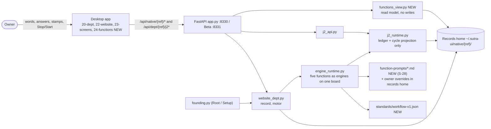
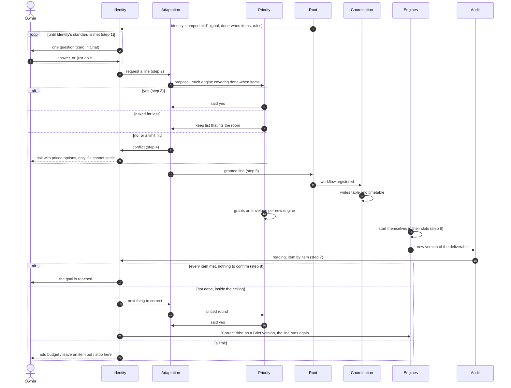
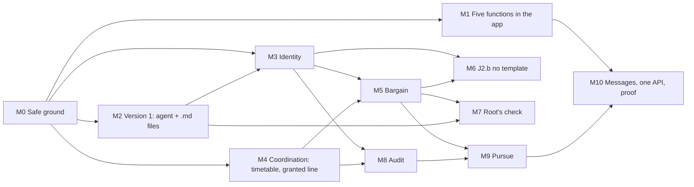

# PRD: The department and its five functions, in the Sutra app

_Status: Final for team review · Version 1.0 · 2026-10-22 · Written by: solution architect · Rulings and marks by: the owner (founder)_  
_Based on: the Native site (department page, journeys.json v2.4; the five function pages, functions.json 1.5); Sutra `6bb38ec6` (2.306.25); the J2 prototype `564e3a7`._

> Build the department's five functions (Identity, Adaptation, Priority, Coordination, Audit) into the Sutra desktop app. Each one does its J2 job honestly for every kind of department, the owner sees the five working as one system, and the owner hears one voice: Identity's.

> **How to read this page**
> - **Milestones** are `M0` to `M10`, in dependency order. Every step has an id such as `M3.2`, with What, How, Where and a testable Done check.
> - **Screens** are `S1` to `S17`. Each has sample data from one department (Thread & Loom Website, 10:24, round 2) and a wireframe.
> - **Marks (`MK-n`)** are proposals for things the owner marked 'needs to be filled', 'marks owed' or 'placeholder'. A step that depends on a mark ships to stable only after the owner marks it. **Questions (`Qn`)** have defaults; the build may go ahead on a default behind the milestone's flag, in Beta only.
> - **Code short names:** R = `engine_runtime.py`, W = `website_dept.py`, J = `j2_runtime.py`, P = `J2_Prototype/j2.py`; all Sutra paths are under `sutra/marketplace/plugin/sutra-ui/`. `Lnnn` is a line of the department page text.
> - **Sizes:** S = up to 1 day · M = 2 to 4 days · L = 5 days or more. VSM labels are written 'VSM S5' so they are not confused with screen ids.

## 1. Context

The owner's design is on the Native site: the department page (journeys J1 to J7; J2 is the five functions working toward the identity's goal) and one page per function. The screenshot attached to the request shows the site's own menu, 'A department > The five functions > Identity, Adaptation, Priority, Coordination, Audit'. This PRD is therefore built around those five pages: each function's version 1 (founder, 2026-09-30), its journeys (FI, FA, FP, FC, FAU) and its J2 steps. Sutra 2.306.25 (6bb38ec6) already runs the five as engines on one board, and J2 steps 1 to 5 shipped on 2026-10-07. The J2 prototype (564e3a7) proved the loop with AI agents outside Sutra over 46 live runs and has a Map of the five. Rule for this document: anything the owner marked 'needs to be filled', 'marks owed' or 'placeholder' appears here as a proposal awaiting the owner's mark, never as a decision.

## 2. Problem

The five functions exist in code, but they do not tell the truth and they are not visible. Audit can report 'goal reached' on a version it never read: an unsampled version's judge is skipped, the skip returns no findings (R:1325-1326), and 'no findings' counts as done (J:445-461). Audit also reads only website output. When Priority counters on a Library kind, the engines it cut still run (R:3819-3839, J:130-140). Identity's standard only checks that fields exist, and every kind fills them, so it never asks (J:146-160). A blocked plan is a dead end. Budget holds never reach the ledger, because J.on_held is never called. A thin-words question cannot be answered through the API, because no ask is filed (J:440-442). On screen, function cards read the old registry instead of the runtime (dept_api.py:696-1161), only Map v2 shows the five together, and the site gives four of the five functions no designed screen yet.

## 3. Goals and non-goals

**Goals**

- G1 Each function does its J2 job for every kind (website, default, organic). 'Goal reached' is never claimed without Audit's reading of every done-when item.
- G2 The owner sees the five functions in the app as one system: what each is doing, who it waits on and what it spends. The owner hears only Identity, in plain words.
- G3 Each function reaches the version 1 the founder defined: one agent with .md files inside a code covering (S-28). The owner can read its instructions in the app and change them through an ask.
- G4 Every claim can be proved: the test lanes run what they say, the ledger records every step, and every reading carries evidence.
- G5 Reuse Sutra's runtime. Port only the prototype's tested parts: the map read model, priced questions, measurable checks, and the done verdict as a covering check.

**Non-goals**

- Growth steps 9 to 14 (grow from repeats, two writers, rules from stamps, context packs, harden, split). Growth is paused after step 8 (founder, 2026-09-27).
- Adaptation's compass, Learn, Grow as a move, lessons and playbooks. Their logic is 'named and empty', and prototype memory was polluted (109 mock playbooks). Whether the Make module's levels belong in version 1 is open (MK-3).
- Spinning out child departments (D-f). Parked with growth.
- Priority's figures (actuality, capability, potentiality). They need run history; M5.3 keeps per-run spend and the check verdict as Priority's first indices.
- A content model for locks and shared standards. It is designed but has no content model yet. Coordination's timetable is in scope (M4.3).
- Per-department engine definitions. That would refactor the global definitions model. The default for Q5 keeps born engines in the records-home Library, tagged made_by.
- The six-tab department screen. Set aside by the founder on 2026-09-29.
- Porting the prototype's AI scheduler or its one-loop relay. Coordination alone cost 25 to 32 percent of input tokens there.
- Migrating to the .ds-* design tokens (T15 is dead). U1 (the site's visitor) and U2 (several things in one place), which are not filled on the site.
- Browser-driven Audit checks (overflow at 360 and 1280 px, script errors). Parked; only browser-free checks ship (M8.6).

## 4. Who it is for

| Who | Need |
|---|---|
| The owner: one person running organisations and departments in the desktop app | Give words, answer one question at a time, see the five functions working, and trust 'goal reached'. |
| The founder: rules on design and marks proposals | One list of marks and questions, each with what it blocks and a default to accept or change. |
| Backend developer | The exact modules, functions, data shapes and tests for each step, with cited lines. |
| Frontend developer | The screens, the read model behind each one, the tokens, and the tests that pin them down. |
| Designer | Screens with sample data, states and wireframes; one colour table; the word rules; which screens are ruled and which are proposals. |
| QA and Human Simulation | A done-check per step, scenario tests for rare branches, and a proof run with metrics. |

## 5. Success metrics

| Metric | Target | How measured |
|---|---|---|
| SM-1 'Goal reached' claimed without a reading of every done-when item for that version | 0 | qa/j2_metrics.py (M10.4) matches every goal.reached event to a readings.jsonl row for the same version, with every item met. Runs over the scenario suite and every Beta department. |
| SM-2 Test lanes that report PASS with 0 tests run | 0; test_j2, test_j2_api and test_j1 run in the department suite | Output of run-tests.sh and qa/walks/suites.sh (M0.1). The publish gate (pytest -q over all files) already collects them. |
| SM-3 Runs of an engine that is not on a registered line and was not stamped through J5 | 0 | Compare the engines in runs.json with the union of dept.workflows and J5-stamped engines, plus the five functions. |
| SM-4 Posts to the owner from anyone but Identity | 0 (regression check; the edges table already refuses them) | Scan board.jsonl for posts with dst Owner and src not Identity. |
| SM-5 Freshness of the five-function view | On screen within 3 s of the record change, for 95 percent of changes | JS test with a timer stub (2.5 s poll), plus timestamps from a Beta walk. |
| SM-6 Dead-end states | 0 states where the owner has no next move | Scenario suite: every end state that is not done has a pending ask with options. |
| SM-7 Kinds that reach a real 'done' | 3 of 3 (website, default, organic) | Scenario suite plus the M10.4 proof runs. |
| SM-8 Owner effort from birth to goal | Median 3 or fewer questions and asks (proposed, Q15) | asks.json across the 9 proof runs. |
| SM-9 Cost of a website department from birth to goal | Median 40 or fewer model calls and 3 USD or less (proposed, Q15) | Spend in runs.json per department across the proof runs. |
| SM-10 Ledger append time | p95 5 ms or less at 10,000 events | Benchmark test (M0.2). It records the figure but does not gate the build. |
| SM-11 Reversal trigger of the 2026-09-27 decision | Fewer than 1 run in 5 overspends its envelope or clashes in a slot, over the first 4 weeks on Beta | runs.json against envelopes. A clash is two runs on one slot id, or a start while another run of the department is open. |
| SM-12 Marks before stable | 100 percent of MK rows marked before the step that depends on them ships to stable | The open questions table at each milestone's review. |

## 6. The five functions (the heart of the department)

The screenshot shows the site's menu: _A department > The five functions > Identity, Adaptation, Priority, Coordination, Audit_. Each function below is traced from its site page (journeys and edges) to the steps and screens of this PRD.

| Function | VSM | In one line |
|---|---|---|
| Identity | VSM S5: identity and policy; closes the system | The department's voice and conscience. It hears you, checks that the identity is good enough, gates every effect by rule, closes conflicts, and says when the goal is reached. |
| Adaptation | VSM S4: outside and future; intelligence | Decides how the department gets there. It proposes the workflows the goal needs, from the Library, fitted, or made fresh. After each reading it proposes the next round, until the goal holds. |
| Priority | VSM S3: inside and now; the resource bargain | Prices every proposal against the room actually left and holds the budget. It answers yes, asks for less, or says no. It never orders. |
| Coordination | VSM S2: anti-oscillation; timetables and standards | Keeps the timetable: a slot for each engine, who goes first, one run at a time, hand-offs, a chain that stops at twelve, and an alarm past a window. It judges nothing about content. |
| Audit | VSM S3*: sporadic direct inspection | The second pair of eyes. It reads what the department actually filed, item by item against done-when, with code checks first, and it also drops in unannounced. Its findings go to Identity. |

### Identity

| | |
|---|---|
| **VSM** | VSM S5: identity and policy; closes the system |
| **One line** | The department's voice and conscience. It hears you, checks that the identity is good enough, gates every effect by rule, closes conflicts, and says when the goal is reached. |
| **Holds** | Goal, done-when items, rules (go, ask, refuse, always), budget, owner and parent, each engine's window, and 'done, read against filed work'. After M3.1 these live in one record, dept.json. |
| **Hands to** | Adaptation: a request for a line; the next thing to correct; Coordination: verdicts on gates; You: the only function that speaks to you (edges table; _tell, R:2048) |
| **Rules it keeps** | Never makes anything; the maker is an engine. Asks only when a rule says ask (S-18); approvals only tighten (S-08). Never invents a goal or a rule; asks one decision-ready question at a time. Never writes the word 'charter' on screen. |
| **Status today** | Take, answer, rule and weigh are built, and so is closing a conflict (the code is ahead of the site). The standard checks presence only and never fires. Thin words ask a question but file no answerable ask. A rule given as an answer is tagged go. Blocked has no way out. Version 1 on its page: the words become the Brief, one question on thin words, the first-publish ask, a tell. The completeness loop is R1, marked 'later'. |
| **In the app** | First box on the Map. Its pane (S5) shows Enough to work?, the goal, done-when items, rules and conflicts closed. Chat speaks as the department with Identity's mark (S15). Settings > Instructions shows goal, completeness and take (S16). |

**Its journeys, traced** (page journey and edges > PRD steps > screens):

- FI1 Enough to work? (J2 step 1; edges FI1.1 'still too little: ask again' and FI1.2 'J1 already answered it: no question') > M0.5, M3.2, M3.3 > screens S5, S6
- FI2 Words after go-live (J3; FI2.1 reaches outside: an ask; FI2.2 refuse: told why) > built; one voice in M3.6 > screen S15
- FI3 The gates (J2 step 6; FI3.1 no rule: goes and tells; FI3.2 refused: never goes) > built; the first-publish ask stays the one default (Q14) > screen S15
- FI4 Closes a conflict (J2 step 4; FI4.1 settled: no ask) > code shipped 2026-10-07; way out of blocked in M3.5, priced options in M5.4 > screens S5, S10
- Declares done from Audit's reading (J2 step 8) as a code check in its covering > M8.4 > screen S14

### Adaptation

| | |
|---|---|
| **VSM** | VSM S4: outside and future; intelligence |
| **One line** | Decides how the department gets there. It proposes the workflows the goal needs, from the Library, fitted, or made fresh. After each reading it proposes the next round, until the goal holds. |
| **Holds** | Its proposals on the board, ideas.json, ladder.json and its rounds. From M5.1, every proposal names the done-when items each engine covers. |
| **Hands to** | Priority: every proposal and every round (a required wire); Identity: conflicts, and a granted round to file; Root: a granted line, for its check |
| **Rules it keeps** | Senses and proposes; never applies. Every proposal passes Priority first. May drop an engine unless the template marks it required (S-06, S-21); may reword inside model steps without an ask (S-07). Engines come from Adaptation, never from Root (S-10). |
| **Status today** | Proposing a line is partly built: a Library line is taken word for word, and offline the shaped line is a fixed draft. Taking a counter and reshaping twice are built. The next move is missing. Version 1 on its page (2026-09-30) is 'two to five workflows... no loop, no Make module'. J2 step 8 (2026-10-01) asks for the loop; Q2 settles which governs. |
| **In the app** | A box on the Map. Its pane (S8) shows the latest proposal or round, a table of which engine covers which item, Root's check, reshapes and the next round. Settings > Instructions shows goal, sense, decide and make. |

**Its journeys, traced** (page journey and edges > PRD steps > screens):

- FA1 The first workflows (J2 steps 2 to 5; FA1.1 refused: reshape; FA1.2 no agreement: to Identity; FA1.3 not confident: ask) > M5.1, M5.2 > screen S8
- J2.b No template fits: make the workflows from the identity, the goal and the practices in place. The owner's focus; 'needs to be filled' > M6 (spike, marks, build) > screen S8
- FA2 Pursue until done (J2 step 8; FA2.1 budget out: waits; FA2.2 chain at 12: stops; FA2.3 no move left: an ask; FA2.4 you say Stop) > M9 > screens S4, S8, S10
- FA3 Crystallize a step (built as the rung proposal you stamp) > kept; plain words in M10.3
- FA4 Grow out and FA5 Learn > later (growth paused; Learn is a placeholder)

### Priority

| | |
|---|---|
| **VSM** | VSM S3: inside and now; the resource bargain |
| **One line** | Prices every proposal against the room actually left and holds the budget. It answers yes, asks for less, or says no. It never orders. |
| **Holds** | One envelope per engine (calls and USD a day) and the bargain threads. From M5.3 it also holds per-run spend and the check verdict as its indices; from M9.2, the ceiling for the goal. |
| **Hands to** | Adaptation: said yes, asked for less, or said no; Identity: through Adaptation's conflict post when a limit is hit |
| **Rules it keeps** | Prices and holds the budget; never orders (S-05). Never starts a run; never rejects over method. Never changes the goal or speaks to you. |
| **Status today** | The bargain is a stub: 'room' means 1 to 6 engines and the cost is a constant. The envelope gate is built, but its holds never reach the ledger. A counter on a Library kind has a bug. All three templates say it orders the queue. Version 1 on its page: 'the envelope gate, as built. Nothing else.' |
| **In the app** | Its pane (S9) shows the bargain as a timeline with three limit bars, today's budget as bars, and spend by round. Settings shows limits and Instructions (goal, bargain). |

**Its journeys, traced** (page journey and edges > PRD steps > screens):

- FP1 The envelope on every start (FP1.1 over: held, asks; FP1.2 you set a new limit) > built; holds reach the ledger in M0.4 > screens S9, S10
- FP2 The bargain with Adaptation (J2 step 3; FP2.1 at the limit: to Identity; FP2.2 refused: idea parked) > M5.3, M5.4 > screen S9
- Grants an envelope to each newly registered engine (move 4 of the nine) > M4.1
- Holds the goal's ceiling (rounds, calls, USD) as a gate in its covering > M9.2

### Coordination

| | |
|---|---|
| **VSM** | VSM S2: anti-oscillation; timetables and standards |
| **One line** | Keeps the timetable: a slot for each engine, who goes first, one run at a time, hand-offs, a chain that stops at twelve, and an alarm past a window. It judges nothing about content. |
| **Holds** | coordination.json: the order, the line, the timetable (from M4.3) and who may post to whom. Also the run rows and thread bounds. |
| **Hands to** | Identity: alarms, lost requests, verdict asks; Priority: verdict asks |
| **Rules it keeps** | No model call inside a tick; a missed slot runs once; one run per slot. The engine starts itself in its slot (2026-09-27). Never changes envelopes, scope or quality calls. |
| **Status today** | Ordering, the chain limit, bounds, the alarm and the in-app motor are built. The line is not rebuilt from the registered workflow. Hand-offs are hard-coded for the website kind. There is no timetable record. Version 1 on its page: 'as built'. |
| **In the app** | Its pane (S7) shows the timetable, what is waiting and why, who makes and who reads each thing, the chain bar, alarms and ties. The engine card (S17) carries the motor. Settings shows who goes first, who may message whom, and Instructions (goal, tie). |

**Its journeys, traced** (page journey and edges > PRD steps > screens):

- FC1 Who goes first (FC1.1 a tie: one AI call; FC1.2 a held one holds the ones after it; FC1.3 past its window: an alarm) > built; reasons and ties shown in M4.5 > screen S7
- FC2 A lost request (J1 edge) > built > screen S15
- Writes its own table and a slot for each engine when a plan is registered (move 5 of the nine) > M4.1 to M4.3 > screen S7
- Carries an alarm straight to Identity past an engine's window > built (run window, 30 minutes by default)

### Audit

| | |
|---|---|
| **VSM** | VSM S3*: sporadic direct inspection |
| **One line** | The second pair of eyes. It reads what the department actually filed, item by item against done-when, with code checks first, and it also drops in unannounced. Its findings go to Identity. |
| **Holds** | Its readings (readings.jsonl, from M8.3) and its findings. |
| **Hands to** | Identity only: readings and findings |
| **Rules it keeps** | The checker is never the writer (R8); it never touches a workflow or a version. A check is a check, never a score. Reads what the department did, never only its goal (POSIWID). |
| **Status today** | Works for websites only, and starts only on a checked Live site. It samples v1 to v3 and then every third version, and a skipped version counts as clean. The judge checks facts only, and there is no reading per item. Version 1 on its page: 'as built: read the live site against the words'. |
| **In the app** | A box on the Map. Its pane (S12) shows done-when as read, readings per version, findings and where each went, and spot checks. Settings > Instructions shows goal and judge. |

**Its journeys, traced** (page journey and edges > PRD steps > screens):

- FAU1 Read the result (J2 step 7; FAU1.1 a hole: asks you; FAU1.2 a workflow with web tools looks it up) > M0.3, M8.1 to M8.3, M8.6 > screen S12
- Sporadic, unannounced spot checks of engine state (ruled 2026-09-27) > M8.7 > screen S12
- Verification in the S-30 shape (ruled; marks owed) > reading format in M8.3; levels and angles wait for MK-2

## 7. Principles and rulings every build keeps

| Rule | Source |
|---|---|
| One system of five functions, with no system above them. j2_runtime records and projects; it never rules. | Department page, internal systems (L1000); internal-system page, 'regress stop' |
| Only Identity speaks to you, in plain words, and it asks only when a rule says ask. | J2 lead (L557); S-29; S-18. Q1 is open against AMEND-2026-09-21-01 |
| The engine starts its own runs, Coordination keeps the timetable, and Priority grants budgets and never starts a run. | Decision of 2026-09-27 (L1081), with its reversal trigger |
| Coordination keeps the table and the tie. Priority prices and holds the budget, and never orders. | S-05 |
| Root makes the department and its five functions, then hands over. It never creates or starts engines; engines come from Adaptation. | S-10; D-b |
| The AI may act unless a person narrows it with a rule, a Stop or a refusal. | S-18 |
| Approvals are set per department and may only tighten. | S-08 |
| No engine is mandatory unless its template says so. | S-06; S-21 |
| Every engine and function is a code covering around an AI inside. Code verdicts live only in the covering. | S-22; S-23 |
| Version 1 of each function is one agent with .md files inside its covering. | S-28; each function page |
| Adaptation and Priority bargain, Identity closes their conflicts, and what Identity cannot settle goes to you. | S-29 |
| A verification names subject, claim, evidence, method, verdict and severity. | S-30 (ruled; marks owed) |
| Adaptation senses and proposes and never applies; every proposal passes Priority first. | Internal-system invariant; S3-S4 wire (2026-09-27) |
| Audit is its own system, sporadic and unannounced. The checker is never the writer, and a check is never a score. | Founder 2026-09-27 (L1243-1244); R8 |
| Every thread between functions is bounded by 4 hops, 15 minutes and a spend limit. At a limit, it goes to Identity. | Engines page s5; J2 step 3 |
| The motor makes no model call inside a tick. A missed slot runs once, and each slot runs once. | Department page, the motor |
| Growth is paused after step 8. | Founder, 2026-09-27 |
| Mark before build: anything the owner marked 'needs to be filled' ships only after the owner marks it. | Department page L285; the screens process |
| Fit the existing Mac app. The Map is closed except for its ruled additions. Status folds into the NOW line, Motor into the engine card, and the Board is renamed Internal messages. | Founder 2026-09-29; current-state |
| Never 'charter' or 'internal system' on screen. No counts at rest; names, never paths; status never shown by colour alone. | Words rule 2026-09-21; A28; tests W9 and W19 |
| Show 'Root' for now. | Founder 2026-10-07 (PRD-1007 section 6); WB_HELPER |
| Components only render; every write is an ask the owner stamps; CSS uses tokens only. | ADR-023; test_website V12 |
| Born engine templates stay local, and workflows register on the department's record. | S-12; S-25 (Q5) |

## 8. Where things stand today

**Built in Sutra (2.306.25)**

- The five functions run as engines on one append-only board, with FIPA acts, A2A thread states and bounds of 4 hops, 900 s and 0.5 USD (R:62-69, R:626-677).
- Only Identity may post to the owner: the edges table refuses any other post (engine_defs edges; R:634).
- The J2 cycle and its ledger sit behind J2_FLOW_V1, which is on by default. Steps 1 to 5 shipped on 2026-10-07, including closing a conflict and Root's check (j2_runtime.py; R:3785-3953).
- J1 birth is a conversation: Setup's converse step (B1) and no stamp at birth (B2) are built (setup.json; R:3045; R:1746-1749).
- An in-app motor ticks every 3 s, with code-first Coordination: one run at a time, a chain limit of 12, a run-window alarm and thread bounds (W:911; R:798-1087).
- An envelope gate per engine, with an escalated envelope ask (R:1823-1834).
- Identity's take, answer, rule and weigh, plus its gates: first publish, setup when a rule says ask, wait for an engine (R:2122-2266, R:1701-1749).
- Audit's pick, mechanical, judge and file steps run on a checked Live site (R:2882-2948).
- 15 function templates picked at birth, under a narrowing-only law (function-templates/; test_function_templates.py).
- In the app: each function's pane (template framework, Chat, Settings), Map v2 with five function boxes, the Agent activity J2 card, and the organisation row as Root's chat (FE20, FE22, FE23).
- The publish gate runs pytest -q over every test file (PUBLISH-CHECK.md step 4).

**Built and measured in the J2 prototype (564e3a7)**

- The full J2 loop, with AI agents for the five functions, builders and a code validator, over 46 live runs (j2.py).
- Identity's intake with to_be_confirmed, two audiences enforced in code, and a code-built decision question capped at twice the budget (P:3512, P:2885, P:4141).
- Priority answering GRANT, COUNTER or REFUSE from a rate card, with the envelope check as code (P:5268, P:5676).
- Audit with headless render checks, rubric R-1 to R-7 and conditions N1 to N8, plus a code-decided workable() (j2_check.py; P:2240).
- A Map tab: the Functions row with state, speaks-to lines (three at most, the rest in a closed dropdown), made-by, a 'not recorded' list and a phone card list (j2_map.py, 564e3a7).
- The atom/1 schema, receipts and artifacts/1 (j2_schema.py; docs/atom-schema.md).
- Measured lessons: relay cost (Coordination took 25 to 32 percent of tokens), memory pollution, and how rare bargains are (9 counters and 0 refusals).

**Designed on the site, not built**

- Identity's completeness loop (FI1, R1) and its journeys. J2.a is 'needs to be filled'.
- J2.b with no template: the Make module, the practices in place and the compass. 'Needs to be filled'.
- Pursue (FA2), Learn (FA5), and Grow as a move of its own (FA4).
- Coordination's timetable with slots, hand-offs, locks and shared standards; the table as a setting (S-15).
- Priority's bargain for the line, priced from the budget; indices and figures.
- Audit's sporadic, unannounced checks (ruled 2026-09-27); the S-30 verification engine and its templates (marks owed).
- Root's standards list (a placeholder) and registration on the department's record (S-25).
- Screens: a NOW line on the Map; Status folded into the NOW line; Motor folded into the engine card; Internal messages replacing the Board; asks as cards in Chat; screens for Adaptation, Priority, Coordination and Audit ('needs to be filled').

## 9. Architecture in the Sutra app

Sutra's runtime stays the control flow. Each function is an engine, with a code covering around an AI inside, that talks only on the department's board, and engines start themselves in Coordination's timetable. This PRD adds one read-only projection, functions_view.py, that every screen reads. It moves each function's prompts into .md files (S-28), with the owner's changes kept in the records home. New verdicts go where the rulings put them: 'done' in Identity's covering, the ceiling in Priority's covering, and the table and timetable written by Coordination. j2_runtime stays a ledger and a projection of the cycle, never a supervisor above the five.



### 9.1 Components

| Component | Status | Location | Responsibility |
|---|---|---|---|
| Engine runtime | Existing, changed | sutra-ui/engine_runtime.py | Runs the five functions as engines. Adds: _root_checks, registration handlers for Coordination and Priority, identity.enough, identity.done, adapt.fit, adapt.pursue, audit.items, the _prompt loader, and covering checks that fail loudly. |
| J2 cycle and ledger | Existing, changed | sutra-ui/j2_runtime.py | Holds the ledger and the cycle projection only. Gains an append-only JSONL file with a sidecar index; a thin-words ask; reopen. J.audited is retired. |
| J2 API | Existing, small change | sutra-ui/j2_api.py | Two cursors (after_seq, after_board) and open_question in the status. |
| Department record and motor | Existing, changed | sutra-ui/website_dept.py | dept.json becomes the one record of who the department is. Writes the registry charter as a mirror; adds last_deliverable and options on asks. |
| Runtime API | Existing, extended | sutra-ui/website_api.py | Adds /functions, /functions/{fn}, /messages and /instructions; asks accept {option}. |
| Functions read model | New | sutra-ui/functions_view.py | One read of the five functions, from the record only: state, what each waits on, its line, spend against envelope, speaks-to, made-by and 'not recorded'. Writes nothing. |
| Function instructions | New data | sutra-ui/function-prompts/<fn>/<file>.md; owner overrides in {records}/{ref}/prompts/ | Each function's version 1 files, as its site page lists them. Starts byte-identical to today's inline prompts. |
| Root's standards | New data | sutra-ui/standards/workflow-v1.json | The standards Root checks a granted line against. Holds today's checks until the owner marks MK-4. |
| Function templates | Existing, wording changed | sutra-ui/function-templates/priority/*.json | Priority's floor, choices and chat_brief stop saying it orders. The 13 keys are unchanged. |
| Engine definitions | Existing, changed | sutra-ui/engine_defs/website.json | Audit and Adaptation start on the department's deliverable. Adds Audit's timer trigger, required flags, the new steps, and a call_usd prior in Priority's template. |
| Founding | Existing, changed | sutra-ui/founding.py | Writes the shaped goal and Root's drafted done-when items into dept.json. |
| Older department API | Existing, narrowed | sutra-ui/dept_api.py | Kept for registry-only departments. Runtime departments stop calling it for function cards (M10.2). |
| Department and runtime screens | Existing, changed | static/js/20-dept.js, 22-website.js, 23-screens.js, 19-org2.js | The Map's NOW line and function boxes, function panes, the question card in Chat, Internal messages, and new sub-departments routed to Root. |
| All five overview | New (proposal, MK-8) | static/js/24-functions.js | The S2 overview and a shared renderer for function nodes. Loaded before 09-tail.js. |
| Styles | Existing, extended | static/panel.css | Adds the --fn-* colours in both themes, the hollow waiting ring, and --soft. Tokens only. |
| Test lanes and metrics | Changed and new | run-tests.sh, qa/walks/suites.sh, qa/j2_metrics.py | Lanes run what they report; the metrics script reads only the record. |

### 9.2 Data

| Data | Location | Shape |
|---|---|---|
| dept.json (the one record of identity) | ~/.sutra-ui/native/{ref}/dept.json (Beta: ~/.sutra-ui-beta) | Adds done_items [{id, text, how: code\|model\|person, level: target\|outcome}], to_be_confirmed [{item, why}], standard {met, missing, checked_at}, workflows[n].fit {engine: note}, and envelopes._goal {rounds, calls, usd}. done stays as joined text for older readers. All additions are additive. |
| Ledger | {ref}/j2-events.jsonl + {ref}/j2-index.json | One j2.event.v1 row per line (fields as J:78-116). The index holds {keys, last_event_by_cycle, count}. The old j2-events.json is converted once and kept as .bak. |
| Cycle state | {ref}/j2-state.json | Adds round, event_count, and an open_ask that is now also set for thin words (missing: words). |
| Readings | {ref}/readings.jsonl (new) | {v, artifact, cycle_id, round, read: true\|false, why_not_read, items: [{id, subject, claim, evidence, method: code\|model, verdict: met\|not_met\|to_confirm, severity}], at} |
| Coordination's table | {ref}/coordination.json | line is the registered engines. Adds timetable [{engine, on: 'after <artifact> vN' \| 'every <period>', window_min, since}]. by is 'Coordination'. Engines left out stay in dept.engines with in_line: false. |
| Asks | {ref}/asks.json | Adds options [{id, label, cost}] and chosen. New kinds: done_items, instructions; j2_identity gains missing: words. |
| Instructions | bundle function-prompts/<fn>/<file>.md; overrides {ref}/prompts/<fn>/<file>.md | Markdown with named slots. A department's file wins over the bundle's. Written only on a stamped instructions ask. |
| Root's standards | bundle standards/workflow-v1.json; overrides in the records home | [{id, says, check}]: the plain sentence and the code check behind it. |
| Registry charter | ~/.sutra-native/user-kit/charters/C-<sha>.json | A one-way mirror of dept.json, written directly (no org.charter proposal) on every identity_revision bump. The Org screen still reads it. |

### 9.3 APIs

| Method and path | Purpose | Status |
|---|---|---|
| GET /api/dept/{ref}/j2 | Cycle state. Adds open_question {id, text, missing} (M0.6). | Changed |
| GET /api/dept/{ref}/j2/events?after_seq=&after_board= | Ledger and board rows, paged by two cursors (M0.2). | Changed |
| POST /api/dept/{ref}/j2/answer {text} | Answers Identity's open question. Works for thin words after M0.5. Errors: 400 EMPTY_ANSWER; 409 NO_OPEN_QUESTION, ALREADY_HANDLED. | Existing |
| POST /api/dept/{ref}/j2/start \| stop \| resume | Start already resumes a stopped cycle (begin calls resume). | Existing |
| GET /api/native/{ref}/functions | The five nodes plus cycle {state, step, says, steps, needs_you, ceiling} and not_recorded (M1.1). 404 for a ref that is not a runtime department. | New |
| GET /api/native/{ref}/functions/{fn} | One function: its page fields, recipe and journeys (M1.7), plus its J2 part. Identity: standard, done_items, rules, conflicts. Adaptation: proposal, coverage, root_checks, rounds. Priority: bargains, envelopes, rounds. Coordination: timetable, holds, handoffs, chain, alarms, ties. Audit: readings, findings, spot_checks. | New |
| GET /api/native/{ref}/messages?fn=&after= | Internal messages over board_view: {from, to, act_words, summary, at}, read only, with private keys stripped (M10.1). | New |
| POST /api/native/{ref}/asks/{aid} {approve} \| {option} | Stamp or refuse, or choose a code-applied option (M3.5). Errors: 409 UNKNOWN_OPTION, 409 OVER_CAP. | Changed |
| POST /api/native/{ref}/instructions {fn, file, text} | Files an instructions ask; nothing changes until the stamp (M2.2). | New |
| POST /api/native/{ref}/ask {text} | The owner's words. The Org sheet's 'New sub-department' also uses it under an organisation with a Root (M1.4). | Existing |
| GET /api/native/{ref}/map \| status \| board \| chat?fn= | Existing reads. The Map's NOW line also reads /functions. | Existing |
| POST /api/native/{ref}/envelope {engine, calls, usd} | The owner's limits; 'raise' options apply through it. | Existing |

### 9.4 The J2 loop and its edges

| Step | Function | What happens | Code today and after |
|---|---|---|---|
| 1 · J2.a Enough to work? | Identity (Root drafts the identity at J1) | Reads the identity Root stamped (goal, done-when items, rules) against its standard. Asks one question at a time until the standard is met, or until 'just do it'. | Today: presence check (J:146-160); thin words with no ask (J:440). After: M0.5, M3.2, M3.3. |
| 2 · J2.b Deciding what to do | Adaptation | Proposes workflows that cover every done-when item: a Library line fitted to the use case, or 2 to 5 engines made when no template fits. | Today: _line_request (R:3744), adapt_source verbatim (R:3752-3766), fixed offline draft (R:4295). After: M5.1, M5.2, M6. |
| 3 · J2.c The bargain | Priority with Adaptation | Priority prices from observed spend against the room left, then says yes, asks for less, or says no. Bounded by 4 hops, 900 s and 0.5 USD. | Today: room means 1 to 6 engines, cost is a constant (R:2721-2727, R:4107-4118). After: M5.3, M5.4. |
| 4 · J2.d Closing a conflict | Identity, then you | No agreement, or a limit hit: Identity rules run, drop or ask. An ask carries options built by code, and blocked always has a way out. | Built 2026-10-07: _line_conflict (R:3776), p_identity_close (R:3906-3953). After: M3.5, M5.4. |
| 5 · J2.e Root's check | Root, then Coordination and Priority | Root checks the granted line against its standards file and records workflow.registered. Coordination writes its table and slots; Priority grants envelopes. | Today: _root_check (R:3785); the event lists a fixed set of checks (J:401-403). After: M0.7, M4.1, M7. |
| 6 · J2.f Running the work | Coordination and the engines | Engines start in their slots, one run at a time. Holds name what is missing, and envelope holds go on the ledger. | Built: next_due, coord_pick, blocked (R:798-930); priority_envelope (R:1823). After: M0.4, M4.2 to M4.5. |
| 7 · J2.g Reading the result | Audit, then Identity | Audit reads the deliverable item by item: the mechanical code step first, then the AI judge inside. It files a reading, and Identity weighs it three ways. Audit also drops in unannounced. | Today: Live site only, sampled, and a skipped version counts as clean (R:2882-2948, R:1325). After: M0.3, M8. |
| 8 · J2.h Next move, or done | Identity (done); Adaptation (next round) | Identity's covering declares done from the reading. Otherwise Adaptation proposes a priced correction round inside the ceiling, Identity files it as a Brief version, and the line runs again. | Today: 'found nothing' counts as done (J:445-461); no next move (R:2808-2856). After: M8.4, M9. |
| Edge J2.1 Identity not good enough | Identity | Asks until the standard is met, or 'just do it' fills defaults and names them. | M0.5, M3.3 |
| Edge J2.2 The bargain hits 4 hops, 15 minutes or its spend | Priority > Identity | Goes to Identity (built 2026-10-07), then to you with priced options if Identity cannot settle it. | R:651-656, R:3776; M5.4 |
| Edge J2.3 Identity cannot close | Identity > you | One ask with options built by code. | R:3906-3953; M3.5, M5.4 |
| Edge J2.4 A workflow fails the standards | Root > Adaptation | Refused with the broken standard named, reshaped at most twice, then an options ask. | R:3800-3820; M7.2, M3.5 |
| Edge J2.5 Past the day's calls or money | Priority | Held, with an ask; recorded on the ledger; priced options. | R:1823-1834; M0.4, M5.4 |
| Edge J2.6 Wants to send something outside | Identity | Asks the first time (the born rule). Whether that conflicts with S-18 is open. | identity_gate (R:1725); Q14 |
| Edge J2.7 A result fails its check | Check, Coordination, Identity | Sent back twice at most, then an options ask. Today the owner is only told. | _send_back (R:1607); M9.5 |
| Edge J2.8 You change the goal | Identity | A goal rule you stamp reopens a cycle at step 1. | R:2582-2596; M9.8, Q7 |



## 10. Milestones

| Id | Name | Centres on | Depends on | Size |
|---|---|---|---|---|
| M0 | Safe ground | All five · bug fixes inside every version 1 · S-31: department × LIFE | none | L · about 9 dev-days (7 backend, 2 frontend) |
| M1 | The five functions in the app | All five, as the owner sees them · screens only; no change to any function's version 1 · S-31: department × PARTS | M0.1 (M1.1 to M1.4 can start alongside M0), MK-8 for M1.6, M1.8 and the Map extras | L · about 18 dev-days (8 backend, 10 frontend) |
| M2 | Each function's version 1: one agent and its .md files | All five · this is each function's version 1 (S-28) · S-31: function × PARTS | M0.1, MK-7 for any content beyond today's prompts | M · about 9 dev-days (7 backend, 2 frontend) |
| M3 | Identity: one record, its standard, a way out | Identity (VSM S5) · FI1, FI4 · beyond version 1 (R1, the completeness loop) · S-31: function × LIFE | M0, M2.1, MK-1 (M3.3), MK-2 (M3.2), Q1 | L · about 15 dev-days (12 backend, 3 frontend) |
| M4 | Coordination: the timetable, and the line is what was granted | Coordination (VSM S2), with Priority's envelopes · FC1, FC2, moves 4 and 5 of the nine · beyond version 1 (the timetable as a record) · S-31: function × PARTS | M0, M1.1, Q12, MK-5 for S7 in stable | L · about 12 dev-days (9 backend, 3 frontend) |
| M5 | Adaptation and Priority: a bargain that means something | Adaptation (VSM S4) and Priority (VSM S3) · FA1, FP1, FP2, J2.c · beyond Priority's version 1 ('the envelope gate, as built. Nothing else'), see Q2 · S-31: function × MEETINGS | M3.2, M4.2, Q2, MK-9 (M5.2), MK-5 (S8 and S9 in stable) | L · about 16 dev-days (13 backend, 3 frontend) |
| M6 | Adaptation: workflows when no template fits (J2.b, the owner's focus) | Adaptation (VSM S4) · J2.b, FA1.3 · 'needs to be filled', so the build waits for MK-3 · S-31: function × LIFE | M3.2, M5.1, MK-3 (M6.3, M6.4) | L · about 10 dev-days (spike 3, build 7) |
| M7 | Root's check against written standards | Root · J2.e · the standards list is a placeholder, so the build waits for MK-4 · S-31: organisation × LIFE | M2.1, M4.4, M5.1, M5.3, MK-4, Q5 | M · about 6 dev-days (4 backend, 2 frontend) |
| M8 | Audit reads every result against done-when | Audit (VSM S3*) · FAU1, J2.g · beyond version 1 ('as built'), see Q2; S-30 marks owed (MK-2) · S-31: function × LIFE | M0.3, M2.4, M3.2, M4.2, MK-2, Q3, Q4 | L · about 19 dev-days (16 backend, 3 frontend) |
| M9 | Pursue: keep going until done | Adaptation, with Priority and Identity · FA2, J2.h · beyond Adaptation's version 1 ('no loop'), see Q2; the name waits for MK-10 · S-31: department × LIFE | M5, M8, MK-10, Q2, Q6, Q7, Q8 | L · about 14 dev-days (11 backend, 3 frontend) |
| M10 | Internal messages, one API, the proof run | All five · ruled screens 3.1 to 3.4 · S-31: department × MEETINGS | M1, M9, MK-6 | M · about 10 dev-days (6 backend, 4 frontend) |

Total about 138 dev-days. Critical path M0 > M3 > M8 > M9 > M10, about 67 dev-days, with M5 run alongside M8 and M1, M2 and M4 alongside M0 and M3. With two backend developers and one frontend developer, that is about 14 to 16 weeks elapsed. The M6.1 spike can start on day 1.



**Working agreement:** one branch per milestone (`feat/dept-m<N>-<slug>` off `main`), one commit per step, build green after each. Every milestone ships behind its own flag under `J2_FLOW_V1` to Beta (:8331) first, then a Human Simulation walk, then the owner's review (including any marks), then stable. Re-check the site's status labels against the code at the start of each milestone.

### M0 · Safe ground

| | |
|---|---|
| **Centres on** | All five · bug fixes inside every version 1 · S-31: department × LIFE |
| **Goal** | Remove the ways the system misreports today, and ship the owner's one missing control, so that every later claim can be proved. |
| **At the end, the owner sees** | Identity's question as a card in Chat that can be answered; no 'goal reached' on a version Audit did not read; budget holds shown in Agent activity. |
| **Ships screens** | S6, S15 |
| **Depends on** | none |
| **Size** | L · about 9 dev-days (7 backend, 2 frontend) |

**M0.1 · Test lanes run what they report**
- **What:** Every developer lane runs its tests, and the department suite runs the J1 and J2 tests.
- **How:** In run-tests.sh, a lane whose file has no __main__ block runs `$PY -m pytest -q $HERE/$lane`. Exit code 5 (no tests collected) counts as FAIL, and the PASS line prints pytest's 'N passed'. Add `$PY -m pytest -q test_j2.py test_j2_api.py test_j1.py` to qa/walks/suites.sh. The publish gate (PUBLISH-CHECK.md step 4) is unchanged.
- **Where:** `run-tests.sh:58-66; qa/walks/suites.sh:15-22`
- **Done check:** `./run-tests.sh test_j2.py` prints '27 passed'. A deliberately broken assert in test_j2.py makes both scripts exit 1. All 11 files with no __main__ block report a non-zero count.

**M0.2 · The ledger appends without reading the file**
- **What:** The ledger becomes append-only JSONL with a sidecar index, and reads page by two separate cursors.
- **How:** J.note appends one line under W._lock(ref) and updates j2-index.json {keys, last_event_by_cycle, count}. Idempotency and causation_id come from the index, not from parsing the file. j2-events.json is converted once and kept as .bak. event_count moves into j2-state.json. /j2/events takes after_seq and after_board.
- **Where:** `j2_runtime.py:78-116, 253-260, 479-500; j2_api.py:34-39`
- **Done check:** 10,000 appends grow the file by exactly one line each. A merged cursor test never repeats or skips a row. An old ledger reads the same after conversion. A benchmark records p95 (SM-10) but does not gate.

**M0.3 · An unread version is never 'clean'**
- **What:** 'Found nothing' counts only when Audit's judge actually read the version with the model.
- **How:** When audit.judge is skipped (only_if not sampled) or answered by its offline draft, audit_file records read:false and the run_engine hook skips _j2_audit_read. The ledger notes audit.not_read, and the cycle stays at step 7. While a cycle is active, audit_pick samples every version of the deliverable (interim, until M8). No change is needed for the other cases: an away model already waits and then asks, and an invalid answer already drops to a person.
- **Where:** `engine_runtime.py:1325-1326, 1296-1306, 2882-2885, 2933-2948, 3956; j2_runtime.py:445-461`
- **Done check:** An offline website department never writes goal.reached; nor does an unsampled v4. A stubbed model reading with no findings does reach goal.reached. test_j2.py:162-180 moves to the stubbed form.

**M0.4 · Envelope holds reach the ledger**
- **What:** Each envelope hold is one ledger event.
- **How:** priority_envelope calls J.on_held(ref, name, slot, why) only when it returns 'wait' and the call is not a peek, keyed by slot. Coordination's other waits are already reported in W.status()['next'] and stay out of the ledger.
- **Where:** `engine_runtime.py:1823-1834; j2_runtime.py:380-387; website_dept.py:1072-1081`
- **Done check:** With an envelope of 0 calls, after 20 motor ticks and 20 panel reads there is exactly one envelope.held event and one escalated envelope ask.

**M0.5 · Thin words become an answerable question**
- **What:** When the first words name nothing to build from, Identity's question becomes a real ask that can be answered anywhere.
- **How:** J.questioned files a j2_identity ask {missing: 'words'} and sets open_ask. J.answer with missing 'words' marks the ask answered and posts the text to Identity as the owner's request, so identity_file reads it as the first words and starts step 2.
- **Where:** `j2_runtime.py:212-245, 440-442; engine_runtime.py:2196-2207`
- **Done check:** A department born from 'a website' shows open_question in /j2. Answering 'a site for my bakery in Pune' through /j2/answer, or in Chat, writes proposal.requested at step 2.

**M0.6 · Identity's question as a card in Chat**
- **What:** The open question shows as a card in the department's Chat (site Chat row 1.3), with an answer box. Agent activity links to it.
- **How:** J.status adds open_question. wbChatHtml renders a .dpask card with the question, a .wbbox and Send, which posts to /j2/answer; the answer stays under the card. Agent activity shows 'Identity asks you in Chat >'. Start again needs no change: begin already resumes a stopped cycle (J:185-191).
- **Where:** `j2_runtime.py:253-261; static/js/22-website.js:728-800; 20-dept.js:396-460`
- **Done check:** In test_website.js, a waiting fixture renders the card in Chat; Send posts {text}; EMPTY_ANSWER shows its snack; an answered card keeps 'You: ...'.

**M0.7 · An honest Root-check event, and the missing token**
- **What:** workflow.validated lists the checks that actually ran, and --soft is defined.
- **How:** A new _root_checks() returns [{check, passed, why}]. _root_check stays as the wrapper that returns the fault list its callers use. J.registered and J.refused write the checks that ran. Define --soft in both theme blocks, and add a CSS test that every var(--x) is defined.
- **Where:** `engine_runtime.py:3785-3812; j2_runtime.py:390-417; static/panel.css:4-44, 5509`
- **Done check:** The event's checks equal the checks that ran, for both a Library line and a shaped line. The CSS test fails on an undefined variable and passes after the fix.

**Acceptance:**
- The 11 files with no __main__ block run in the developer lanes, and the J1 and J2 tests run in the department suite.
- No offline or unsampled version ever produces goal.reached.
- A thin-words department can be answered from Chat and from /j2/answer.
- A budget hold shows once in Agent activity.

**Ported from the prototype:** Honest records: say 'not read' rather than guess (j2_map.py 'not recorded'); Every pause carries an answerable question (P:3018 _ask_user)

**Risks:** Turning the lanes on surfaces red tests those lanes never ran. Fix each one, or mark it xfail with a linked issue; never delete it.

---

### M1 · The five functions in the app

| | |
|---|---|
| **Centres on** | All five, as the owner sees them · screens only; no change to any function's version 1 · S-31: department × PARTS |
| **Goal** | One read of the five functions, taken only from the record, feeds the Map, the list column and each function's pane. The app then shows each function as its site page describes it, with live state. |
| **At the end, the owner sees** | On the Map, each function's box says whether it is working or waiting, and whether it waits on the owner. Each function's pane shows its job, what it holds, its recipe and its journeys with live status. With the owner's mark, an 'All five' overview. |
| **Ships screens** | S1, S2, S3, S4 |
| **Depends on** | M0.1 (M1.1 to M1.4 can start alongside M0), MK-8 for M1.6, M1.8 and the Map extras |
| **Size** | L · about 18 dev-days (8 backend, 10 frontend) |

**M1.1 · The functions read model**
- **What:** functions_view.functions(ref) and GET /api/native/{ref}/functions. Per function: state, waits_on, line, last act, spend today against envelope, speaks-to and made. Plus the cycle (state, step, says, steps, needs_you) and not_recorded.
- **How:** Port the state rules of j2_map._functions onto Sutra's records. Who holds the turn: assessing, waiting and closing go to Identity; adapting and reshaping to Adaptation; bargaining to Priority; running to Coordination and the running engine. Waiting: the src of an open thread that wrote its latest post waits on the dst (the decider is dst[0], R:641-643). Before M9, pursuing maps to Identity waiting_on_you while a finding ask is pending. A failed step check is a fault. 'Should have fired' is also a fault: Audit with no run after a filed deliverable, or Coordination idle while two engines are ready. No model calls and no writes.
- **Where:** `new functions_view.py; website_api.py (beside /{ref}/map)`
- **Done check:** test_functions_view.py has one fixture per cycle state (assessing, waiting, adapting, bargaining, closing, checking, running, pursuing, blocked, stopped, done) and gives the expected state for all five. A thread fixture puts the wait on the src. A stopped or done department never shows working. No private keys and no paths.

**M1.2 · Speaks-to and made-by from the record**
- **What:** Per pair: who spoke to whom. Per artifact: who made it and who reads it.
- **How:** Pairs come from board.jsonl src > dst, including Owner and Identity. Made comes from runs.json wrote{art, v}; readers come from each engine's reads in the definitions and born templates. Anything missing goes to not_recorded. Delete the hard-coded wbMakerOf and wbReaderOf.
- **Where:** `functions_view.py; static/js/22-website.js:884-913`
- **Done check:** Website: Plan made Site plan, and Write reads it. An organic department with shaped engines gives the right answer with no map. test_website.js passes with the maps removed.

**M1.3 · Function colours and the waiting ring**
- **What:** Five function colours in both themes, and a dot for 'waits on another function' that is not amber.
- **How:** Add --fn-identity, --fn-adaptation, --fn-priority, --fn-coordination and --fn-audit, each with -bg and -line, to both theme blocks (values in Design tokens). Add .dpdot.wait, a hollow --muted ring, so that amber keeps meaning 'waits on you'. Add a contrast test using the accent picker's rule.
- **Where:** `static/panel.css:4-44; test_website.js`
- **Done check:** All 10 colours pass 4.5:1 on --card, --surface, --acc-bg and their own -bg. The tokens-only check (V12) passes.

**M1.4 · Every new department is a runtime department**
- **What:** 'New sub-department...' on the Org screen, under an organisation that has a Root, goes to Root, so the department is born with its five functions.
- **How:** In 19-org2.js, when the organisation has a Root, the sheet posts the name and words to /api/native/{root}/ask (the J6 path: Root's Setup, then founding.spawn) and does not file org.create. Organisations without a Root keep org.create.
- **Where:** `static/js/19-org2.js:530-545; org2_apply.py:87`
- **Done check:** test_org2.js: under a Root organisation the sheet posts to Root's ask and files no org.create; without a Root it files org.create as today.

**M1.5 · Map: the NOW line and honest function boxes (ruled design)**
- **What:** Site Map rows 2.1 to 2.4: the topology is kept, a NOW line sits above (counts only when not zero, plus checks), the legend is cut, and Budget joins Knows. System status folds into the NOW line. The existing five boxes take their state from the read model.
- **How:** wb2MapHtml reads /functions and replaces wb2FnCls. The NOW pills come from cycle.says, needs_you and health. Remove the legend and the System status row; add a Budget bar to Knows. The prototype's extra box detail (line text, ? and ! badges, the speaks-to dropdown, function-to-work lines) waits for MK-8.
- **Where:** `static/js/23-screens.js:27-160; 22-website.js:202`
- **Done check:** test_website.js: state classes match each fixture; no legend; NOW pills appear only when not zero; no digits at rest outside the NOW line; no System status row.

**M1.6 · Function rows carry a state (proposal, MK-8)**
- **What:** Each function row in the list column gets its mark and a state dot.
- **How:** dpListHtml reads the cached /functions answer. Dots: a breathing accent dot for working, a hollow ring for waiting, amber with '?' for waits on you, block with '!' for a fault, off for quiet. Hidden for departments that are not runtime departments.
- **Where:** `static/js/20-dept.js:21, 236-260`
- **Done check:** test_dept.js: the dot class follows the state; each row's accessible name includes the state word.

**M1.7 · Each function's pane mirrors its function page**
- **What:** The pane each function already has opens on what its site page holds: one line, the template fields (goal, done, hears, writes, checks, envelope, settings), its recipe as steps with code or AI and the rung, its journeys with live status, and its version 1 scope.
- **How:** functions_view.function(ref, fn) returns the template fields from the picked function template and the definitions, the recipe from the function's steps and rungs, and each journey's last ledger event. A 'placeholder' shows as one quiet line, 'not set yet'. The first tab keeps today's name until MK-8 decides on 'About'.
- **Where:** `functions_view.py; static/js/20-dept.js:572-640; 22-website.js:888-927`
- **Done check:** Render tests pass for all five from fixtures. Journey rows FI1-FI4, FA1-FA5, FP1-FP2, FC1-FC2 and FAU1 show their status and last event. No 'charter', no 'internal system', no paths.

**M1.8 · The 'All five' overview (proposal, MK-8)**
- **What:** S2: five cards in canonical order, plus 'Between them'.
- **How:** A new static/js/24-functions.js, loaded before 09-tail.js, renders from /functions. The viewer body is a size container, laid out in 3, 2 or 1 columns.
- **Where:** `static/js/24-functions.js; static/panel.html:205-249; panel.css`
- **Done check:** A render test shows five cards in order, each with its mark, a state word and a bar. No digits at rest outside titles. test_panel.js 21b passes.

**M1.9 · Refresh without flicker**
- **What:** The Map, the dots and the panes refresh on the 2.5 s tick, and repaint only when the answer changes.
- **How:** Hook wbTick. Build a signature per function from (state, waits_on, line, spend), following the dpActivitySig pattern. Add a timer stub to the vm test harness.
- **Where:** `static/js/22-website.js:161-178; test_dept.js harness`
- **Done check:** With the timer stub, an unchanged answer causes no render, and a change renders within one tick (SM-5).

**Acceptance:**
- For every runtime department, the Map, the list and each pane agree with each other and with the record in every J2 state.
- Each function's pane shows its page's fields, its recipe and its journeys with live status.
- SM-5 is met on a Beta walk.

**Ported from the prototype:** map/1 function node and its state rules (j2_map.py); Speaks-to lines: three at most, the rest in a closed dropdown (8b24f54); Made-by from recorded runs, a 'not recorded' list, and a phone card list

**Risks:** The wake order is not ruled (Q9). Mitigation: show only states the record has, with no 'asleep' state. Registry-only departments have no runtime record. Mitigation: M1.4 stops new ones from being made, and older ones keep today's cards.

---

### M2 · Each function's version 1: one agent and its .md files

| | |
|---|---|
| **Centres on** | All five · this is each function's version 1 (S-28) · S-31: function × PARTS |
| **Goal** | Each function runs as one agent whose instructions are .md files inside its code covering, as its function page lists them. The owner reads those files in the app and changes them through an ask, and covering checks fail loudly. |
| **At the end, the owner sees** | Under each function's Settings, its instruction files (Identity's goal, completeness and take, for example), each with a Change button that asks before anything changes. |
| **Ships screens** | S16 |
| **Depends on** | M0.1, MK-7 for any content beyond today's prompts |
| **Size** | M · about 9 dev-days (7 backend, 2 frontend) |

**M2.1 · Prompts load from .md files, byte for byte**
- **What:** Every function prompt loads from function-prompts/<fn>/<file>.md, using the file names on its site page.
- **How:** Files: Identity goal, completeness and take; Adaptation goal, sense, decide and make; Priority goal and bargain; Coordination goal and tie; Audit goal and judge. R._prompt(fn, file, **slots) loads a file and fills its slots. The first commit holds today's inline text byte for byte. The second commit makes defs() refuse a missing file.
- **Where:** `engine_runtime.py p_identity_*, p_adapt_*, p_priority_bargain, p_coord_tie, p_audit_judge (R:4100-4305); new function-prompts/`
- **Done check:** A snapshot test renders every prompt for the fixtures identically before and after the move. Removing a file fails the definitions load.

**M2.2 · The owner's changes, kept in the records home and applied by an ask**
- **What:** A changed instruction is used only after the owner stamps it, and it survives updates.
- **How:** An 'instructions' ask carries {fn, file, text}. On the stamp, identity_apply writes {ref}/prompts/<fn>/<file>.md, and R._prompt prefers the department's file. An update replaces the bundle and keeps the records home (J7 step 3).
- **Where:** `engine_runtime.py (identity_apply, _prompt); website_api.py (POST /{ref}/instructions)`
- **Done check:** A stamped change is used by the next run. A refused change leaves nothing. Replacing the bundle keeps the change.

**M2.3 · Settings > Instructions**
- **What:** Each function's Settings lists its files and offers Change.
- **How:** List each file by name with its first lines. Change opens a .wbsheet whose Send files the ask, and the row then reads 'waits for your stamp'.
- **Where:** `static/js/22-website.js (wbSettingsHtml :952); 20-dept.js`
- **Done check:** A render test lists all five functions' files, Send posts the ask, and no paths appear.

**M2.4 · Covering checks fail loudly**
- **What:** Each function's covering check (the 'checks (covering)' row on its page) is code. A failed check fails the step and never falls back to a draft.
- **How:** Add the missing CHECK entries for the function steps. Identity: a journey is named, and the verdict is go, ask or refuse. Priority: accept or reject, with a price. Audit: a finding names where and what. Coordination: one run at a time, chain under twelve. Adaptation: a proposal names its rows. A failure marks the step failed; for Audit, the reading is marked not_read. The function templates keep their 13 keys.
- **Where:** `engine_runtime.py:4527 (CHECK), 1370-1386; engine_defs/website.json`
- **Done check:** A stubbed Audit finding with no 'where' fails the step, the Audit node shows a fault, and no goal.reached is written.

**Acceptance:**
- Every function prompt is a file named as on its site page.
- An owner change takes effect only after a stamp, and survives an update.
- A failed covering check is a visible fault, never a silent draft.

**Ported from the prototype:** Official function contracts as files (agents/j2/*.md). Their may and may-not lists become proposed text for the owner, never copied without a mark.

**Risks:** Model behaviour may drift when prompts move. Mitigation: a byte-identical first commit, then owner changes one at a time, each with a proof run.

---

### M3 · Identity: one record, its standard, a way out

| | |
|---|---|
| **Centres on** | Identity (VSM S5) · FI1, FI4 · beyond version 1 (R1, the completeness loop) · S-31: function × LIFE |
| **Goal** | Identity holds one record of who the department is. Root drafts done-when items at birth, Identity reads them against its own standard and asks only for what is missing, every blocked state has a way forward, and the owner hears one voice. |
| **At the end, the owner sees** | Their own words as the goal; done-when as numbered items Root drafted at birth; a question only when Identity's standard is not met; a way forward from any blocked plan; Identity's pane. |
| **Ships screens** | S5, S6, S10, S15 |
| **Depends on** | M0, M2.1, MK-1 (M3.3), MK-2 (M3.2), Q1 |
| **Size** | L · about 15 dev-days (12 backend, 3 frontend) |

**M3.1 · One record of who the department is**
- **What:** dept.json holds the goal, done-when, rules, owner, budget and windows. The registry charter becomes a mirror.
- **How:** founding.spawn passes setup.shape's goal into W.create. On every identity_revision bump, W writes the registry charter directly, with no org.charter proposal. dept_api.identity reads W.dept(ref) for runtime departments. The Org screen keeps reading /api/org/charters, which is now the mirror.
- **Where:** `founding.py:88-153; website_dept.py:301-324; dept_api.py:696-716; lib/placement_engine.py`
- **Done check:** Founding 'a site for my bakery in Pune' makes dept.json's goal the shaped goal. After a J2 answer, /api/dept/{ref}/identity and the mirror both equal dept.json. The mirror files no proposal.

**M3.2 · Root drafts done-when items at birth (needs MK-2)**
- **What:** J1 ends with the identity stamped by Root, done-when items included (L557).
- **How:** setup.shape also returns done_items in the proposed format: id, text, how (code, model or person) and level (target or outcome). Setup writes them into dept.json as part of what Root stamps, and the birth tell lists them. done stays as joined text. Offline, the kind's done line becomes D1.
- **Where:** `engine_runtime.py:3125 (p_setup_shape), 3200 (setup_make); founding.py; website_dept.py`
- **Done check:** A founding test gives items, each with an id, a how and a level. The birth tell names them. Offline there is exactly one item, D1.

**M3.3 · Identity reads the identity against its standard (needs MK-1)**
- **What:** Identity reads what Root stamped against the standard in its own completeness.md, and asks until the standard is met.
- **How:** A new C0 step, identity.enough, reads completeness.md (M2.1) and returns {enough, missing, question}. Its covering checks the shape: goal, items, tagged rules, owner, budget. Its offline draft is today's presence check. It asks one question at a time through the M0.5 ask, with no cap; 'just do it' fills from the kind's defaults, and the tell names which. FI1.1: still too little, so ask again. FI1.2: J1 already answered it, so no question.
- **Where:** `j2_runtime.py:146-200; engine_runtime.py (new p_identity_enough); engine_defs/website.json (Identity steps)`
- **Done check:** Thin words get a question, and an answer is read again. A question J1 already answered is not asked. 'Just do it' starts step 2, and the tell names the defaults it used.

**M3.4 · Rules and done-when items change through the right asks**
- **What:** A rule given as an answer keeps its tag, and a change to done-when items never overwrites the goal.
- **How:** An answer to the rules question goes through _rule_ask: Identity restates the tag and scope, and the owner stamps it. Changing done-when items is a new done_items ask that bumps identity_revision. It does not reuse the goal tag, because that tag overwrites d['goal'].
- **Where:** `j2_runtime.py:231-237; engine_runtime.py:2028, 2582-2596`
- **Done check:** 'Never publish without asking me' becomes a pending rule ask tagged ask, and after the stamp dept.rules holds it. A stamped change to the items leaves the goal as it was.

**M3.5 · A way out of blocked, with options**
- **What:** From blocked, new words reopen step 2, and the blocked message becomes an ask with options.
- **How:** When J is blocked and the verdict is go, identity_file calls _line_request and sets step 2 with repairs at 0. asks.json gains options [{id, label, cost}], and POST /asks/{aid} accepts {option}. The blocked ask offers: change the plan in my words; leave an item out (a done_items ask); stop.
- **Where:** `engine_runtime.py:2232-2239, 2610-2618, 3818-3819; website_dept.py:420; website_api.py:136`
- **Done check:** Root refuses three times, so the plan is blocked; new words then write proposal.requested at step 2. Each option is applied by code, and an unknown option returns 409 UNKNOWN_OPTION.

**M3.6 · One voice, in plain words**
- **What:** In a department, only Identity speaks, signed with the department's name and Identity's mark.
- **How:** Label each function's chat box 'Say it to Identity about <Function>'; it already posts to Identity about that function (22-website.js:796). _tell gains a plain-words check: no function addressing another, no J2 codes, no GRANT or COUNTER. A failing message is regenerated once, then replaced by a template. Root keeps 'Root'.
- **Where:** `engine_runtime.py:2048; static/js/22-website.js:660-700, 783-800`
- **Done check:** The plain-words test passes on every _tell in the J2 scenarios. A board scan finds 0 posts to the owner from anyone but Identity (SM-4).

**M3.7 · Identity's pane**
- **What:** S5: Enough to work?, goal, done when, rules and conflicts closed, on top of the M1.7 pane.
- **How:** /functions/Identity returns {standard, done_items, rules, open_question, conflicts}, rendered as cards.
- **Where:** `functions_view.py; static/js/20-dept.js:572-614; 22-website.js:888`
- **Done check:** Render tests pass from fixtures, and 'charter' never appears.

**Acceptance:**
- A new department's goal is the owner's words, and its done-when items come from Root at birth.
- Identity asks only when its marked standard is not met.
- Blocked always offers options.
- SM-4 holds.

**Ported from the prototype:** Intake with to_be_confirmed (P:3512); The two-audience guard: regenerate once, then use a template (P:2885); Options built and applied by code (P:4141)

**Risks:** The standard may ask too much. Mitigation: 'just do it' always ends the questions, and SM-8 is tracked from the first Beta walk.

---

### M4 · Coordination: the timetable, and the line is what was granted

| | |
|---|---|
| **Centres on** | Coordination (VSM S2), with Priority's envelopes · FC1, FC2, moves 4 and 5 of the nine · beyond version 1 (the timetable as a record) · S-31: function × PARTS |
| **Goal** | When a plan is registered, each function does its own part: Root records it, Coordination writes its own table and a slot for each engine, and Priority grants each new engine an envelope. Only granted engines run, and the screen says who goes first and why anything waits. |
| **At the end, the owner sees** | Coordination's timetable (each engine's slot and what starts it), waiting rows with the exact reason, who makes and who reads each thing, and an engine card with the motor folded in. |
| **Ships screens** | S7, S17 |
| **Depends on** | M0, M1.1, Q12, MK-5 for S7 in stable |
| **Size** | L · about 12 dev-days (9 backend, 3 frontend) |

**M4.1 · Registration by the right functions**
- **What:** Root records the plan. Coordination and Priority act on that record. Root writes nothing to the table.
- **How:** J.registered keeps writing workflow.registered (Root). Coordination's handler for that event, its fixed trigger 'an engine born', rewrites coordination.json with by = Coordination. Priority's handler grants an envelope to each new engine, written as an envelope.granted ledger event by Priority. Born engines carry made_by Adaptation.
- **Where:** `engine_runtime.py:3800-3843, 414-449; engine_defs/website.json (Coordination and Priority handlers); j2_runtime.py:390-408`
- **Done check:** After registration, coordination.json says by Coordination, the ledger holds an envelope.granted from Priority for each new engine, and no table write is attributed to Root.

**M4.2 · The line is what was granted**
- **What:** Engines Priority cut never run.
- **How:** Coordination's set_line sets the line to the registered engines on the cycle's first registration, and on any later full-line registration. Engines left out stay on the record with in_line: false. An engine added through J5 (grow_line) is merged in. Pursue rounds never register a line.
- **Where:** `engine_runtime.py:3364-3378, 414-449`
- **Done check:** A website-kind counter keeps a subset: coordination.json.line equals the registered list, and runs.json never holds a run of a dropped engine (SM-3).

**M4.3 · Coordination's timetable is its own state**
- **What:** One slot per engine, written by Coordination (department page L1049, L1081).
- **How:** coordination.json gains timetable [{engine, on: 'after <artifact> vN' | 'every <period>', window_min, since}]. Coordination writes it at registration and in grow_line, from each engine's start.on. next_due keeps reading start.on; the timetable is the readable record.
- **Where:** `engine_runtime.py:414-449, 3364; website_dept.py (map_view)`
- **Done check:** Every registered engine has exactly one row, and a grown engine adds one. In the scenario suite, SM-11's 'clash in a slot' reads 0.

**M4.4 · Required engines (Q12)**
- **What:** A kind can mark an engine required.
- **How:** Add required: true on kind engines. _root_checks adds 'no required engine left out', and adapt_line_counter raises a conflict when a keep list drops a required engine.
- **Where:** `engine_defs/website.json kinds; engine_runtime.py:3785, 3884-3903`
- **Done check:** A plan without Check is refused, and a counter that drops Check goes to Identity as a conflict.

**M4.5 · Hand-offs, hold reasons and ties from the record**
- **What:** Coordination shows who makes and who reads each thing, why anything waits, and when it broke a tie.
- **How:** functions_view.coordination(ref) uses the M1.2 made-by data. Holds come from the reasons W.status()['next'] and due(peek=True) already compute. A tie shows whenever coord.tie ran.
- **Where:** `functions_view.py; website_dept.py:1072-1081`
- **Done check:** A waiting engine shows 'Pages v2 is not filed yet'. Organic and website fixtures name the right makers and readers. A tie fixture shows 'Coordination chose Write first'.

**M4.6 · The queue belongs to Coordination; Priority never orders**
- **What:** S-05 holds on screen and in every Priority prompt.
- **How:** Move 'Next runs' and 'Queue' from Priority's cards to Coordination's. In all three Priority templates, rewrite the ordering floor lines, the choices ('The order of the queue') and the chat_brief ('You decide what runs next') as price-and-hold wording. Change the default first and then its narrowings, so the narrowing law still holds.
- **Where:** `static/js/22-website.js:901-906; 20-dept.js:1120-1128; function-templates/priority/{default,product-build,money-movement}.json`
- **Done check:** A test finds no Priority template field containing 'order' or 'what runs next'. test_function_templates passes. Priority's card shows no next runs.

**M4.7 · Coordination's pane and the engine card (S7 needs MK-5)**
- **What:** S7 shows the timetable, what is waiting and why, who makes and who reads, the chain bar, alarms and ties. S17 is the engine card with the motor folded in (ruled) and 'With the five functions'.
- **How:** Render from /functions/Coordination and the engine read. The Motor row leaves the list column.
- **Where:** `static/js/22-website.js (wbFnExtra; engine pane :418-560); 24-functions.js`
- **Done check:** Render tests pass; there is no Motor row; no counts at rest.

**Acceptance:**
- SM-3 is 0 across every scenario, on all three kinds.
- Every table and timetable write is by Coordination; every envelope grant is by Priority.
- Nothing in Priority's templates or on its screen says it orders.

**Ported from the prototype:** Holds that name exactly what is missing (the prototype's Coordination contract); Only registered work runs (P:5487)

**Risks:** Leaving an engine out without a stamp may conflict with S-06. Mitigation: Q13; the plan message names what was left out, and the owner's words can bring it back.

---

### M5 · Adaptation and Priority: a bargain that means something

| | |
|---|---|
| **Centres on** | Adaptation (VSM S4) and Priority (VSM S3) · FA1, FP1, FP2, J2.c · beyond Priority's version 1 ('the envelope gate, as built. Nothing else'), see Q2 · S-31: function × MEETINGS |
| **Goal** | Adaptation's proposals name the done-when items each engine covers, and fit the Library line to the use case. Priority prices them from observed spend against the room actually left. Every limit reaches the owner as one priced question. |
| **At the end, the owner sees** | What was proposed and for which items, what it costs, what Priority said and why (in money and room only), and three priced options when money runs short. |
| **Ships screens** | S8, S9, S10 |
| **Depends on** | M3.2, M4.2, Q2, MK-9 (M5.2), MK-5 (S8 and S9 in stable) |
| **Size** | L · about 16 dev-days (13 backend, 3 frontend) |

**M5.1 · Proposals cover the done-when items**
- **What:** Each engine in a proposal names the items it covers.
- **How:** p_adapt_line receives done_items and returns covers for each engine. Its draft maps every item to the kind's line. adapt_line_offer adds covers to the payload. Until M7, an uncovered item is a ledger warning.
- **Where:** `engine_runtime.py:3452, 4279-4305`
- **Done check:** In a test proposal, the union of covers equals the set of done items.

**M5.2 · Fit a Library line to the use case (needs MK-9, D-e)**
- **What:** Adaptation may drop engines that are not required, and give each engine a note for this use case.
- **How:** A new C0 step, adapt.fit, runs after adapt_source for a Library source and returns {engines, fit: {engine: note}, why}. The notes are stored on dept.workflows[n].fit, and _context_block hands each engine its note. No instruction overlays and no Library writes. The offline draft is the kind's line unchanged.
- **Where:** `engine_runtime.py:3499-3516, 3752-3766; engine_defs/website.json (Adaptation steps)`
- **Done check:** The words 'one page only' keep every required engine, and Write's prompt holds the note. Offline, the line equals the kind's line.

**M5.3 · Priority prices from observed spend**
- **What:** Priority works from a real estimate and the room actually left today, and keeps indices.
- **How:** priority_read estimates each engine as the median spend of its runs in runs.json. With no history, it uses a prior: model steps × 1 call × call_usd, from Priority's template. Room is the sum over the line of (envelope − today's spend). The facts are {estimate, room, remaining}, and the prompt gets those figures instead of the constant. A counter names a keep list that fits the room. Each answer is filed with the per-run spend and check verdict it read, as Priority's indices.
- **Where:** `engine_runtime.py:2721-2735, 4107-4135, 294-298; website_dept.py:816-823; engine_defs/website.json (Priority template)`
- **Done check:** Room for two engines gives a counter keeping two. No room gives a reject, a conflict and step 4. Enough room gives accept. Estimates equal the medians in the fixture.

**M5.4 · Priced options on budget and bargain limits**
- **What:** An envelope that has run out, or a bargain at its limit, reaches the owner as one priced question.
- **How:** Reuse M3.5's options. 'Raise' calls W.set_envelope, up to twice the starting budget, otherwise 409 OVER_CAP. 'Leave items out' files a done_items ask that bumps identity_revision. 'Stop here' ends the attempt. Code builds and applies the options; no agent writes a budget offer.
- **Where:** `engine_runtime.py:1823-1834, 3776-3782; website_dept.py:420, 498`
- **Done check:** One test per option passes. A raise above the cap returns 409 OVER_CAP. No ask text comes from a model.

**M5.5 · Scenario tests for rare branches**
- **What:** Seven branches on three kinds, in the gate.
- **How:** Stub R.MODEL per step id for: counter, reject, limit by hops, by time, by spend, Identity drops, Identity asks. Run each on website, default and organic.
- **Where:** `test_j2.py (fixture :18-52)`
- **Done check:** 21 scenario tests pass under pytest and in qa/walks/suites.sh.

**M5.6 · Adaptation's and Priority's panes, and the limit card (needs MK-5)**
- **What:** S8 shows the proposal, a coverage table and reshapes. S9 shows the bargain timeline, limit bars and today's budget. S10 is the limit card.
- **How:** Render from /functions/Adaptation and /functions/Priority. Owner-facing words are 'said yes', 'asked for less' and 'said no'.
- **Where:** `functions_view.py; 24-functions.js; 22-website.js`
- **Done check:** Render and plain-words tests pass, and GRANT, COUNTER and REFUSE never appear on screen.

**Acceptance:**
- Every proposal covers every done-when item.
- Priority's answer changes with the room actually left, and its reasons are only about money and room.
- Every limit reaches the owner as one priced question (SM-6).

**Ported from the prototype:** A code-built priced question with a cap of twice the budget (P:4141); No bundling: price the work, not the label (the idea, not the rate-card units); The scenario switch (J2_SCENARIO, docs/j2-test-plan.md:209-224)

**Risks:** Live bargains are rare (9 counters and 0 refusals in 46 prototype runs). Mitigation: M5.5. Estimates are rough. Mitigation: observed medians are shown beside actual spend (M9.6).

---

### M6 · Adaptation: workflows when no template fits (J2.b, the owner's focus)

| | |
|---|---|
| **Centres on** | Adaptation (VSM S4) · J2.b, FA1.3 · 'needs to be filled', so the build waits for MK-3 · S-31: function × LIFE |
| **Goal** | Answer the owner's own question for J2.b: when no template fits, how Adaptation makes the workflows from the identity, the goal and the practices in place. Prove a first version, and ship what the owner marks. |
| **At the end, the owner sees** | First, a short proposal with three tried examples to mark. Then, for a department no template fits, a plan of two to five engines, each saying which done-when items it covers and why. |
| **Ships screens** | S8 |
| **Depends on** | M3.2, M5.1, MK-3 (M6.3, M6.4) |
| **Size** | L · about 10 dev-days (spike 3, build 7) |

**M6.1 · A design spike in the prototype (starts on day 1)**
- **What:** Evidence for the owner, from runs, before any build.
- **How:** In J2_Prototype, where every workflow is already custom, run three briefs that match no Library kind. Write a two-page proposal covering: which 'practices in place' are read (candidates: the department's rules, the Library's engine use cases, the organisation's earlier registered workflows, the kind's done line); whether the Make module's levels 1 to 3 belong in version 1; and the confidence rule for 'ask the person' (FA1.3). Attach the plans and costs of the three runs.
- **Where:** `J2_Prototype/agents/j2/adaptation.md (read only), runs/; the proposal goes to the owner`
- **Done check:** The proposal and the three runs exist and are linked from MK-3.

**M6.2 · The owner marks J2.b**
- **What:** The owner marks each row of the proposal keep, change or drop.
- **How:** Walk the proposal with the owner and record the marks on the site's J2.b and FA1 rows (journeys.json, functions.json), following the site's process.
- **Where:** `Native site data: journeys.json J2.b, functions.json Adaptation`
- **Done check:** J2.b no longer reads 'needs to be filled', and every proposal row carries a mark.

**M6.3 · Read the practices in place (as marked)**
- **What:** Adaptation's line request carries the practices the owner marked.
- **How:** adapt_source gathers the marked practices into the request's input as names and use cases, never whole files.
- **Where:** `engine_runtime.py:3744-3766`
- **Done check:** A test shows the request carries exactly the marked practices and nothing else.

**M6.4 · Shape from the identity, with a confidence (as marked)**
- **What:** With no template, Adaptation proposes engines that cover the items, or asks one question when it is not confident.
- **How:** For a no-template source, p_adapt_line returns 2 to 5 engines (or the marked range), each {name, does, reads, writes, covers, confidence}, using function-prompts/adaptation/make.md. If any engine has low confidence, Identity asks one question instead of Adaptation guessing. Offline, today's draft is kept and the plan says so.
- **Where:** `engine_runtime.py:4279-4305; function-prompts/adaptation/make.md`
- **Done check:** An organic department and a default department each get a plan that covers their items. A low-confidence stub produces one Identity question and no registration.

**M6.5 · No-template scenarios**
- **What:** End-to-end tests for the no-template path.
- **How:** Scenario tests on the organic and default kinds: shape, bargain, Root's check, run, read.
- **Where:** `test_j2.py`
- **Done check:** Both kinds reach step 7 with a covering plan, in the gate.

**Acceptance:**
- The owner has marked J2.b.
- A department no template fits gets a covering plan, or one question, never a guess.

**Ported from the prototype:** Custom workflows from the charter (_turn_adaptation, P:4684); Plan checks before building (_lld_gaps, _atoms_checked) as ideas for the spike

**Risks:** The spike's answer may change M5.2 or M7. Mitigation: the build stays behind J2_ADAPT_MAKE until it is marked.

---

### M7 · Root's check against written standards

| | |
|---|---|
| **Centres on** | Root · J2.e · the standards list is a placeholder, so the build waits for MK-4 · S-31: organisation × LIFE |
| **Goal** | Root checks every granted line against a standards file, names the broken standard when it refuses, and registers the plan on the department's record. |
| **At the end, the owner sees** | A 'Root's check' row with one dot per standard and the broken one named in plain words. Root's standards can be read in Root settings. |
| **Ships screens** | S11 |
| **Depends on** | M2.1, M4.4, M5.1, M5.3, MK-4, Q5 |
| **Size** | M · about 6 dev-days (4 backend, 2 frontend) |

**M7.1 · Standards as a file Root reads**
- **What:** Root's check reads its standards from data, not code.
- **How:** standards/workflow-v1.json, shipped in the bundle, holds today's checks: engines known, each reads what one before it wrote, unique names, size. _root_checks reads the file. Owner changes live in the records home and are applied by an ask, as in M2.2.
- **Where:** `engine_runtime.py:3785-3797; new standards/`
- **Done check:** Removing a standard from the file removes its check, and the event lists exactly the file's checks.

**M7.2 · The proposed version 1 standards (after MK-4)**
- **What:** The proposed list: each engine reads the Brief or what one before it wrote; each names one output; no name is used twice; every done-when item is covered; no required engine is left out; the size is within the ruled range (Q11); each engine's check exists for its artifact type; the estimate fits the room.
- **How:** Add the marked standards to the file, with their code checks. A refused plan is reshaped at most twice, then reaches the owner as the M3.5 options ask.
- **Where:** `standards/workflow-v1.json; engine_runtime.py:3800-3843`
- **Done check:** One test per standard: the plan is refused with that reason and reshaped, and on the third refusal an options ask appears.

**M7.3 · Root's check on screen, and Root settings > Standards**
- **What:** S11 and a Standards list in Root settings.
- **How:** S11 appears in Adaptation's pane and as the title of the 'Root's review' pill. Root settings gains Standards, where Change files an ask.
- **Where:** `24-functions.js; static/js/22-website.js:1044 (wbRootPaneHtml)`
- **Done check:** Render tests pass, with no counts at rest.

**Acceptance:**
- A refused plan always names the broken standard.
- The standards the owner marked are the only ones checked.

**Ported from the prototype:** The code validator at J2.e (P:5487): its field and refusal rules, not the rate card

**Risks:** Standards that are too strict could loop. Mitigation: two reshapes at most, then an ask.

---

### M8 · Audit reads every result against done-when

| | |
|---|---|
| **Centres on** | Audit (VSM S3*) · FAU1, J2.g · beyond version 1 ('as built'), see Q2; S-30 marks owed (MK-2) · S-31: function × LIFE |
| **Goal** | Audit reads every kind's deliverable item by item: the mechanical code step first, then the AI judge inside. It also drops in unannounced. Identity's covering declares done from Audit's reading, and the owner always has a next move. |
| **At the end, the owner sees** | For website, default and organic departments: each done-when item marked met, not met or to confirm, with evidence; every finding and where it went; spot checks Audit made on its own; and a 'goal reached' that can be trusted. |
| **Ships screens** | S12 |
| **Depends on** | M0.3, M2.4, M3.2, M4.2, MK-2, Q3, Q4 |
| **Size** | L · about 19 dev-days (16 backend, 3 frontend) |

**M8.1 · The deliverable is the plan's last output**
- **What:** Each department's deliverable is computed from its registered plan.
- **How:** W.last_deliverable(ref) returns what the last engine in the latest registered workflow writes: Live site for a website, Result for default, the shaped last artifact for organic. No artifact-template flag.
- **Where:** `website_dept.py; dept.workflows`
- **Done check:** A test per kind names the right deliverable.

**M8.2 · Audit reads any kind's deliverable**
- **What:** Audit and Adaptation start on the department's deliverable, not only on Live site.
- **How:** Their start.on gains {kind: 'version', of: '$deliverable', checked: true}, resolved per department in _on_version. Replace every hard-coded 'Live site' in audit_pick, audit_mechanical, p_audit_judge, the about field of audit_file, _j2_audit_read, J.on_post's evidence_refs and J.audited. Add a text-reading path for deliverables that are not HTML.
- **Where:** `engine_defs/website.json; engine_runtime.py:829-835, 2882-2948, 3956-3968, 4139-4160; j2_runtime.py:332-336, 445-461`
- **Done check:** A default department (Do, then Result) and an organic shaped department both reach step 7. grep finds no 'Live site' literal left on Audit's path.

**M8.3 · A reading per done-when item (format per MK-2)**
- **What:** Each item is judged met, not met or to confirm, with its evidence.
- **How:** A new Audit step, audit.items (the AI inside), judges each item, after the mechanical step (code, recipe step 2) has run. readings.jsonl rows use the S-30 fields: subject, claim, evidence, method, verdict, severity. When a mechanical failure and the judge disagree, both rows are recorded (Q4).
- **Where:** `engine_runtime.py:2882-2960, 4139-4160; engine_defs/website.json`
- **Done check:** A stub judge says 'met' on an item that failed mechanically: the reading records not_met and keeps both rows. Every row has the six S-30 fields.

**M8.4 · Identity's covering declares done**
- **What:** Done is a code check in Identity's covering, made against Audit's reading.
- **How:** A new code step, identity.done, reads the latest reading. Done means every item is met, nothing is left to confirm, and no high finding is open. It then writes goal.reached, with evidence_refs pointing at the reading. J.audited is retired; j2_runtime only records.
- **Where:** `engine_runtime.py:3956-3968; engine_defs/website.json (Identity); j2_runtime.py:445-461`
- **Done check:** No findings but D2 not met: not done. Every item met: goal.reached, citing the reading. An item still to confirm: not done. SM-1 is 0 across the suite.

**M8.5 · Identity weighs a reading three ways**
- **What:** A fact only the owner knows becomes a question; a wrong that needs the owner's yes becomes an ask; anything else becomes the next thing to correct.
- **How:** Until M9 ships, 'anything else' goes to the owner as Identity's finding ask: a stamp files 'Correct this:' as a Brief version (R:2603-2604) and the line runs again, so the owner always has a next move. From M9 it goes to Adaptation as the next round.
- **Where:** `engine_runtime.py:2642-2700`
- **Done check:** One test per route. With J2_PURSUE off, a not-met item always leaves a pending ask (SM-6).

**M8.6 · Measurable checks for websites**
- **What:** Browser-free checks in the mechanical step.
- **How:** In-page links resolve, every form has a submit, images have alt text, there is exactly one h1, and no placeholder text ('to be confirmed', lorem) remains.
- **Where:** `engine_runtime.py:2888-2932`
- **Done check:** A fixture per defect gives a finding that names where and what.

**M8.7 · Sporadic, unannounced spot checks (cadence: Q3)**
- **What:** Audit also drops in at a random moment, as ruled on 2026-09-27.
- **How:** Audit gains a second trigger: a random minute within its cadence (once a day by default). It reads engine state directly (every version has a run and a check, each traces back, nothing is stuck), files findings to the record, and never touches a workflow or a version.
- **Where:** `engine_defs/website.json (Audit start: timer with jitter); engine_runtime.py:850-860, 2888`
- **Done check:** With a fake clock there is one spot check per cadence, at a minute that is not fixed. Findings are filed, and nothing is written outside Audit's own rows.

**M8.8 · Audit's pane (needs MK-5)**
- **What:** S12 shows done-when as read, readings per version, findings and where each went, and spot checks.
- **How:** Render from /functions/Audit. Severity shows as a word with a dot, never as a number.
- **Where:** `functions_view.py; 24-functions.js`
- **Done check:** Render tests pass from fixtures.

**Acceptance:**
- SM-1 is 0, and SM-7 is 3 of 3 in the scenario suite.
- Every not-met item leaves the owner a next move.
- Spot checks run at unannounced times.

**Ported from the prototype:** The workable() done verdict as a code check (P:2240), here in Identity's covering; Browser-free checks from j2_check.py; to_be_confirmed blocks done

**Risks:** Judging each item costs calls. Mitigation: mechanical checks first, and one model call per reading, not one per item.

---

### M9 · Pursue: keep going until done

| | |
|---|---|
| **Centres on** | Adaptation, with Priority and Identity · FA2, J2.h · beyond Adaptation's version 1 ('no loop'), see Q2; the name waits for MK-10 · S-31: department × LIFE |
| **Goal** | After a reading that is not done, Adaptation proposes a correction round on the registered line. Priority prices it inside the goal's ceiling, Identity files it as a Brief version, the line runs again on its own triggers, and Audit reads again. This repeats until the goal is reached or a limit asks the owner. |
| **At the end, the owner sees** | Round dots on the progress line, the next round and its price, a priced question at any limit, and a ready card when the goal is reached. |
| **Ships screens** | S4, S8, S9, S10, S14 |
| **Depends on** | M5, M8, MK-10, Q2, Q6, Q7, Q8 |
| **Size** | L · about 14 dev-days (11 backend, 3 frontend) |

**M9.1 · Adaptation proposes the next round**
- **What:** A correction round, priced, on the existing line.
- **How:** A new handler on Identity's inform {word: 'next', items} runs adapt.pursue, then p_adapt_next (C0), and sends a round proposal {fixes, covers, correction, estimate} to Priority. The estimate is the observed cost of running the registered line again (M5.3). A round never registers a line.
- **Where:** `engine_runtime.py (a new handler beside adapt_act, R:2808); engine_defs/website.json; function-prompts/adaptation/decide.md`
- **Done check:** A reading with D2 not met gives one round proposal that names D2 and carries an estimate equal to the fixture's line cost.

**M9.2 · Priority prices the round inside the ceiling**
- **What:** The goal's ceiling is a gate in Priority's covering.
- **How:** The ceiling {rounds, calls, usd} lives in Priority's envelopes as dept.envelopes._goal. Priority's covering refuses to fund a round past it and raises the limit ask (M5.4 options).
- **Where:** `engine_runtime.py (priority_read, priority_post); website_dept.py`
- **Done check:** Round 7 of 6 is not funded and an options ask appears. A raise is applied by code, capped at twice the starting budget.

**M9.3 · Identity files the correction; the line runs again**
- **What:** A granted round becomes a Brief version, and the registered engines run on their own triggers.
- **How:** Identity files 'Correct this: ...' as a Brief version (no stamp unless a rule says ask, S-18), by the same path identity_apply uses for a stamped finding. Plan, Write, Check and Publish run again on their version triggers, and Audit reads the new deliverable.
- **Where:** `engine_runtime.py:2603-2604 (_file_brief), 829-835`
- **Done check:** Scenario: not met, then a round, Brief v3, Live site v2, a new reading and goal.reached. Only registered engines run (SM-3).

**M9.4 · The same failure twice changes the approach**
- **What:** No round repeats a correction that already failed.
- **How:** Adaptation's covering check refuses a round whose correction for an item matches the last round that failed on that item, and p_adapt_next is told 'the last approach failed'. A changed line goes through steps 3 to 5 as a full registration (M4.2).
- **Where:** `engine_runtime.py (the adapt.pursue covering)`
- **Done check:** A repeated failure gives a different correction or a limit question, never the same round twice.

**M9.5 · No silent ends**
- **What:** Every limit ends in one options ask.
- **How:** Rounds or money (M9.2), two rounds with no progress, and J2.7 (a result failed its check twice in _send_back, which today only tells) each end in an options ask. 'Done with open items' is offered only after Q6.
- **Where:** `engine_runtime.py:1607 (_send_back), 2642-2700; j2_runtime.py`
- **Done check:** In the scenario suite, every end state that is not done has a pending ask (SM-6).

**M9.6 · Rounds and spend per function**
- **What:** Rounds are counted, and spend is shown per function and per round.
- **How:** A round is counted for each correction Brief version. Spend per round comes from the runs linked to that round through the ledger's run_ref, because steps.jsonl rows carry no round.
- **Where:** `functions_view.py; j2_runtime.py`
- **Done check:** In a test, the sums equal runs.json for each round.

**M9.7 · Pursue on screen**
- **What:** Round dots, the next round, spend by round, the limit card and the ready card.
- **How:** Round dots on the progress line; a Next round card in S8; spend by round in S9; the limit card S10; the ready card S14, with its 'one thing open' variant after Q6.
- **Where:** `24-functions.js; 22-website.js`
- **Done check:** Render tests pass from fixtures.

**M9.8 · A goal change reopens the cycle (Q7)**
- **What:** J2.8: a stamped goal change starts a new cycle.
- **How:** A stamped goal rule, or a stamped change to the done items, calls J.reopen(ref): a new cycle_id at step 1, with the record kept. After done, task words follow J3 4a (Q8).
- **Where:** `engine_runtime.py:2582-2596; j2_runtime.py:124-200`
- **Done check:** A done department receives a stamped goal rule and gets a new cycle with a step-1 event.

**Acceptance:**
- In the scenario suite, a department with a failing item either reaches done in two or more rounds, or ends at a limit with an ask.
- SM-3 and SM-6 hold in every round, and SM-9 is measured.

**Ported from the prototype:** Limits never stop silently (P:3340-3352); The 'same failure twice' guard; A cycle ceiling (J2_MAX_CYCLES = 6)

**Risks:** Cost can run away (prototype runs reached 57 to 131 calls). Mitigation: the ceiling in Priority's gate, estimates from observed cost, and spend per function on screen.

---

### M10 · Internal messages, one API, the proof run

| | |
|---|---|
| **Centres on** | All five · ruled screens 3.1 to 3.4 · S-31: department × MEETINGS |
| **Goal** | The owner can read what the functions say to each other, runtime departments read one API family, and the whole loop is proved on three kinds with live models. |
| **At the end, the owner sees** | Internal messages (read only, from > to, a colour per function, a filter) where the Board was, plus the shared proof report. |
| **Ships screens** | S13 |
| **Depends on** | M1, M9, MK-6 |
| **Size** | M · about 10 dev-days (6 backend, 4 frontend) |

**M10.1 · Internal messages (MK-6)**
- **What:** S13 replaces the Board (the ruled rename). Agent activity folds in as 'Show every step'.
- **How:** GET /api/native/{ref}/messages?fn=&after= maps board_view rows to {from, to, act_words, summary, at} and strips private keys.
- **Where:** `website_api.py; engine_runtime.py:4640 (board_view); static/js/23-screens.js:177-201`
- **Done check:** A filter returns only rows where the function is the sender or the recipient. There is no composer and no payload keys.

**M10.2 · One API family for runtime departments**
- **What:** Function cards for runtime departments read only /api/native and /j2.
- **How:** 20-dept.js checks wbIs(ref) before calling dpLoad for the five function routes.
- **Where:** `static/js/20-dept.js:53, 572-720`
- **Done check:** A runtime fixture makes zero calls to /api/dept/{ref}/(identity|adaptation|priority|coordination|audit).

**M10.3 · Words pass**
- **What:** Every new card follows the word rules.
- **How:** Extend tests W9 and W19 to every new card, use plain words for the ladder in Settings, and fold steps behind 'Show the steps'.
- **Where:** `test_website.js; 20-dept.js:1212; 22-website.js:952`
- **Done check:** The word tests pass.

**M10.4 · The proof run**
- **What:** Nine live runs on Beta (3 kinds × 3 briefs), measured.
- **How:** qa/j2_metrics.py reads only the record and reports SM-1 to SM-12. Human Simulation walks each screen. The report goes into the shared page.
- **Where:** `new qa/j2_metrics.py; qa/sim/runs/`
- **Done check:** The metrics meet their targets, or the owner accepts the gaps in writing. The flags are switched on in stable.

**Acceptance:**
- Every metric is measured and the report is shared.
- No runtime department calls the older function routes.

**Ported from the prototype:** Message detail without raw payloads; secrets removed before display (redact())

**Risks:** Live proof runs are costly. Mitigation: three briefs per kind, inside each goal's ceiling.

---

## 11. Screens: how it looks in the Sutra app

The shell stays as it is: **rail** (Now, Focus, Chats, Market, Org) > **tree** (organisation, then departments; the organisation row is Root's chat) > **list column** > **viewer**. Window 1440×940 by default (900×600 minimum); the viewer is about 815px wide at default size. Wireframes show the light theme.

**Ruled design (built as drawn):** Chat rows 1.1 to 1.6 (S15, S6), Map rows 2.1 to 2.4 (S1, NOW pill of S4), Internal messages 3.1 to 3.4 (S13), Status folded into the NOW line, Motor folded into the engine card (S17). **Proposals awaiting the owner's mark:** S2, S3, the strip and full forms of S4, the About rename, the prototype's Map extras (MK-8), and the four function panes S7, S8, S9, S12 (MK-5).

**The list column, before and after:**

| Group | Today (2.306.25) | After M1 | After M10 |
|---|---|---|---|
| top | Chat · Map · System status · Motor · Board · Agent activity | Chat · Map · Agent activity (System status folds into the NOW line) | Chat · Map · Internal messages (Motor folds into the engine card in M4) |
| FUNCTIONS | Identity · Adaptation · Priority · Coordination · Audit (bare labels) | With MK-8: All five, then each function with its mark and a state dot | same |
| ENGINES / FILED WORK / PEOPLE / APPS | as today | as today | as today |

**Symbols in wireframes:** `(*)` working · `( )` waits on another function (hollow ring) · `(?)` waits on you (amber) · `(!)` fault · `(.)` quiet · `(v)` met · `(x)` not met · `(~)` to confirm · `[Id] [Ad] [Pr] [Co] [Au]` the five function marks · `[===--]` a bar.

| Id | Screen | Milestone | Where |
|---|---|---|---|
| S1 | Map: the NOW line and the five function boxes | M1 (M1.5); the prototype extras after MK-8 | Org > Thread & Loom > Thread & Loom Website > list: Map |
| S2 | All five (overview, proposal) | M1 (M1.8), after MK-8; each later milestone adds that function's strip | Org > Thread & Loom > Thread & Loom Website > list: FUNCTIONS > All five |
| S3 | List column: function rows with state (proposal) | M1 (M1.6), after MK-8 | The list column of any runtime department |
| S4 | Progress words: the NOW pill (ruled) and the strip line (proposal) | M1 (NOW pill in M1.5; strip and full form after MK-8); rounds in M9 (M9.7) | The Map's NOW line; the department strip; the top of All five |
| S5 | Identity's pane | M3 (M3.7), on top of M1.7 | list: FUNCTIONS > Identity (first tab) |
| S6 | Identity's question card | M0 (M0.6, in Chat); M3 (in Identity's pane and All five) | Wherever the department needs the owner: Chat first; also Identity's pane and All five |
| S7 | Coordination's pane: the timetable | M4 (M4.7); stable after MK-5 | list: FUNCTIONS > Coordination |
| S8 | Adaptation's pane | M5 (M5.6), M6, M7 (S11 inside), M9 (next round); stable after MK-5 | list: FUNCTIONS > Adaptation |
| S9 | Priority's pane | M5 (M5.6); M9 adds spend by round; stable after MK-5 | list: FUNCTIONS > Priority; also Map > Knows > Budget |
| S10 | Limit or blocked card | M3 (M3.5, blocked); M5 (M5.4, budget and bargain); M9 (M9.5, rounds and J2.7) | Top of Chat and All five, and of the pane of the function that caused it |
| S11 | Root's check row | M7 (M7.3); M0.7 makes the event honest first | Inside Adaptation's pane; the title of the 'Root's review' pill |
| S12 | Audit's pane | M8 (M8.8); stable after MK-5 | list: FUNCTIONS > Audit |
| S13 | Internal messages | M10 (M10.1); row or switch per MK-6 | list (top group): Internal messages, where the Board was |
| S14 | Ready card | M9 (M9.7) | Top of Chat and All five once the goal is reached |
| S15 | Chat: the department's one voice | M0 (M0.6 question card); M3 (M3.6 one voice); M9 (S10, S14) | list: Chat (the first row; the department opens on it) |
| S16 | A function's Settings > Instructions | M2 (M2.3) | Any function > Settings |
| S17 | Engine card: the motor and the five functions | M4 (M4.7); the five-function rows after MK-8 | list: ENGINES > Write (also from the Map and S7) |

### S1 · Map: the NOW line and the five function boxes

| | |
|---|---|
| **Milestone** | M1 (M1.5); the prototype extras after MK-8 |
| **Where** | Org > Thread & Loom > Thread & Loom Website > list: Map |
| **Purpose** | The department as one picture. This is the ruled Map (topology kept, a NOW line, the legend cut, Budget added to Knows), with the five boxes showing honest state. |
| **Layout** | A head (crumb, name, kind, On switch, Live site), then the NOW line as pills, then the SVG rows PEOPLE, FUNCTIONS (five 154×64 boxes, each with a 4px bar in its function's colour), WORK and KNOWS. Below a viewer width of 600px the SVG becomes a card list in the same order. |
| **Sample data** | 10:24, round 2. NOW: 'Round 2 · Write is fixing the size filter', 'Write running', '1 ask for you', '5 of 6 runs passed today'. Boxes: Identity waits on you; Adaptation quiet; Priority quiet; Coordination working; Audit quiet. Work: Brief v3 > Plan > Site plan v2 > Write (running) > Pages v1 > Check > Build v1 > Publish > Live site v1. Knows: Product build · 4 rules · 5 things · this app · Budget bar (30 of 120 calls on hover). |

| Region | Content |
|---|---|
| NOW line | Pills for the cycle's words, what is running, asks for you, and today's checks. Counts appear only when not zero. |
| FUNCTIONS | Five boxes: function colour bar, icon, name, state word; outline by state (working: accent and halo; waits on you: amber; fault: block; waiting: dashed). |
| WORK | Artifacts and engines in line order; the running engine has a halo; the deliverable is filled with the ok tint once it is live. |
| KNOWS | Template, Rules, Record, Host and a Budget bar (spend of the whole goal against its ceiling). |

**States:** Loading: skeleton bars above the frame · Empty: Brief v1 and the quiet line 'No plan yet' · Working: as in the sample · Needs you: Identity's box amber, with the NOW pill · Error: 'Could not read · Try again'; the boxes fall back to today's classes · Done: NOW reads 'Goal reached', and the deliverable takes the ok tint · Stopped: the switch is off, NOW reads 'Off', no halos

**Interactions:** A box opens that function's pane. An engine opens its engine card (S17); an artifact opens Filed work. Knows > Budget opens Priority (S9). Hovering names a shape (the legend is cut).

```
+------------------------------------------------------------------------------------------+
| Map                                                                                      |
|------------------------------------------------------------------------------------------|
| Thread & Loom > Thread & Loom Website                                                    |
| Thread & Loom Website   website                                  [On =o]   Live site     |
| (Round 2 · Write is fixing the size filter) (Write running) (1 ask for you) (5 of 6 ok)  |
|                                                                                          |
| PEOPLE     (You ?)                                                                       |
| FUNCTIONS  |[Id] Identity ?| |[Ad] Adaptation| |[Pr] Priority | |[Co] Coordin. *| |[Au] Audit|
|            | waits on you  | | quiet         | | quiet        | | working       | | quiet    |
| WORK   (Brief v3) > Plan > (Site plan v2) > ((Write)) > (Pages v1) > Check > (Build v1)    |
|        > Publish > [Live site v1]                                                        |
| KNOWS  [Template Product build] [Rules 4] [Record 5 things] [Host this app] [Budget ==--] |
+------------------------------------------------------------------------------------------+
```

### S2 · All five (overview, proposal)

| | |
|---|---|
| **Milestone** | M1 (M1.8), after MK-8; each later milestone adds that function's strip |
| **Where** | Org > Thread & Loom > Thread & Loom Website > list: FUNCTIONS > All five |
| **Purpose** | The five as one system: what each is doing, who it waits on, what it spends today, and its last act. The owner sees in one look who holds the turn and whether anything needs them. |
| **Layout** | The same head as the Map, then the progress block (S4, full form), then a grid of six cards: three columns at 720px and up, two at 460 to 719, one below. Each card has a 3px top rule in its function's colour; cell six is 'Between them'. |
| **Sample data** | Identity: waits on you, 'May the reviews show first names?', last: told Adaptation the next thing to correct · 10:20, enough to work (v)(v)(v)(v)(~). Adaptation: quiet, last: proposed round 2 · 10:21. Priority: quiet, last: said yes to round 2 · 10:21. Coordination: working, Write's turn, last: gave Write the turn · 10:23. Audit: quiet, last: read Live site v1 · 10:19, (v)(x)(v)(v)(v)(~)(v)(v). |

| Region | Content |
|---|---|
| Function card | Icon and name, the purpose line, Now (state word and line, or a 'waits on Priority' or 'waits on you' chip), a Today bar, 'last: ... · time', and the function's strip (Identity: enough-to-work dots; Adaptation: the plan; Priority: limit bars while a bargain is open; Coordination: the line with the current engine; Audit: done-when dots). |
| Between them | The last three messages between functions, and 'All messages >'. |

**States:** Loading: five skeleton cards · Empty (before step 1): 'Not started'; Start shows only for departments born before J2 · Working · Needs you: S6 or S10 above the progress block · Fault: the card has a block dot and '!' with the reason · Blocked: S10, form B, at the top · Error: 'Could not read · Try again' replaces the grid · Done: S14 at the top, all cards quiet · Stopped: 'Stopped by you' with Start; cards at 70 percent

**Interactions:** A card opens that function's pane. A 'waits on' chip opens the function it waits on. 'Between them' opens Internal messages at that message. Arrow keys move between cards; Enter opens one.

```
+-------------------------------------------------------------------------------------------+
| All five                                                        (proposal: needs MK-8)    |
| (*) Round 2 · Write is fixing the size filter                                 needs you   |
| [v Enough to work][v Propose][v Price][- Settle][v Root's review][* Run][ Read][ Next/done] |
| +=[Id] Identity ====== ? + +=[Ad] Adaptation ===== + +=[Pr] Priority ========= +           |
| | hears you, keeps the   | | proposes the work the  | | prices the work, holds  |           |
| | goal and the rules     | | goal needs             | | the budget              |           |
| | waits on you: may the  | | quiet                  | | quiet                   |           |
| | reviews show names?    | | today [=---------]     | | today [=---------]      |           |
| | today [==--------]     | | last: round 2 · 10:21  | | last: said yes · 10:21  |           |
| +------------------------+ +------------------------+ +-------------------------+           |
| +=[Co] Coordination == * + +=[Au] Audit =========== + +- Between them ---------+           |
| | says who goes first,   | | reads the result       | | [Id]>[Ad] next: D2      |           |
| | one at a time          | | against done-when      | | [Ad]>[Pr] round 2       |           |
| | working: Write's turn  | | (v)(x)(v)(v)(v)(~)(v)(v)| | [Pr]>[Ad] said yes     |           |
| | last: gave Write the   | | last: read v1 · 10:19  | | All messages >          |           |
| | turn · 10:23           | |                        | |                         |           |
| +------------------------+ +------------------------+ +-------------------------+           |
+-------------------------------------------------------------------------------------------+
```

### S3 · List column: function rows with state (proposal)

| | |
|---|---|
| **Milestone** | M1 (M1.6), after MK-8 |
| **Where** | The list column of any runtime department |
| **Purpose** | Each function's state at a glance beside its name, and the way into 'All five'. |
| **Layout** | The FUNCTIONS group: 'All five' (after MK-8), then one row per function in canonical order. Each row has a 13px icon in the function's colour, the name in ink, and at the right a badge ('?' or '!') and a 7px dot. |
| **Sample data** | Identity: amber dot and '?' (title 'Identity · waits on you · may the reviews show first names?'). Adaptation: off. Priority: off. Coordination: breathing accent dot (title 'working · Write's turn'). Audit: off. |

| Region | Content |
|---|---|
| FUNCTIONS group | Six rows; the selected row on --acc-bg. |
| ENGINES and FILED WORK | Unchanged until the owner marks the engine-dot cleanup. |

**States:** Loading: rows with no dots · Error: rows with no dots; title 'state not read' · Stopped: every dot off; title 'stopped' · Not a runtime department: no dots and no 'All five' row

**Interactions:** 'All five' opens S2. A function row opens its pane. Each row's accessible name includes its state word.

```
| FUNCTIONS                  |
| All five                   |
| [Id] Identity          (?) |
| [Ad] Adaptation        (.) |
| [Pr] Priority          (.) |
| [Co] Coordination      (*) |
| [Au] Audit             (.) |
| ENGINES                    |
| Plan                  IDLE |
| Write              RUNNING |
```

### S4 · Progress words: the NOW pill (ruled) and the strip line (proposal)

| | |
|---|---|
| **Milestone** | M1 (NOW pill in M1.5; strip and full form after MK-8); rounds in M9 (M9.7) |
| **Where** | The Map's NOW line; the department strip; the top of All five |
| **Purpose** | The J2 cycle in plain words: where the department is, and whether it needs the owner. |
| **Layout** | The NOW pill is the first pill of the Map's NOW line. The compact form is a button in the strip after the parent's name. The full form has the words, eight step pills (Enough to work, Propose, Price, Settle, Root's review, Run, Read, Next or done) and round dots. |
| **Sample data** | '(*) Round 2 · Write is fixing the size filter · needs you'. Pills: Enough to work done, Propose done, Price done, Settle skipped, Root's review done (round 1), Run now, Read next, Next or done next. Rounds (v)(*)( )( )( )( ). |

| Region | Content |
|---|---|
| Words | Not started · Reading your words · Waiting for your answer · Proposing the work · Pricing the plan · Settling a disagreement · Root is reviewing the plan · Reshaping the plan · {Engine} is {line} · Working on what Audit found · Stuck: needs your words · Stopped by you · Goal reached. |
| Step pills | Done: ok fill with a tick. Now: accent outline with a breathing dot. Next: line outline. Skipped: dashed, '-'. |
| Rounds | Six dots against the ceiling; the title reads 'Round 2 of 6'. |

**States:** Loading: one skeleton bar · Error: the compact form hides · Stopped: 'Stopped by you' and Start · Done: an ok dot, 'Goal reached', every pill ticked

**Interactions:** The compact form opens All five. A pill's title gives the step's last event and time. The progress line is aria-live and announces only a change of step or state.

```
NOW pill on the Map (ruled):
  (Round 2 · Write is fixing the size filter) (1 ask for you)

Strip, compact (proposal, MK-8):
  Thread & Loom Website  Thread & Loom   (*) Round 2 · Write is fixing the size filter · needs you

Full, top of All five (proposal, MK-8):
  (*) Round 2 · Write is fixing the size filter                                 needs you
  [v Enough to work] [v Propose] [v Price] [- Settle] [v Root's review] [* Run] [ Read] [ Next or done]
  rounds (v)(*)( )( )( )( )
```

### S5 · Identity's pane

| | |
|---|---|
| **Milestone** | M3 (M3.7), on top of M1.7 |
| **Where** | list: FUNCTIONS > Identity (first tab) |
| **Purpose** | Who the department is, from its one record: whether it is enough to work on, done-when as items, the rules, the open question, and the conflicts Identity closed. |
| **Layout** | The pane frame (function mark, state, tabs), then cards: the open question (S6), Enough to work?, Goal, Done when, Rules, Conflicts closed. Folded at the bottom: How Identity works (from its function page) and Recent. |
| **Sample data** | Goal: 'A phone-first website for Thread & Loom, a handloom boutique in Pune, where shoppers browse kurtas, sarees, shirts and dupattas and order on WhatsApp.' D1 browse all ten products by category (target, code); D2 filter by size XS to XXL and price (target, code); D6 new arrivals, a three-outfit lookbook and three reviews (outcome, model, to confirm). Rule, yours at 10:14: never show a price that is not in my list. Conflict at 10:08: Photo Picker dropped; D6 stays covered by Write. |

| Region | Content |
|---|---|
| Enough to work? | One row per item of the marked standard (MK-1): a dot and a note. |
| Done when | Items D1 to D8, each with its level (target or outcome) and how it is checked; a 'to confirm' chip where needed. |
| Rules | Tags go, ask, refuse and always; the line; 'the template' or 'yours · time'. |
| Conflicts closed | Time, who split, the ruling, and why. |

**States:** Loading: skeleton · Empty: 'Identity has not read the words yet' · Assessing: breathing dots on the items being read · Needs you: the question card at the top · Error: 'Could not read · Try again' · Done: every item ticked; Done when links to Audit's reading · Stopped: content stays; the head reads 'stopped'

**Interactions:** A done-when id opens Audit's reading at that item. A conflict opens Internal messages at that thread. 'Change the goal' opens Chat with the box filled with 'Change the goal to: '.

```
+-------------------------------------------------------------------------------------------+
| ([Id] Identity)  (?) waits on you                               [Identity][Chat][Settings]|
| +- IDENTITY ASKS (S6) -------------------------------------------------------------------+|
| +- ENOUGH TO WORK? ----------------------------------------------------------------------+|
| | (v) The goal names what and for whom       (v) Every rule is tagged                     ||
| | (v) Done-when items, each with how checked (v) Owner and budget are set                 ||
| | (~) Nothing invented: one thing to confirm with you, the reviews' names                 ||
| +- GOAL ---------------------------------------------------------------------------------+|
| | A phone-first website for Thread & Loom, a handloom boutique in Pune, where shoppers   ||
| | browse kurtas, sarees, shirts and dupattas and order on WhatsApp.  [Change the goal]    ||
| +- DONE WHEN (drafted by Root at birth) -------------------------------------------------+|
| | D1 Browse all ten products by category                                target · code    ||
| | D2 Filter by size (XS to XXL) and by price                            target · code    ||
| | D6 New arrivals, a lookbook of three outfits, three reviews  (to confirm) outcome · model||
| | ... D3 D4 D5 D7 D8                                                                      ||
| +- RULES --------------------------------------------------------------------------------+|
| | [go] Plan, write and check inside the record                         the template      ||
| | [ask] Ask the owner before the first publish                         the template      ||
| | [refuse] Never show a price that is not in my list                   yours · 10:14     ||
| +- CONFLICTS CLOSED ---------------------------------------------------------------------+|
| | 10:08 Adaptation and Priority did not agree on Photo Picker. Ruled: drop it; D6 stays  ||
| |       covered by Write. No ask to you.                                                  ||
+-------------------------------------------------------------------------------------------+
```

### S6 · Identity's question card

| | |
|---|---|
| **Milestone** | M0 (M0.6, in Chat); M3 (in Identity's pane and All five) |
| **Where** | Wherever the department needs the owner: Chat first; also Identity's pane and All five |
| **Purpose** | Answer Identity in words, or with one click on an option. The same card and state appear everywhere, and answering in one place clears them all. |
| **Layout** | An amber .dpask card, at most 640px wide: the label 'Identity asks', the question, one line of why, up to three option buttons built by code, an answer box with Send, and 'Just do it' (step 1 questions only). |
| **Sample data** | Open at 10:20: 'May the three reviews show your customers' first names?' Why: 'Audit found the reviews show names, and nothing on record says the customers agreed (D6).' Options: Yes, first names · Initials only · Leave reviews out. Answered: 'You: Initials only · 10:26'. |

| Region | Content |
|---|---|
| Question and why | 500 13px question; 11.5px muted why. |
| Options | At most three; each sends its own words. |
| Answer box | 'Or type your own answer...' and Send. |

**States:** Open · Sending: Send is disabled and reads 'Sending...' · Answered: the card goes quiet, with the answer kept under it · Error: a snack; the typed words stay in the box · Stopped department: the card can still be answered, and the answer is used on Start

**Interactions:** Cmd+Enter sends. An option sends at once, with no second confirm. Tab order: options, box, Send, Just do it.

```
+- [Id] IDENTITY ASKS --------------------------------------------------------------------+
| May the three reviews show your customers' first names?                                 |
| Audit found the reviews show names, and nothing on record says the customers agreed (D6)|
| [ Yes, first names ]  [ Initials only ]  [ Leave reviews out ]                          |
| +----------------------------------------------------------------------+ [ Send ]       |
| | Or type your own answer...                                           |               |
| +----------------------------------------------------------------------+               |
+-----------------------------------------------------------------------------------------+
  answered:
+- [Id] IDENTITY ASKED -------------------------------------------------------------------+
| May the three reviews show your customers' first names?                                 |
| You: Initials only · 10:26                                                              |
+-----------------------------------------------------------------------------------------+
```

### S7 · Coordination's pane: the timetable

| | |
|---|---|
| **Milestone** | M4 (M4.7); stable after MK-5 |
| **Where** | list: FUNCTIONS > Coordination |
| **Purpose** | Who goes first and why anything waits: the timetable (Coordination's own state), what is waiting and why, who makes and who reads each thing, the chain, alarms and ties. Coordination judges nothing about content. |
| **Layout** | The pane frame, then cards: Timetable, Who makes it / who reads it, then three small cards side by side (The chain, Alarms, Ties). The function page fields fold at the bottom. |
| **Sample data** | Plan: after a new Brief, window 15 min, ran 10:22 (Site plan v2). Write: after a new Site plan, window 30 min, its turn since 10:23. Check: waits, Pages v2 is not filed yet. Publish: waits, Build v2 is not filed yet. Left out: Photo Picker (10:08). Chain 3 of 12 (on hover). Alarms: none. Ties: none today. |

| Region | Content |
|---|---|
| Timetable | One row per engine: dot, name, what starts it, its window, its last run or its wait reason; engines left out are listed under it. |
| Who makes it, who reads it | Artifact, maker and readers, from the record. |
| Chain / Alarms / Ties | A bar of 12; alarms past a window; ties Coordination's AI broke. |

**States:** Loading: skeleton · Empty (before Root's check): 'No plan yet' · Working · Fault (alarm): a block row in Alarms and '!' in the head · Error: the quiet line · Stopped: every engine 'stopped where it was' · Done: every engine ticked; 'nothing waiting'

**Interactions:** An engine row opens its engine card (S17). An artifact opens Filed work. Settings keeps 'Who goes first' and 'Who may message whom'.

```
+-------------------------------------------------------------------------------------------+
| ([Co] Coordination)  (*) working · Write's turn                 [Coordination][Chat][Settings]|
| +- TIMETABLE ----------------------------------------------------------------------------+|
| | (v) Plan     after a new Brief          window 15 min   ran 10:22 · Site plan v2       ||
| | (*) Write    after a new Site plan      window 30 min   its turn since 10:23           ||
| | ( ) Check    after a new Pages          window 5 min    waits: Pages v2 is not filed   ||
| | ( ) Publish  after a Build that passed  window 10 min   waits: Build v2 is not filed   ||
| | Left out of the plan: Photo Picker (10:08)                                             ||
| +- WHO MAKES IT, WHO READS IT -----------------------------------------------------------+|
| | Brief v3      Identity, from your words      read by Plan                              ||
| | Site plan v2  Plan                           read by Write                             ||
| | Pages v1      Write                          read by Check                             ||
| | Live site v1  Publish                        read by Audit, Adaptation                 ||
| +- THE CHAIN ----------+ +- ALARMS -------------------+ +- TIES -------------------------+|
| | [===---------]       | | None                       | | None today                     ||
| +----------------------+ +----------------------------+ +--------------------------------+|
+-------------------------------------------------------------------------------------------+
```

### S8 · Adaptation's pane

| | |
|---|---|
| **Milestone** | M5 (M5.6), M6, M7 (S11 inside), M9 (next round); stable after MK-5 |
| **Where** | list: FUNCTIONS > Adaptation |
| **Purpose** | What was proposed and why: the latest proposal or round, which engine covers which done-when item, where each engine came from, what Priority and Root said, reshapes, and the next round. |
| **Layout** | The pane frame, then cards: the latest proposal or round, the plan and what it covers (a table of dots), Root's check (S11), reshapes, the next round, and earlier rounds (folded). |
| **Sample data** | Round 2: 'Correct D2: choosing a size shows only products in that size.' Fixes F1, about 9 calls and 0.40 USD to run the plan again. Priority said yes 10:21 > Identity filed Brief v3 10:22 > running. Coverage: Write covers D1 to D8 (Library, fitted: 'one page, phone first'); Photo Picker shaped, left out 10:08; Check is required. Root's check: approved 10:09. |

| Region | Content |
|---|---|
| Latest round | The correction, the items it fixes, its price, and a status trail (Priority, Identity, running). |
| Coverage table | Engines × D1 to D8 as dots; where each came from (Library, fitted, shaped); in the plan or left out. |
| Next round | What happens after the next reading, in words. |

**States:** Loading · Empty: 'Nothing proposed yet' · Proposing: a breathing dot · Waiting: 'waits on Priority' with the ring dot · Reshaping: Root's refusal shown, with the first reshape dot filled · Blocked: S10 at the top · Error · Done: 'Nothing to do: the goal is reached'

**Interactions:** An engine opens S17. An item id opens Audit's reading. 'shaped' opens the born engine. 'Earlier rounds' opens round 1.

```
+-------------------------------------------------------------------------------------------+
| ([Ad] Adaptation)  (.) quiet · last: proposed round 2 · 10:21  [Adaptation][Chat][Settings]|
| +- ROUND 2 -----------------------------------------------------------------------------+ |
| | Correct D2: choosing a size shows only products in that size. Fixes F1.               | |
| | about 9 calls, 0.40 USD to run the plan again                                         | |
| | (v) Priority said yes 10:21 > (v) Identity filed Brief v3 10:22 > (*) running          | |
| +- THE PLAN AND WHAT IT COVERS ---------------------------------------------------------+ |
| |               D1 D2 D3 D4 D5 D6 D7 D8   from                 in the plan              | |
| | Plan          .        .                 Library              yes                      | |
| | Write         .  .  .  .  .  .  .  .     Library, fitted      yes ('one page, phone')  | |
| | Photo Picker                 .           shaped               left out · 10:08         | |
| | Check                  .  .              Library (required)   yes                      | |
| | Publish                                  Library              yes                      | |
| +- ROOT'S CHECK  (v)(v)(v)(v)(v)(v)(v)(v)  approved · 10:09 ----------------------------+ |
| +- NEXT ROUND --------------------------------------------------------------------------+ |
| | After Audit reads Live site v2: if D2 is met and you answer about the reviews, the     | |
| | goal is reached; if not, round 3 is proposed.                                          | |
| +---------------------------------------------------------------------------------------+ |
+-------------------------------------------------------------------------------------------+
```

### S9 · Priority's pane

| | |
|---|---|
| **Milestone** | M5 (M5.6); M9 adds spend by round; stable after MK-5 |
| **Where** | list: FUNCTIONS > Priority; also Map > Knows > Budget |
| **Purpose** | What the plan costs and what Priority said: the bargain as a short timeline with its three limits, today's budget per engine and function, and spend per round against the goal's ceiling. Priority prices and holds the budget; it never orders. |
| **Layout** | The pane frame, then cards: The bargain (open or latest) with three limit bars, the latest round, Today's budget (bars, with Set limits), Spend by round, and earlier bargains (folded). |
| **Sample data** | Round 1, 10:06 to 10:08. Adaptation proposed Plan, Write, Photo Picker, Check and Publish, about 34 calls and 1.60 USD. Priority asked for less: 'Photo Picker costs about 12 calls a round; today's room fits four engines.' Adaptation proposed again: Photo Picker without web search, about 5 calls a round. Priority said no: 'A fifth engine adds about 0.40 USD every round, past the limit for this goal.' Limit reached, so it went to Identity. Round 2: correct D2, said yes at 10:21. |

| Region | Content |
|---|---|
| The bargain | Rows of who said what; the reasons are money and room only. |
| Limit bars | Exchanges (of 4), Time (of 15 min), Spend (of 0.50 USD); full turns hard. |
| Today's budget | A bar per engine and per function; the numbers in the title. |

**States:** Loading · Empty: 'No bargain yet' · Bargaining: rows grow live; the head reads 'pricing the plan' · Limit hit: the bar goes hard; 'went to Identity' · Out of budget: an envelope bar goes hard, with S10 at the top · Error · Done: spend stays

**Interactions:** A row opens Internal messages at that message. Set limits opens Settings. No GRANT, COUNTER, REFUSE or 'orders' anywhere on this screen.

```
+-------------------------------------------------------------------------------------------+
| ([Pr] Priority)  (.) quiet · last: said yes · 10:21             [Priority][Chat][Settings] |
| +- THE BARGAIN · ROUND 1 · 10:06 to 10:08 ----------------------------------------------+ |
| | [Ad] proposed        Plan, Write, Photo Picker, Check, Publish · about 34 calls, 1.60  | |
| | [Pr] asked for less  Photo Picker costs about 12 calls a round; today's room fits four | |
| | [Ad] proposed again  Photo Picker without web search · about 5 calls a round          | |
| | [Pr] said no         a fifth engine adds about 0.40 USD every round, past the limit    | |
| | (!)  limit reached   went to Identity · ruled: drop Photo Picker                      | |
| | Exchanges [##############]  Time [===-----------]  Spend [==------------]            | |
| +- ROUND 2 · 10:21 ---------------------------------------------------------------------+ |
| | [Ad] proposed: correct D2 · about 9 calls, 0.40 USD   >   [Pr] said yes              | |
| +- TODAY'S BUDGET --------------------------------------------------------- [Set limits]+ |
| | Plan [=------]  Write [==-----]  Check [-------]  Publish [-------]                   | |
| | [Id] [==-----]  [Ad] [=------]  [Pr] [=------]  [Co] [-------]  [Au] [=------]        | |
| +- SPEND BY ROUND ----------------------------------------------------------------------+ |
| | Round 1 [=======-----]   Round 2 [=-----------]   This goal [===---------]            | |
| +---------------------------------------------------------------------------------------+ |
+-------------------------------------------------------------------------------------------+
```

### S10 · Limit or blocked card

| | |
|---|---|
| **Milestone** | M3 (M3.5, blocked); M5 (M5.4, budget and bargain); M9 (M9.5, rounds and J2.7) |
| **Where** | Top of Chat and All five, and of the pane of the function that caused it |
| **Purpose** | No dead ends. The card names who stopped, why, and what happens if nothing is done, then gives up to three priced options that code applies. |
| **Layout** | An amber .dpask (hard when the plan is blocked): the label 'Identity asks', a title, three key-value lines (Who, Why, If nothing is done), up to three option rows each with a cost line, and an answer box when blocked. |
| **Sample data** | A, the limit for this goal: 'This needs more than planned.' Who: Write, in round 6. Why: 'Round 6 of 6 is used, and the size filter (D2) still fails Audit's reading.' Options: Add budget for two more rounds (about 3.00 USD more; the limit becomes 12.00) · Leave the size filter out (D2 is dropped from done-when) · Stop here. B, blocked at Root's check: 'The plan could not be approved.' Why: 'D6 is covered by no engine.' Options: change the plan in my words · leave D6 out · stop. |

| Region | Content |
|---|---|
| Who / Why / If nothing is done | Plain words, with the cause named even when it came from Priority or Audit. |
| Options | A label and a cost line each; the first is the recommended one. |

**States:** Open · Applying: options disabled, 'Applying...' · Applied: the card goes quiet with 'You chose: ... · time' · OVER_CAP or UNKNOWN_OPTION: a snack, and the card is read again · Stopped: the card can still be answered

**Interactions:** One click applies an option; nothing here leaves the machine, so there is no second confirm. An option's title repeats its cost.

```
+- [Id] IDENTITY ASKS ----------------------------------------------------------- (warn) -+
| This needs more than planned.                                                          |
| WHO                Write, in round 6                                                   |
| WHY                Round 6 of 6 is used, and the size filter (D2) still fails Audit's  |
|                    reading.                                                            |
| IF NOTHING IS DONE Nothing more runs; the site stays as Live site v6.                  |
| [ Add budget for two more rounds ]   about 3.00 USD more; the limit becomes 12.00      |
| [ Leave the size filter out      ]   D2 is dropped from done-when; nothing more spent  |
| [ Stop here                      ]   the site stays as it is; you can ask again later  |
+----------------------------------------------------------------------------------------+
```

### S11 · Root's check row

| | |
|---|---|
| **Milestone** | M7 (M7.3); M0.7 makes the event honest first |
| **Where** | Inside Adaptation's pane; the title of the 'Root's review' pill |
| **Purpose** | One dot per standard a plan must meet. A refused plan names the broken standard in plain words. |
| **Layout** | One row: the label 'Root's check' (muted; Root has no function colour), a dot per standard (its name in the title), the verdict and the time. When refused, a second line gives the reason and the reshape dots (of 2). |
| **Sample data** | Approved: all eight ticked, 'approved · 10:09'. Refused: dot 4 crossed, 'sent back · 10:09', reason 'D6 (new arrivals, lookbook, reviews) is covered by no engine', reshapes (*)( ). |

| Region | Content |
|---|---|
| Dots | In the standards file's order (MK-4). |
| Reason | The broken standard, in plain words. |

**States:** Not yet: 'Root has not checked a plan yet' · Checking: dots breathe in turn · Approved · Refused: the crossed dot and the reason · Blocked after two reshapes: S10, form B

**Interactions:** Hover a dot to read its standard.

```
| Root's check  (v)(v)(v)(v)(v)(v)(v)(v)   approved · 10:09                               |

| Root's check  (v)(v)(v)(x)(v)(v)(v)(v)   sent back · 10:09                              |
|               D6 (new arrivals, lookbook, reviews) is covered by no engine.            |
|                                                          reshapes (*)( )               |
```

### S12 · Audit's pane

| | |
|---|---|
| **Milestone** | M8 (M8.8); stable after MK-5 |
| **Where** | list: FUNCTIONS > Audit |
| **Purpose** | Each done-when item marked met, not met or to confirm, with evidence and method. Readings per version, including versions not read and why; what Audit found and where each finding went; spot checks. A check is never a score. |
| **Layout** | The pane frame, then cards: Done when as read (latest version), Readings, What Audit found, Spot checks, Never looked at. |
| **Sample data** | Live site v1, read 10:19: D1 met (code: four category sections, ten product cards); D2 not met (code: choosing size M still shows all ten); D3 to D5 met; D6 to confirm (model: the reviews show full names); D7 and D8 met. F1 medium, 'The size filter does nothing', to Adaptation > round 2. F2 low, 'Reviews show full names', asked you at 10:20 (open). Spot check at 10:16: every version has a run and a check; nothing stuck. |

| Region | Content |
|---|---|
| Done when as read | A dot, the id, the verdict word, the method chip (code or model) and the evidence. |
| Readings | One row per deliverable version, or 'not read: why'. |
| What Audit found | Id, severity as a word with a dot, the finding, and where it went. |
| Spot checks | Unannounced reads of engine state, with their time. |

**States:** Loading · Empty: 'Nothing filed to read yet' · Reading: the items breathe in turn · Not read: an amber row with its reason · Error · Done: every item ticked on the latest version (Identity, not Audit, says 'goal reached')

**Interactions:** An item opens its evidence in the preview. A finding's 'went to' opens Internal messages at that message.

```
+-------------------------------------------------------------------------------------------+
| ([Au] Audit)  (.) quiet · last: read Live site v1 · 10:19        [Audit][Chat][Settings]  |
| +- DONE WHEN, AS READ ON LIVE SITE V1 · 10:19 -----------------------------------------+ |
| | (v) D1 met        code   four category sections; ten product cards                    | |
| | (x) D2 not met    code   choosing size M still shows all ten products                 | |
| | (v) D3 met        code   the size table runs XS 32 to XXL 42                           | |
| | (v) D4 met        code   ten links to wa.me/910000011111                               | |
| | (v) D5 met        code   timings, address and exchange text match your words           | |
| | (~) D6 to confirm model  the reviews show full names; nothing says they agreed         | |
| | (v) D7 met        model  indigo, madder red and undyed-cotton palette                  | |
| | (v) D8 met        model  single column under 600px                                     | |
| +- READINGS ----------------------------------------------------------------------------+ |
| | Live site v1  (v)(x)(v)(v)(v)(~)(v)(v)  read 10:19                                   | |
| | Live site v2  not filed yet: Write is fixing the size filter                         | |
| +- WHAT AUDIT FOUND --------------------------------------------------------------------+ |
| | (~) F1 medium  The size filter does nothing   to Adaptation > round 2                | |
| | (.) F2 low     Reviews show full names        asked you · 10:20 > open               | |
| +- SPOT CHECKS -------------------------------------------------------------------------+ |
| | 10:16 dropped in unannounced: every version has a run and a check; nothing stuck     | |
| +---------------------------------------------------------------------------------------+ |
+-------------------------------------------------------------------------------------------+
```

### S13 · Internal messages

| | |
|---|---|
| **Milestone** | M10 (M10.1); row or switch per MK-6 |
| **Where** | list (top group): Internal messages, where the Board was |
| **Purpose** | What the functions say to each other, read only, so the owner can look inside without any of it reaching Chat. Site screen 3: from > to, a colour per function. |
| **Layout** | A filter row (All, the five functions, Engines) with a 'Show every step' switch, then a list of rows divided by hairlines. Each row has a 3px bar in the sender's colour, the sender's icon and name, 'to' and the recipient's chip, the act word, the summary and the time. The footer reads 'The functions speak here; you speak in Chat.' There is no composer. |
| **Sample data** | 10:06 Adaptation to Priority, proposes: Plan, Write, Photo Picker, Check, Publish (about 34 calls). 10:07 Priority to Adaptation, asks for less: Photo Picker costs about 12 calls a round. 10:08 Identity to Adaptation, rules: drop Photo Picker; D6 stays covered by Write. 10:19 Audit to Identity, tells: reading of Live site v1, D2 not met, D6 to confirm. 10:21 Priority to Adaptation, says yes: round 2 fits today's room. 10:23 Coordination to Write, gives the turn: your slot, after Site plan v2. |

| Region | Content |
|---|---|
| Filter | A function chip keeps rows where that function is the sender or the recipient. |
| Rows | Engines get no colour bar; the owner's own words are not repeated (Chat holds them). |

**States:** Loading: skeleton rows · Empty: 'The functions have not spoken yet' · Filtered with no rows: 'Nothing from Priority yet' · Working: new rows slide in at the bottom · Error · Stopped: a last quiet row, 'Stopped by you'

**Interactions:** A chip filters the list. A row expands to its full summary, never the raw payload. Links from other panes open the list at a message, highlighted for 1 s.

```
+-------------------------------------------------------------------------------------------+
| Internal messages                                                                         |
| [All] [[Id] Identity] [[Ad] Adaptation] [[Pr] Priority] [[Co] Coordination] [[Au] Audit]  |
| [Engines]                                                       Show every step [ =o]     |
| TODAY                                                                                     |
|| [Ad] Adaptation  to (Priority)  proposes                                          10:06 |
||      Plan, Write, Photo Picker, Check, Publish · about 34 calls                         |
|| [Pr] Priority  to (Adaptation)  asks for less                                     10:07 |
||      Photo Picker costs about 12 calls a round; today's room fits four                  |
|| [Id] Identity  to (Adaptation)  rules                                             10:08 |
||      drop Photo Picker; D6 stays covered by Write                                       |
|| [Au] Audit  to (Identity)  tells                                                  10:19 |
||      reading of Live site v1: D2 not met, D6 to confirm                                 |
|| [Co] Coordination  to (Write)  gives the turn                                     10:23 |
||      your slot: after Site plan v2                                                      |
|               The functions speak here; you speak in Chat.                                |
+-------------------------------------------------------------------------------------------+
```

### S14 · Ready card

| | |
|---|---|
| **Milestone** | M9 (M9.7) |
| **Where** | Top of Chat and All five once the goal is reached |
| **Purpose** | Says plainly that the goal is reached and why it can be trusted (Audit read every item), then gives the next moves. |
| **Layout** | A .dpcard with a 3px ok top rule: a serif title, one line of proof, eight item dots, and the buttons Open the live site, Ask for a change and See what was checked. |
| **Sample data** | 'Thread & Loom Website is done.' 'Every done-when item is met on Live site v3, read by Audit at 10:38.' On hover: 3 rounds · 41 calls · 3.02 USD. |

| Region | Content |
|---|---|
| Proof | Which version, read by Audit, when; the cost on hover. |
| Actions | Three buttons. |

**States:** Done · Done with one thing open (only after Q6): an amber rule and 'Answer the open question' · Reopened: the card goes quiet, with 'New words at 11:02 started a new round'

**Interactions:** Ask for a change focuses the Chat box. See what was checked opens Audit's pane.

```
+=(ok)======================================================================================+
| Thread & Loom Website is done.                                                            |
| Every done-when item is met on Live site v3, read by Audit at 10:38.                      |
| (v)(v)(v)(v)(v)(v)(v)(v)                                                                  |
| [ Open the live site ]  [ Ask for a change ]  [ See what was checked ]                    |
+-------------------------------------------------------------------------------------------+
```

### S15 · Chat: the department's one voice

| | |
|---|---|
| **Milestone** | M0 (M0.6 question card); M3 (M3.6 one voice); M9 (S10, S14) |
| **Where** | list: Chat (the first row; the department opens on it) |
| **Purpose** | The owner's only conversation. Identity speaks for the department in plain words; asks are cards in the flow; nothing one function says to another appears here. Site Chat rows 1.1 to 1.6 (ruled). |
| **Layout** | The chat (owner turns on the right, department turns on the left, signed with the department's name and Identity's mark), the working line with Stop, the box 'Say it to Thread & Loom Website', up to three rule chips, and a quiet link to Internal messages. |
| **Sample data** | 10:05 'Filed in the Brief. Done when, in eight items: ...' [See the items]. 10:09 'The plan: Plan, Write, Check, Publish. Photo Picker was left out to stay inside the budget.' 10:18 'Live site v1 is live.' [Open the live site]. 10:20 the open card about the reviews. 10:22 'Audit found the size filter does nothing. It is being corrected now (round 2).' Working: 'Write is working: fixing the size filter'. |

| Region | Content |
|---|---|
| Turns | Relay lines fold once answered; asks are cards with the answer kept under them. |
| Working line | A breathing dot, '{Engine} is working: {line}', and Stop. |
| Rule chips | At most three, then 'more...'. |

**States:** Loading · Empty: 'Nothing has been said yet' · Working · Needs you: the card in the flow, plus a sticky 'needs you' pill when it is scrolled out of view · Error: 'Could not read · Try again'; a send error under the box · Done: S14 at the top · Stopped: 'Stopped by you: every engine stops where it is.'

**Interactions:** Cmd+Enter sends. Rule chips open Identity's pane. Open buttons work as today.

```
+-------------------------------------------------------------------------------------------+
| Chat                                                                                      |
| [Id] Thread & Loom Website                                                  tells · 10:18 |
| Live site v1 is live.  [Open the live site]                                               |
| +- [Id] IDENTITY ASKS ----------------------------------------------------------------+   |
| | May the three reviews show your customers' first names?                            |   |
| | [ Yes, first names ] [ Initials only ] [ Leave reviews out ]                       |   |
| | [ Or type your own answer...                                       ] [ Send ]      |   |
| +------------------------------------------------------------------------------------+   |
| [Id] Thread & Loom Website                                                  tells · 10:22 |
| Audit found the size filter does nothing. It is being corrected now (round 2).            |
| (*) Write is working: fixing the size filter                                     Stop     |
| +-------------------------------------------------------------------------+ [ Send ]     |
| | Say it to Thread & Loom Website                                          |             |
| +-------------------------------------------------------------------------+             |
| [never show a price that is not in my list] [ask before the first publish] more...       |
| What the functions said to each other >                                                   |
+-------------------------------------------------------------------------------------------+
```

### S16 · A function's Settings > Instructions

| | |
|---|---|
| **Milestone** | M2 (M2.3) |
| **Where** | Any function > Settings |
| **Purpose** | Each function's version 1 files (S-28), readable by the owner and changed only through an ask. Template and limits stay as they are. |
| **Layout** | The pane frame, then cards: Instructions (one row per file: name, first line, Change), a note for any change waiting on a stamp, then Template and Today's limit side by side. |
| **Sample data** | Identity: goal ('What Identity is for, and the rules it keeps...'), completeness ('When the department has enough to work; what to ask if not...'), take ('How to judge a request: go, ask or refuse...'). A note: 'completeness: your change waits for your stamp · 11:02'. Template: Product build. Today's limit: 30 calls, 6.00 USD a day. |

| Region | Content |
|---|---|
| Instructions | The files as listed on the function's page; Change opens a sheet that files an ask. |
| Template / Limit | Today's controls, in plain words. |

**States:** Loading · Waiting for a stamp: an amber note on that file · Error on Set: the error under the field · Default: 'as shipped' beside each file nobody has changed

**Interactions:** Change opens the sheet; Send files the ask. Set limits posts to /envelope as today.

```
+-------------------------------------------------------------------------------------------+
| ([Id] Identity)  (?) waits on you                               [Identity][Chat][Settings]|
| +- INSTRUCTIONS -------------------------------------------------------------------------+|
| | goal          What Identity is for, and the rules it keeps...             [Change]     ||
| | completeness  When the department has enough to work; what to ask...      [Change]     ||
| | take          How to judge a request: go, ask or refuse...                [Change]     ||
| | (~) completeness: your change waits for your stamp · 11:02                             ||
| +- TEMPLATE -----------------+ +- TODAY'S LIMIT ------------------------------------------+|
| | Product build   [Change]   | | [30] calls  [6.00] USD a day   [Set]                     ||
| +----------------------------+ +----------------------------------------------------------+|
+-------------------------------------------------------------------------------------------+
```

### S17 · Engine card: the motor and the five functions

| | |
|---|---|
| **Milestone** | M4 (M4.7); the five-function rows after MK-8 |
| **Where** | list: ENGINES > Write (also from the Map and S7) |
| **Purpose** | On every engine: its slot and the motor's facts (ruled: Motor into the engine card), and what each of the five is doing to it right now. The five then read as one system from the work's side too. |
| **Layout** | The engine header (name, state, round, since), a Motor block (slot, ran once per slot, window, today's bar), then 'With the five functions': five rows, each with a function chip, a dot and a sentence. Existing tabs: Steps, Engine, Runs. |
| **Sample data** | Write, running in round 2 since 10:23. Slot: after Site plan v2; ran once per slot; window 30 min; today bar. Identity: lets it start, no rule holds it. Adaptation: proposed the round it is running, correct D2. Priority: admitted the run inside today's budget. Coordination: gave it the turn at 10:23. Audit: will read the Live site it leads to. |

| Region | Content |
|---|---|
| Motor | From the timetable and run rows. |
| With the five functions | One sentence per function, from the read model. |

**States:** Running · Waiting: the header reads 'Waits: Pages v2 is not filed yet' and the holding function's row turns amber · Held by budget: Priority's row is block · Stopped

**Interactions:** A function chip opens that function's pane. Runs opens the run log.

```
+-------------------------------------------------------------------------------------------+
| Write · engine        (*) running · round 2 · since 10:23              [Steps][Engine][Runs]|
| MOTOR                                                                                     |
| slot: after Site plan v2 · ran once per slot · window 30 min · today [=---------]         |
| WITH THE FIVE FUNCTIONS                                                                   |
| ([Id] Identity)      (v) lets it start: no rule holds it                                  |
| ([Ad] Adaptation)    (v) proposed the round it is running: correct D2                     |
| ([Pr] Priority)      (v) admitted the run inside today's budget     [=---------]           |
| ([Co] Coordination)  (*) gave it the turn at 10:23                  [===-------]           |
| ([Au] Audit)         ( ) will read the Live site it leads to                              |
+-------------------------------------------------------------------------------------------+
```

## 12. Design tokens

Use panel.css as it ships, in both themes: the app follows the system until the owner picks a theme (Q10). A function's colour says who; a state colour says how. A function colour never fills a state dot, and a state colour never marks a function. Amber means 'needs you' only; waiting on another function is a hollow muted ring. Status is never shown by colour alone: a word or a badge ('?', '!') always goes with it. The five function colours pass WCAG AA (4.5:1 or better) on --card, --surface, --acc-bg and their own -bg in both themes: light 4.90 to 5.63, dark 4.76 to 6.24 (recomputed from the hex values). They do not change with the owner's accent. New CSS uses tokens only (test V12).

**Core tokens (from `static/panel.css`)**

| Token | Light | Dark | Use |
|---|---|---|---|
| --bg | #fafaf9 | #0C0B09 | App background |
| --surface | #ffffff | #161412 | Panes and function cards |
| --card | #ffffff | #1C1A17 | Cards |
| --line / --line-soft | #e2e0dd / #eeecea | #2A2622 / #221F1C | Borders and hairlines |
| --ink | #1c1917 | #F5F0E8 | Text |
| --muted / --faint | #78716c / #a8a29e | #8C857D / #6E6860 | Notes, times, the waiting ring |
| --acc / --acc-bg | #8A5D2E / #f6efe7 | #C4956A / rgba(196,149,106,.12) | Accent (owner-changeable); the working dot; selected rows |
| --ok / --ok-bg | #3f7d54 / #eef4ef | #5A9E6F / rgba(90,158,111,.13) | Met, done, live |
| --warn / --warn-bg | #8a6d12 / #f8f3e4 | #C9A227 / rgba(201,162,39,.13) | Needs you, to confirm |
| --block / --block-bg | #9c3f34 / #faeeec | #B8574B / rgba(184,87,75,.14) | Fault, not met, a limit hit |
| --soft (new) | #f5f4f2 | #221F1C | Fixes the undefined token at panel.css:5509 (M0.7) |

**The five function colours (new, `--fn-*`)**

| Function | Light | Dark | Icon |
|---|---|---|---|
| Identity | #6059C5 (bg #F1F0FA, line #CCCAEC) | #938ED7 (bg rgba(147,142,215,.14), line rgba(147,142,215,.36)) | A speech bubble with a tick (WB2_ICONS); short mark [Id] |
| Adaptation | #9B3FB3 (bg #F6EEF8, line #DFC2E7) | #C07DD1 (bg rgba(192,125,209,.14), line rgba(192,125,209,.36)) | Two rails with rungs (a ladder); short mark [Ad] |
| Priority | #2B7179 (bg #ECF2F3, line #BBD2D4) | #3EA4AF (bg rgba(62,164,175,.14), line rgba(62,164,175,.36)) | A gauge; short mark [Pr] |
| Coordination | #356C97 (bg #EDF2F6, line #BED0DE) | #629CC8 (bg rgba(98,156,200,.14), line rgba(98,156,200,.36)) | Three linked nodes; short mark [Co] |
| Audit | #B03E6C (bg #F8EEF2, line #E6C1D0) | #D17C9E (bg rgba(209,124,158,.14), line rgba(209,124,158,.36)) | A page with a magnifier; short mark [Au] |

**Type:** The app's own scale; no new sizes. Department name in the strip: serif 600 17px. Map and overview head: serif 500 20px. Card name, goal and progress words: serif 400 15px. Body, rows and chat: sans 12.5px (chat turns 12px). Notes and evidence: 11.5px muted. Card labels: 600 10.5px uppercase, .06em. Group labels: 600 9px uppercase, .09em. Buttons 500 11px; tabs 500 10.5px. Times and ids (D1, F1): mono 11px faint. Step pills 500 11px; NOW pills 600 12px.

**Radius, spacing, size, motion:** Radius: card 10 (--r); ask and table 9; row 8; button, tab and input 6; bar 4; pill, chip and switch 99; dot 50 percent. Spacing, using only values the app already uses: 4, 6, 8, 10, 12, 16, 20. Card padding 11px 13px; grid and stack gap 10; viewer padding 12. Sizes: dot 7px, breathing dot 8px, badge 14px, list icon 13px, card icon 16px, Map function box 154×64, bar height 6px, function top rule and message bar 3px. Motion: --ease cubic-bezier(.2,.7,.2,1); breathe 1.6 s; halo 1.4 s; slide .28 s; all off under prefers-reduced-motion. Layout follows the viewer's width (a size container), not the window's.

**Words on screen:** said yes / asked for less / said no (never GRANT, COUNTER, REFUSE) · the plan · Root's check · today's budget · the limit for this goal · round · what Audit found · to confirm with you · never 'charter' or 'internal system' · Root shown as 'Root' for now.

## 13. Risks

| Risk | Impact | Mitigation |
|---|---|---|
| A false 'goal reached' | High: it breaks the product's main promise. | An interim fix in M0.3; a reading per item and done declared by Identity's covering in M8; SM-1 measured. |
| Two records of who the department is | High: screens show one thing while the runtime works on another. | dept.json becomes the one source, with a one-way mirror written directly (M3.1). |
| Engines Priority cut still run | Medium: overspend, and an untrue plan. | The line is rebuilt by Coordination at registration, with a website-kind test (M4.2); SM-3. |
| Building over the owner's marks | High: rework, and design taken from the owner. | Every 'needs to be filled' item is an MK row; its dependent step ships to stable only after the mark (SM-12). |
| Function-page version 1 (2026-09-30) against the J2 flow (2026-10-01) | Medium: building past what was ruled as version 1. | Q2; each milestone states whether it is inside or beyond version 1; steps beyond version 1 stay in Beta until reviewed. |
| Cost runs away once Pursue loops | High: prototype runs took 57 to 131 calls. | A ceiling in Priority's gate, estimates from observed cost, the 'same failure twice' guard, and spend per function on screen (M9). |
| The global definitions model limits per-department engines | Medium: two departments cannot both own an engine of the same name. | Q5 default: born engines stay in the records-home Library, tagged made_by; fitting is done with notes, not overlays (M5.2). |
| Site status labels lag the code | Medium: building what already exists. | Re-check the labels against the code at the start of each milestone; already-built items are marked BUILT here. |
| A fragile frontend (one global state, innerHTML rebuilds, two API families) | Medium | One new module, repaints guarded by a signature, render tests per card, one API family (M1.9, M10.2). |
| Ledger cost while the screen polls every 2.5 s | Medium | Appends with a sidecar index; event_count kept in the state file (M0.2). |
| Rare bargain branches never exercised live | Medium | 21 scenario tests (M5.5). |
| Agent text leaks to the owner | Medium | The edges table plus a plain-words guard at _tell: regenerate once, then a template (M3.6). |
| Placeholders hide what is missing | High | Anything to confirm blocks done (M8.4). |
| Model behaviour drifts when prompts move to files | Medium | A byte-identical first commit, then owner changes one at a time, each with a proof run (M2.1). |

## 14. Marks and questions for the owner

Marks (`MK`) cover what the owner marked 'needs to be filled', 'marks owed' or 'placeholder'. Each comes with a proposal, and nothing that depends on it ships to stable before the mark. Questions (`Q`) have a default the build may use behind a flag in Beta.

| Question | For | Blocks |
|---|---|---|
| MK-1 J2.a: what is Identity's standard (the content of completeness.md), and what are its journeys? Proposal: five points. The goal names what and for whom; done-when has items, each with how it is checked; every rule is tagged; owner and budget are set; nothing is invented (facts not given are marked to confirm). | Owner (mark) | M3.3 |
| MK-2 S-30 marks owed: the four goal levels, the five website angles, the version 1 way, and the three components. Proposal for version 1: each done-when item has a level (target or outcome) and a 'how'; a reading row has subject, claim, evidence, method, verdict and severity. A verification engine held by Root stays designed. | Owner (mark) | M3.2, M8.3 |
| MK-3 J2.b with no template: which practices in place are read, are the Make module's levels in version 1, and what confidence rule leads to asking the person? (The function page's version 1 says no Make module, while J2.b says this is the focus.) | Owner (mark), after the M6.1 spike | M6.3, M6.4 |
| MK-4 Root's version 1 standards list (J2.4 is a placeholder). Proposal: the eight standards in M7.2. | Owner (mark) | M7.2 |
| MK-5 Screens for Adaptation, Priority, Coordination and Audit. The site says 'needs to be filled; no screen of its own yet'. Proposal: their panes S7, S8, S9 and S12. | Owner (mark), designer | S7, S8, S9 and S12 in stable (M4.7, M5.6, M8.8) |
| MK-6 Internal messages: which function owns it, and is it its own row (screen 3) or a switch in Chat (the cleanup design)? Default: its own row, read only. | Owner (mark) | M10.1 |
| MK-7 Each function's goal, done, settings and .md content (placeholders 'the founder's to fill'). Default: today's prompts, byte for byte. | Owner (mark) | Owner-written instruction content beyond the defaults (M2.2) |
| MK-8 New structure that reopens the 2026-09-29 rulings: the All five overview (S2), state dots on function rows (S3), the progress line in the strip (S4), renaming the first tab 'About', and the prototype's richer Map boxes (this reopens the closed Map). | Owner (mark) | M1.6, M1.8, the Map extras in M1.5, and the five-function rows of S17 |
| MK-9 Directions D-b, D-d and D-e ('not on the to-build list until you mark them'), in particular D-e: Adaptation fits the template's engines before the first run. | Owner (mark) | M5.2 |
| MK-10 Pursue: its name and how the gap is measured (FA2, R1 placeholders). Default: 'next round' on screen, and the gap is the done-when items not met. | Owner (mark) | M9 in stable |
| Q1 Voice: does only Identity speak to you (J2, S-29), or do you chat with all five (AMEND-2026-09-21-01)? Default: Identity only; a function's chat box sends your words to Identity about that function. | Owner | M3.6 |
| Q2 Function-page version 1 (2026-09-30) against the J2 flow (2026-10-01): which governs each function's first release? Default: J2 governs, as the later and ruled word (S-29); steps beyond a page's version 1 stay in Beta until you review them. | Owner | M5, M8, M9 in stable |
| Q3 Audit is ruled sporadic and unannounced (2026-09-27). Is J2's done-reading of every deliverable an accepted exception, and what is the spot-check cadence? Default: yes; once a day at a random minute. | Owner | M8.2, M8.7 |
| Q4 Done is a code check in Identity's covering (S-23), and Audit's mechanical step is code. When a measured failure and the AI judge disagree, does the measured failure win (set against S-09 and S-22)? Default: yes, and both rows are kept. | Owner | M8.3, M8.4 |
| Q5 S-25: is registering the plan on dept.workflows enough, while born engine templates stay in the app's records-home Library, tagged made_by (S-12)? Default: yes; per-department definitions are a later refactor. | Owner | M7 |
| Q6 Pursue limits: the round ceiling (default 6), what happens at the limit (three priced options, capped at twice the budget), and whether 'done with open items' is an allowed end. Default: no 'done with open items'. | Owner | M9.2, M9.5 |
| Q7 Goal change (J2.8): through Root again, or Identity takes your words? Default: Identity, as a goal rule you stamp (J4), which reopens a cycle. | Owner | M9.8 |
| Q8 Tasks after done: keep J3 4a (your task is filed in the Brief and the registered line runs it), or always go through a new round with Adaptation and Priority? Default: keep J3 4a. | Owner | M9.8 |
| Q9 The order in which the five wake (the motor table against life cycle s10). Default: no 'asleep' state on screen. | Owner | Any 'asleep' state |
| Q10 Theme (warm-light only, or both) and the five function colours. Default: both themes, with the colours in this document. | Owner, designer | M1.3 final values |
| Q11 Plan size: '2 to 5, there is no limit' against the code's cap of 6. Default: no hard cap from Root; Priority's room bounds it. | Owner | M7.2 |
| Q12 Which website engines are required (S-21, B3)? Default: only Check, because it enforces your rules (J4). | Owner | M4.4 |
| Q13 May a counter leave out an engine without your stamp (S-06 against S-18)? Default: yes (S-18); the plan message names what was left out. | Owner | M4.2 |
| Q14 Does 'ask before the first publish' count as a person having spoken (S-18; FI3, R2)? Default: keep it as built, as the one default ask. | Owner | None in this PRD |
| Q15 Targets for owner effort (SM-8) and cost (SM-9). Default: set from the M0 baseline. | Owner | M10.4 pass or fail |
| Q16 Step pill names (Enough to work, Propose, Price, Settle, Root's review, Run, Read, Next or done), and whether names such as 'Round 2', 'D2' and 'v3' are allowed at rest under A28. Default: yes; they are names, not counts. | Owner, designer | S4 |

## 15. How the reviews were resolved

| Finding | Resolution |
|---|---|
| Feasibility P0: Pursue (old M7.1) plus the line rebuild (old M3.1) could not close the loop. A fix workflow replaced the line, and nothing could start it. | Verified (R:829-835, R:2603-2604, J:124-128, J:445-461). Pursue now uses the existing Brief-correction path: a priced round, filed by Identity as a Brief version, after which the registered line runs again on its own triggers (M9.1 to M9.3). Rounds never register a line. set_line runs only on the first registration or a full-line registration, and J5 engines merge (M4.2). SM-3 uses the union of registered lines and J5 engines. |
| Feasibility P1: the M0.6 answer box would return 409 on real departments, because thin words file no ask. | Verified (J:212-226, J:440-442, R:2196-2207, kinds' rules). M0.5 has J.questioned file a j2_identity ask (missing: words), whose answer goes to Identity as first words. The done-check uses a department born from thin words. |
| Feasibility P1: M5.2's 'a failed check falls back to the draft' brought back the false 'goal reached'. | Fixed in M2.4: a failed covering check fails the step (for Audit, the reading is not_read) and never uses a draft. The done-check asserts that no goal.reached is written. |
| Feasibility P1: department-local engines (M5.4) and fitting (M4.2) assumed definitions per department. | Verified (defs cache R:264-287, born_template R:3297-3308; Write and Plan have no instruction field). Descoped: born engines stay in the records-home Library, tagged made_by (Q5). Fitting is a note stored on the registered workflow and handed over through _context_block (M5.2). Per-department definitions are a non-goal. |
| Feasibility P1: shipping M6 before M7 left 'pursuing' states with nothing to answer. | M8.5 routes not-met items through Identity's existing finding ask until Pursue ships, and M9 swaps that for rounds. SM-6 is checked in M8 with Pursue off. |
| Feasibility P1: M4.3 pricing misread work_calls and depended on a later milestone. | Verified (W:320-338, R:4107-4118). M5.3 estimates from the median observed spend per run, with a prior of model steps × call_usd. Room is the sum of (envelope − today's spend) over the line. The forward reference is gone, and M7 now depends on M5.3. |
| Feasibility P2: the test-gate defect was misdiagnosed. | Verified (PUBLISH-CHECK.md step 4 runs pytest over all files). M0.1 now fixes the developer lanes (11 files with no __main__ block) and adds test_j2, test_j2_api and test_j1 to suites.sh. SM-2 and the risks are reworded, and the reserved day is dropped. |
| Feasibility P2: the M0.2 ledger design still parsed the whole file, and its cursor was inconsistent. | M0.2 adds a sidecar index under the lock, moves event_count into the state file, and uses two cursors (after_seq, after_board). The benchmark no longer gates. |
| Feasibility P2: calling J.on_held from blocked() would fire on every tick and every peek. | Verified (R:898-930). M0.4 calls on_held only from priority_envelope, never on peeks, keyed by slot. Coordination's waits stay in W.status()['next']. |
| Feasibility P2: the waiting rule in the read model was inverted. | Verified (R:641-643, decider = dst[0]). M1.1 now has the src of an open thread wait on the dst. Before M9, pursuing maps to Identity waiting on you; both cases are fixtures. |
| Feasibility P2: milestone sizes were below the sum of their steps, and some dependencies pointed forward. | Sizes are recomputed from the steps (about 138 dev-days; critical path M0 > M3 > M8 > M9 > M10, about 67 days). The options shape moved into M3.5. M7 depends on M5.3; M9 depends on M5 and M8. M1.1 to M1.4 start alongside M0. |
| Feasibility P2: the template edits broke the 13-key law, and the S-05 fix was incomplete. | Verified (test_shape; Priority's choices and chat_brief). Identity's standard lives in completeness.md and Audit's timing in engine_defs, so no template keys are added. M4.6 rewrites floor, choices and chat_brief in all three Priority files, with a test. |
| Feasibility P2: Audit on any kind was under-scoped. | Verified (R:2884-2946, R:3964, R:4141; J:335, J:453). M8.1 defines the deliverable as the registered plan's last output, with no template flag. M8.2 lists every hard-coded 'Live site', adds a text path, and is sized L. |
| Feasibility P2: standard 7 (port of P:4963) could not be ported. | Verified (CHECK at R:4527). Replaced by 'each engine's check exists for its artifact type'. The S11 sample now refuses for an uncovered item. |
| Feasibility P2: the PRD and the screens spec contradicted each other. | Merged into one document: the screens spec's decisions D-1 to D-11, one colour table, and the read-model fields in M1.1. |
| Feasibility P2: registry-only departments are still being made. | Verified (19-org2.js:539, org2_apply.py:87). M1.4 routes 'New sub-department' under a Root organisation to Root; the risk is listed in M1. |
| Feasibility P2: M1 was designed on a guess about the screenshot. | Q0 is closed: the screenshot is the site's 'A department > The five functions' menu. The M1 backend starts at once; the new-structure screens wait for MK-8. |
| Feasibility P3: some items already built were listed as work. | Marked BUILT and the steps shrunk: /j2/start resumes (J:185-191); the function chat box posts to Identity (22-website.js:796); SM-4 is enforced by the edges table; hold reasons are in W.status next; board_view exists (R:4640); _library lives in the records home. |
| Feasibility P3: smaller code-accuracy errors. | The old M0.5 is folded into M3.4. M0.3's text is corrected (only skipped or offline steps use drafts). M0.7 keeps _root_check's fault list for its callers. Rounds come from the ledger's run_ref. A done_items ask kind is added. The mirror writes the registry directly. A timer stub is added. VSM labels are written 'VSM S5'. |
| Fidelity P0: J2.b, the owner's stated focus, was deferred. | New milestone M6, 'Workflows when no template fits': a design spike from day 1, an owner-mark step, then a build that follows the marks. MK-3 asks what the practices in place are and whether the Make module's levels are in version 1. The Make module is no longer a plain non-goal. |
| Fidelity P0: the five function pages (the screenshot) were not traced, and their version 1 scopes were silently overridden. | Each function section traces its page's journeys and edges (FI, FA, FP, FC, FAU) to steps and screens. Each milestone states whether it is inside or beyond version 1. Q2 asks which governs. The S-28 .md files moved early (M2), and M1.7 mirrors each function page in the app. |
| Fidelity P1: Coordination's own state, the timetable, was missing. | M4.3 makes the timetable Coordination's state, one slot per engine, written by Coordination. S7 opens on the timetable. SM-11 defines a clash in a slot. Locks and shared standards stay open. |
| Fidelity P1: Root wrote Coordination's table and added engines (against S-05 and S-10). | M4.1: Root only checks and records workflow.registered; Coordination writes its table; Priority grants envelopes; born engines are made_by Adaptation. Adaptation's rules now say engines come from Adaptation, never from Root. |
| Fidelity P1: the interplay of Coordination and Pursue (fixes dropping Check and Publish; J5; J3 4a). | A round is a correction on the existing line, never a registration (M9.3). SM-3 includes J5 engines. Q8 asks whether tasks after done keep J3 4a (default: yes). |
| Fidelity P1: j2_runtime had grown into a system above the five. | Done is Identity's covering step identity.done (M8.4), and the ceiling is Priority's covering gate (M9.2). j2_runtime stays a ledger and projection. The loop table names only the five, Root and the owner. |
| Fidelity P1: the founder's answer on Audit timing was misstated. | Recorded as ruled 2026-09-27 (sporadic and unannounced). M8.7 builds spot checks. Q3 asks only whether the J2 done-reading is an accepted exception, and the cadence. |
| Fidelity P1: S-30 verification was flattened. | Done-when items carry a level (M3.2); readings use the six S-30 fields (M8.3). MK-2 lists the owed marks. The Root-held verification engine stays designed, not defaulted. |
| Fidelity P1: J2.a ('needs to be filled') was decided by default, and done-when was moved out of J1. | Root's Setup drafts done-when items as part of what Root stamps (M3.2). Identity checks them against its standard (M3.3), which is MK-1. Edges FI1.1 and FI1.2 are included. |
| Fidelity P1: the app design reopened the 2026-09-29 rulings without saying so. | Screens are split. Ruled: Chat 1.1 to 1.6, Map 2.1 to 2.4, Internal messages 3.1 to 3.4, Status into the NOW line, Motor into the engine card. Proposals behind MK-8: S2, S3, the strip line, the About rename, the prototype's Map extras. The System status and Motor rows are dropped. |
| Fidelity P1: 'needs to be filled' items were filled silently, and the policy was to build on defaults. | New policy: items marked 'needs to be filled', 'marks owed' or 'placeholder' ship only after the owner's mark (MK-1 to MK-10, SM-12). Other questions run on their defaults behind flags, in Beta only. |
| Fidelity P1: the PRD and the screens disagreed (colours, dots, names, B1 status). | One colour table (recomputed AA in both themes), amber only for 'waits on you', the pill names of D-1, 'All five'. B1 is marked built (setup.json; R:3045). |
| Fidelity P1: 'code decides' conflicted with S-09 and S-22. | Code verdicts sit only in coverings: Identity's done check, Priority's ceiling, and Audit's existing mechanical code step. Item judgements are AI insides. Q4 raises 'a measured failure overrides the judge' as an explicit ruling. |
| Fidelity P2: Priority 'never orders' was only partly fixed, and the sample showed Priority arguing method. | M4.6 covers floor, choices and chat_brief in all three templates, with a test. The sample is rewritten so that Priority's reasons are only about money and room. |
| Fidelity P2: Priority's state and price were missing moves 4 and 7 of the nine. | M4.1 grants an envelope to each new engine (by Priority). M5.3 keeps per-run spend and the check verdict as indices. Room is defined. |
| Fidelity P2: J2 edges J2.6 and J2.7, and the end states, were missing. | An edge table J2.1 to J2.8 is in the loop. J2.7's end gets an options ask (M9.5). 'Leave out' goes through a done_items ask. 'Done with open items' is Q6. |
| Fidelity P2: M5 had no screen, and owner edits would be lost on update. | Default .md files ship in the bundle; owner overrides live in the records home and are applied by an ask (M2.2). Settings > Instructions (S16) and Root settings > Standards (M7.3). |
| Fidelity P2: the answer card was placed in Agent activity, not Chat. | S6 renders in Chat from M0 (M0.6), and Agent activity links to it. |
| Fidelity P2: function states never reached the record, and a silent function went undetected. | States derive only from recorded rows. M1.1 adds a 'should have fired' fault: Audit with no run after a filed deliverable, or Coordination idle while two engines are ready. |
| Fidelity P2: the S-31 structure was not applied. | Each milestone names its S-31 cell (level × face), and new concepts carry idea cards in the glossary. |
| Fidelity P3: smaller fidelity items. | Ties are shown in S7 and Internal messages. One purpose line per function. Fault and blocked states added to S2. Engine rows keep their words until MK-8. No Internal messages row before M10. The Internal messages name is ruled, and only the row-or-switch question is MK-6. Proof metrics go in the shared report (M10.4). |

## 16. Glossary

| Term | Meaning |
|---|---|
| Department | One self-running system of five functions and their engines, made by Root at the end of J1. |
| Function | One of Identity, Adaptation, Priority, Coordination and Audit: an engine pointed at the other engines, not at the work. On screen they are always called 'functions'. |
| Engine | A unit that does work (Plan, Write, Check, Publish, Do, or one Adaptation shaped). It starts itself when its slot comes. |
| Line, plan, workflow | The ordered engines the department runs. After M4.2 the line is exactly the registered plan. |
| Artifact, version | Filed work (Brief, Site plan, Live site...). A version is never edited. |
| Deliverable | The last output of the registered plan; the one Audit reads to close the goal (M8.1). |
| Board | The department's one append-only message log. Functions talk only here, along the edges table. |
| Internal messages | The owner's read-only view of the board (S13), replacing the Board row (ruled 2026-09-29). |
| Ask, stamp, refuse, option | A decision put to the owner, and the owner's yes or no. An option is one of up to three priced choices that code applies. |
| Envelope | One engine's daily allowance of calls and USD, granted and held by Priority. |
| Bargain | Adaptation's proposal and Priority's answer (said yes, asked for less, said no), bounded by 4 exchanges, 15 minutes and a spend limit. |
| Conflict | A bargain with no agreement, or one that hit its limit. Identity closes it, or asks the owner. |
| Root | The organisation's own department. It makes departments (Setup), stamps their identity, and checks plans (J2.e). Shown as 'Root' for now. |
| Done-when item | One checkable piece of 'done', with its level (target or outcome) and how it is checked (M3.2). |
| Reading (idea card) | THIS IS Audit's verdict on every done-when item for one version. ONE OF Audit's outputs. WORK ON readings.jsonl. BECAUSE 'found nothing' is not 'done' (S-30). |
| Round (idea card) | THIS IS one priced correction on the registered line after a reading that is not done. ONE OF Adaptation's moves. WORK ON M9. BECAUSE J2 step 8 loops until the goal holds, inside a ceiling. |
| Timetable (idea card) | THIS IS Coordination's record of one slot per engine. ONE OF Coordination's state. WORK ON coordination.json. BECAUSE 'anything that runs on a clock or a new version is an engine with a slot in Coordination's timetable' (L1049). |
| All five (idea card) | THIS IS one view of the five functions' state. ONE OF the department's screens (a proposal). WORK ON S2. BECAUSE the owner asked to see the five as one system. |
| Instructions (idea card) | THIS IS a function's version 1 .md files, readable and changeable through an ask. ONE OF a function's parts (S-28). WORK ON S16, M2. BECAUSE version 1 of each function is one agent and its files. |
| Mark (MK) | The owner's keep, change or drop on a proposal for something the site marks 'needs to be filled'. A step that depends on it ships to stable only after the mark. |
| Covering, inside | The code around a step (typed input, the check, the row, the trigger, the gates) and the AI inside it (S-22, S-23). |
| Rung, ladder | How far a step has climbed from AI to code. |
| Ledger | The J2 event log (j2-events.jsonl after M0.2). It records and never rules. |
| Motor | The in-app loop that starts due runs every 3 seconds. |
| J1, J2, J2.a to J2.h | J1 founds the organisation and its first department. J2 is the five functions working toward the goal, with eight sub-journeys. |
| VSM S2 to S5, S3* | The functions' places in Beer's Viable System Model: Coordination S2, Priority S3, Audit S3*, Adaptation S4, Identity S5. Not to be confused with screen ids S1 to S17. |

## 17. Sources

- **Site:** `native/system/department.html` (#j1, #j2, #rulings, #directed, the motor, how a unit starts); `functions/{identity,adaptation,priority,coordination,audit}.html`; `screens.html` and screens 1 to 3; the department-screen page; `internal-system.html`; `design-system.html`; `current-state.html`.
- **Sutra** at `6bb38ec6`. Re-read for this version: J:120-262, 375-465; R:229-300, 410-450, 636-650, 795-860, 898-930, 1296-1362, 1820-1836, 2118-2245, 2590-2700, 2718-2740, 3295-3320, 3364-3392, 3499-3516, 3785-3845, 3956-3972, 4105-4120; W:296-345, 816-823; `engine_defs/website.json` (kinds, edges, Audit and Adaptation start); `engine-templates/{plan,write,setup}.json`; `function-templates/priority/*.json`; `test_function_templates.py`; `PUBLISH-CHECK.md`; `run-tests.sh`; `qa/walks/suites.sh`; `static/js/19-org2.js:539`; `22-website.js:660, 790-800, 908`.
- **J2 prototype** at `564e3a7`: `j2.py`, `j2_map.py`, `docs/map-schema.md`, `agents/j2/*.md`, `docs/j2-test-plan.md`, `README.md`.
- **Working notes in this folder:** `gap-matrix.md`, `prd-draft.md` (superseded by this page), `screens.md` (folded into section 11).
