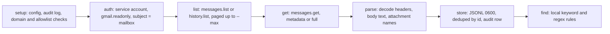

# Sutra Pulse (step 1): read-only Gmail reader

## What it is
A command-line tool that reads mail from selected mailboxes in the company Google Workspace domain, read-only.
It uses a service account with domain-wide delegation and the single OAuth scope
`https://www.googleapis.com/auth/gmail.readonly`. Domain-wide delegation lets the service account open any
mailbox in the domain, so Pulse itself limits what is opened: only mailboxes in the configured domain and in an
allowlist file, only with a stated reason, and every run is written to an audit log.

Mock mode (`PULSE_MOCK=1`) serves a synthetic fixture inbox with no Google calls, so everything can be built and
tested before the key exists. Purpose, scope and data rules: [CHARTER.md](CHARTER.md).

## Rules before first use
- **Allowlist approval and owner notice (DEC-3).** The Workspace admin approves every allowlist entry, and each
  mailbox owner is told in writing before the first read. The tool does not enforce this; people do.
- **Retention (DEC-1).** Mail output is kept 30 days by default (`PULSE_RETENTION_DAYS`) and deleted by `purge`,
  which also runs inside `fetch` and `find`. The audit log is kept 365 days; step 1 does not delete it.
- **Minimum data.** `fetch` saves metadata (including subject and snippet) unless `--full` is given. Attachment
  contents are never downloaded.

## Admin setup (Workspace admin, once)
1. Create or pick a GCP project for Pulse.
2. Enable the Gmail API in that project (APIs & Services > Library > Gmail API > Enable).
3. Create a service account in the project (IAM & Admin > Service accounts). Note its numeric client ID.
4. Create a JSON key for the service account. Store it outside the repo, readable only by the person running
   Pulse: `chmod 600 /path/to/key.json`. Never commit it, never paste it into chat.
5. In the Google Admin console go to
   **Security > Access and data control > API controls > Domain-wide delegation**,
   choose "Add new", enter the service account's client ID, and grant exactly one scope:
   `https://www.googleapis.com/auth/gmail.readonly`. No other scope.
6. Approve the allowlist: one mailbox per line in a file outside the repo. Tell each owner in writing first.

## Install
Python 3.11 or newer. Mock mode and the tests need only the standard library.
Live mode needs two packages:
```bash
cd prototypes/pulse
python3 -m venv .venv
.venv/bin/pip install -r requirements.txt
```

## Mock run
```bash
cd prototypes/pulse
export PULSE_MOCK=1 PULSE_OUT_DIR=/tmp/pulse-out PULSE_STATE_DIR=/tmp/pulse-state
python3 pulse.py check --mailbox ana@example.test --reason "trying the mock inbox"
python3 pulse.py fetch --mailbox ana@example.test --reason "trying the mock inbox" --max 7
python3 pulse.py fetch --mailbox ana@example.test --reason "trying the mock inbox" --full --since-last
python3 pulse.py find  --mailbox ana@example.test --reason "trying the mock inbox" --rules fixtures/rules.sample.json
python3 pulse.py purge --dry-run
python3 pulse_test.py            # all tests, stdlib only, under 10 s
```
Mock always uses domain `example.test` and `fixtures/allowlist.txt`, ignoring live values in `.env`.
Choose a failure to simulate with `PULSE_MOCK_SCENARIO=<name>` (names in `fixtures/scenarios.json`, for
example `mismatch`, `history_expired`, `rate_limit_then_ok`, `server_error`, `invalid_grant`).
Mock does not evaluate Gmail search syntax: `--query` and rule `gmail_query` are recorded but every list returns
the whole fixture inbox.

## Live run
```bash
cd prototypes/pulse
cp .env.example .env      # then fill in the live keys below; .env is git-ignored
.venv/bin/python pulse.py check --mailbox someone@yourdomain.com --reason "first live check, owner notified"
.venv/bin/python pulse.py fetch --mailbox someone@yourdomain.com --reason "..." --max 20
```
Output goes to `~/.sutra-pulse/out/<mailbox>/<YYYY-MM-DD>.jsonl` (files 0600, folders 0700); the audit log and
saved positions to `~/.sutra-pulse/state/`. Relative paths in `.env` are resolved from the current directory.

## Configuration
A non-empty value in the shell wins over `prototypes/pulse/.env`.

| Key | Default | Notes |
|---|---|---|
| `PULSE_MOCK` | unset (live) | `1` mock, `0` or unset live |
| `PULSE_SA_KEY_PATH` | - | Live: path to the JSON key, outside the repo |
| `PULSE_DOMAIN` | - | Live: Workspace domain, lowercase, no `@` |
| `PULSE_ALLOWLIST` | - | Live: allowlist file, one mailbox per line, `#` comments |
| `PULSE_OUT_DIR` | `~/.sutra-pulse/out` | Mail output (mock under `_mock/`). Must be a folder of its own, not `~` or `/`. `purge` only deletes dated files inside its `<mailbox>/` and `_mock/<mailbox>/` folders |
| `PULSE_STATE_DIR` | `~/.sutra-pulse/state` | `audit.jsonl`, `history.json`, `history.mock.json` |
| `PULSE_RETENTION_DAYS` | `30` | 1..3650 |
| `PULSE_MOCK_SCENARIO` | `default` | Mock only |
| `PULSE_DEBUG` | unset | `1` shows stack traces; never prints config values |

## Commands and exit codes
```
pulse.py check  --mailbox M --reason R
pulse.py fetch  --mailbox M --reason R [--query Q] [--since Nd|Nh] [--max N] [--full] [--since-last]
pulse.py find   --mailbox M --reason R --rules FILE [--since Nd|Nh] [--max N] [--full]
pulse.py purge  [--dry-run]
```
`--reason` is 10 to 500 characters and goes into the audit log. `--max` is 1..500 (default 50).
Before any Google call Pulse checks, in order: arguments, config, audit log, domain, allowlist, rules (find),
key file (live), Google libraries (live). Then it fetches the profile and refuses if the opened mailbox is not
the one asked for.

Only `fetch --since-last` saves or moves the mailbox's saved position. A plain `fetch`, with or without
`--query` or `--since`, never touches it.

| Exit | Meaning | Codes |
|---|---|---|
| 0 | Success | `ok` |
| 1 | Bug | `internal` |
| 2 | Fix your input or install | `usage`, `config_missing`, `config_invalid`, `rules_invalid`, `deps_missing` |
| 3 | Refused by policy | `wrong_domain`, `not_allowlisted`, `mailbox_mismatch`, `audit_unavailable`, `unsafe_path` |
| 4 | Credentials or admin setup | `key_missing`, `key_unreadable`, `unauthorized_client`, `invalid_grant`, `token_error`, `access_denied` |
| 5 | Try later | `rate_limited`, `server_error`, `network_error` (after 5 attempts, backoff 1, 2, 4, 8 s) |

Rules file format (JSON): see `fixtures/rules.sample.json`. Allowed keys: `id`, `description`, `gmail_query`,
`keywords`, `regex`, `fields`. Fields: `from`, `to`, `cc`, `subject`, `snippet`, `attachments.name`,
`body_text` (needs `--full`). `attachments.name` only has values with `--full`.

## Flow


## What changes when the key arrives
1. The admin completes "Admin setup" above and gives you the key file path and the approved allowlist.
2. Install the two packages (see Install).
3. In `prototypes/pulse/.env` set 4 keys: `PULSE_SA_KEY_PATH`, `PULSE_DOMAIN`, `PULSE_ALLOWLIST`, and unset
   `PULSE_MOCK` (or set it to `0`).
4. Run `check` first on one allowlisted mailbox whose owner has been told. It must print that mailbox.
5. Then follow the live checklist in `docs/ai/pulse-gmail-reader/plan.md` (L-1..L-11).
No code changes are needed; the same pipeline runs with `LiveClient` in place of `MockClient`.

## Platform
POSIX only (Linux, macOS): Pulse uses `fcntl` file locks and `os.O_NOFOLLOW`. Windows is not supported.
