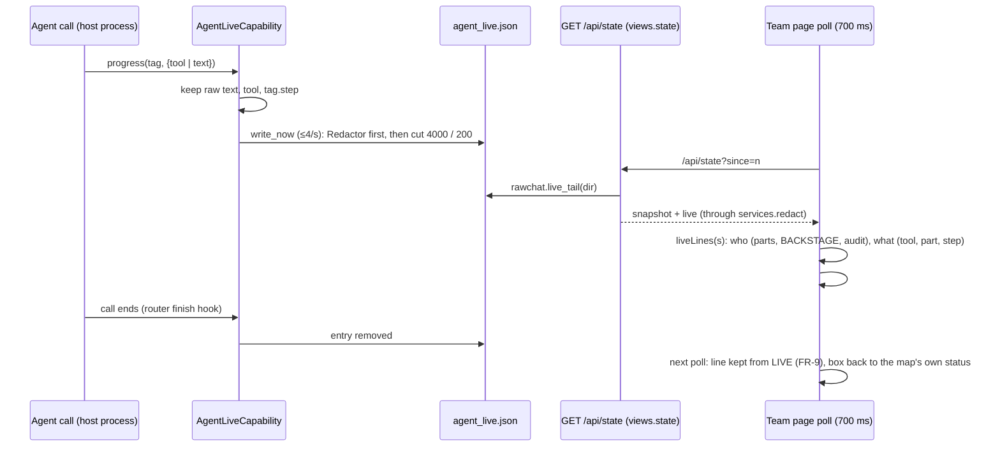

# Architecture: Show who is working and what, live, on the Map and in chat
Task: live-view | Spec: spec.md (Refined) | Base: 6c79a1db, rebased onto remove-real-run-gates before the first commit (FR-13)

## Context
The run already records, during every agent call, who is calling and its last tool title: `agent_live.json`, written by
`AgentLiveCapability` (capabilities/agents.py:96-215), served only to the Raw AI chat (`GET /api/agent-live`, engine/api/rawchat.py:42).
The team page never reads it. It keys the Map and chat on `J2Run.thinking`, which planner and judge calls never set (impact.md §1).
So the fix is to show the record that exists, on the poll that exists, and delete the fixed sentences it replaces.

## Approach
1. The writer: redact each entry before it is cut (Q-7) and add the call's `step`; everything else unchanged.
2. The server: `/api/state` of a live run carries `live` = `rawchat.live_tail(dir)["agents"]` (one line in views.state). Its body is already redacted.
3. The page (one port edit, E32): a pure `liveLines(s)` turns `s.live` into `{k, p, what, line}` rows (who from the existing people
   tables, what = tool line, else part name, else step name). `#typing`, the Map chip, the Map's lit boxes and the Simple view crew read it.
   A page-session memory `LIVE` keeps the last line per person and overall (FR-9, Q-5). The fixed crew sentences go.
4. A comment-only J2 patch P47 updates the rule in j2_studio.py:8-9 (FR-14). One decision, D453.

## Alternatives considered
| # | Alternative | Why rejected |
|---|---|---|
| A1 | Make `j2_realization.ask` set `run.thinking` (a J2 P patch) | No run reference there; a logic patch through the hot vendor_j2.py; still gives no plain "what" (impact.md §3) |
| A2 | The page polls `GET /api/agent-live` itself | A second poll timer (N-5); the chip and crew would read two responses that can disagree |
| A3 | Redact at read time only (as today) and write the full reply untruncated so the API can redact then cut | agent_live.json would grow with every reply and be rewritten 4/s; the API would cut what the file should have cut |
| A4 | A new Sutra JS module (`live_line.js`) instead of page code | Still needs E edits at `#typing`, `mapChip`, `paintMap` and `sCrew` (they are page code); adds a file, a MODULES entry and a load-order guard for nothing |
| A5 | Keep the crew sentences, add the live line beside them | Owner rule: one-liners come from what agents do; the sentences are the fixed text the task removes (FR-10) |

## Components
| File | Owner | Change | Size |
|---|---|---|---|
| `sutra_app/engine/capabilities/agents.py` | Sutra | `AgentLiveCapability`: `redact` (constructor arg; `install` builds `Redactor(default_env_file())` when none); `progress` keeps the raw `text`/`tool` and the call's `step`; `snapshot` redacts, then cuts | ~+10/-3 |
| `sutra_app/engine/rawchat.py` | Sutra | `live_tail` passes `step` through (:122-124) | +1/-1 |
| `sutra_app/engine/views.py` | Sutra | `state`: in the `ctx.mode == "live"` branch (:352-353) add `live=rawchat.live_tail(_dir(ctx))["agents"]` | +2 |
| `scripts/port_j2_ui.py` | Sutra | `PAGE_EDITS` gains E32a-E32e; header count 59 → 64 (:18) | ~+35 |
| `sutra_app/ui/pages/j2_ui.html` | generated | regenerated by the port, never by hand | ~+14/-17 |
| `scripts/vendor_j2.py` | Sutra | `Edit("P47", "j2_studio.py", ...)` in `OTHER_EDITS` (before :3607) and `"P47"` in `PATCH_NOTES` (:3611-3648) | +6 |
| `sutra_app/engine/j2_studio.py`, `sutra_app/engine/VENDORED.md` | generated | regenerated by vendor_j2.py (docstring line, patch table, sha) | +1/-1 each |
| `docs/DECISIONS.md`, `docs/diagram/decisions.json` | Sutra | `## D453 — …` and its diagram entry | +15 |
| `tests/ui/fixtures/live/agent_live.json` | test | the FR-11 fixture | +10 |
| `tests/engine/test_engine_agent_live.py` | test | FR-1, FR-5a, step | +40 |
| `tests/engine/test_engine_api_redact.py` | test | FR-2, FR-5b, FR-7 (plant the fixture in the live run) | +25 |
| `tests/engine/test_engine_rawchat.py` | test | `step` passes through | +2 |
| `tests/ui/test_port_edits.py` | test | E32a-E32e rows in `EDIT_IDS` (:67-71) and the fragment table | +12 |
| `tests/ui/js/page_render.test.js` | test | live-line tests (FR-3,4,6,8,9,10) and the `team` parity normaliser (NFR-6) | +70 |
| `tests/engine/test_engine_vendor.py` | test | `marks["P47"] = ("j2_studio.py", "P47 (D453)")` (:191) | +1 |

Not touched: j2.py, j2_map.py, j2_realization.py, events.py, host/*, engine/api/*, orchestrator/*, connectors/*, any static JS module, E28, E29.

## Data model
No new file, schema id or migration. `agent-live/1` gains one optional field per entry:
`{"call", "since", "step", "text", "tool", "tools"}`; `step` is `tag.step` (int or null). Readers that ignore it (raw_chat.js, orchestrator/runs.py:121-140) are unaffected.
`/api/state` (live mode only) gains `live: {<key>: {call, since, step, text, tool, tools}}`. Saved runs: no `live` key.

## Interfaces
Python (agents.py):
```python
class AgentLiveCapability(Capability):
    def __init__(self, *, interval=LIVE_INTERVAL, clock=time.time, threaded=True, redact: Optional[Callable[[str], str]] = None) -> None
    # install(): if self._redact is None: from sutra_app.config import default_env_file; from sutra_app.orchestrator.redact import Redactor
    #            self._redact = Redactor(default_env_file())      # lazy, as AgentPicks imports connectors (agents.py:93)
    # progress(): entry["text"] = text; entry["tool"] = tool; entry["step"] = tag.step   (raw; no cut here)
    # snapshot(): r = self._redact or (lambda t: t)
    #             {"text": r(e["text"])[-LIVE_TAIL:], "tool": r(e["tool"])[:TOOL_CHARS], ...the rest as is}
```
`snapshot()` is what `write_now()` writes (≤4/s), so redaction runs at most 4 times a second, not on every streamed chunk.

Python (views.py, in `state`, inside `if ctx.mode == "live":`):
```python
snap.update(host=..., run_id=..., dept_id=..., live=rawchat.live_tail(_dir(ctx))["agents"])
```

Page (E32; the exact JS the edits insert; comments as the repo writes them):
```js
// E32 (D453): who works now and what they do, from the run's agent_live.json only (s.live, D133). The who: a part's person, Asha for
// Identity and the backstage functions, Nora for Audit, else the key. The what: the call's tool line, else the part's name, else its step's
// name; never the agent's own text. LIVE keeps this page session's last line, overall and per person (never stored).
const LIVE = {last: {}, line: "", key: ""};
const liveStep = (s, n) => String((s.steps || {})[n || s.step] || "").split(" ").slice(1).join(" ");
function liveLines(s){
  if (!s || s.status !== "running") return [];
  const parts = sModel(s).parts;
  return Object.entries(s.live || {}).sort((a, b) => (a[1].since || 0) - (b[1].since || 0)).map(([k, e]) => {
    const part = parts.find(x => (x.workflows || []).includes(k)),
      p = k === "audit" ? "nora" : k === "identity" || BACKSTAGE.some(b => b[0] === k) ? "asha" : (part || {}).person || "",
      what = String(e.tool || (part || {}).name || liveStep(s, e.step)).slice(0, 120), name = p ? PEOPLE[p].name : k,
      line = what ? `${name}: ${what}` : name;
    if (p) LIVE.last[p] = what;
    LIVE.line = line;
    return {k, p, what, line}; });
}
const liveTyping = s => { const L = liveLines(s).map(l => l.line), r = L.length ? L : s.status === "running" ? [LIVE.line || liveStep(s)] : [];
  return r.length ? r.slice(0, 3).map(esc).join("<br>") + (r.length > 3 ? `<br>+${r.length - 3}` : "") : s.status === "waiting" ? "Your turn." : ""; };
function mapLive(m){      // the boxes of the live agents show running; a box goes back to the map's own status when its agent stops
  const L = liveLines(CTX), on = n => L.some(l => n.kind === "function" ? n.id === "fn:" + l.k : n.kind === "engine" && (n.workflows || []).includes(l.k));
  (m.nodes || []).forEach(n => { if (on(n)){ if (!("st0" in n)) n.st0 = n.status; n.status = "running"; } else if ("st0" in n){ n.status = n.st0; delete n.st0; } });
}
```
Where each edit goes (old text is J2's own, counted once):
| Edit | Anchor (today's line) | Change |
|---|---|---|
| E32a | j2_ui.html:1082 `const sNum = …, sCap = …;` | replaced by the block above (`sNum`/`sCap` have no other use: 3 and 1 calls, all on :1100) |
| E32b | j2_ui.html:1084-1100 (sCrew body from `const th =` to the makers' `} });`) | new body: `open` computed inline (no `th`, no `live`); `line: plain(LIVE.last[k] || "")` in the SKEYS init; :1085-1087 kept; the makers loop keeps only :1096 (parked); then `liveLines(s).forEach(l => { if (l.p && !t[l.p].ask){ t[l.p].busy = true; t[l.p].line = plain(l.what); } });`; :1101 and `return t` unchanged |
| E32c | j2_ui.html:1976-1977 (`$("typing").innerHTML = s.thinking ? …`) | `$("typing").innerHTML = liveTyping(s);` plus `const lk = liveLines(s).map(l => l.line).join("\n"); if (lk !== LIVE.key){ LIVE.key = lk; paintMap(); }` |
| E32d | j2_ui.html:3660-3661 (`function mapChip(m){` and its `const st = m.status || {}, ns = m.nodes || [];`) | insert after them: `if (CTX && CTX.status === "running" && !CTX.paused){ const L = liveLines(CTX), t = L.length ? L[L.length - 1].line : LIVE.line || liveStep(CTX); if (t) return [t, L.length ? "running" : "idle"]; }` |
| E32e | j2_ui.html:3442 `function paintMap(){ paint(` | `function paintMap(){ mapLive(MAP); paint(` |

API contract: unchanged routes. `GET /api/state` live body: `+ "live": {...}`.

## Sequence diagrams


## Cross-cutting
| Concern | Decision |
|---|---|
| Errors | `live_tail` already returns `{}` on a missing or foreign file (rawchat.py:106-125); `liveLines` returns `[]` for no state or not running; `mapLive` changes nothing with no live rows |
| Security | Redact before the cut in the writer (FR-5), then again in every API body (ctx.py:187). The page never shows `text` (Q-10). All page output goes through `esc` (`#typing`, crew `esc(t.line)` j2_ui.html:1309, the Map's existing `mapWords`) |
| Security: host holds secret values | the host's `Redactor` reads `.env` values into memory only to replace them; it never exports them into `os.environ` (load_env_file's rule, paths.py:206-211, stays true) |
| Layering | engine → `sutra_app.orchestrator.redact` and `sutra_app.config`, imported lazily inside `install` only (no engine module imports orchestrator today; recorded in D453) |
| Performance | redaction ≤4/s per run (in `write_now`); `/api/state` adds one small file read per poll; the Map repaints only when the live lines change |
| Logging | none added |
| Config | none added |
| Backward compatibility | additive field and key; a run made before this has no `step` (falls back to the snapshot step) |

## Rollout and rollback
Ships in the next beta, then a release when the owner says so. Rollback: revert the commits; no data written by this change needs cleaning
(agent_live.json is rewritten every call; an old file with `step` reads fine).

## Test strategy
| Level | File | Covers |
|---|---|---|
| unit (py) | tests/engine/test_engine_agent_live.py | FR-1 nested tag key; FR-5a redact-then-cut on both cuts (fails on today's code); `step` recorded; existing entry-shape tests updated for `step` |
| unit (py) | tests/engine/test_engine_rawchat.py | `step` passes through `live_tail` |
| API (py) | tests/engine/test_engine_api_redact.py | FR-2 `live` in the live `/api/state`, not in saved; FR-5b planted value redacted; FR-7 `state.chat` unchanged; the existing all-routes walk keeps passing with the fixture planted |
| page (node) | tests/ui/js/page_render.test.js | FR-3, FR-4 (incl. `text` never shown, 120 cut), FR-6 (order, cap, +N), FR-8 (`mapLive`, `mapChip`), FR-9 (memory, fresh-load step name), FR-10 (crew lines, deleted strings absent); NFR-6 parity with the `team` crew texts blanked |
| port | tests/ui/test_port_edits.py | E32a-E32e present once, old text gone; `--check` clean |
| vendor | tests/engine/test_engine_vendor.py | P47 mark; `vendor_j2.py --check` clean |
| decisions | tests/test_diagram_decisions.py | D453 in both files |
| e2e (manual, beta) | plan.md, last section | the owner's view; Q-1 runtime read of agent_live.json; NFR-1 timing |
| not added | browser tests (SUTRA_BROWSER=1) | mock runs write no agent_live, so they would only see FR-9's step name; the node tests drive the real page code |

## Traceability
| Requirement | Component | Test |
|---|---|---|
| FR-1 | agents.py (no change unless the test fails) | test_engine_agent_live.py `test_a_planner_and_a_judge_call_are_keyed_by_their_function` |
| FR-2 | views.py `state`, rawchat.py | test_engine_api_redact.py `test_a_live_state_carries_the_live_agents_and_a_saved_one_does_not` |
| FR-3 | E32a `liveLines` | page_render.test.js "E32: the who of each live key" |
| FR-4 | E32a `liveLines`, `liveStep`; agents.py `step` | page_render.test.js "E32: the what is the tool, else the part, else the step; never the text"; test_engine_agent_live.py `step` test |
| FR-5 | agents.py `snapshot` + install; API redaction | test_engine_agent_live.py `test_a_secret_is_redacted_before_either_cut`; test_engine_api_redact.py planted-fixture test |
| FR-6 | E32a `liveTyping`, E32c | page_render.test.js "E32: the chat line: one per agent by since, three then +N" |
| FR-7 | views.py (no chat write), E32c (no `addMsg`) | test_engine_api_redact.py (chat length); page_render.test.js asserts `liveTyping` source has no `addMsg` |
| FR-8 | E32a `mapLive`, E32d, E32e, E32c repaint | page_render.test.js "E32: the Map lights the live boxes and its chip says the latest line" |
| FR-9 | E32a `LIVE`, `liveTyping`, E32d | page_render.test.js "E32: between calls the last line stays; a fresh page says the step" |
| FR-10 | E32a (sNum/sCap gone), E32b | page_render.test.js "E32: the crew says what the live agents do"; test_port_edits.py E32b absent-strings row |
| FR-11 | tests/ui/fixtures/live/agent_live.json | used by both test files above |
| FR-12 | DECISIONS.md, decisions.json | test_diagram_decisions.py; plan T0 grep |
| FR-13 | process (rebase, port) | plan T0; test_port_edits.py; `port_j2_ui.py --check` |
| FR-14 | vendor_j2.py P47 → j2_studio.py | test_engine_vendor.py marks; `vendor_j2.py --check` |
| NFR-1 | poll + repaint | manual beta check (plan, live test) |
| NFR-2 | whole diff | review: `git diff --stat origin/main` (plan T8) |
| NFR-3 | E32 | review of E32 literals (plan T8) |
| NFR-4 | E32a, E32b | plan T5 done-check: line count of the sCrew block |
| NFR-5 | whole diff | review (plan T8) |
| NFR-6 | E32 | page_render.test.js parity loop with the `team` normaliser |

## Decisions
**D453 — The team page shows who works now and what, from agent_live.json**
- Decision: `/api/state` carries the run's live agents; the page builds one line per live agent (who from the existing people tables, what from the call's tool line, else the part name, else the step name, never the agent's text); the Map chip, the lit boxes, the chat line and the crew read it; the fixed crew sentences go (E32). The writer redacts before it cuts, with the app's `Redactor`, and records the call's step. P47 changes j2_studio.py's rule comment only.
- Context: impact.md §1 (planner and judge calls leave `thinking` None for minutes); owner answers Q-1..Q-10 (spec.md).
- Consequences: one more field in agent-live/1; the engine imports `orchestrator.redact` lazily in the host; mock runs show the step name instead of "Working…"; idle crew lines are empty on a fresh page; the `team` parity golden is compared with crew texts blanked.
- Rejected: A1-A5 above.

**D453-a (inside D453) — Redact in the writer, not only in the API.** Context: the cut (agents.py:160-162) can split a secret so the API's whole-value Redactor misses the rest (Q-7). Consequence: the host builds a `Redactor` from the same `.env`; the server-only extras (launch token, override key) are still covered by the API pass.

**D453-b — The step name comes from the call's tag.** Context: during "What I build" the tag says step 2 (j2.py:5606) while the snapshot's step is the earlier one. Consequence: one field `step` per entry; old files fall back to the snapshot step.

## Risks
| # | Risk | Likelihood | Mitigation |
|---|---|---|---|
| R1 | Parity: E32 is the first edit that changes a golden (`team`, crew texts). The opt-in test (page_render.test.js:355) compares every key with J2's own harness | certain | one normaliser blanks the crew `<small>` texts of `team` on both sides, in both the golden loop and the opt-in test, named E32 |
| R2 | The removal branch also edits port_j2_ui.py's header (:18), `EDIT_IDS` (test_port_edits.py:71), vendor_j2.py | high | T0 rebases first; regenerate, never merge j2_ui.html; take the next free numbers |
| R3 | Engine importing orchestrator.redact might break an import contract nobody wrote down | low (no test enforces it; grep found none) | lazy import inside `install`; full gate in T8 |
| R4 | The host's environment may lack a secret-named variable the server has | low | the API pass still redacts every body; the gap is only the cut edge for that value |
| R5 | `liveStep` may read "Is the site workable?"-style words in the Agent view; the Simple crew runs it through `plain()` | moderate | accepted: it is J2's own step label, already shown in the step strip (j2_ui.html:411) |
| R6 | Idle crew lines are empty on a fresh page and on saved runs (Q-5 has no stored source) | certain | accepted by the owner's Q-5/N-5; the crew still shows name and role |
| R7 | Q-1 is confirmed by code and unit test only until the beta read | low | plan live-test step 3 |
| R8 | A change-request plan call (`purpose="change"`) never appears live | certain | out of scope; FR-9 line shows |
