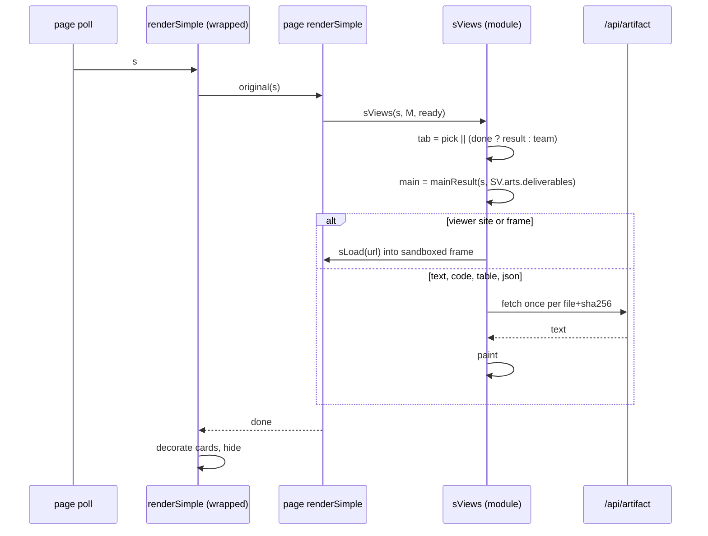

# Architecture: the centre panel shows any output, not only websites
Task: sut-27-output-agnostic-result | Spec: spec.md (Refined) | Base: f21add06 | Decision: D450

## Context

The team page is J2's `j2_ui.html`, generated by `scripts/port_j2_ui.py` and never hand-edited (D137, D191). Its centre panel assumes a website (spec "Problem"). The change is UI only: no engine, no `engine/views.py`, no `engine/api/*`.

Verified facts this design rests on:

| fact | evidence |
|---|---|
| Sutra modules load after the page script, in `MODULES` order, from `/ui/js/` (port edit E12) | scripts/port_j2_ui.py:56-58, :204-206; j2_ui.html:4806-4819 |
| `dept_ext` must stay the last module | tests/ui/test_port_edits.py:245-248 |
| A module script from `'self'` needs no CSP hash; only inline scripts are hashed | ui/boot.py:143-166 (`script-src 'self' <hashes>`) |
| A module may add its own stylesheet link at load | avatars.js:220-225 (`/ui/css/avatars.css`) |
| Adding a module adds one line to `j2_ui.html` (the E12 output), nothing else | commit fd7bc2f6 (avatars): j2_ui.html +1 |
| The render harness behind the goldens runs only `sutra_ctx.js` and the page's last inline script, never a module | pages/j2_ui_render.js:16-22 |
| `renderSimple`, `sViews`, `sTabs`, `sFinish`, `sPhase`, `sOpenPart`, `sTeamwork`, `sLoad`, `paint` are top-level `function` declarations (replaceable on `window`); `SV`, `isReady`, `esc`, `runQ`, `sNoun`, `TYL` are top-level `const` (readable by bare name from another classic script, not replaceable) | j2_ui.html:218, :237, :244, :1010, :1062, :1106-1107, :1125, :1222, :1326, :1340, :1600, :1727, :1957 |
| `paint` skips when the HTML string is unchanged, so DOM decoration after a paint survives the next identical poll | j2_ui.html:218-222 |
| `renderSimple` redraws `#sfinish` only when ready/failed flips | j2_ui.html:1243-1244 |
| The share click is an anonymous listener on `#sfinish` | j2_ui.html:1878-1884 |
| A tab click sets `SV.pick = data-view` and re-renders (handler on `#sview`) | j2_ui.html:1854-1857 |
| `s.allChat` holds every chat message (`who`, `human_output`) | j2_ui.html:1969; fixtures/j2/state.json |
| Deliverable rows carry `form`, `file`, `sha256`, `workflows` | j2_artifacts.py:155-160; fixtures/j2/artifacts.json |
| `/view` renders md, html, images (data URL), else escaped `<pre>`; `/api/artifact` serves raw bytes, `text/plain` for text | views.py:559-598 |
| The page already links `/api/artifact?name=...` as a plain `<a>` | j2_ui.html:1751 |
| `tests/ui/fixtures/j2/` is pinned by MANIFEST.json (every file listed with its hash) | tests/ui/test_fake_backend.py:765-773 |

## Approach

One new Sutra module, `result_view.js`, joins `MODULES` (before `dept_ext`). At load it replaces `sViews` (tabs, default tab, Result and Files panes) and `sFinish` for non-page runs, wraps `sPhase` and `sOpenPart` for wording, and wraps `renderSimple` to decorate the plan cards, hide `#sopen` and refresh the finish bar after each render. Its styles live in `result_view.css`, linked by the module. All choice logic (page run, main result, viewer, summary, a part's files, CSV/JSON tables) is pure functions, exported for node tests.

## Alternatives considered

| option | why rejected |
|---|---|
| Port edits in `scripts/port_j2_ui.py` (new `Edit` rows on `sTabs`, `sViews`, `sFinish`, `sTeamwork`) | D439 rejected this for render changes: about 10 new edits, a re-port, golden changes, and every J2 sync re-anchors them |
| Replace `sTeamwork` wholesale in the module | copies about 40 lines of J2 render that then drift from J2; decorating the painted DOM (the avatars pattern) changes only what the spec asks |
| A new server route (`/api/result`) that picks the main file and parses CSV | needs `engine/views.py` / `engine/api/*`, which the owner keeps closed (Q-6 answered); the page has every input it needs |

## Components

| file | new / changed | what |
|---|---|---|
| `sutra_app/ui/static/js/result_view.js` | new | the module: pure core + `adopt()` glue |
| `sutra_app/ui/static/css/result_view.css` | new | tabs pane, text/code/table viewers, card summary and file list, `.sframe.rvpane` rule |
| `scripts/port_j2_ui.py` | changed | `MODULES` gains `"result_view"` before `"dept_ext"` |
| `sutra_app/ui/pages/j2_ui.html` | regenerated | one line, `<script src="/ui/js/result_view.js"></script>`, written by E12 |
| `tests/ui/test_port_edits.py` | changed | its `MODULES` mirror gains `"result_view"` |
| `tests/ui/js/result_view.test.js` | new | node tests (pure core and a vm-stubbed page) |
| `tests/ui/fixtures/result_view/state-script.json`, `artifacts-script.json` | new | hand-built script-run fixture (below) |
| `tests/ui/test_dept_page.py` | changed | one new browser test for the script run |
| `docs/DECISIONS.md`, `docs/diagram/decisions.json` | changed | D450 |

Untouched: everything in impact.md §6, `engine/views.py`, `engine/api/*`, `j2.css`, `fixtures/j2/*`, `page_render.test.js`.

### Page functions: replaced, wrapped, left alone

| page global | treatment | why |
|---|---|---|
| `sViews(s, M, ready)` | replaced | three tabs, default tab, pick, address label, viewer dispatch, no page toast on non-page runs |
| `sTabs(s)` | left; no longer called (only `sViews` called it) | nothing to change |
| `sFinish(s)` | replaced: page runs (incl. docset) call the original; others get the module's bar | Download of the main file or "All files (N)"; Copy share link only with a main file that is not a real-run result (Q-4) |
| `renderSimple(s)` | wrapped (after the original, in `try`) | card decoration, "What you got" site line, `#sopen`, finish refresh when the main result changes |
| `sPhase(s, open)` | wrapped | "Checking it on a phone and a laptop" → "Checking the work" on non-page runs |
| `sOpenPart(sec)` | wrapped (await, then swap one text node in `#sdbody`) | "The part, on the page." → "The part, in the result." |
| `sTeamwork(s, M)` | left; its painted DOM is decorated | avatars pattern; no copied J2 render |
| `sTop` | left; `#sopen` hidden in the `renderSimple` wrapper on non-page runs | one place for post-render fixes |
| share click | a capture-phase listener on `#sfinish` for `[data-share]` that copies the main file's `/view` URL and calls `stopImmediatePropagation`; on non-page runs the module's `sFinish` leaves the button out when there is no main file or the main result is a real-run result (Q-4); page runs keep the page's button and URL | the page's listener is anonymous and cannot be replaced |

Every wrapper falls back to the original if the module throws (NFR-7). `adopt()` runs once; if any required global is missing it returns false and the page stays as J2 drew it.

## Data model

No schema or migration. Data the module reads:

| source | fields used | via |
|---|---|---|
| `/api/state` (poll) | `status`, `outcome`, `paused`, `saved`, `output`, `output_label`, `types[output].form`, `docset`, `versions`, `allChat[].who/human_output`, `studio.parts[].sec/st/workflows` (through `sModel`); names confirmed by Kaivan: `workflows[].id/real_run.result`, `types[output].entry_file` (today `types[output].file` carries the same value: j2_types.py:435, j2.py:3778) | the `s` passed to `renderSimple` |
| `/api/artifacts` | `deliverables[].name/form/file/sha256/workflows/label` | `SV.arts`, already fetched by the page's `sArts` (j2_ui.html:1738-1741) |
| `/api/artifact?name=` | raw text of text/code/CSV/JSON files; Download links | module `fetch`, cached by `file + sha256` |
| `/view?name=` | md, html, images in the sandboxed frame | `sLoad(url)` |
| `/site/v<N>` | the site preview | `sLoad(url)` |
| `/api/artifacts/groups` | `groups[].rows[].real_runs[].workflow/result/run_output` for the real-run result hook (FR-10 step 1); later `created/changed/deleted/files_truncated`. Never `output` (the stdout tail), `dry_run.*` or `expect`. Today no row has these keys and the projection (j2_artifacts.py:774-793) would drop them, so the hook is always skipped until P45 | fetched by the module (T2), flattened to one `runs` array |
| `run_output/<receipt-id>.json` (P45, not built) | the real-run result text, up to 64 KB | route decided when P45 lands; the module only keeps the link |

Script-run fixture (`tests/ui/fixtures/result_view/`), hand-built from the shape of `fixtures/j2/state.json` and `artifacts.json`, with only the keys the module and the page read. No real run, no path, no name:

| file | content |
|---|---|
| `state-script.json` | `output: "env_report"`, `output_label: "Environment report"`, `types: {env_report: {label, form: "agent", file: "env_report/*", tag, color}}`, `doc: false`, `docset: []`, `docset_files: []`, `files: []`, `versions: 1`, `status: "done"`, `outcome: "Done"`, `paused: null`, `saved: null`, `workflows: [W-1 plan, W-2 writes the script]`, `studio.parts` for W-1, W-2 (`st: done`), `chat` with a user brief and one W-2 message whose `human_output` is "@Coordination I wrote env_report/report.py. It prints the environment." |
| `artifacts-script.json` | `deliverables`: two rows of type `env_report`, `kind: "type"`, `form: "agent"`, files `env_report/report.py` and `env_report/report.txt`, `workflows: ["W-2"]`, `name` equal on both (the multi-file case); `records: []` |

Tests derive variants in code (one row, zero rows, running, `output: null`) instead of adding files.

## Interfaces

Module global `ResultView` (node: `module.exports`). Pure functions, no DOM:

```js
ResultView.isPageRun(s)                       // (s.docset||[]).length > 0 || ((s.types||{})[s.output]||{}).form === "page"
ResultView.done(s)                            // /^Done/.test(s.outcome) && !s.paused && s.status !== "running" || !!s.saved
ResultView.named(s)                           // -> the concrete type entry file, or "" (step 2)
ResultView.realRun(s, runs)                   // -> {workflow, result, link} when step 1 hits, else null
ResultView.mainResult(s, rows, runs)          // -> {kind: "real-run", workflow, result, link} | {kind: "file", row} | {kind: "list"} | {kind: "none"}
ResultView.viewerFor(row)                     // -> "site" | "frame" | "text" | "code" | "table" | "json" | "download"
ResultView.summaryOf(s, part)                 // -> string: last W-n human_output, leading @name stripped, first sentence; "Finished." if none
ResultView.filesOfPart(part, rows)            // -> rows whose workflows share one with part.workflows
ResultView.table(text, sep)                   // -> {head: [str], rows: [[str]], total: n} or null when it does not parse; rows capped at 1,000
ResultView.jsonTable(text)                    // -> same shape for an array of objects; null otherwise (caller falls back to numbered text)
ResultView.label(s, tab, main)                // -> the #surl text
ResultView.adopt(root)                        // installs the wrappers; true when adopted
```

`mainResult`, in full (spec FR-10):

```js
const str = x => typeof x === "string" && x ? x : "";
const LINK = /^run_output\/\w[\w.-]*\.json$/;          // P45's link, the row's `run_output` key; `output` (stdout tail) is never read
function realRun(s, runs) {                           // step 1: each workflow's last receipt row, in plan order; the row's own keys
  const last = (s.workflows || []).map(w => w && (runs || []).filter(r => r && r.workflow === w.id).pop())
    .filter(r => r && LINK.test(str(r.run_output)) && str(r.result)).pop();
  return last ? {workflow: last.workflow, result: last.result, link: last.run_output} : null;
}
function named(s) {                                   // step 2: an absent field or a glob gives ""
  const t = ((s.types || {})[s.output]) || {}, entry = str(t.entry_file) || str(t.file);
  return entry.includes("*") ? "" : entry;
}
function mainResult(s, rows, runs) {
  const rr = realRun(s, runs); if (rr) return {kind: "real-run", ...rr};
  const hit = named(s) && rows.find(r => r.file === named(s)); if (hit) return {kind: "file", row: hit};
  if (rows.length === 1) return {kind: "file", row: rows[0]};
  return rows.length ? {kind: "list"} : {kind: "none"};
}
```

Order: real-run result (a receipt row's own `result` plus a P45 `run_output/<id>.json` link; the engine already applied the entry_file fallback to `result`, so the UI adds none) → a concrete type entry file (a glob such as `<name>/*` means no single main) → the single output → the Files list. An entry file not among the output rows is skipped. No other name or extension is read (FR-11). `realRun` and `named` are the only places SUT-23 / P45 touch.

Viewer by extension (FR-5):

| `viewerFor` | rule | route | inserted as |
|---|---|---|---|
| `site` | `row.form === "page"` | `/site/v<versions>?x=1<runQ>` | sandboxed frame via `sLoad` |
| `frame` | `.html .htm .md .png .jpg .jpeg .gif .webp .svg` | `/view?name=<file><runQ>` | sandboxed frame via `sLoad` |
| `text` | `.txt .log` | `/api/artifact` | `<pre>` of escaped text |
| `code` | the code list in spec FR-5 | `/api/artifact` | escaped lines with numbers |
| `table` | `.csv` (`,`) `.tsv` (tab) | `/api/artifact` | escaped `<table>`; falls back to `code` |
| `json` | `.json` | `/api/artifact` | escaped `<table>` or numbered pretty text |
| `download` | anything else | `/api/artifact` | `<a href download="<basename>">Download</a>` |

All module HTML is built with the page's `esc()` (escapes `& < > "`), the same way the page builds its own markup; no file content reaches `innerHTML` unescaped (FR-6). The CSV parser handles quoted fields and `""`; it returns null on an unterminated quote.

Tab keys used with the page's own `data-view` handler: `result`, `files`, `team`, and `file:<path>` (opens Files with that file shown, with an "All files" back button). Unknown picks (for example the page's old `site`) map to `result`.

Wording table (FR-17) lives in one object in the module, so the string scan test reads the same source.

## Sequence diagrams



```mermaid
sequenceDiagram
  participant U as user
  participant F as #sfinish
  participant RV as module capture listener
  participant P as page listener
  U->>F: click Copy share link
  F->>RV: capture phase
  Note over F: non-page run with no main file or a real-run result: no data-share button (Q-4)
  RV->>RV: clipboard.writeText(main file /view URL; page run: today's /site/latest)
  RV->>F: stopImmediatePropagation; text "Link copied — opens on this computer only"; reset after 2.5 s
  Note over P: never runs for data-share
```

## Cross-cutting

| concern | handling |
|---|---|
| errors | every wrapper is `try { new } catch { original }`; fetch failure shows the FR-7 line; parse failure falls back to numbered text |
| security | HTML only in the existing sandboxed frames (no `allow-same-origin`, D83, D153); module markup escaped with `esc`; no inline script, no new CSP source (D82) |
| performance | file text fetched once per `file + sha256`, not per poll; table capped at 1,000 rows; pane repainted only when its key changes (`paint` compares strings) |
| polling | `SV.arts` arrives after `renderSimple`; the wrapper recomputes the main result each render and repaints `#sfinish` only when `ready && key changed`. The `real_runs` rows come from `/api/artifacts/groups`, fetched alongside (T2); absent rows skip step 1 |
| logging | none (page convention) |
| config | none |
| backward compatibility | page runs keep today's strings and finish bar; docset runs keep the page's `sFinish`; with the module removed the page is J2's again |
| accessibility | tabs keep `role="tab"` and `aria-selected`; file names on cards are click targets inside the card button, so the keyboard path to a file is the Files tab (stated limit) |
| privacy | not handled (owner dropped request item 6); the share URL becomes the main file's `/view` link (spec FR-19, Q-3), which opens on this computer only |

## Later extension points (planned, pending Kaivan; not built)

| Later item | engine field (planned) | route | where the module draws it |
|---|---|---|---|
| a file in the user's folder as the main result | the receipt row's `result` and `run_output` = `run_output/<receipt-id>.json` (P45) | P45's route (not built) | `mainResult` already returns `{kind: "real-run"}` (hook, T1); T2 shows the text once the route exists, until then the step never hits |
| "What the script printed" | receipt row `stdout`, `stderr` tails, `exit` | `/api/artifacts/groups` `real_runs[]` (today without stdout: j2_artifacts.py:774-793, an engine-side gap) | a folded `<details>` under the Result viewer, shown with the text viewer, last line as the summary |
| "What changed in your folder" | receipt row's own top-level `created`, `changed`, `deleted`, `files_truncated` (P45, `dry_run.*` format: sorted folder-relative path lists; never `dry_run.*`) | the same `real_runs[]` rows | a folded `<details>` under the Result viewer, "1 file created" style summary |

The Result pane has one slot below the viewer (`#rvlater`, empty today). A future `later(s, groups)` pure function fills it; when the fields are absent it returns "" and nothing is drawn.

## Rollout and rollback

Ships with the next release, nothing to migrate. Rollback: remove `"result_view"` from `MODULES` in both lists and re-port (the tag goes); the page is J2's again. Or revert the commits.

## Test strategy

| layer | file | covers |
|---|---|---|
| unit (node) | `tests/ui/js/result_view.test.js` | `isPageRun`, `done`, `realRun`, `named` and `mainResult` (real-run result with a P45 link, the same with only a stdout-tail `output`, a link-shaped `output`, or no receipt row (skipped), concrete entry file, glob entry file, name not among outputs, one, two, zero), `viewerFor` table, `summaryOf` (@name strip, first sentence, none), `filesOfPart`, `table` (quotes, bad, 1,500 rows), `jsonTable`, `label`, wording object has no site/page word for non-page keys |
| glue (node, vm stub page) | same file | `adopt()` on a stub with the page globals: tabs and default, pick kept, Result pane per fixture, card decoration on a painted fixture, finish bar hrefs, share capture text, fallback when a wrapper throws, `output: null` |
| port | `tests/ui/test_port_edits.py` | MODULES list and order, `dept_ext` last, page tag present |
| serving | `tests/ui/test_serve.py` | CSP unchanged, module tags served |
| parity | `tests/ui/js/page_render.test.js` | unchanged goldens (the harness never loads modules) |
| browser (opt-in) | `tests/ui/test_dept_page.py` | existing finish test on the website fixture stays `["Download", "Copy share link"]`; new test on the script fixture: three tabs, Result selected, Files list (two files), no site/page text, Download href, a done card without bars |

### Existing tests

| test | effect | handling |
|---|---|---|
| `page_render.test.js` goldens and E4 (:292-302, `download=*.html`, "Copy share link") | unaffected: the harness runs the page script alone (j2_ui_render.js:16-22). E4 still describes J2's own `sFinish`, which the module still calls for page runs | no edit; run it to prove it |
| `test_dept_page.py:886-899` (finish shows `["Download", "Copy share link"]`) | the fixture is a website run, so the page's `sFinish` draws it; button texts unchanged | no edit; if it fails the module is wrong, not the test |
| `test_dept_page.py` part record (`opens_its_record`, near :1072) | card click still hits `data-part` | no edit; run it |
| `test_fake_backend.py:765-773` (manifest) | new fixtures live in `fixtures/result_view/`, not `fixtures/j2/` | no edit |
| `tests/engine/legacy/j2_flow_test.py` | J2 strings, not the app page | no edit |

## Traceability

| requirement | component | test |
|---|---|---|
| FR-1, FR-2, FR-3 | `sViews` replacement | result_view.test.js glue; browser script test |
| FR-4 | `sViews` (placeholder; page run live site) | glue: running script and running website variants |
| FR-5 | `viewerFor` | unit table |
| FR-6 | renderers via `esc`; frame for HTML | unit `<b>x</b>`; glue checks frame use |
| FR-7 | renderers, fetch error path | unit bad CSV/JSON; glue 404 |
| FR-8 | `table` cap | unit 1,500 rows |
| FR-9 | Files pane | glue on script fixture; browser |
| FR-10, FR-11 | `named`, `mainResult` | unit |
| FR-12 | Result pane header | glue |
| FR-13 | `summaryOf`, card decoration | unit; glue |
| FR-14 | `filesOfPart`, card decoration | unit; glue |
| FR-15 | card decoration (`.sl` removal rule) | glue: one card per status |
| FR-16 | page-run delegation | glue on website fixture; existing browser finish test |
| FR-17 | wording object, `sPhase`/`sOpenPart` wrappers, `#sopen`, `sFinish` | glue |
| FR-18 | wording object | glue string scan of script fixture; browser |
| FR-19 | share capture listener | glue |
| FR-20 | `isPageRun`, `mainResult` | unit `output: null` |
| FR-21 | `sViews` never builds `/site/` URLs for non-page runs | glue: saved script variant, no `/site/` URL requested |
| FR-22 | result_view.css | browser script test at 375 px |
| NFR-1 | MODULES + E12 line | test_port_edits.py |
| NFR-2 | no page edit | page_render.test.js |
| NFR-3 | external module only | test_serve.py |
| NFR-4 | file list above | `git diff --stat origin/main` |
| NFR-5 | fixtures hand-built | test_ownership.py |
| NFR-6 | D450 | test_diagram_decisions.py |
| NFR-7 | wrapper fallbacks | glue: a throwing helper leaves the original output |

## Decisions

### D-1 One module wrapping page globals (D439 route)
- Decision: `result_view.js` in `MODULES`; replace `sViews`, `sFinish`; wrap `renderSimple`, `sPhase`, `sOpenPart`; decorate `sTeamwork`'s DOM.
- Context: generated page; goldens pin J2's render.
- Consequences: goldens untouched; the module depends on page global names, so a J2 sync that renames one turns the module off (adopt returns false), and the glue test catches it.

### D-2 Main result by a fixed order, built on the planned engine names
- Decision: the real-run result (the receipt row's own `result`, shown from its `run_output` link `run_output/<id>.json`, P45), else a concrete `types[output].entry_file` (`file` today), else the single output, else the Files list. Names confirmed by Kaivan; `result` is never matched against outputs.
- Consequences: no file-name guessing; a website run gets its site through the entry file even when it has other outputs; a folder run (`<name>/*`) with several files shows the list until its plan names a result.

### D-3 Viewers by extension, HTML only in the sandboxed frame
- Decision: reuse `/view` and `/site` in the existing frame for md, html and images; render text, code and tables in the page from `/api/artifact` text.
- Consequences: no server change; markdown and images look as they do today.

### D-4 Draft for docs/DECISIONS.md

```
## D450 — The centre panel shows any output: Result, Files, How it was made for every run; the main result by a fixed rule, never by file name (SUT-27)
- Sources: request.md of SUT-27 (approved by the owner, 2026-11-25) and the owner's answers of the same day; the before and after mock-ups; `j2_ui.html` (`sTabs`, `sViews`, `sFinish`, `sTeamwork`, `sPhase`, `sOpenPart`, the share listener); `engine/views.py` (`view_page`, `artifact`); `j2_artifacts.py` (`rows`, `served`); D439 (a Sutra module wraps the page).
- Decided: (a) Every run shows three tabs: Result, Files, How it was made. Result opens by default when the run is done; How it was made before. (b) A file is shown by a viewer chosen from its form and extension: the site preview for a page, the sandboxed frame for HTML, markdown and images (`/view`), text, numbered code, and tables for CSV and JSON (parsed in the page from `/api/artifact`), a Download link for anything else. (c) Result shows the main result, first match: the real-run result its receipt row names (`result`, a path in the user's folder resolved by the engine, shown from the `run_output/<id>.json` file the row links as `run_output`), the output type's entry file when it is one concrete file (not a folder glob) among the run's outputs, the run's only output, else the Files list. No other file name or extension decides it. (d) A finished part card shows its builder's one-line summary (the last message's `human_output`, a leading @name removed, first sentence) and its files; grey bars only while a part is in progress. (e) Wording follows the output: no site, page or "Open the site" unless the run makes a web page; Download saves the main file. (f) "Copy share link" copies the main file's `/view` link, and after copying says "Link copied — opens on this computer only". All of it is `ui/static/js/result_view.js`, a module in the port's list, with `result_view.css`.
- Why: scripts and reports showed an empty Page tab, grey bars and a Download of an empty page, and the file the run made was nowhere. One rule for every output keeps one screen to learn and to test, and a hook leaves the main result to the plan once SUT-23 records it.
- Rejected: port edits to `sTabs`, `sViews`, `sFinish` and `sTeamwork` (D439: the goldens pin the render, and every J2 sync re-anchors them); a screen per project type (D241); picking the main file by name (`report.txt`, `index.html`); a server route that picks the file or parses CSV (`engine/views.py` stays closed for this change); private-data detection and a "Turn sharing on" switch (the owner dropped it); a zip download.
- Rollback: drop `result_view` from `MODULES` (and its mirror in `tests/ui/test_port_edits.py`) and port again; the page is J2's again.
- Follow-ups: P45 (`run_output/<id>.json` and its route; the `real_runs` projection to carry `result`, `run_output`, `created`/`changed`/`deleted`/`files_truncated`) turns on the real-run result; "What changed in your folder" and "What the script printed" when SUT-28 / SUT-23 add a route. Share link: hidden with no main file or a real-run result (spec Q-4, answered).
- Diagram: label "centre panel: Result / Files / How it was made for every output; main result by rule, never by name", pill on band:EXPERIENCE.
```

decisions.json entry (appended after D448, or after D449 when SUT-28 lands first):

```json
{"id": "D450", "label": "centre panel: Result / Files / How it was made for every output; main result by rule, never by name (SUT-27)", "anchor": "band:EXPERIENCE"}
```

## Risks

| risk | likelihood | mitigation |
|---|---|---|
| A J2 sync renames a wrapped global | low per sync | `adopt()` returns false and the page is J2's; the glue test names each global it needs |
| `SV.arts` lags `renderSimple` by one fetch, so Result briefly shows the placeholder or list | high, harmless | the wrapper re-evaluates on the re-render `sArts` triggers (j2_ui.html:1740) |
| `#sfinish` drawn before the main result is known | high | finish refresh keyed on the main file in the wrapper |
| File names on a card are not keyboard targets (inside a `<button>`) | certain | Files tab is the keyboard path; noted in D450 follow-ups if the owner wants more |
| A user looks for Copy share link on a run with no main file or a real-run result | certain | hidden by the owner's choice (spec Q-4); Download or All files stays in the finish bar |
| P45's built key list differs from the confirmed one | low (confirmed by Kaivan; final list pending once built) | only `realRun` changes; unit cases pin that `output`, `dry_run.*`, `expect` and the plan's `real_run.result` are not read |
| D450 collides with a parallel branch | moderate | re-check the highest number after `git fetch` before the decision commit |
| `j2_ui.html` regeneration needs a J2 extraction at the port's pin | moderate | the change is exactly the E12 line; `test_port_edits.py` and the opt-in `SUTRA_J2_CHECKOUT` check confirm it |

## Change log

| date | change |
|---|---|
| 2026-11-25 solution-architect | First version |
| 2026-11-25 developer (T1) | Owner decisions at plan review: main-result step 1 is the real-run result hook (`realRun`, P45 link on the workflow's last receipt row; `result` never matched against outputs); `mainResult` takes `runs`; `/api/artifacts/groups` `real_runs` now read; share URL is the main file's `/view` link (Q-3); Q-2 confirmed (no design change) |
| 2026-11-25 developer (T1) | Owner update: `realRun` reads the receipt row's `run_output` key only; `output` (stdout tail) is never a link |
| 2026-11-25 developer (T1, second commit) | P45 confirmed: `realRun` reads the receipt row's own `result` and `run_output` (each workflow's last row, last in plan order); Later folder changes from the row's top-level `created`/`changed`/`deleted`/`files_truncated`. No reader built for them yet (Later) |
| 2026-11-25 developer (T1, docs) | Q-4 answered: Copy share link hidden on non-page runs with no main file or a real-run result; share flow and risk rows updated |
