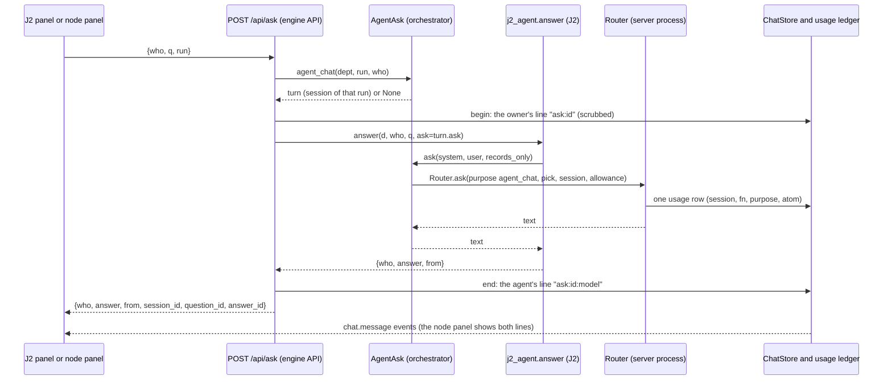

# J2 sync 4: Sutra Pro takes over the J2 changes of `prototypes/j2` (sync note of record and build plan)

_Status: Proposed (complete: parts 0 to 7) · Author: solution-architect (stage 3 of 5) · Date: 2026-11-10 · Ships as: 0.3.0 · Branch base: `main` with the 0.2.1 fix (D135) merged · Analysis (read-only input): `./j2-sync-4-analysis.md` · Spec: the owner's rules R1 to R5 below_

How to read this note. It is the sync note of record (what lands, what is left out and why: same spirit as `j2-sync-3.md`) and the build plan a pool of developers runs in parallel lanes. Part 1 holds the decisions (D136 and on, in the repository's DECISIONS format: they are pasted into `docs/DECISIONS.md` by the docs lane, not before, so the 0.2.1 fix that amends D127 and D128 cannot conflict with this branch). Part 2 is the engine sync, Part 3 the routes and the agent-answer port, Part 4 the page re-port, Part 5 the lanes, Part 6 the verification matrix and the integrator's cross-verification, Part 7 migration, risks and what is not done.

Paths are repository-relative to `sutra-pro/` unless they start with `prototypes/` (the J2 copy, one level up). No file under `sutra-pro/` may contain the owner's name or an absolute home-folder path (R5): the commands below use `$J2SRC`, `$J2FULL`, scratch folders from `mktemp -d` and commit hashes.

## 0. Scope, the owner's rules, the pins

### 0.1 What this work is

`prototypes/j2` (the J2 copy inside this repository) is a strict superset of the vendored J2 (`9200cf6`): 9 changed and 2 new top-level files, 5 generic templates, 79 seed-library files and the whole new page (analysis section 0 and 2). Sutra Pro vendors the engine from it and re-ports the page from it. Every J2 change is taken, or listed in 7.4 with its reason and its follow-up (R3). Nothing is silently dropped.

### 0.2 The owner's rules, and where each one decides something here

| Rule | What it means in this design | Decisions |
|---|---|---|
| R1 one central engine; new things enhance, nothing replaces or is routed around it | every new route is a view in `engine/views.py` on the one `RunCtx`; the report row in Artifacts and the run-end steps are hooks of the capability registry or the host, not new paths; no second flow | D140, D142, D143, D146, D147 |
| R2 every agent that works does so in its own chat session with its own model and effort picker | a model-backed answer of a function is a turn of that function's session, booked, scanned, limited, with the session's own pick; the J2 panel and the node panel show the same transcript | D147, D148, D149 |
| R3 everything in the copy that Pro lacks is implemented and cross-verified | the verification matrix (Part 6) has one row per inventory item; deferrals are in 7.4 with reason and follow-up | D136 to D151 |
| R4 the architect decides, numbered, from D136 (D135 is reserved) | Part 1 | all |
| R5 the page is generated; J2 prompts and code byte-identical except numbered patches; goldens only through recorders; no owner name or absolute path; every decision has a pill entry; traceability regenerated | Part 2 (patch table), Part 4 (edit table), Part 5 (docs lane) | D136, D137 |

### 0.3 Pins (verified in this worktree on 2026-11-10)

| Item | Value | How it was checked |
|---|---|---|
| Worktree | `sutra-wt-sync4`, branch `feat/sutra-pro-j2-sync-4`, cut from `origin/main` `b5dd56f87b45e6994f906ec2fb051e75efcdadc4` | `git rev-parse HEAD origin/main` |
| Source of the sync | the folder `prototypes/j2` of this repository at commit `00efb179e21cb79fae157a0679e819921ac37726` (its last touch: "Document rows: a Map link to the PRD keeps landing on the Documents view", 2026-11-09) | `git log -1 -- prototypes/j2` |
| Tree id of that folder | `99b6f3a05de78a609b593d81d7fb06b55c32b961` | `git rev-parse HEAD:prototypes/j2` (equal to `00efb179:prototypes/j2`: nothing touched the folder since) |
| Extraction | `git archive 00efb179e21cb79fae157a0679e819921ac37726 prototypes/j2 \| tar -x --strip-components=2 -C "$J2SRC"` into a new empty folder; the two scripts take that folder with `--commit` | never the working tree: an edited file or a `.pyc` cannot be vendored |
| J2's own repository | `main` is `dfa44b3` (as last fetched; not re-fetched): `j2.py`, `j2_agent.py`, `j2_map.py` and the whole seed library are byte-identical to the copy, `j2_artifacts.py` and `j2_template_lib.py` differ | analysis 1.4 (spot-checked by the owner's coordinator) |
| Vendored baseline before this work | J2_Prototype `9200cf626e5c05032caefda4f96b694284efdc5e` | `scripts/vendor_j2.py` `BASELINE` |
| Parallel fix | D135 (project run's honest capability text, the report in the team chat, follow-up continuity; amends D127 and D128), merged to `main` and released as 0.2.1 BEFORE the lanes below start. This branch's lanes are cut from that `main`. Files it owns and this work must not edit: `engine/capabilities/project.py`, `engine/capabilities/workspace.py`, the grounding text of `connectors/workdir.py`, the run-end flow of `orchestrator/projector.py`, the team chat report message | owner brief |

`prototypes/j2` is the only place the pin is read from. After the 0.2.1 merge the commit id above is still reachable and its folder tree is still `99b6f3a0` (the 0.2.1 fix touches no J2 file); the integrator proves it with `test "$(git rev-parse 00efb179e21cb79fae157a0679e819921ac37726:prototypes/j2)" = 99b6f3a05de78a609b593d81d7fb06b55c32b961`.

### 0.4 What lands, in one table

| # | Theme | Lands as | Decision | Part |
|---|---|---|---|---|
| 1 | Engine files (`j2.py` late judge and placement, `j2_agent.py` activity and answer, `j2_map.py` plan map, `j2_artifacts.py` groups and views, `j2_template_lib.py` catalog and Document templates) | `vendor_j2.py` re-run from the pin; one anchor count fixed; header and baseline rewritten | D136 | 2 |
| 2 | Agent-readable views (`j2_agent_models.py`, `j2_agent_views.py`) | vendored with P1; a Sutra-owned run-end step builds the JSON | D143 | 2 |
| 3 | Seed library (79 files; 32 templates, 39 versions) and `sync_seed_library` | vendored; existing installs receive new versions of existing templates without overwriting anything | D144 | 2 |
| 4 | Late judge (rows gain `judge`, records gain `late`) | on by default, no patch; records models extended; cost measured from the usage ledger | D145 | 2 |
| 5 | Read routes `plan-map`, `activity`, `catalog`, `artifacts/groups`; `runlist` and `changes` (P13 retired) | views, routes, stdlib rows, `J2_PATHS` | D140 | 3 |
| 6 | `POST /api/ask` | phase 1 records-only, phase 2 a turn of the function's own session through an orchestrator port | D147 to D149 | 3 |
| 7 | `/library` | `/d/{dept}/library` over the one global library; run-end catalog collection under the library lock | D141, D142 | 3, 4 |
| 8 | The page (Simple view, icon rail, chat panel, Map, Artifacts tabs, native Run settings, catalog) | regenerated by `port_j2_ui.py` with a rewritten edit table; output choice re-homed; project report row | D137, D138, D139, D146 | 4 |
| 9 | Tests, goldens, fixtures, legacy flow test | re-recorded only through the recorders; the 14 failing tests become the new expectations | D136, D150 | 2, 4, 6 |

## 1. Decisions (D136 to D151; D135 belongs to the 0.2.1 fix)

They are written in the form of `docs/DECISIONS.md` and are pasted there, with their pills in `docs/diagram/decisions.json` (`id`, `label`, `anchor`: the label and anchor are the last line of each entry), by the docs lane (WP-DOC) after it has rebased on the `main` that carries 0.2.1. The numbering is final.

## D136 — Sync 4 vendors from the J2 copy `prototypes/j2` at a pinned commit and tree
- Sources: owner brief of 2026-11-10 (names the folder as the source), `docs/design/j2-sync-4-analysis.md` 1.1 to 1.4, D114, D13.
- Decided: the source is the folder `prototypes/j2` at commit `00efb179e21cb79fae157a0679e819921ac37726` (tree `99b6f3a05de78a609b593d81d7fb06b55c32b961`), extracted with `git archive <commit> prototypes/j2 | tar -x --strip-components=2 -C <empty folder>` and given to both scripts with `--commit`. `scripts/vendor_j2.py`: `BASELINE` is that commit; new constants `BASELINE_TREE` and `UPSTREAM_J2 = "dfa44b3"`; the static header of `VENDORED.md` is written from them (the sutra commit, the tree id, the extraction command, and the sentence that `j2.py`, `j2_agent.py`, `j2_map.py` and the seed library equal J2's own `dfa44b3`, so a later move back to J2's repository is a no-op for them; `9200cf6` stays named as the previous baseline); the one anchor that failed (P1, `j2_artifacts.py`, `    import j2_map`) now expects 3; `CODE` gains `j2_agent_models.py` and `j2_agent_views.py` (D143); P13 is retired (D140); `REF_DOCS` gains `agent-views-j2-proposal.md`; a new data patch P15 replaces the six absolute home-folder paths of a J2 developer's machine in the seed's `library/index.json` (`runs[].library`, found by the check made for this design: six values of the form `"library": "/<home folder>/<login>/.../J2_Prototype/library"`) with `"not recorded"` (R5 forbids an absolute home path in any file of this product; no code and no page reads the field; the two other values, `/tmp/j2-live-library*`, stay). `scripts/port_j2_ui.py` gets the same `--commit` flag, because a `git archive` folder is not a repository. Not carried, with the reason in 7.4: the two HTML mocks, `build-on-run-design.md` (a design with no code), the older studio and the budget demo.
- Why: it is the only superset (J2's own `dfa44b3` has neither the Artifacts groups, the Document templates nor the page); a commit plus a tree id is reproducible while `main` moves; D114 already allows taking a J2 change from the copy when J2's repository lacks it.
- Rejected: J2's own `origin/main` (drops the Artifacts groups, the Document templates and the whole new page, against R3); the working tree of `prototypes/j2` (not reproducible: an edited file or a `.pyc` would be vendored); both sources (two truths); the folder's HEAD without a pin (moves under the build).
- Diagram: label "J2 sync 4: prototypes/j2 @00efb17", pill on J2 chips.

## D137 — The department page is J2's new page, re-ported by anchor; Sutra's strip, tabs and panels are added around it
- Sources: R5, analysis 3.F and 4.2, D76, D114, `docs/design/ui.md` 5.
- Decided: `scripts/port_j2_ui.py` ports J2's new `j2_ui.html` (Simple-view redesign, icon rail with flyouts, chat panel, Adaptation Map, Artifacts groups and tabs, native Run settings, shared template library page). Kept after a semantic re-check: E1, E3, E4, E6b, E8 to E12, E13a, E13c, E13d. Rewritten: E2 (now two edits: `frame` and `sframe` each get the sandbox, only `frame` gets `data-src`), E5 (the title it patched is gone: a strip at the top of the Simple view replaces it), E6a (graph and org chart use the whole work area), E7 (a strip at the top of the icon rail: back to All teams, the team chip and the two tab buttons), E13b (count 3). Retired: E14 to E18 and `run-settings.css` (J2's own Run settings is the design they copied), E19a to E19c (D139). New: E9b (Esc closes only the node panel when it is open), E12 gains two modules, the `/library` path edits (D141), the Ask bridge edit (D148), and E22 (J2's own `TABSUB` line still says Run settings has "what to build"). 28 page edits in all; the edit table and the exact anchors are in Part 4. The page is regenerated, never hand edited; `--check` must pass.
- Why: J2's page is what the J2 side now calls J2 and R3 asks for all of it; keeping the generated-file rule keeps the next sync cheap; every Sutra part that needs a seam in the page gets a numbered edit instead of a runtime hook that `--check` cannot see.
- Rejected: keeping the old page (R3); hand edits (R5); runtime patching from `dept_ext.js` of the Map flyout, the rail and the chat panel (the edits would be invisible to `--check`); taking only Run settings and the catalog (the Artifacts tabs and the function chat need the rest).
- Diagram: label "J2 page re-ported (E1 to E13, D137)", pill on User chat interface · J2 Simple view.

## D138 — Home and Console keep a frozen copy of the previous J2 stylesheet; only the team page takes the new one
- Sources: D74 (one stylesheet for both pages: superseded in that one respect), analysis 3.F, the check made for this design: Home is built on the old J2 Simple skeleton (`#sview`, `.shead`, `.smain`, `.schat`, `.stoggle`, `#dview`, `#rail`, `.barbadge`, `.railoff`, `.has-site`), and five classes Sutra code uses (`barbadge`, `has-site`, `railoff`, `smain`, `stoggle`) exist only in the old stylesheet; 24 rules of the old sheet that mention `.rail`, `.tabs` or `#rail` are not in J2's new `<style>` verbatim (among them the generic 240 px `.rail.tabs` rule), and the new `#rail.rail.tabs` rule (84 px) would apply to Home's `<nav id="rail">`.
- Decided: `sutra_app/ui/static/css/j2-shell.css` is a byte copy of the committed `j2.css` of the previous sync (the J2 `9200cf6` style block), owned by Sutra from now on (its first line says so and names this decision); `home.html` and `console.html` link it instead of `j2.css`. The team page links the regenerated `j2.css`. `test_port_edits.py` pins the copy's sha256 so it cannot drift by accident, and a new test (`tests/ui/test_shared_css.py`) fails when a class that Sutra's scripts or pages use is defined in none of `j2.css`, `j2-shell.css` and the `sutra-*.css` files. Home and Console keep their look; moving them to J2's new look is a design pass of its own (7.4).
- Why: regenerating the one shared sheet would have restyled Home and the console with rules written for another layout, and nothing in the sync asked for that; a frozen, hashed copy costs one 90 KB file and makes both pages independent of J2's next redesign.
- Rejected: restoring the 24 lost rules by hand into `sutra-shell.css` (Home also depends on the changed `#sview` and `#dview` rules: a partial copy breaks at the next J2 change); re-skinning Home now (a design task with its own risk, not part of taking J2's changes); keeping D74 as it was (it cannot hold when J2 replaces its shell).
- Diagram: label "Home and console keep J2's previous stylesheet", pill on band:EXPERIENCE.

## D139 — The per-request output choice moves to the new start page as a Sutra module; Settings keeps the default
- Sources: D129 (`auto` is the default, the owner overrides it anywhere), analysis Q3, the new page (the start select, `/api/output` and `OUTS` are gone from it).
- Decided: one page edit (E19) puts `<div class="soutpick" id="soutpick"></div>` before the chips inside the landing (`#sland`), and a new Sutra module `static/js/output_pick.js` fills it: "What should we make?" with Let the team decide (`auto`), Website, PRD document and Project work, hidden whenever the landing is hidden (the landing hides itself once a run exists), disabled for an archived team. It shows `next_run.output` of `GET /api/engine/settings?dept=` (new, additive: what the team's next run would use, the start page's choice included: `ctx.effective_settings`, which already layers `engine.json`, the team's file and `page.json`), so a reload shows what was picked; a change is `POST /api/output {type}` (the J2 route, token and team added by the fetch wrapper), which stores `page.json next_settings.J2_OUTPUT` as before. Settings, Engine keeps `CHOICES.output` (the default for the team). `engine/api/commands.py` does not change; `engine/api/settings.py` `settings_view` gains `next_run` when a team is named.
- Why: the choice belongs where the request is typed; a module is testable in node and needs one edit instead of three edits that patch J2's state code.
- Rejected: the three-edit E19 (it patched code that no longer exists); a control inside Run settings (it is not where the owner types the request, and the pane is for finished and saved runs); dropping the choice (D129 says the owner overrides anywhere).
- Diagram: label "start page: choose what to make", pill on band:EXPERIENCE.

## D140 — The new read routes are ordinary views; patch P13 is retired into Sutra-owned code
- Sources: R1, analysis 3.E and 6.3, D25 (one implementation behind two adapters), D114 (P13).
- Decided: `engine/views.py` gains `plan_map`, `activity`, `catalog`, `artifacts_groups` and `ask` (D147); `runlist` and `changes` stay, but their code moves out of J2's `j2.py` into the Sutra-owned `engine/runlist.py` (the same logic as `j2_server.run_row`, `run_list` and the inline `/api/changes` of J2's server, over `j2.saved_dir`, `j2._read`, `j2._jsonl`), so patch P13 and its test are removed and `PATCH_VIEWS` goes; the table of J2's routes is now 31 GET rows and 6 POST rows (`HANDLER_COUNT = 37`). `artifacts_groups` is a live view (`LIVE_VIEWS`) like `artifacts_tree`. The FastAPI adapter registers the five GETs and `POST /api/ask` (token required), the stdlib adapter (`j2_server.py`) registers the same rows plus `/library` as J2's page, and `sutra_ctx.js` `J2_EXACT` holds 30 names (`PATCHED_EXACT` is removed: `runlist` and `changes` are J2's routes now).
- Why: one patch fewer in the vendored file (P13 changed no J2 behaviour), and the routes are J2's now, so recording their shapes from J2's own server replaces the engine-recorded `patched` section of the shape golden; a view is two to four lines on the pattern of `artifacts_tree`.
- Rejected: keeping P13 (its reason, "J2's own repository does not have them", is gone for the copy); a second module path for the new routes (D25: one implementation); serving them from the stdlib adapter only.
- Diagram: label "J2 routes: one implementation, P13 retired", pill on J2 chips.

## D141 — The shared template library is served under the team: `/d/{dept}/library`, over the one global library
- Sources: R1, analysis 3.D, 3.F and 6.2, D26 (the library is one global store behind a file lock), D72 (pages), D79.
- Decided: `ui/routes.py` serves `GET /d/{dept}/library` (HEAD too) with the same page file, the same CSP and the same boot block as `/d/{dept}/`; `/d/{dept}/library/` redirects (308) to it. `GET /api/catalog` is a team route (`?dept=`) answering `j2_template_lib.catalog_view()` from `<data>/library` without a lock (the index is replaced atomically, P12). `sutra_ctx.js` gains `pagePath` (`/d/<dept>/`), `libraryPath` (`/d/<dept>/library`) and `onLibrary()`, and the page edits replace every root path J2 builds (`/library`, `/?run=`, the two `location.pathname` tests) with them; in J2's stub DOM (no team) they give `/` and `/library`, so the render harness behaves as J2's. J2's `--collect` is never run on a data folder by hand: D142 is the only writer.
- Why: the page needs the team shell (rail, token, CSP, node panel) and the data is global, so the path says the team and the library says nothing about it; the stub fallback keeps the harness equal to J2's.
- Rejected: a global `/library` page (no team shell, a second boot block); copying the library per team (D26); a lock on the catalog read (a read of an atomically replaced index needs none).
- Diagram: label "/d/{dept}/library over the one library", pill on Template library.

## D142 — A finished run is collected into the catalog by a Sutra-owned step under the library lock
- Sources: analysis 3.D and 6.2 (`collect` writes `index.json` and version folders with no lock; P10 wraps only `store` and `mark_used`), D26, D14.
- Decided: `engine/host/finish.py` (new, Sutra's) runs the steps of the end of a run, in the engine process, inside `Host._conclude` before the final publish and before `run.ended` (heartbeat still beating), only when the run ended `done` or `done_with_open_items`, each step guarded (an exception or a step that took over 10 s is a `finish.step` trace line and never a failed run). The `catalog` step, only when the engine setting `template_library` is on and the run is not a mock run, takes `j2_template_lib._library_lock()` (P10: waits 30 s, then skips with a trace line) and calls `j2_template_lib.collect(<team runs dir>, runs=[run_id])`. No J2 file changes. With `template_library` off (the default, D18) nothing is collected and the catalog's "By run" lists J2's eight development runs only; the Settings text for the flag says so.
- Why: the catalog is only worth having if the owner's own runs reach it; the lock makes the read-modify-write of the index safe against the runtime `store`; running in the engine process keeps D14 (files only, the server never writes the library).
- Rejected: the server collecting after `run.ended` (a second writer of the library); an ops command only (a catalog the owner has to remember to fill); collecting mock runs (a scripted run teaches the library nothing and would fill the owner's catalog with flagged junk); patching J2 to call `collect` itself (a recorded patch for something host code does).
- Diagram: label "run end: collect into the catalog", pill on Template library.

## D143 — The agent-readable JSON is built at the end of a run by a Sutra-owned step; the two J2 modules are vendored with P1 only
- Sources: R3, analysis 3.C and 6.6, `docs/agent-views-j2-proposal.md` (J2's own proposal: `J2_AGENT_VIEWS`, four hook points, no code).
- Decided: `j2_agent_models.py` and `j2_agent_views.py` join `CODE`. `j2_agent_views.py` needs one P1 edit (its `HERE` / `sys.path.insert` block and three flat imports become `from . import ...`); `j2_agent_models.py` has no sibling import. The `agent_views` step of `finish.py` (D142's runner, first in order) calls `j2_agent_views.build(<run dir>, quiet=True)` for a run that ended `done` or `done_with_open_items`, after the run's last file is written, so the Artifacts pane's Agent-readable tab shows the validated JSON (`agent/*.json`, `artifacts/<name>.json`, `site/sections/<id>.json`, the stamped `prd.json`, `hld.json`, `lld.json`, `design.json`) for the runs the app makes. `python -m sutra_app.engine.j2_agent_views build <run dir>` is the manual form.
- Why: cheap and safe: one import edit under an existing patch, no new patch id; the module reads run files and writes new JSON files (and only adds top-level keys to artifact-schema JSONs J2 itself wrote), writes through no `J2Run.save` (so no records gate sees it) and runs under the same guard as every finish step.
- Rejected: leaving the tab with raw run files only (R3: the module is part of the copy and the tab is empty without it); a J2 patch that calls `build` from `j2.py` (the proposal's four hook points: four patches for what host code does); running J2's CLI as a subprocess (its flat imports need J2's folder on the path, the vendored files are a package).
- Diagram: label "run end: agent-readable JSON", pill on Department records.

## D144 — The seed keeps its mock-flagged templates; `sync_seed_library` delivers new versions and provenance to existing installs, never overwriting
- Sources: analysis 2.3 and Q7, D26, `ops/doctor.py`, `tests/ops/test_doctor.py`.
- Decided: all 157 seed files are vendored, byte for byte except `library/index.json` (patch P15, D136) (32 templates, 39 versions, 26 of them `mock: true`, 8 `runs` rows); the catalog's "Hide mock" toggle is J2's answer to the mock flag. `sync_seed_library(data_dir)` keeps its return value for templates (`artifact/section/slug`) and now also returns `artifact/section/slug@vN` for each version it adds. The rule, under the library lock (the same `<library>/.lock` file and `oslayer` calls P10 uses, not an import of J2): (1) a template the data library lacks is copied whole, as today; (2) for a template it has, a seed version folder it lacks and whose number is free is copied and its index row appended; a number that exists with another spec sha is left alone and reported as `skipped`, never renumbered; the same sha at another number counts as present; (3) for a version both have with the same spec sha, provenance keys (`business`, `made_by.date`, `mock`, `collected_from`) are added to its `meta.json` and index row only where absent; (4) the seed's `runs` rows whose id is absent are appended; every write is a temp file and `oslayer.replace`. It runs at server start once per seed (a marker `<library>/.seed-sync` holds the sha256 of the seed's `index.json`), logs and continues on any failure, and by hand through `sutra-pro config sync-library`; `doctor` reports missing seed versions with that fix.
- Why: shipping new seed versions only to new installs would contradict "an existing install keeps working and gains what is new"; the rule only adds, so nothing the owner's runs wrote is touched; the marker makes the start cheap.
- Rejected: replacing the library from the seed (overwrites the owner's versions); renumbering a conflicting seed version (changes what an old run's `templates.json` points at); syncing only by command (the owner would never see the new versions); running the sync from the engine process (two writers per start).
- Diagram: label "seed library: add, never overwrite", pill on Template library.

## D145 — The late judge stays on by default with no patch; its records are accepted; its cost is read from the usage ledger
- Sources: analysis 3.A, 4.5 and 6.5, D131 (picks), D59 (every call is charged to one atom), D47 (records are checked through one catalogue).
- Decided: realization stays `True` by default, so the late judge runs as J2 wrote it; there is no `J2_LATE_JUDGE` flag and no patch. Its calls are tagged `judge` or `plan` with the turn's function, so `PICK_PURPOSES` gives them the function's own pick and `LIVE_PURPOSES` shows them as that agent's live work (D131, D133): no code. Records: `MessageMeta` gains `judge`; `RealizationDoc` gains `late` (a list of `LateEntry`: `workflow`, `revises`, `t`, `cycle`, `calls`, `seconds`, `score`, `weakest`, `missing`, `rounds`, `ready`, `zone`, `stage`, `note`) and `docs/schemas/realization.v1.json` is re-exported (additive: the family version stays 1). Cost: the usage ledger already has `purpose`, `fn`, `session_id` and `atom_id`; `GET /api/usage/summary` gains `by=purpose`, `team_agents` rows gain `usage.by_purpose` (`{agent_turn, judge, plan, agent_chat}` each with calls and usd), the Agents tab shows "judging N calls, $x" under an agent's usage when it is not zero, and `scripts/live_smoke.py --scenario late-judge` forces an audit failure and prints the ledger by purpose and function next to `sum(late[].calls)`, which must equal the rows with purpose `judge` or `plan` of a function other than adaptation.
- Why: the owner wants J2's change taken whole and the judge is part of it; a flag or a patch would be a J2 difference nobody asked for; the cost is a number a person can see and the integrator can reconcile.
- Rejected: switching the judge off by default (a hidden difference from J2); a new vendored patch with an `EngineSettings` flag (a recorded J2 change for a cost question; if the live numbers say the cost is too high a later sync can add P16); measuring cost inside the engine (the ledger is the one place usage is priced).
- Diagram: label "late judge on; cost by purpose", pill on Usage and cost ledger.

## D146 — A report document of an engine output is shown in Artifacts' Documents group through a capability hook
- Sources: R1, D126, D128, analysis 3.C and 6.7 (`project.md` is in no group: `TYPES_PATH` is a constant and `types.json` has no type for it).
- Decided: `Capability.documents(output, run_dir)` (new, default in `capabilities/base.py`): the document rows of an output this capability registered, built from its `OutputSpec` (`file`, `label`): one row of J2's own document shape (`id`, `kind: "document"`, `name`, `file`, `doc_file`, `maker`, `made_in`, `sections`, `nodes: []`, `versions`, `docs`, `ok`, `views`, where `views` is `j2_artifacts.views(d, row)`). `capabilities.documents(output, run_dir)` asks every capability and `views.artifacts_groups` merges the rows into the `documents` group and the top-level `documents` map of `artifacts-groups/1` for a run whose output has a `file` and is not one of J2's own. The default implementation is inherited, so `project.py` (which the 0.2.1 fix owns) is not edited, and every future output with a report file appears the same way. `served()` already serves the file because the tree lists every file of a run folder as a run record (checked on a mock run).
- Why: the owner sees the project report where the PRD, HLD and LLD are, with its three tabs, with no J2 patch and no edit of `types.json`; the hook is the registry's, so the next output needs no work.
- Rejected: a recorded patch on `TYPES_PATH` (a J2 change for a row Sutra can add after the fact); a second `types.json` merged at run time (J2 reads the constant in four places); editing `project.py` (owned by D135's fix).
- Diagram: label "report row from the capability", pill on band:DEPARTMENT RUNTIME.

## D147 — A function's model-backed answer is a turn of its own agent session, through one port; `POST /api/ask` stays the one route
- Sources: R1, R2, D130 to D134, D9, D14, analysis 6.1, Q4.
- Decided: phase 1 and phase 2 are one route. `POST /api/ask {who, q, run}` (token required) is `views.ask`: 400 `{"error": "not a function"}` unless `who` is one of J2's six `FUNCS`, then `ctx.commands.ask(who, q, run)`. In the app `DeptCommands.ask` asks the orchestrator for `services.agent_chat(dept, run, who)` (new optional method of `EngineServices`, implemented by `orchestrator/agent_ask.py`): a turn object for the function's session of that run, or `None` when the function has no session of its own for that run (it never worked in it, or `who` is the validator, which is code): then J2's own `j2_agent.answer(d, who, q, ask=None)` answers from the records, nothing is stored and no model is called. With a turn, `answer(d, who, q, ask=turn.ask)` is J2's function unchanged, and `turn.ask` is a model call made through the server's `Router` as a call of that session (D149); a refusal or failure of the model falls back to the records, with the reason in the reply. The stdlib adapter always answers from the records (`ask=None`): the app never uses it, and no path calls `llm.ask` directly. A J2 answer is `{who, answer, from}`; the app adds `session_id`, `question_id`, `answer_id` and `note` (additive).
- Why: R2 says a function's answer is a turn of its session, and the engine process cannot do it (`llm.ask` raises `NoModelAvailable` in the server process: no port was configured), so the server's router, which owns the picks, the ledger and the scan, answers; J2's prompt and J2's record-only fallback stay J2's.
- Rejected: `ask=llm.ask` in the API process (cannot work, and would bypass the pick, the ledger and the scan); a new `/api/teams/.../ask` route beside J2's (two doors); calling the engine process (D14: files only, and a finished run has no process); a provider chat session per agent (the answer is self-contained, J2's `answer` carries the records each time).
- Diagram: label "ask a function: a turn of its own session", pill on Chat sessions.

## D148 — One transcript: the question and the answer are lines of the agent's session, and both panels read it
- Sources: R2, D130, D132 (the steer line and its `steer:` marker), Q4.
- Decided: the owner's question is stored as a `user` line of the function's session with `src_ref` `ask:<id>` and the answer as an `agent` line (`who` = the function) with `src_ref` `ask:<id>:records` or `ask:<id>:model`; `ChatMessageOut` gains `ask` (`"q"`, `"records"` or `"model"`, left out of the wire when absent, as `steer` is), derived from the `src_ref` like `steer`, because `MessageMeta` is J2's closed key set. The lines are stored in the session of the run asked about, an archived one included (a past run's chat is its record), and the session stays `writable = 0`: only this route writes them. They are never given to the engine (`node_context.json` is not touched: a note steers, a question does not). The node panel's agent chat shows them (the question as the owner's line, the answer with its source label) and its box has two modes, Note and Ask; the Ask mode sends `POST /api/ask?dept=` like J2's panel does. J2's panel keeps its feed (records) and gets its questions and answers from the session: a Sutra module `function_chat.js` loads the function's session (`GET /api/teams/{dept}/agents?run=` for the id, `GET /api/chats/{sid}/messages`) and fills J2's `QA` list through one page edit in `loadFeed` (E-ASK); a question in flight stays local until its answer arrives.
- Why: R2 asks for the same session in both places, not two surfaces; the session already has the lines, the events (`chat.message`) and the transcript view, and J2's panel needs only its list filled.
- Rejected: J2's page-memory `QA` as the only record (a second transcript that a reload loses); a new messages table; writing the lines through the generic message route (it refuses agent chats on purpose); also feeding the question to the agent as a note.
- Diagram: label "one transcript per agent", pill on Chat sessions.

## D149 — The answer call carries the agent's own pick, is scrubbed, limited and booked to the session, and never runs offline
- Sources: R2, D109, D131, D134, D37, D59, `connectors/router.py`.
- Decided: `PICK_PURPOSES` gains `agent_chat`; `RouteContext` gains `pick: Optional[Pick]`; `Router._pick_for` returns `ctx.pick` first for a purpose in `PICK_PURPOSES` (a call that carries a session id no longer loses its pick) and `_plan` lets the pick decide before the session's own provider. `orchestrator/agent_ask.py` resolves the pick with `agent_sessions.effective` (own, then run, then team) and passes it only when its source is not `default` (the policy decides then, with no "your choice could not run" note). The call is `Router.ask(AskRequest(..., ctx=RouteContext(tag=CallTag(function=who, purpose="agent_chat", run_id, dept_id, task_id, atom=<the run's overhead atom>, workspace="none"), session_id=sid, node_id=node, allowance=Allowance(max_calls=2, max_usd=0.25, deadline=now+120), pick=pick)))`: so the usage row carries the session, the function, the purpose and the overhead atom, and the provider quota, health and fallback of the router apply. The system and user text are put through `scrubbed(text, redact)` (credential shapes and the app's secret values replaced, audit row in replace mode) before the call: the records of a run can hold a pasted secret and this prompt is Sutra's turn, not J2's. Limits: `services.limits.gate(...)` non-empty means the owner's monthly limit or plan window is reached: the answer is from the records, with the words of the gate as the note. Offline (`router.mode == "offline"`, which includes `SUTRA_CONNECTOR=stub`): records only, the lines are stored all the same, with the note "No model is connected". One question at a time per session (a second gets 409 `busy`).
- Why: the pick is the owner's per-agent choice (D131); the ledger and the atom rule are the app's accounting; the scrub is what the egress design (D109) promises for every prompt that is the app's own; a bounded call cannot run away.
- Rejected: booking to the session through `RouteContext.session_id` alone (then `_pick_for` ignored the pick, and the model and effort of the session were lost); charging the answer to a work atom (D59: an answer is overhead); observing instead of scrubbing (D109 reserves observe-only for J2's own prompts); no ceiling (a question is one short call).
- Diagram: label "answer: own pick, scrubbed, booked", pill on Connector router.

## D150 — Tests move only through the recorders; the shape golden stops depending on the seed; J2's own new test blocks run on the vendored engine
- Sources: R5, D84, D66, analysis 4.5 and 5.2.
- Decided: goldens are re-recorded only by `scripts/record_engine_golden.py`, `scripts/record_fn_golden.py`, `scripts/record_api_shapes.py` and `scripts/capture_j2_fixtures.py` (commands in 2.7), after the vendoring commit and never by hand. `record_api_shapes.key_paths` collapses `enums.<Name>` to `enums.*` (and `MAPS` gains `enums`), so a new seed template cannot move `api_shapes.json` again; its route list gains `plan_map`, `activity`, `catalog`, `artifacts_groups`, `runlist`, `changes` and the POST `ask`; the `patched` section and `--patched-only` are removed. The legacy flow test is merged by hand from a 3-way merge (8 conflict regions, listed in 2.8) and runs `late_judge_run`, `plan_map_view`, `artifacts_groups`, `run_settings`, `chat_panel`, `function_chat`, `view_kept` and `simple_redesign` of J2 on the vendored engine, with J2's page read from the pinned extraction (`SUTRA_J2_CHECKOUT`); `EXPECTED.json` records the new pin and the new minimum.
- Why: the 14 tests that fail on the overlay fail for stated reasons (seed counts, two prompt goldens, function-node goldens, 24 library key paths, one meta key, a header pin); each becomes the new expectation by a recorder, so a reviewer reads a diff of recorded output, not of edited numbers.
- Rejected: editing golden files; pinning `enums.<Name>` keys again (they are data); skipping J2's new blocks (R3 asks for cross-verification).
- Diagram: label "goldens only by recorder", pill on Department records.

## D151 — Closed library models for the four new view shapes wait; the shape goldens and J2's own blocks hold them
- Sources: D39, D46, D47, analysis 5.1, R3.
- Decided: the library's closed wire models (`MapDoc`, `ArtifactsTreeDoc`, `StoryDoc`, ...) are not extended in this release to `plan-map/1`, `activity/1`, `artifacts-groups/1` and the catalog view. The two record changes that strict mode would reject are made (D145). The four shapes are pinned by `api_shapes.json` (key paths, three modes, recorded from J2's own server) and by J2's own flow blocks. Follow-up W-WIRE: closed models and `tests/library/test_lib_wire.py` cases for them, when J2's Artifacts rows stop moving (7 commits touched `j2_artifacts.py` since the import on 2026-11-06, five of them on 2026-11-09).
- Why: a closed model of 13 row kinds that J2 changes every day would fail the next sync for no gain to the owner; the shape golden already fails on any key that appears or goes.
- Rejected: models now (a rewrite at the next sync); no pin at all (R3).
- Diagram: key only, label "new J2 views pinned by shape goldens".

## 2. Part A: the engine sync (lane A, then lane L)

Everything below was dry-run on 2026-11-10 against the pinned extraction in a scratch destination: the edited script built **207 files** (204 of the analysis, plus the two agent-views modules and the one reference doc), `--check` passed against its own output, every anchor matched, and the new modules compile.

### 2.1 `scripts/vendor_j2.py`: the exact changes

| # | Change | Exact text |
|---|---|---|
| 1 | constants | `BASELINE = "00efb179e21cb79fae157a0679e819921ac37726"` with the comment "sutra commit that last touched prototypes/j2 (sync 4, D136)"; `BASELINE_TREE = "99b6f3a05de78a609b593d81d7fb06b55c32b961"`; `UPSTREAM_J2 = "dfa44b3"`; `PREVIOUS_BASELINES = ("9200cf6", "33aeeda")`; `DESIGNED_AGAINST` unchanged. The module docstring says "16 code modules" and "P1 to P5, P7 to P12, P14 and P15 (no P6, no P13)" |
| 2 | `CODE` | `"j2_agent_models.py", "j2_agent_views.py"` added after `"j2_agent.py"` |
| 3 | P1 count | `Edit("P1", "j2_artifacts.py", "    import j2_map\n", "    from . import j2_map\n", count=3)` (was 2; the third is in `groups()`, `j2_artifacts.py:463`) |
| 4 | P1, agent views | `Edit("P1", "j2_agent_views.py", old, new)` with `old` = `"HERE = os.path.dirname(os.path.abspath(__file__))\nif HERE not in sys.path:\n    sys.path.insert(0, HERE)\nimport j2_agent_models as G      # noqa: E402\nimport j2_artifact_models as AM      # noqa: E402\nimport j2_template_lib as L      # noqa: E402\n"` and `new` = `"HERE = os.path.dirname(os.path.abspath(__file__))\nfrom . import j2_agent_models as G\nfrom . import j2_artifact_models as AM\nfrom . import j2_template_lib as L\n"` (`sys` stays imported: `main` uses it). `j2_agent_models.py` has no sibling import |
| 5 | P13 retired | delete the `Edit("P13", ...)` block (the `run_row`, `run_list`, `run_changes` insertion before `saved_snapshot`) and `PATCH_NOTES["P13"]`; the code lives in `engine/runlist.py` (D140) |
| 6 | P15, data | `scrub_seed_index(text) -> (text, lines)` in the script: `re.subn(r'"library": "/(?:Users\|home)/[^"]*"', '"library": "not recorded"', text)`, which must replace exactly 6 (anything else is a `VendorError`: J2 changed under the patch). The script holds the pattern, never a path: a literal anchor would put the developer's home path into a file of this product (R5). `build()` applies it to `library/index.json` only, adds the row with patch `P15`, and feeds the line numbers of the six lines into `ranges` so the patch table's "Where" column names `seed/library/index.json` and them (the dry run of this design printed an empty cell for a data patch: this is the fix). `PATCH_NOTES["P15"]` = "seed data: the six `runs[].library` values that held a J2 developer's absolute home-folder path become `not recorded` (R5); nothing reads the field" |
| 7 | `REF_DOCS` | `"agent-views-j2-proposal.md"` appended |
| 8 | `PATCH_NOTES["P1"]` | `P1_NOTE` gains: "; `j2_agent_views.py` also loses its `sys.path` insert" |
| 9 | `render_vendored_md` header | replaces the first paragraph and the "Copied into" paragraph's source words (text below); the tree id is printed only when `commit == BASELINE` |
| 10 | the closing paragraph | "Not vendored" gains "`docs/mocks/*.html` and `docs/build-on-run-design.md` of the copy (mocks; a design with no code)" |

The new header paragraph (static text with `{commit}` and the constants):

```
Source: the J2 prototype as it is kept in this repository's own copy `prototypes/j2`, at the sutra commit `{commit}` (tree of `prototypes/j2`: `{BASELINE_TREE}`), extracted with `git archive {commit} prototypes/j2 | tar -x --strip-components=2 -C <empty folder>` (sync 4, D136). `j2.py`, `j2_agent.py`, `j2_map.py` and the seed library are byte-identical to J2's own repository at `{UPSTREAM_J2}` (2026-11-09, PR #33 `adaptation-map`), so a later move back to J2's repository is a no-op for them; `j2_artifacts.py`, `j2_template_lib.py` (the Document templates), the five generic templates, the two agent-views modules and the page exist only in the copy. The previous baselines were J2_Prototype `9200cf6` (PR #31) and `33aeeda` (PR #30). The design was written against `ce2631f`; its line numbers (`j2.py:n`) are that commit's, and everything after `j2.py:8313` has moved. Patches are located by anchor text, never by line.
```

The anchors that moved and still match (no edit needed): P7 `j2.py` template generator and reviewer (+110), P1 `j2_template_lib.py` imports (+1), P10 `store`, `mark_used` (+28), P12 `j2_template_lib.py` (+28). VENDORED.md ranges that change by themselves on the re-run: P1 (adds `j2_artifacts.py:463` and the agent-views lines), P7, P10, P12. `docs/design/*.md` that cite `j2.py` lines below 6650 stay valid (nothing moved there).

`scripts/port_j2_ui.py` reads the same extraction (`--j2 "$J2SRC" --commit <sha>`); its `j2_commit()` returns the flag when `git rev-parse` fails (a `git archive` folder). Part 4 holds its edit table.

### 2.2 What the re-run regenerates (all by the script, none by hand)

| Group | Files | Note |
|---|---|---|
| engine code | `j2.py` (late judge, placement, certainty), `j2_agent.py` (`activity`, `answer`), `j2_artifacts.py` (+298: groups, views, Documents group), `j2_map.py` (`plan_map`), `j2_template_lib.py` (catalog, provenance, Document templates), new `j2_agent_models.py`, `j2_agent_views.py` | the other nine modules are byte-identical already |
| generic templates | `templates/{prd,hld,lld}/generic.json` (the `Document` entry), `templates/{design,website}/generic.json` (the `from` string) | |
| seed | 79 files: `library/index.json` (patched by P15) and 26 `v1/meta.json` changed, 52 new (13 version folders of `meta.json`, `model.py`, `schema.json`, `spec.json`) | 157 files, 39 `meta.json`, 32 templates, 39 versions (baseline 105, 26, 26, 26) |
| reference | `docs/reference/j2/docs/agent-views-j2-proposal.md` | |
| manifest | `sutra_app/engine/VENDORED.md` (header, patch table P1 to P12, P14, P15, the 206-row hash table: the 207 files minus itself) | |

Run it (the first commit of lane A), from the repository's project folder:

```
export J2SRC="$(mktemp -d)"            # a new, empty folder: never inside the repository
git archive 00efb179e21cb79fae157a0679e819921ac37726 prototypes/j2 | tar -x --strip-components=2 -C "$J2SRC"
test "$(git rev-parse 00efb179e21cb79fae157a0679e819921ac37726:prototypes/j2)" = 99b6f3a05de78a609b593d81d7fb06b55c32b961
scripts/py scripts/vendor_j2.py --source "$J2SRC" --commit 00efb179e21cb79fae157a0679e819921ac37726           # writes
scripts/py scripts/vendor_j2.py --source "$J2SRC" --commit 00efb179e21cb79fae157a0679e819921ac37726 --check   # must print: 207 files, ok
```

### 2.3 `engine/runlist.py` (new, Sutra's): P13's code, moved

`run_row(name, runs_dir=None, live_running=False)`, `run_list(runs_dir=None, live="", live_running=False)` and `run_changes(d)` are the bodies the P13 block held (the vendored `j2.py` of the previous sync carries them: copy them out verbatim, replacing the `saved_dir`, `_read`, `_jsonl` and `RUNS_DIR` names by `j2.saved_dir`, `j2._read`, `j2._jsonl` and `j2.RUNS_DIR`; they are also what J2's own `j2_server.run_row` and `run_list` do, with `runs_dir` as P5 has it). `views.runlist` and `views.changes` call `runlist.run_list(ctx.runs_dir, ctx.live_id or "", bool(running))` and `runlist.run_changes(_dir(ctx))`; their bodies and replies do not change. The tests of `tests/engine/test_engine_views.py` section "patch P13" stay and are renamed "runlist and changes (D140)".

### 2.4 Records: what strict mode must accept

| File | Change | Test |
|---|---|---|
| `sutra_app/library/chat.py` | `MessageMeta` gains `judge: MetaValue = None` (group "the documents, the realization plan and the template routing") | `tests/library/test_lib_records.py::test_every_meta_key_j2_attaches_to_a_message_is_in_message_meta` (scans the vendored `j2.py`) passes; `tests/library/test_lib_chat.py` gains a message with `judge="W-9"` |
| `sutra_app/library/wire.py` | new `LateEntry(Value)`: `workflow: Id`, `revises: Optional[Id] = None`, `t: Text`, `cycle: Count`, `calls: Count`, `seconds: Seconds`, `score: Optional[Score] = None`, `weakest: Optional[Text] = None`, `missing: seq(Text, 3) = []`, `rounds: seq(Score, 5) = []`, `ready: Optional[bool] = None`, `zone: Optional[Text] = None`, `stage: Optional[Text] = None`, `note: Optional[Text] = None`; `RealizationDoc` gains `late: seq(LateEntry, 200) = []` after `seconds` (`wire()` leaves it out when unset, so an old record round-trips unchanged) | `tests/library/test_lib_wire.py`: a hand-built `realization` with two `late` entries passes and `wire()` returns it; one with an unknown key in a `late` entry is refused; the real-run scenarios still pass |
| `docs/schemas/realization.v1.json` | regenerated: `scripts/py -m sutra_app.library.export` (then `--check`); the family version stays 1 (the change is additive) | `tests/library/test_lib_schema_drift.py` |
| strict mode | no code: `gate_record` in `strict` mode now accepts a forced-audit-failure run | new test in `tests/engine/test_engine_host.py` or `tests/library/test_lib_write_paths.py`: a mock run with `J2_FORCE_AUDIT_FAIL=1`, realization on, `record_mode=strict` ends `done_with_open_items` or `done` with no `RecordRejected` and its `realization.json` holds `late` |

Workflow rows gain `stage_from`, `certainty`, `certainty_from`, `judge`: `registered_from_j2` copies named keys only, and the analysis checked that rows pass; a test pins it (a registered late row keeps `judge`).

### 2.5 The 14 tests that fail on the overlay, and what each becomes

| Test | Cause | Becomes |
|---|---|---|
| `test_engine_vendor.py::test_the_data_files_are_all_there` | seed 105 files, 26 `meta.json` | pins 157 files and 39 `meta.json` |
| `test_engine_vendor.py::test_vendored_md_names_the_baseline_commit` | header pins `9200cf6`, `33aeeda`, `ce2631f` | asserts the new commit, the tree id, `dfa44b3`, and the three old ones |
| `test_engine_prompts.py::test_engine_asks_the_model_what_j2_asked[brewlab_fixes0]`, `[realization]`, `test_a_changed_role_file_is_seen` | the two prompt goldens | equal after `record_engine_golden.py` (2.6); the four other scenarios must not change |
| `test_engine_fn_golden.py` (3 tests) | `fn_atoms_brewlab.json` prompt digest, `run_events.jsonl` (`tokens_out` 515 to 525) | equal after `record_fn_golden.py` |
| `test_engine_views.py` (live, saved, idle shapes of `/api/library`) | 8 provenance keys and 16 `enums.<Name>` keys | equal after `record_api_shapes.py` with `enums` collapsed (`enums.*`) |
| `test_lib_records.py::test_every_meta_key...` | `judge` | passes with 2.4 |
| `test_doctor.py::test_the_seed_library_is_checked_and_synced_without_overwriting`, `test_cli.py::test_config_sync_library_adds_what_is_missing_and_is_idempotent` | 32 template keys, not 26 | expect 32 templates, and (D144) the added versions; new cases below |

New cases of lane A: `test_engine_vendor.py` (the patch table is `P1` to `P12`, `P14`, `P15` without `P6` and `P13`; `CODE` has 16 names; `P15`: no file of the seed holds `/Users/`; `test_p1_no_sibling_is_imported_by_its_flat_name` runs for the two new modules; `test_engine_runlist.py`).

### 2.6 Goldens: what moves, and the exact recorder commands

| Golden | Changes | Cause | Command (after the vendoring commit; `$J2SRC` as above) |
|---|---|---|---|
| `tests/engine/golden/prompts_brewlab_fixes0.json` | yes (Priority call 22 and the workflows digest) | mock `estimated_resources` (W-5 estimate 0 to 10) | `scripts/py scripts/record_engine_golden.py --source "$J2SRC" --commit 00efb179e21cb79fae157a0679e819921ac37726` |
| `prompts_realization.json` | yes (Coordination call 5, 26,459 to 27,611 characters, and the workflows digest) | `_place_wf` keys `stage_from`, `certainty`, `certainty_from` | same command (one run records all six) |
| `prompts_brewlab_fixes1`, `prompts_prd`, `prompts_design_docs`, `prompts_template_library` | no | verified equal | the same run; `git status` must show exactly the two files above |
| `prompts_agent_answer.json` (new, a seventh scenario `agent_answer` of `record_engine_golden.py`) | new | the one new prompt J2 added: `j2_agent.answer`'s system text and its user text around a stub `ask` (a mock Brew Lab run, then `j2_agent.answer(d, "adaptation", "Why was W-3 scored below the gate?", ask=<stub that records (system, user)>)`) | same command: the new prompt is byte-checked like the other six, and `test_engine_prompts.py` runs the same scenario against the vendored `j2_agent` |
| `fn_atoms_brewlab.json`, `run_events.jsonl` | yes | the same two causes in the function-node run | `scripts/py scripts/record_fn_golden.py` |
| `api_shapes.json` | `get.{live,saved,idle}.library.keys`: +8 provenance, the 16 `enums.<Name>` become one `enums.*`; in lane B also the new routes | provenance; data-dependent keys | lane A: `key_paths` collapses `enums.<Name>` to `enums.*` (`MAPS` gains `enums`), then `scripts/py scripts/record_api_shapes.py --source "$J2SRC" --commit 00efb179e21cb79fae157a0679e819921ac37726`; lane B (D150): the route list, `patched` removed |

A recorder's output is reviewed as a diff and committed in the same commit as the code that explains it ("Goldens: ..."); no golden file is edited by hand. Prompt text did not change: the diffs are embedded data only (workflow rows), which the reviewer confirms by `scripts/py scripts/record_engine_golden.py --engine` showing equal digests with the vendored engine.

### 2.7 Seed: counts, the sync rule, where it runs (D144)

Counts after the sync: 157 files, 39 `meta.json`, 32 templates (the 26 of the baseline plus 6 new `still-point-yoga-*` PRD templates), 39 versions (26 `mock: true`, 13 `mock: false`), 8 `runs` rows (6 mock, 2 live). `sutra_app/ops/doctor.py`:

| Function | Contract |
|---|---|
| `seed_dir()`, `missing_seed_templates(...)` | unchanged; `missing_seed_versions(data_dir, seed=None) -> list[str]` is new (`artifact/section/slug@vN` of seed versions the library lacks and could receive) and `doctor`'s `library` check reports both, with the fix `sutra-pro config sync-library` |
| `sync_seed_library(data_dir, seed=None, *, report=None) -> list[str]` | returns the templates added as before and the versions added as `artifact/section/slug@vN`; fills `report` (a dict) with `templates`, `versions`, `filled` (provenance keys added), `skipped` (`[{template, version, why}]`) and `runs` when given; takes the library lock (`<library>/.lock`, `oslayer.try_lock`, waits 30 s, then raises `LibraryBusy`-like `OSError`) |
| the rule | as D144: add a missing template; add a missing seed version whose number is free (a taken number with another spec sha is `skipped`, never renumbered; the same sha at another number counts as present); fill `business`, `made_by.date`, `mock`, `collected_from` only where absent, in `meta.json` and in the index row, for a version with the same spec sha; append `runs` rows whose id is absent; every write by temp file and `oslayer.replace` |
| `sync_seed_once(data_dir)` | new: reads the marker `<library>/.seed-sync` (the sha256 of the seed's `index.json`), does nothing when equal, else runs `sync_seed_library` and writes the marker; never raises (logs a warning) |
| callers | `orchestrator/wiring.start_services` calls `sync_seed_once` through `run_blocking` after the database is open (lane D); `sutra_app/ops/cli.py` `config sync-library` prints templates, versions and skipped; `engine/host/loop._seed_library` stays (it only copies the seed when no library exists) |

Tests (lane D): a library at the baseline seed gains the 6 templates and the 5 versions of the 4 old templates and the provenance of its 26 old versions; a library whose `prd/problem` already has its own `v2` (another sha) keeps it and reports the seed's `v2` as skipped; a second run changes nothing (byte for byte); a held lock makes the sync give up with a log line and leave every file as it was; the marker stops the second start; an index that is not JSON is left alone and reported.

### 2.8 The legacy flow test (lane L) and `EXPECTED.json`

`tests/engine/legacy/j2_flow_test.py` is Sutra's port of J2's 9200cf6 flow test (10,522 lines). The new J2 flow test (11,555 lines) is merged in, not re-ported:

```
SC="$(mktemp -d)"; cd <the J2_Prototype clone>; git show 9200cf6:j2_flow_test.py > "$SC/base.py"
cp tests/engine/legacy/j2_flow_test.py "$SC/ours.py"; cp "$J2SRC/j2_flow_test.py" "$SC/theirs.py"
git merge-file -p "$SC/ours.py" "$SC/base.py" "$SC/theirs.py" > "$SC/merged.py"     # exit status 8: eight conflict regions
```

Verified for this design: 8 regions (the analysis counted 7 rejected patch hunks). Rule for every region: take THEIRS (J2's new assertions), then put the port's guards back on top (they are the same three mechanical edits used all over the file: a page read goes through `page_file("j2_ui.html")` or `served_page(get)` and its assertions are guarded `html is None or ...`; `import j2_server` and `import j2_map as M` become `from sutra_app.engine import ...`; `here = os.path.dirname(...)` becomes `here = HERE`).

| # | Block (merged line) | Ours (the port) | Theirs (J2) | Resolve |
|---|---|---|---|---|
| 1 | `page()` (2143) | `'id="runsel"'`, `assert html is None or x in html` | `'id="runlist"'`, `assert x in html` | `'id="runlist"'` with the guard |
| 2 | `prd_page()` (3155) | `served_page(get)`, asserts `id="outsel"` and `/api/output` are in the page | `get("/")`, asserts `id="outsel"` is NOT in the page | `served_page(get)`; `html is None or ('id="outsel"' not in html and 'id="otype"' in html and 'id="doclinks"' in html)` |
| 3 | `atom_cards_render()` (3744) | compares with the page at git commit `3ab8120` when `git show` works | the Simple view shows none of the atom cards' internals | THEIRS whole (the port's guard is not needed) |
| 4 | `left_bar()` (8223) | 58 lines of guarded Chrome probe of the old rail | one `print` | THEIRS; the probe moved into `left_bar_toggle` |
| 5 | `left_bar_toggle()` (8299) | port imports and the hamburger asserts | icon-rail asserts (`names_`, `nav.count(...)`) | THEIRS with `from sutra_app.engine import j2_server, j2_map as M`, `here = HERE`, page via `page_file` |
| 6 | `left_bar_toggle()` (8339) | 17 lines | 244 lines (the new probe, `with_c`, `runs`, `head`) | THEIRS; `runs` and `with_c` read saved runs: keep the existing `names` guard so the block prints its skip reason without them |
| 7 | `template_library()` (11271) | `page_file(...)` guarded read | `TPLTABS = ARTTABS` asserts | THEIRS asserts, ours read |
| 8 | the end of the file (11359) | the `for _name in (...)` list of blocks that may need J2's page, harness or saved runs | the new blocks (`agent_views`, ...) | take both; add `run_settings`, `chat_panel`, `function_chat`, `view_kept`, `simple_redesign`, `agent_views`, `agent_views_page`, `left_bar`, `left_bar_toggle` to the list (they read the page, Chrome or saved runs), so they run only with `SUTRA_J2_CHECKOUT` |

`change_test.py`, `realization_test.py`, `j2_replay_size.py` are byte-identical to the previous baseline's: no change. `tests/engine/test_engine_legacy.py::test_expected_json_records_the_three_minimums` asserts `startswith("9200cf6")`: it asserts the new pin (`00efb179`). `tests/engine/legacy/EXPECTED.json`: `j2_commit` is the new commit; `flow_fast_ok_lines` is the number of ` ok` lines the merged flow test prints in `--fast` (measured once on a green run; J2's new blocks add some, so it grows from 67); `change_checks` 192 and `realization_checks` 97 stay.

J2's `j2_flow_test.py` also needs J2's saved runs for its blocks `agent_views`, `replay` and `cross_runs` (the analysis: it stops at `assert len(cross_runs) == 4` inside `prototypes/j2`, which never carried `runs/`). The integrator therefore uses a composite folder for the full proof (6.2): the extraction plus `runs/` and `Claude outputs/` taken from J2_Prototype `9200cf6` (`git archive 9200cf6 runs "Claude outputs"`), which is exactly what the copy lost; `SUTRA_J2_CHECKOUT` points at that composite folder.

## 3. Part B: routes, the report hook, and the ask port (lanes B and C)

### 3.1 The route table after the sync (J2 paths, one implementation: D25, D140)

| Route | View | Adapter registration | Live view? | J2 source |
|---|---|---|---|---|
| `GET /api/plan-map?run=` | `views.plan_map` = `j2_map.plan_map(_dir(ctx))` | `engine/api/run_views.py` `ROUTES` | no (files only) | `j2_server` `/api/plan-map` |
| `GET /api/activity?who=&run=` | `views.activity` = `j2_agent.activity(_dir(ctx), q.get("who"))` | `run_views.py` | no | `/api/activity` |
| `GET /api/catalog` | `views.catalog` = `j2_template_lib.catalog_view()` | `engine/api/library.py` | no | `/api/catalog` |
| `GET /api/artifacts/groups?run=` | `views.artifacts_groups` (3.2) | `engine/api/files.py` | yes (`LIVE_VIEWS`, like `artifacts_tree`) | `/api/artifacts/groups` |
| `GET /api/runlist`, `GET /api/changes` | `views.runlist`, `views.changes` over `engine/runlist.py` | `engine/api/state.py` (comment: "J2's own since sync 4") | `runlist` yes | `/api/runlist`, `/api/changes` |
| `POST /api/ask` | `views.ask` (3.3) | `engine/api/commands.py` `ROUTES`, token required | no | `POST /api/ask` |
| `GET /library` | not an API route | stdlib adapter only (`route()` returns `("index", {})`); the app serves `/d/{dept}/library` (D141) | | `/library` |

`views.py`: `VIEWS` has 36 entries (31 + the five new); `PATCH_VIEWS` is deleted; `HANDLER_COUNT = 37` (31 GET rows with `site` counted twice, 6 POST rows) and the identity in `tests/engine/test_engine_views.py` becomes `HANDLER_COUNT == 37 == len(v.VIEWS) - 1 + 2`; `LIVE_VIEWS` gains `"artifacts_groups"`; the module docstring says 37 handlers. `scripts/build_traceability.py` loses `parse_patch_views` (it read `PATCH_VIEWS`: the P13 views are J2 endpoints now) and counts 37 rows.

`engine/j2_server.py` (the stdlib adapter, legacy tests only): `route()`'s `fixed` table gains `/api/plan-map`, `/api/activity`, `/api/catalog`, `/api/artifacts/groups`; `/library` returns `("index", {})`; `do_POST`'s table gains `"/api/ask": "ask"`; `_RunCommands.ask(who, question, run_id)` answers with `j2_agent.answer(d, who, question, ask=None)` where `d` is `j2.saved_dir(run_id)` for a saved run else `RUN.dir` (J2's own resolution, `None` when the folder is missing): records only, always, so no path of this tree calls `llm.ask` for an answer (R2); J2's `function_chat` block, which runs in mock mode, expects `from == "records"`.

### 3.2 `artifacts_groups` and the report hook (D146)

```python
def artifacts_groups(ctx, q):
    d = _dir(ctx)
    body = j2_artifacts.groups(d, j2_map.build(d, _live_map_input(ctx))) if d else j2_artifacts.groups(None)
    out = j2.saved_output(d) if _saved(ctx) else _live_dict(ctx)["output"]
    rows = capabilities.documents(out, d) if d else []
    if rows:                                           # the report of an engine output: J2's Documents group does not know it
        docs = next(g for g in body["groups"] if g["id"] == "documents")
        have = {r["id"] for r in docs["rows"]}
        docs["rows"] += [r for r in rows if r["id"] not in have]
        body["documents"] = {**(body.get("documents") or {}), **{r["id"]: {"sections": {}, "file": r["file"], "kind": "document"} for r in rows}}
    return _json(body)
```

`capabilities/base.py`: `Capability.documents(self, output, run_dir) -> list` (default, inherited by every capability): `[]` unless `output` is one of `self.outputs()` and its spec has a `file` that exists in `run_dir`; then one row `{id: output, kind: "document", name: f"{spec.label} {spec.noun}", file: spec.file, doc_file: spec.file, maker: None, made_in: [], sections: {}, nodes: [], versions: [{workflow: None, cycle: None, purpose: "", label: "current"}], docs: [], ok: <file is not empty>}` and `views` = `j2_artifacts.views(run_dir, row)`. The registry function `capabilities.documents(output, run_dir, capabilities=None)` concatenates every capability's rows. `capabilities/__init__.py` exports it; `describe()` is unchanged. Tests: a mock project run's `/api/artifacts/groups` has a `documents` row `project` with `views.human = {format: "markdown", file: "project.md"}` and `views.agent = {format: "text", file: "project.md", ...}`; `/api/artifact?name=project.md` serves it (the tree lists it as a run record); a website run and a PRD run get no extra row; a capability that registers a second output with a file gets its row with no code (a test capability). `project.py` and `workspace.py` are not edited.

### 3.3 `POST /api/ask`: view, command, and the two phases in one route (D147)

`views.ask(ctx, body)`:

```python
def ask(ctx, body):
    who = str(body.get("who") or "")
    if who not in j2_agent.FUNCS:                      # J2's six: identity, adaptation, priority, coordination, audit, validator
        return _json({"error": "not a function"}, 400)
    if ctx.commands is None:
        return _no_commands()
    q = body.get("q")
    if isinstance(q, str) and len(q.strip()) > ASK_CHARS:                  # 2,000, as a note to an agent
        return _json({"error": "question too long"}, 400)
    try:
        return _json(ctx.commands.ask(who, q, str(body.get("run") or "")))
    except AskBusy:                                                        # raised by DeptCommands.ask when the orchestrator says busy (`ports.is_busy`)
        return _json({"error": "busy"}, 409)
```

`AskBusy(RuntimeError)` and `ASK_CHARS = 2000` are defined in `views.py` (the engine cannot import the orchestrator's `Busy`, so `DeptCommands` translates it).

`Commands` gains `ask(self, who: str, question: Any, run_id: str) -> dict` (the J2 answer `{who, answer, from}`, plus the additive `session_id`, `question_id`, `answer_id`, `note`). `DeptCommands.ask` (`engine/api/commands.py`):

1. `q = " ".join(str(question or "").split())`; the run: `run_id` if it matches `RUN_PARAM_RE` and `services.resolve_run(run_id, dept)` belongs to the team, else the page's current run (`ctxmod.current_ref`); `d = ctxmod.run_dir_of(...)` or `None` (J2 answers "This run recorded nothing for X" for a missing folder).
2. `make = getattr(self.services, "agent_chat", None)`; `turn = make(dept, ref.run_id, who) if make and ref and q else None`.
3. `turn is None`: `return j2_agent.answer(d, who, q, ask=None)`: records only, nothing stored, no model (the function has no session of its own for this run, or the validator, which is code).
4. otherwise `turn.begin(q)` (stores the owner's line, scrubbed; a busy session raises the orchestrator's busy error, which `DeptCommands` turns into `AskBusy`), then, inside `try ... finally`, `got = j2_agent.answer(d, who, q, ask=turn.ask if turn.can_ask else None)`. `turn.ask` raises only `AskFailed(reason)` (defined in `engine/api/ports.py`; the port wraps the router's `ConnectorError`s, `NoProviderError`, a refused allowance and anything else the model side raises): the fallback is `got = j2_agent.answer(d, who, q, ask=None)` with `got["note"] = "The model could not answer (<reason>); this is from the records only."`. When `turn.can_ask` is false `got["note"] = turn.reason`. The `finally` always calls `turn.end(answer_or_None, source)`: with an answer it stores the agent's line and returns `{session_id, question_id, answer_id}` (merged into `got`); with `None` (an unexpected error) it stores nothing and only releases the busy mark, and the error propagates as a 500.



### 3.4 The orchestrator port: `sutra_app/orchestrator/agent_ask.py` (new, lane C)

```python
ASK_REF = "ask:"                         # src_ref prefix of the owner's question and of its answer (the tail says which)
ASK_MAX_CALLS, ASK_MAX_USD, ASK_TIMEOUT_S = 2, 0.25, 120.0      # one retry at most; a ceiling, not a budget; a whole answer is one short call

class AgentAsk:
    def __init__(self, *, db, tasks, chats, router, chat_port, limits, redact, ids=None) -> None: ...
    def turn(self, dept_id: str, run_id: str | None, agent: str) -> "AskTurn | None": ...
```

`turn()`: `None` unless `agent` is one of the five `FUNCTIONS` and `run_id` names a run of the team and the function has a session stamped with that run (`SELECT s.id, s.node_id, s.status FROM chat_sessions s JOIN graph_nodes g ON g.id = s.node_id WHERE s.kind = 'function' AND s.run_id = ? AND g.department_id = ? AND g.kind = ? ORDER BY s.created_at DESC LIMIT 1`; an archived session counts: a past run's chat is its record). Otherwise an `AskTurn` with `session_id`, `node_id`, `task_id`, `run_id`, `dept_id`, `agent`, and:

| Field or method | Contract |
|---|---|
| `can_ask`, `reason` | false (with a sentence) when `router.mode == "offline"` ("No model is connected."), when `limits.gate(conn, now, dept_id)` is not empty (its words), or when the router or chat port is missing (a test app) |
| `begin(question) -> int` | one transaction: `GATE.check("chat_message", ChatMessage(kind="text", session_id, role="user", who="user", text=scrubbed(question, redact), src_ref=f"ask:{token}", task_id, at))`, `chats.post`; returns the line's id; a second `begin` while this session has an ask running raises `AppError("busy", ...)` (the route answers 409) |
| `ask(system, user, records_only, max_tokens=700, effort="low") -> str` | J2's `ask` callable: `system` and `user` through `scrubbed(text, redact)`; the pick = `agent_sessions.effective(conn, sid, chat_port.default_pick)` turned into `Pick(provider, model, effort)` only when its `source` is `own`, `run` or `team` (when it is `default` the policy decides, and no "your choice could not run" note is made); then `router.ask(AskRequest(system=..., user=..., kind="text", effort="low", timeout_s=ASK_TIMEOUT_S, ctx=RouteContext(tag=CallTag(function=agent, purpose="agent_chat", run_id=run_id, dept_id=dept_id, task_id=task_id, atom=overhead_atom_id(run_id), workspace="none"), session_id=sid, node_id=node_id, allowance=Allowance(max_calls=2, max_usd=0.25, deadline=now + 120), pick=pick)))`; returns `turn.text.strip()`; `max_tokens` has no field on `AskRequest` (the CLIs take none): the shortness is in J2's prompt |
| `end(answer, source) -> dict` | `source` is `records` or `model`; with an answer it stores `ChatMessage(kind="text", role="agent", who=agent, text=answer, src_ref=f"ask:{token}:{source}")` and returns `{session_id, question_id, answer_id}`; with `answer=None` it stores nothing and returns `{}`; either way it releases the busy mark (so it is the one call in the `finally`) |

Wiring: `wiring.build_services` sets `services.agent_chat = AgentAsk(db=..., tasks=..., chats=..., router=connector_router, chat_port=chat_port, limits=limits, redact=redact).turn` (an `AppServices` field like `chat_port`; not in `STORE_SLOTS`, so `missing()` is unchanged). `engine/api/ports.py` declares `AgentChatTurn` (a Protocol with the members above), `AskFailed`, and documents `agent_chat` as optional: a `Services` without it (a fake in the engine tests) answers from the records.

### 3.5 The connector layer (D149)

| File | Change |
|---|---|
| `connectors/models.py` | `RouteContext.pick: Optional[Pick] = None` ("the owner's pick for this call, resolved by the caller: used when the call belongs to a session") |
| `connectors/router.py` | `PICK_PURPOSES = ("agent_turn", "plan", "judge", "agent_chat")`; `_pick_for`: `if ctx is None or ctx.tag.purpose not in PICK_PURPOSES: return None`, then `if ctx.pick is not None: return ctx.pick if ctx.pick.provider else None`, then the old body (`agent_pick` and no `ctx.session_id`); `_plan`: when `req.ctx.pick` is set, `pick = self._pick_for(req)` and `pinned = pick.provider` replace the `_chosen_for` path (the session's own provider is already inside the cascade the caller resolved) |
| `connectors/usage.py` | none: `build_usage_row` already takes `session_id`, `node_id`, `fn`, `purpose` and `atom` from the context |
| `orchestrator/models.py`, `orchestrator/chats.py` | `ChatMessageOut.ask: Literal["q", "records", "model"] \| None = None` (left out of the wire when None, like `steer`); `_message_out` sets it with `_ask_of(src_ref)`: `None` unless the reference starts with `ask:`; `records` or `model` when it ends with `:records` or `:model`, else `q` |

Tests (lane C): `tests/connectors/test_router_pick.py`: a request with `ctx.pick` and a `session_id` goes to the picked provider with the picked model and effort (`Plan.effort_for`), falls back with the existing `pick_miss` note when it cannot run, and ignores `ctx.pick` for a purpose outside `PICK_PURPOSES`; `tests/orchestrator/test_agent_ask.py` with the stub router and the fake CLIs: no session for the run gives `None`; `validator` gives `None`; own, run and team picks reach `ctx.pick` in that order and `default` gives none; one usage row with the session id, `fn`, `purpose=agent_chat` and the overhead atom; a pasted credential in the records never reaches the fake CLI's input (the scrub, audit row in `replace` mode); the gate's words become `reason`; offline gives `can_ask` false and still stores both lines; a second `begin` is busy; an archived session works; the lines are stored once; `ChatMessageOut.ask` values. `tests/engine/test_engine_api_commands.py` (lane B, with a fake `agent_chat`): the five outcomes of 3.3 and the 400 and 409 answers; the stdlib adapter never imports `llm.ask` for an answer.

### 3.6 Steering, live runs, stop, offline

| Situation | What happens |
|---|---|
| a note (D132) and a question | different boxes: a note is read by the agent at its next call; a question is answered at once from the records and never reaches `node_context.json` |
| asked while the agent works | a separate one-shot call of the server's router; the engine process is untouched; the answer reads the records as they are now (J2's readers skip a half-written line) |
| the run ended, the process is gone | nothing changes: the answer needs the run folder and the session, not the process |
| the function did not work in this run (no session of its own) | records only, nothing stored: "This run recorded nothing for Priority." |
| the app stops while an answer is being made | the router's close kills the child CLI; the question line stays without an answer line; J2's panel shows "No answer was stored." for it (`function_chat.js`), the node panel shows the question alone |
| stub or offline mode | `can_ask` false: records only, both lines stored, the reply carries `note: "No model is connected."` |
| an archived team | 403 `read_only` (the engine's rule for writes to a merged team) |
| the question is empty | J2's own answer (`{answer: "", from: "records"}`), nothing stored |

### 3.7 Map of `J2_PATHS` and the UI-side contract (owned by lane E)

`sutra_ctx.js`: `J2_EXACT` is `["/api/state", "/api/runs", "/api/runlist", "/api/changes", "/api/call", "/api/preview", "/api/docs", "/api/map", "/api/plan", "/api/plan-map", "/api/library", "/api/catalog", "/api/run-templates", "/api/artifacts", "/api/artifacts/tree", "/api/artifacts/groups", "/api/artifact", "/api/agent", "/api/activity", "/api/code", "/api/story", "/api/board", "/api/audits", "/api/refs", "/api/say", "/api/ask", "/api/output", "/api/reset", "/api/playbooks/clear", "/api/lessons/clear"]` (30); `PATCHED_EXACT` and `J2_PATHS.patched` are removed; `J2_PREFIXES` unchanged. Tests that move with it: `tests/ui/js/ctx.test.js` (30 names, `matches("/api/ask")`, `patched` gone), `tests/contracts/test_contract_route_table.py` (28 GET paths without the three settings and capabilities rows, 6 POSTs, 37 entries in all, `len(templated) == 4`; the page's list and the table name the same 30; `PATCHED_PATHS` and `patched_paths()` removed), `tests/engine/test_engine_api_scope.py` (`GET_PATHS` gains the four, `POSTS` gains `/api/ask` with a body in `BODIES`, the table of 28 rows plus settings), `tests/engine/test_engine_views.py` (the names set, `HANDLER_COUNT`, four shape tests, five ask tests), `tests/ui/fake_backend.py` (`J2_GET_PATHS` gains `/api/plan-map`, `/api/activity`, `/api/catalog`, `/api/artifacts/groups`, `/api/runlist`, `/api/changes`; `J2_POST_PATHS` gains `/api/ask`) and `tests/ui/test_fake_backend.py` (the count assertion `len(J2_GETS) + len(J2_POSTS) == 28` moves to the new lengths; the file's docstring says "J2's 28 data routes"), `tests/engine/test_engine_host.py` unchanged.

## 4. Part C: the page re-port (lane E, in three parts)

Checked for this part, all against the pinned page (`j2_ui.html`, 4,589 lines, 585,080 bytes): the 25 edits of `port_j2_ui.py` give 12 matches and 13 failures (E2 found 1 of 2; E5, E6a, E7, E14 to E18 and E19a to E19c found 0; E13b found 3 of 2); every new anchor below was counted in the page and is unique unless a count is written. The page fetches `/api/state`, `/api/runs`, `/api/runlist`, `/api/changes`, `/api/call`, `/api/preview`, `/api/docs`, `/api/map`, `/api/plan`, `/api/plan-map`, `/api/library` (and `/api/library/...`), `/api/catalog`, `/api/run-templates`, `/api/artifacts/tree`, `/api/artifacts/groups`, `/api/artifact`, `/api/agent`, `/api/activity`, `/api/code`, `/api/story`, `/api/board`, `/api/audits`, `/api/refs`, `/api/say`, `/api/ask`, `/api/reset`, `/api/playbooks/clear`, `/api/lessons/clear` (all in the 30 of 3.7), and no longer `/api/artifacts` or `/api/output`; it uses no `eval`, `Function`, cookie, `EventSource`, `XMLHttpRequest`, `setInterval`, `blob:` or `data:` URL, only `localStorage` (23 uses) and `navigator.clipboard` (3), so the page's CSP (D82) needs no change.

### 4.1 The edit table of `scripts/port_j2_ui.py` (28 page edits, 3 render-harness edits, 1 layout-harness edit)

`PAGE_EDITS` is the list below; `RUN_SETTINGS_EDITS`, `OUTPUT_EDITS`, `RUN_SETTINGS_CSS` and the `run-settings.css` output are deleted; the docstring and the `ok:` line say 28. `apply_edits` still checks every count against J2's original text first, so every edit anchors on J2's text, never on another edit's output.

| Id | State | Anchor in the pinned page (count; line) | What it becomes |
|---|---|---|---|
| E1 | kept, new replacement | the `STYLE_BLOCK` regex (1; 7) | the three links `j2.css`, `sutra-graph.css`, `sutra-panel.css` (no `run-settings.css`), then `<!--SUTRA-BOOT-->` and `sutra_ctx.js` |
| E2a | rewritten | regex `<iframe id="frame" title="([^"]*)" src="/site/latest"></iframe>` (1; 771) | `<iframe id="frame" title="\1" data-src="/site/latest" sandbox="allow-scripts allow-forms allow-popups"></iframe>` |
| E2b | new | `<iframe id="sframe" title="Your result"></iframe>` (1; 710) | the same with `sandbox="allow-scripts allow-forms allow-popups"` and no `data-src` (the page sets `sframe.src` itself at 1761 with `runQ()`, which carries the team through E4) |
| E3 | kept | `<script src="vendor/d3.min.js"></script>` (1; 840) | `/ui/vendor/d3.min.js` |
| E4 | kept | `const runQ = () => viewRun ? "&run=" + encodeURIComponent(viewRun) : "";` (1; 877) | adds `&dept=` |
| E5 | replaced (the title `stitle` is gone) | `<div id="sview">\n  <section class="sland" id="sland" aria-label="Start">` (1; 673) | the same with `  <div class="shome"><a href="/" id="to-home-s">← All teams</a><b id="deptchip-s"></b></div>` between the two lines |
| E6a | rewritten | `document.querySelector("#dview .wbar").hidden = name === "map"; document.querySelector("#dview .work").classList.toggle("mapfit", name === "map"); railReveal(name);` (1; 2115, inside `showTab`) | `const full = name === "map" \|\| name === "graph" \|\| name === "orgchart"; document.querySelector("#dview .wbar").hidden = full; document.querySelector("#dview .work").classList.toggle("mapfit", full); railReveal(name);` (the title bar is hidden, and the pane uses the whole area, for the two Sutra panes too; `railReveal` is unconditional in J2's new code) |
| E6b | kept | `"report","rundetails","runsettings"].forEach(t => $("pane-"+t).hidden = t !== name);` (1; 2116) | adds `"graph","orgchart"` and `SutraCtx.tab(name);` (the list now also holds `catalog`: checked) |
| E7 | rewritten | `<nav class="rail tabs" id="rail" aria-label="Detailed view sections">\n` (1; 724) | the same line, then the strip of 4.3 (home link, team chip, the two tab buttons, a separator) |
| E8 | kept | `    <div class="pane" id="pane-map"></div>\n` (1; 786) | adds `pane-graph` and `pane-orgchart` |
| E9 | kept | the `agentdrawer` aside (1; 836) | adds the `nodepanel` aside |
| E9b | new | `!$("detail").open && $("agentdrawer").hidden) chatSet(false);` (1; 4265, J2's Esc handler of the chat panel) | `... && $("agentdrawer").hidden && !document.body.classList.contains("nodeopen")) chatSet(false);` (Esc with the node panel open closes only the node panel) |
| E10 | kept | the `j2pos:` key (1; 3135) | adds the team |
| E11 | kept | `async function openAgent(id){\n` (1; 3428) | adds the node panel's `wants` test |
| E12 | kept, list grows | `</script>\n</body>` (1; 4587) | `MODULES` gains `function_chat` and `output_pick` before `dept_ext` |
| E13a, c, d | kept | the three wordings (1 each; 2097, 4382, 4385) | as before |
| E13b | count 3 | `no ranking records` (3; 4363, 4379, 4518: the third is `railStatus`) | `no pricing records`; `E13_WORDS` holds `("no ranking records", "no pricing records", 3)`; `--e13-json` and `page_render.test.js` read the count from it |
| E19 | new (replaces E19a to E19c) | `    <div class="schips" id="schips"></div>\n` (1; 691) | `    <div class="soutpick" id="soutpick"></div>\n` before it (D139; `output_pick.js` fills it) |
| E20a | new | `` `/library?q=${encodeURIComponent(t.name)}` `` (1; 1320) | `` `${SutraCtx.libraryPath}?q=${encodeURIComponent(t.name)}` `` |
| E20b | new | ``const libHref = (art, sec, name, ver) => `/library?open=`` (1; 2480) | ``... => `${SutraCtx.libraryPath}?open=`` |
| E20c | new | ``const runHref = id => `/?run=${encodeURIComponent(id)}&view=detail&tab=library`;`` (1; 2481) | ``const runHref = id => `${SutraCtx.pagePath}?run=...` `` |
| E20d | new | `location.pathname === "/library"` (**2**; 1955 in `setView`, 2562 in `CAT`) | `SutraCtx.onLibrary()` |
| E20e | new | ``const back = view => `/?${viewRun`` (1; 2641) | ``const back = view => `${SutraCtx.pagePath}?${viewRun`` |
| E20f | new | ``data-catgo="/library${viewRun`` (1; 4555) | ``data-catgo="${SutraCtx.libraryPath}${viewRun`` |
| E21 | new | `for (const k of Object.keys(FEED)) delete FEED[k]; Object.assign(FEED, v); } } catch (e) {}\n  paintFeed();` (1; 936, in `loadFeed`) | the same with `  try { if (window.FunctionChat) await FunctionChat.hydrate(QA, CHATFN, viewRun); } catch (e) {}` before `paintFeed();` (D148) |
| E22 | new | `runsettings: "appearance, what to build, saved runs"};` (1; 4510, `TABSUB`) | `runsettings: "appearance and saved runs"};` (J2's own text is stale: the pane has no "what to build") |
| E14 to E18 | retired | | J2's native Run settings is the design they copied: `#appear`, `#runlist`, `#runq`, `RUNS`, `renderRuns`, `/api/runlist`; `RUN_SETTINGS_CSS` (21 of its 27 rules are verbatim in J2's `<style>`) and `static/css/run-settings.css` are deleted |
| E19a to E19c | retired | | `OUTS`, `outOptions` and the start select are gone from the page; replaced by E19 and the module |

Harness edits H1, H2, H3 (`j2_ui_render.js`) and H1 (`j2_graph_layout.js`): unchanged text, they still match.

### 4.2 The eleven edits that still match, and what to look at again

| Edit | What changed around it in the new page | Re-check | Proof |
|---|---|---|---|
| E3 | d3 is still the Map's Tree view library (28 `d3.` uses) | the path under `/ui/vendor/` | `test_port_edits.py` |
| E4 | new URL builders: `viewHref` (relative query), `sframe.src`, the share link, `/file/` links, `runQ().slice(1)` in the new fetches | every non-fetch URL still carries `&dept=`; fetches get the team from the wrapper too (`withDept` does not duplicate it) | `ctx.test.js`, `page_render.test.js` (`sframe` has `dept=`) |
| E6b | `showTab` now lists `catalog` and its Artifacts header code | the pane list still ends with the anchored tail | `test_port_edits.py` |
| E8, E9 | `#pane-map` and the agent drawer unchanged; `#chatp` (z 30) and `#nodepanel` (z 60) overlap on a narrow screen | 4.3 hides the chat panel while the node panel is open | browser test |
| E10 | other per-viewer keys (`j2chat`, `j2railopen`, `j2view`, `j2theme`) are viewer preferences or per run | pins stay per team | `page_render.test.js` |
| E11 | function chips still call `openAgent`; the Simple view's team card can reach it | the node panel opens over either view | `test_dept_page.py` |
| E12 | the page script is still the last inline script; `<!--SUTRA-BOOT-->` is the only boot marker | the CSP hashes of two inline scripts | `test_serve.py` |
| E13a, c, d | no new wording of "ranking" anywhere else (checked: only the four user-visible places) | `E13_WORDS` | `page_render.test.js` parity |

### 4.3 Rail, strip, chat panel and node panel together

The new rail is 84 px wide with 64 x 58 px icon buttons (`.ri`), a hover label (`.rlbl`), a flyout `#rfly` filled from `RAILITEMS` (Settings also lists the tabs `railModel` could not place, under "Other"), and a pool of tab buttons inside the flyout. J2's wiring reaches every `.tabs [role=tab]` present when its script runs (`b.onclick = showTab(...)`, and `setView("detail", true)` for `.rail [role=tab]`), but `railTabs()` only looks inside `#railsub`.

| Element | Where it is | How it fits |
|---|---|---|
| strip at the top of the rail (E7) | first child of `#rail`, a `div.railhome` | the home link `<a class="ri s-home" href="/" id="to-home" aria-label="All teams, back to Home" data-name="All teams" data-role="back to Home">` with a left-arrow SVG and an `.rlbl` label; the team chip `<b id="deptchip" class="rdept"></b>` (11 px, one line, ellipsis, `title` = the full name); two buttons `<button type="button" role="tab" class="ri s-graph" data-tab="graph" aria-selected="false" aria-label="Workflow graph, the team's nodes and their chats">` and `... class="ri s-org" data-tab="orgchart" ... aria-label="Org chart, every team and how they connect">`, each with an SVG and an `.rlbl`; then `<div class="rsep" aria-hidden="true"></div>`. They are outside `#railsub`, so J2's flyout model never lists them and nothing is shown twice; they sit in `.tabs`, so J2's own handlers open the panes (`showTab`, `setView`), `aria-selected` follows `showTab`, and `.ri` and `.rlbl` give them J2's size and hover label |
| strip in the Simple view (E5) | first child of `#sview` (a flex column), in flow | `.shome`: "All teams" and the team chip; `dept_ext.chip()` fills `#deptchip` and `#deptchip-s` and sets their `title` |
| the two panes | `#pane-graph`, `#pane-orgchart` (E8), shown by `showTab` (E6b), full area (E6a) | `dept_ext.onTab` mounts them at the `sutra:tab` event as before |
| J2's chat panel `#chatp` and `#chatfab` | fixed, right 16 px, 420 px wide, z 30 and 31, only in `#dview` | the node panel (`#nodepanel.agentdrawer`, z 60, 50vw) opens above it; `sutra-panel.css`: `body.nodeopen #dview .chat, body.nodeopen .chatfab { visibility: hidden }` (no stray tab stop behind the dialog); Esc closes only the node panel (E9b); the panel's focus and `role="dialog"` are unchanged |
| the Agent drawer `#agentdrawer` | unchanged | `NodePanel` and the drawer exclude each other as before |
| archived team | `body.archived` | the rule in `sutra-panel.css` hides the composers: `#sbox`, `#ssend`, `#box`, `#send`, `.scompose`, `.outsel` and now also `#lform`, `#lbox`, `#lsend`, `.schips`, `#soutpick` (the landing); a refused write is silent in J2's page, so the controls go |
| Home and Console | not part of this page | D138: they link `j2-shell.css` |

CSS to write (lane E2, `sutra-panel.css`; `j2.css` is never edited): replace the `.railhome` block (lines 174 to 178) with rules for the strip in the 84 px rail (`#rail .railhome{display:flex;flex-direction:column;align-items:center;gap:4px;width:100%}`, `#rail .rdept{...}`, `#rail .railhome .ri svg{fill:none;stroke:currentColor;stroke-width:2.2;stroke-linecap:round;stroke-linejoin:round}`, `#rail .railhome a.ri{text-decoration:none}`, the selected tab button: J2's `.tabs button[aria-selected="true"]` gives it an accent underline, which looks wrong on an icon, so `#rail .railhome .ri[aria-selected="true"]{border-bottom-color:transparent;background:var(--panel2)}`), `#sview>.shome{flex:none;display:flex;align-items:baseline;gap:10px;padding:8px 14px 0;font-size:13px}`, and the two rules above. No transition on anything new (the `motion_css.test.js` rule of D122 holds: transform and opacity only, never `transition: all`).

### 4.4 The two new modules and the node panel's ask

| File | Contract |
|---|---|
| `static/js/output_pick.js` (new; added to `MODULES` by E12) | a classic script with one global `OutputPick` (and `module.exports` in node, like the other modules); `init()` at DOM ready on a team page whose `#soutpick` exists: `GET /api/engine/settings?dept=` (through `SutraCtx.api`), builds `<label for="outsel">What should we make?</label><select id="outsel" class="outsel">` with `auto` "Let the team decide", `website` "Website", `prd` "PRD document", `project` "Project work", selects `next_run.output` (a value outside the four, such as `hld`, is added as an option so the choice is shown, not lost); on change `POST /api/output {type}` through the J2 path (the fetch wrapper adds token and team); a 409 (a run exists) disables it with the sentence "The team has started; choose before the first message."; archived: not built |
| `static/js/function_chat.js` (new; E12) | one global `FunctionChat`; `hydrate(QA, who, run)` as in D148: ids from `GET /api/teams/{dept}/agents[?run=]` (the row whose `agent` is `who` and `kind` is `function`), messages from `GET /api/chats/{sid}/messages` (up to 5 pages of 200), pairs a `q` line with the next `records` or `model` line, a question with no answer becomes `{a: "No answer was stored.", from: ""}` unless it is in flight, replaces every non-pending entry of `QA` for `who` in place, sets `n` to the feed's length, returns `false` and changes nothing on any failure or when there is no session of its own (`validator`, an agent that did not work in the run); the module also exports `askPath(dept)` = `/api/ask?dept=<dept>` for the node panel |
| `agent_chats.js`, `node_panel.js` | an agent's chat box has two modes, Note (the steer route, unchanged) and Ask (`ctx.api.post(FunctionChat.askPath(dept), {who: agent, q, run: session.run_id})`); only a function chat offers Ask (not a builder's, not the validator's: 7.4); the reply carries the new lines, which the panel already receives as `chat.message` events, and the call's result refetches the messages when the stream is down; while it waits the box shows "Asking <agent>..." and is disabled (a second question is `409 busy`) |
| `chat_view.js` | a line with `ask === "q"` is drawn as the owner's line labelled "You asked"; `records` and `model` lines as the agent's line with a small label ("From its records, no AI call", "AI answer from its records"); `steer` is unchanged |
| `dept_ext.js` | `chip()` fills `#deptchip` and `#deptchip-s`; a `chat.message` with `ask` does not raise an unread dot (the owner asked for it) |

### 4.5 `/d/{dept}/library` (D141)

`sutra_app/ui/routes.py`: `dept_library(dept)` serves `DEPT_PAGE` with `dept_boot(row, ...)` for a known team and the small 404 page otherwise; routes `("/d/{dept}/library", dept_library, "ui_dept_library")` (GET and HEAD) and `("/d/{dept}/library/", dept_library_slash, ...)` which answers 308 to `/d/{dept}/library` keeping the query. `sutra_ctx.js`: `pagePath = ctx.dept ? "/d/" + ctx.dept + "/" : "/"`, `libraryPath = pagePath + "library"`, `onLibrary() = location.pathname.replace(/\/$/, "") === libraryPath` (false without a `location`), all exported on `SutraCtx`. In J2's stub DOM (no team) they are `/`, `/library` and false, so the render harness behaves as J2's. The catalog page then needs no further Sutra code: the E20 edits send its links to `/d/<dept>/...`, its data comes from `GET /api/catalog` (team route, global data), and the rail's items on that page already navigate to `back(...)`, which E20e points at the team's page.

### 4.6 Style sheets (D138)

1. Before `port_j2_ui.py` regenerates `j2.css`: `git show HEAD:sutra_app/ui/static/css/j2.css > sutra_app/ui/static/css/j2-shell.css` (run in the project folder, from the commit that precedes lane E's port commit), then prepend one comment line: `/* j2-shell.css: the J2 9200cf6 style block, a Sutra-owned copy for Home and Console (D138). Not generated: do not regenerate from J2. */`.
2. `home.html` and `console.html`: `<link rel="stylesheet" href="/ui/css/j2-shell.css">` replaces the `j2.css` link; nothing else changes.
3. `tests/ui/test_port_edits.py` pins the sha256 of `j2-shell.css` (so it cannot move by accident), and its table of outputs lists `j2.css` (generated) but not `j2-shell.css`; new `tests/ui/test_shared_css.py`: every class that `static/js/*.js`, `home.html` and `console.html` use must be defined in `j2.css` (team page classes) or in `j2-shell.css` or in a `sutra-*.css`, per page: Home and Console against `j2-shell.css` plus the Sutra sheets, the team page against `j2.css` plus the Sutra sheets (the check made for this design found five classes only the old sheet defines: `barbadge`, `has-site`, `railoff`, `smain`, `stoggle`, all Home's).
4. `scripts/build_desktop_app.py`, `MANIFEST.in`, `pyproject.toml` package data and `tests/release/test_wheel*` already include `ui/static/css/*`; `static/css/run-settings.css` is deleted from them (the wheel test lists the CSS files).
5. The team page loads `j2.css`, `sutra-graph.css`, `sutra-panel.css` (E1). `sutra-shell.css` stays Home's.

### 4.7 CSP, hashes and the sandbox

`_PageCache` hashes the inline scripts of the page file once per version of the file (the new page has two: the first-paint theme script and the page script, 585 KB in all: the hash cost is a few milliseconds, once); the boot block is JSON and is not a script. `csp_header` is unchanged (`img-src 'self' data: blob:` already allows what the page needs; `frame-src 'self'`). The two iframes carry `sandbox="allow-scripts allow-forms allow-popups"` (no `allow-same-origin`: a generated page cannot read the page's token, D83) and the engine's own `/site/*` responses carry the `sandbox` CSP header as before; `frame` takes its `src` from `data-src` plus the team (`fillFrames`), `sframe` from the page's own script with `runQ()`.

### 4.8 Harness, fixtures, fake backend, tests (lane E3)

| Item | Change |
|---|---|
| `j2_ui_render.js` | H1 to H3 unchanged; it now also prints `finish`, `journey`, `journeyhtml`, `sframe`, `needids` and accepts `changes`, `journey`, `planmap`, `activity`, `think` inputs |
| `scripts/capture_j2_fixtures.py` | `ROUTE_FILES` gains `plan-map.json`, `catalog.json`, `artifacts-groups.json`, `runlist.json`, `changes.json`; per-function `activity-<who>.json` (six) and `ask-<who>.json` (the mock records-only answer) are captured with `AGENT_WHO`'s loop; `GOLDEN_KEYS` gains the keys the new harness prints (`finish`, `journey`, `journeyhtml`, `sframe`, `needids`); the J2 python is Sutra's own (`--j2-python "$(scripts/py -c 'import sys;print(sys.executable)')"`: J2's mock mode needs only the standard library and pydantic); command: `scripts/py scripts/capture_j2_fixtures.py --j2 "$J2SRC" --j2-python <that python>` (then `--check`) |
| `tests/ui/fake_backend.py` | serves the new fixtures at the five GETs; `/api/ask` answers from the fixture and stores the two lines (`ask:<id>`, `ask:<id>:records`) in the fake's chat store of the function's session, so the node panel and the J2 panel tests see one transcript; `GET /d/web/library` serves the page; `/api/engine/settings?dept=` carries `next_run.output`; runlist and changes come from J2's fixtures now (the derived versions and their tests are removed) |
| `tests/ui/test_port_edits.py` | the table of edits (28) with the present and absent strings of 4.1; the synthetic J2 page of the mechanics test gets the new anchors; `P13_API` and `E19_API` give way to the new route list; the E20 edits and E5, E7, E19, E21 are asserted by their strings |
| `tests/ui/js/page_render.test.js` | the golden keys of 4.8; the parity test applies `E13_WORDS` (count 3) and treats `sframe`'s `dept` parameter as the one allowed difference |
| `tests/ui/js/ctx.test.js` | 30 exact names, `pagePath`, `libraryPath`, `onLibrary`, no `patched` |
| `tests/ui/js/` new | `output_pick.test.js`, `function_chat.test.js`; `agent_chats.test.js`, `chat_view*.test.js` and `node_panel` tests gain the ask mode and the ask lines |
| `tests/ui/test_dept_page.py`, `test_serve.py`, `test_visual.py`, `test_browser_smoke.py`, `test_chart_insight.py`, `cdp.py` | selectors of the old rail and Simple title go (`.rail [data-tab=map]`, `#railmenu`, `#stitle`, `.outsel`); new: the strip, `/d/web/library` (200, CSP, the catalog renders from `catalog.json`), the output select, the chat panel's function mode with a hydrated question, Esc with the node panel open, the rail's Artifacts flyout |

### 4.9 Motion (D122) on the new page

The page has 40 `@keyframes`, 71 `animation:` and 43 `infinite` (baseline 3, 8, 4), all on transform, opacity or dash offset, with eight `prefers-reduced-motion` blocks. Procedure (lane E3, once the port is committed): `scripts/py tests/ui/fake_backend.py --port 8791 --stage full`, open `http://127.0.0.1:8791/d/web/` in the shown browser pane (a hidden pane gets no frames), `await import('/__fake/probe.js')`, then `__probe.lag(10000)` for five states: the Simple landing idle (bot blink and sway), the Detailed Map idle, Artifacts with the groups list, the chat panel open in function mode with a 300-line feed (`__seed`), and the rail flyout opened and closed 20 times. Acceptance: no more than 1 gap over 20 ms per 400 ticks in any state, and the results written into `docs/notes/J2-SYNC-4.md` beside the D122 table. If a state misses: add overrides to `sutra-panel.css` that switch off the offending J2 animation (as D122 did for the idle drift and the spokes' march; never edit `j2.css`), name them in the note, and re-run.

### 4.10 The output select and the project report row, in the page's terms

The output select is E19 (one placeholder in the landing) plus `output_pick.js` (4.4, D139): the page's own script never sees it, and `body.archived` hides it (4.3). The project report row needs no page edit at all: J2's Artifacts pane draws every row of the `documents` group of `artifacts-groups/1` by its `views`, so the row that 3.2 adds on the engine side shows with its Summary, Agent-readable and Human-readable tabs like a PRD does; the browser test opens it on a mock project run. A report is not a Map node, so the row's `nodes` is empty and no Map link points at it.

## 5. Part D: the build plan (work packages, lanes, merge order)

### 5.1 Branches and the rule that keeps the lanes apart

`feat/sutra-pro-j2-sync-4` is the integration branch (cut from `origin/main` `b5dd56f8`). Before any lane starts, the integrator merges `main` with the 0.2.1 fix into it. Each lane is a branch `lane/sync4-<id>` (not `feat/sutra-pro-j2-sync-4/<id>`: git cannot hold both) in its own worktree `../sutra-wt-sync4-<id>`, cut from the integration branch after that merge (lane A first; the others from lane A's first commit and rebased on its tip before they merge). A lane edits only the files it owns below; a file listed for two lanes is a named shared edit with the function-level split written next to it. **Nobody edits** `engine/capabilities/{project,workspace}.py`, the grounding text of `connectors/workdir.py`, the run-end flow of `orchestrator/projector.py` or the team chat report message (the 0.2.1 fix owns them), and nobody edits `docs/DECISIONS.md` or `docs/diagram/decisions.json` before lane G (D136 to D151 are pasted there once, from Part 1).

Each task is one coherent commit that leaves the build green; its tests are named; a lane ends with its own as-built note `docs/notes/J2S4-<id>.md` (what was built, what was measured, what was left) and the gate: `scripts/gate.sh` (pytest and the node tests of `tests/js/*.mjs`) plus `node --test tests/ui/js/*.test.js`.

### 5.2 Lanes, files owned, size, order

| Lane | Packages (size) | Files owned (exclusive unless a shared edit is named) | Starts | Depends on |
|---|---|---|---|---|
| **A** foundation | A1 vendor and `runlist.py` (S); A2 records (S); A3 recorders and goldens (M) | `scripts/vendor_j2.py`, `sutra_app/engine/{j2*.py,templates/,seed/,VENDORED.md,runlist.py}`, `docs/reference/j2/**`, `sutra_app/engine/views.py` (only the `runlist` and `changes` bodies, shared with B), `sutra_app/library/{chat,wire}.py`, `docs/schemas/*`, `scripts/{record_engine_golden,record_fn_golden,record_api_shapes}.py` (`key_paths` only, shared with B), `tests/engine/{test_engine_vendor,test_engine_runlist,test_engine_prompts}.py`, `tests/engine/golden/{prompts_*,fn_atoms_brewlab,run_events,api_shapes}`, `tests/library/*` | first | none |
| **L** legacy | L1 merge the flow test (S); L2 `EXPECTED.json` and the slow run (S) | `tests/engine/legacy/*`, `tests/engine/test_engine_legacy.py`, `scripts/engine_gate.sh` (only if the block list needs it) | after A1 | A1 |
| **B** routes | B1 views, adapters, stdlib rows (M); B2 report hook (S); B3 ask view and command, settings `next_run` (M); B4 shape golden and route-table tests (S) | `sutra_app/engine/views.py` (the new views, `PATCH_VIEWS`, `LIVE_VIEWS`), `engine/api/{run_views,library,files,state,commands,ports,settings}.py`, `engine/j2_server.py`, `engine/capabilities/{base,__init__}.py`, `scripts/{record_api_shapes (route list),build_traceability}.py`, `tests/engine/{test_engine_views,test_engine_api_scope,test_engine_api_commands,test_engine_api_settings,test_capabilities_registry,test_engine_project}.py`, `tests/contracts/test_contract_route_table.py`, `tests/engine/golden/api_shapes.json` | after A1 | A (B4 needs A3's `key_paths`) |
| **C** ask port | C1 router and context (S); C2 `agent_ask.py` and wiring (L); C3 `ChatMessageOut.ask` (S); C4 end-to-end test (S, after B is merged) | `sutra_app/connectors/{router,models}.py`, `sutra_app/orchestrator/{agent_ask.py,models.py,chats.py}`, `orchestrator/wiring.py` (`build_services` only, shared with D), `tests/connectors/test_router_pick.py`, `tests/orchestrator/{test_agent_ask,test_chats}.py`, `tests/integration/test_agent_ask_e2e.py` | after A1 | A1; C4 needs B |
| **D** library, finish, usage | D1 seed sync (M); D2 finish steps (M); D3 usage by purpose (S); D4 live smoke (S) | `sutra_app/ops/{doctor,cli}.py`, `orchestrator/wiring.py` (`start_services` only), `engine/host/{finish.py,loop.py}`, `orchestrator/{usage.py,agent_sessions.py}`, `orchestrator/api/usage.py`, `scripts/live_smoke.py`, `tests/ops/{test_doctor,test_cli}.py`, `tests/engine/test_engine_finish.py`, `tests/orchestrator/{test_usage,test_agent_sessions}*.py` | after A | A (the seed and `team_agents` must be the new ones) |
| **E** page | E1 port (M); E2 modules and styles (M); E3 fixtures, fake backend, tests, probe (L) | E1: `scripts/port_j2_ui.py`, `ui/pages/{j2_ui.html,j2_ui_render.js,j2_graph_layout.js}` (generated), `ui/static/css/{j2.css,j2-shell.css}`, `run-settings.css` (deleted), `ui/pages/{home,console}.html` (the one link), `ui/routes.py`, `ui/static/js/sutra_ctx.js`, `tests/ui/{test_port_edits,test_shared_css}.py`, `tests/ui/js/ctx.test.js`; E2: `ui/static/js/{output_pick,function_chat,dept_ext,node_panel,agent_chats,chat_view,console_view}.js`, `ui/static/css/sutra-panel.css`, `tests/ui/js/{output_pick,function_chat,agent_chats,chat_view*,node_panel*,console_view}.test.js`, `tests/ui/test_console.py`; E3: `scripts/capture_j2_fixtures.py`, `tests/ui/fixtures/j2/**`, `tests/ui/{fake_backend,test_fake_backend,test_dept_page,test_serve,test_visual,test_browser_smoke,test_chart_insight,cdp}.py`, `tests/ui/js/page_render.test.js`, `docs/notes/J2-SYNC-4.md` | after A1 | A1; the contract test with B and the ask flag of C only at integration |
| **G** docs and release | G1 decisions and pills (S); G2 design docs (S); G3 traceability (S); G4 version 0.3.0 (S) | `docs/DECISIONS.md`, `docs/diagram/{decisions.json,README.md}`, `docs/design/{j2-sync,engine,ui,library,orchestrator,connectors}.md`, `docs/{TRACEABILITY,ENVIRONMENT}.md`, `docs/design/traceability.json`, the three version places | after the code lanes merge | all |
| **V** verification | V1 the procedure of 6.2; V2 the live run; V3 the evidence | `docs/notes/J2S4-V.md` (evidence) | last | all |

Parallelism: after A1, lanes B, C, D, E and L run at once with no shared file except the two named ones (`views.py`, where A edits two function bodies and B the rest and the constants, and `wiring.py`, where C edits `build_services` and D edits `start_services`; each rebases on the other's merge and the hunks do not overlap). Lane E is the critical path (three packages of M to L; two or three developers split E1, E2, E3 by their disjoint file lists); everything else is shorter than E.

Merge order into `feat/sutra-pro-j2-sync-4`: A (its three commits, in order), then L, B, D, C in any order, then E, then G, then V. After each merge the integrator runs `scripts/gate.sh` on the integration branch; the known reds before a lane lands are listed with it:

| After merging | Must be green | Known red until |
|---|---|---|
| A | the 14 tests of 2.5 except the two `ops` ones | D (`test_doctor`, `test_cli` seed tests) |
| L | `tests/engine/test_engine_legacy.py` (fast), `SUTRA_SLOW=1 ... test_flow_script_fast_passes` with the composite folder | |
| B | `tests/engine`, `tests/contracts` except the page's list | E (`J2_EXACT` in `sutra_ctx.js`) |
| D | `tests/ops`, `tests/orchestrator`, `tests/engine` | |
| C | `tests/connectors`, `tests/orchestrator`, `tests/integration` | |
| E | everything, `node --test tests/ui/js/*.test.js`, `SUTRA_BROWSER=1 scripts/py -m pytest tests/ui` | |

### 5.3 The tasks, in order, as the checklist a developer ticks

```
# Implementation plan: J2 sync 4 (0.3.0)
Branch: lane/sync4-<id>   Base: feat/sutra-pro-j2-sync-4 (main with 0.2.1 merged in)

Lane A
- [ ] A1 vendor: scripts/vendor_j2.py edits 2.1, run on the extraction, engine/runlist.py, views bodies, vendor tests — files: scripts/vendor_j2.py, sutra_app/engine/**, docs/reference/j2/** — tests: test_engine_vendor.py, test_engine_runlist.py, `vendor_j2 --check` = 207 files ok — covers: D136, D140, D143, 3.A, 3.C, 3.D, 2.x of the matrix
- [ ] A2 records: MessageMeta.judge, LateEntry, RealizationDoc.late, schema export, forced-failure strict test — files: library/{chat,wire}.py, docs/schemas/** — tests: tests/library/*, test_engine_host.py — covers: D145
- [ ] A3 goldens: key_paths enums.*, the new agent_answer scenario of record_engine_golden.py, the four recorders (2.6), commit the recorded files only — files: scripts/{record_api_shapes,record_engine_golden}.py, tests/engine/golden/**, tests/engine/test_engine_prompts.py (the seventh scenario) — tests: test_engine_prompts.py, test_engine_fn_golden.py, test_engine_views.py (shapes) — covers: D150
Lane L
- [ ] L1 flow test merge (2.8, eight regions) — files: tests/engine/legacy/j2_flow_test.py — tests: python3 -m py_compile; `SUTRA_J2_CHECKOUT=<composite> SUTRA_SLOW=1 pytest tests/engine/test_engine_legacy.py` — covers: D150
- [ ] L2 EXPECTED.json, the pin test, the J2 blocks list — files: tests/engine/legacy/EXPECTED.json, tests/engine/test_engine_legacy.py
Lane B
- [ ] B1 five views, five adapter rows, stdlib rows, LIVE_VIEWS, PATCH_VIEWS removed, HANDLER_COUNT 37, build_traceability — tests: test_engine_views.py (shape tests of the four views and the names), test_engine_api_scope.py
- [ ] B2 Capability.documents, capabilities.documents, artifacts_groups merge — tests: test_capabilities_registry.py, test_engine_project.py (mock project run: row, views, served file)
- [ ] B3 views.ask, Commands.ask, DeptCommands.ask, AgentChatTurn protocol, settings_view next_run — tests: test_engine_api_commands.py (fake agent_chat: five outcomes, 400, 409, offline note), test_engine_api_settings.py
- [ ] B4 api_shapes.json with the new routes (record_api_shapes route list, `patched` removed), route-table tests — tests: test_engine_views.py, tests/contracts/test_contract_route_table.py (the page's list is E's)
Lane C
- [ ] C1 RouteContext.pick, PICK_PURPOSES, _pick_for and _plan — tests: tests/connectors/test_router_pick.py
- [ ] C2 orchestrator/agent_ask.py (AgentAsk, AskTurn), wiring slot — tests: tests/orchestrator/test_agent_ask.py (3.5)
- [ ] C3 ChatMessageOut.ask and _ask_of — tests: tests/orchestrator/test_chats.py, the shape test of /api/chats/{sid}/messages
- [ ] C4 (after B merged) end-to-end: mock team run, POST /api/ask, both lines in the session, one usage row, the J2 and node-panel reads — tests: tests/integration/test_agent_ask_e2e.py
Lane D
- [ ] D1 doctor: missing_seed_versions, sync_seed_library rule, sync_seed_once, CLI, doctor check, start_services call — tests: test_doctor.py, test_cli.py (2.7)
- [ ] D2 engine/host/finish.py (runner, agent_views, catalog); the seam is one call, `finish.run_steps(self, status)`, in `Host._conclude` right after `self.publisher.stop()` and before `self.heartbeat.stop()` (so the heartbeat still beats, and `publisher.final()` and `run.ended` come after the files exist) — tests: test_engine_finish.py: both steps run for done and done_with_open_items only, never for stopped or crashed, a raising step and a SystemExit are traced and the run still ends, the catalog step needs template_library and a non-mock run, takes the lock, skips on LibraryBusy; the files appear before run.ended
- [ ] D3 usage by purpose: UsageStore.summary by=purpose, api/usage.py Literal, team_agents usage.by_purpose — tests: test_usage*.py, test_agent_sessions.py
- [ ] D4 scripts/live_smoke.py --scenario late-judge (6.3)
Lane E
- [ ] E1.1 port_j2_ui.py: the 28 edits of 4.1, --commit, E1_NEW, run-settings removal, regenerate the pages — tests: --check, test_port_edits.py (rewritten)
- [ ] E1.2 j2-shell.css freeze (4.6), home.html and console.html links, test_shared_css.py, the wheel css list
- [ ] E1.3 ui/routes.py /d/{dept}/library, sutra_ctx.js (30 names, pagePath, libraryPath, onLibrary) — tests: ctx.test.js, test_serve.py (route), test_dept_page.py
- [ ] E2.1 output_pick.js, function_chat.js, their node tests
- [ ] E2.2 node_panel.js and agent_chats.js (Ask mode; the "judging N calls, $x" and "questions N calls, $x" lines from `usage.by_purpose`), chat_view.js (ask lines), dept_ext.js (both chips, no unread dot for ask), console_view.js (a usage-by-purpose table from `GET /api/usage/summary?by=purpose`) — node tests, test_console.py
- [ ] E2.3 sutra-panel.css (strip, Simple strip, archived rule, nodeopen hides the chat panel)
- [ ] E3.1 capture_j2_fixtures.py (new routes, activity, ask, golden keys), re-capture, --check
- [ ] E3.2 fake_backend.py (new routes, ask with stored lines, /d/web/library, next_run, `usage.by_purpose` in the agents rows, `by=purpose` summary) and its tests
- [ ] E3.3 page_render.test.js, dept page, visual, browser smoke and insight tests on the new rail and Simple strip
- [ ] E3.4 the motion probe of 4.9 and its note
Lane G
- [ ] G1 DECISIONS.md D136 to D151 (from Part 1, D135 left to the 0.2.1 fix), decisions.json pills, diagram README row, gen.py check
- [ ] G2 j2-sync.md (a line under Later syncs), engine.md (patch table: P13 gone, P15, the 16 modules, 7.1 rows), ui.md (the new edit table), library.md, orchestrator.md (agent_ask), connectors.md (agent_chat pick)
- [ ] G3 scripts/build_traceability.py regenerated; test_docs.py and test_traceability.py green
- [ ] G4 version 0.3.0 in the three places; the release notes text
Lane V
- [ ] V1 the procedure of 6.2, V2 the live run of 6.3, V3 the evidence note
```

### 5.4 Challenges to the analyst's suggested split

| The analyst said | Here | Why |
|---|---|---|
| Engine sync first, independent of the page | yes, but A1 is a gate for everyone, A2 and A3 are not | every lane needs the new modules and seed in the tree; only the goldens and the records are separate |
| Routes before the page | not a dependency: E starts after A1 | the page tests run against fixtures captured from J2's own server and a fake backend; the real routes meet the page only in the contract test and the browser test at integration. Starting E early shortens the critical path by the whole length of B and C |
| Ask phase 1 first, phase 2 as an option | one route, two lanes (B owns the route and the records-only fallback, C owns the port), the interface fixed in 3.4 | the protocol must be written once; a records-only first release would make R2 a promise for later |
| Catalog collector and agent views optional | in, as the D2 package of lane D | both are 30 lines over J2 functions inside one guarded runner; leaving them out leaves two J2 features without a producer |
| The page is the biggest risk | and it has one more: Home and Console share `j2.css` | found only by checking Sutra's own pages against the new sheet; D138 and E1.2 remove it |

## 6. Part E: the verification matrix and the integrator's cross-verification

### 6.1 The matrix (one row per item of the analysis, in its order)

"Test" names a file and what it proves; a new test is marked (new). "See it" is what a person does in the app (a team with a finished run, the Brew Lab brief of the tests, or a live run, as 6.3 says). Row ids M1 to M66 are what the evidence note of lane V cites.

| Id | Analysis item | Lands in | Test | See it |
|---|---|---|---|---|
| M1 | 3.A `_late_judge`, `_place_wf`, `_plan_name`, `PLAN_NAME`; the `_register` refusal | vendored `engine/j2.py` (no patch) | `test_engine_prompts.py[realization]`; J2's block `late_judge_run` in the legacy flow test | a website run with a forced audit failure: the chat says "Judge: W-n scored 0.91 ..." |
| M2 | 3.A rows gain `stage_from`, `certainty`, `certainty_from`, `judge` | `engine/j2.py`; `library/records.py` `registered_from_j2` | `test_lib_records.py` (new: a late row keeps `judge`); the `realization` golden | Adaptation, Map: each workflow shows its zone and score |
| M3 | 3.A `realization.json` `late` | `library/wire.py` `RealizationDoc.late`, `LateEntry`; `docs/schemas/realization.v1.json` | `test_lib_wire.py` (new cases), `test_lib_schema_drift.py`, strict forced-failure test (new) | Artifacts, Run plan, Realization plan, Agent-readable: the `late` list |
| M4 | 3.A chat meta `judge`, event `adaptation/late_judge` | `library/chat.py` `MessageMeta.judge` | `test_lib_records.py::test_every_meta_key_j2_attaches_to_a_message_is_in_message_meta` | the judge lines in the chat |
| M5 | 3.A calls tagged judge or plan with the turn's function; own pick; live view | no code: `PICK_PURPOSES`, `LIVE_PURPOSES` | `test_engine_picks.py` (new case: a call tagged `judge` of `priority` reads Priority's pick), `test_engine_agent_live.py` | pick a model for Priority, run with a forced failure: the usage row of a late judgement carries it (6.3 L2) |
| M6 | 3.A mock `estimated_resources`, prompt data grows, no new setting | recorders; `engine/spec.py` unchanged | `test_engine_prompts.py[brewlab_fixes0]`, `test_engine_fn_golden.py`, `test_engine_spec.py` | offline demo run |
| M7 | 3.A late judge cost (and 6.5) | `usage.by_purpose`, `GET /api/usage/summary?by=purpose`, the Agents tab line, `live_smoke --scenario late-judge` | `test_usage*.py`, `test_agent_sessions.py` (new); reconciliation in V2 | Agents tab: "judging N calls, $x"; Console: usage by purpose |
| M8 | 3.B `j2_map.plan_map` | `views.plan_map`, `GET /api/plan-map` | `test_engine_views.py` (new shape test); J2 block `plan_map_view`; `api_shapes.json` | Detailed view, Adaptation item, Map |
| M9 | 3.B `j2_agent.activity` | `views.activity`, `GET /api/activity` | `test_engine_views.py` (new); J2 block `function_chat`; shapes | chat button: a function's feed |
| M10 | 3.B `j2_agent.answer`, records-only | `views.ask`, `DeptCommands.ask`, stdlib `_RunCommands.ask` | `test_engine_api_commands.py` (new); J2 block `function_chat` (mock: `from == "records"`); `prompts_agent_answer.json` | ask with the team offline: "From the records: ..." |
| M11 | 3.B `answer` with a model (R2) | `orchestrator/agent_ask.py`, `connectors/router.py` (`RouteContext.pick`), D147 to D149 | `test_agent_ask.py`, `test_router_pick.py`, `test_agent_ask_e2e.py` (all new) | 6.3 L4 and L6 |
| M12 | 3.C `groups` | `views.artifacts_groups`, `GET /api/artifacts/groups` | `test_engine_views.py` (new); J2 block `artifacts_groups`; shapes | rail, Artifacts: five groups |
| M13 | 3.C `agent_view`, `human_view`, `views` (three tabs) | vendored `j2_artifacts.py`; the page | J2 block `artifacts_groups`; `page_render.test.js`; browser test (tabs) | Artifacts, any row: Summary, Agent-readable, Human-readable |
| M14 | 3.C `j2_agent_models.py`, `j2_agent_views.py` | vendored (P1), `engine/host/finish.py` `agent_views` | `test_engine_vendor.py` (flat imports), `test_engine_finish.py` (new) | Agent-readable shows a model and "valid" for a run of the app |
| M15 | 3.C gap: `project.md` in no group | `Capability.documents`, `artifacts_groups` merge | `test_engine_project.py` (new rows); `test_capabilities_registry.py` | a project run: Artifacts, Documents, "Project work report" |
| M16 | 3.D Document generic templates | vendored `templates/{prd,hld,lld}/generic.json`, `j2_template_lib.py` | `test_engine_vendor.py` hashes; `tests/library` loads the three through the library models (new); `/api/library/prd/Document/generic/v1` has `render.md` (new) | Library: the Document section of PRD, HLD, LLD |
| M17 | 3.D catalog `catalog_view` | `views.catalog`, `GET /api/catalog` | `test_engine_views.py` (new); shapes | `/d/<team>/library` |
| M18 | 3.D `collect` | `finish.py` `catalog` (under `_library_lock`) | `test_engine_finish.py` (new) | `template_library` on, a finished live run: its row in "By run" |
| M19 | 3.D runtime store unchanged | vendored; P10 and P12 anchors | `vendor_j2 --check`; `test_engine_library_lock.py` | two runs storing templates together |
| M20 | 3.D seed 79 files | vendored (P15 on the index); `sync_seed_library` | `test_engine_vendor.py` (157, 39); `test_doctor.py`, `test_cli.py` (new rule) | the catalog shows the Still Point Yoga PRD templates; Hide mock |
| M21 | 3.E `GET /library` | `ui/routes.py` `dept_library` | `test_serve.py` (new) | open `/d/<team>/library` |
| M22 | 3.E `runlist`, `changes` | `engine/runlist.py`; adapters | `test_engine_runlist.py`, `test_engine_views.py`; shapes | Run settings list; the Simple view's build journey |
| M23 | 3.E `/api/library` provenance; item `render.md` | vendored `j2_template_lib.py` | shapes; M16 | catalog badges mock or live |
| M24 | 3.E `/api/artifacts` and `/api/output` | unchanged routes; `output_pick.js` | `test_engine_api_commands.py`; `output_pick.test.js` (new) | the start page's "What should we make?" |
| M25 | 3.F Simple view redesign | the ported page | `page_render.test.js` goldens; `test_port_edits.py`; browser smoke | `/d/<team>/`: bot, greeting, chips, build journey, finish card |
| M26 | 3.F icon rail with flyouts | page; the strip (E7) | `test_dept_page.py` (strip, tabs open panes); browser | rail hover labels, flyouts, All teams, Workflow graph, Org chart |
| M27 | 3.F chat panel, function mode, feed, question box | page; E21; `function_chat.js` | `function_chat.test.js` (new); J2 block `chat_panel`; browser | the chat button on a function's view |
| M28 | 3.F Adaptation Map tab | page | `page_render.test.js`; J2 block `plan_map_view` | Adaptation, Map |
| M29 | 3.F Artifacts five groups, list and details, tabs | page | browser test; J2 block `artifacts_groups` | Artifacts |
| M30 | 3.F template viewer tabs, template line, provenance | page; E20 | `page_render.test.js`; browser | Library, a template |
| M31 | 3.F shared library page | page, E20, `ui/routes.py`, `sutra_ctx.js` | `test_port_edits.py` (E20), `ctx.test.js`, `test_serve.py`, browser | `/d/<team>/library`: by run, by artifact, search, Hide mock |
| M32 | 3.F Run settings native | page (E14 to E18 retired) | `page_render.test.js` (run list: filters, search, open a run), browser | Settings, Run settings |
| M33 | 3.F harness prints more | `j2_ui_render.js`; fixtures; `GOLDEN_KEYS` | `page_render.test.js`; `capture_j2_fixtures.py --check` | none (test only) |
| M34 | 3.F browser state and URL parameters; no `EventSource` etc. | page (J2's); CSP unchanged | `test_serve.py` (CSP and hashes); `test_port_edits.py` (no forbidden API) | a reload keeps view and filters |
| M35 | 3.F motion | 4.9 probe | `docs/notes/J2-SYNC-4.md` numbers | the landing and the rail feel as smooth as Home |
| M36 | 3.G role files, conditions, types, prompt constants unchanged | byte copies | `vendor_j2 --check`; `test_engine_vendor.py` rows | none |
| M37 | 3.G flags and env: none new | `engine/spec.py`, `docs/ENVIRONMENT.md` unchanged | `test_engine_spec.py`, `test_docs.py` | none |
| M38 | 3.G files written by tools (`agent/*.json`, `collect`) | M14, M18 | `test_engine_finish.py` | Artifacts, Agent-readable |
| M39 | 3.H ten new flow-test blocks; docs | `tests/engine/legacy/j2_flow_test.py` (merged); one doc vendored | the slow legacy run in the composite folder prints an ` ok` line for each of the eight named blocks | none |
| M40 | 4.1 P1 count; eight moved anchors | `scripts/vendor_j2.py` | `vendor_j2 --check` (207 files, ok) | none |
| M41 | 4.2 thirteen failing page anchors | 4.1 table | `port_j2_ui.py --check`; `test_port_edits.py` (28 edits) | none |
| M42 | 4.2 eleven passing anchors, semantic re-check | 4.2 table | the tests it names | none |
| M43 | 4.3 against J2's main | not our source (D136); the copy equals it for `j2.py`, `j2_agent.py`, `j2_map.py`, the seed | `vendor_j2` header says so | none |
| M44 | 4.4 trial overlay builds 204 files | 207 with the three additions | `vendor_j2 --check` | none |
| M45 | 4.5 the 14 tests | 2.5 | each, by name | none |
| M46 | 4.5 strict records with a forced failure | A2 | strict forced-failure test (new) | none |
| M47 | 4.5 failures that exist in the analyst's sandbox (stop, slow server, lock, startup, screenshots outside git) | not caused by this work | the integrator runs them on a normal checkout and records the result | none |
| M48 | 5.1 source and baseline; regenerated files | D136; 2.1, 2.2 | `vendor_j2 --check` | none |
| M49 | 5.1 late judge records; read routes; ask; `/library`; Run settings native; page; seed; legacy suites; docs | M1 to M39 | as listed | as listed |
| M50 | 5.2 goldens (two prompt, two function-node, shapes, fixtures, `EXPECTED.json`) | 2.6, 4.8, 2.8 | the recorders' `--check` | none |
| M51 | 5.3 new tests: view shapes; late-judge purpose, function and pick; strict forced late; ask port; prompt golden for `answer`; `doctor` versions; `/library` path edits; `page_render` keys | rows M8 to M12, M5, M3, M11, M10, M20, M31, M33 | each as named | none |
| M52 | 5.4 no work: identical modules, `llm.py`, `j2_server.py`, docs and mocks, flags, P13 logic, provenance copy, runtime store | vendored or listed in 7.4 | `vendor_j2 --check` | none |
| M53 | 6.1 chat with every function versus agent sessions | D147 to D149; 3.3 to 3.6 | M10, M11; `test_agent_ask_e2e.py` (the question and the answer are lines of the function's session, one usage row, own model) | 6.3 L4, L6: the same Q and A in the chat panel and in the node panel |
| M54 | 6.2 catalog, `/api/catalog`, `--collect`, seeding, P10, the name `library` | D141, D142, D144 | M17 to M21 | 6.3 L5, L7 |
| M55 | 6.3 Run settings versus P13 | D140, `runlist.py`, E14 to E18 retired | M22, M32 | Run settings |
| M56 | 6.4 Simple view and Artifacts tabs versus E1 to E19 | D137, 4.1 | M25 to M32, M41 | the page |
| M57 | 6.5 late judge versus capabilities, picks and records | D145 | M1 to M7 | 6.3 L2 |
| M58 | 6.6 agent-readable views | D143 | M14 | Agent-readable |
| M59 | 6.7 project report in Artifacts | D146 | M15 | a project run |
| M60 | 6.7 motion (D122) | 4.9 | M35 | the page |
| M61 | 6.7 build on a run versus follow-ups | not taken: J2 has design only, no code (7.4) | none | none |
| M62 | 6.7 provider sessions and the chat panel (two right-hand panels) | 4.3: z-order, hidden chat panel under the node panel, Esc (E9b) | browser test (new): both panels, Esc closes one | open a function's node panel with the chat panel open |
| M63 | Part C: Home and Console share `j2.css` (found by this design) | D138, `j2-shell.css` | `test_shared_css.py` (new), `test_port_edits.py` (hash), `test_home*.py` unchanged | Home looks as before |
| M64 | Part A: a J2 developer's absolute path in the seed index | P15 | `test_engine_vendor.py` (new: no `/Users/` in the seed); `tests/test_ownership.py` | none |
| M65 | existing installs (data folders) | D144; 7.1 | `test_doctor.py` (new rule), `test_engine_host.py` (a run in an old folder), 6.3 L7 | open a copy of a real data folder |
| M66 | R2: no `llm.ask` side path | D147 | `test_engine_api_commands.py` (new): `grep` of the answer path; the stdlib adapter answers `ask=None` | none |

### 6.2 The integrator's cross-verification procedure (after lane G, on the integration branch)

Every command runs in the project folder `sutra-pro/`; the J2 folders are scratch and never inside the repository. `scripts/py` is the project's Python.

| Step | Command | Pass |
|---|---|---|
| 1 pin | `test "$(git rev-parse 00efb179e21cb79fae157a0679e819921ac37726:prototypes/j2)" = 99b6f3a05de78a609b593d81d7fb06b55c32b961`; `J2SRC=$(mktemp -d); git archive 00efb179e21cb79fae157a0679e819921ac37726 prototypes/j2 \| tar -x --strip-components=2 -C "$J2SRC"` | no output, exit 0 |
| 2 composite | `J2FULL=$(mktemp -d); cp -R "$J2SRC/." "$J2FULL/"; git -C <the J2_Prototype clone> archive 9200cf6 runs "Claude outputs" \| tar -x -C "$J2FULL"` (what the copy lost) | `"$J2FULL/runs"` has 114 run folders |
| 3 engine | `scripts/py scripts/vendor_j2.py --source "$J2SRC" --commit 00efb179e21cb79fae157a0679e819921ac37726 --check` | `207 files, ok` |
| 4 page | `scripts/py scripts/port_j2_ui.py --j2 "$J2SRC" --commit 00efb179e21cb79fae157a0679e819921ac37726 --check` | `ok: the 28 anchors ... match their counts, and the N committed files equal a fresh port` |
| 5 recorders | `scripts/py scripts/record_engine_golden.py --source "$J2SRC" --commit <pin> --check`; `scripts/py scripts/record_fn_golden.py --check`; `scripts/py scripts/record_api_shapes.py --source "$J2SRC" --commit <pin> --check`; `scripts/py scripts/capture_j2_fixtures.py --j2 "$J2SRC" --j2-python "$(scripts/py -c 'import sys;print(sys.executable)')" --check` | every one says up to date |
| 6 J2's own flow test, in its own world (the source itself is sound) | `cd "$J2FULL" && "$(cd - >/dev/null; scripts/py -c 'import sys;print(sys.executable)')" j2_flow_test.py --fast` | the last line `j2 flow checks passed` |
| 7 J2's new blocks on the vendored engine | `SUTRA_J2_CHECKOUT="$J2FULL" SUTRA_SLOW=1 scripts/py -m pytest tests/engine/test_engine_legacy.py -k flow -s` and the engine gate `SUTRA_J2_CHECKOUT="$J2FULL" scripts/engine_gate.sh` | green; the output holds an ` ok` line for each of `late_judge_run`, `plan_map_view`, `artifacts_groups`, `run_settings`, `chat_panel`, `function_chat`, `view_kept`, `simple_redesign`; at least `flow_fast_ok_lines` of them in all |
| 8 suites | `scripts/gate.sh`; `node --test tests/ui/js/*.test.js`; `(cd desktop && npm test)` | all green (the node tests and `desktop` as the CI job runs them) |
| 9 browser | `SUTRA_BROWSER=1 scripts/py -m pytest tests/ui` | green (the browser tests are skipped without the variable: not a pass) |
| 10 traceability and docs | `scripts/py scripts/build_traceability.py --check` (or the script's check mode), `scripts/py -m pytest tests/test_docs.py tests/test_traceability.py tests/test_ownership.py tests/test_layout.py` | green; no file of the product holds an absolute home-folder path (`git grep -nI "/Users/" -- .` shows only the existing fake paths of tests) |
| 11 live run | 6.3 | each scenario's evidence recorded |
| 12 Windows | the `windows` job of `sutra-pro-ci.yml` | the standing rule of this repository is local merges only, so the integrator names the exact commit and asks the coordinator for the owner's word to push it for CI; until then Windows is recorded as not proved |

### 6.3 The live run (the real `claude` CLI, a scratch copy of a data folder)

Setup: `SCRATCH=$(mktemp -d)`; copy a real data folder with teams, runs, chats and a library (`cp -R ~/.sutra-pro "$SCRATCH/data"`; the owner's own folder is never run against); a scratch clone of a small git repository as the working folder, set in Settings, Connectors, Working folder with access "read and change"; `scripts/py -m sutra_app --data-dir "$SCRATCH/data" --no-browser` and the printed address in a shown browser (a hidden pane gets no animation frames). `scripts/live_smoke.py` carries the scripted parts (`--scenario project`, `website`, `late-judge`, `ask`).

| Scenario | Steps | Evidence to record |
|---|---|---|
| L1 project run | the owner's sentence about the repository in a team's chat | `<run>/output.json` says `project`; `project.md` has five sections; `git status` of the clone; `GET /api/artifacts/groups` has the `project` document row; the three tabs show it in the page |
| L2 website run with the late judge | engine setting `force_audit_fail` 1 (locked field: edit the team's `engine.json` by hand), realization on, the Brew Lab brief; Priority's pick set to another model first | `realization.json` `late` entries and the "Judge:" chat lines; the usage ledger by purpose and function (`GET /api/usage/summary?by=purpose`, `GET /api/usage?task_id=`); `sum(late[].calls)` equals the rows with purpose `judge` or `plan` of a function other than adaptation; the model of a late row is the pick |
| L3 Artifacts groups and tabs | open the finished website run's Artifacts | five groups; Summary, Agent-readable (valid marks after the finish step), Human-readable for a charter, a workflow, a document and an audit; the Map and its feed |
| L4 the Map, its chat and a question | Adaptation, Map; the chat button; ask Adaptation why a workflow scored below the gate | the answer; the same question and answer in the node panel's chat for Adaptation (one transcript, both ways); one ledger row with `session_id`, `fn=adaptation`, `purpose=agent_chat`, the overhead atom |
| L5 `/d/<team>/library` | open it from the rail's Library item | by run, by artifact, search, Hide mock; open a template; the links back to the team page; with `template_library` on and a finished live run, its row in "By run"; `<library>/.lock` is free afterwards |
| L6 an answer in its own session with another model | in Audit's agent chat choose another model and effort in its pill; ask Audit a question; ask Identity one with no pick | the usage row's model and effort are the picked ones for Audit and the policy's for Identity; the CLI log shows `--model` for Audit's call only |
| L7 an existing install | start the scratch copy as it was (teams, runs, chats, library); then a run started under the previous release and finished under this one | everything opens; the library gains 5 versions and 6 templates and provenance (`.seed-sync` marker, `GET /api/catalog` counts: 32 templates, 39 versions); an old saved run opens in the new page (Artifacts falls back to raw JSON, the Map works); a second start changes no file of the library |
| L8 Home and Console | open both | the same look as the previous release |
| L9 offline | `--offline` | an ask answers from the records with the note "No model is connected." and both lines are stored |

Evidence goes into `docs/notes/J2S4-V.md`: the commit ids, the last lines of each command of 6.2, the counts of 6.1 that are numbers, the L2 reconciliation table, the L4 and L6 ledger rows, the motion numbers, and the list of what was not proved (Windows, until CI runs). Screenshots are not committed (`test_screenshots_are_never_committed`): their scratch paths are listed.

## 7. Part F: migration, compatibility, rollback, risks, and what is not done

### 7.1 Existing data folders (an installed app has teams, runs, chats and a library under its data folder)

| Area | What happens | Why it is safe |
|---|---|---|
| database | no migration: `SCHEMA_VERSION` stays; `ChatMessageOut.ask` is derived from `src_ref`, the ledger already has `purpose` and `session_id`, and `usage` gains only a new grouping | nothing to roll forward or back |
| settings files (`engine.json`, `policy.json`, `workdir.json`, `limits.json`) | unchanged; no new key; `next_run` exists only in a response | an old file is read as before |
| run folders | old runs are read as they are: their `workflows.json` rows have no `stage_from` or `judge` (J2's map says "not placed"), their Artifacts tab falls back to the run's own JSON, `/api/plan-map` and `/api/activity` read what exists; new runs get `late`, `judge`, and, when they end `done`, the agent JSON files | J2's readers skip what is missing; every new file is additive |
| runs in flight at the upgrade | the engine process (D14) keeps running its old code and ends as before (no finish steps, so no agent JSON and no catalog row for that run); the new server re-adopts it (`reconcile`) and reads its files | files only; the new views tolerate the old shapes |
| the library | `sync_seed_once` adds templates, versions and provenance, never overwrites (D144); the marker `.seed-sync` makes a restart cheap; a conflicting version number is reported and left | the rule only adds; every write is a temp file and `oslayer.replace` under the library lock |
| chats | ask lines are ordinary lines with an `ask:` reference; an older app that opens the folder shows them as plain lines; the session rules (`writable = 0` for agent chats) are untouched | the record validators already accept them (`role`/`who` rule) |
| browser storage | new keys (`j2view`, `j2chat`, `j2railopen`, `j2theme` already existed); the old page's `j2bar` is ignored; map pins keep their key shape (E10) | viewer preferences only |
| Home, Console, desktop app, updater | Home and Console keep their stylesheet (D138); the Electron window loads the same server | no change to the shell |
| API clients | every change is additive: new routes, `next_run`, `ChatMessageOut.ask` (left out when absent), `usage.by_purpose`, `by=purpose`; removed: `PATCH_VIEWS` and `J2_PATHS.patched` (internal names) | |

### 7.2 Rollback

Code: revert the merge of the integration branch; the previous vendored tree is reproduced by the previous `vendor_j2.py` at the previous commit with `--source <J2_Prototype clone at 9200cf6> --commit 9200cf626e5c05032caefda4f96b694284efdc5e --check` (P13 comes back with that script). Data: nothing needs undoing to run 0.2.x again; the library additions and `.seed-sync` are additive files, the ask lines are plain chat lines, the agent JSON files are extra files in run folders. A release is never "Latest" (D100), so 0.2.1 stays installable beside 0.3.0.

### 7.3 Risks, ranked, with the mitigation each has in this design

| # | Risk | Mitigation |
|---|---|---|
| 1 | the page re-port is the critical path (28 edits, a new rail, a strip, two modules, the node panel's ask) | lane E starts after A1 and is split in three disjoint file lists; every edit is proved by `--check` and by `test_port_edits.py`; the 11 edits that still match are re-checked by behaviour (4.2); the browser suite runs on the real page |
| 2 | Home and Console restyled by the new `j2.css` (found by this design) | D138: a frozen, hashed copy; `test_shared_css.py` |
| 3 | the late judge adds high-effort calls by default | D145: the ledger by purpose, the Agents tab line, the reconciliation in L2; the decision to add a switch is made on live numbers, with P16 reserved |
| 4 | `POST /api/ask` spends money and sends run content to a model | token required; ceilings (2 calls, $0.25, 120 s); scrub in replace mode; the owner's limits gate; one question per session at a time; records-only fallbacks; offline never calls a model |
| 5 | a model answer that bypasses the pick, the ledger or the scan | the call goes through the server's router with `RouteContext.pick`, the session and the overhead atom; `test_agent_ask.py` and the end-to-end test assert the row |
| 6 | two copies of J2 diverge (J2's repository and the copy) | D136 pins commit and tree and says what equals what; a later move back is a no-op for the three identical files |
| 7 | six root-path edits for `/library` | counts proved in the page (1, 1, 1, 2, 1, 1); the stub fallback keeps the harness equal to J2's; `test_port_edits.py` asserts each |
| 8 | the seed sync touches an owner's library | add-only, lock, marker, `skipped` report, tests for the conflicts of 2.7 |
| 9 | a finish step stops or slows a run's end | steps run only for `done` runs, inside try/except that also catches `SystemExit` (`j2_agent_views.build` can raise it), under a time rule (a step over 10 s ends the rest); they run before the final publish, never after `run.ended` |
| 10 | hidden coupling the analysis listed: the third lazy `import j2_map`; `sframe.src` set by script; `served()` and the agent JSON; the flat imports of `j2_agent_views`; a test that pins seed counts; a shape golden that held data keys | each has its change (P1 count 3; E2b; M14; P1 on the new module; 2.5; `enums.*`) and its test |
| 11 | a J2 developer's absolute path in the seed | P15 and `test_engine_vendor.py` |
| 12 | Windows is not run here | the CI job is step 12 of 6.2; `sync_seed_library` uses the same `oslayer` lock as P10; the evidence note says "not proved" until CI runs |
| 13 | size: the page grows 45 %, the seed index is 168 KB, goldens grow | the CSP hash is computed once per file version; no runtime cost; reviewed as diffs of recorded output |
| 14 | motion: 43 infinite animations | the probe of 4.9 and overrides in `sutra-panel.css` |
| 15 | an ask whose answer was never stored (the app closed) | the question stays; J2's panel says "No answer was stored."; the node panel shows the question alone; no repair |
| 16 | the 0.2.1 fix and this branch edit neighbouring files | the do-not-touch list of 5.1; `capabilities/__init__.py` and `base.py` are the only shared neighbours and are rebased first |

### 7.4 What is explicitly not done, and why (each with its follow-up; R3)

| Item | Reason | Follow-up |
|---|---|---|
| `docs/mocks/j2-artifacts-mock.html` (289 KB) and `j2-run-settings-mock.html` | generated mock pages of screens that are ported; not engine or page code | none needed |
| `docs/build-on-run-design.md` and J2's branch `build-on-run` | a design of 552 lines, no code mentions it | when J2 ships code: a new `J2Run` entry point, a route and a patch beside P11, with its own sync note |
| J2's branch `backend-builder` | not on J2's main and not in the copy | as `j2-sync-3.md` says |
| the older studio (`server.py`, `studio.py`, `ui.html`, `mock_site.py`) and the budget demo (`negotiate*`, `scenarios/`) | outside the engine path since D91 | none |
| `j2_server.py` | Sutra's `views.py` is the one implementation (D25); only the routes matter | none |
| closed library models for `plan-map/1`, `activity/1`, `artifacts-groups/1` and the catalog | D151: the shapes move daily on J2's side | W-WIRE after J2's Artifacts rows settle |
| asking a workflow builder (`W-n`) or the validator | J2's `answer` serves six functions and refuses the rest; the validator is code with no session; a builder's session exists, so the same port can serve it | extend `AgentAsk.turn` to `kind == "step"` when J2's feed and answer cover builders |
| Home and Console in J2's new look | a design pass with its own risk; they keep their look (D138) | a Home design package |
| live typing of an answer (`chat.partial`) | answers are one short call | add when the owner asks |
| a switch for the late judge | no live number yet (D145) | P16 on the measured cost |
| server-side repair of an interrupted ask | the page already says what happened (risk 15) | none unless it recurs |
| Windows proof | no Windows here | the CI job of step 12 |
| the seed's `runs` rows (J2's own development runs, 6 mock) as Sutra data | kept as J2 ships them: they explain where the seed templates came from (D144) | the catalog's Hide mock toggle |

### 7.5 What the owner should know before development starts

1. The new J2 page makes the team page look different from Home and Console; Home and Console keep the old look on purpose (D138). Re-skinning them is a separate piece of work.
2. A function's model-backed answer is stored in that function's own chat and booked to it with its own model and effort; the same question and answer are in J2's chat panel and in the node panel. It never runs offline, never when the owner's limit is reached, and costs at most $0.25 per question.
3. The late judge is on by default, as in J2; its cost is shown per agent and in the console, and a switch is decided on measured numbers.
4. Two things were found that no earlier note had: a J2 developer's absolute home path sits in the seed library index (removed by patch P15), and Home reuses J2's old page styles (frozen, D138).
5. Windows cannot be proved from here: the integrator will ask for the word to push the branch for CI.


