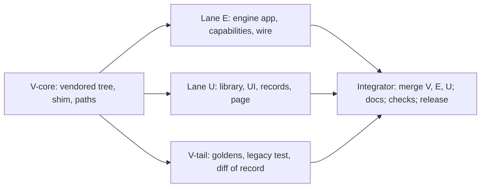

# J2 sync 5: Sutra Pro takes over J2 `cut-off/2026-11-12` (as-built note of record)

_Status: As built, ready to ship as 0.4.0 · Date: 2026-11-13 · Branch: `feat/sutra-pro-j2-sync-5` · Source: tag `cut-off/2026-11-12` = commit `1d537295eb11cb034956fa9d8a4026eaa1e3f44e`, tree of `prototypes/j2` `30c71fea4679716c9f48d297ee4b2c3463eeebfd` · Replaces: the sync 4 pin `025e265c594564f47a2365874cd5a5cc5d0d20a6` · Decisions: D160 to D175 (in `docs/DECISIONS.md`)_

This is the note of record for sync 5. Sections A to G say what was built and what was not; everything after the line "Design as proposed" is the design and lane plan as it was written before the lanes ran, kept unchanged for the history (its tables say "proposed"; where it differs from what follows, A to G win). Lane notes with measurements: `docs/notes/J2S5-v.md` (vendoring), `J2S5-e.md` (engine application), `J2S5-u.md` (library, page, tooling). Paths are relative to `sutra-pro/`.

## A. What was built

- **The pin.** The vendored J2 is `prototypes/j2` at `1d537295`: 18 code modules (`j2_types.py` is new), `conditions/` and `templates/` as whole data trees, `artifacts/types.json`; `scripts/vendor_j2.py --check`: 229 files, ok. The page is regenerated by `scripts/port_j2_ui.py` (two of seven files changed, all 33 anchors matched), the 81 UI fixtures re-captured (the new route `/api/timing` added one), the seven prompt goldens, the API shape golden and the two function-node goldens re-recorded by their recorders (D173, D174). `scripts/j2_diff_of_record.py --check` passes: 313 source files, 0 undecided.
- **No default output type (D165, D166, D167).** `Selection.output` may be `None`: J2's planner chooses per run from `types.json`. The settings model checks an output name by shape, membership is checked where J2 is loaded, the start page and the Engine settings page build their choices from `output_types` of `GET /api/engine/settings`. A run with no type opens everywhere (state, run list `label` and `form`, rehydrate, function nodes); old runs open by form and by shape.
- **Types as data (D161, D163, D164).** Types a run makes live in `<data>/types` under a lock (P17); the project output is a host-registered document type (P18) and capabilities add types through `j2_types.register`.
- **Views (D168).** `docs`, `refs`, `file`, stage words and the new `GET /api/timing` read J2's data (42 handlers, 34 page route names).
- **Settings (D169, D170).** `builder_timeout` (`J2_BUILDER_TIMEOUT`, default 600 s, `0` = none) end to end; the `llm` shim carries `timeout`, `CallTimeout` and `can_read_files`; a timed-out model call ends the run with code `timeout`.
- **Library (D171, D172).** The mirrors of J2's section models are retired (`library/artifacts/**`, 22 schema files); the record catalogue knows `timing.json`, `autofix.json`, `deliverables.json` and `input_cuts.json` and reads artifact and stage file names by shape; `RegisteredWorkflow` has `work_kind` and `sections`.
- **Version (D175).** Version 0.4.0 (`pyproject.toml`, `sutra_app/__init__.py`, `desktop/package.json`, `desktop/package-lock.json`); `scripts/check_release_tag.py sutra-pro-v0.4.0` passes.

## B. Patch statuses (as in `sutra_app/engine/VENDORED.md`)

| Patch | Status |
|---|---|
| P1 | conflict fixed: one counted rule over every code line (40 lines) replaces the anchors; the `sys.path` insert of `j2_agent_views.py` is an anchor edit |
| P2 | applies, extended: third edit `j2_types.AGENTS_DIR` |
| P3, P4, P5, P10, P11, P15, P16 | applies (no anchor moved; P15 still finds exactly six home paths) |
| P6, P13 | none (numbers never used); P19 is the reserve |
| P7 | conflict fixed (the `call` loop with `timeout`); one edit added beyond the design: the deliverables planner call is tagged with the function and step, so its usage rows are charged to Adaptation |
| P8 | conflict fixed (run-end anchor `timing.json` / `status = "waiting"` / `def timing`); a `CallTimeout` is reported with code `timeout` |
| P9 | conflict fixed (`self._builder_for(fn)`) |
| P12 | conflict fixed (two anchors: the imports, the `CHROME_PATH` tuple) |
| P14 | conflict fixed, with a guard: `(self.out or {}).get("single")`, because `_plan_stages` now runs while no type is chosen |
| P17 | new: local type store under `J2_TYPES_DIR`, atomic write, exclusive lock, a busy lock is a `ValueError` |
| P18 | new: host type registration (`HOST`, `register`, `template_path` absolute, `load` extras) |

None dropped; P1 changed form; P7, P8, P9, P12, P14 re-anchored.

## C. Deviations from the design

1. P7 got one more edit (the planner call's function tag, above). 2. `features.py` also lost `PRD_BUILDER`, `HLD_BUILDER`, `LLD_BUILDER` (J2 removed them). 3. `record_fn_golden.py` takes no `--source` or `--commit`; it records the engine itself. 4. `EXPECTED.json` keeps J2's own flow-test hash and adds the merged copy's hash and the known upstream failures. 5. The legacy flow test is a three-way merge with six more `skippable` blocks.
6. The project atom rules and charter drift guards compare with the `prd` type's files, not the `document` type's, so project prompts stay byte-identical to sync 4 (lane E, deviation 1). 7. `OutputSpec` carries `name` and `tag`; `register` takes `OutputSpec`s only. 8. `/api/timing` of a live run is rebuilt from the run folder (the API process has no `J2Run`). 9. A working folder now claims a brief that names a deliverable (the phrase list that answered first is gone, D165). 10. `capture_j2_fixtures.py` captures `/api/timing` (a route new in J2); `rehydrate.py` has `RESTORED_TYPE`. 11. The by-hand checks ran offline only (section F); a document or project run with realization on stops in the offline mock (cost 0), see F.
12. Integration: `CallTimeout` is reported as code `timeout`; the route-table pin counts 34 names; the orchestrator tests' "bad output" is a shape-invalid value (a name like `pdf` is valid by shape now); `tests/test_traceability.py` counts 42 endpoints.

## D. Not done, and why

- **Post-cut-off J2 work is not in this sync.** J2's main has 38 later commits under `prototypes/j2` (auto-reuse of earlier work, run templates, the reviewer thread, and more). The owner pinned the tag `cut-off/2026-11-12`; a later sync takes the next pin. Nothing of it is vendored, ported or tested here, and no document of this note claims it.
- Parallel builds, scripts and actions, and the 13 word-based decisions of J2's `word-matching-followups.md` (the handoff's "coming later").
- Closed library models for the new view shapes (D151) still wait; the shape golden holds them.
- `J2_TEMPLATE_LIBRARY` stays off by default as upstream; the Studio's frame decorations stay off under the preview sandbox (D153).
- J2's three known upstream flow-test failures (`map_focus`, `graph_map`, `warm_ui`) are pinned as expected and go to J2's maintainers; they are not fixed in the copy.
- A real-model run of the by-hand checks (the planner choosing or creating a type, a document written section by section, project work in a working folder) was not done: it was integrated offline (section F).

## E. Verification

Run on the merged tree with the extraction of the pin (`SUTRA_J2_CHECKOUT`, full commit):

| Check | Result |
|---|---|
| `vendor_j2.py --check`, `port_j2_ui.py --check`, `record_engine_golden.py --check`, `record_api_shapes.py --check`, `capture_j2_fixtures.py --check`, `record_fn_golden.py --check` | all clean (229 files; 33 anchors, 7 page files; 81 fixtures) |
| `j2_diff_of_record.py --check` | PASS (313 source files, 0 undecided) |
| `scripts/check_release_tag.py sutra-pro-v0.4.0` | passes |
| `scripts/gate.sh` | `gate: ok`: 10,808 passed, 340 skipped, 0 failed (11 min 50 s, run without the extraction; with `SUTRA_J2_CHECKOUT` set the same tree passes 10,813 with one environment-dependent test, since fixed) |
| `SUTRA_SLOW=1 pytest tests/engine -k "prompts or legacy or vendor or patches"` | 214 passed, 1 skipped (4 min 20 s): both `j2_flow_test.py --fast` runs, with and without the extraction, the prompt goldens, vendor and patch tests |
| `node --test tests/ui/js/*.test.js` | 1258 tests, 1256 pass, 0 fail, 2 skipped |
| `SUTRA_BROWSER=1 pytest tests -m browser` | 305 passed (8 min 46 s) |

Goldens re-recorded by recorders in this sync (each explained in its commit message): the seven prompt goldens and the API shape golden (lane V: J2 changed `team.md`, `builder.md`, `adaptation.md`, the plan text and the builder inputs, so system and prompt hashes move in every call; call counts, order, outcome, spend and site hash are unchanged), the 81 UI fixtures (lane U), and `fn_atoms_brewlab.json` and `run_events.jsonl` (integration: prompt digests, and two usage rows for the planner and judge calls that now carry function Adaptation).

Red tests that belonged to nobody, fixed at integration (no test weakened): the route-table pin (34 names), two orchestrator tests whose "bad" output value is valid by shape (a shape-invalid value now), the traceability count (42), the golden counts (34 usage rows, 155 events), the stop-line test (J2's planner call is in flight before the first turn, so it waits for the function nodes), the second-setting test (it stops the run it switched back to ask-me), the packaging test (`library/templates.py` no longer writes `docs/schemas`), and the legacy flow test copy (host types listed apart from local ones; five page-reading blocks join the skippable list).

## F. The by-hand checks (handoff section 5), offline

Done on a scratch data folder with `python -m sutra_app --offline --no-browser`, the stub connector and J2's mock engine, driven by the HTTP API (`POST /api/chart/changes` to add three teams, `POST /api/tasks`, the team's own `POST /api/settings {decide_for_me}`, `GET /api/runlist`, `/api/state`, `/api/artifacts/groups`, `/api/timing`, `/api/docs`, `/api/refs`). No error or traceback in the server log or in any run's stderr.

- **Website brief** ("a landing page for a music event", no type pinned): J2's planner chose `website` (label Website, form page; the mock chooses it for any brief), built it, Done ("the site is workable"); Artifacts groups: Run plan, Guides, Site (build items, Style guide), Records; the run list row has label and form.
- **Document brief** ("a hiring policy for a small startup"): with the type left to the planner the offline mock again chose `website` (a mock limit: J2's mock planner does not read the brief, so this cannot show the planner picking a document type offline). With `business_report` pinned and realization on (the default), the offline mock stopped after 4 cycles ("Validator rejected ...: its cost is 0", the mock Priority prices no document section); `prd` pinned did the same. With realization off (engine setting) the same brief ended Done ("the Report is workable"), the run list says Report / document and Artifacts lists the Documents group with the Report. Not checked here: whether the default realization-on document path stops the same way at sync 4 (no sync 4 build was run), and a real model writing every section; that needs a model. Recommended before release notes are final: one real-model document run.
- **Project-output team** (output pinned to `project`; no working folder was set, so the workspace part, agents reading a folder, was not exercised offline): the same pattern, stopped with realization on, Done with realization off ("the project work report is workable"), Documents group lists "Project work report", run list says Project work / document.
- **An old saved run**: the runs of earlier invocations open through the run list, state, artifacts, timing, refs and docs routes (200 each) after the server was restarted on the same folder.
- **A run with no type**: a run could not be made to stop before J2's mock planner chose a type, so one was made by stopping a task and removing the type from its summary, snapshot, live file and deliverables record: the run list gives empty label and form, `GET /api/state` has `output: null`, and state, timing, refs, docs, artifacts and audits all answer 200. The code path is also pinned by the host, runlist, rehydrate and view tests and J2's own `saved_run_no_type` block (in the flow script run above).

## G. Change log

- 2026-11-13: design and lane plan (first version). 2026-11-13: as-built note of record written by the integrator; the design below is unchanged.

---

# Design as proposed

# J2 sync 5: Sutra Pro takes over J2 `cut-off/2026-11-12` (design and lane plan)

_Status: Proposed · Date: 2026-11-13 · Branch: `feat/sutra-pro-j2-sync-5` (base: `origin/main` c4383c7e) · Source: tag `cut-off/2026-11-12` = commit `1d537295eb11cb034956fa9d8a4026eaa1e3f44e`, tree of `prototypes/j2` `30c71fea4679716c9f48d297ee4b2c3463eeebfd` · Replaces: the sync 4 pin `025e265c594564f47a2365874cd5a5cc5d0d20a6` · Decisions: D160 to D175 (written into `docs/DECISIONS.md` by the integrator from the lane notes) · Ships as: 0.4.0_

Paths are relative to `sutra-pro/` unless they start with `prototypes/`. `$J2SRC` is the extraction of the new pin: `git archive 1d537295eb11cb034956fa9d8a4026eaa1e3f44e prototypes/j2 | tar -x --strip-components=2 -C "$J2SRC"` (a new, empty folder, never the working tree; D154).

The owner's rules for this sync, kept as the test of every choice below: one central engine that capabilities enhance, nothing replaced or rerouted; no owner name and no home-folder path in any file under `sutra-pro/`; J2's vendored text is byte-identical except numbered patches recorded in `sutra_app/engine/VENDORED.md`; the generated page only through `scripts/port_j2_ui.py`; goldens only through the recorder scripts; "agents decide, code validates": no type names, keyword lists or brief-specific rules in app code. Speed: one release, as soon as the lanes merge.

Out of scope, a later sync: the 38 later J2 commits on main (auto-reuse, run templates), the reviewer thread, parallel builds, scripts and actions, the 13 word-based decisions of `word-matching-followups.md`.

## 1. What this design relied on, and what it corrected

The analyst's findings were re-checked against `$J2SRC` and the worktree. Verified as stated: 82 commits and 57 files; `j2.OUTPUTS` and the 41 section models are gone; `j2_types.py` accepts only the forms `page` and `document`; `OUTPUT = None`; the planner call `_deliverables` runs even when `J2_OUTPUT` is set (it only adds "The Requester chose X: include it"); `J2Run.stage_words()` is a static method; `output_def` returns the fixed key set of `j2_types.load`. Six anchors of `vendor_j2.py` fail (j2.py P1, P7, P8, P9; j2_template_lib P12; j2_check P12). Corrections and additions found while checking:

| # | Finding | Consequence |
|---|---|---|
| 1 | The P9 anchor fails for one reason only: `system_prompt(fn, reply_format, self.out["builder"])` is now `... self._builder_for(fn))`. The analyst's second reason (`call_delay()`) is not in the text: `if self.calls and DELAY:` is unchanged. | P9's new anchor and replacement keep `self._builder_for(fn)` (section 4). |
| 2 | P14's text still matches, and it would crash: `_plan_stages` runs while `self.out` is `None` (no type chosen yet), and `self.out.get("single")` raises. Today it has no effect (the fixed key set has no `single`); once `project` carries `single` again it would also be live. | P14 gets a guard: `(self.out or {}).get("single")` (section 4). |
| 3 | `j2_types.load` returns a fixed dict, so a type's `single`, `workspace`, `deliver` and its mock callables cannot ride in data. The entries are also read as JSON by other J2 code (`j2_artifacts.load_types` deep-copies them; views dump parts of them), so a callable in an entry would break a route. | P18 keeps the host's callables beside the entry, never in it (section 4, section 5). |
| 4 | `project.md` is now listed natively: `j2_artifacts.load_types` and J2's Documents group list every `kind: type` entry of form `document` whose file exists. The D146 hook (`Capability.documents`) would add a second row. | The registry de-duplicates by row id; J2's row wins (D164, amends D146). |
| 5 | The text of `PRD_CHARTER_FMT` is byte-equal to `templates/prd/charter.txt`, and `PRD_ATOM_RULES` to `templates/prd/atom_rules.md` (compared with the running sync 4 engine, with the one trailing newline `j2_types._text` strips). `DOC_CHECK_TYPES` was `facts-present, heading-present, section-not-empty, ids-unique`; the document form's list lacks `ids-unique`. | The project type keeps today's charter, atom rules and check types by carrying its own copies as data (section 5); only the plan text changes (item 4 of section 5). |
| 6 | Of the seven generated page files only two differ from a fresh port at the new pin: `sutra_app/ui/pages/j2_ui.html` and `sutra_app/ui/static/css/j2.css` (`port_j2_ui.py --check` with the new commit: all 33 anchors match, no anchor error). | Lane U regenerates; the other five files are unchanged. |
| 7 | `library/workflow.py` `registered_from_j2` copies a whitelist of keys and drops the rest, so workflows' new `kind` and `sections` do not make strict mode refuse a row; they are lost. `RegisteredWorkflow.kind` is already the model's own discriminator (`Literal["registered"]`), so J2's `kind` ("build"/"audit") needs another field name. | Lane U adds `work_kind` and `sections` (D172). |
| 8 | `library/records.py` knows artifact data files only as `(prd\|hld\|lld\|design\|website)(-v<N>)?.json` and stage files as `stage-[a-z]+\.json` (no underscore: `stage-business_report.json` is refused in strict mode). | Lane U generalises both by shape (D172). |
| 9 | `pyproject.toml` ships `engine/capabilities/data/*` (one level). | The project type's data files are flat files in that folder (`project.<name>`); no packaging file changes. |
| 10 | `tests/engine/test_engine_vendor.py::test_every_vendored_module_imports_in_a_clean_process` already exists. | Lane V extends its module list with `j2_types`; no new smoke test file. |
| 11 | There is no JSON-schema file of `EngineSettings` in `docs/schemas/`. The pins of the settings are `tests/engine/test_engine_spec.py`, `tests/contracts/test_contract_settings.py`, `tests/contracts/test_contract_env_and_spec.py` and the UI fixture `tests/ui/fixtures/engine-settings.json`. | `builder_timeout` is pinned in those (lane E and lane U). `docs/schemas/` changes only through the library export (lane U). |
| 12 | Sync 4's legacy flow test is exactly "J2 at 025e265c plus Sutra's edits", and `025e265c` is in this repository's history. | A plain three-way merge works (base = J2's file at `025e265c`), unlike sync 4's two-step merge (D174). |

## 2. Approach

One engine, as before. The vendored tree moves to the new pin with the patch set P1 to P18 (P17 and P18 are new; the reserve of D145 for a late-judge switch moves to P19). Types stop being code: the vendoring script copies `artifacts/types.json`, `conditions/*.json` and the whole `templates/` tree, with no list of type names in it, and Sutra's code asks J2's `j2_types` for everything it used to hard-code.

Three things need a Sutra-side design, because J2 no longer offers a place for them:

1. The `project` output. It becomes a document-form type that the host registers in its own process through one small hook (P18), with its prompts and template as data files that belong to the capability, not to J2. Everything a run needs from it (`single`, `workspace`, `deliver`, the offline mocks) rides beside the entry. The planner never sees it (`deliverable: false`), and patch P14 keeps the host-pinned project run free of the planner call (D129).
2. "No default type". The host no longer falls back to a website. A brief that the project rules do not claim is left to J2's planner (`J2_OUTPUT` unset); an owner's pin or a follow-up pins as before. Every place that read "website" as a default reads `None` instead, and the choices on the page come from the data.
3. Local types. Types that runs create are kept per user in the data folder (`<data>/types/`), under a lock, not inside the installed package (P17).

The wire changes are the ones J2's own server made (`/api/timing`, `/api/docs` by type, `label` and `form` on run rows, `types` in the snapshot's `output_info`) plus one Sutra field (`output_types` in the engine settings answer). The generated page is regenerated, the fixtures and goldens re-recorded.

## 3. Alternatives considered

| Question | Options | Chosen, and why the others lost |
|---|---|---|
| Where `project` lives | (1) a data patch adding `project` to the vendored `artifacts/types.json`, plus a pass-through patch; (2) a registration hook in `j2_types`; (3) a host-written entry in the local store | (2). (1) puts a Sutra type into a byte-identical J2 data file and makes `project` visible to every team's planner and to the template library; it still needs a code patch for `single`, `workspace` and the mocks. (3) persists a Sutra type per user, shares it between teams, writes files for every run, and cannot carry callables. (2) is one patch in one file, process-local, invisible to the planner and the library, and carries what data cannot. |
| What the host does when `auto` and no project rule fires | (a) keep a default type (any name); (b) one model call to choose; (c) leave the type unset and let J2's planner choose | (c). (a) is a hard-coded type, which this sync removes; (b) duplicates the planner J2 now has; (c) is J2's own design (`OUTPUT = None`). |
| Output names in settings | (a) keep a closed list in `spec.py`; (b) validate by shape in `spec.py` and by membership against the data after J2 is imported | (b). `spec.py` must not import J2 (it is read before J2 is imported), so it can check only the shape; the membership check sits where J2 is already loaded. |
| The library's mirrors of J2's former 41 models | (a) keep and re-point; (b) retire | (b). The mirrors existed to be bound to J2's code by a drift test; that code is gone, and J2's `templates/<type>/generic.json` is now the single source. A mirror that names `prd`, `hld`, `lld` in code is exactly what this sync removes, and `docs/schemas/templates/` would duplicate vendored files. |
| Legacy flow test | (a) two-step merge as in sync 4; (b) three-way merge from `025e265c` | (b), fewer steps and a clean proof. |

## 4. The patches (handoff step 4): the verdict of each of P1 to P16, and P17 and P18

The script applies exact text edits that name their anchor and the count they must find; a J2 change under an anchor stops the run. Verdicts, with the J2 text found at `1d537295`:

| Patch | Verdict | Mechanics at the new pin |
|---|---|---|
| P1 imports | conflict fixed (rule instead of anchors) | The anchors named the import lines one by one; the J2 changes broke the one in j2.py (the new `import j2_types`) and about ten new or indented lines have none (`j2_agent_views.py:25-28`, `j2_artifact_models.py:38`, `j2_artifacts.py:27`, `j2_realization.py:20`, `j2_rules.py:24`, `j2_template_lib.py:40-43`, `j2_types.py:425` and `:443`). P1 becomes one rule applied to every code module: a code line (not a comment) `import j2_x[ as Y]` or `import llm` becomes `from . import ...` (indentation kept), and `from j2_x import ...` becomes `from .j2_x import ...`. The rule has a per-file expected count recorded in the script (`P1_COUNTS`): j2.py 14, j2_agent_views.py 4, j2_artifact_models.py 2, j2_artifacts.py 5, j2_change.py 2, j2_map.py 2, j2_realization.py 2, j2_rules.py 1, j2_story.py 2, j2_template_lib.py 4, j2_types.py 2 (40 lines); a count that differs stops the run, like a missing anchor. The `sys.path` insert of `j2_agent_views.py` stays an explicit anchor edit. `hooks` and `port` imports (P3, P8) stay in the P8 anchor. |
| P2 role files | applies, extended | `J2_DIR` (j2.py) and `AGENTS` (j2_realization.py) anchors unchanged. New third edit: `j2_types.AGENTS_DIR = os.getenv("J2_AGENTS_DIR") or <package copy>` (a page type's builder is a role file: `j2_types.load` joins it to `AGENTS_DIR`). Conditions, `types.json` and `templates/` stay package-relative. |
| P3 run folder and id | applies | No anchor changed. |
| P4 `user_says` / `apply_override` | applies | No anchor changed. |
| P5 explicit-path variants | applies | No anchor changed. |
| P7 tagged calls | conflict fixed | `J2Run.call`'s `llm.ask` now sits in `while True:` with `timeout=timeout` and `except llm.CallTimeout`. New anchor: the `raw = llm.ask(system, user, mock, ... schema=schema, timeout=timeout)` statement and its `break`; the replacement sends the same arguments through `_ask(self._ask_tag(fn, "agent_turn", self.calls, self.atom or None), ..., timeout=timeout)` and keeps the loop, the event and the second-stop `raise` byte for byte. `_ask` passes `timeout` on. The other P7 anchors (summary, template generator, reviewer, `j2_realization` planner and judge, `_dispatch_turn`) are unchanged. |
| P8 hooks | conflict fixed | The run end saves `timing.json` and builds the report before `status = "waiting"`. New anchor for the run-end `_run_status()` call: `self.save("timing.json", self.timing())\n        self.status = "waiting"\n\n    def timing(self):`; the replacement adds `self._run_status()      # P8` right after the `status = "waiting"` line, as before. The crash-path anchor (`self.turn = None` / `self.status = "waiting"` / `def _run`) is unchanged. All other P8 anchors apply. |
| P9 system addendum | conflict fixed | Anchor becomes `system = system_prompt(fn, reply_format, self._builder_for(fn))` followed by the unchanged `if self.calls and DELAY:`; the replacement inserts the addendum block after the first line, as before. |
| P10 library lock | applies | `store` and `mark_used` are still the only two writers of the library index that a run reaches. A third, `collect` (J2's cataloguing command-line tool), has been there since sync 4 unlocked; neither J2's runtime nor Sutra calls it (checked by grep), so it stays unpatched. |
| P11 rehydrate | applies | No anchor changed. |
| P12 Windows | conflict fixed (two anchors) | `j2_template_lib.py`: `import keyword` is gone, so the import anchor becomes `import os\nimport re\nimport shutil\n` (`from sutra_app import oslayer` goes after `import os`). `j2_check.py`: the tuple is `(os.getenv("J2_CHROME"), os.getenv("CHROME_PATH"), "/Applications/...Chrome", shutil.which...)`; the anchor becomes the `for p in (...` line with `CHROME_PATH` in it and `*windows` goes after the Applications entry. The `J2_CHROME=none` guard above it is J2's. `CHROME_PATH` needs no Sutra change: the existing `chrome` setting maps to `J2_CHROME`, which is read first. |
| P14 `single` | conflict fixed | The anchor matches by text but would crash on `self.out is None`. New text: `if self.stages or self.goal or (self.out or {}).get("single"):`. It is live again once `project` carries `single` (P18). Every other output has no `single`: unchanged for them. |
| P15 seed data | applies | The seed `library/index.json` still holds exactly six home-folder paths in `runs[].library` (the script stops on any other count) and the two `/tmp/` values; the new seed `library/website/` folder is copied as is. |
| P16 Decide for me | applies | No anchor changed. |
| P17 (new) local type store | new | Types a run makes live in the data folder, not in the package. See below. |
| P18 (new) host type registration | new | One hook in `j2_types.py`. See below. |
| P6, P13 | none | P6 was never used; P13 stays retired (D140). P19 is reserved for the late-judge switch of D145 if live numbers ask for one. |

**P17, the local type store** (`j2_types.py`, three edits; D163). J2 writes `artifacts/types.local.json` and `library/types/<name>/generic.json` next to its code, which in the installed app is a read-only, shared package. After P17: `_STORE = os.getenv("J2_TYPES_DIR")`; when it is set, `LOCAL_TYPES_PATH` is `<store>/types.local.json` and `LOCAL_LIBRARY_DIR` is `<store>/templates`; when it is not set, J2's own locations apply (J2's flow test and developer use are unchanged). The two names stay module attributes because J2's flow test sets them. The entry's `"template": "library/types/<name>/generic.json"` is J2's own relative name (`LOCAL_LIBRARY_REL`) and is left alone: `template_path` maps it under `LOCAL_LIBRARY_DIR`. `_write_local` writes a temp file and `oslayer.replace`s it. `create` is renamed `_create` and a new `create` runs it inside an exclusive lock on `<store>/.lock` (`oslayer.try_lock`, the same loop as P10, waits 30 s); a busy lock raises `ValueError` (not a new class), because `J2Run._deliverables` already turns a `ValueError` of `create` into the event `new_type_refused` and goes on. The lock covers the whole read-modify-write of `create` (read of the local file, template write, validation by `generic_problems`, write). `promote` is a developer command that writes package files; it is not changed and the app never calls it. The host exports `J2_TYPES_DIR=<data>/types` through `DataPaths.j2_env()`; the API process exports it before the first import of J2 (lane E, section 8).

**P18, host type registration** (`j2_types.py`, five small edits; D164):

1. After `NAME_RE`: `HOST = {}` (name to `{"entry": {...json-safe...}, "extras": {...callables and flags...}}`) and `register(entry, extras=None)`. `entry` must be `kind: "type"` with a name that `NAME_RE` accepts; the entry names its owner in `entry["host"] = "<capability name>"`. A name that `types.json` or the local store already has raises `ValueError`; the same owner registering the same name again replaces its entry (idempotent); another owner raises `ValueError`. `register` clears `_CACHE`.
2. `_read_types`: the host entries are added after the local types and before the first record (`d["types"][at:at] = local + [e["entry"] for e in HOST.values()]`).
3. `template_path`: `if os.path.isabs(rel): return rel` first, so a host type's template is a file of the host (the other path rules stay).
4. `load`: after the `mock` handling, `out.update(HOST.get(name, {}).get("extras") or {})`: the keys J2 cannot read from data reach `output_def` (and so `J2Run.out`) unchanged.
5. `templated`: skips a name that is in `HOST` (a host type is not a template-library artifact).

The files an entry names (`conditions`, `builder`, `intake`, `charter_format`, `atom_rules`) may be absolute paths: `j2_types.load` already joins them with `os.path.join(HERE, ...)`, which keeps an absolute second argument (the same trick the project output's conditions file uses today). `j2_types.default()` then accepts `J2_OUTPUT=project` once the host has registered it, which is exactly the process order today (register after the import, before `J2Run` exists).

**Data patch P15 and the managed folders.** The script's `MANAGED` list stays; the copy of `templates/` and `conditions/` becomes a tree copy (section 6, lane V), so a future type is vendored without touching the script. The exclusions are explicit: `templates/README.md`, `tools/`, `fixtures/n6-sudoku-*`, `docs/word-matching-followups.md`, and the page, test and server files already excluded.

## 5. The project output

The owner's rule: capabilities enhance the one engine; the `project` output keeps working as today, including `workspace: edit`, `deliver`, `single`, the earlier-report follow-up (D135) and the host pinning the type with no planner call (D129).

1. **Entry, as data.** `project_spec` stops building a `j2.OUTPUTS` dict. `OutputSpec` becomes the description of a type entry plus the host-only keys: `name`, `label`, `noun`, `file`, `sections`, `rubric` (the `PJ-n` items), `check_types` (today's four, `ids-unique` included), `done`, and paths to its text files; and `single`, `workspace`, `deliver`, `mock_charter`, `mock_section`, `mock_atom`. `OutputSpec.to_type_entry()` returns the JSON-safe entry (`kind: "type"`, `form: "document"`, `deliverable: false`, `triggers: []`, `groups: []`, `depends_on: []`, `tag: "Project"`, `color: "--other"`, `export: null`, `cost: {"item_parts": [{"part": "doc_section", "words": ""}]}` so no project item is priced as a requirements section, `host: "project"`) and `OutputSpec.extras()` returns `{single, workspace, deliver, mock_charter, mock_section, mock_atom}` (the last built with `j2.doc_atom_for(sections, {})`, which still exists). The entry takes the rest from the `document` form (conditions override, rates card `rates_prd`, workflow template `doc-sections`).
2. **Files, as data** (flat, in `sutra_app/engine/capabilities/data/`, shipped by the existing `engine/capabilities/data/*` glob; each file ends with exactly one newline because `_text` strips one): `project.json` (the conditions, exists), `project.builder.md`, `project.intake.md`, `project.charter.txt` (a copy of the former charter format), `project.atom_rules.md` (the document atom rules with the four sentences removed that `_ATOM_EDITS` removed), `project.generic.json` (the five sections, as `j2_types.template_for("project", "Project work", PROJECT_SECTIONS)` writes a new type's template). Tests prove: each file equals its former Python string (so the prompts of a project run are byte-identical to sync 4 for the charter, intake, builder, atom rules and check types); `project.atom_rules.md` equals the vendored document atom rules with the four edits (a drift guard that fails loudly when J2's text moves, as `_atom_rules` did); `project.generic.json` equals `template_for(...)` of the vendored `j2_types`.
3. **Registration.** `capabilities.register(j2)` calls `j2_types.register(entry, extras)` for every output a capability adds (the `j2` argument is still how the module is found). Conflicts become `CapabilityConflict`. `SPECS[name]` stays (the workspace table reads `spec.workspace`, the host reads `spec.deliver`). No `j2.OUTPUTS` exists any more.
4. **What changes in the run.** The charter, intake, builder, atom rules and check types are as today. The plan text is the one place that changes: J2 now builds Adaptation's document task from the type's template (sections with their fields, "each workflow names the section(s) it writes in `sections`", the price rule), and `OutputSpec.plan` is no longer read. The project's own plan guidance (one workflow per section named "Write <Section>", Findings reads the folder, Changes makes exactly the changes the charter asks for, Confirmation checks them) moves into the capability's Adaptation addendum, which is the existing mechanism for text the capability adds without touching J2's prompts. So the project prompts of Adaptation differ from sync 4 and nothing else does; the lane records the diff in its note.
5. **No planner call.** Patch P14 returns early from `_plan_stages` for a type that says `single`, so a project run built with `J2_OUTPUT=project` makes no `_deliverables` call, as today. Every other pinned type (the owner picks `prd` on the start page) now gets J2's planner call with "The Requester chose X: include it"; that is J2's behaviour at this pin and is recorded as such (D165): D129's "no model call" is about the host's rule table, which still makes none.
6. **Documents group.** J2's group lists `project.md` natively now (finding 4). `capabilities.documents(output, run_dir)` keeps its contract but the caller merges by row id, J2's row first; the capability row stays as the fallback for a run whose type record is missing. A test asserts exactly one `project` row in `artifacts-groups/1` for a finished project run.
7. **Scope kept.** The project rule table (`select.py` strong and weak project words) stays: it picks `project`, which no model call replaces without a design of its own (D129); it is recorded as the one remaining word list (D165).

## 6. Decisions

Numbers start at D160 (the next free number after D159). Each lane writes the text of its decisions into its note `docs/notes/J2S5-<lane>.md` in exactly this shape; the integrator copies them into `docs/DECISIONS.md` in number order, adds the pills to the diagram key, and records the amendments (D129, D145, D146).

## D160 — The pin moves to J2 `cut-off/2026-11-12` (`1d537295`); the source stays the extraction of this repository's `prototypes/j2`
- Sources: D136, D154, the owner's handoff for this sync, `docs/design/j2-sync-4.md`.
- Decided: `scripts/vendor_j2.py` takes `BASELINE = 1d537295eb11cb034956fa9d8a4026eaa1e3f44e` and tree `30c71fea4679716c9f48d297ee4b2c3463eeebfd` (`git rev-parse <commit>:prototypes/j2`), `VENDORED.md` names it as "sync 5", and the sync 4 pin becomes history next to `9200cf6` and `33aeeda`. The extraction is made with `git archive`, never from the working tree. The 38 later commits of main (auto-reuse, run templates) are not vendored: they are a later sync.
- Why: the owner asked for exactly this tag; a tag is a fixed point, main moves under the work.
- Rejected: vendoring main (it holds features nobody designed for); vendoring the tag from a git checkout of the working tree (an edited file would be vendored silently).
- Diagram: label "J2 pin: cut-off 2026-11-12", pill on band:DEPARTMENT RUNTIME.

## D161 — The vendoring script copies types as data: `templates/**`, `conditions/*.json`, `artifacts/types.json`; it names no type
- Sources: D13, D136, `docs/design/j2-sync-4.md` (the lists `CONDITIONS` and `GENERIC_TEMPLATES`).
- Decided: `CODE` gains `j2_types.py`. `CONDITIONS` and `GENERIC_TEMPLATES` are replaced by tree copies of `conditions/` and `templates/` (all files, byte for byte), minus `templates/README.md`. Exclusions are named, each with its reason, in `scripts/j2_diff_of_record.py` (which must still report 0 undecided): `templates/README.md`, `tools/check_deliverables.py`, `tools/check_doc_plan.py`, `fixtures/n6-sudoku-*`, `docs/word-matching-followups.md`. The seed library is already a tree copy (`library/`). The sync 5 tree adds 18 type text files (`builder.md`, `atom_rules.md`, `charter.txt`, `intake.md` for `prd`, `hld`, `lld`, `document`, and `charter.txt`, `intake.md` for `website`), `conditions/document.json`, `templates/business_report/generic.json` and `j2_types.py`.
- Why: a list of type folders in the script is a list of type names in app tooling; the next type J2 adds must arrive by a re-vendor with no script edit.
- Rejected: extending the two tuples by hand (the next sync breaks the same way); copying `docs/word-matching-followups.md` (a working note of J2's, not an engine file).
- Diagram: label "types vendored as data", pill on band:DEPARTMENT RUNTIME.

## D162 — Patches P1 to P16 are accounted for; P17 and P18 are new; P14 gets a guard; P19 is the new reserve
- Sources: D13, D136, D145, section 4 of `docs/design/j2-sync-5.md`.
- Decided: verdicts, recorded in `VENDORED.md` and in `scripts/vendor_j2.py` `PATCH_NOTES`: applies P2 (extended to `j2_types.AGENTS_DIR`), P3, P4, P5, P10, P11, P15, P16; conflict fixed P1 (a counted rule instead of anchors: 40 lines), P7 (the `call` loop with `timeout`), P8 (the run end), P9 (`_builder_for`), P12 (the `keyword` import, the Chrome tuple), P14 (`(self.out or {}).get("single")`); none for P6 and P13 (retired); new P17 (local type store) and P18 (host type registration). The reserve of D145 for a late-judge switch moves from P17 to P19.
- Why: every changed anchor is explained by the J2 change that moved it; P14 would crash on a run with no type; the reserve number was only ever a placeholder.
- Rejected: dropping P14 (the project output needs it, finding 2 and section 5); keeping P17 for the late judge (a number reserved for a switch nobody asked for would block the patch that is needed now).
- Diagram: label "patch table P1-P18", pill on band:DEPARTMENT RUNTIME.

## D163 — Types a run makes are kept per user in the data folder, under a lock (patch P17)
- Sources: D26 (the one global library lives under the data folder), D144, J2's `j2_types.create`.
- Decided: `DataPaths.types_dir` is `<data>/types`; `DataPaths.j2_env()` exports `J2_TYPES_DIR` with it; the API process exports it before it first imports J2. P17 puts `types.local.json` and the local templates there and serialises `create` with an exclusive lock on `<data>/types/.lock`. Local types are not shipped, not part of the package, and shared by every team of the user (J2's own meaning of "local"). A busy lock is a `ValueError` that J2 already turns into a refused-type event.
- Why: the installed package is read-only and shared; two runs creating types at once must not lose one; a user's types are the user's data (backup, uninstall).
- Rejected: leaving the files in the package (fails in the installed app, leaks between users); one store per team (J2's planner lists every type for every run; per-team stores would hide a type the user already made); a Sutra-side copy of `create` (a second implementation to keep in step).
- Diagram: label "local types in the data folder", pill on band:DEPARTMENT RUNTIME.

## D164 — The project output is a host-registered document type; capabilities add types through one hook (patch P18)
- Sources: R1, D126, D128, D129, D146, `docs/design/j2-sync-5.md` sections 4 and 5.
- Decided: `j2_types.register(entry, extras)` (P18) takes a JSON-safe entry and keeps callables and flags beside it. `capabilities.register(j2)` registers each capability's outputs through it. `project` is a `document`-form type with `deliverable: false`, its texts and template as flat data files of the capability, the project's keys (`single`, `workspace`, `deliver`, the mocks) in `extras`. Patch P14 keeps the host-pinned project run free of the planner call. Prompts of a project run are byte-identical to sync 4 except Adaptation's plan text, whose project guidance moves into the capability's addendum. J2's Documents group lists `project.md` itself; the registry merges the capability's row only when J2's row is missing (amends D146).
- Why: it is the smallest change that keeps the type out of every planner list and out of the template library, keeps the engine the only engine, and does not put a Sutra type into J2's data.
- Rejected: a project entry in the vendored `types.json` (a Sutra type in a byte-identical J2 file, visible to every planner); the host-written entry in the local store (persistent, shared between teams, no callables, a write per run); a Sutra fork of `j2_types.load` (a replaced engine module).
- Diagram: label "project = host-registered type", pill on band:DEPARTMENT RUNTIME.

## D165 — The engine has no default output type: an unclaimed brief is left to J2's planner
- Sources: R1, D129, the owner's rule "agents decide, code validates", handoff change 1.
- Decided: `Selection.output` is `Optional[str]`; `None` means "undecided: J2 chooses". `select_output` keeps the owner's choice, the project rules (strong and weak project words, the working folder) and the follow-up rule (the finished run's own type, read from its records). The rules `deliver` (a phrase list naming PRD, HLD, LLD, website) and `default` are removed. With `None` the host leaves `J2_OUTPUT` unset; `output.json` records `output: null` and the reason "the team's planner chooses"; `EngineContext.output` returns the live run's type, else the selection's, else `None`; capabilities read `None` as "nothing". A pinned non-project type gets J2's planner call (J2's behaviour at this pin). The one word list left in the capability layer is the project rule table, kept because choosing `project` without it needs a model call that D129 refused; it is listed in the lane note as carried over, not as new.
- Why: the owner's rule removes type names and phrase lists from app code; J2 now has a planner for exactly this decision.
- Rejected: a default type from `types.json` (a first entry is still a hard-coded choice); a Sutra-side model call to choose (duplicates J2's planner); keeping the `deliver` phrase list with names read from the data (still a keyword list deciding).
- Diagram: label "no default type", pill on band:DEPARTMENT RUNTIME.

## D166 — Output names are checked by shape in `spec.py` and by the data where J2 is loaded; the page builds its choices from the engine's answer
- Sources: D129, `spec.py` (`OUTPUT_NAMES`), the settings view, `output_pick.js`.
- Decided: `EngineSettings.output` is `auto` or a name that matches J2's own `NAME_RE` shape (`[a-z][a-z0-9_]{1,40}`); `OUTPUT_NAMES` is removed. Membership is checked after J2 is imported: the host at preflight (an unknown pinned type is a "Could not start: unknown output type X (known: ...)" line, not a silent default), and `apply_change` of the settings API (a violation row). `GET /api/engine/settings` gains `output_types`: a list, in `types.json` order, of `{"name", "label", "form", "pin"}` for every type the owner may pin (`pin` is true for a `deliverable` type and for a host type); `capabilities_view` keeps `outputs` as the list of names from the data. `settings_view.js` and `output_pick.js` build their choices from it, with "Let the team decide" (`auto`) first; labels are the data's.
- Why: a closed list in the settings model is a list of types in app code and it would refuse a type the user's planner just made; the page needs the data, not a copy of it.
- Rejected: pinning only what the start page listed before (a user type could not be chosen); validating membership inside `spec.py` (it is read before J2 exists).
- Diagram: label "output choices from the data", pill on band:EXPERIENCE.

## D167 — A run with no type opens everywhere; old runs open through the records, not through names
- Sources: handoff change 2, J2's `saved_run_no_type`, `saved_output`, `LEGACY_OUTPUT`.
- Decided: `EMPTY_LIVE` has `output: null`, `out_label: null`; `live_state` reads `(run.out or {}).get("label")`; `run_row` and the run list give `label` and `form` through `j2_types.info` or `j2_types.recorded` as J2's `run_row` does (empty strings for a run with no type); `rehydrate.py` decides by data: a stage is a document when `j2_types.info(kind)["form"] == "document"`, a page when `j2.is_page(kind)`; `RESTORED` chains keep working for any type; the "built a document, not a website" refusal reads "no page and no document chain" for a run whose `j2.saved_output` is not a page; the page stage's blueprint is the chain document, in the page type's `depends_on` order, whose record has a non-empty `sections` list of objects with `id`, `anchor` and `implements` (a shape check; J2 names its own `lld` in `_begin_stage`, and the state test compares the result with a live run). `fnodes/registry.py` `workable` follows J2's `is_page(audit.get("output", j2.LEGACY_OUTPUT))`. A test is added from J2's `saved_run_no_type`.
- Why: the owner's handoff names the empty type as the case most likely to break; a name list in `rehydrate.py` would refuse a new document type's chain.
- Rejected: treating a run with no type as `website` (J2 does not, and the run list would lie); refusing to continue any chain that ends in a type outside the three (the owner's custom types would be dead ends).
- Diagram: label "runs without a type open", pill on band:EXPERIENCE.

## D168 — Documents, references, files, stage words and timing are views on J2's data
- Sources: D140, D141, J2's `docs_view`, `/api/refs`, `/api/timing`, `J2Run.stage_words`.
- Decided: `views.docs` is J2's `docs_view` ported on `j2_artifacts.load_types(run_dir)` and returns `{type: {asked, text, workflows, label, tag, color}}` for every document-form type of the run; `views.refs` walks `j2_types.names()` with `j2.output_def(k)` for conditions and rubric (as J2's server does); `views.file` allows the file of the run's own type (`j2_types.info`/`recorded`) and every `documents.json` key; `stage_words` is `j2.J2Run.stage_words()` in `views.py` and `host/publisher.py`; `/api/timing` is new (`j2.saved_timing(dir)` for a saved run, `run.timing()` for the live one, 404 `{"error": "no timing"}` when there is none); `HANDLER_COUNT` is 42. `output_info` (J2's) already carries `page`, `generic` and `types`.
- Why: they are J2's shapes at this pin; a hand-kept copy is what broke at every sync.
- Rejected: keeping `docs` as three fixed keys (it hides any other document type).
- Diagram: label "views read the types", pill on band:EXPERIENCE.

## D169 — `builder_timeout` is an engine setting end to end
- Sources: D129 (settings layers), handoff change 7, `J2_BUILDER_TIMEOUT`.
- Decided: `EngineSettings.builder_timeout: float = Field(600, ge=0)` (seconds; `0` means no limit; the env name `J2_BUILDER_TIMEOUT` follows the existing rule); editable; it is exported by `to_env` like every field. `docs/ENVIRONMENT.md` gets its row (the integrator), the Engine settings page shows "Builder time limit (seconds)" with the text "A builder's AI call that runs longer is stopped and tried once more; 0 means no limit" (lane U), and the pins in `test_engine_spec.py`, the contract tests and the UI fixture list it.
- Why: J2 added the limit and a retry; a limit the owner cannot see or change would be a hidden behaviour change of every run.
- Rejected: leaving J2's default unexposed (no way to lengthen it for a slow model); a per-model value (the router already has its own timeouts; this is J2's per-call limit).
- Diagram: label "builder time limit setting", pill on band:EXPERIENCE.

## D170 — The `llm` shim carries `timeout`, `CallTimeout` and `can_read_files`
- Sources: D13, J2's `llm.py`, `CompletionRequest.timeout_s`.
- Decided: `llm.ask(..., schema=None, timeout=None, *, tag=None)`: `timeout` becomes `CompletionRequest.timeout_s` (the router already honours it and cuts it to the envelope's deadline); a `ModelError` with code `timeout` is re-raised as `llm.CallTimeout(RuntimeError)` so J2's `except llm.CallTimeout` works; every other error is unchanged. `llm.can_read_files()` returns `False`: the agents' file tools are bound to the owner's working folder, never to a run folder, so J2's "read the rest at <path>" hint would point at nothing. `READS_FILES` is not defined.
- Why: the new P7 text and J2's builders call all three; the port of J2's contract belongs in the one shim.
- Rejected: `can_read_files()` true when the working folder is on (the cut text lives in the run folder, outside the agents' reach).
- Diagram: label "llm shim: timeout", pill on band:DEPARTMENT RUNTIME.

## D171 — The library's mirrors of J2's former section models are retired; template artifact names are data
- Sources: D46 (the drift test), `docs/design/library.md`, J2's `templates/<type>/generic.json`.
- Decided: `sutra_app/library/artifacts/{models,rules,render}.py` and the `SECTION_MODELS`, `DOC_MODELS` registry of its `__init__.py` are removed; `templates.py` loses `generic`, `generic_file`, `write_generic`, `generic_drift` and `ARTIFACTS`, and `TemplateArtifact` and `ArtifactData.artifact` become a name checked by shape. What stays is the field-driven machinery (`build_model`, `validate`, run templates, rules by spec). The generated `docs/schemas/artifact.<kind>.*` and `docs/schemas/templates/` are regenerated away by the export; `tests/library/test_lib_schema_drift.py` keeps checking `docs/schemas/` against a fresh export; the parity test keeps its Certainty-zone and JSON-extract parts and loses the section-model parts; the artifact fixtures and tests built on the mirrors are removed.
- Why: J2 no longer has the models the mirrors were bound to; the vendored generic templates are the single source; the mirrors name three types in code.
- Rejected: keeping the mirrors as a frozen copy (it would drift silently and keep the type names); re-pointing them at the generic templates (a second reader of files J2 already reads).
- Diagram: label "template models from data", pill on band:EXPERIENCE.

## D172 — The record catalogue knows the new run files and reads kinds by shape
- Sources: D47, handoff changes 5 and 10, finding 7 and 8.
- Decided: `records.py` gains rows for `timing.json`, `autofix.json`, `deliverables.json` and `input_cuts.json` (open run object or list, by what J2 writes: `timing.json` and `deliverables.json` are objects, `autofix.json` and `input_cuts.json` are lists; the lane checks each against a mock run); the artifact-data route and `stage-<kind>.json` read the kind by the name shape (`[a-z][a-z0-9_]*`), not a list; `RegisteredWorkflow` gains `work_kind` (J2's `kind`: "build" or "audit") and `sections`, carried by `registered_from_j2` and written back by `to_j2` under J2's keys; `RegisteredWorkflow.output`, `ArtifactData.artifact`, `Evaluation.output` are names checked by shape and default `None` (not "website"), omitted from `to_j2` when `None`.
- Why: strict mode refuses unknown files, and every run of this sync writes the four new ones; the mirrors' type literals are retired with them.
- Rejected: leaving the files to the unchecked list (strict mode would not validate them at all); naming J2's `kind` field `kind` on the model (it is the discriminator of the model).
- Diagram: label "records: timing, autofix, cuts", pill on band:DEPARTMENT RUNTIME.

## D173 — The page is regenerated, the fixtures re-captured, the route pins move to 42 and 34
- Sources: D137, D150, handoff change 10.
- Decided: `scripts/port_j2_ui.py` regenerates the seven page files (two change: `j2_ui.html`, `j2.css`; the 33 anchors need no edit); `capture_j2_fixtures.py` runs with the full 40-hex commit and the 80 fixtures are re-captured (30 expected to change); `sutra_ctx.js` `J2_EXACT` gains `/api/timing` (34 names); `fake_backend.py` and the UI fixtures gain `/api/timing`, `output_types`, `builder_timeout`, the docs shape and `label`/`form` on run rows. `output_pick.js` and `settings_view.js` carry no type name.
- Why: the page is generated; the pins are the proof that no route is dropped.
- Rejected: hand edits to `j2_ui.html` or `j2.css` (generated files).
- Diagram: label "page regenerated for sync 5", pill on band:EXPERIENCE.

## D174 — Goldens move only through the recorders; the legacy flow test is a three-way merge
- Sources: D150, R5, `docs/notes/J2S4-l.md`.
- Decided: all seven prompt goldens are re-recorded (each differs: the page and document forms' plan text, the deliverables planner call, `DOC_NOTE`, the builder inputs; the lane note says why for each); the function-node goldens and the API shape golden are re-recorded from the extraction with `--source` and `--commit` (the shape recorder reports `types` as a `*` map: its keys are data); the legacy flow test is `git merge-file` with base = J2's `j2_flow_test.py` at `025e265c`, ours = Sutra's copy, theirs = the extraction (the same for `realization_test.py`, `change_test.py`, `j2_replay_size.py` where Sutra edited them); the three known upstream failures (`map_focus`, `graph_map`, `warm_ui`) are added to the copy's `skippable` wrap list with the reason "known upstream failure at cut-off/2026-11-12", and `EXPECTED.json` records the pin, the sha256 of the merged file, the new minimums and the skip lines.
- Why: R5 allows goldens to move only through recorders; the known failures are upstream's, to be sent to J2's maintainers, not fixed here.
- Rejected: editing a golden by hand; fixing the three upstream blocks in the copy.
- Diagram: label "goldens by recorder only", pill on band:DEPARTMENT RUNTIME.

## D175 — One release, 0.4.0; the later J2 work stays out
- Sources: D100, D135, the owner's handoff.
- Decided: the integrator merges V, E, U in that order, regenerates the traceability and the diagram key, adds `docs/ENVIRONMENT.md`'s `J2_BUILDER_TIMEOUT` and `J2_TYPES_DIR` rows, bumps the version to 0.4.0 and releases once (never "Latest", D100). Amended: D129 (a pinned non-project type now gets J2's planner call), D145 (the late-judge patch number is P19), D146 (J2's Documents row wins). Not in this release: the 38 later commits, parallel builds, scripts and actions.
- Why: speed; one release carries the whole wire change once.
- Rejected: a release per lane (the wire is not usable until all three are merged).
- Diagram: label "release 0.4.0", pill on band:DEPARTMENT RUNTIME.

## 7. Settings and wire changes

| Where | Change | Lane |
|---|---|---|
| `EngineSettings` | `output`: `auto` or a name by shape (no `OUTPUT_NAMES`); new `builder_timeout` float, default 600, `ge=0`, `0` = none, editable; `J2_GENERIC` appears nowhere | E |
| `ENV_NAMES` / `to_env` | `J2_BUILDER_TIMEOUT` follows from the field; `J2_TYPES_DIR` is a path variable of `DataPaths.j2_env()`, not a setting | V (`paths.py`), E (spec) |
| `GET /api/engine/settings` | `output_types` (D166); `next_run.output` may be `"auto"` or any name | E |
| `GET /api/engine/capabilities` | `outputs` = `j2_types.names()` (data), no sort of a registry dict | E |
| `GET /api/timing` | new row: 42 handlers; `J2_EXACT` 34 names | E (handler), U (page) |
| `GET /api/docs` | `{type: {asked, text, workflows, label, tag, color}}` | E |
| `GET /api/runs`, `/api/runlist` | rows gain `label` and `form` (empty for no type) | E |
| `GET /api/state` snapshot | `rubric` leaves it; `output_info` gains `page`, `generic`, `types` (J2's function; no code); `stage_words` from `stage_words()` | E |
| `refs`, `artifact`, `preview` | read the data (D168) | E |
| `engine-live/1` | `output` and `out_label` may be `null` | E |
| `output.json` | `output` may be `null`, reason "the team's planner chooses" | E |
| Records | four files, `work_kind`, `sections`, kind-by-shape (D172) | U |
| Shape recorder | `types` is a `*` map | V |
| llm shim | `timeout`, `CallTimeout`, `can_read_files` | V |
| `DataPaths` | `types_dir`, `J2_TYPES_DIR` in `j2_env()` | V |

## 8. Hard-coded types in Sutra code (handoff step 5): every hit and what is done

| Hit | Action | Lane |
|---|---|---|
| `engine/views.py:112` EMPTY_LIVE `"website"`, `"Website"` | `None` and `None` | E |
| `engine/views.py:127` `run.out["label"]` | `(run.out or {}).get("label")` | E |
| `engine/views.py:255`, `engine/host/publisher.py:249` `STAGE_WORDS` | `J2Run.stage_words()` | E |
| `engine/views.py:386-400` docs `prd`/`hld`/`lld` | J2's `docs_view` port (D168) | E |
| `engine/views.py:604-625` `j2.OUTPUTS` (refs, file) | `j2_types.names()`, `j2.output_def` (D168) | E |
| `engine/views.py:656` `'document' if live['doc'] else 'website'` | the run's type label, "document" only for a document form, nothing for none | E |
| `engine/host/loop.py:200`, `:304` | `None` / shape check; membership by the data (D166) | E |
| `engine/capabilities/__init__.py:108`, `select.py:75-78`, `base.py:124` | `Selection.output` optional; `deliver` and `default` rules removed; `EngineContext.output` optional (D165) | E |
| `engine/capabilities/{__init__,base,project}.py` `j2.OUTPUTS`, `PRD_*` | registration through P18 (D164) | E |
| `engine/api/commands.py:167` | `_output_type` returns `auto`, a name known to `j2_types`, else `None` | E |
| `engine/api/settings.py:83` | `outputs = j2_types.names()` and `output_types` (D166) | E |
| `engine/spec.py:37-40` `OUTPUT_NAMES`, `:149` | shape check (D166) | E |
| `engine/runlist.py:39` | `label`/`form`, `None`-safe (D167) | E |
| `engine/rehydrate.py:60,174,186,202,223,280` | by form and `is_page` (D167) | U |
| `engine/fnodes/registry.py:187` | `is_page(audit.get("output", LEGACY_OUTPUT))` | U |
| `engine/features.py` symbols `detect_documents`, `export_prd` | removed from the text and the table | V |
| `library/workflow.py:231,493`, `library/evaluation.py:177`, `library/records.py:171`, `library/templates.py:52,438` | names by shape; mirrors retired (D171, D172) | U |
| `library/artifacts/{__init__,rules,render}.py` | retired (D171) | U |
| `ui/static/js/output_pick.js:34`, `settings_view.js:115` | choices from `output_types` (D166) | U |
| `scripts/` | `grep` finds no type name in `scripts/` other than the recorders' scenario names, which are test data | V |
| Tests that name `website`, `prd`, `hld`, `lld` as test data | stay (tests are not app code) | all |

## 9. Key flows

```mermaid
sequenceDiagram
    participant Host
    participant Caps as capabilities.register
    participant JT as j2_types (P17, P18)
    participant J2 as J2Run
    participant Pl as J2 planner
    Host->>Host: select_output (owner / project rules / follow-up) -> Selection or None
    Host->>Host: export J2_* env, J2_TYPES_DIR=<data>/types, J2_OUTPUT only when pinned
    Host->>J2: import j2 (reads env)
    Host->>Caps: register(j2)
    Caps->>JT: register(project entry, extras)
    Host->>J2: J2Run(...) -> set_output(default() or None)
    alt project pinned (single)
        J2->>J2: _plan_stages returns early (P14): no planner call
    else any other run
        J2->>Pl: _deliverables (types with deliverable: true)
        Pl-->>J2: chosen types; a new type -> j2_types.create (lock, <data>/types)
    end
```

## 10. Lane plan

Three lanes, one integrator. Branch for each lane: `feat/sutra-pro-j2-sync-5-<lane>` from the integration branch `feat/sutra-pro-j2-sync-5`. A lane touches only the files it owns; shared files (`docs/DECISIONS.md`, `docs/TRACEABILITY.md`, `docs/design/traceability.json`, `docs/design/decision-index.json`, the diagram, `docs/ENVIRONMENT.md`, `docs/design/*.md`, `pyproject.toml`, `tests/test_docs.py`, `tests/test_traceability.py`, `tests/release/**`) belong to the integrator. Each lane writes its decision text and its measurements into `docs/notes/J2S5-<lane>.md` (`v`, `e`, `u`).



### Lane V: the vendoring (and the glue it needs to import). Fast: V-core first.

Owns (exclusive): `scripts/vendor_j2.py`, `scripts/j2_diff_of_record.py`, `scripts/record_engine_golden.py`, `scripts/record_fn_golden.py`, `scripts/record_api_shapes.py`; `sutra_app/engine/j2.py`, `sutra_app/engine/j2_*.py` (17 modules plus `j2_types.py`), `sutra_app/engine/{agents,conditions,artifacts,templates,seed}/**`, `sutra_app/engine/VENDORED.md`, `sutra_app/engine/{llm,paths,features}.py`; `docs/reference/j2/**`, `docs/notes/J2-DIFF-OF-RECORD.md`, `docs/notes/J2S5-v.md`; `tests/engine/{test_engine_vendor,test_engine_patches,test_engine_library_lock,test_engine_llm_shim,test_engine_paths,test_engine_features,test_engine_legacy,test_engine_prompts,test_engine_fn_golden,test_j2_scope}.py`, `tests/engine/conftest.py`, `tests/engine/legacy/**`, `tests/engine/golden/{prompts_*,fn_atoms_*,api_shapes}.json`.

Decisions it writes: D160, D161, D162, D163, D170, D174.

V-core (target: about an hour; push to the integration branch as soon as it is green on its own tests; lanes E and U rebase on it):
- V1 `vendor_j2.py`: new pin and tree, `CODE` + `j2_types.py`, tree copies of `conditions/` and `templates/`, the P1 rule with `P1_COUNTS`, the repaired P7, P8, P9, P12 edits, P2's third edit, P14's guard, P17 and P18 edits, `PATCH_NOTES` P1 to P18, header "sync 5". Run it against `$J2SRC` with `--commit 1d537295eb11cb034956fa9d8a4026eaa1e3f44e`, then `--check`.
- V2 `llm.py` shim (D170), `paths.py` (`types_dir`, `J2_TYPES_DIR` in `j2_env`), `features.py` (drop the two symbols).
- V3 `test_engine_vendor.py` (pin, file and seed counts of the new tree, patch table P1 to P18 without P6 and P13, the P1 rule's counts, `j2_types` in the clean-process import list), `test_engine_patches.py` (P2 for `j2_types.AGENTS_DIR`; P7 retry through the shim: a `CallTimeout` once is retried, twice raises; P9; P14 with `out is None`; P17: with `J2_TYPES_DIR` set `create` writes under it and nothing under the package, a held lock gives `ValueError`, two threads creating different types lose neither; P18: register, duplicate refused, same owner idempotent, `names()` and `default()` accept it, `type_list()` and `templated()` leave it out, `load()` returns the extras, the entry stays JSON-serialisable), `test_engine_llm_shim.py`, `test_engine_paths.py`, `test_engine_features.py`.

V-tail (can merge after E and U; touches only V files):
- V4 recorders: `record_engine_golden.py` (all seven prompt goldens), `record_fn_golden.py`, `record_api_shapes.py` (`types` as a `*` map), each with `--source "$J2SRC" --commit <40 hex>`; the note explains every golden's diff.
- V5 legacy flow test: three-way merge (D174), `skippable` additions, `EXPECTED.json`; `test_engine_legacy.py` pin test.
- V6 `j2_diff_of_record.py`: exclusions (D161); `--check` exits 0 with 0 undecided; regenerate `docs/notes/J2-DIFF-OF-RECORD.md`.
- V7 `docs/notes/J2S5-v.md`: decision text, per-patch verdict, golden explanations, measurements.

Done when: `scripts/py scripts/vendor_j2.py --source "$J2SRC" --commit 1d537295eb11cb034956fa9d8a4026eaa1e3f44e --check` prints `N files, ok`; `tests/engine/test_engine_vendor.py`, `test_engine_patches.py`, `test_engine_library_lock.py`, `test_engine_llm_shim.py`, `test_engine_paths.py`, `test_engine_features.py` pass; every vendored module imports in a clean process; `j2_flow_test.py --fast` passes with only the three known upstream blocks skipped (`SUTRA_J2_CHECKOUT="$J2SRC" SUTRA_SLOW=1 pytest tests/engine/test_engine_legacy.py tests/engine/test_engine_prompts.py`); the three recorders `--check` clean; `j2_diff_of_record.py --check` PASS. V cannot make the engine tests of lanes E and U pass: those need E's capability change, so V's gate is its own files.

### Lane E: the engine application (capabilities, host, settings, views, wire).

Owns (exclusive): `sutra_app/engine/{capabilities,host,api}/**`, `sutra_app/engine/{spec,views,runlist,j2_server,hooks,events,port}.py`, `sutra_app/engine/capabilities/data/project.*` (new flat files), `sutra_app/orchestrator/**` and `sutra_app/connectors/**` (only if a pin forces a change); `docs/notes/J2S5-e.md`; every `tests/engine/test_*.py` not named under V or U (capabilities, project, workspace, picks, select, spec, host, publisher, views, runlist, api, live, finish, deliverable, crash, events, inbox, port contract), `tests/engine/fixtures/**`, `tests/contracts/**`, new E test files.

Decisions it writes: D164, D165, D166 (backend), D167 (engine part: live state, run rows, planner-free project run), D168, D169 (backend).

Order inside the lane (risky and foundational first):
- E1 capabilities: `OutputSpec.to_type_entry()`/`extras()`; the five `project.*` data files; `register` through `j2_types.register`; `project_spec`; the Adaptation addendum gains the project plan guidance; `Selection.output` optional; `select.py` loses the `deliver` and `default` rules; `EngineContext.output` optional; `documents()` merges by id. Tests: registry, select table (every row; no website result), project prompt bytes equal to sync 4 for charter, intake, builder, atom rules, check types (the equality tests of section 5), a mock project run end to end (`test_engine_project*.py`), no `_deliverables` call in a project run (call log), one `project` row in the Documents group.
- E2 settings: `spec.py` (`output` by shape, `builder_timeout`), `api/settings.py` (`output_types`, `outputs`), `api/commands.py:167`, `host/loop.py` (None selection, unknown pinned type refused at preflight, `output.json` null, `_chat_system_line`), `api/ctx.py` or the app start: export `J2_TYPES_DIR` before the first import of J2 in the API process. Tests: `test_engine_spec.py` pins (`builder_timeout` default 600, env name, `0`), settings API rows, a fresh-interpreter test that `j2_types.LOCAL_TYPES_PATH` lies under the data folder in the API process.
- E3 views and wire: `EMPTY_LIVE`, `live_state`, docs, refs, file, stage words, `/api/timing` (`HANDLER_COUNT = 42`, the route table, the FastAPI route), `runlist.py` rows with `label` and `form`, `None`-safe. Tests: `test_engine_views.py`, `test_engine_runlist.py` (a saved run from J2's `saved_run_no_type`), `tests/contracts` pins (route table 42, settings, env and spec), the contract tests against `tests/engine/golden/api_shapes.json` (they need V4's golden, so they run after V-tail; until then lane E checks shapes against `$J2SRC` through the recorder's `--check`).
- E4 `docs/notes/J2S5-e.md`.

Done when: the lane's own tests pass on top of V-core; a project mock run ends with `project.md` and `deliverable.json` as before; no `"website"`, `"prd"`, `"hld"`, `"lld"` or `OUTPUTS` in `sutra_app/engine/{capabilities,host,api}/` or `views.py`, `spec.py`, `runlist.py` (a test greps for them, excluding the vendored files); `HANDLER_COUNT` is 42.

### Lane U: the library, the page and the UI tooling.

Owns (exclusive): `sutra_app/library/**`, `sutra_app/engine/rehydrate.py`, `sutra_app/engine/fnodes/**`, `sutra_app/ui/**` (static, pages, routes), `scripts/port_j2_ui.py`, `scripts/capture_j2_fixtures.py`, `docs/schemas/**`, `docs/notes/J2S5-u.md`; `tests/library/**`, `tests/ui/**` (Python, JS, fixtures, fake backend), `tests/engine/{test_engine_rehydrate,test_engine_rehydrate_chain,test_engine_fn_registry,test_engine_fn_checks,test_engine_fn_declare,test_engine_fn_layer,test_engine_fn_mutations,test_engine_fn_tuning}.py`.

Decisions it writes: D166 (page part), D167 (rehydrate and fnodes part, as a paragraph the integrator joins to E's), D169 (page part), D171, D172, D173.

Order inside the lane:
- U1 page and fixtures (needs only `$J2SRC`, can start at once): `port_j2_ui.py` regenerates the page (two files change), `capture_j2_fixtures.py` with the full commit, 80 fixtures; `sutra_ctx.js` (`/api/timing`, 34 names), `fake_backend.py`, the UI fixtures and tests; `output_pick.js` and `settings_view.js` from `output_types` (shape in D166), `builder_timeout` row and label, no type name in either file.
- U2 library: retire the mirrors (D171), open artifact names, `RegisteredWorkflow` `work_kind`/`sections`, records rows and kind-by-shape (D172); run `python -m sutra_app.library.export` to regenerate `docs/schemas/`; fix `tests/library/**` (remove the mirror tests, keep the Certainty and JSON-extract parity, the schema drift test, the records tests with new cases: the four files in strict mode, a run folder of a new type `stage-business_report.json`).
- U3 `rehydrate.py` and `fnodes/registry.py` (D167): by form and `is_page`; the page stage's blueprint by shape; refusal text; tests including a chain of a type that is not one of the three (a `business_report` document chain continues) and the state test against a live run.
- U4 `docs/notes/J2S5-u.md`.

Done when: `node --test tests/ui/js/*.test.js` passes; `port_j2_ui.py --check` and `capture_j2_fixtures.py --check` pass with the new commit; the library, records and rehydrate tests pass; `python -m sutra_app.library.export --check` is up to date; no type name in `sutra_app/library/`, `ui/static/js/output_pick.js`, `settings_view.js`, `rehydrate.py`, `fnodes/` (grep test).

### What lanes E and U can start before V-core lands

- U: everything in U1 (it reads the extraction, not the vendored tree) and U2 (pure Pydantic and the export); U3's design and tests that build run folders as files.
- E: the five `project.*` data files and their equality tests against the old Python strings in `project.py`; `OutputSpec`; `Selection` and `select.py`; `spec.py`; `api/settings.py`; `views.py` edits (read `$J2SRC` for J2's `docs_view`, `refs`, `run_row`). Tests that import `sutra_app.engine.j2` wait for V-core; E rebases on it as soon as it is pushed.
- V-core promises the interface E needs: `j2_types.register(entry, extras=None)`, `j2_types.HOST`, `DataPaths.types_dir`, `llm.CallTimeout`.

### Order and merge

Start order: V, E and U at once; V-core is the critical path. Merge order into `feat/sutra-pro-j2-sync-5`: V-core, E, U, V-tail (V-tail last: it records goldens from the extraction and the contract tests of E use them, so the integrator re-runs E's contract tests after it). No file is owned twice, so merges conflict-free; the integrator resolves only the shared documents.

Integrator work after the merges: copy the decision texts into `docs/DECISIONS.md` (D160 to D175) and the amendments (D129, D145, D146); the pills and the key of the diagram (`docs/diagram/gen.py`) and `decision-index.json`; `scripts/build_traceability.py` (42 endpoints, 175 decisions); `docs/ENVIRONMENT.md` rows `J2_BUILDER_TIMEOUT` and `J2_TYPES_DIR`; `docs/design/engine.md` and `j2-sync-5.md` rewritten as the as-built note; `VENDORED.md` is V's; version 0.4.0; release.

## 11. Test strategy

| Level | What | Where |
|---|---|---|
| Vendoring | the tree equals what the script derives; every vendored module imports; patch table P1 to P18; the P1 counts; the seed counts; no home path in any file (P15) | V: `test_engine_vendor.py` |
| Patch behaviour | P2, P7 (retry), P9, P14 (no type), P17 (data folder, lock, concurrency), P18 (register, exclusions, extras, JSON-safe) | V: `test_engine_patches.py` |
| Engine contract | `llm` shim; paths; features | V |
| Capabilities | registry through P18; select table with no website result; project data equals the old strings; project run mock end to end; no planner call; one Documents row | E |
| Settings and wire | spec pins; settings rows; route table 42; run rows; docs shape; `/api/timing`; no-type run | E |
| Library | strict records for the four files; `work_kind`/`sections` round trip; kinds by shape; schema export up to date | U |
| UI | node tests (output choices from data, `builder_timeout` row, `J2_EXACT` 34); fixtures; page equals a fresh port | U |
| Golden | prompt, fn and shape goldens by recorder; legacy flow test with three known skips | V |
| Whole tree | the integrator's gate: `scripts/gate.sh`, node tests, slow engine suite with `$J2SRC`, the browser suite, the docs and traceability checks | integrator |

## 12. Traceability

| Requirement | Decision | Component | Test |
|---|---|---|---|
| Vendor `cut-off/2026-11-12`, all patches accounted | D160, D161, D162 | `vendor_j2.py`, `VENDORED.md` | V: vendor and patch tests, `--check` |
| No hard-coded output type in app code | D165, D166, D167, D168, D171, D173 | E and U files of section 8 | E and U grep tests |
| Project output works as today | D164 | `capabilities/**`, P14, P18 | E: project tests, prompt-equality tests |
| Local types per user | D163 | P17, `DataPaths` | V: P17 tests; E: fresh-interpreter test |
| Builder timeout | D169, D170 | `spec.py`, `llm.py`, settings page | E: spec pins; V: shim; U: node test |
| Runs with no type | D167 | `views.py`, `runlist.py`, `rehydrate.py` | E and U tests from `saved_run_no_type` |
| Wire follows J2 | D168 | `views.py`, `api/**` | E: views and contract tests; V: shape golden |
| New run files accepted | D172 | `records.py` | U: strict records tests |
| Page and fixtures | D173 | generated files | U: `--check` of both scripts |
| Goldens and legacy test | D174 | recorders, legacy copy | V |
| One release | D175 | integrator | release tests |

## 13. Verification list (the integrator)

```
export J2SRC="$(mktemp -d)"; PIN=1d537295eb11cb034956fa9d8a4026eaa1e3f44e
git archive $PIN prototypes/j2 | tar -x --strip-components=2 -C "$J2SRC"        # from the repository root
test "$(git rev-parse $PIN:prototypes/j2)" = 30c71fea4679716c9f48d297ee4b2c3463eeebfd
cd sutra-pro
scripts/py scripts/vendor_j2.py --source "$J2SRC" --commit $PIN --check
scripts/py scripts/port_j2_ui.py --j2 "$J2SRC" --commit $PIN --check
scripts/py scripts/record_api_shapes.py --source "$J2SRC" --commit $PIN --check   # and record_engine_golden.py, record_fn_golden.py
scripts/py scripts/capture_j2_fixtures.py --j2 "$J2SRC" --commit $PIN --check
scripts/py scripts/j2_diff_of_record.py --check                                   # 0 undecided
scripts/py -m sutra_app.library.export --check
SUTRA_J2_CHECKOUT="$J2SRC" SUTRA_SLOW=1 scripts/py -m pytest tests/engine/test_engine_legacy.py tests/engine/test_engine_prompts.py
scripts/gate.sh ; node --test tests/ui/js/*.test.js ; SUTRA_BROWSER=1 scripts/py -m pytest tests/ui
```

By hand, in the app (the handoff's section 5): a website brief ("a landing page for a music event"): the planner chooses the page type, builds, shows in Artifacts; a document brief ("a hiring policy for a small startup"): every section written; an old saved run opens; a run that stopped before a type was chosen opens (run list row, Run settings, Artifacts). Added: a project brief on a scratch folder (read and edit access) ends with `project.md`, one Documents row, the deliverable record, no planner call in the call log; a team whose `engine.json` pins `website` still builds a page; creating a new type through a planner answer writes under the data folder's `types/` and not inside the package. `grep` over `sutra-pro/` for the owner's name and for an absolute home folder path finds nothing (R5).

## 14. Risks

| Risk | Mitigation |
|---|---|
| The project plan text changes (J2's template-derived plan replaces `PROJECT_PLAN`), and workflows now need a `sections` field; a project run could plan badly | the guidance moves to the addendum; the end-to-end mock project run and the prompt-diff note (E1); the integrator's scratch-folder project run |
| A callable in a type entry reaches a JSON route | P18 keeps callables in `extras`; a P18 test serialises every entry; a views test dumps `load_types` |
| `J2_TYPES_DIR` read at import: the API process imports J2 before the variable is set | E2 exports it first; the fresh-interpreter test fails if the store lands in the package |
| Every non-project run now makes J2's planner call | upstream behaviour; counted in the call log and the usage ledger; D175 records it |
| All seven prompt goldens and 30 fixtures move | each diff is explained by cause in the lane notes; recorders only |
| The library retirement removes about 1,000 lines and 22 schema files | the export `--check` and the schema drift test prove `docs/schemas/` equals the code; nothing outside `library/` imports the mirrors (grep) |
| `rehydrate`'s blueprint rule by shape differs from J2's `lld` rule on a custom chain | the state test against a live run for the shipped types; the note says what it proves |
| Strict mode refuses a run file of a new kind | catalogue rows and kind-by-shape (D172), tested with a mock run in strict mode |
| The three known upstream failures hide a real regression | they are named and expected exactly; a fourth fails the test; the three go to J2's maintainers |
| `docs_view` lists `project` for any project run and a user type named `project` | `create_problems` refuses an existing name; the type is registered in every run process |
| The shared local store gives every team the same planner choices | J2's own meaning of "local"; recorded in D163 |

## 15. Change log

- 2026-11-13: first version (design and lane plan for sync 5).
