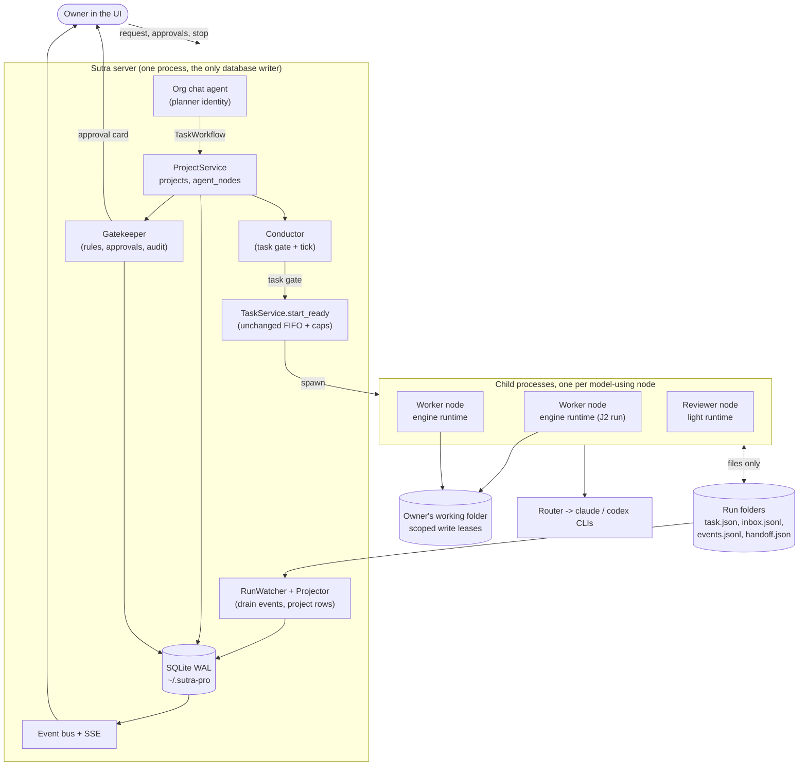
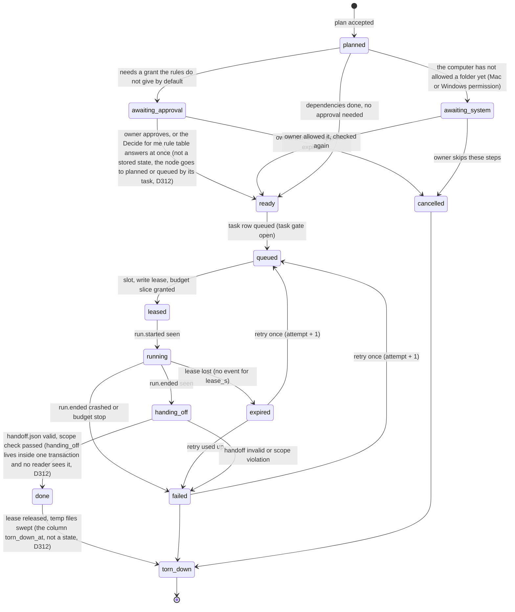
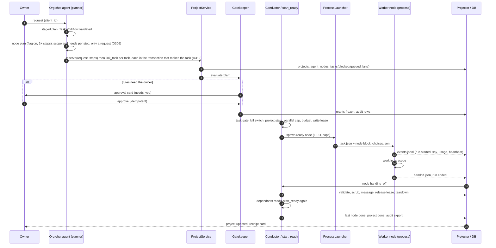

# Multi-agent nodes: architecture

Status: proposed, 2026-11-20. Design only. Findings: [analysis.md](analysis.md). Permissions and safety: [guardrails-and-permissions.md](guardrails-and-permissions.md).
Decisions D253 on: [decisions.md](decisions.md). Work packages MAN-1 on: [build-plan.md](build-plan.md).
Phase 1 (MAN-1 to MAN-4), phase 2 (MAN-5 to MAN-7) and phase 3 (MAN-8 without its chat card, MAN-9, MAN-15) are built; this document was corrected after each from the developer's notes ([dev-notes.md](dev-notes.md)) by the architect rulings D297 to D305, D306 to D312 and D315 to D323. Corrections are marked with their D number. Phase 3 follow-up (G12 to G22, P1 to P3) and phase 4 (MAN-10 to MAN-14) are built and were reviewed against this design: D324 to D331 and the architect's D332 to D341. Section 9 (preservation) was checked again and holds, with the two precisions of D340.

## 1. The idea in one page

A team run in Sutra Pro is already a small, well-behaved worker: its own process, its own folder, files in and files out, a heartbeat, a stop ladder, crash
recovery. The only things it lacks are an **identity**, a **permission set**, a **budget slice** and a **project around it**.

So the design does not add a new kind of process. It does this:

1. A **node** is a normal run (a `tasks` row, a run folder, a process) that also has a row in a new table `agent_nodes`: who it is, what it may do, how much it may spend.
2. A **project** is a new row that groups the nodes made for one request, with one budget, one stop and one teardown.
3. Two server-side helpers run the project. Both are plain code, not models:
   - the **Conductor** decides when a node may start and watches it;
   - the **Gatekeeper** decides what a node may do and asks the human when a rule says so.
4. Nodes start through the **same** scheduler as every task (`start_ready`), so FIFO, `SUTRA_MAX_RUNS`, `SUTRA_MAX_LIVE`, the spending limit and the stop ladder all apply for free.
5. Everything is off until `SUTRA_NODES_V1=1`. With the flag off, no table is read, no new column is used, and `task.json` is byte-identical to today.

## 2. Context



Where this sits in the existing system: the new boxes are `ProjectService`, `Conductor`, `Gatekeeper` and the light node host. Everything else on the picture
already exists (`TaskService`, `RunWatcher`, `Projector`, the bus, the run-folder protocol, the router).

## 3. Approach

### 3.1 Node types and roles

| Role | Runtime | Uses a model? | Process? | Job | Starts from |
|---|---|---|---|---|---|
| **Conductor** | server code | no | no (a gate and a tick in the server) | Decides when a node may start, watches leases, tears down, recovers. | project created |
| **Gatekeeper** | server code | no | no | Issues grants, applies rules, asks the human, records the audit. Never a model: a model never approves a model. | project created |
| **Planner** | inline (today's org chat agent stage) | yes, short calls | no (runs in the server as now) | Picks teams and the step graph. Gets an identity and a small budget slice. With the flag on, a second small call, the node plan (D306), may propose a write scope and a `needs` list per step: only narrower than the department's, never wider, and only a request. It has no stored grant; its calls are tagged `workspace=read` with the flag on, so it can read the owner's folder as today and can never edit it (D307). | owner request |
| **Worker** | engine runtime (an ordinary J2 run) | yes | yes | Does one plan step as a normal team run. Unchanged inside. | a ready plan step |
| **Reviewer** | light runtime (new small host) | yes | yes | Reads what workers handed off and the folder, read-only, and returns a verdict. | workers done (sub-flag) |

Why only these:

- The engine is frozen, and its five functions share one `J2Run` object. They are **not** split into nodes (see decision D256 and alternative B below).
  A worker node is a whole team run, and the team still has its Identity, Adaptation, Priority, Coordination and Audit inside, exactly as today.
- The planner already exists as the org chat agent's staged calls. It is not a process and does not become one. It gets an identity so it is audited and budgeted like the others.
- The reviewer is a new, small kind of run because the owner asked for an independent reader that is separate from the makers. It does not load J2.

Three runtimes, one protocol:

| Runtime | What runs | Speaks |
|---|---|---|
| `engine` | `python -m sutra_app.engine` (unchanged) | `task.json` in, `events.jsonl` out, `inbox.jsonl`, `heartbeat`, `run.ended` |
| `light` | `python -m sutra_app.nodes` (new, no J2) | the **same** files and the same eight events, so `RunWatcher`, `Projector`, `reconcile` and the stop ladder work on it untouched |
| `inline` | server code | rows and audit only |

### 3.2 What a node is, concretely

A node is two rows and a folder.

```
tasks         (existing)  the run: status, run_id, pid, settings, last_event_at   + new column lane
agent_nodes   (new)       the identity: node_id, project_id, role, runtime, plan_ref, grants, budget slice, write scope, lease
runs/<run_id> (existing)  the folder: task.json now carries an optional "node" block (ignored by older readers)
```

Identity travels in four places so it cannot get lost:

1. `task.json` gets an optional `node` block: `{id, project_id, role, runtime, attempt, grants_id}` (see section 5).
2. `CallTag` gets two optional fields, `node_id` and `node_role` (empty by default), so every model call, usage row and egress row carries them. (The usage row's own `node_id` column is the GRAPH node, so the runtime node goes in its `detail` as `agent_node` and `agent_role`; the egress row has `node` and `role`; the project is one join away: D304.)
3. The child environment gets `SUTRA_NODE_ID` (a plain id, not a secret). The server's own value of it is never passed on: a run is a node only when its `task.json` says so.
4. Every audit row names the node.

### 3.3 Lifecycle



What each step means in plain words:

| Step | What happens | Who does it |
|---|---|---|
| **spawn** | The Conductor's task gate lets the queued task through (it asks the kill switch first and holds a node with no valid grant: D302, D303). `_prepare_next` makes the run folder and `task.json` (with the `node` block) and the process starts. | Conductor + `TaskService` |
| **lease** | A lease is a row: this node holds this write scope and this slot until `last_beat_at + lease_s`. It is taken inside the same transaction that marks the task `starting`, so two nodes cannot take the same scope. | `_prepare_next` (server) |
| **heartbeat** | The engine's existing heartbeat line every 5 s. The Projector moves `agent_nodes.last_beat_at` (coalesced, at most once per 15 s when nothing else changed). Any event extends the lease. | node writes, Projector reads |
| **hand-off** | On a clean end the host writes `handoff.json` (a summary, the files made with their checksums, claims, status) as the FIRST of the run's finish steps, so a slow later step cannot cost a node its hand-off (D309). The Conductor validates it inside the projector's transaction (the hashes of one hand-off share a 64 MB budget), scrubs it, stores it as a message, writes `handoff.accepted.json` (the one file dependants are given) and releases the lease. | host (writes), Conductor (reads) |
| **finish** | `run.ended` is read as today; the task and the node go terminal. | `Projector` |
| **teardown** | Sweep the node's temp files (`choices.json`, MCP config), release the scope and slot, flush audit, keep the run folder as history. Nothing is deleted that the owner could want. | Conductor |
| **crash recovery** | At app start `reconcile` (unchanged) settles tasks. Then `reconcile_projects` rebuilds leases from rows, re-adopts live nodes, retries or fails the rest. Leases are rows, so a crash loses nothing. | server |

A node never waits for the human while its process is alive. Approvals happen **before** spawn (the plan gate) or **after** a node ends (a `needs_grant` end becomes a card
and then a new attempt). That avoids parked processes, which is the "no idle reaper" problem of F4.

### 3.4 How a project starts



## 4. Approach by area

### 4.1 Communication: messages and events

Two kinds of traffic, kept apart.

**Inside a node:** unchanged. The eight run events (`run.started`, `say`, `node`, `step`, `atom`, `usage`, `heartbeat`, `run.ended`) go to `events.jsonl`. No new run event
type is added. Structured payloads travel as **files in the node's own run folder**, the way the live view already does (D133 "a published file, not a ninth run event"):

| File | Written by | Read by | Shape |
|---|---|---|---|
| `handoff.json` | the host, at a clean end (flag on) | Conductor | `handoff/1` (section 5.3) |
| `verdict.json` | the light reviewer | Gatekeeper | `verdict/1` |
| `needs.json` | the light host when it lacks a grant | Gatekeeper | `needs/1`: `{tier, why}` |
| `agent_live.json` | engine or light host | `RunWatcher` | `agent-live/1`, unchanged (so live text uses the existing `chat.partial` path) |

**Between nodes:** only through the server, in a table `node_messages` (append-only, written only by the server). A node never reads another node's folder and never writes to
another node. Dependants receive upstream data through the **existing** `upstream` mechanism (files copied under `upstream/<run id>/`, which the host already checks for
absolute paths, `..` and links). The validated hand-off is one of those files, `handoff.accepted.json`, written by the server after its check and scrub; the node's own `handoff.json` is never offered (D309, D265). `RunSpec.upstream` has no new field.

Message envelope (`node-message/1`):

```
{ v:1, project_id, seq,            # seq: 1, 2, 3 ... per project, no gap (D297): the writer takes MAX(seq)+1 in its own transaction
  at, from:{node_id, role}, to:{node_id|role|"project"},
  kind: handoff | verdict | gate_request | gate_decision | control | status,
  src_ref,                         # unique per project: "handoff:<node_id>:<attempt>"; a repeat is stored once
  body, body_sha256 }              # body <= 16 KB; anything bigger is a file reference with a sha256
```

Delivery is at least once with `src_ref` de-duplication, so effectively once (the same pattern as `chat_messages.src_ref` and `usage_ledger.call_ref`).

**The `seq` guarantee (D297).** For one project, at every committed state, the stored `seq` values are exactly 1 to n. The key is `(project_id, seq)`, not a table-wide autoincrement (that would give project A the numbers 1, 3, 4). `NodeStore.post` does all of this in one write transaction: look up `(project_id, src_ref)`, and if it is there return that row and take no number; else take `MAX(seq) + 1` for the project and insert. Nothing is ever updated or deleted (triggers; a project is never deleted in v1), a rollback gives the number back, and `project.message` is published after COMMIT. So a page that has `k` and asks `?after=k` gets `k+1, k+2, ...`; a first row that is not `k+1` means a message was lost and the page refetches from its last contiguous number. The snapshot carries `last_message_seq`. There is no global sequence for the page; the bus has its own `seq`.

**To the owner (the page):** project and node changes are ordinary store events emitted after COMMIT, in the style of today's invalidation events:
`project.created`, `project.updated`, `node.updated`, `approval.opened`, `approval.decided`, `project.message`. They go through the same bus, so they get a `seq`, enter the
ring and replay by `Last-Event-ID`. The page then refetches `GET /api/projects/{id}` (a snapshot), the same "events are invalidations, the page refetches" rule as the bus
(`orchestrator/events.py`). Reuse of the streaming contract:

| Streaming contract (D201-D238) | Used for nodes |
|---|---|
| Gap-free `seq`, snapshot plus `after=` catch-up (`LiveTurn`) | `node_messages.seq` (per project, D297) and `GET /api/projects/{id}/messages?after=` |
| State words `accepted, running, stopping, done, stopped, failed` | Node states map one to one: `queued/leased` is accepted, `running`, `stopping` (stop ladder), `done`, `cancelled` is stopped, `failed` |
| `heartbeat` with real idle time and idle limit | The node's `last_beat_at` and the lease length are shown the same way ("quiet for 40 s of 90 s") |
| `chat.partial` live text of AI workers | A worker's live text is unchanged |
| Idempotent send with `client_id` (D219, D220) | `POST /api/projects` and approval answers |
| One `CancelToken` per turn (D215) | The planner's call (bound to its spawned process, D301) and a light node's calls |

### 4.2 Shared state and who owns it

The rule that keeps this safe: **every piece of state has exactly one writer.**

| State | Where | Single writer | Readers |
|---|---|---|---|
| `projects`, `agent_nodes`, `node_messages`, `node_audit`, `approvals` | SQLite | the server, always inside `db.tx()` | server, UI through the API |
| `tasks` (+ `lane`) | SQLite | `TaskService` / `Projector` (as today) | server |
| `usage_ledger` | SQLite | `UsageStore` (as today) | server |
| `task.json`, `inbox.jsonl`, `choices.json` | run folder | the server, before start (as today) | the node |
| `events.jsonl`, `handoff.json`, `verdict.json`, `needs.json`, `agent_live.json`, J2 files | run folder | the node that owns the folder | server |
| The owner's working folder | disk | only a node holding a write lease on that path, and only in its scope | owner, other nodes (read) |
| Provider slots (optional, sub-flag) | `<data>/connectors/slots/*.lock` | each router's `flock` on a slot file | all routers |
| `quota.json` | `<data>/connectors/` | routers (as today) | all |
| Kill and pause files `<data>/nodes/KILL`, `PAUSE` | disk | the owner (by hand, or `sutra-pro nodes`) or the server | `NodeControl` watcher (every 2 s) and the task gate; the Conductor tick may also look; the light host |

**SQLite approach.** Keep SQLite, WAL, one writer (D16). Nodes never open the database. New tables are additive in migration v6. To stop heartbeats from flooding the writer:

- The Projector skips the `tasks.touch` of a heartbeat-only batch when the last touch was less than 15 s ago. The offset is replay-safe (`src_ref` and `call_ref` make a replay harmless), so a crash re-reads at most 15 s of lines.
- Project and node updates happen **inside the Projector's existing transaction** for that run, not in extra ones.
- Node message and audit rows are small (body at most 16 KB, reasons at most 200 characters).
- Acceptance test (package MAN-12): 12 fake nodes for 5 minutes with `StoreBusy` count zero. If it fails, the next step is a batch window of 250 ms per project, not a new database.

### 4.3 Scheduling and parallelism from plan edges

One scheduler. The Conductor is a **gate** on it, not a second queue.

- **Plan edges** already exist: a step's `depends_on` becomes `tasks.depends_on`, and `settle_blocked` turns `blocked` into `queued` when the dependencies end well, or cancels it when one ends badly (F7 of the failure table in `orchestrator.md`). Reused as is.
- **Conflict edges** are new and implicit: two steps that write overlapping paths must not run together. The Gatekeeper computes them from write scopes at plan time and the task gate enforces them at start time with a lease check. A conflict edge **delays**; it never cancels, so a failed sibling does not cancel a step that only waited for a folder.
- **Enforcement (D323, D328, built):** scope leases, conflict edges and "no scope means alone" are enforced for every project with the master flag on. A lease is the node's row in `agent_nodes` (`writes_json`) and is held until the node is torn down; it is read in the transaction that starts a node. The leases are among the steps of projects only: an ordinary task of another team has none (D337). Scopes are compared without case and with `/` for `\`. The sub-flag `SUTRA_NODES_LANES` only allows two nodes of the same team together.
- **After the run (D329, D336, built):** the host's folder watch (`git status` before and after, only for a run whose output delivers files) names the paths the node changed, the hand-off carries them (`changes`, at most 100), and the Conductor asks the owner about a path that no writer of the project owns (the union of the scopes; a writer with no scope owns the whole folder). The project is paused and nothing new starts; a running writer is not stopped. What the watch cannot see (no git, more than 5000 entries, ignored paths, a slow or refusing git) is not checked, and G26 makes that visible. A Claude step has its edit tools narrowed to its scope; a Codex step has no such narrowing.
- **Write scope** per writing step: a list of relative paths or folders. The department's output spec decides if a step may write at all (`workspace_for`). The planner may **narrow** the scope, never widen it. No declared scope means "the whole folder", so that step runs alone among writers. If the folder is not a git work tree, writers run one at a time and nothing is checked after the run (the check needs git: D336).
- **Same-team parallelism** (sub-flag `SUTRA_NODES_LANES`): a node task gets `lane = node_id`. The unique index becomes `(dept_id, lane)`. Every ordinary task has lane `''`, so the rule for them is identical to today. `live_in`, `deliver_to_department` and `stop_live(dept)` look only at lane `''`: a node is addressed by node id only.
- **What may start**: `_prepare_next` already walks queued tasks in FIFO order and asks `why_waiting` and `start_gate`. A new optional `task_gate(conn, now, row)` is asked next, in the same transaction. It answers with a waiting sentence or empty. It checks, in order: master kill and pause (`NodeControl.gate`, built in MAN-4; the Conductor's gate asks it first and adds the rest, never replaces it: D303), that the node has a valid grant (a node with none is held, never started as an ordinary task: D302), project state, node state, parallel cap of the project, project budget, write lease, provider slot. A held task stays `queued` with the sentence as its detail (the `Limits` pattern) and starts by itself when the reason ends.
- **Caps** are shared. Node tasks count in `counts_in`, so `SUTRA_MAX_RUNS` and `SUTRA_MAX_LIVE` bound the whole machine. A project adds its own `max_parallel` (default 3).
- **Order** is FIFO by task creation, which is plan order. Critical-path ordering is a non-goal for v1.
- **Inside a department** the J2 engine still runs its own builders one after another. That is a known limit, not a regression. The seam for later is the Coordination function's schedule; it needs a J2 sync and is outside this design.

### 4.4 Budget and limits, per node and per project

| Level | What | How it is enforced | Existing piece reused |
|---|---|---|---|
| App | `SUTRA_MAX_RUNS`, `SUTRA_MAX_LIVE`, monthly dollars, plan-window guard | unchanged (`start_ready`, `Limits.gate`) | all of it |
| Provider | at most N Claude and M Codex CLIs for the whole machine | file-lock slots shared by every router (sub-flag `SUTRA_NODES_SLOTS`) | `policy.max_concurrency` for N and M |
| Project credits | a ceiling in work credits (the sum of the nodes' slices, so total spend equals today's separate tasks) | slices are carved at plan time and the ceiling is their sum; the task gate's "the slices fit" check is a consistency guard only. A retry has the same slice, so the ceiling counts each attempt: worst case (1 + retries) times the ceiling (D320) | `J2_BUDGET` |
| Project dollars | optional ceiling | the Conductor tick sums `usage_ledger` by the project's task ids; over the ceiling stops nodes with the stop ladder | `UsageStore.rows(task_id=)` |
| Node credits | one slice per engine node | `task.json` settings `J2_BUDGET` and `J2_BUDGET_CAP` both set to the slice, read from the node's row at `_run_spec`. A slice is final in v1: there is no raise card and no budget gate; the owner asks again with a bigger budget (D320, P25 kept) | `TaskSettings` |
| Node calls, dollars, time | `max_calls` (default 60), `max_usd` (optional), `wall_s` (default 1800) | a `NodeMeter` in Sutra's own `engine/llm.py` shim adds `Allowance(max_calls, max_usd, deadline, envelope_id=node id)` to each call, from a running total in the process. Past a cap the host stops the run with outcome "Stopped: node limit (calls)" | `Allowance` and `Router.check_gate` |
| Retries | one per node, review loops at most 2, nodes spawned at most `max_nodes` (workers only, reviewers on top: D305) | counted in `agent_nodes` and `projects` rows | `attempts.py` |
| Plan confirm threshold | 400 work credits (D300 amended by D318, so five default steps ask): the plan gate asks when the estimate is over it; not asked when the owner gave their own `budget`. `project_credits` (1000) is the most Decide for me says yes to | `caps_json["confirm_credits"]`, `caps_json["project_credits"]`, defaults in `config.py`; a step with no estimate counts as its slice | `Plan.confirm_credits` in `gatekeeper.py` |

Honest limits: the dollar cap sees only Claude's list-price figure (Codex rows carry tokens, no dollars, D37), so a Codex node is bounded by calls and time. The router's
`Allowance` was per request; the new `NodeMeter` makes it cumulative per node by passing the remaining amount each time.

### 4.5 Failure handling

| # | Failure | What happens | Result for the project |
|---|---|---|---|
| N1 | Node process crashes (`run.ended crashed`, or pid gone) | Existing path marks the task crashed. The Conductor retries once as a new attempt (`attempts.py`), with the earlier attempt's outcome told to it and with the same dependencies, so it is given the same upstream hand-offs (D310). | After the retry fails: node `failed`, policy applies |
| N2 | Node is silent past its lease | In project mode only, the Conductor asks the stop ladder to end it, marks `expired`, retries once. A sleeping laptop is detected (the Conductor's own tick gap is larger than half the lease). If the project has no open gate, the lease is extended once instead. If it has an open gate (approval or system permission), a closed laptop is a refusal: see N14. | as N1 |
| N14 | The laptop sleeps, or the app is closed, while a gate is open (D296) | Every open gate of the project counts as refused. Waiting nodes are `cancelled` ("the computer went to sleep before you answered" or "Sutra was closed before you answered"), running nodes of the project are stopped with the stop ladder, the project is `stopped`, and one receipt note in the org chat says why (D311). Detected by the Conductor's tick gap (wall clock, from the end of one tick to the start of the next, D311), and by `reconcile_projects` after a restart. | project `stopped` |
| N3 | Node hits its own cap (calls, dollars, time, credits) | The meter refuses the next call and the host ends the run `crashed` with an outcome that names the limit, even when J2 itself would say done (D321). No retry (a retry would hit the same cap). There is no raise card in v1 (D320); one plain note tells the owner. | node `failed` with reason `limit` |
| N4 | Project wall time or dollars reached | Tick stops running nodes with the ladder; no new spawns; one plain note (D321). Wall time counts from the first node start, not from the project's creation. | project `stopped` |
| N5 | Hand-off missing, too big, malformed or with a path outside the folder | Node is not `done`; one retry; then `failed`. The bad file is kept for the owner. | policy applies |
| N6 | Scope violation (a path changed that no writer of the project owns, D336) | The project is paused (no new spawns; a running writer is not stopped), the step waits, audit row `scope.violation`, a card in the chat and on the page. Keep: the hand-off goes on. No, or Decide for me: the step is set aside (`scope.quarantined`), its files stay in the owner's folder, nothing is handed on, its dependants are cancelled. When the watch cannot say what changed: audit row `scope.unchecked` (G26). | project paused, then running |
| N7 | Reviewer says `changes` (D330, D338) | One question to the owner (never answered by Decide for me). A yes: the steps it names get a fresh attempt, at most `review_loops` (2) times; after that one plain note and the project ends as it is. A no: the project ends as it is. A model never orders work. | waits for the owner, then continues or ends |
| N8 | Reviewer says `reject` | The same as `changes` (D338): one question, nothing is cancelled by a verdict. | as N7 |
| N9 | Approval never answered, or answered no | Expires after 24 h; the held nodes are `cancelled` ("not approved"). No process was running. With Decide for me on the rule table answers at once (guardrails 5.1) except the three things it never answers (a permission of the computer, an estimate over `project_credits`, tier 5 otherwise). A no to a question about one step cancels that step only (D315 b, built as P1); a no to the estimate, an expiry, a stop and a closed laptop stop the project. | project `stopped`, or `done_with_open_items` for a single step's no |
| N10 | Database busy past 5 s (`StoreBusy`) | The gate returns "waiting" and the tick tries again. Nothing is half-written (single transaction). | none |
| N11 | App closed or crashed with live nodes | At start `reconcile` then `reconcile_projects` (section 3.3). | resumes or fails per node |
| N13 | The computer has not allowed a folder (macOS "Operation not permitted", Windows "Access is denied") | Found by the probe before spawn: the node waits in `awaiting_system` with one card, the rest runs. Found late, during a run: the node ends as `needs_system_permission` (no retry) and the same card appears. Never answered by Decide for me. | only the affected steps wait or are cancelled |
| N15 | A node's grant is missing, unreadable or wider than its role (D302) | The task gate holds it ("Held: this agent has no valid grant"); the tick fails it: task cancelled, node `failed`, audit `grant.denied`, the failure policy applies (D310). It is never started as an ordinary task. | policy applies |
| N12 | Kill switch | The stop ladders of every live node run together (about 12 s in all, D303), audit row, no new spawns until cleared. Every project with a live node becomes `stopped`, its queued and blocked nodes are `cancelled`, and nothing restarts by itself after resume. Pause only holds. A node the owner or the switch stopped is never retried. | project `stopped` |

**Failure policy** per project, set at plan time, default `stop_branch`: a failed node cancels only its dependants (what a failed task does today), siblings go on. The other
choice is `stop_all`. Nothing silently continues: a project that ends with a failed node ends `done_with_open_items` or `stopped`, never `done`.

## 5. Components

| Component | New / changed | Responsibility | Files | Public interface |
|---|---|---|---|---|
| `ProjectService` | new (MAN-5, built) | Create a project from a plan (`reserve`, before the tasks), link each task as it is made (`link_task`), own the project and node rows, build the snapshot, keep the planner's stop tokens (D301). | `sutra_app/orchestrator/projects.py` | `reserve(request_id, title, steps, budget=None, decide_for_me=False, ...) -> Reservation`, `link_task(tx, reservation, step_ref, task_id)`, `answer(project_id, approval_id, decision)`, `probe_system`, `system_check`, `system_skip`, `snapshot(id)`, `stop(id)`, `pause(id)`, `stop_planners(request_id)` |
| `NodeStore` | new | Rows of `agent_nodes`, `node_messages`, `node_audit`, `approvals`; leases; state moves. | `sutra_app/orchestrator/nodes_store.py` | `put_node`, `lease(tx, node, now)`, `release(tx, node)`, `post(tx, msg)`, `audit(tx, row)` |
| `KillSwitch`, `NodeControl` | new (MAN-4, built) | The two files, the stop and pause levels, the 2-second watcher, the node stop, an audit row for each. Calls the one stop ladder through `TaskService.stop_node`. | `sutra_app/orchestrator/killswitch.py`, `sutra_app/ops/nodes.py` | `KillSwitch.held()`, `NodeControl.gate`, `stop_node`, `pause_all`, `kill_all`, `resume`, `enforce` |
| `Conductor` | new (MAN-5 to MAN-7, built inside `projects.py`; split into `conductor.py` by C0 before MAN-8, D312) | The task gate, the node state machine and teardown (`sync_task`, called by the projector and the scheduler in their own transactions), hand-off intake, retry, the tick (leases, sleep check, gate expiry), `reconcile_projects`, `refuse_open_gates`, stop. | `sutra_app/orchestrator/projects.py`, then `conductor.py` | `gate(conn, now, row) -> str`, `sync_task(tx, task_id)`, `tick(now)`, `reconcile_projects()`, `refuse_open_gates(project_id, reason)`, `stop(project_id)` |
| `Gatekeeper` | new | Role table, grant calculation (an intersection), tier rules, approval cards, audit of decisions. | `sutra_app/orchestrator/gatekeeper.py`, `sutra_app/orchestrator/grants.py` | `evaluate(plan) -> Evaluation`, `grant_for(node) -> Grant`, `decide(approval_id, answer)` |
| Project routes | new | HTTP surface (token, flag-guarded). | `sutra_app/orchestrator/api/projects.py` | see section 6 |
| Light node host | new | A small run host for the reviewer: same files and events, no J2. | `sutra_app/nodes/__main__.py`, `host.py`, `reviewer.py`, `templates/reviewer.md` | `python -m sutra_app.nodes --run-dir <dir>` |
| `TaskService` | changed (small) | `lane` in the busy key; optional `task_gate`, `spawn_guard` and `node_sync` hooks; node block in `_run_spec`; `retry_in` and `cancel_in` inside the caller's transaction. | `sutra_app/orchestrator/tasks.py`, `waiting.py` | `TaskService(..., task_gate=None)` |
| `Projector` | changed (small) | Update node rows inside its existing transaction; coalesce heartbeats; call `Conductor.on_run_ended`. | `sutra_app/orchestrator/projector.py` | unchanged public surface |
| `RunSpec` / `TaskSpec` | changed (additive) | Optional `node` block. Written only when the flag is on. | `sutra_app/orchestrator/models.py`, `sutra_app/engine/spec.py` | `RunSpec.node: NodeBlock | None = None`; excluded from the dump when `None` |
| `CallTag` | changed (additive) | Optional `node_id`, `node_role`. | `sutra_app/engine/port.py` | two new optional fields |
| `engine/llm.py` shim | changed (additive) | `NodeMeter`: cumulative calls, dollars, deadline per node. | `sutra_app/engine/llm.py` | `configure(..., meter=None)` |
| `host/finish.py` | changed (additive step) | `handoff` step: write `handoff.json`. Only when the task says it is a node. | `sutra_app/engine/host/finish.py`, `handoff.py` | `finish.run_steps` gains one step |
| Router slots | new, optional | A file-lock slot per provider, shared across processes. | `sutra_app/connectors/slots.py`, `router.py` (one hook) | `Slots.acquire(provider) -> Slot` |
| Scoped folder grant | changed (additive) | `Folder` may carry `scope`; Claude gets `Edit(<scope>/**)` rules. | `sutra_app/connectors/workdir.py`, `claude.py`, `codex.py` | `Folder(..., scope=())` |
| Egress | changed (additive, built) | The audit row also records `node` and `role` from the tag (the project is one join away, D304). | `sutra_app/connectors/egress.py` | two optional fields |
| Schema | changed (additive, built) | Migration v6: five tables, `tasks.lane`, index swap. | `sutra_app/orchestrator/schema.py` | `DDL_V6_NODES` |
| Config | changed (additive) | The flags and defaults. | `sutra_app/config.py`, `sutra_app/ops/envfile.py` | `Settings.nodes_v1` etc. |
| UI | new, built | A project page: the questions, the steps and their order, what it used, what Sutra decided for you, why it stopped, the audit. Mounted by `ui.mount_project_page` only while the flag is on; its own event stream (D326, D334). There is no list of projects yet (R6). | `sutra_app/ui/static/js/project_*.js`, `sutra_app/ui/routes.py` (`build_project_router`), `ui/pages/project.html` | page `/p/<id>` |

### 5.1 The `node` block in `task.json`

```
"node": { "id": "nd_<12 hex>", "project_id": "prj_<12 hex>", "role": "worker|reviewer",
          "runtime": "engine|light", "attempt": 1, "grants_id": "gr_<12 hex>",
          "caps": { "calls": 60, "usd": null, "wall_s": 1800 }, "scope": ["site/pricing/"] }
```

MAN-8 adds one more optional key, `tool_profile` (`none|sutra|github|sutra+github`, from the grant), so an engine worker's calls can carry the tools it was granted (D298); `folder` needs no key, because the router already derives it from the tag and the owner's access.

`TaskSpec` already has `extra="ignore"` ("a newer orchestrator may add some", `engine/spec.py` line 91), so an older engine reads the file as before. The block is **left out** of the
dump when the flag is off, so `task.json` is byte-identical to today (golden test).

### 5.2 The grant (frozen at spawn)

A grant is data: `{id, node_id, role, tiers: [0..4], folder: none|read|inspect|edit, scope: [...], tool_profile: none|sutra|github|sutra+github, commands: none|git_reads, run_tools: none|engine, caps}`.
It is computed once by the Gatekeeper as the **intersection** of the role table, the plan, the department's output spec and the owner's own folder access. It never changes
during the node's life. The connectors enforce it with what they already have (see the mapping table in the guardrails document).

How the parts relate (D298, D299, D304):

- `tiers` are not a ladder: a grant lists each tier it holds (a reviewer holds 0, 1 and 3, never 2).
- `folder` is what the node may do in the owner's folder. It is capped by the owner's access and by the department's output spec (`workspace_for`). `inspect` is read plus the four git reads (`Router.folder_for`).
- Tier 1 = a folder to read, or the `sutra` part of the profile. Tier 2 = folder `edit`. Tier 3 = the four git reads (`commands = git_reads`). Tier 4 = the `github` part of the profile. The owner's folder access caps the first three through `folder`; it does not cap the profile.
- `run_tools` describes J2's builder tools in the run folder: `engine` for a worker (the engine's own rule, as today), `none` otherwise. It is written in the audit and not enforced by the grant; it is not a tier and not capped by the owner's access.
- `from_json` checks a stored grant by the same rules as a new one, so a row edited by hand cannot be wider than the role table.

### 5.3 `handoff.json` (`handoff/1`)

```
{ "v":1, "node_id", "status": "done|done_with_open_items|blocked",
  "summary": "<= 2000 chars, plain text, treated as data",
  "files": [ {"path":"relative/path", "sha256":"...", "bytes": 1234} ],      # at most 200, paths checked
  "claims": [ "<= 200 chars each, at most 20" ],
  "needs": [ {"tier": 3, "why": "<= 200 chars"} ] }                           # light nodes only
```

The host builds `files` from the folder watch and the run's own files, not from what an agent says. The Conductor re-checks every path (relative, no `..`, no link,
inside the node's scope or its run folder) and every checksum before accepting.

## 6. Interfaces / APIs

Every route answers `404 not_found` while `SUTRA_NODES_V1` is off, before the token is looked at. With it on, every write needs the launch token (`require_token`); reads need none, as every read of the app (D305).

| Route | Request | Response | Errors |
|---|---|---|---|
| `POST /api/projects` (built, MAN-13: D310, D326, D334) | `{client_id, text, budget?, failure_policy?, decide_for_me?}` (closed body) | `202 {message_id, turn, duplicate:false}`: the request is the owner's own line in the org chat and the plan is made after the answer, so no project exists yet; find it in `GET /api/projects`. A repeated `client_id` answers `200 {duplicate:true, message_id}` and starts nothing | 422 bad body; 404 flag off; a plan the gate refuses is a `failed` project with its reason, not an error of the route |
| `GET /api/projects` | `?status=&limit=&offset=` | `ProjectOut[]` | |
| `GET /api/projects/{id}` | | snapshot: project, nodes, edges, caps, spend, open approvals, last message seq | 404 |
| `GET /api/projects/{id}/messages` | `?after=<seq>&limit=` | `node_message[]` (secrets redacted) | 404 |
| `GET /api/projects/{id}/audit` | `?after=<seq>&limit=` | `audit_row[]` | 404 |
| `POST /api/projects/{id}/approvals/{aid}` (built, D316 d) | `{decision: "allow_once"|"allow_project"|"deny"}` | the project snapshot; idempotent by the approval's own id: the same answer again returns the snapshot, a different one is 409 | 404; 409 `decided`; 410-style "ran out" message for an expired one; 422 `allow_project` on tier 5 or 6 |
| `POST /api/projects/{id}/system/{item}/check` and `/skip` (built, MAN-15) | `{}` | the project snapshot. Check again probes the folder again; skip cancels only the steps that need that permission | 404 |
| `POST /api/projects/{id}/stop` | `{}` | `{stopped: n}` | 404 |
| `POST /api/projects/{id}/pause` | `{resume?: bool}` | `ProjectOut` | 404 |
| `GET /api/nodes/status` | | `{level: none|pause|kill, kill, pause}` (what the two files say; the page's way to learn the flag: 404 means off) | |
| `POST /api/nodes/pause-all` and `/kill-all` | `{reason?}` | `{affected: n}`: for pause, nodes now waiting to start; for kill, nodes stopped | |
| `POST /api/nodes/resume` | `{}` | `{resumed: bool}`: removes both files; what was held starts | |
| `POST /api/nodes/{id}/stop` | `{}` | `{stopped: bool}` (`false` for a node whose task is over) | 404 only for an id that does not exist |

Error codes reuse the app's closed set where one fits (`not_found`, `busy`, `store_busy`, `validation`). One new code: `node_limit` (a cap stopped something), carried as data, never a new HTTP status.

New cards (D316, D317): `NodeApprovalCard {type:"node_approval", project_id, approval_id, kind, tier, node_id, question, options[], expires_at}` and `SystemPermissionCard {type:"system_permission", project_id, approval_id, item, label, level, steps[], platform, options, affects[]}`. Both come with the project snapshot (`cards`, `system_cards`). The approval card is also a message of the org chat and an item of `needs_you` (D317, G12; not yet built). A system permission card is shown on the same plumbing. A receipt is never a card (D311).

## 7. Data model

Migration `DDL_V6_NODES` (one tuple, one transaction, never edited later):

```
projects        id TEXT PK ('prj_'+12 hex), request_id TEXT UNIQUE, title, status CHECK (planning, awaiting_approval, running, reviewing, done,
                done_with_open_items, stopped, failed), failure_policy ('stop_branch'|'stop_all'), decide_for_me 0|1, paused 0|1, review_loops,
                caps_json, budget_credits, budget_usd, client_id UNIQUE, created_at, ended_at, stop_reason
agent_nodes     id TEXT PK ('nd_'+12 hex), project_id FK, task_id UNIQUE FK NULL, role CHECK (planner, worker, reviewer),
                runtime CHECK (inline, engine, light), plan_ref, depends_on JSON, state CHECK (planned, awaiting_approval, awaiting_system, ready, queued, leased,
                running, handing_off, done, failed, cancelled, expired), attempt, grants_json, writes_json, slice_credits,
                lease_expires_at, last_beat_at, failure_reason, torn_down_at, created_at, ended_at
node_messages   project_id FK, seq INTEGER (>= 1), from_node, to_node, kind CHECK (...), src_ref, body, body_sha256, at,
                PRIMARY KEY (project_id, seq), UNIQUE(project_id, src_ref)   -- seq per project, no gap (D297)
                + triggers: no UPDATE, no DELETE (D264)
node_audit      seq INTEGER PK AUTOINCREMENT, at, project_id, node_id, role, actor, action, tier, target, decision, reason, ref, hash
                + triggers: no UPDATE, no DELETE (the pattern of atom_ledger)
approvals       id TEXT PK ('ap_'+12 hex), project_id FK, node_id, tier, request_json, status CHECK (open, allowed_once, allowed_project, denied,
                expired), decided_by ('owner'|'system'|'rule:<name>'), decided_at, expires_at, client_id, created_at
tasks           + lane TEXT NOT NULL DEFAULT ''
index swap      DROP INDEX tasks_one_live_per_dept; CREATE UNIQUE INDEX tasks_one_live_per_dept_lane ON tasks(dept_id, lane)
                WHERE status IN ('starting','running','waiting_user')
```

Known limit (D312): the append-only triggers stop UPDATE and DELETE, not `INSERT OR REPLACE`, because SQLite fires delete triggers on a replace only with `recursive_triggers` on. The code never writes that spelling and a test scans for it; a `BEFORE INSERT` trigger goes into v7 if the schema is touched again.

Notes from the build (D304, D305): `agent_nodes.task_id` (UNIQUE) points at the node's current attempt; an earlier attempt stays in `tasks` through `parent_task_id`, and a retry re-points the row in the same transaction that makes the new task. Projects are never deleted in v1, because the append-only tables refer to them. `paused` is a column because a paused project is still `running` in the status list.

Backward compatibility:

- Every existing task has `lane = ''`, so the new unique index forbids exactly what the old one forbids.
- Older code reading a v6 file stops with the existing message "the database is newer than this app understands: update the app" (`db.py` `migrate`). That is the same rule as v2 to v5. The pre-upgrade backup the app already makes (`ops/backup.py`) covers it.
- With the flag off, the five tables stay empty and nothing reads them.
- Disk: `<data>/projects/<project_id>/` holds the audit export (`audit.jsonl`, mode 0600) written at project close. Run folders stay where they are.

## 8. Cross-cutting

| Topic | Rule |
|---|---|
| Errors | A node failure never fails the server. Every Conductor action is wrapped; an error is logged, audited and the node is failed with a reason. |
| Logging | Ids only (`prj_`, `nd_`, `tsk_`). No prompt text, no file contents. Reasons are clipped to 200 characters and redacted. |
| Config | `SUTRA_NODES_V1` (master, default 0), `SUTRA_NODES_LANES`, `SUTRA_NODES_REVIEWER`, `SUTRA_NODES_SLOTS` (each default 0 and effective only with the master). Caps in `projects.caps_json` with defaults in `config.py`. |
| Security | See the guardrails document. Nodes never open the database or call the server. The launch token never reaches a node (`child_environment` already drops it). |
| Performance | Heartbeats coalesced; node writes ride the Projector's transaction; one watcher task per live node as today; no per-node database connection. Targets: 12 nodes, no `StoreBusy`, page update within 1 s of an event. |
| Concurrency | The task gate runs inside `_prepare_next`'s single write transaction, so the lease check and the lease take are atomic. The Conductor tick uses `run_blocking` like every store call. |
| Time | The lease uses the injected `Clock` (tests). The sleeping-laptop check uses the same wall clock, from the END of one tick to the START of the next: a monotonic clock does not run while the computer sleeps on macOS and Linux (D311). |
| Privacy | Everything stays under the data folder. No network service. Audit rows hold names and shapes, never content. |

## 9. Preservation: each existing behaviour and how it is kept

| Existing behaviour | Kept by |
|---|---|
| Checkpoints | Nodes are runs, so run files, `snapshot.json` and `LiveTurn` checkpoints are untouched. The planner's turn keeps its checkpoint. Project state is rows plus files, rebuilt at start. |
| Resume | `reconcile` runs first and unchanged. `reconcile_projects` is read-and-repair on top. A follow-up task and `rehydrate` work on a node's run like any run. |
| Stop and `CancelToken` | A node stop is `launcher.stop` (the same ladder). The project stop calls it per node, all together (D303). The planner and the light host use a `CancelToken` as chat turns do, bound to the spawned process, so a Stop ends the running call (D301). |
| Idempotent send | `client_id` on project start and approvals; `src_ref` on messages. |
| Egress scrub | Both modes stay. New: hand-off and messages are scrubbed in `replace` mode; light-node prompts are scrubbed by the host before the call; audit rows gain node fields. |
| Budgets | Slices become `J2_BUDGET`; raises stay the Requester's; `Limits` still gates the start; the monthly dollar limit still applies. |
| J2 provider seam | `llm.py`, `ModelPort`, `Router`, `ChatPort` unchanged in shape. Optional tag fields and an optional allowance only. |
| Local-first | All new rows and files are in the data folder. |
| Releases | No change to release scripts, workflows, packaging or version numbers. |
| Vendored J2 | No `j2*.py` change; `test_engine_vendor.py` and the prompt goldens still pass. |
| Flag-off scheduler | The same behaviour as before (D312 d): the start loop looks at the task again just before and after a process starts, and a process that began for a task that ended meanwhile is stopped, for every task. |
| One live task per team (P11) | With lanes the unique index `(dept_id, lane)` is unchanged. An ordinary task (lane `''`) waits for any live task of its team, a step in a lane waits for its own lane and for an ordinary task; `live_in`, `stop_live` and `deliver_to_department` look at lane `''`. `tasks.lane` is filtered on with the flag off and is always `''` (D340 a). |
| Crash text of an ordinary run | The "Your computer did not allow it" prefix is written for node runs only (G24, D340 b). |
| The planner's schemas and prompts | `chat_turn`, `AssignmentDraft` and the decide, change and assign prompts are byte-identical; the node plan is a separate family and a fifth template, used only with the flag on (D306). |

## 10. Test strategy

Runs with the fake engine (`SUTRA_ENGINE=fake`, `FakeLauncher`, `ScriptedConnector`); the default suite never calls a model (`orchestrator.md` section 7). Mapped to the work packages.

| Layer | What it covers |
|---|---|
| Unit | Role table and grant intersection (never wider than the owner's access); tier rules; scope overlap; budget slicing (sum never exceeds the ceiling); `NodeMeter`; `handoff.json` validation (paths, sizes, checksums); injection wrapper; state machine moves (only allowed edges); message de-duplication. |
| Store | Migration v6 on an empty file and on a v5 file with data; the lane index keeps the old rule for lane `''`; append-only triggers; `src_ref` uniqueness. |
| Integration | A project of 4 steps with `FakeLauncher`: edges respected, parallel steps run together, a conflict edge delays, caps hold, a failed node cancels only its branch; kill and stop; crash and restart (`reconcile_projects`); lease expiry; approval allow, deny and expiry; budget ceiling stop; `StoreBusy` retry. |
| Contract | `task.json` byte-identical with the flag off (golden); `RunSpec` dump with a node block validates in `TaskSpec`; event set of `events.jsonl` is still the closed eight; the bus topics. |
| Phase 1 additions | `seq` stays 1 to n under two projects, a repeated `src_ref` and a rollback (D297); a read-only owner still gets tier 4 when approved, and never tier 2 or 3 (D298); a document run's grant has `run_tools = engine` and tiers 0 and 1 (D299); a node with no valid grant is held, never started (D302); kill-all with several nodes ends in one ladder's time (D303). |
| Phase 2 additions | A node's retry is given the same upstream (D310); a node held for no valid grant is failed with `grant.denied` (D310); a slow `agent_views` step still leaves a hand-off (D309); a tick that took 40 s of ladders is not read as a sleep (D311); a held project says so in the reply (D308); a flag-on planner call is tagged `read` (D307); a resumed request is stoppable (D301); `reserve` for a request with a failed project is refused (D310). |
| Safety | A planted-instruction hand-off ("ignore your rules, enable writes") changes no grant and no edge; a secret in a hand-off is redacted; a path outside scope pauses the project; no route works with the flag off. |
| Preservation | The whole existing suite with the flag off: unchanged. Vendored-file hashes unchanged. |
| e2e (beta app, by hand) | The owner runs a 3-step project in the beta and stops it. `live_smoke.py` is **not** run (it spends quota, `AGENTS.md`). |

## 11. Rollout and risk

Order: schema and flags first (inert), then identity and audit (no behaviour), then the gate and project rows, then parallel same-team lanes, reviewer, slots. Each package leaves the
build green and the flag off by default. Try each in the beta app (`~/.sutra-pro-beta`) as `AGENTS.md` says; release only when the owner asks.

Rollback: set `SUTRA_NODES_V1=0`. Running projects are stopped first by the kill switch. Rows stay and are ignored. The migration is additive, so no data is lost.

| Risk | Likelihood | Mitigation |
|---|---|---|
| Parallel writers corrupt the owner's folder | medium | Leases among the steps of projects (built), a git-based check after the run with a pause and a question on a path nobody owns, writers serialise when there is no git or no scope. Not covered: an ordinary task of another team (D337), a step writing inside another step's scope, what git does not see (D336). Default `lanes` off. |
| A node is told something that changes its behaviour (prompt injection) | medium | Data wrapper, structured hand-off, no grant changes from content, tests with planted text. |
| Hand-offs leak secrets | low | Scrub in `replace` mode before storing and before giving to the next node. |
| More processes exhaust the machine or quota | medium | Shared caps, optional provider slots, per-node call and time caps. |
| SQLite write pressure | low now, rising | Coalesced heartbeats; the MAN-12 load test; batch window as the next step. |
| Scope enforcement is weaker on Codex than on Claude | medium | A Claude step has its edit tools narrowed to its scope; a Codex step has no narrowing and relies on the path check. The idea of routing a scoped writer to Claude was not built (D336 d). Written in the owner's documents. |
| The Conductor tick stops while the server runs | low | The tick is its own 5-second loop (`start_ticking`), a failed look is logged and the loop goes on; a missed tick delays but never loses state (rows), and a KILL file is watched separately every 2 s (D303). |
| Owner confusion between "graph node" and "node" | low | UI says "agent"; docs say "runtime node". |

## 12. Alternatives considered

| Option | What it is | Why not |
|---|---|---|
| **A. Agents as threads in the server** | Run each agent as an asyncio task or thread in the one server process. | `engine/llm.py` configuration and the J2 environment are module-level, per process (`loop.py` docstring: the J2 environment is set before `engine.j2` is imported). Two J2 runs in one process would share them. No OS isolation, no kill without taking the server down. Rejected. |
| **B. Split J2's five functions into five nodes** | Identity, Adaptation, Priority, Coordination and Audit each become a process. | They share one `J2Run` object and its lock. Splitting is a rewrite of a frozen engine (D13, D249). The owner said enhance, do not replace. Rejected. |
| **C. A broker and remote workers** | Redis or a queue, workers on other machines. | A new service and dependency, breaks local-first, and the file protocol plus one SQLite writer is enough at the target of 12 to 24 nodes. Rejected; the node protocol is files, so a remote node stays possible later. |
| **D. (chosen) Node = run + identity + project** | New rows around the existing run. | Reuses scheduler, stop ladder, recovery, usage and the router. Smallest change that gives identity, limits and a project. |

## 13. Traceability

The owner's asks, with where each is answered.

| Ask | Design | Test | Package |
|---|---|---|---|
| Nodes spawned for a project and torn down | 3.3, 3.4 | integration: project of 4 steps | MAN-5, MAN-6 |
| Parallel where the plan allows | 4.3 | integration: edges, conflicts, caps | MAN-5, MAN-10 |
| Planner, workers, reviewer, gatekeeper | 3.1 | unit and integration | MAN-2, MAN-3, MAN-5, MAN-11 |
| Lifecycle: lease, heartbeat, hand-off, crash recovery | 3.3 | integration: expiry, restart | MAN-5, MAN-6, MAN-7 |
| Message and event contract | 4.1 | contract tests | MAN-6, MAN-13 |
| Shared state and SQLite | 4.2, 7 | store tests, load test | MAN-1, MAN-12 |
| Budgets and limits | 4.4 | unit and integration | MAN-9, MAN-12 |
| Failure handling | 4.5 | integration | MAN-7 |
| Guardrails, permissions, approvals, audit, kill, injection, egress | guardrails document | safety tests | MAN-2, MAN-3, MAN-4, MAN-8, MAN-14 |
| Flag off keeps today | 5.1, 7, 9 | preservation tests | every package |
| Resume of messages by `after=` | 4.1 (`seq` guarantee), 7 | store and message tests | MAN-1, MAN-6 |
| A node can reach only what its grant says, builder tools and network told truthfully | 5.2, guardrails 3 and 4 | grant tests | MAN-2, MAN-8 |
| Stop means stop, also for the planner | 4.5, 9 | kill, planner stop tests | MAN-4, MAN-5 |
| The plan says which step wants a scope or the GitHub reads | 3.1, D306 | node plan tests, plan gate tests | MAN-8, MAN-10 |
| Nobody is left waiting unseen | 4.5 N9, N14, D296, D308, D311 | gate refusal and expiry tests | MAN-7, MAN-8, MAN-15 |

## 14. Decisions

D253 to D341 in [decisions.md](decisions.md). D324 to D331 are the rulings of the phase 3 follow-up and the phase 4 notes (the ceiling is real, the app's own data, the project page and route, the tool audit, leases and lanes, scope enforcement, the reviewer, slots and the load numbers); D332 to D341 are the architect's rulings after phase 4 (what the scope check sees, leases among project steps, the reviewer's independence, the tool audit and the network, the flag-off precisions, what a flag-on beta is). D315 to D323 are the architect's rulings after phase 3 (a no is as wide as the question, MAN-8 as built, the chat card, the plan gate numbers, Decide for me as built, budgets as built, caps and triggers, system permissions as built, "runs alone" is MAN-10's promise). D306 to D312 are the architect's rulings after phase 2 (the node plan, `auto` output and the planner's reach, a gate nothing answers yet, hand-off intake rules, retry and failure rules, the sleep check and the receipt, the design as built). D297 to D305 are the architect's rulings after phase 1 (seq per project, tier 4 and the folder, builder tools are not a tier, the confirm threshold, the planner's stop, no grant no start, kill switch ownership, adopted findings, small rules). D294 is Decide for me for projects (the project runs with no input; a rule table answers the gates). D295 is operating-system permissions per system, Mac and Windows (checked before a node starts; only the owner can grant them). D296: a closed laptop is a refusal. The main ones: D253 node = run plus identity, D254 flag off by default, D257 one scheduler with a task gate, D258 lanes,
D262 server is the only writer, D266 the Gatekeeper is code, D267 grants frozen at spawn, D271 budget slices.
