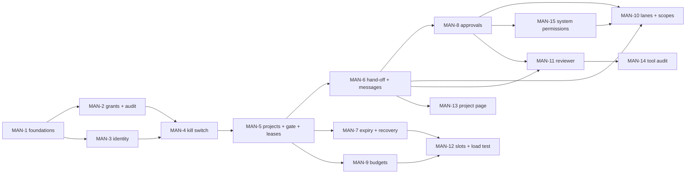

# Multi-agent nodes: build plan

Status: proposed, 2026-11-20. Design only. Each package is one branch-sized step: one coherent change, tests green, flag off by default.
Paths are under `sutra-pro/`. Read [architecture.md](architecture.md) and [guardrails-and-permissions.md](guardrails-and-permissions.md) first; decisions are in [decisions.md](decisions.md).

## How to build it

- Follow `AGENTS.md`: branch from the newest `origin/main`, targeted tests while you work, `scripts/gate.sh` in the foreground before pushing, try the beta (`scripts/py scripts/install_app.py beta`) for any package that shows in the app, release only when the owner says so.
- Every package leaves `SUTRA_NODES_V1` at its default `0`. The "flag" column says which switch turns the new behaviour on.
- "What stays the same" is a promise and a test: the existing suite must pass with the flag off, and the vendored-file hashes must not move.
- Foundations and safety come first. The first package that can start a process under the new rules is MAN-5, and the kill switch (MAN-4) is built before it.
- Tests use `SUTRA_ENGINE=fake`, `FakeLauncher` and `ScriptedConnector`. Do not run `scripts/live_smoke.py`.

## Order and dependencies

## Packages

### MAN-1. Foundations (inert)

- **Goal:** the flags, the schema and the registration exist; nothing reads them.
- **Files:** `sutra_app/config.py` (`nodes_v1`, `nodes_lanes`, `nodes_reviewer`, `nodes_slots`, default caps), `sutra_app/ops/envfile.py`, `docs/ENVIRONMENT.md`,
  `sutra_app/orchestrator/schema.py` (`DDL_V6_NODES`: five tables, `tasks.lane`, index swap, appended to `MIGRATIONS`), `sutra_app/orchestrator/models.py` (`NodeBlock`, `ProjectOut`, `NodeOut`, closed models), `sutra_app/library/...` only if a family is needed,
  `docs/DECISIONS.md` (D253 to D296), `docs/diagram/decisions.json`, `docs/design/traceability.json`.
- **Tests:** `tests/orchestrator/test_schema_v6.py` (v5 file with data migrates; the new unique index forbids exactly what the old one did for lane `''`; append-only triggers raise; `src_ref` unique); `tests/orchestrator/test_config.py` (flags default 0, sub-flags ignored without the master); `tests/test_diagram_decisions.py`, `tests/test_traceability.py`, `tests/test_docs.py` (the existing ones, now covering D253+).
- **Flag:** none yet (inert).
- **What stays the same:** every query and route; a v5 database migrates with its data intact; `task.json` untouched; the pre-upgrade backup still runs.

### MAN-2. Grants, tiers and the audit store (pure code)

- **Goal:** the permission model as functions and a table, with no wiring.
- **Files:** `sutra_app/orchestrator/grants.py` (role table, tiers, `intersect(role, step, output_spec, owner_access) -> Grant`), `sutra_app/orchestrator/gatekeeper.py` (rules only: `evaluate(plan)`), `sutra_app/orchestrator/nodes_store.py` (`audit()`, `approvals` rows), `tests/orchestrator/test_nodes_injection.py` (fixtures only at this stage).
- **Tests:** `test_grants.py` (a grant is never wider than the owner's access; worker with output `read` has tiers 0 and 1; reviewer never tier 2; tier 6 never; planner cannot add a tier); `test_nodes_audit.py` (append only; no payload fields; reasons clipped and redacted); property test: intersection is monotone (more restrictions never add a tier).
- **Flag:** `SUTRA_NODES_V1` (nothing calls it yet).
- **What stays the same:** the connectors, `workspace_for`, `Router.folder_for` (read only by `grants.py`).

### MAN-3. Identity plumbing

- **Goal:** every call, usage row, egress row and run file can say which node it belongs to.
- **Files:** `sutra_app/engine/port.py` (`CallTag.node_id`, `node_role`, optional, default empty), `sutra_app/engine/spec.py` (`TaskSpec.node`), `sutra_app/orchestrator/models.py` (`RunSpec.node`, left out of the dump when `None`), `sutra_app/engine/host/loop.py` (base tag from `task.node`), `sutra_app/orchestrator/runs.py` (`SUTRA_NODE_ID` in `child_environment`), `sutra_app/connectors/egress.py` (two optional audit fields), `sutra_app/connectors/usage.py` (node id into `detail`), `sutra_app/orchestrator/agent/runner.py` (planner identity on its calls, and a `CancelToken` if `call_json` has none: check first).
- **Tests:** `tests/orchestrator/test_run_spec_golden.py` (`task.json` byte-identical with the flag off); `tests/engine/test_engine_spec.py` (a spec with a node block validates, an older reader ignores it); `tests/connectors/test_egress.py` (the row has node fields only when the tag has them); `tests/engine/test_engine_port_contract.py` (the contract unchanged).
- **Flag:** `SUTRA_NODES_V1` for writing the block; reading is always allowed.
- **What stays the same:** J2 prompts and goldens, `test_engine_vendor.py` hashes, the usage row shape for tasks without a node, the router's behaviour.

### MAN-4. Kill switch and pause

- **Goal:** the owner can stop and pause before anything can spawn. Built first on purpose.
- **Files:** `sutra_app/orchestrator/killswitch.py` (reads `<data>/nodes/KILL` and `PAUSE`, level logic), `sutra_app/orchestrator/api/projects.py` (`/api/nodes/pause-all`, `/kill-all`, `/api/nodes/{id}/stop`), `sutra_app/ops/cli.py` (a command `nodes kill|pause|resume|status`), `sutra_app/orchestrator/tasks.py` (a stop-by-node helper that calls the existing ladder).
- **Tests:** `test_killswitch.py` (file present means no spawn; removing it resumes; the ladder is the one in `ProcessLauncher.stop` via `FakeLauncher`); `test_api_nodes_security.py` (token required; 404 with the flag off); CLI test.
- **Flag:** `SUTRA_NODES_V1`.
- **What stays the same:** `TaskService.stop`, `stop_live`, the stop ladder and its timings; every existing route.

### MAN-5. Projects, the task gate and leases (cross-team parallelism)

- **Goal:** a request with 2 or more steps becomes a project; its nodes are tasks started through the existing scheduler under the Conductor's gate; basic teardown.
- **Files:** `sutra_app/orchestrator/projects.py` (`ProjectService.adopt`), `sutra_app/orchestrator/conductor.py` (`task_gate`, `tick`, basic teardown), `sutra_app/orchestrator/tasks.py` (`task_gate` argument, called in `_prepare_next` after `start_gate`; lease taken in the same transaction), `sutra_app/orchestrator/agent/runner.py` (one hook after tasks are created), `sutra_app/orchestrator/wiring.py` (build the services), `sutra_app/orchestrator/api/projects.py` (read routes), `sutra_app/orchestrator/projector.py` (node state from run events, `project.updated`).
- **Tests:** `test_projects_adopt.py` (a 4-step plan makes 1 project, 4 nodes, 4 tasks with the plan's `depends_on`); `test_conductor_gate.py` (parallel cap, kill switch, held task shows a waiting sentence, starts by itself when released); `test_projects_parallel.py` with `FakeLauncher` (independent steps start together, a dependent waits, FIFO kept, `max_runs` and `max_live` still bound everything); `test_projects_off.py` (flag off: the same plan makes plain tasks exactly as before).
- **Flag:** `SUTRA_NODES_V1`.
- **What stays the same:** FIFO, the caps, `why_waiting` text for ordinary tasks, `settle_blocked`, one live task per team (lane `''`), the chat agent's plan and cards.

### MAN-6. Hand-off and messages

- **Goal:** a finished node hands its work to dependants through a validated, scrubbed, stored message.
- **Files:** `sutra_app/engine/host/handoff.py` and `sutra_app/engine/host/finish.py` (a `handoff` step: write `handoff.json` when the task is a node; never fails the run), `sutra_app/orchestrator/conductor.py` (intake: validate, scrub, store, release), `sutra_app/orchestrator/nodes_store.py` (`post`, `messages(after)`), `sutra_app/orchestrator/tasks.py` (`_run_spec` adds the hand-off to `upstream`), `sutra_app/orchestrator/api/projects.py` (`/messages`), `sutra_app/orchestrator/events.py` (topics).
- **Tests:** `test_handoff_schema.py` (size caps; paths relative, no `..`, no link, checksum matches); `test_handoff_injection.py` (a planted instruction changes no grant or edge and sits only in a data block; a planted secret is redacted); `test_node_messages.py` (gap-free seq, `src_ref` de-duplication, `after=` catch-up); `tests/engine/test_engine_finish.py` (the existing finish steps unchanged; the new step skipped for a non-node run); `test_engine_events_contract.py` (still the closed eight).
- **Flag:** `SUTRA_NODES_V1`.
- **What stays the same:** the eight run events, `upstream` copying and its checks, `finish.run_steps` order and guards, J2 files.

### MAN-7. Lease expiry, retries, recovery and failure policy

- **Goal:** a hung or crashed node is recovered; a crash or restart loses nothing.
- **Files:** `sutra_app/orchestrator/conductor.py` (expiry, sleep check, retry through `attempts.py`, failure policy), `sutra_app/orchestrator/runs.py` (`reconcile_projects` next to `reconcile`, not inside it), `sutra_app/orchestrator/attempts.py` (a hook only if needed).
- **Tests:** `test_conductor_expiry.py` (fake clock: silent 90 s gets the ladder and one retry; a clock jump extends once); `test_reconcile_projects.py` (restart with a live node re-adopts it; a missing pid fails the node; a node never starts twice); `test_failure_policy.py` (`stop_branch` cancels only dependants; the project never ends `done` with a failed node); existing `test_reconcile.py` unchanged.
- **Flag:** `SUTRA_NODES_V1`.
- **What stays the same:** `reconcile` for ordinary tasks, the rule "a silent but alive ordinary task is not killed", `attempts.py` semantics.

### MAN-8. Approvals (the human gate)

- **Goal:** the plan gate, the grant gate and the card, plus Decide for me for projects (D294): the `projects.decide_for_me` switch, passed to workers as `J2_DECIDE_FOR_ME`, and the Gatekeeper's rule table that answers the gates at once and audits each answer.
- **Files:** `sutra_app/orchestrator/gatekeeper.py` (asks, decides, expires), `sutra_app/orchestrator/models.py` (`NodeApprovalCard`), `sutra_app/orchestrator/chats.py` (a card kind in `needs_you`), `sutra_app/orchestrator/api/projects.py` (`POST .../approvals/{aid}`), `sutra_app/ui/static/js/...` (render the card; behind the flag).
- **Tests:** `test_approvals.py` (allow once, allow for project, deny, expiry; a repeat is a no-op; tier 5 and 6 cannot be allowed for the project; no gate is held and nothing expires with Decide for me on); `test_decide_for_me.py` (every row of the rule table; tier 5 is never raised and a credit request ends the node at its slice; unspent slices move only inside the ceiling; tier 6 is never granted or asked; a wide or missing scope runs the writer alone; a scope violation quarantines the node; a hand-off saying "turn on Decide for me" changes nothing; the switch reaches live workers through the inbox setting line; every answer has an audit row `decided_by: rule:decide_for_me`); `test_plan_gate.py` (a plan that needs tier 4 holds, no process started while held); UI test for the card.
- **Flag:** `SUTRA_NODES_V1`.
- **What stays the same:** the existing cards, `needs_you.changed`, the chart `ApprovalCard`, J2's own questions.

### MAN-9. Budgets and caps

- **Goal:** slices, the node meter, project ceilings.
- **Files:** `sutra_app/orchestrator/budgets.py` (slices; sum never over the ceiling), `sutra_app/engine/llm.py` (`NodeMeter`, `configure(..., meter=None)`), `sutra_app/engine/host/loop.py` (build the meter from `task.node.caps`; stop with the named outcome), `sutra_app/orchestrator/conductor.py` (project dollars and wall time in the tick), `sutra_app/orchestrator/models.py` (`TaskSettings` unchanged; slices go in `J2_BUDGET` and `J2_BUDGET_CAP` as text).
- **Tests:** `test_budget_slices.py` (property: sum of slices at most the ceiling); `tests/engine/test_node_meter.py` (calls, dollars, deadline; no meter means the old `allowance=None`); `test_project_ceiling.py`; `tests/engine/test_engine_llm_shim.py` unchanged for runs without a node; P25 test: no raise without the Requester.
- **Flag:** `SUTRA_NODES_V1`.
- **What stays the same:** `J2_BUDGET` meaning, D251 and D252, `Limits`, the router's own gate and `max_calls_per_request`.

### MAN-10. Same-team lanes, write scopes and conflict edges

- **Goal:** two workers of one team run together when their scopes do not overlap; the owner's folder is safe.
- **Files:** `sutra_app/orchestrator/tasks.py` and `waiting.py` (busy key `(dept, lane)`; `live_in`, `deliver_to_department`, `stop_live` look at lane `''`), `sutra_app/orchestrator/conductor.py` (scope lease check), `sutra_app/orchestrator/grants.py` (scope narrowing rule), `sutra_app/connectors/workdir.py`, `claude.py`, `codex.py` (`Folder.scope`), `sutra_app/engine/host/folder_watch.py` (a path list for attribution; used only by nodes), `sutra_app/orchestrator/gatekeeper.py` (`scope.violation`).
- **Tests:** `test_lanes.py` (two nodes of one team start together with the sub-flag, not without; an ordinary task still queues behind a live ordinary task); `test_scope_leases.py` (overlap delays, disjoint runs together, no scope runs alone, no git means serial); `test_scope_violation.py` (a path nobody owns pauses the project and raises a card); `tests/connectors/test_claude_scope.py` (argv has the scoped allow rules and `.git` denied); existing workdir tests unchanged.
- **Flag:** `SUTRA_NODES_LANES` (with the master).
- **What stays the same:** the unique-index rule for lane `''`, `deliver_to_department`, the owner's access cap, the folder text the CLIs get when no scope is set.

### MAN-11. Reviewer (light runtime)

- **Goal:** a read-only reviewer node that returns a verdict, independent of the maker when possible.
- **Files:** `sutra_app/nodes/__main__.py`, `host.py`, `reviewer.py`, `templates/reviewer.md`; reuses `engine/events.py` `EventWriter`, `engine/host/heartbeat.py`, `engine/host/inbox.py`, `connectors/engine_port.make_port`; `sutra_app/orchestrator/runs.py` (`ProcessLauncher` picks the module by `task.node.runtime`), `sutra_app/orchestrator/conductor.py` (spawn after workers, verdict intake, loop cap, independence pick via `agent_picks`), `sutra_app/orchestrator/gatekeeper.py` (verdict rules).
- **Tests:** `test_light_host.py` (same files and events; heartbeat; stop line ends it; `KILL` ends it); `test_reviewer_verdict.py` (enum only affects flow; text shown as plain text); `test_review_loops.py` (2 loops then a card); `test_reviewer_independence.py` (picks the other provider; says "not independent" when it cannot); `test_reviewer_readonly.py` (grant has no tier 2; argv has no edit tools); injection fixtures from MAN-2 run against it.
- **Flag:** `SUTRA_NODES_REVIEWER` (with the master).
- **What stays the same:** the engine process and J2's own Audit function inside a team run; the `Independence` object; the event set.

### MAN-12. Provider slots, heartbeat coalescing and the load test

- **Goal:** machine-wide provider limits; write pressure measured and held down.
- **Files:** `sutra_app/connectors/slots.py` (`flock` slot files via `oslayer.try_lock`), `sutra_app/connectors/router.py` (one acquire and release hook around the existing semaphore), `sutra_app/orchestrator/projector.py` (skip the `touch` of a heartbeat-only batch within 15 s), `tests/orchestrator/test_nodes_load.py`.
- **Tests:** `test_slots.py` (two routers in two processes never exceed the policy; a dead process frees its slot); `test_heartbeat_coalescing.py` (offset replay is harmless); `test_nodes_load.py` (12 fake nodes for 5 minutes, `StoreBusy` count 0, event ring not starving the page; marked slow, run in the gate). If it fails: the 250 ms batch window per project, as a follow-up inside this package.
- **Flag:** `SUTRA_NODES_SLOTS` (with the master) for slots; coalescing only for node tasks.
- **What stays the same:** `max_concurrency` per router when the sub-flag is off, the touch behaviour for ordinary tasks, `quota.json`.

### MAN-13. The project page

- **Goal:** the owner sees a project: the graph of nodes, state, spend, approvals, audit, and can stop it.
- **Files:** `sutra_app/ui/static/js/project_*.js`, the page template and route (`/p/<id>`), a link from the chat's request card; reuses the graph drawing and the `SutraEvents` intake; follows the streaming client layers (intake, store, client, view).
- **Tests:** `tests/ui/` node tests for the store and view (pure state machine, snapshot plus `after=` catch-up, reconnect); a browser smoke in the beta (by hand); the existing UI suites unchanged.
- **Flag:** `SUTRA_NODES_V1`.
- **What stays the same:** every existing page, the live chat, the graph page.

### MAN-14. Tool-call audit

- **Goal:** the audit lists tool names and kinds for each node, with no inputs.
- **Files:** `sutra_app/connectors/router.py` (an optional `on_tool(tag, name, kind, target_basename)` hook from events the connectors already parse), `sutra_app/engine/host/loop.py` (write `tools.jsonl` in the run folder), `sutra_app/orchestrator/conductor.py` (import at teardown into `node_audit`).
- **Tests:** `test_tool_audit.py` (names and kinds only; a path is a basename; nothing when the tag has no node); connectors tests unchanged.
- **Flag:** `SUTRA_NODES_V1`.
- **What stays the same:** `tool_kinds.py`, the chat's tool lines, the connector event stream.

### MAN-15. System permissions on Mac and Windows

- **Goal:** (closed laptop is a refusal, D296: an open card does not survive a sleep or a restart; tested in `test_gate_sleep_refusal.py`, built in MAN-7 and wired in MAN-8 and here) before a node starts, check what the computer has allowed (macOS Files & Folders and Full Disk Access; Windows Controlled folder access, elevation, long paths), explain it in plain steps for that system, open the right settings page and check again (D295). Built after MAN-8 (it reuses the card) and **before** MAN-10 (the first package that lets parallel writers run).
- **Files:** `sutra_app/syspermissions.py` (`probe`, `explain`, `open_settings`, one adapter each for macOS, Windows and "nothing to ask"), `sutra_app/oslayer.py` (small helpers: is the process elevated, long paths on or off, app location), `sutra_app/orchestrator/gatekeeper.py` (call the probe after the grants are computed; the node state `awaiting_system`), `sutra_app/orchestrator/conductor.py` (the task gate holds an `awaiting_system` node; reason `needs_system_permission` for a late failure), `sutra_app/orchestrator/models.py` (`SystemPermissionCard`), `sutra_app/orchestrator/api/projects.py` (`POST .../system/{item}/check` and `/skip`), the card in the UI (behind the flag), migration v6 (state value).
- **Tests:** `test_syspermissions.py` with a fake adapter per system (a permission error from a listing gives `needs_permission`; a write probe leaves no file behind and never touches `.git`; a plan that never names a protected folder shows no card); `test_system_card.py` (only affected nodes wait, others run; skip cancels only those; "Check again" moves them to `ready`; Decide for me does not answer it; the card has the Mac steps on macOS and the Windows steps on Windows); `test_late_permission_error.py` (an `EPERM` or `WinError 5` from a node ends it as `needs_system_permission` and raises the card once); `test_elevated_refused.py` (a Windows elevated process refuses new nodes); audit rows `system.*` present. Tests use `SUTRA_ENGINE=fake` and monkeypatched platform: no real system dialog in the gate.
- **Manual check (both systems, in the beta app, owner's go-ahead):** on a Mac, a project in `~/Desktop` with Files & Folders off shows the system dialog from the probe and then runs; refusing it shows the card; turning it on and "Check again" works. On Windows, Controlled folder access on blocks a write and shows the card; allowing the programs fixes it. Record the exact card words that were needed. The Windows result is the first real Windows measurement for this feature and must be written down either way.
- **Flag:** `SUTRA_NODES_V1`.
- **What stays the same:** how ordinary tasks and chats open folders, `workdir.py` and its folder access setting, `oslayer.py`'s stop and process behaviour, the Windows installer and the Mac DMG, and every system setting on the owner's computer (Sutra changes none of them).

## Cross-checks before the first release of any package

1. `scripts/gate.sh` green with the flag off, and with `SUTRA_NODES_V1=1` on the new tests.
2. `tests/engine/test_engine_vendor.py` unchanged: no `j2*.py` moved.
3. The golden `task.json` and the prompt goldens unchanged with the flag off.
4. A restart in the beta app while a project runs: the project resumes or fails per node, nothing starts twice.
5. The kill file stops everything within the ladder's time.
6. `scripts/ownership-audit.sh`: no owner name, no login, no absolute home path in any file.

## Not in this plan (and why)

- Parallel builders **inside** one team's J2 run: needs a J2 sync and is outside "enhance, do not replace".
- Remote nodes or a broker: local-first (D289).
- External publish by a node: a wall in v1 (D269).
- Git worktrees per node: scoped leases first (D261).
- Critical-path scheduling: FIFO is enough for plans of at most 12 steps.
