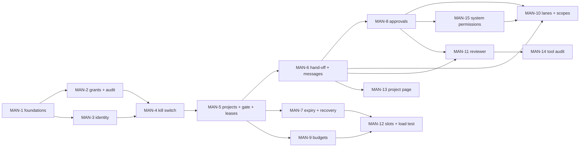

# Multi-agent nodes: build plan

Status: proposed, 2026-11-20. Design only. Each package is one branch-sized step: one coherent change, tests green, flag off by default.
Paths are under `sutra-pro/`. Read [architecture.md](architecture.md) and [guardrails-and-permissions.md](guardrails-and-permissions.md) first; decisions are in [decisions.md](decisions.md).

**Status (2026-11-20).** MAN-1 to MAN-4 are built (commits b4caeec8, 80a35494, c021b6db, 8dab4e61) and reviewed by the architect against the design. Their rulings are D297 to D305. The packages below carry what the rulings added, marked with the D number. The section "Before phase 2" listed what the developer had to fix in the phase 1 code first (done).

**Status (2026-11-20, phase 2).** MAN-5 to MAN-7 are built (commits 707beb82, daa39f27, f08204f6, 72a31f0f, head 72a31f0f) and reviewed by the architect against the design. Their rulings are D306 to D312. The section "Before phase 3" lists what the developer must fix in the phase 2 code first (G1 to G11 and the move-only split C0); the packages below carry what the rulings added, marked with the D number.

**Status (2026-11-20, final adherence check).** The fix round (PB-1 to PB-20, G23 to G26, R1 to R12, D342 to D345) is accepted with its deviations ruled (D346); a flag-on beta with a real Claude and a small read-only project is a GO under the conditions of D347. "Before publish" is rewritten as three groups: closed, what the first real-model run can close, what waits for a release.

**Status (2026-11-20, phase 4, reviewed by the architect).** The phase 3 follow-up (G12 to G22, P1 to P3, D324, D325) and MAN-10 to MAN-14 are built with fakes (D326 to D331, dev-notes N52 to N64), head 7b6c62a0, and were reviewed against the design: faithfully built, with the rulings D332 to D341. The section "Before the beta build" lists four small fixes (G23 to G26); "Before publish" is split into what a flag-on beta needs and what a release needs (R1 to R12, P4, P5, P8, P9). The flag stays `0` in every release and every default (D341).

**Status (2026-11-20, phase 3).** The phase 2 fixes (G1 to G11, C0, the Minor items, D313, D314) are built. MAN-8 is built except its chat card (NOT complete: D317), MAN-9 is built, MAN-15 is built with fakes only (the manual check on a real Mac and Windows is still open), head 49c162d0, and all were reviewed by the architect against the design. Their rulings are D315 to D323. The section "Before phase 4" lists what the developer must fix first (G12 to G22); "Before publish" lists what must be done before any beta reaches the owner with the flag on, and before any release (P1 to P9). The packages below carry what the rulings added, marked with the D number.

## How to build it

- Follow `AGENTS.md`: branch from the newest `origin/main`, targeted tests while you work, `scripts/gate.sh` in the foreground before pushing, try the beta (`scripts/py scripts/install_app.py beta`) for any package that shows in the app, release only when the owner says so.
- Every package leaves `SUTRA_NODES_V1` at its default `0`. The "flag" column says which switch turns the new behaviour on.
- "What stays the same" is a promise and a test: the existing suite must pass with the flag off, and the vendored-file hashes must not move.
- Foundations and safety come first. The first package that can start a process under the new rules is MAN-5, and the kill switch (MAN-4) is built before it.
- Tests use `SUTRA_ENGINE=fake`, `FakeLauncher` and `ScriptedConnector`. Do not run `scripts/live_smoke.py`.

## Before phase 2 (fixes to the phase 1 code, one commit each, in this order)

These are places where the built code differs from the design in a way that matters. MAN-5 does not start until they are done and the suite is green with the flag off.

- [x] **F1 (D302, MAN-4).** A node with no usable grant must never start. `NodeControl.gate` (or a small gate beside it) asks `node_block_of` for every queued task that has an `agent_nodes` row and returns "Held: this agent has no valid grant" when it raises `NodeBlockError`. Remove the "starts as an ordinary task" fallback in `TaskService._run_spec` (a node that still reaches it raises: the gate makes that impossible). Test: a node row with an empty, role-mismatched or too-wide grant stays `queued` with that sentence, nothing starts, the next queued task still starts.
- [x] **F2 (D299, MAN-2).** `grants.py`: replace `commands = sandboxed_builder` with the separate field `run_tools` (`none` or `engine`; `engine` for a worker, `none` otherwise); `COMMAND_LEVELS = (none, git_reads)`; a worker gets `git_reads` when its folder is `edit`, a reviewer when it is `inspect`; the "builder tools go with folder edit" rule goes; `run_tools` is in `to_json` and `from_json` and is not capped by the owner's access or the output level. Tests: a worker with output `read` has tiers 0 and 1 and `run_tools = engine`; a worker with `edit` has 0 to 3; the audit text names `run_tools`.
- [x] **F3 (D298, MAN-2).** `grants.py`: tier 4 no longer depends on the owner's access (`_why_not_network` keeps only "a {role} never reaches the network"); split the tool profile into `sutra` and `github` (`TOOL_PROFILES = none, sutra, github, sutra+github`; worker ceiling `sutra+github`, reviewer `sutra`); tier 1 = a folder to read or the `sutra` part (the planner always has it); tier 4 = the `github` part; a step may ask for `sutra`, `github` or both, the `sutra` part is given up to the role's ceiling without an approval, the `github` part only to a worker with one; a tier-4 approval gives `github` only. Update the `Grant` invariants and `StepRequest` to match, and keep `from_json` strict. Tests: rewrite `test_tier_4_is_only_given_to_a_worker_with_an_approval_and_an_owner_who_allowed_changes` as "...with an approval, for any folder access"; a read-only owner with a folder gets tiers {0,1,4} (the folder is `read`, so tier 1) and a no-folder owner gets {0,4}; a reviewer or the planner is refused tier 4; tier 4 does not add the `sutra` part.
- [x] **F4 (D300, MAN-1 and MAN-2).** Add `"confirm_credits": 500` to `NODE_DEFAULT_CAPS` (and its test in `test_config.py`); `Plan.confirm_credits` defaults to it; `None` means "do not ask about spend". Test: a plan estimated at 501 asks, 500 does not; `None` never asks.
- [x] **F5 (D305, MAN-2).** `Plan.max_nodes` counts workers only. Test: 12 workers and 2 reviewers is accepted, 13 workers is not.
- [x] **F6 (D303, MAN-4).** `NodeControl._stop_live` and kill-all run the ladders together (`asyncio.gather`, as `TaskService.shutdown` does), one failure logged and the rest going on. Test with `FakeLauncher` that takes a few seconds per stop: three nodes end in about one ladder's time.
- [x] **F7 (D297 to D305, MAN-1).** Copy D297 to D305 into `docs/DECISIONS.md`, `docs/diagram/decisions.json` and (by `scripts/build_traceability.py`) `docs/design/traceability.json`; the amended lines of D264, D267, D269, D273, D279, D291 and D294 too. `tests/test_diagram_decisions.py` and `tests/test_traceability.py` must pass.

No schema change is needed: migration v6 is not edited by any of these (it has not been released; if a CHECK is wanted later it goes in v7).

## Before phase 3 (fixes to the phase 2 code, one commit each, in this order)

Phase 3 starts with MAN-8. These are places where the built phase 2 code differs from the design in a way that matters (D306 to D312). The suite must be green with the flag off after each.

- [x] **G1 (D309, MAN-6, high).** `engine/host/finish.py`: for a node the `handoff` step runs FIRST (`NODE_STEPS + STEPS`); a run that is not a node keeps its steps and order. Test: a node whose `agent_views` step is made to take more than 10 s still has `handoff.json`; the existing finish tests are unchanged.
- [x] **G2 (D311, MAN-7, high).** `ProjectService.tick`: set `_last_tick` when the tick ENDS (the pause between ticks is what is measured), so the tick's own ladders are not read as a sleep. Test with the fake clock: a tick whose stops took 40 s followed by a normal tick refuses no open gate and extends no lease; a real gap of 60 s still does.
- [x] **G3 (D310, MAN-5, high).** A node held for "no valid grant" is failed by the tick: its task is cancelled (`cancel_in`), the node is `failed` with an audit row `grant.denied` (actor conductor, decision deny, no text from the grant), the failure policy applies. Test: a node row with an empty, role-mismatched or too-wide grant ends `failed` within one tick, nothing starts, the project ends `failed` or `done_with_open_items` by its other nodes.
- [x] **G4 (D310, MAN-7, high).** `TaskService.retry_in(force=True)` (the node's retry) keeps `depends_on=old.depends_on`; the owner's own `retry` stays as it was. Test: B depends on A (done); B crashes; the new attempt of B is `queued` with A's hand-off in its `upstream`, and a node C that waits for B waits for the new attempt.
- [x] **G5 (D301, MAN-5).** `_decide_flow` passes the request through `_as_planner` before `agent.resume` and releases the token after, so a resumed request has a planner node and a stop token. Test: kill-all during a resumed request's stage C ends the call; its project has a planner node row.
- [x] **G6 (D307, MAN-5).** `build_tag`: a `chat_agent` call whose context has `agent_node_id` is tagged `workspace="read"`; without it, `edit` as before. Test: the pinned tag test is unchanged; a planner call of a project has `read`; with the owner on "read and change" the folder the router gives it has no edit tools.
- [x] **G7 (D308, MAN-5).** Two new Sutra lines in `LINES` (the pinned set is extended on purpose, as N19): `stopped` ("Stopped. I did not start anything.") for a cancelled planner call, and `project_waits` ("I set up the project “{title}”. It is estimated at about {credits} credits, which is over {limit}, so it waits for your OK. Nothing has started. If nobody answers it is cancelled after 24 hours.") for a project made `awaiting_approval`. Test: Stop during planning ends with `stopped`, not `failed`; a six-step plan's reply says it waits.
- [x] **G8 (D310, MAN-5).** `reserve` returns not ok (with the reason) for a request whose project is `failed` or `stopped`; `link_task` raises for a step that has no node in an ok reservation, so the task is never made. Test: both cases make no ordinary task.
- [x] **G9 (D309, MAN-6).** `handoff_intake`: the file hashes of one hand-off share a 64 MB budget (`MAX_HASHED_BYTES` becomes the total); past it a file is checked by size only and counted as `unchecked`. Test: three 30 MB files give two hashed and one unchecked; the accepted hand-off still stores.
- [x] **G10 (D307, MAN-5, low).** `grants.describe` (or the `grant.issued` row) says "output auto (decided in the run)" when the team's output is `auto`. Test: the audit row text.
- [x] **G11 (D306 to D312, MAN-1).** Copy D306 to D312 into `docs/DECISIONS.md`, `docs/diagram/decisions.json` and (by `scripts/build_traceability.py`) `docs/design/traceability.json`; the amended lines of D255, D275, D291 and D296 too. `tests/test_diagram_decisions.py` and `tests/test_traceability.py` must pass.
- [x] **C0 (D312, MAN-5 to MAN-7).** Move the Conductor out of `projects.py` into `conductor.py` (`gate`, `sync_task`, `tick`, `refuse_open_gates`, `reconcile_projects`, `stop`, retry, teardown; `ProjectService` keeps `reserve`, `link_task`, reading and the planner's tokens and delegates). A move with no change of behaviour: every test passes unchanged except imports. Done before MAN-8.

Also, small and in the same commits as the code they touch: `INSERT OR REPLACE` stays out of the append-only tables (the guard test of m1); `docs/schemas/` is not touched in phase 3's first commit.

## Before phase 4 (fixes to the phase 3 code, one commit each, in this order)

Phase 4 starts with MAN-10. The suite must be green with the flag off after each; nothing here touches a flag-off path.

- [x] **G12 (D317, MAN-8, high).** The approval card is a chat message. `orchestrator/projects.py` (`_reserve`, `_settle_answers`) and `orchestrator/chats.py`: write one org-chat card message of type `node_approval` per open question (by `src_ref` `approval:<id>`), in the transaction that opens it; count open project questions in `needs_you` / `needs_you_count` and emit `needs_you.changed` when one opens and when it is answered or ends; `orchestrator/models.py`: the new kind in `ChatCard` and `NeedsYouOut` (made on purpose; nothing is written with the flag off); the chat page (`sutra_app/ui/static/js/` chat view) draws the options as buttons that POST to `/api/projects/{id}/approvals/{aid}`, and shows an answered or ended card as answered; the card words say what a no does (D315). The reply line (`planner.NODE_LINES`, `runner._hand_off`, `Reservation.waits`) says it for every kind of question, not only the estimate. Tests: an open question makes one card and one `needs_you` item, an answer clears both, a repeat makes no second card, a flag-off app has no such row and every existing response is byte-identical, a UI test for the card.
- [x] **G13 (D319, MAN-8, high).** Decide for me must also read the owner's own switch. `runner._decide_for_me_of` (or `_reserve_project`): true when the request line says so OR the owner's Decide for me setting is on (the engine setting behind `POST /api/settings`, the Simple view's switch). `runner._store_user_line`: do not store `decide_for_me` in `meta_json` when the flag is off (`self.projects is None`). Tests: switch on in settings and a plan with a tier-4 question starts with no question held; flag off stores nothing.
- [x] **G14 (D321, MAN-9, high).** A node that hit its cap ends failed. `engine/host/loop.py` `_conclude`: when `meter.reached` is set and the status is not `stopped`, make it `crashed` (the outcome text stays). Test (`tests/engine/test_node_meter.py` or `test_engine_node_identity.py`): J2 would end `done_with_open_items`, the cap fired, `run.ended` says `crashed` with the cap outcome; `test_project_ceiling.py`: that node is failed, not retried, no hand-off goes on to its dependants.
- [x] **G15 (D321, MAN-9, high).** Project wall time starts at the first node start. `conductor.py` `_project_limit` and `_tick_sync`: measure from the earliest `started_at` of the project's node tasks; a project with none started has no wall limit yet. Test with the fake clock: a project that waits 3 h for an answer and then runs is not stopped by the first tick.
- [x] **G16 (D322, MAN-15).** `projects.py` `probe_system`: a time limit of 45 s (`asyncio.wait_for` on the blocking probe; on timeout the item is a need and its card opens; the late result is ignored). `link_task`: raise `AppError("busy")` when the project has ended, so a stop or kill between `reserve` and the tasks makes no task; `runner._create_tasks` already handles an `AppError`. Tests: a probe that never returns still ends in a card; a project stopped during the probe makes no task and leaves no queued orphan.
- [x] **G17 (D322, MAN-15).** `projects.py` `system_check`: for the item `unknown` (the late card) `still` is true when the probe finds ANY need, not only one with the same item word. Test: a late card whose folder still refuses stays open after "Check again".
- [x] **G18 (D318, MAN-8).** `config.py` `NODE_DEFAULT_CAPS["confirm_credits"]` becomes 400 (and `test_config.py`, `test_gatekeeper*.py` numbers, the `project_waits` test uses the default). Test: a plan of four default steps asks nothing, five default steps ask, and the reply says "about 500 credits, which is over 400".
- [x] **G19 (D323, MAN-8).** No text may say a writer "runs alone" before MAN-10: `projects.py` `approval_cards` (the `scope` words), `gatekeeper.RULE_TABLE` row `scope_wide_or_missing` and `decide_for_me_answer`'s `why`, the `Gate("scope", ...)` words. Say "allowed" and, from MAN-10, "kept apart from other writers". Test: a scan of those strings for "alone".
- [x] **G20 (D307, MAN-8, low).** `projects.py` `_settle_answers`: the rewritten `grant.issued` row calls `issued.describe(output=...)` like `_reserve` does, so "output auto (decided in the run)" is not lost on an answer. Test: the row text after an answer.
- [x] **G21 (D315, MAN-8, low).** Until P1 is built the card for a step question says "If you say no, the whole project stops." (`approval_cards` words). Test: the words.
- [x] **G22 (docs only, developer).** Make `dev-notes.md` N45 to N51 agree with the rulings written under them (the architect has added them); keep `docs/ENVIRONMENT.md` in step with G18.

## Before the beta build (architect, phase 4 review; one commit each, in this order)

A flag-on beta is not built until these are done. None touches a flag-off path except G24, which makes one flag-off text what it was.

- [x] **G23 (D339, MAN-14, medium).** `tools.jsonl` is handed on as a file of the step: `engine/host/handoff.py` `NOT_HANDED_ON` lacks it (found by building a hand-off in a run folder that holds one; the reviewer's prompt would list it too). Add `tools.jsonl` (and `.sutra-probe-*`-style hidden names stay skipped as they are). Test: a node run folder with `tools.jsonl` and `report.md` hands on `report.md` only; `orchestrator.tasks.RUN_FOLDER_INTERNALS` stays a subset (the existing test keeps them in step).
- [x] **G24 (D340 b, MAN-15, low).** `engine/host/loop.py`: the "Your computer did not allow it" prefix (`permission_outcome` in `_emit_ended` and `_conclude`) is written only when `self.task.node is not None`. Test: an ordinary run that crashes with `PermissionError` ends with exactly the outcome it had before; a node run gets the prefix.
- [x] **G25 (D338 a, MAN-11, medium).** The reviewer's "independent" label comes from `projects.caps_json.reviewer_independent` (set by `_review`), not from `verdict.independent`. `nodes/host.py` stops guessing `connector != "auto"`; `conductor._review_done` writes the card's `independent` from the caps; the audit row `review.started` already says it. Test: one provider only, the task's connector set to that program explicitly: the card says "not independent"; two providers: it says nothing.
- [x] **G26 (D336 b, MAN-10, medium).** A writer's check that could not be made says so. In `conductor._scope_violation`: a node with tier 2 whose accepted hand-off has no `changes` key (git could not say, no git, more than 5000 entries, the watch was not taken), or whose `changes` is partial (`engine/host/handoff.py` also carries the watch's `more` count when it is above 0), gets one audit row `scope.unchecked` (reason in plain words, no path) and the project page shows "Sutra could not check which files this step changed" (`project_view.js` ACTION_WORDS). It never holds the project. Test: a git-less folder writer ends `done`, audit has `scope.unchecked`; a writer with `changes: []` has none.

## Before publish (a flag-on beta for the owner, and any release)

**Status (2026-11-20, the architect's final adherence check, D346, D347).** Code head `88c0b32e` (the same code as `24c7c1be`; the later commits are documents only). A box ticked here means built or decided and tested with stand-ins (the gate: 12509 passed, 373 skipped at `24c7c1be`). **Nothing below is called seen unless it says "seen".** The list has three groups: what is closed, what the first real-model beta run can close (D347, [beta-run-checklist.md](beta-run-checklist.md)), and what still waits for a release.

### A. Closed: built or decided, tested with stand-ins

- [x] **P1 (D315).** A no to a question about one step cancels only that step.
- [x] **P2 (D319).** Decide for me turned on answers the open questions at once; turned off it applies to the next gate.
- [x] **P3 (D322).** A late system card that clears gives the failed step one fresh attempt that spends no retry.
- [x] **P6 (MAN-13, D326).** The project page, the "Sutra decided for you" list, `stop_reason`, the audit rows, `POST /api/projects` with `failure_policy`, the note for an app that is not in the usual place.
- [x] **P7 (MAN-12, MAN-14).** The load test and slots, and the tool-call audit.
- [x] **P8 (docs).** `architecture.md` and `guardrails-and-permissions.md` agree with D316 and D320 to D347 (keep it true).
- [x] **G23 to G26 (D338 to D340).** Done in the phase 4 review round; the conditions of D341 are the rest of what a flag-on beta needs.
- [x] **R1 (D333, D345 n).** The Mac probe also looks at iCloud Drive (`~/Library/Mobile Documents`) and at a folder under `/Volumes`; the startup disk's own `/Volumes` link resolves to `/` and is not named. Fakes only. **Not covered and not known:** other cloud-file folders (for example `~/Library/CloudStorage`); P5 will show whether macOS asks there.
- [x] **R2 (D336 e, D345 d).** A step that ran alone is checked against its own scope; overlapping steps against the union. Fakes only: a real folder watch is in R7.
- [x] **R3 (D337).** The words say "other steps of projects"; no waiting between teams is added.
- [x] **R4 (D342, the owner's ruling).** The Codex limit is kept and told. The release note and `OPERATIONS.md` say it. Live check (a real Codex step outside its scope) is in R7.
- [x] **R5 (D338 b, D345 c).** A review question that names no step asks nothing; `approve` is an opinion.
- [x] **R6 (D334 d, D345 o).** The way back into a project: notes end with the page address, shown as "Open the project"; `GET /api/projects?client_id=`.
- [x] **R8 (D343, the owner's ruling).** No credit reporting; one model call is one credit. The sentence must be in the release note (see C).
- [x] **R10 (D333, D345 m, n).** The owner words are clean of machine words; the Windows notice names the `claude` and `codex` programs (a notice, not a test).
- [x] **R11 (D344, D346 b).** The inputs of a step's tool calls are emptied in `calls.jsonl` and `snapshot.json` by the host when it ends the run. **Limit written (D346 b):** a host killed hard or crashed hard does not run it. Follow-up F-1 below. The shape `tools.calls[*].input` was matched to J2's source, never seen from a real Claude run (check C10).

### B. The first real-model beta run (D347): closes only what is SEEN

A flag-on beta app, a real Claude, a throw-away read-only git folder, a request of two steps. The exact checks are C1 to C16 in [beta-run-checklist.md](beta-run-checklist.md). It can close, in part:

- [ ] **B1.** A real planner splits a request into a project of two steps (the stub could not: not verified).
- [ ] **P4, first sample only.** The real calls and minutes of two read steps. P4 itself still needs a document run and a website run.
- [ ] **P5, Mac only, one folder.** The first-start window words with the beta's own bundle id (`os.sutra.pro.beta`) when the folder is under Documents, Desktop or Downloads. Windows is not touched.
- [ ] **R7, in part.** Seen if it happens: Claude accepts the tool call with a JSON schema; the real shape of the tool log and of `calls.jsonl` (R11); the project page in the real desktop window (not phone width); the kill switch and Stop with a real process; a restart with the app closed; slots with a real program; the reviewer on one or two providers (second run).
- [ ] **Decide for me, off and on, with real questions** (second run).

### C. Remains before a release (not touched by the first beta run)

- [ ] **P4.** Real calls and minutes of a document run and a website run; set `node_calls` and `node_wall_s`; write the numbers in D273's amendment.
- [ ] **P5.** The manual check on a real Mac **and a real Windows** computer, the exact card words written down, either result.
- [ ] **R7, the rest.** A real folder watch on a real project with a writer; Claude's `Edit(path/**)` rules with the real program; a real Codex step outside its scope (the question and its words); a real reviewer on two providers (if not seen in B); the page at phone width, dark and light, a long project; Windows `msvcrt` slots; Windows long and short names in the scope comparison; the load test with real model latency.
- [ ] **R9.** The owner reads the words and links once in the real app: the question cards, the project page, the "app is not in the usual place" note, and the Work and Recipes pages if they ship.
- [ ] **R12 (reopened).** The release notes and `OPERATIONS.md` sections 12 to 14 are read once more against the code **at the release head**: the text changed after the box was first ticked (D346 b), and three packages add lines. The flag is `0` in every default.
- [ ] **R2 and R4, live.** Counted in R7: a writer that goes outside its place, on Claude and on Codex.
- [ ] **R8 (words).** The release note carries "When a step is tried again, one model call counts as one credit; your dollar limit is the number that holds."
- [ ] **M1 (new).** The migration on a copy of the owner's real data: copy `~/.sutra-pro` to the beta's folder as `RELEASE.md` says, open the beta, see the data intact and `<data>/backups/pre-upgrade-v5-to-v8.sqlite3` (or the versions that apply) written. An older app refuses a newer database; the way back is a backup taken before.
- [ ] **F-1 (new, small).** The Conductor, at a node's end and outside any transaction, also calls `blank_tool_inputs(run_dir)` (idempotent, files only) so a host that was killed hard does not leave inputs behind. Until then the owner words say "when a step ends; a step killed hard may keep them".
- [ ] **F-3 (new, small).** `sutra-pro prune` also removes `<data>/nodes/tools/<run>.jsonl` of runs it prunes (nothing removes them today; each is at most about 200 KB).
- [ ] **F-2 (only if the beta shows it).** A reserved slot for interactive chat, if a chat turn waits more than 10 seconds behind step calls (D346 d). Not built.
- [ ] **P9 (release gate).** The cross-checks below with the flag on, on the beta; `scripts/ownership-audit.sh`; the full gate on the **integration head** of the three branches ([../merge-plan-nodes-devin.md](../merge-plan-nodes-devin.md)); the owner's own go-ahead.

## Order and dependencies

## Packages

### MAN-1. Foundations (inert)

- **Goal:** the flags, the schema and the registration exist; nothing reads them.
- **Files:** `sutra_app/config.py` (`nodes_v1`, `nodes_lanes`, `nodes_reviewer`, `nodes_slots`, default caps), `sutra_app/ops/envfile.py`, `docs/ENVIRONMENT.md`,
  `sutra_app/orchestrator/schema.py` (`DDL_V6_NODES`: five tables, `tasks.lane`, index swap, appended to `MIGRATIONS`), `sutra_app/orchestrator/models.py` (`NodeBlock`, `ProjectOut`, `NodeOut`, closed models), `sutra_app/library/...` only if a family is needed,
  `docs/DECISIONS.md` (D253 to D296), `docs/diagram/decisions.json`, `docs/design/traceability.json`.
- **Tests:** `tests/orchestrator/test_schema_v6.py` (v5 file with data migrates; the new unique index forbids exactly what the old one did for lane `''`; append-only triggers raise; `src_ref` unique); `tests/orchestrator/test_config.py` (flags default 0, sub-flags ignored without the master); `tests/test_diagram_decisions.py`, `tests/test_traceability.py`, `tests/test_docs.py` (the existing ones, now covering D253+).
- **Built, plus (D297, D300, D304):** `node_messages` is keyed `(project_id, seq)`; the columns `projects.decide_for_me`, `paused`, `review_loops` and `approvals.created_at`; append-only triggers on `node_messages` too; `NODE_DEFAULT_CAPS` gets `confirm_credits` (F4).
- **Flag:** none yet (inert).
- **What stays the same:** every query and route; a v5 database migrates with its data intact; `task.json` untouched; the pre-upgrade backup still runs.

### MAN-2. Grants, tiers and the audit store (pure code)

- **Goal:** the permission model as functions and a table, with no wiring.
- **Files:** `sutra_app/orchestrator/grants.py` (role table, tiers, `intersect(role, step, output_spec, owner_access) -> Grant`), `sutra_app/orchestrator/gatekeeper.py` (rules only: `evaluate(plan)`), `sutra_app/orchestrator/nodes_store.py` (`audit()`, `approvals` rows), `tests/orchestrator/test_nodes_injection.py` (fixtures only at this stage).
- **Tests:** `test_grants.py` (a grant is never wider than the owner's access; worker with output `read` has tiers 0 and 1; reviewer never tier 2; tier 6 never; planner cannot add a tier); `test_nodes_audit.py` (append only; no payload fields; reasons clipped and redacted); property test: intersection is monotone (more restrictions never add a tier).
- **Built, plus (D298, D299, D304, D305):** folder level `inspect`; fixes F2, F3, F4, F5 above. The grant's fields are `{tiers, folder, scope, tool_profile, commands, run_tools, caps}` (architecture 5.2).
- **Flag:** `SUTRA_NODES_V1` (nothing calls it yet).
- **What stays the same:** the connectors, `workspace_for`, `Router.folder_for` (read only by `grants.py`).

### MAN-3. Identity plumbing

- **Goal:** every call, usage row, egress row and run file can say which node it belongs to.
- **Files:** `sutra_app/engine/port.py` (`CallTag.node_id`, `node_role`, optional, default empty), `sutra_app/engine/spec.py` (`TaskSpec.node`), `sutra_app/orchestrator/models.py` (`RunSpec.node`, left out of the dump when `None`), `sutra_app/engine/host/loop.py` (base tag from `task.node`), `sutra_app/orchestrator/runs.py` (`SUTRA_NODE_ID` in `child_environment`), `sutra_app/connectors/egress.py` (two optional audit fields), `sutra_app/connectors/usage.py` (node id into `detail`), `sutra_app/orchestrator/agent/runner.py` (planner identity on its calls, and a `CancelToken` if `call_json` has none: check first).
- **Tests:** `tests/orchestrator/test_run_spec_golden.py` (`task.json` byte-identical with the flag off); `tests/engine/test_engine_spec.py` (a spec with a node block validates, an older reader ignores it); `tests/connectors/test_egress.py` (the row has node fields only when the tag has them); `tests/engine/test_engine_port_contract.py` (the contract unchanged).
- **Built, plus (D301, D304):** the planner's `cancel` reaches the router (checked before each attempt). It does not yet stop a running call: MAN-5 finishes that (D301). The usage row carries `detail.agent_node`; the egress row `node` and `role`.
- **Flag:** `SUTRA_NODES_V1` for writing the block; reading is always allowed.
- **What stays the same:** J2 prompts and goldens, `test_engine_vendor.py` hashes, the usage row shape for tasks without a node, the router's behaviour.

### MAN-4. Kill switch and pause

- **Goal:** the owner can stop and pause before anything can spawn. Built first on purpose.
- **Files:** `sutra_app/orchestrator/killswitch.py` (reads `<data>/nodes/KILL` and `PAUSE`, level logic), `sutra_app/orchestrator/api/projects.py` (`/api/nodes/pause-all`, `/kill-all`, `/api/nodes/{id}/stop`), `sutra_app/ops/cli.py` (a command `nodes kill|pause|resume|status`), `sutra_app/orchestrator/tasks.py` (a stop-by-node helper that calls the existing ladder).
- **Tests:** `test_killswitch.py` (file present means no spawn; removing it resumes; the ladder is the one in `ProcessLauncher.stop` via `FakeLauncher`); `test_api_nodes_security.py` (token required; 404 with the flag off); CLI test.
- **Built, plus (D302, D303, D304):** `GET /api/nodes/status`, `POST /api/nodes/resume`, the 2-second `NodeControl` watcher, and `TaskService.task_gate` (pulled forward from MAN-5). Fixes F1 and F6 above. The automatic triggers of D279 are **not** in this package (D303): they come with their causes (MAN-7, MAN-9, MAN-10).
- **Flag:** `SUTRA_NODES_V1`.
- **What stays the same:** `TaskService.stop`, `stop_live`, the stop ladder and its timings; every existing route.

### MAN-5. Projects, the task gate and leases (cross-team parallelism)

- **Goal:** a request with 2 or more steps becomes a project; its nodes are tasks started through the existing scheduler under the Conductor's gate; basic teardown.
- **Files (as built, D312):** `sutra_app/orchestrator/projects.py` (`ProjectService.reserve` and `link_task` instead of one `adopt`; the Conductor's `gate`, `sync_task`, teardown and tick live here until C0 moves them to `sutra_app/orchestrator/conductor.py`), `sutra_app/orchestrator/tasks.py` (`task_gate` argument, called in `_prepare_next` after `start_gate`; lease taken in the same transaction), `sutra_app/orchestrator/agent/runner.py` (one hook after tasks are created), `sutra_app/orchestrator/wiring.py` (build the services), `sutra_app/orchestrator/api/projects.py` (read routes), `sutra_app/orchestrator/projector.py` (node state from run events, `project.updated`).
- **Tests:** `test_projects_adopt.py` (a 4-step plan makes 1 project, 4 nodes, 4 tasks with the plan's `depends_on`); `test_conductor_gate.py` (parallel cap, kill switch, held task shows a waiting sentence, starts by itself when released); the parallel case is covered by `test_conductor_gate.py`, which runs the real scheduler with `FakeLauncher` (independent steps start together, a dependent waits, FIFO kept, `max_runs` and `max_live` still bound everything), so there is no `test_projects_parallel.py`; `test_projects_off.py` (flag off: the same plan makes plain tasks exactly as before).
- **Also (D298 to D305):**
  - The Conductor's `task_gate` asks `NodeControl.gate` first and adds its own checks (D303); a node with no valid grant is held and then failed with a `grant.denied` row (D302).
  - The plan becomes a `gatekeeper.Plan`: `TaskWorkflow` steps plus each team's output spec become `PlanStep`s (built; an `auto` output reads as `read`, D307). The planner's `scope` and `needs` are NOT in its schema: they come from the node plan stage (D306), built in MAN-8; until then no step carries them. A step with no estimate counts as its slice (D300).
  - `grant.issued` rows state `run_tools` (D299). `agent_nodes.task_id` follows the current attempt (D305).
  - The planner's stop (D301): `cancel` through `call_json_result` and the one-shot plan of the base connector, Claude, Codex and the stub (tests: a running planner call is ended by Stop within the cancel ladder; the stub shows the token reaches it); a registry of in-flight planner tokens in `ProjectService`; node stop, project stop and kill-all ask it. Tests in `tests/connectors/` and `test_projects_adopt.py`.
  - Kill ends the project (D303 d): a kill sets every project with a live node to `stopped`, cancels its queued and blocked nodes, and nothing restarts by itself after resume; a node stopped by the owner or the switch is never retried. The projector owns node state from here (the `mark_ended` of MAN-4 becomes its rule: a node is `cancelled` only if its task ended stopped).
- **Built, plus (D306 to D312):** fixes G3, G5, G6, G7, G8, G10; the planner's stop and identity as D301; a plan that needs the owner is held and the reply says so (D308).
- **Flag:** `SUTRA_NODES_V1`.
- **What stays the same:** FIFO, the caps, `why_waiting` text for ordinary tasks, `settle_blocked`, one live task per team (lane `''`), the chat agent's plan and cards.

### MAN-6. Hand-off and messages

- **Goal:** a finished node hands its work to dependants through a validated, scrubbed, stored message.
- **Files:** `sutra_app/engine/host/handoff.py` and `sutra_app/engine/host/finish.py` (a `handoff` step: write `handoff.json` when the task is a node; never fails the run), `sutra_app/orchestrator/handoff_intake.py` (pure intake: validate, scrub; called by the Conductor's `_hand_off` inside the projector's transaction), `sutra_app/orchestrator/nodes_store.py` (`post`, `messages(after)`), `sutra_app/orchestrator/tasks.py` (`handoff.json` is run plumbing; dependants get `handoff.accepted.json` through the existing `upstream` listing, no new field), `sutra_app/orchestrator/api/projects.py` (`/messages`), `sutra_app/orchestrator/events.py` (topics).
- **Tests:** `test_handoff_schema.py` (size caps; paths relative, no `..`, no link, checksum matches); `test_handoff_injection.py` (a planted instruction changes no grant or edge and sits only in a data block; a planted secret is redacted); `test_node_messages.py` (D297: seq is 1 to n per project with two projects interleaved, with a repeated `src_ref` that takes no number, after a rolled-back post, and for 50 posts read back as 1 to 50; `after=` catch-up returns k+1 first); `tests/engine/test_engine_finish.py` (the existing finish steps unchanged; the new step skipped for a non-node run); `test_engine_events_contract.py` (still the closed eight).
- **Built, plus (D309):** fixes G1 and G9; the owner's-folder `changes` list comes with MAN-10; a hand-off with status `blocked` fails the node in MAN-11; the 16 KB reference hashes the file in MAN-11.
- **Flag:** `SUTRA_NODES_V1`.
- **What stays the same:** the eight run events, `upstream` copying and its checks, `finish.run_steps` order and guards, J2 files.

### MAN-7. Lease expiry, retries, recovery and failure policy

- **Goal:** a hung or crashed node is recovered; a crash or restart loses nothing. Also the automatic trigger "a node loses its lease twice" (D303), and a node stopped by the owner or the kill switch is never retried.
- **Files:** `sutra_app/orchestrator/conductor.py` (expiry, sleep check, retry through `attempts.py`, failure policy), `sutra_app/orchestrator/runs.py` (`reconcile_projects` next to `reconcile`, not inside it), `sutra_app/orchestrator/attempts.py` (a hook only if needed).
- **Tests:** `test_conductor_expiry.py` (fake clock: silent 90 s gets the ladder and one retry; a clock jump extends once); `test_reconcile_projects.py` (restart with a live node re-adopts it; a missing pid fails the node; a node never starts twice); `test_failure_policy.py` (`stop_branch` cancels only dependants; the project never ends `done` with a failed node); existing `test_reconcile.py` unchanged.
- **Built, plus (D310, D311):** fixes G2 and G4; the sleep check is on the wall clock and the receipt of D296 is a chat note (no card in any later package); `failure_policy` is set only by the owner (MAN-13). Tests as built: `test_conductor_expiry.py`, `test_reconcile_projects.py`, `test_gate_sleep_refusal.py`; the failure policy is tested there too (there is no `test_failure_policy.py`).
- **Flag:** `SUTRA_NODES_V1`.
- **What stays the same:** `reconcile` for ordinary tasks, the rule "a silent but alive ordinary task is not killed", `attempts.py` semantics.

### MAN-8. Approvals (the human gate)

- **Starting point after phase 2 (D306, D308):** `reserve` already stores the plan gate's questions as `approvals` rows (kind in `request_json`, audit `gate.asked`), holds every node (`awaiting_approval`) and the gate holds their tasks; `NodeStore.decide`, `expire_due` and `refuse_open_gates` exist. Nothing answers a question, nothing reads `decide_for_me` (the runner passes none), and no step carries `scope` or `needs`. So MAN-8 ALSO builds: (1) the node plan stage (D306: `node_plan` family in `agent/replies.py`, template `nodeplan.md`, `ChatAgent.node_plan`, the runner calls it in `_hand_off` before `_reserve_project`, `ProjectStep` gets `scope` and `needs`, `reserve` turns them into `StepRequest`s; tests: flag off makes no `nodeplan` call, an invalid reply is asked again, a failed stage gives the defaults and `plan.defaults`, `docs/schemas/` only gains `node_plan.v1.json`); (2) the answer path (`answer(project, approval, decision)`: re-run `evaluate` with what was approved, rewrite `grants_json` and write a new `grant.issued` row for nodes that have NOT spawned, never for a spawned one; move `awaiting_approval` nodes to `planned` or `queued` by their task; project to `running` when no question is open; a deny or expiry cancels the nodes with "not approved"); (3) the estimate question stored as kind `plan_estimate`, tier 5, answers allow once or deny only (`allow_project` is 422); (4) Decide for me at `reserve`: the runner passes `decide_for_me` from the request's `J2_DECIDE_FOR_ME`, the rule table answers in the same transaction, no hold; (5) the `project_waits` reply line is replaced by the card. No receipt card (D311).
- **Goal (D298):** tier 4 reaches an engine worker: the `node` block gets `tool_profile`, `PortSpec` an optional `tools` (empty by default) that `RouterPort` puts on a node's agent-turn calls only, never on a builder-tools call; `tests/engine/test_engine_port_contract.py` and `tests/connectors/test_engine_port.py` are extended on purpose. The plan gate does not ask the tier-4 question before this works. The tier-4 answer is independent of the owner's folder access.
- **Goal:** the plan gate, the grant gate and the card, plus Decide for me for projects (D294): the `projects.decide_for_me` switch, passed to workers as `J2_DECIDE_FOR_ME`, and the Gatekeeper's rule table that answers the gates at once and audits each answer.
- **Files:** `sutra_app/orchestrator/gatekeeper.py` (asks, decides, expires), `sutra_app/orchestrator/models.py` (`NodeApprovalCard`), `sutra_app/orchestrator/chats.py` (a card kind in `needs_you`), `sutra_app/orchestrator/api/projects.py` (`POST .../approvals/{aid}`), `sutra_app/ui/static/js/...` (render the card; behind the flag).
- **Tests:** `test_approvals.py` (allow once, allow for project, deny, expiry; a repeat is a no-op; tier 5 and 6 cannot be allowed for the project; no gate is held and nothing expires with Decide for me on); `test_decide_for_me.py` (every row of the rule table; tier 5 is never raised and a credit request ends the node at its slice; unspent slices move only inside the ceiling; tier 6 is never granted or asked; a wide or missing scope runs the writer alone; a scope violation quarantines the node; a hand-off saying "turn on Decide for me" changes nothing; the switch reaches live workers through the inbox setting line; every answer has an audit row `decided_by: rule:decide_for_me`); `test_plan_gate.py` (a plan that needs tier 4 holds, no process started while held); UI test for the card.
- **Built (developer, phase 3 round):** the node plan stage (`NodePlan`, `nodeplan.md`, `ChatAgent.node_plan`, `plan.defaults`; no `docs/schemas` file: `chat_turn` has none either, N44), the answer path (`ProjectService.answer`, grants rewritten for nodes that have not started, `not approved` on a no), `plan_estimate` (tier 5, allow once or deny), Decide for me as `gatekeeper.RULE_TABLE` and `decide_for_me_answer` (audit `decided_by rule:decide_for_me`; `decide_for_me` comes with the request line and reaches the workers as `J2_DECIDE_FOR_ME`), `POST /api/projects/{id}/approvals/{aid}`, `NodeApprovalCard` (in the snapshot as `cards`), tier-4 delivery (`NodeBlock.tool_profile`, `PortSpec.tools`, `RouterPort`). **Not built:** the card as a message of the org chat and the `needs_you` kind, the page's rendering and its UI test (N47). Tests: `test_node_plan.py`, `test_approvals.py`, `test_decide_for_me.py`, `test_api_approvals.py`, `tests/connectors/test_node_tools.py`.
- **Status (architect, phase 3 review): BUILT EXCEPT THE CHAT CARD, not complete (D317).** Accepted as built: the plan kept in `caps_json["plan"]` (D316 a), the node plan stage and its extra call (D316 b), `ChatPost.decide_for_me` (D316 c; G13), the route shape without `client_id` (D316 d), the rule table as data (D319), tier-4 delivery (D298). Still to do: G12 (the card in the chat, `needs_you`, the page's rendering, the UI test, a reply line for every question kind), G13, G18, G19, G20, G21 before phase 4; P1 and P2 before publish. A no stops the whole project until P1 (D315).
- **Flag:** `SUTRA_NODES_V1`.
- **What stays the same:** the existing cards, `needs_you.changed`, the chart `ApprovalCard`, J2's own questions.

### MAN-9. Budgets and caps

- **Starting point after phase 2:** `ProjectService.gate` is where "the unspent slices fit" goes (after the parallel cap); the tick is where project dollars and project wall time (`project_wall_s`) go; `agent_nodes.slice_credits` exists and is empty; `projects.budget_credits` today holds the owner's per-request `budget`, so MAN-9 defines it as the project ceiling (the sum of the slices) and `DEFAULT_SLICE` (100, in `projects.py`) is replaced by the real default. Slices reach a node at `_run_spec` from `agent_nodes.slice_credits` (not by rewriting the task's settings), so a retry or a later move cannot drift. Retries are bounded by `retries` per node, and `max_nodes` counts nodes, not attempts, so a project makes at most 2 x its workers' runs.
- **Goal:** slices, the node meter, project ceilings. Also the automatic triggers "a cap reached" and "the same node hits the egress scrub three times" (D303: the tick counts the node's rows of `egress.jsonl`), each with an audit row and a card.
- **Files:** `sutra_app/orchestrator/budgets.py` (slices; sum never over the ceiling), `sutra_app/engine/llm.py` (`NodeMeter`, `configure(..., meter=None)`), `sutra_app/engine/host/loop.py` (build the meter from `task.node.caps`; stop with the named outcome), `sutra_app/orchestrator/conductor.py` (project dollars and wall time in the tick), `sutra_app/orchestrator/models.py` (`TaskSettings` unchanged; slices go in `J2_BUDGET` and `J2_BUDGET_CAP` as text).
- **Tests:** `test_budget_slices.py` (property: sum of slices at most the ceiling); `tests/engine/test_node_meter.py` (calls, dollars, deadline; no meter means the old `allowance=None`); `test_project_ceiling.py`; `tests/engine/test_engine_llm_shim.py` unchanged for runs without a node; P25 test: no raise without the Requester.
- **Built (developer, phase 3 round):** `budgets.py` (`make_slices`, `move_unspent`, `egress_scrubs`), a slice per node from the plan (`agent_nodes.slice_credits`), `projects.budget_credits` = the sum of the slices, `_run_spec` gives the run `J2_BUDGET` and `J2_BUDGET_CAP` from the node's row, `NodeMeter` and `NodeCapReached` (`engine/llm.py`, built by the host from the node block's caps; the run ends `stopped: this step reached its <calls|usd|wall> cap`), the gate holds a node when the slices do not fit the ceiling, the tick stops a project past `project_wall_s` or its `budget_usd`, and the triggers `cap_reached` and `egress_scrub` (each an audit row `trigger.*` and one plain note). A new default cap `project_credits` (1000) is the ceiling Decide for me may say yes to. Tests: `test_budget_slices.py`, `test_project_ceiling.py`, `tests/engine/test_node_meter.py`, `test_engine_node_identity.py`. See N50.
- **Status (architect, phase 3 review): built, accepted with fixes (D320, D321).** Slices are final in v1: no raise card, no budget gate, `move_unspent` is a pure function nothing calls, a retry has the same slice (the ceiling is per attempt). Triggers are an audit row and a plain note, not a card. Fix before phase 4: G14 (a node that hit its cap must end failed even if J2 ends `done`), G15 (project wall time from the first node start). Before publish: P4 (measure the real call counts and minutes, then set `node_calls` and `node_wall_s`). The P25 engine re-test is not needed (J2's own Decide for me waits for the Requester on a raise, and `J2_BUDGET_CAP` equals the slice).
- **Flag:** `SUTRA_NODES_V1`.
- **What stays the same:** `J2_BUDGET` meaning, D251 and D252, `Limits`, the router's own gate and `max_calls_per_request`.

### MAN-10. Same-team lanes, write scopes and conflict edges

- **Starting point after phase 2 (D307, D309):** `caps_json["conflict_edges"]` and the snapshot's `conflict` edges are stored and shown from MAN-5 but not enforced; with lanes on, a worker whose output is `auto` counts as a possible writer (no scope means the whole folder and it runs alone); the node block already carries `scope`; the node plan (MAN-8) supplies it. The hand-off gets the optional `changes` list (paths changed in the owner's folder) and the intake's key set grows with it.
- **Also (D323, D322):** scope leases, conflict edges and "no scope means alone" are enforced for every project with the master flag on; `SUTRA_NODES_LANES` only allows two nodes of the same team together. Only now may a card or rule text say a writer "runs alone". The path attribution ignores `.sutra-probe-*` (the system probe's file). The scope violation question is a chat card (D317) and, with Decide for me on, the node is quarantined (`gatekeeper.on_scope_violation`). Needs G12 first.
- **Goal:** two workers of one team run together when their scopes do not overlap; the owner's folder is safe. Also the automatic trigger "a scope violation" (D303).
- **Files:** `sutra_app/orchestrator/tasks.py` and `waiting.py` (busy key `(dept, lane)`; `live_in`, `deliver_to_department`, `stop_live` look at lane `''`), `sutra_app/orchestrator/conductor.py` (scope lease check), `sutra_app/orchestrator/grants.py` (scope narrowing rule), `sutra_app/connectors/workdir.py`, `claude.py`, `codex.py` (`Folder.scope`), `sutra_app/engine/host/folder_watch.py` (a path list for attribution; used only by nodes), `sutra_app/orchestrator/gatekeeper.py` (`scope.violation`).
- **Tests:** `test_lanes.py` (two nodes of one team start together with the sub-flag, not without; an ordinary task still queues behind a live ordinary task); `test_scope_leases.py` (overlap delays, disjoint runs together, no scope runs alone, no git means serial); `test_scope_violation.py` (a path nobody owns pauses the project and raises a card); `tests/connectors/test_claude_scope.py` (argv has the scoped allow rules and `.git` denied); existing workdir tests unchanged.
- **Built (developer, phase 4):** leases for every project (D328), lanes behind the sub-flag, hand-off `changes`, scope violation question and quarantine, narrowed Claude edit tools (D329); tests `test_scope_leases.py`, `test_lanes.py`, `test_scope_violation.py`, `tests/connectors/test_claude_scope.py`. Deviation: a violation is a path no writer of the project owns (N59).
- **Status (architect, phase 4 review): built, accepted (D336, D337).** The "runs alone" words are true among the steps of projects; P11 holds with lanes. Gaps recorded: the check sees only what git sees and is silent otherwise (G26 before the beta), it compares with the union of scopes (R2), leases do not cover an ordinary task of another team (R3), Codex has no narrowing (R4).
- **Flag:** `SUTRA_NODES_LANES` (with the master).
- **What stays the same:** the unique-index rule for lane `''`, `deliver_to_department`, the owner's access cap, the folder text the CLIs get when no scope is set.

### MAN-11. Reviewer (light runtime)

- **Starting point after phase 2 (D309):** the Conductor's `_hand_off` and `handoff_intake.read_handoff(runtime="light")` already accept a light node's `needs`; MAN-11 adds what a hand-off with status `blocked` does (the node ends `failed`, never retried) and makes the 16 KB message reference hash the file.
- **Also (D317, D315):** the grant gate (a `needs.json`) and the review-loop question are chat cards through the card plumbing of G12; allow once and allow for the project differ here for the first time (D315 d). Needs G12 first.
- **Goal:** a read-only reviewer node that returns a verdict, independent of the maker when possible. The reviewer's grant takes its output level from the strongest step it reviews (D305).
- **Files:** `sutra_app/nodes/__main__.py`, `host.py`, `reviewer.py`, `templates/reviewer.md`; reuses `engine/events.py` `EventWriter`, `engine/host/heartbeat.py`, `engine/host/inbox.py`, `connectors/engine_port.make_port`; `sutra_app/orchestrator/runs.py` (`ProcessLauncher` picks the module by `task.node.runtime`), `sutra_app/orchestrator/conductor.py` (spawn after workers, verdict intake, loop cap, independence pick via `agent_picks`), `sutra_app/orchestrator/gatekeeper.py` (verdict rules).
- **Tests:** `test_light_host.py` (same files and events; heartbeat; stop line ends it; `KILL` ends it); `test_reviewer_verdict.py` (enum only affects flow; text shown as plain text); `test_review_loops.py` (2 loops then a card); `test_reviewer_independence.py` (picks the other provider; says "not independent" when it cannot); `test_reviewer_readonly.py` (grant has no tier 2; argv has no edit tools); injection fixtures from MAN-2 run against it.
- **Built (developer, phase 4):** the light host and the reviewer (D330); tests `test_light_host.py`, `test_review_loops.py`. Tested inside those files, not in the separate files named above: the verdict rules, independence and read-only grant.
- **Status (architect, phase 4 review): built, accepted with G25 (D338).** Read-only by construction (no folder, no tool, one call), a typed verdict, the owner decides. The grant gate after a `needs.json` is not built and moves to Non-goals for v1 (D335).
- **Flag:** `SUTRA_NODES_REVIEWER` (with the master).
- **What stays the same:** the engine process and J2's own Audit function inside a team run; the `Independence` object; the event set.

### MAN-12. Provider slots, heartbeat coalescing and the load test

- **Also (D320, N30):** the load test also measures the hand-off intake inside the projector's transaction (64 MB hash budget) and the 45 s system probe does not hold the runner. The numbers of P4 may come from this package's runs.
- **Goal:** machine-wide provider limits; write pressure measured and held down.
- **Files:** `sutra_app/connectors/slots.py` (`flock` slot files via `oslayer.try_lock`), `sutra_app/connectors/router.py` (one acquire and release hook around the existing semaphore), `sutra_app/orchestrator/projector.py` (skip the `touch` of a heartbeat-only batch within 15 s), `tests/orchestrator/test_nodes_load.py`.
- **Tests:** `test_slots.py` (two routers in two processes never exceed the policy; a dead process frees its slot); `test_heartbeat_coalescing.py` (offset replay is harmless); `test_nodes_load.py` (12 fake nodes for 5 minutes, `StoreBusy` count 0, event ring not starving the page; marked slow, run in the gate). If it fails: the 250 ms batch window per project, as a follow-up inside this package.
- **Built (developer, phase 4):** `slots.py`, the router's slot hook, coalescing in the projector, the load test with numbers (D331, N61); tests `tests/connectors/test_slots.py`, `test_nodes_load.py`.
- **Status (architect, phase 4 review): built, accepted (D331).** The numbers are of fakes on one machine; real latency and Windows slots are R7.
- **Flag:** `SUTRA_NODES_SLOTS` (with the master) for slots; coalescing only for node tasks.
- **What stays the same:** `max_concurrency` per router when the sub-flag is off, the touch behaviour for ordinary tasks, `quota.json`.

### MAN-13. The project page

- **Also (D315 to D322):** the page draws the card too (the chat card is G12), the "Sutra decided for you" list (D294, D319), the node's `needs_system_permission` card, conflict edges whenever they are enforced (D323), a static note when the app is not in the usual place (D322 d), and `stop_reason` with the audit rows.
- **Also (D310, D307):** `POST /api/projects` with an optional `failure_policy` (the only way to get `stop_all`; D255's route, which no earlier package built), and the page draws a conflict edge only when lanes are on. The page shows `stop_reason` and the audit rows for a project the closed-laptop rule stopped (D311).
- **Goal:** the owner sees a project: the graph of nodes, state, spend, approvals, audit, and can stop it. The page learns whether the feature is on from `GET /api/nodes/status` (404 means off); the flags stay out of `Settings.public()` (D305).
- **Files:** `sutra_app/ui/static/js/project_*.js`, the page template and route (`/p/<id>`), a link from the chat's request card; reuses the graph drawing and the `SutraEvents` intake; follows the streaming client layers (intake, store, client, view).
- **Tests:** `tests/ui/` node tests for the store and view (pure state machine, snapshot plus `after=` catch-up, reconnect); a browser smoke in the beta (by hand); the existing UI suites unchanged.
- **Built (developer, phase 4):** `project_store.js`, `project_view.js`, `project_page.js`, `project.html`, `sutra-project.css`, `ui.mount_project_page`, `POST /api/projects`, `GET /api/nodes/app-location` (D326); tests `project_store.test.js`, `project_view.test.js`, `project_page.test.js`, `test_project_page_route.py`, `test_api_start_project.py`. Not built: a list of projects, a browser smoke.
- **Status (architect, phase 4 review): built, accepted (D334).** `202 {message_id, turn}`, its own mount and event stream, and the missing way back (R6) are ruled.
- **Flag:** `SUTRA_NODES_V1`.
- **What stays the same:** every existing page, the live chat, the graph page.

### MAN-14. Tool-call audit

- **Also (phase 3 review):** nothing changes here; the node's tier-4 tool calls (the GitHub reads) are the first thing the owner will want to see in it, so the names include the `github` and `sutra` tool kinds.
- **Goal:** the audit lists tool names and kinds for each node, with no inputs.
- **Files:** `sutra_app/connectors/router.py` (an optional `on_tool(tag, name, kind, target_basename)` hook from events the connectors already parse), `sutra_app/engine/host/loop.py` (write `tools.jsonl` in the run folder), `sutra_app/orchestrator/conductor.py` (import at teardown into `node_audit`).
- **Tests:** `test_tool_audit.py` (names and kinds only; a path is a basename; nothing when the tag has no node); connectors tests unchanged.
- **Built (developer, phase 4):** `connectors/tool_audit.py`, the router's `on_tool`, `engine/host/toollog.py`, the Conductor's `prepare_tools` and `tool.used` rows (D327); tests `test_tool_audit.py`, `tests/engine/test_host_tool_log.py`.
- **Status (architect, phase 4 review): built, accepted with G23 (D339).** Names, kinds and a file's base name only. The limits (a tool's network traffic and `calls.jsonl` are not scrubbed) are in the owner's documents.
- **Status (architect, final check, D346): the log moved and the inputs are emptied.** The tool log is `<data>/nodes/tools/<run id>.jsonl`, outside the step's folder, a record kept by the host and not a proof (PB-6); at the end of a run the host empties the tool inputs in `calls.jsonl` and `snapshot.json` (R11, D344), except when it is killed hard (F-1). Tests: `tests/engine/test_host_tool_log.py`, `test_tool_scrub.py`, `tests/orchestrator/test_tool_audit.py`. Not seen with a real Claude run: the real shape of `tools.calls[*].input` (check C10).
- **Flag:** `SUTRA_NODES_V1`.
- **What stays the same:** `tool_kinds.py`, the chat's tool lines, the connector event stream.

### MAN-15. System permissions on Mac and Windows

- **Starting point after phase 2 (D311):** the node state `awaiting_system` is in the schema, the gate and `sync_task` already hold it, and `refuse_open_gates` covers every open `approvals` row, so the system permission gate is stored as an `approvals` row (kind `system`, tier 1 for a read step and 2 for a write step, because `open_approval` takes tiers 1 to 5) and gets the D296 refusal for free. The probe may show a system dialog and touches the disk, so it is NOT run inside the task gate (which runs in the start transaction): it is an async step in the runner after `reserve` (node plan, `reserve`, probe), which sets the affected nodes `awaiting_system` through `ProjectService`; a skip cancels them with `cancel_in`. No receipt card (D311).
- **Goal:** (closed laptop is a refusal, D296: an open card does not survive a sleep or a restart; tested in `test_gate_sleep_refusal.py`, built in MAN-7 and wired in MAN-8 and here) before a node starts, check what the computer has allowed (macOS Files & Folders and Full Disk Access; Windows Controlled folder access, elevation, long paths), explain it in plain steps for that system, open the right settings page and check again (D295). Built after MAN-8 (it reuses the card) and **before** MAN-10 (the first package that lets parallel writers run).
- **Files:** `sutra_app/syspermissions.py` (`probe`, `explain`, `open_settings`, one adapter each for macOS, Windows and "nothing to ask"), `sutra_app/oslayer.py` (small helpers: is the process elevated, long paths on or off, app location), `sutra_app/orchestrator/gatekeeper.py` (call the probe after the grants are computed; the node state `awaiting_system`), `sutra_app/orchestrator/conductor.py` (the task gate holds an `awaiting_system` node; reason `needs_system_permission` for a late failure), `sutra_app/orchestrator/models.py` (`SystemPermissionCard`), `sutra_app/orchestrator/api/projects.py` (`POST .../system/{item}/check` and `/skip`), the card in the UI (behind the flag), migration v6 (state value).
- **Tests:** `test_syspermissions.py` with a fake adapter per system (a permission error from a listing gives `needs_permission`; a write probe leaves no file behind and never touches `.git`; a plan that never names a protected folder shows no card); `test_system_card.py` (only affected nodes wait, others run; skip cancels only those; "Check again" moves them to `ready`; Decide for me does not answer it; the card has the Mac steps on macOS and the Windows steps on Windows); `test_late_permission_error.py` (an `EPERM` or `WinError 5` from a node ends it as `needs_system_permission` and raises the card once); `test_elevated_refused.py` (a Windows elevated process refuses new nodes); audit rows `system.*` present. Tests use `SUTRA_ENGINE=fake` and monkeypatched platform: no real system dialog in the gate.
- **Manual check (both systems, in the beta app, owner's go-ahead):** on a Mac, a project in `~/Desktop` with Files & Folders off shows the system dialog from the probe and then runs; refusing it shows the card; turning it on and "Check again" works. On Windows, Controlled folder access on blocks a write and shows the card; allowing the programs fixes it. Record the exact card words that were needed. The Windows result is the first real Windows measurement for this feature and must be written down either way.
- **Built (developer, phase 3 round):** `sutra_app/syspermissions.py` (adapters macOS, Windows, none; `probe`, `explain`, `open_settings`, `is_permission_failure`), `oslayer.is_elevated` and `long_paths_enabled`, `ProjectService.probe_system` (after `reserve`, before the tasks), `awaiting_system`, the question as an `approvals` row (kind `system`), `SystemPermissionCard` (in the snapshot as `system_cards`), `POST .../system/{item}/check` and `/skip`, the late refusal (`needs_system_permission`, one card), the elevated refusal. Tests use fake adapters and a patched platform: `tests/test_syspermissions.py`, `test_system_card.py`, `test_late_permission_error.py`, `test_elevated_refused.py`. **Not done:** the manual check on a real Mac and a real Windows computer, the page's rendering of the card (N51).
- **Status (architect, phase 3 review): built with fakes, accepted with changes (D322).** Deviations accepted: the probe is in the folder root, macOS lists Desktop, Documents and Downloads only, Windows elevated is a refused plan with a sentence, long paths are a need, the app-location note moves to MAN-13. Fix before phase 4: G16 (probe time limit; no task for an ended project), G17 (late card "Check again" must not clear while the folder still refuses). Before publish: P3 (a fresh attempt after a late card clears), P5 (the manual check on a real Mac and Windows).
- **Flag:** `SUTRA_NODES_V1`.
- **What stays the same:** how ordinary tasks and chats open folders, `workdir.py` and its folder access setting, `oslayer.py`'s stop and process behaviour, the Windows installer and the Mac DMG, and every system setting on the owner's computer (Sutra changes none of them).

## Cross-checks before the first release of any package

1. `scripts/gate.sh` green with the flag off, and with `SUTRA_NODES_V1=1` on the new tests.
2. `tests/engine/test_engine_vendor.py` unchanged: no `j2*.py` moved.
3. The golden `task.json` and the prompt goldens unchanged with the flag off.
4. A restart in the beta app while a project runs: the project resumes or fails per node, nothing starts twice.
5. The kill file stops everything within the ladder's time.
6. `scripts/ownership-audit.sh`: no owner name, no login, no absolute home path in any file.

## Not in this plan (and why)

- Parallel builders **inside** one team's J2 run: needs a J2 sync and is outside "enhance, do not replace".
- Remote nodes or a broker: local-first (D289).
- External publish by a node: a wall in v1 (D269).
- Git worktrees per node: scoped leases first (D261).
- Critical-path scheduling: FIFO is enough for plans of at most 12 steps.
- The budget gate (a raise card) and the move of unspent slices (D320): a slice is final in v1; the owner asks again with a bigger budget.
- A receipt card (D311) and a card for each automatic trigger (D321): they tell and ask nothing, so they are plain notes.
