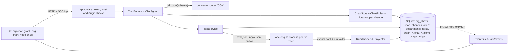
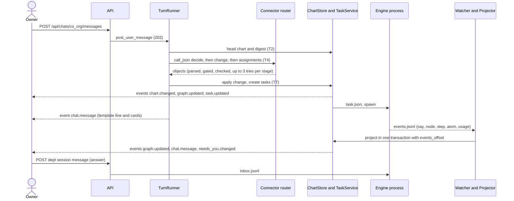

# Orchestrator: chat agent, global org chart, workflow graph, chats, stores and API
_Design section · orchestrator architect · 2026-11-04 · Proposed. Decision ids `ORCH-D1..D11` are proposals; the consolidator numbers them D13 and later. Patched in place by the settlements S1-contracts, S2-models, S3-web and S4-fnodes (`docs/design/settlements/`): every changed paragraph, row or block carries its settlement id in square brackets, for example [S1-contracts-03]; where S4 supersedes an earlier settlement only the S4 text stands._

Read: `arch/gen.py` (orchestration boxes :72-117, server boxes :121-122 and :188-198, arrows 1-7 :204-222), draw.io page 3 (`diagram.xml:410-526`, the seven steps :503), `docs/DECISIONS.md` D1-D12, the sibling sections `library.md` (LIB), `engine.md` (ENG), `connectors.md` (CON), `ui.md` (UI), J2 (`j2_server.py`, `j2.py`, `README.md`, `docs/map-schema.md`, `docs/atom-schema.md`, `j2_ui.html:1048-1130`, cited inline), the plugin (`bin/sutra-atom`, ADR-009, -011, -018, -029).
`spec-function-nodes.json` had not landed when this section was written; the final spec and its one design, `function-nodes.md`, are settled by S2-models-05 to 10 and S4-fnodes-06 to 14 and applied below (1.3) [S2-models-05][S4-fnodes-14]. "(assumed)" / "(unverified)" mark what I could not check; "verified" means I ran it in a scratch folder under /tmp (SQLite 3.51, FastAPI 0.162, Starlette 1.10, pydantic 2.14). The sibling sections were read as they stood at about 01:00; ENG and UI already follow the protocol and wire shapes of this section.

## 1. Purpose and scope
**In:** the chat agent (one turn per owner request); the ONE org chart's store, change log and rules around the library's `apply_change`; the workflow graph store; chat sessions and messages; atoms and usage tables; departments and tasks; the run launcher, watcher and projector that turn engine events into graph, chat, atom and usage rows; the SQLite database; the HTTP API and the SSE stream; `main.py`, `__main__.py`; the data layout; the tests.
**Out (owned by the sibling sections, used here):** the closed models, registry, write gate, chart and atom rules (LIB); the engine process and the J2-compatible routes (ENG); the model router (CON); the pages (UI).
**Words.** *Request*: one owner message to the chat agent. *Task* (table `tasks`): one run of one department. *Assignment*: the chat agent's plan for one task. *Step*: a node of a task's graph. The UI's "Task N" and LIB's `task_id` on a chart change are the request: `req-<message id>`.

### 1.1 Chats and voices (what the owner sees)
| Surface | Voice | Shows | The owner's text goes to |
|---|---|---|---|
| Org chat `cs_org` (the Root node's session) | "Sutra" = code: template lines, cards and errors; never a model sentence | requests, template lines, cards (`chart_change`, `task`, `approval`, `choice`, `done`), `needs_you` cards (the team's Identity question verbatim) | the chat agent (it plans silently) [S4-fnodes-12] |
| `needs_you` card inside the org chat | the team's Identity, verbatim | its open question, option buttons, a text box | the department session, never the chat agent |
| Department chat | Identity only: the owner's lines and Identity's `to_user` lines, as J2's Simple view (`j2_ui.html:1103-1113`) | all tasks of the department, across runs | the live run's inbox (an answer) or a follow-up task |
| Division chat | the department's Identity (a lens) | the department session filtered to tasks scoped to the division, plus the division's own notes | the department's Identity with `scope_node_id` (as the department chat) [S4-fnodes-06] |
| Function chat (5 per department), step chat | the node's own role | its working lines and its atom cards, read-only; Identity's log is not the owner's chat, the department session is | nowhere (403 `read_only`) [S4-fnodes-06] |
The chat agent never speaks as Identity and is not called when the owner writes in a department (J2: Identity is "the only agent that talks to the founder", `docs/j2-handoff.md:31`; `README.md:164-165`). The chat agent's model output is structure only; none of its sentences is shown to the owner. [S4-fnodes-12]

### 1.2 Owner steps (draw.io page 3) to code
| Step | Code | Proof |
|---|---|---|
| 1 chat agent reads the chart; reuse, add or rearrange | T2, stages A and B of T4 (`ChartStore.digest`, `ChatDecision`, a library `ChartChange` of kind reuse, add or rearrange; the stage B reply class is `ChartChangeRequest`) [S2-models-01] | `test_chat_agent.py::test_reuse_first` |
| 2 reference the model library | T3: `REGISTRY.transport_schema` and field digests of the models the reply will fill | `test_chat_agent.py::test_prompt_carries_schema` |
| 3 claude cli + python models build workflow + graph | T4 `call_json(schema=...)` -> `ReplyParser` -> `GATE`; assignments are the top-level workflow; T7 `TaskService.create` | `test_scripted_conversation.py` |
| 4 graph visible | `GET /api/graph`, event `graph.updated` | `test_api_graph.py` |
| 5, 7 every node (department, division, function, step) linked to a chat | `ensure_node` creates node and session together | `test_graph_store.py::test_every_node_has_one_session` |
| 6 graph updates as agents work | `RunWatcher` -> `Projector` (5.6) | `test_projector.py` |

### 1.3 Alignment with the sibling sections (the consolidator settles what is marked **open**)
- **LIB adopted:** `OrgChart`, `ChartChange` (one class, kinds reuse, add, rearrange), `apply_change` (pure, all violations), `carry_links`, `GATE.check` -> `Checked` (stores accept only `Checked`, `body` = its JSON), `REGISTRY.transport_schema`, `ReplyParser`, the `Node` family, `GraphEdge`, `check_graph`, `Atom` and its lifecycle, `Department`, `FunctionSpecs`. This section defines none of them again, nor the closed base classes, `ChartChangeRequest`, `LinkPlan` or `slug_id` (the library is the only owner of the chart models and the write gate; the orchestrator owns the SQL tables, the approval policy `classify` and its extra rules); it adds the records and reply classes in 3.2. [S2-models-01]
  Consequences: departments never move, merge or split (LIB DL5), only divisions do (the diagram's moved node is a division, `gen.py:97`); chart node ids are assigned by code: the model sends ref placeholders (library `NewNode.ref`, for example `$web`) and `ChartStore` injects `new_id = slug_id` with `taken` widened by every id ever stored in `org_nodes` plus `root`, so an id is never reused [S2-models-01]. **Settled** [S2-models-03]: `Node.state` has J2's nine `map/1` statuses; there is no `outcome` column. **Settled** [S2-models-04]: the ops union stays and is sent as `anyOf`; the agent uses the native schema first and the prompted path as the net.
- **ENG adopted (`engine.md` 4.4-4.9 and 6, which follow 5.5 and 5.6 here):** `python -m sutra_app.engine --run-dir <dir>`, one process per run (D9 confirmed, 5.6); `task.json` in (ENG's `TaskSpec` reads what our `RunSpec` writes: two classes of one document, a contract test proves they agree), `inbox.jsonl` in, `events.jsonl` out with the closed set of eight events of 5.6 and a heartbeat every 5 s; the engine writes no SQLite (its router's usage sink, `EventUsageSink`, appends `usage` lines to `events.jsonl` and the Projector writes the ledger row); its routes call the `EngineServices` protocol, defined only in `sutra_app/engine/api/ports.py`, which our `Services` satisfies (3.5). **E-1 settled** [S1-contracts-01][S3-web-12]: the J2 routes live at the root with `?dept=` and `?run=`; there is no `/d/{dept}/` copy of them. [S1-contracts-05][S1-contracts-09][S1-contracts-11]
- **CON adopted:** `AsyncConnector` as `ConnectorPort`; `UsageIn` and `UsageSink` imported from `sutra_app.connectors.usage` (the Router builds one row per request, the server's sink is `UsageStore`); `session_hook` -> `ChatStore.set_provider(session_id, connector, model, provider_session_id)`; `ChatTranscripts(chats)` as the `TranscriptSource` (the router's `session.json` is authoritative, `ChatStore.provider_session_id` is a mirror for display); `detail_json` on `usage_ledger`. [S1-contracts-05][S1-contracts-08]
- **UI adopted (`ui.md` 0, 8, 13):** the wire shapes of 6, including its requests 1, 2, 3, 5 and 9; one `cs_org` session. **U-1 settled** [S3-web-13]: the UI uses the LIB ids (`sales`, `sales.identity`, `s-` + 10 hex; no `n:`/`f:`/`s:` prefixes, no `org_<hex>`) and the generic URL-id rule `^[A-Za-z0-9_.:-]{1,120}$` for `/d/{dept}/`, and statuses are J2's map words. **U-2 settled** [S2-models-02]: J2's team personas ("Product Analyst") are `step` nodes with `step_ref` `team:<role>`; only org-chart divisions are `division` nodes.
- **Function nodes (settled, S2-models-05 to 07 and S4-fnodes-06 to 14; the design is `function-nodes.md`):** `sutra_app.engine.fnodes` opens, checks and closes one `work-atom/0.3` atom per function turn inside the engine process and reports each transition as an `atom` event (there is no `session` event); the Projector stores them (5.6). The server never decides atom boundaries. [S2-models-05][S1-contracts-09]

### 1.4 Context


## 2. Module map (`sutra_app/` unless stated; WP = owner, see 8)
| Path | Responsibility | WP |
|---|---|---|
| `config.py` | `Settings` (closed, env `SUTRA_*`; adds `max_live`, `override_key`, `env_file`; the token has at least 16 characters), data-dir layout helpers [S1-contracts-14][S1-contracts-19][S3-web-02] | 1 |
| `orchestrator/__init__.py`, `api/__init__.py`, `testing/__init__.py` | package markers | 1 |
| `orchestrator/errors.py`, `ids.py`, `redact.py`, `textutil.py` | `AppError`; `IdFactory`, `Clock`; secret redaction (port of `j2_server.py:29-43`: the secret set is every value of an environment variable whose name contains KEY, TOKEN, SECRET, PASSWORD or AUTH plus every value in the `.env` file, minimum length 8, longest first) [S1-contracts-19]; `slugify`, `tokens`, `jaccard`, `parse_yes_no` (`plain_check` is deleted) [S4-fnodes-12] | 1 |
| `orchestrator/db.py`, `schema.py` | `Database`/`Tx`/`StoreContext`/`run_blocking`; DDL v1 + `MIGRATIONS` [S2-models-01] | 1 |
| `orchestrator/records.py`, `models.py`, `services.py`, `api/deps.py` | library `Record`s for `chat_session`, `chat_message` (its `meta` is `MessageMeta`, imported from `sutra_app.library.chat`) [S2-models-15], `usage_record`, `work_task`; wire models (all derive from library `Value`) [S2-models-01], `RunSpec`, `RunEvent` with `RUN_EVENT_TYPES` and `parse_event` [S1-contracts-09]; the `Services` dataclass; `require_token` (the one dependency for the header token and the Origin check) [S3-web-03], error handlers, `RedactedJSONResponse` | 1 |
| `orchestrator/events.py`, `api/events.py` | `EventBus` (ring, thread-safe `publish` and `publish_one`) [S1-contracts-08]; `GET /api/events` | 2 |
| `orchestrator/chats.py`, `atoms.py`, `usage.py` | `ChatStore` (+ `ChatTranscripts`, `note_provider`, `apply_links`) [S1-contracts-08][S2-models-11], `AtomStore` (+ `display`, the Atom log `append_ledger`) [S4-fnodes-08][S4-fnodes-09], `UsageStore` (the server's usage sink; `UsageIn` is imported from `sutra_app.connectors.usage`) [S1-contracts-05] | 3 |
| `orchestrator/api/chat.py`, `atoms.py`, `usage.py` | chat reads, needs-you; atoms and the Atom log [S4-fnodes-09]; usage routes | 3 |
| `orchestrator/graph.py`, `api/graph.py` | `GraphStore` (nodes, edges, view, node view, status); graph routes | 4 |
| `orchestrator/chart_rules.py`, `chart.py` | `ChartRules` (library `apply_change` plus our rules); `ChartStore` | 5 |
| `orchestrator/departments.py`, `nodes.py`, `api/chart.py`, `api/departments.py` | `DepartmentStore` (`row` is `Services.department`) [S3-web-02]; `ensure_node`; chart, change-log and department routes | 5 |
| `orchestrator/tasks.py`, `api/tasks.py` | `TaskStore`/`TaskService`; task and run routes | 6 |
| `orchestrator/runs.py`, `projector.py` | `RunLauncher`, `ProcessLauncher`, `RunWatcher`, `reconcile`, the stop ladder constants `STOP_GRACE_S` and `TERM_GRACE_S` [S1-contracts-15]; `Projector` (events -> rows) | 6 |
| `orchestrator/testing/fake_engine.py` | `FakeLauncher` and a fake engine process that replay scripted `RunEvent`s | 6 |
| `orchestrator/agent/ports.py`, `replies.py` | `ConnectorPort`, `ConnectorFailure`; `ChatDecision`, `AssignmentPlan` (+ `to_task_workflow`) [S2-models-13], `AssignmentDraft` | 7 |
| `orchestrator/agent/prompts.py`, `templates/{decide,change,assign,retry}.md` | template loader (`str.format` over the files) and the four templates | 7 |
| `orchestrator/agent/planner.py`, `agent.py`, `runner.py` | fallback planner, `status_report`; `ChatAgent.plan`; `TurnRunner` (queue, T0-T9, approvals, code template lines, the request's overhead key, hooks) [S4-fnodes-07][S4-fnodes-12] | 7 |
| `orchestrator/api/agent.py`, `testing/scripted.py` | message post, retry, decision routes; `ScriptedConnector` | 7 |
| `orchestrator/wiring.py`, `api/system.py`, `main.py`, `__main__.py` | `build_services`; `/api/health`, `/api/config`; `create_app` (`TrustedHostMiddleware`, `docs_url=None`, plug-in mounts in a fixed order), lifespan; CLI [S3-web-01][S3-web-03][S3-web-14] | 8 |
| `tests/orchestrator/**` | see 7 (`__init__.py` in each folder; file names unique repo-wide) | by file |
| `tests/test_packaging.py` | package-data globs against every non-Python file under `sutra_app/`; a slow wheel-contents case; no runtime read from `docs/schemas` [S3-web-08] | 8 |
| `tests/contracts/__init__.py`, `tests/contracts/test_contract_*.py` | cross-section contract tests (route table, events, usage with atom ids, settings, env, JSON extractors, diagram strings) [S1-contracts-01][S4-fnodes-11] | CT-1 |

## 3. Public interfaces
### 3.1 Conventions, database, settings
```python
# ids: chart node = LIB NodeId (^[a-z][a-z0-9_-]{1,39}$) assigned by code (slug_id: hyphens only, never reused), so a DEPARTMENT id also matches DEPT_ID_RE = ^[a-z][a-z0-9-]{1,39}$ (it is the URL /d/<id>/ and the folder departments/<id>/)  [S2-models-01][S1-contracts-01]
#      root "root" · function node "<dept>.<fn>" · step "s-"+10 hex of sha1(task id:step ref) · task tsk_<12 hex> · session cs_<12 hex> ("cs_org" fixed) · change "chg-NNNN" (LIB ChangeId) · request "req-<message id>" · atom "a-<sid10>-<nn>" (function atom) or "<run id>:W-n.aK" (stored key of a J2 workflow atom)  [S2-models-10]
#      run id j2-YYYYMMDD-HHMMSS-<4 hex> (matches J2's SAVED = r"j2-[\w-]+", j2.py:2669).  Times in the database are epoch seconds (LIB Ts); the wire shows ISO-8601 'Z'.  fn in identity|adaptation|priority|coordination|audit
class Database:    # sqlite3, isolation_level=None, WAL, synchronous=NORMAL, foreign_keys=ON, busy_timeout=5000, one connection per thread (verified)
    def __init__(self, path: Path, publish: Callable[[list[Event]], None]): ...
    def conn(self) -> sqlite3.Connection                 # reads (autocommit)
    @contextmanager
    def tx(self) -> Iterator[Tx]                         # BEGIN IMMEDIATE .. COMMIT; ROLLBACK on any exception; nested use raises
    def migrate(self) -> None                            # walks PRAGMA user_version over schema.MIGRATIONS
async def run_blocking(fn, *args)                        # anyio.to_thread.run_sync: stores are synchronous; async code calls them through this
class Tx:  conn: sqlite3.Connection; def emit(self, type: str, data: dict) -> None   # handed to publish() only after COMMIT, dropped on ROLLBACK (verified)
class Settings(BaseModel): data_dir, host, port, token (at least 16 characters, also from SUTRA_TOKEN), connector, engine, offline, chat_timeout, chat_attempts, max_runs, max_live, watch_ms, live, override_key: SecretStr | None (never serialised), env_file: Path      # extra="forbid"; env table in 6.4  [S1-contracts-14][S1-contracts-19][S3-web-02]
```
**Writing.** Every record is built as a library record, passed through `GATE.check(family, payload, ctx=...)` and stored from the returned `Checked`: `body` = `Checked.json`, `sha256` = `Checked.sha256`, projection columns computed from `Checked.model`. A `GateError` is 422 on API input, 500 `internal` on an internal write (a bug), and retry text inside the chat agent. The SQL `CHECK`s are the second line. `ctx` is the `StoreContext` of the open `Tx` (3.4). [S2-models-01]

### 3.2 Records and reply classes added by this section (all library `Record`/`Value`, registered in `REGISTRY`)
Records (fields = the columns in 4.1; `kind` + `schema_version` as LIB 3.1): `chat_session`, `chat_message` (the stored server message; its `meta` is `MessageMeta`, J2's closed message-meta key set with open values, imported from `sutra_app.library.chat`; J2's own `chat.jsonl` line is the library's `run_message`) [S2-models-15], `usage_record`, `work_task`. Reply classes (verified on plain-pydantic equivalents, LIB's `Record` not being merged yet: they export schemas with no `oneOf`, no `discriminator` and no recursion; optional fields only as `X | None`, which LIB folds into type lists):
```python
class AssignmentDraft(Value):                # one task for one department; the top-level Step
    ref: ^a[1-5]$ · dept: NodeId · scope: NodeId | None · title: S(1,80) · brief: S(1,2000) · depends_on: [^a[1-5]$]<=4 · follows: ^tsk_[0-9a-f]{12}$ | None
class ChatDecision(Record):                  # FAMILY "chat_turn", kind "decide"  (stage A)  [S4-fnodes-12]
    intent: Literal["new_task","chart_request","status","smalltalk","clarify"] · change: Literal["none","reuse","add","rearrange"]
    reuse_nodes: [NodeId]<=10 · why: S(1,300) · assignments: [AssignmentDraft]<=5 = []   # assignments only when change is none or reuse; no prose field exists (the model's output is structure only)
    # V: new_task + (none or reuse) => assignments non-empty; reuse => reuse_nodes non-empty; chart_request => add or rearrange; status, smalltalk => none and no assignments; clarify => change none and no assignments, reuse_nodes may list up to 3 candidates
class AssignmentPlan(Record):                # FAMILY "chat_turn", kind "assignments" (stage C): assignments: [AssignmentDraft] 1..5   [S4-fnodes-12]
    def to_task_workflow(self, request_id: str) -> TaskWorkflow    # id = request_id ('req-<message id>'), name = the first title, steps = AssignmentStep(id=ref, name=title, dept, scope, brief, depends_on, follows); TurnRunner (T7) passes it through GATE.check('workflow', ...) before TaskService.create; it is not stored  [S2-models-13]
    # V: refs unique; depends_on names known refs and has no cycle (depth-first walk)
```
The chart change itself is LIB's `chart_change` family: one class, `ChartChange`, with kinds reuse, add and rearrange. Stage B's reply class is `ChartChangeRequest` (the model sends `reason`, `reuses` and `ops`; new nodes carry a `ref` such as `$web`, never an id); `kind`, `id`, `task_id`, `base_revision` and `ts` of a change are always set by code, never taken from the model, and a reuse change is built by code from `reuse_nodes`. The chat agent's flat reply classes stay orchestrator-owned and transport-safe (no union). [S2-models-01][S2-models-13]

### 3.3 Wire and run models (`orchestrator/models.py`; wire shapes as `ui.md` 8, plus its requests; times ISO-8601 'Z')
Every class in `orchestrator/models.py` derives from `sutra_app.library.base.Value`. [S2-models-01]

| Model | Fields |
|---|---|
| `Event` | `seq:int, at:str, type:str, data:dict` |
| `Violation` (LIB) | `path, code, message`; LIB's codes (C1 to C12; `duplicate_id` and `unknown_parent` do not exist, use `unknown_node`) plus ours: `reuse_candidate busy bad_assignment` [S2-models-01][S4-fnodes-12] |
| `ChartView` | `version` (= `OrgChart.revision`), `nodes:[{id,kind,name,purpose,parent_id,position}]` (live nodes only); `parent_id` is read from `OrgChart.edges`, `position` is the index among siblings in `OrgChart.nodes` order; there is no slug, keywords, state or merged_into [S2-models-01] |
| `ChartChangeOut` | `seq:int, id ("chg-0002"), at (ISO Z), actor ("chat_agent"\|"user"\|"system"), decision ("reuse"\|"add"\|"rearrange", = kind; the bootstrap row is add by actor system), status ("applied"\|"pending_approval"\|"rejected"\|"stale"\|"failed"), summary, reason, task_id ("req-17"), task_title, revision (int\|null = result_revision), added, moved, archived, reused:[node id]` (for a row that is not `applied` the lists hold the plan and the UI draws no marks for it) [S3-web-04] |
| `ChangeResult` | `id, status('applied'\|'pending_approval'\|'rejected'\|'stale'), decision, summary, revision, added, moved, archived:[id], ids_by_ref:{}` |
| `GraphView` | `version, chart_version (= revision), nodes:[GraphNodeOut], edges:[{src,dst,kind,label}]`; nodes in depth-first pre-order: a node's children come as its chart children by `org_edges.position`, then its five function nodes in the order identity, adaptation, priority, coordination, audit, then its step nodes by creation (`ts`, then id) [S3-web-04]; edge kinds on the wire: `contains`, `has_function`, `has_step` (derived on read, never stored) and `handoff`, `step`, `speaks_to`, `depends_on` (stored); `reads` and `rework` are fields of the step event, not edge kinds [S2-models-02] |
| `GraphNodeOut` | `id, kind('root'\|'department'\|'division'\|'function'\|'step'), label, status, detail, chat_session_id, org_node_id, dept_id, task_id, fn, step_ref, version, meta`. `status` = `Node.state`, J2's nine map words: idle running waiting waiting_on_you fault filed done_unchecked left_open not_made (a function node uses the first five; a merged-away division's graph node is deleted, so no node is "archived") [S2-models-03]. `meta`: `run_id` on department and step nodes; on a function node exactly `{stats, wait_on}` in `GraphView` and `graph.updated`, and in `NodeDetail.node` the full set (see `NodeDetail`) [S3-web-04]. Chip fields of a function node: `id` = `<dept>.<fn>`, `label` = the function name, `status` = `Node.state` set by the node event, `detail` = the node event's detail (J2's "last seen: ..." or what it is doing), `chat_session_id` = the node's own working-log session. `stats` = `{calls, seconds, tokens_in, tokens_out, atoms_open, atoms_closed, atoms_failed, atoms_total}`: the first four from the node event (`tokens_in/out` = the event's `tokens.input/output`), the atom counts from one `GROUP BY display` over `atoms` for the node (failed = `verify_failed`). State once: stored = the `FunctionNode` fields; derived at request time = `constraints`, `hands_to`, `stats.atoms_*` [S4-fnodes-10][S4-fnodes-14] |
| `NodeDetail` (`GET /api/graph/nodes/{id}`) | `{node, session, atoms:[AtomOut], usage_total{calls,usd,tokens_in,tokens_out}, task, archived_chats:[ChatSessionOut]}`; `atoms` = the open atom first, then the 20 newest (the total is `node.meta.stats.atoms_total`; "Show all" is `GET /api/atoms?node_id=&limit=100&offset=`); `archived_chats` = the sessions with `filed_under` = the node and the node's own archived chats that hold at least one message (the empty replacement that archiving starts, set aside when the old chat comes back, is kept but not listed) [S2-models-09][S2-models-11][S4-fnodes-10]. For a function node `node.meta` is exactly `goal:str` (the standing J2 role sentence), `task:str` (the standing ROLE line such as "J2.c prices, checks run limits"; the live task is `NodeDetail.task` and `AtomOut.task_id`), `context:[str]` (the names of the slice the function is given; Identity's list has no money fields), `constraints:[str]` (= `FunctionSpec.may_not`), `wait_on` (null, "you", a function key or a builder id), `hands_to:[function key]` (= `HANDOFFS[fn]`: identity [adaptation, priority, coordination, audit]; adaptation [priority, identity, audit, coordination]; priority [adaptation, identity, coordination]; coordination [priority, adaptation, identity, audit]; audit [identity]) and `stats` as above. `GraphStore.node()` reads `goal`, `task` and `context` from the stored body, `constraints` from `FunctionSpecs`, `hands_to` from `HANDOFFS`, and counts `atoms_*` with one `GROUP BY display` [S3-web-04][S4-fnodes-10][S4-fnodes-14] |
| `ChatSessionOut` | `id, node_id, kind('org'\|'department'\|'division'\|'function'\|'step'), title, writable, status('active'\|'archived'), filed_under (str\|None), connector, model, provider_session_id, last_message_id, note, phase (`cs_org` only), direct_turn (int\|None: the owner's line a running direct turn answers, `direct_running.py`)` [S2-models-11] |
| `ChatMessageOut` | `id, session_id, role('user'\|'agent'\|'system'), who, kind('text'\|'question'\|'card'\|'note'\|'error'), text, card, pause, answered_by, task_id, state, at` (a question's `text` is Identity's J2 text verbatim, numbered options included) |
| `ChatCard` (on `type`) | `chart_change{change_id,decision,summary,added:[{id,name,kind}],moved:[{id,name,from_name,to_name}],archived:[{id,name,into_name}],pending}` · `task{task_id,dept_id,dept_name,title,status}` · `approval{change_id,question,options:[{id,label}]}` · `choice{question,options:[{id,label}]}` · `needs_you{dept_id,dept_name,question_message_id,text,options}` (open or answered is read live from that question's `answered_by`) · `done{task_id,dept_name,title,status,outcome,receipt?{usd,tokens,seconds,checks_passed,checks_total,attempt}}` (the receipt is written by `Projector._finish` from the task's ledger sums, start and end, its atoms by final state and a retry's attempt number; a card without one has no `receipt` key) · `atom{atom_id,outcome,label,goal,rows:[{label,text}]}` (posted only to function-node sessions) [S2-models-07] |
| `ChatPost` · `Accepted` · `Delivery` | `{text:1..8000, choice?:{message_id,option}}` (`option` = the option's `id` or its label text) · `{message_id, turn:'started'\|'queued'}` · `{message_id, delivered:'answer'\|'follow_up', task_id}` |
| `TaskOut` | `id, dept_id, dept_name, scope_node_id, title, status, run_id, parent_task_id, depends_on, outcome, created_at, started_at, ended_at, usage{calls,usd,tokens_in,tokens_out}` |
| `RunRef` | `{run_id, task_id, dept_id, dir (relative to the data dir), status, pid, started_at, ended_at}` |
| `DepartmentOut` · `DeptRow` | `{id, name, purpose, node_status, live_task_id, session_id, functions:[{id,fn,status,chat_session_id}]}` (`name` and `purpose` come from `org_nodes`; there is no `status`) [S2-models-14] · `{id, name, archived, merged_into_name}` (`Services.department` returns the `DeptRow` itself; the engine and the UI read its attributes `id, name, archived, merged_into_name` through their own `typing.Protocol`; `name` is joined from `org_nodes`; a department is never archived, moved or merged (DL5), so `archived` is false and `merged_into_name` is empty, and neither is stored) [S3-web-02][S2-models-14] |
| `AtomOut` | `id, schema, node_id, task_id, state, goal, attempt, ts_open, ts_closed, body, usage{calls,usd,tokens_in,tokens_out}`. `state` is the display word, five words for both schemas: `open`, `verify_failed`, `closed`, `refused`, `abandoned` (for `work-atom/0.3` rows the library `atom_display_state`: a stored `abandoned` with `abandon_code` `verify_failed` shows `verify_failed`; for `atom/1` rows the view's own status, which uses the same words); `id` is the stored key (`'<run_id>:W-3.a1'` for an `atom/1` row); `usage` sums `usage_ledger` by `atom_id` (null parts left out); work kind, verify template, `closed_by` and `reason` are read from `body` [S2-models-07][S2-models-10][S3-web-13][S4-fnodes-08][S4-fnodes-10] |
| `AtomLogRow` (`GET /api/atoms/log`) | `{seq, atom_id, node_id, status, body, ts}`: one row of the Atom log (`atom_ledger`); `status` = closed, verify_failed, abandoned or refused; `body` = the library `LedgerRow` JSON [S4-fnodes-09] |
| `UsageIn` / `UsageOut` | `UsageIn` is imported from `sutra_app.connectors.usage` (CN-6; fields: `provider('claude'\|'codex'\|'stub'), model, purpose, session_id, node_id, task_id, dept_id, fn, step, atom_id, usd\|None, tokens_in\|None, tokens_out\|None, seconds, ok, how, call_ref, detail`); this section defines only `UsageOut` (= the `UsageIn` fields + `id, at`, `detail` parsed; declared in `models.py`, only `usage.py` imports `UsageIn`) [S1-contracts-05][S2-models-07] |
| `NeedsYouOut` | `message_id, session_id, kind('question'\|'approval'), dept_id, dept_name, text, options, asked_at` |
| `RunSpec` (`task.json`, `"run-spec/1"`) | `run_id, task_id, dept_id, dept_label, scope_id, scope_label, user_text` (the owner's words verbatim: Identity starts from these), `framing` (the agent's paragraph, context only), `parent_run_id, seed_from, upstream:[{dept_id,run_id,title,files}], settings:{J2_OUTPUT, J2_BUDGET, J2_BUDGET_CAP, J2_FIXES, J2_MEMORY, J2_SLIM, J2_RATES: str}, connector`. `settings` is a closed set of these seven keys, validated by `TaskService.create` (J2_OUTPUT in website\|prd\|hld\|lld; J2_BUDGET and J2_BUDGET_CAP integers 1..100000; the other four '0' or '1'; anything else is 422 `validation`) [S1-contracts-03]. `RunSpec` is the strict writer and the engine's `TaskSpec` the reader (`extra='ignore'`): two classes of one document; a contract test proves every `RunSpec` field exists in `TaskSpec` and a `RunSpec` dump validates [S1-contracts-11] |
| `RunEvent` (closed union on `t`; one JSON line each in `events.jsonl`, every line has `at`) | the eight events of 5.6; `models.py` exports `RUN_EVENT_TYPES = ('run.started','say','node','step','atom','usage','heartbeat','run.ended')` and `parse_event(line, strict=False)`: with `strict=False` it drops the keys a variant does not declare (noting them once per run) before validating, so the variants themselves stay closed `Value`s; with `strict=True` it raises. The `node` variant accepts the optional `wait_on` and `tokens` (`extra=forbid` stays) and has no `goal`; the `atom` variant gets `outcome`, `card` and `ledger` (for `work-atom/0.3` only); `usage` gets `atom`; `session` does not exist [S1-contracts-09][S2-models-07][S3-web-04] |
Other names below: `ChangeContext{session_id, message_id, request_id, request_title}` (`request_title` is set by `TurnRunner`, T7) [S3-web-04], `NodeInit`, `ResumeInfo{connector, provider_session_id, messages (last 20)}` (diagnostics only; the router's transcript hook is `ChatTranscripts`, 3.4) [S1-contracts-08].

### 3.4 Services (signatures to code against)
```python
class StoreContext(GateContext):   # db.py (ORCH-1): get(family, id) over the open Tx for the families node, atom, org_chart and department; created by Database.tx(); every store passes it as ctx= to GATE.check  [S2-models-01]
class ChartStore:      # chart.py
    def head(self) -> Checked[OrgChart];  def view(self) -> ChartView;  def pending(self) -> list[ChartChangeOut];  def digest(self, text: str, *, max_chars: int = 6000) -> str
    def check(self, change: Checked[ChartChange], chart: OrgChart | None = None) -> list[Violation]    # library apply_change (dry run, ALL violations) + ChartRules extras; gathers live scopes from tasks
    def classify(self, change) -> Literal["auto", "approve"]                                          # approve iff a rearrange holds a MergeOp or SplitOp
    def apply(self, change: Checked[ChartChange], *, actor: str, ctx: ChangeContext, plan: dict | None = None, approved: bool = False) -> ChangeResult   # new node ids = slug_id with taken widened by every id in org_nodes plus root; writes task_title and result_json; the Department record is written here, in the same transaction [S2-models-01][S2-models-14][S3-web-04]
        # one BEGIN IMMEDIATE transaction; stale_base -> status 'stale'; classify()=="approve" and not approved -> stores 'pending_approval' (plan kept) and returns it
    def decide(self, change_id: str, approve: bool) -> ChangeResult     # re-checks against the live chart; idempotent: a second call raises AlreadyDecided carrying the first result
    def history(self, after: int = 0, limit: int = 50) -> list[ChartChangeOut];  def bootstrap(self) -> None   # bootstrap: no-op when the root exists
def ensure_node(tx: Tx, spec: NodeInit) -> GraphNodeOut             # nodes.py: graph_nodes row + chat_sessions row + denormalised chat_session_id; the only creator of either
class DepartmentStore: def row(self, dept_id: str) -> DeptRow | None;  def sweep(self) -> int      # row is Services.department  [S3-web-02]
class GraphStore:      # graph.py
    def view(self, *, level: Literal["chart","full"] = "chart", dept: str | None = None, task: str | None = None) -> GraphView    # one read transaction
    def node(self, node_id: str) -> NodeDetail
    def put_node(self, tx, node: Checked[Node]) -> bool   # False when unchanged; else version += 1, emit graph.updated; Node.state is the wire status and Node.detail the one-line detail  [S2-models-03]
    def put_edge(self, tx, edge: Checked[GraphEdge]) -> bool;  def aggregate(self, tx) -> None            # department, division and root state from tasks and function nodes
class ChatStore:       # chats.py
    def post(self, tx, session_id, rec: Checked[ChatMessage]) -> ChatMessageOut | None                    # None when src_ref is already stored
    def messages(self, session_id, *, after: int = 0, limit: int = 200) -> list[ChatMessageOut]           # division sessions: own notes + department lines of tasks scoped to the division
    def mark_answered(self, tx, question_id: int, by_message_id: int) -> None;  def needs_you(self) -> list[NeedsYouOut]
    def set_provider(self, session_id, connector: str, model: str, provider_session_id: str | None) -> None   # CON's session_hook, called positionally as (session_id, provider, model, provider_session_id); opens its own tx
    def note_provider(self, tx, session_id, connector, model) -> None    # connector and model only, never touches provider_session_id; UsageStore.record calls it  [S1-contracts-08]
    def resume_info(self, session_id) -> ResumeInfo;  def phase(self, session_id) -> str | None
    def apply_links(self, tx, plan: LinkPlan, names: Mapping[str, str]) -> None   # executes the library carry_links plan: keep = nothing; move = UPDATE node_id; archive = status 'archived', writable 0, note 'Merged into <name>', filed_under = target  [S2-models-11]
class ChatTranscripts:  # chats.py, CON's TranscriptSource  [S1-contracts-08]
    def __init__(self, chats: ChatStore);  def messages(self, session_id: str, limit: int = 20) -> list[Message]   # Message from sutra_app.connectors.models; role agent becomes assistant; only kinds text and question with state ok; the newest `limit` in order
class AtomStore:       # atoms.py: apply_transition(tx, node, event) is the Projector's entry (gate, forward moves only, upsert, append_ledger, card, put_node, atom.updated); upsert computes `display`; append_ledger is the only writer of atom_ledger  [S2-models-07][S4-fnodes-08][S4-fnodes-09]
class UsageStore:      # usage.py: record(row: UsageIn), the server's usage sink: INSERT ... ON CONFLICT(task_id, call_ref) WHERE call_ref IS NOT NULL DO NOTHING, then ChatStore.note_provider  [S1-contracts-05]
class TaskService:     # tasks.py
    def create(self, tx, *, dept_id, text, title, scope_id=None, framing="", depends_on=(), follows=None, request=None, change_id=None, settings=None) -> TaskOut
        # settings: the seven allowed keys with valid values, else 422 validation  [S1-contracts-03]; follows: a task of the same department, sets seed_from and parent_run_id  [S1-contracts-12]; change_id is set for every task of a request  [S3-web-04]
    async def start_ready(self) -> list[str]            # FIFO: blocked -> queued when dependencies are done; start (5.6) queued tasks while count(status in starting,running) < SUTRA_MAX_RUNS and count(status in starting,running,waiting_user) < SUTRA_MAX_LIVE  [S1-contracts-14]
    def deliver(self, session_id: str, text: str) -> Delivery          # department or division chat (5.5); raises Busy
    def deliver_to_department(self, dept_id: str, text: str, *, scope_id: str | None = None, settings: dict | None = None) -> Delivery   # what the engine's /api/say calls
    def stop_live(self, dept_id: str) -> bool                           # True when no task of the department is starting or running afterwards; stops a waiting_user task (outcome reset by you) and cancels queued and blocked tasks of the department; False, touching nothing, when a task is starting or running; blocks at most the stop ladder  [S1-contracts-04]
    async def stop(self, task_id) -> TaskOut;  async def retry(self, task_id) -> TaskOut
    def resolve_run(self, run_id: str | None, dept_id: str) -> RunRef | None    # run_id wins; else the live task's run; else the latest
class Projector:       # projector.py: apply(tx, task, events: list[RunEvent]) -> None, rows per 5.6; RunWatcher drives it
class TurnRunner:      # agent/runner.py
    async def post_user_message(self, session_id: str, text: str, choice: Choice | None = None) -> Accepted     # T0; returns at once
    async def decide(self, change_id: str, approve: bool) -> ChangeResult;  async def retry(self, session_id: str) -> Accepted
```

### 3.5 Ports (what this section needs from the others, and offers)
```python
class ConnectorFailure(Exception): kind: Literal["unavailable","auth","quota","timeout","bad_output"]    # CON errors carry .kind; an adapter maps other classes by name
class ConnectorPort(Protocol):                   # CON's AsyncConnector
    async def call_json(self, prompt: str, *, schema: dict | None = None, tools: Sequence[str] = (), timeout: float = 120.0,
                        function: str = "chat_agent", step: str = "plan", context: Mapping[str, str] | None = None) -> tuple[dict, float | None, str]   # (object, usd, how: native|prompted|repaired|stub); context keys: purpose, session_id, node_id, task_id, atom_id (the request's overhead key, mapped to CallTag.atom)  [S4-fnodes-07]
    def status(self) -> Mapping[str, Mapping[str, Any]]      # per provider: installed, signed_in, detail (503 preflight, /api/health)
UsageIn, UsageSink = sutra_app.connectors.usage.UsageIn, sutra_app.connectors.usage.UsageSink   # imported, not defined here (CN-6): the Router builds exactly one UsageIn per request and hands it to a sink; in the server process the sink is UsageStore, which also covers the chat agent (AsyncConnector.records_usage = True, so TurnRunner writes no usage row of its own)  [S1-contracts-05]
class RunLauncher(Protocol):                     # runs.py; ProcessLauncher is the default, FakeLauncher the test double
    async def start(self, spec: RunSpec, run_dir: Path) -> int        # spawns the engine process in a new session and returns its pid (the fake returns 0); run_dir already exists: TaskService.start created it (0700) with task.json, inbox.jsonl and events.jsonl  [S1-contracts-11]
    def send(self, run_dir: Path, line: dict) -> int                  # appends to inbox.jsonl, returns the line number
    async def stop(self, run_dir: Path, pid: int | None) -> None;  def alive(self, pid: int | None) -> bool   # stop = the single stop ladder (5.6); alive uses the Process handle when the server spawned the process (returncode None means alive) and os.kill(pid, 0) otherwise  [S1-contracts-15][S1-contracts-16]
EngineServices = sutra_app.engine.api.ports.EngineServices   # defined there, not here; our Services satisfies it: data_dir, require_token, redact, resolve_run, department (-> DeptRow | None), deliver_to_department, stop_live  [S1-contracts-01][S3-web-02]
```
Plug-ins: `create_app` builds the connector router first: `sutra_app.connectors.factory.build_router(settings, usage_sink=usage, events=lambda t, d: bus.publish_one(t, d), transcripts=ChatTranscripts(chats), session_hook=chats.set_provider)` with `AsyncConnector(router)` (the factory reads from `settings` only `data_dir`, `connector` and `offline`; the session hook is called positionally as `(session_id, provider, model, provider_session_id)`; `ChatStore.provider_session_id` is a mirror for display, the router's `session.json` is authoritative) [S1-contracts-08]. Then, when importable and in this order, it calls `sutra_app.engine.api.mount(app, services)`, mounts `app.include_router(sutra_app.connectors.api.build_api_router(router=router, write_guard=require_token))` (the router carries the `/api/connectors` prefix; the write guard is `require_token`, 6.1) and calls `sutra_app.ui.mount(app, services)` (it reads exactly `services.settings.token`, `services.version` and `services.department`) [S3-web-01][S3-web-02]. `Services` carries `settings`, `version`, `data_dir`, `require_token`, `redact`, `resolve_run`, `department`, `deliver_to_department` and `stop_live` (the names ENG and UI assume, `engine.md` 4.9, `ui.md` 4.1); there is ONE department lookup, `department`, and no `lookup_dept` [S3-web-02]. An ImportError is logged and skipped.

## 4. Data
### 4.1 SQL (`schema.py`, DDL v1; executed in SQLite 3.51 with these constraints exercised: second root, second parent, old state and kind words, two live tasks per department, duplicate step, stored `contains` edge, two sessions per node, two open plugin atoms (several open workflow atoms are allowed), bad atom state, duplicate usage call, duplicate change id)
```sql
CREATE TABLE meta (key TEXT PRIMARY KEY, value TEXT NOT NULL);            -- 'graph_version', 'bootstrapped_at'; schema version = PRAGMA user_version. All times: epoch seconds
CREATE TABLE org_charts (revision INTEGER PRIMARY KEY, body TEXT NOT NULL, sha256 TEXT NOT NULL, ts INTEGER NOT NULL);   -- append-only Checked[OrgChart]; max(revision) is the chart
CREATE TABLE chart_changes (                                              -- the change log: one row per decision; with org_charts the only chart-change DDL (the library's org_changes DDL is dropped)  [S2-models-01]
  seq INTEGER PRIMARY KEY AUTOINCREMENT, id TEXT NOT NULL UNIQUE,         -- id = 'chg-' + 4 digits of seq (library ChangeId)
  task_id TEXT NOT NULL,                                                  -- the owner's request, 'req-<message id>' (library task_id)
  task_title TEXT NOT NULL DEFAULT '',                                    -- ChangeContext.request_title: the first assignment's title, else the owner's request cut to 60 characters at a word boundary on one line; '' only for actor 'system'  [S3-web-04]
  kind TEXT NOT NULL CHECK (kind IN ('reuse','add','rearrange')),
  actor TEXT NOT NULL CHECK (actor IN ('chat_agent','user','system')),
  base_revision INTEGER NOT NULL, result_revision INTEGER,
  status TEXT NOT NULL CHECK (status IN ('applied','pending_approval','rejected','stale','failed')),
  summary TEXT NOT NULL, reason TEXT NOT NULL DEFAULT '', session_id TEXT, message_id INTEGER,
  body TEXT NOT NULL,                                                     -- Checked[ChartChange]
  result_json TEXT NOT NULL DEFAULT '{}',                                 -- {added,moved,archived,reused}: node ids; for a row that is not 'applied' the plan; history() builds ChartChangeOut from the row with no replay  [S3-web-04]
  plan_json TEXT, ops_json TEXT, violations TEXT,                         -- kept while pending_approval; primitives applied; why rejected
  before_sha TEXT NOT NULL DEFAULT '', after_sha TEXT NOT NULL DEFAULT '', ts INTEGER NOT NULL);
CREATE INDEX chart_changes_status ON chart_changes(status, seq);
CREATE TABLE org_nodes (                                                  -- projection of the head OrgChart, written only by ChartStore.apply; rows with state 'archived' (merged_into taken from ChartChangeResult.aliases) are history and the id-reuse guard, never part of OrgChart  [S2-models-01]
  id TEXT PRIMARY KEY, kind TEXT NOT NULL CHECK (kind IN ('root','department','division')),
  name TEXT NOT NULL, purpose TEXT NOT NULL DEFAULT '',
  state TEXT NOT NULL DEFAULT 'active' CHECK (state IN ('active','archived')),
  merged_into TEXT REFERENCES org_nodes(id), created_rev INTEGER NOT NULL, archived_rev INTEGER, ts INTEGER NOT NULL);
CREATE UNIQUE INDEX org_nodes_one_root ON org_nodes(kind) WHERE kind = 'root';
CREATE TABLE org_edges (                                                  -- the live tree only; a retired node has no edge; position is computed from OrgChart.nodes order  [S2-models-01]
  parent_id TEXT NOT NULL REFERENCES org_nodes(id), child_id TEXT NOT NULL REFERENCES org_nodes(id),
  position INTEGER NOT NULL DEFAULT 0, PRIMARY KEY (parent_id, child_id), CHECK (parent_id <> child_id));
CREATE UNIQUE INDEX org_edges_child ON org_edges(child_id);               -- one parent each
CREATE INDEX org_edges_parent ON org_edges(parent_id, position);
CREATE TABLE departments (                                                -- one per department node (same id); the library Department record {id, home_dir, ts_created}, written only by ChartStore.apply in the transaction that adds the department; name and purpose are read from org_nodes, the charter is the run folder's goal.json  [S2-models-14][S4-fnodes-13]
  id TEXT PRIMARY KEY REFERENCES org_nodes(id), home_dir TEXT NOT NULL,   -- 'departments/<id>', relative to the data dir
  body TEXT NOT NULL, sha256 TEXT NOT NULL, ts INTEGER NOT NULL);
CREATE TABLE tasks (                                                      -- one run of one department; run_id names the folder runs/<run_id>
  id TEXT PRIMARY KEY, dept_id TEXT NOT NULL REFERENCES departments(id), scope_node_id TEXT REFERENCES org_nodes(id),
  title TEXT NOT NULL, user_text TEXT NOT NULL, framing TEXT NOT NULL DEFAULT '',
  status TEXT NOT NULL CHECK (status IN ('blocked','queued','starting','running','waiting_user','done',
                              'done_with_open_items','stopped','crashed','cancelled')),
  run_id TEXT UNIQUE, parent_task_id TEXT REFERENCES tasks(id), depends_on TEXT NOT NULL DEFAULT '[]',   -- JSON task ids
  request_id TEXT, origin_message_id INTEGER, change_id TEXT, settings_json TEXT NOT NULL DEFAULT '{}',  -- settings: the seven allowed J2_* keys
  pid INTEGER, events_offset INTEGER NOT NULL DEFAULT 0, inbox_seq INTEGER NOT NULL DEFAULT 0,           -- bytes of events.jsonl applied; last inbox line number
  outcome TEXT NOT NULL DEFAULT '', created_at INTEGER NOT NULL, started_at INTEGER, ended_at INTEGER, last_event_at INTEGER);
CREATE INDEX tasks_dept ON tasks(dept_id, created_at);
CREATE INDEX tasks_open ON tasks(status) WHERE status IN ('blocked','queued','starting','running','waiting_user');
CREATE UNIQUE INDEX tasks_one_live_per_dept ON tasks(dept_id) WHERE status IN ('starting','running','waiting_user');
CREATE TABLE graph_nodes (                                                -- the library Node family; body = Checked[Node] (a function node's body is the FunctionNode: goal, task, context, wait_on, stats, open_atom, atom_count, spec_version)  [S4-fnodes-14]
  id TEXT PRIMARY KEY,                                                    -- chart node: its chart id | function: '<dept>.<fn>' (types.function_node_id) | step: 's-' + first 10 hex digits of sha1('<task_id>:<step_ref>')  [S2-models-02]
  kind TEXT NOT NULL CHECK (kind IN ('root','department','division','step','identity','adaptation','priority','coordination','audit')),
  department_id TEXT REFERENCES departments(id), parent_id TEXT,          -- parent_id: chart parent (mirror, written with the chart), or the step's parent
  state TEXT NOT NULL DEFAULT 'idle' CHECK (state IN ('idle','running','waiting','waiting_on_you','fault','filed','done_unchecked','left_open','not_made')),   -- state = library Node.state = wire status: J2's nine map/1 words; there is no outcome column  [S2-models-03]
  label TEXT NOT NULL, detail TEXT NOT NULL DEFAULT '', chat_session_id TEXT,   -- detail = Node.detail  [S2-models-03]; chat_session_id: denormalised copy of the id of this node's ACTIVE session (I1)  [S2-models-11]
  task_id TEXT REFERENCES tasks(id), step_ref TEXT, version INTEGER NOT NULL DEFAULT 1,   -- task_id + step_ref = the library StructuralNode step key; step_ref is 'task', 'W-<n>' or 'team:<role>'  [S2-models-02]
  body TEXT NOT NULL, sha256 TEXT NOT NULL, ts INTEGER NOT NULL,
  CHECK ((kind = 'step') = (task_id IS NOT NULL AND step_ref IS NOT NULL)));
CREATE UNIQUE INDEX graph_nodes_step ON graph_nodes(task_id, step_ref) WHERE kind = 'step';
CREATE INDEX graph_nodes_dept ON graph_nodes(department_id, kind);
CREATE INDEX graph_nodes_hot ON graph_nodes(state) WHERE state IN ('running','waiting_on_you','fault');
CREATE TABLE graph_edges (                                                -- stored edges only; contains / has_function / has_step are derived on read; reads and rework are event fields, not kinds: a read is a depends_on edge labelled 'reads', a rework one labelled 'revises'  [S2-models-02]
  id TEXT PRIMARY KEY, kind TEXT NOT NULL CHECK (kind IN ('handoff','step','speaks_to','depends_on')),   -- id = '<kind>:<from>><to>' (library)
  from_id TEXT NOT NULL REFERENCES graph_nodes(id), to_id TEXT NOT NULL REFERENCES graph_nodes(id),
  status TEXT NOT NULL DEFAULT 'idle', label TEXT NOT NULL DEFAULT '', task_id TEXT REFERENCES tasks(id),
  version INTEGER NOT NULL DEFAULT 1, body TEXT NOT NULL, CHECK (from_id <> to_id));
CREATE INDEX graph_edges_to ON graph_edges(to_id, kind);
CREATE INDEX graph_edges_task ON graph_edges(task_id);
CREATE TABLE chat_sessions (                                              -- library family 'chat_session' (names reserved by library.md 1); history rows keep their origin node id  [S2-models-11]
  id TEXT PRIMARY KEY, node_id TEXT NOT NULL,                             -- the node it belongs to (the origin node id for an archived row); NO UNIQUE and NO REFERENCES, uniqueness is the partial index below  [S2-models-11]
  kind TEXT NOT NULL CHECK (kind IN ('org','department','division','function','step')), title TEXT NOT NULL,
  writable INTEGER NOT NULL DEFAULT 0 CHECK (writable IN (0,1)),
  status TEXT NOT NULL DEFAULT 'active' CHECK (status IN ('active','archived')),
  filed_under TEXT,                                                       -- NULL, or the node an archived session is filed under (merge: the survivor)  [S2-models-11]
  connector TEXT NOT NULL DEFAULT '', model TEXT NOT NULL DEFAULT '', provider_session_id TEXT,   -- 'claude' | 'codex' | 'stub' | ''
  last_message_id INTEGER NOT NULL DEFAULT 0, note TEXT NOT NULL DEFAULT '', created_at INTEGER NOT NULL, updated_at INTEGER NOT NULL);
CREATE UNIQUE INDEX chat_sessions_active ON chat_sessions(node_id) WHERE status = 'active';   -- exactly one active session per node  [S2-models-11]
CREATE TABLE chat_messages (                                              -- library family 'chat_message'
  id INTEGER PRIMARY KEY AUTOINCREMENT, session_id TEXT NOT NULL REFERENCES chat_sessions(id),
  role TEXT NOT NULL CHECK (role IN ('user','agent','system')), who TEXT NOT NULL,     -- 'user','sutra','identity','W-3',...
  kind TEXT NOT NULL DEFAULT 'text' CHECK (kind IN ('text','question','card','note','error')),
  text TEXT NOT NULL, card_json TEXT, meta_json TEXT NOT NULL DEFAULT '{}',            -- meta: library MessageMeta (sutra_app.library.chat), J2's closed key set  [S2-models-15]
  pause TEXT, answered_by INTEGER REFERENCES chat_messages(id),                        -- pause = J2 pause kind (j2.py:125-134)
  task_id TEXT REFERENCES tasks(id), src_ref TEXT,                                     -- src_ref: idempotency key of a projected line
  state TEXT NOT NULL DEFAULT 'ok' CHECK (state IN ('ok','pending','error')), at INTEGER NOT NULL);
CREATE INDEX chat_messages_session ON chat_messages(session_id, id);
CREATE UNIQUE INDEX chat_messages_src ON chat_messages(session_id, src_ref) WHERE src_ref IS NOT NULL;
CREATE INDEX chat_messages_open_q ON chat_messages(kind, answered_by) WHERE kind = 'question' AND answered_by IS NULL;
CREATE TABLE atoms (                                                      -- body = Checked[Atom] (the plugin's work atom, schema 'work-atom/0.3') or the library atom_view payload (J2 atom/1)
  id TEXT PRIMARY KEY,                                                    -- the stored key: work-atom/0.3 = the AtomId ('a-<sid10>-<nn>'); atom/1 = '<run_id>:<atom/1 id>' because J2 restarts at W-1 in every run (the atom/1 body keeps J2's id)  [S2-models-10]
  schema TEXT NOT NULL CHECK (schema IN ('work-atom/0.3','atom/1')),      -- plugin SCHEMA_VERSION 0.3 (bin/sutra-atom:35) | J2 atom/1 (j2_schema.py:6)
  node_id TEXT NOT NULL REFERENCES graph_nodes(id), department_id TEXT REFERENCES departments(id), task_id TEXT REFERENCES tasks(id),
  state TEXT NOT NULL,                                                    -- stored state, checked per schema below: work-atom/0.3 = open, closed, refused, abandoned (library); atom/1 = open, closed, verify_failed, abandoned (j2_schema.py:7)  [S2-models-07]
  display TEXT NOT NULL CHECK (display IN ('open','verify_failed','closed','refused','abandoned')),   -- display = library atom_display_state(body) for work-atom/0.3, = state for atom/1; set by AtomStore.upsert from the Checked body, never from the event  [S4-fnodes-08]
  attempt INTEGER NOT NULL CHECK (attempt BETWEEN 0 AND 3),
  goal TEXT NOT NULL, body TEXT NOT NULL, sha256 TEXT NOT NULL, ts_open INTEGER NOT NULL, ts_closed INTEGER,
  CHECK ((schema = 'work-atom/0.3' AND state IN ('open','closed','refused','abandoned')) OR (schema = 'atom/1' AND state IN ('open','closed','verify_failed','abandoned'))));   -- [S2-models-07]
CREATE UNIQUE INDEX one_open_atom_per_node ON atoms(node_id) WHERE state = 'open' AND schema = 'work-atom/0.3';   -- one open plugin atom per node, bin/sutra-atom:172
CREATE INDEX atoms_task ON atoms(task_id, state);
CREATE INDEX atoms_node_display ON atoms(node_id, display);               -- [S4-fnodes-08]
CREATE TABLE atom_ledger (                                                -- the Atom log box: append-only (bin/sutra-atom:42), one row per atom, written only by AtomStore.append_ledger inside the Projector transaction  [S4-fnodes-09]
  seq INTEGER PRIMARY KEY AUTOINCREMENT, atom_id TEXT NOT NULL UNIQUE, node_id TEXT NOT NULL,
  status TEXT NOT NULL CHECK (status IN ('closed','verify_failed','abandoned','refused')),   -- the display word at the end of the atom  [S4-fnodes-08]
  body TEXT NOT NULL, ts INTEGER NOT NULL);                               -- body = the library LedgerRow JSON
CREATE TRIGGER atom_ledger_no_update BEFORE UPDATE ON atom_ledger BEGIN SELECT RAISE(ABORT, 'atom log is append-only'); END;
CREATE TRIGGER atom_ledger_no_delete BEFORE DELETE ON atom_ledger BEGIN SELECT RAISE(ABORT, 'atom log is append-only'); END;
CREATE TABLE usage_ledger (   -- one row per model request, built once by the connector Router; stub rows (provider 'stub') are kept but excluded from totals  [S1-contracts-05]
  id INTEGER PRIMARY KEY AUTOINCREMENT, at INTEGER NOT NULL,
  provider TEXT NOT NULL CHECK (provider IN ('claude','codex','stub')), model TEXT NOT NULL DEFAULT '', purpose TEXT NOT NULL,
  session_id TEXT REFERENCES chat_sessions(id), node_id TEXT REFERENCES graph_nodes(id), task_id TEXT REFERENCES tasks(id),
  dept_id TEXT REFERENCES departments(id), fn TEXT, step TEXT,           -- step: the step_ref (W-<n> or team:<role>)  [S1-contracts-05]
  atom_id TEXT,                                                           -- no foreign key (a usage line can reach the server before its atom line); never NULL for rows written by the engine host and the chat agent; '<run_id>:<id>' for a J2 workflow atom  [S1-contracts-05][S1-contracts-10][S2-models-10][S4-fnodes-07]
  usd REAL CHECK (usd IS NULL OR usd >= 0), tokens_in INTEGER CHECK (tokens_in IS NULL OR tokens_in >= 0),
  tokens_out INTEGER CHECK (tokens_out IS NULL OR tokens_out >= 0),                    -- Claude: list-price estimate (a delta per call); Codex: NULL unless the owner filled rates; tokens are the comparable unit  [S1-contracts-05]
  seconds REAL NOT NULL DEFAULT 0, ok INTEGER NOT NULL DEFAULT 1 CHECK (ok IN (0,1)), how TEXT NOT NULL DEFAULT '', call_ref TEXT, detail_json TEXT);
CREATE INDEX usage_task ON usage_ledger(task_id);
CREATE INDEX usage_dept ON usage_ledger(dept_id, at);
CREATE INDEX usage_atom ON usage_ledger(atom_id) WHERE atom_id IS NOT NULL;   -- [S1-contracts-05]
CREATE UNIQUE INDEX usage_call ON usage_ledger(task_id, call_ref) WHERE call_ref IS NOT NULL;     -- re-ingest is idempotent: INSERT ... ON CONFLICT(task_id, call_ref) WHERE call_ref IS NOT NULL DO NOTHING (the target repeats the index's WHERE, else SQLite refuses it); call_ref = '{run_id}:{call_no}' when the call has a number, else 'r:{request_id}'  [S1-contracts-05]
```
*Statements tagged with a settlement id were added after the scratch run named in the heading; `test_schema.py` executes them (the old "two sessions per node" check now reads "two active sessions per node", `chat_sessions_active`).*

**Invariants (each has a test):** I1 every graph node has exactly one ACTIVE session and `chat_session_id` equals it [S2-models-11]; I2 the live chart's nodes and the root, department and division graph nodes are the same set (a merged-away division's graph node is deleted), and `check_graph(chart, nodes, edges)` (LIB G1-G5; the former G6, at most one open atom per node, is the unique index `one_open_atom_per_node`) returns nothing [S2-models-03]; I3 every live non-root org node has exactly one edge and no cycle; I4 every live department has a `departments` row, five function nodes `<dept>.<fn>` and an existing `home_dir`;
I5 the `after_sha` of each applied change equals the `before_sha` of the next and the last equals the head chart's `sha256`; I6 at most one live task per department; I7 no `contains` row exists in `graph_edges`, so the graph can never be a second chart.
**Transactions.** Every multi-row change is one `Database.tx()`; events are emitted inside it and delivered after COMMIT. Writers are the server only (ORCH-D5). A task's `events_offset` commits in the same transaction as the events it covers, so a replay never applies twice.

### 4.2 Files (`SUTRA_DATA_DIR`, default `<project>/data`, else `~/.sutra-app`)
```
data/db.sqlite3 (+ -wal -shm)     data/logs/server.log
data/departments/<dept>/department.json      mirror for humans, not authoritative; written after COMMIT, best effort
data/departments/<dept>/runs/<run id>/       the department's records = J2's run folder (chat.jsonl, calls.jsonl, workflows.json, atoms.json, summary.json, ...); created by TaskService.start (mode 0700); goal.json is the department's charter: it is read through J2's routes, never copied to SQLite  [S1-contracts-11][S4-fnodes-13]
    + task.json (RunSpec) · inbox.jsonl (server -> engine) · events.jsonl (engine -> server) · trace.jsonl, snapshot.json, live.json (engine) · run.stdout.log · run.stderr.log
data/departments/<dept>/memory/              lessons and playbooks (the engine's)
data/engine.json · data/departments/<dept>/engine.json · data/departments/<dept>/page.json ({since_run, next_settings}) · data/departments/<dept>/memory/ · data/library/ · data/agents/j2/     engine-owned: the orchestrator never reads them, and DepartmentStore.sweep never deletes a department folder that holds any of them  [S1-contracts-03]
data/connectors/policy.json                  the connectors' optional policy file (CON's, never read here)  [S1-contracts-08]
```
Example rows: `chart_changes(2,'chg-0002','req-3','Coffee shop landing page','add','chat_agent',1,2,'applied','Added the Web team',...)` [S3-web-04] · `graph_nodes('web.identity','identity',department_id='web',state='waiting_on_you',label='Identity',chat_session_id='cs_5e0a77b19c3d')` · `tasks('tsk_a1b2c3d4e5f6','web',title='Coffee shop landing page',status='waiting_user',run_id='j2-20261104-100004-7f3a')`.

## 5. Flows
### 5.1 Startup and shutdown (`create_app`, lifespan)
1. `Settings.load()`; create dirs; logging with the redaction filter. 2. Open the database, `migrate()`. 3. `ChartStore.bootstrap()` when there is no root: one transaction appends `org_charts` revision 1 (`seed_chart`), `chart_changes #1`, the `root` projection, graph node `root`, session `cs_org` (writable) and a fixed greeting from "Sutra" (no model call).
4. `build_services()`: bus (bound to the running loop), stores, the CON router and `AsyncConnector`, the launcher (`SUTRA_ENGINE=process|fake`), `Services`. 5. `DepartmentStore.sweep()` removes empty `departments/<id>` folders with no row (never one that holds an engine-owned entry, 4.2) [S1-contracts-03]; `refresh_function_nodes(specs, nodes)` then stores, through the gate, the function nodes whose `spec_version` is lower than their `FunctionSpec.version` (goal, task, context and `spec_version` replaced; no event ever writes them) [S4-fnodes-14].
6. `reconcile()` runs after migrate and bootstrap and before `start_ready()`, and ends by publishing `server.resync {reason:'restart'}`; for each task in `starting`, `running` or `waiting_user` [S1-contracts-16]:
   - (1) drain `events.jsonl` from `events_offset`, applying complete lines in batches (the heartbeats written while the server was down refresh `last_event_at`); (2) a terminal event settles the task through the normal projection;
   - (3) else, pid alive and now - `last_event_at` <= 30 s: re-attach the watcher from `events_offset`;
   - (4) else, pid alive but silent over 30 s: only if `ps -p <pid> -o command=` contains `sutra_app.engine --run-dir <that dir>` run the stop ladder, otherwise signal nothing (pid reuse); then the task is `crashed` ("the app was closed while it ran and the team stopped answering");
   - (5) pid gone: `crashed` ("the app was closed while it ran"); (6) `starting` with no pid: `crashed` ("could not start"); `starting` with a live pid and no event within 30 s of the spawn (`last_event_at` is seeded with the spawn time): the same as (4).
   - `launcher.alive(pid)` uses the `Process` handle when the server spawned it (`returncode` None means alive) and `os.kill(pid, 0)` otherwise. Every crashed task also abandons its open work atoms (5.6) [S1-contracts-10].
7. Start `start_ready()`, mount routers and plug-ins. **Shutdown:** stop accepting; the stop ladders (5.6: stop line, `STOP_GRACE_S` = 8 s, SIGTERM to the process group, `TERM_GRACE_S` = 4 s, SIGKILL; 12 s at most) of ALL live tasks, waiting runs included, run in parallel; after each process is gone the watcher drains `events.jsonl` one last time and the task takes the status of `run.ended` if one was written, otherwise it becomes `stopped` with outcome "the app was closed" (not `crashed`: the app caused it); then the watchers are cancelled and `PRAGMA wal_checkpoint(TRUNCATE)` runs [S1-contracts-15]. A stopped run continues as a follow-up task (`seed_from`, 5.5); one stopped while it waited for the owner cannot be rehydrated, so its follow-up is fresh with the old files and the orphaned-question rule [S1-contracts-12].

### 5.2 One owner request at the top level (the chat agent)
Constants: `ATTEMPTS=3` per stage (ADR-029 D4), `MAX_CALLS=6` per request, `CALL_TIMEOUT=120 s`, `HISTORY=12 messages`, `DIGEST<=6000 chars`, `PENDING_TURNS<=5`, `ASSIGNMENTS<=5`; chart limits are LIB's (500 nodes, depth 6, 8 ops per change). [S2-models-01]
- **T0 accept.** `POST /api/chats/cs_org/messages`. Gate `ChatPost`. Preflight: `connector.status()` shows no usable connector -> 503 `provider_unavailable` or `cli_missing`, nothing stored. Else store the message (`state=pending`), emit `chat.message`. One turn runs at a time (the chart is global); later requests queue (the 6th waiting gets 429). Compute the request's overhead key once, `atom_id = overhead_atom_id('req-<message id>')` (library `types.py`): every model call of the request carries it in `context.atom_id`, so the ledger row of a chat-agent call has an atom id and `node_id` `root` [S4-fnodes-07]. Return 202 `{message_id, turn}`.
- **T1 pending approval.** If exactly one `chart_changes` row is `pending_approval` and `parse_yes_no(text)` (whole message only: yes, y, ok, okay, sure, go ahead, do it, approve / no, n, nope, cancel, leave it, reject) answers it, call `decide()` and reply; no model call. A card button sends `choice={message_id, option}` and takes the same path; the click is stored as the owner's line with the option's label.
- **T2 read the chart (step 1).** `chat.turn{reading_chart}`. `chart = head()`; `digest(text)`: one line per live department `id | name | purpose(<=120) | live: <title or -> | last: <title (status) tsk_id>` and one per division `id | name | purpose(<=80)`; over 40 departments keep the top 25 by token overlap with the text plus every busy one.
- **T3 reference the library (step 2).** `chat.turn{consulting_library}`. For each stage the prompt carries `REGISTRY.transport_schema(family, kind=...)` of the class the reply must be and a field digest (names, one-line docs) of the library models it nests (`NewNode`, the ops, `AssignmentDraft`), plus the five function names.
- **T4 plan (step 3).** `chat.turn{planning}`. Every stage is one `call_json(prompt, schema=transport_schema(...), timeout=120, function="chat_agent", step=<stage>, context={purpose:"chat_plan", session_id:"cs_org", node_id:"root", atom_id:<the request's overhead key>})` (the same `atom_id` on every call of the request: stages A, B, C and retries) [S4-fnodes-07], then `ReplyParser.parse` (tolerant in, closed out; failure gives `retry_text`), then `GATE.check`, then our checks; violations go back as `retry.md`; `timeout` and `bad_output` count as an attempt; `unavailable`, `auth`, `quota` do not retry (F1).
  **A decide** (`ChatDecision`): checks `unknown_node` on `reuse_nodes`, intent/change consistency. `status`: the message is `status_report()`, built by code; no stage asks the model for prose [S4-fnodes-12]. **B change** (only for `change` add or rearrange): the reply class is `ChartChangeRequest` (`reason`, `reuses`, `ops`; each new node carries a `ref` such as `$web`); code sets `kind`, `id`, `task_id`, `base_revision`, `ts` and `ChartStore` injects the real node ids (`slug_id`); `ChartStore.check` returns ALL violations (LIB C1 to C12 plus `reuse_candidate`, `busy`); a `reuse` change is built by code from `reuse_nodes`. [S2-models-01]
  **C assignments** (`AssignmentPlan`, only when `intent` is `new_task` and A gave none): given the chart as it will be after B; checks `bad_assignment` (dept live or added, scope a division under it, `follows` a task of that department).
- **T5 fallback.** A stage failing three times, or `MAX_CALLS` reached: `fallback_plan(text, chart)` (5.3). The change row's `reason` ends "(planned by keywords)".
- **T6 gate.** If `classify(change)=="approve"` (a rearrange with merge or split): store `pending_approval` with the change and what is needed to resume, post an `approval` card ("Merge Leads into Quotes? Their chats and history stay available.") with Yes / No, end the turn. On yes, `decide()` re-checks against the live chart (if it now fails the row becomes `rejected`, "the chart changed since", and the owner is told) and the turn resumes at T7, including stage C; on no nothing changes and a Sutra line says so. [S4-fnodes-12]
- **T7 apply and hand off (steps 3-5, 7).** `chat.turn{applying}`: first build the `TaskWorkflow` from the `AssignmentPlan` (`to_task_workflow`) and gate it (`GATE.check('workflow', ...)`; a `GateError` here is a bug and ends the turn with F5) [S2-models-13]; `ctx.request_title` is the title of the first assignment, else the owner's request cut to 60 characters at a word boundary on one line [S3-web-04]; then `ChartStore.apply(change, ctx)` (reuse only logs a row); `stale_base` -> back to T2 once, then F4. `chat.turn{handing_off}`: for each assignment in dependency order one transaction `TaskService.create` with `change_id` set on every task of the request [S3-web-04] (task row, the task's step node with its session, `handoff` edges for dependencies, the owner's text as the first user line of the department session with `src_ref="req:<message id>:<task id>"`, because the engine never echoes owner lines); then `start_ready()` writes `task.json` and starts the process (5.6); its Identity starts from the owner's own words.
- **T8 reply.** Post the code template line for the outcome (add, reuse, move, merge, split, none, status, smalltalk; who `sutra`) plus cards: `chart_change` when the chart changed, one `task` card per assignment. Mark the request `ok`; `chat.turn{done}`. [S4-fnodes-12]
- **T9 afterwards (step 6).** The chat agent is not involved again until the next request. The watcher keeps graph and chats current; on a terminal event it posts one `done` card (or an error note) to `cs_org` and calls `start_ready()`.
`phase` of the org chat (the UI's progress bar): `reading` (T2), `planning` (T3-T5), `building` (T6-T8), then `working` while any task of it is live, `ready` when all ended.
Code templates (the text of every Sutra line in the org chat; no model sentence is ever shown): add "I set up a {name} team and gave it your request."; reuse "I gave this to the {name} team."; move "I moved {x} under {y}."; merge "I merged {a} into {b}."; split "I split {a} into {a} and {b}."; none "I could not tell which team should take this. Which fits best?" (a `choice` card with the top 3 and "None of these"); smalltalk "Tell me what you need and I will give it to the right team."; clarify posts the `choice` card "Which team fits best?" (candidates from `reuse_nodes`, else the top 3 by token overlap, plus "None of these"); status is `status_report()`, built by code. [S4-fnodes-12]


### 5.3 Prompts (files in `agent/templates/`; `{x}` are placeholders) [S4-fnodes-12][S2-models-01]
```
decide.md
You are the chat agent of one organisation. The owner's request is a task, or a request about the organisation chart. Read CHART, then decide, in this order, and stop at the first that fits:
1 REUSE a team (department or division) whose purpose fits. Prefer reuse. Never create a team that overlaps one in CHART.   2 ADD a team only when none fits.   3 REARRANGE divisions (move, merge, split, rename) only when the owner asks or the task shows the chart is wrong. Departments never move or merge.
Use only ids that appear in CHART. If the request needs work and change is none or reuse, fill `assignments` (at most 5; `brief` states the need in one paragraph, the team also reads the owner's own words; `follows` only with a task id listed for that team).
Answer with ONE JSON object that matches SCHEMA.
change.md
CHART (revision {revision}):\n{digest}\nMODELS:\n{field_digest}\nOWNER REQUEST:\n{message}\nYOUR DECISION:\n{decision}\nWrite the chart change of kind {kind}. Give each new node a ref such as $web (a dollar sign and lowercase letters); the system assigns the real id. Answer with ONE JSON object that matches SCHEMA.
assign.md
CHART AFTER THE CHANGE:\n{digest}\nOWNER REQUEST:\n{message}\nWrite the assignments (at most 5). Same rules for `brief` and `follows`. Answer with ONE JSON object that matches SCHEMA.
retry.md
Your last answer was rejected (attempt {n} of {max}).\n{one line per violation: "- {path}: {code}: {message}"}\nChanged since your last try: {delta}\nFix exactly these points and answer again with the full JSON object.
```
The decide prompt also carries `CONVERSATION (latest last)` (12 messages) and `PENDING` (approvals). `fallback_plan`: `tokens(text)` = lowercase `[a-z0-9]{3,}` minus a fixed stop-word list; a department's score = tokens shared with its name and purpose. Best score >= 2 and above the runner-up: reuse it with one assignment (`brief` = the text). Otherwise a `choice` card. No departments at all and the model down: F1. The prompts ask for structure only: decide.md and assign.md lost their reply sentences and `{banned}` is no longer a placeholder of the chat agent [S4-fnodes-12]; change.md asks for a `ref`, not an id, and has no `{retired}` [S2-models-01].

### 5.4 Chart rules (`ChartRules`; the library does the chart arithmetic, this section adds what needs the database)
`ChartStore.check` runs LIB `apply_change` as a dry run (ALL violations, C1 to C12: `stale_base`, `unknown_node`, `bad_parent_kind`, `duplicate_name`, `move_not_division`, `cycle`, `merge_not_division`, `bad_merge`, `split_not_division`, `bad_split_part`, `not_a_child`, `bad_target`, `ids_lost`, `functions_changed`, `invariant`) and adds: [S2-models-01]
- **Reuse-first (ORCH-D3).** `reuse_candidate`: an added department or division whose name+purpose token set has Jaccard >= 0.5 with a live node of the same kind, or whose normalised name (`tokens`, trailing `s` stripped) equals one's, is refused with a message naming that node.
- `busy`: a move, merge or split of a division whose subtree has a live task (not retried; a Sutra line says "{name} is busy with {task}"). There is no `retired_id` and no `bad_id`: ids are assigned by code (`slug_id`, hyphens only, `taken` widened by every id ever stored in `org_nodes` plus `root`), so a model can neither reuse nor malform one. [S2-models-01]
- `bad_assignment` (stage C): a department that is neither live nor added by the change, a scope that is not a division under it, a `follows` that is not a task of that department. There is no `not_plain` and no `plain_check`: nothing the model writes is shown. [S4-fnodes-12]
**Apply** (one transaction): append `org_charts` (the head after `apply_change`, gated), project `org_nodes`/`org_edges` (a merged-away or removed node becomes a retired `archived` row with `merged_into` from `aliases`, edge dropped; `position` from the `OrgChart.nodes` order), write structural graph nodes through `ensure_node`, for each id in `new_function_nodes` a `FunctionNode` (`new_function_node(dept, fn, specs, now)`) through `ensure_node`, and the `Department` record (written by `ChartStore.apply` in the same transaction as the revision that adds the department, and by nothing else) with `mkdir -p <home_dir>/runs` [S2-models-14], then `carry_links(links, result)` -> `LinkPlan`, executed by `ChatStore.apply_links` in the same transaction: `keep` leaves a session alone, `move` re-points it, `archive` sets it archived (`writable=0`, note "Merged into X", `filed_under` = the target); sessions already archived under a merged-away node are re-filed to its final target (`resolve_alias`); the survivor's session gets the note "Took in X"; the merged-away division's graph node is DELETED (not archived), the steps whose parent it was get the survivor as parent, and its `org_nodes` row stays as a retired row [S2-models-11][S2-models-03]. A split keeps the node and its session; new parts get nodes and sessions through `ensure_node`. The change row (`before_sha`, `after_sha`, `ops_json`, `task_title`, `result_json`) [S3-web-04], `graph_version += 1`, events. A failed `mkdir` or SQL error undoes everything; leftover empty folders are swept at startup.
Division move/merge/split follow LIB C4-C7; a move adds a note to the node's session ("Moved from A to B"); tasks, atoms, usage and run folders never change owner (history stays).

### 5.5 Writing in a department or division chat
`TaskService.deliver(session_id, text)` and `deliver_to_department(dept, text, settings=...)` (the engine's `POST /api/say?dept=` calls the second, so the J2 page and the node panel behave alike; `settings` carry the start page's output choice, allowed key `J2_OUTPUT`). Find the department's live task. Both strip the text first. [S1-contracts-19]
- **Live task `waiting_user`:** append the line to `inbox.jsonl` at once (`{"n","kind":"user","text","at"}`), even if the run thread has not yet reached waiting: the host queues it [S1-contracts-13]; store it in the department session (`task_id` set), mark the open question answered, task and nodes back to `running`. **Owner override** [S1-contracts-19]: the server holds the key (`Settings.override_key`, a secret read from the environment or `SUTRA_ENV_FILE`); if the stripped text starts with it (`hmac.compare_digest` on the prefix, as J2 matches the start, `j2.py:3368-3370`, `README.md:491-495`) the line is an OVERRIDE, accepted only for a live task in `waiting_user` (otherwise 409 `busy`, a system note "Owner override needs a team that is waiting for you." in the department session, and NO task is ever created from it); the inbox receives `{"n","kind":"override","cmd":<text after the key>,"at"}` and the department session stores only "Owner override sent". The engine host never sees the key (`engine.md` 4.4); J2's own system line "Owner override applied: ..." comes back as a `say` event.
- **Live task `running` or `starting`:** 409 `busy` ("The team is working. You can write again when it asks you something or is done", `j2.py:3366-3367`, `j2_server.py:254-255`). The 409 is decided from the task row, without asking the engine. [S1-contracts-13]
- **No live task:** create a follow-up task: always a NEW task (new run id, new folder, new process; the old folder is never written again) with `parent_task_id` = the department's latest task, `parent_run_id` and `seed_from` = the department's latest run that has a folder, and `scope_node_id` for a division, and schedule its start on the server loop (the call returns once the task row exists, `Delivery.delivered="follow_up"`). `seed_from` is set only here and by `TaskService.create(follows=...)` for a task of the same department (`POST /api/tasks` accepts an optional `follows`); never by `retry`, which sets `parent_run_id` only and starts fresh; a retry is told instead: its `framing` is the first attempt's own framing plus a fixed-template brief of every earlier attempt (how it ended, the done-when items its audit met and did not, limits hit, what was left to confirm, its closed and unfinished atoms, a crash's redacted stderr tail; at most 4 000 characters, no chat line, nothing marked done in the new run), and `settings_json` carries `_attempt` = its number (`orchestrator/attempts.py`, GAP-model-quality). The engine host decides how to use it: it tries to rehydrate the old run and otherwise starts fresh with the old files as `upstream` (`engine.md` 4.8); neither is an error. Orphaned question rule: when the owner answers a question whose task has already ended (for example after the app was closed), `deliver_to_department` creates the follow-up with `framing` = "Earlier the team asked the owner: <question text and options>" and marks that question answered by the new first user line. [S1-contracts-12] Answer buttons post `Option N` as J2 does (`j2_ui.html:1105`); the engine's `option_picked` takes the number or the full text (`j2.py:1496`).
`stop_live(dept)` serves the engine's reset (`POST /api/reset?dept=`): it returns True when no task of the department is starting or running afterwards (it stops a `waiting_user` task through the normal stop ladder with outcome "reset by you" and cancels the department's queued and blocked tasks, "reset by you"), and False, touching nothing, when a task is starting or running (J2 `j2_server.py:264`); it may block the calling worker thread for at most the stop ladder (12 s) and drives the async stop with `anyio.from_thread.run`. The engine adapter answers 409 `{"ok":false}` on False, else writes `page.json.since_run` and answers 200 `{"ok":true}`; history (tasks, run folders, the department chat) is never deleted. [S1-contracts-04]

### 5.6 Run lifecycle and the graph updating as agents work
`TaskService.start` (D9 confirmed: every task runs in its own process, `python -m sutra_app.engine --run-dir <dir>`, started in a new session and speaking only through files: `task.json` and `inbox.jsonl` in, `events.jsonl`, `snapshot.json`, `live.json` and J2's own files out; the process exits right after it writes `run.ended`, a run that waits for the owner stays alive, a follow-up is a new process): allocate `run_id` (retried on collision), create `runs/<run_id>` with mode 0700 (`exist_ok=False`), write `task.json` (`RunSpec`) by temp file and rename (0600), create empty `inbox.jsonl` and `events.jsonl` (0600, `O_CREAT|O_EXCL`), status `starting`, `launcher.start()`. The orchestrator creates the run folder; the engine never does (a missing or foreign `--run-dir`, or a `task.json` that fails validation, ends in `run.ended{crashed, code 'start_failed'}` when `events.jsonl` can be opened). `ProcessLauncher`: `asyncio.create_subprocess_exec(sys.executable, "-m", "sutra_app.engine", "--run-dir", dir)`, `start_new_session=True`, stdout and stderr to the run folder, child environment = `sutra_app.connectors.env.PASS_NAMES` + `SHELL`, `TERM`, `PYTHONPATH` + every `SUTRA_*` except `SUTRA_TOKEN` + the seven `RunSpec.settings` keys; never a `*_API_KEY`, `*TOKEN*` or `*SECRET*` name: the owner's logins only, `gen.py:173`. [S1-contracts-11]
Spawn failure: task `crashed` ("could not start: ..."), the others go on. `start_ready` order: FIFO, while count(status in `starting`,`running`) < `SUTRA_MAX_RUNS` and count(status in `starting`,`running`,`waiting_user`) < `SUTRA_MAX_LIVE`; a run that pauses for the owner (`waiting_user`) FREES its `SUTRA_MAX_RUNS` slot and the Projector calls `start_ready()` when it does; the owner's answer resumes the same process and is never queued, so `SUTRA_MAX_RUNS` is a soft limit; a task held back shows the step-node `detail` "waiting for a free slot (N teams working)"; there is no idle reaper in v1, the owner frees a slot with `POST /api/tasks/{id}/stop` [S1-contracts-14]; a `blocked` task becomes `queued` when all `depends_on` tasks are `done` or `done_with_open_items`, and `cancelled` ("waiting task X did not finish") when one ended otherwise. **One stop ladder** serves `stop(task)` and the server shutdown (constants `STOP_GRACE_S` = 8 and `TERM_GRACE_S` = 4 in `runs.py`): append `{"kind":"stop"}` to `inbox.jsonl`, wait up to `STOP_GRACE_S` for `run.ended` (the watcher keeps projecting), then SIGTERM to the process group, wait `TERM_GRACE_S`, then SIGKILL to the group (12 s at most); `stopped` ("stopped by you") [S1-contracts-15].
`RunWatcher` (one asyncio task per live run, every `SUTRA_WATCH_MS`=400): read bytes from `tasks.events_offset`, take complete lines only (the engine appends each line with one `os.write`), parse into the closed `RunEvent` union (`parse_event(line, strict=False)`: unknown fields are ignored and noted once per run; tests parse strict) [S1-contracts-09], apply the batch in ONE transaction together with the new offset, then `aggregate()`. A file shorter than the offset: offset reset to 0 (`src_ref` and `call_ref` make the replay harmless). Unknown `t` or a bad line: skipped with a `note` in the Identity session.
| Event `t` (engine -> `events.jsonl`; `engine.md` 4.5; every line carries `at`, ISO-8601 UTC 'Z') [S1-contracts-09] | Fields | Projection |
|---|---|---|
| `run.started` | `pid, schema:'events/1', mock, seed:'none'\|'rehydrated'\|'fresh'` | task `running` (pid stored); the task step and the department `running`; the host emits it after the seed decision, so a run that fails early emits only `run.ended` [S1-contracts-09] |
| `say` | `id, who, text, to_user, act, pause, questions, next` (`who` is identity\|adaptation\|priority\|coordination\|audit\|validator\|system\|`W-<n>`\|`team:<role>`, never `user`) | `src_ref="<run>#chat:<id>"`. `identity` + `to_user`: department session (`kind=question` when `act=ASK_REQUESTER`: task `waiting_user`, Identity node and department `waiting_on_you`, a `needs_you` card in `cs_org`, event `needs_you.changed`; the Projector then calls `start_ready()` because a waiting run frees its `SUTRA_MAX_RUNS` slot); other functions: their own session (`W-n`: that step's); `validator` lines: the session of the function named in `next` (else Identity's); `system` lines: Identity's session. A `speaks_to` edge `<dept>.<who>` -> `<dept>.<next>` with a message count is projected from every `say` where both are function names (source `{file:'chat.jsonl', field:'next', value:<id>}`). The owner's own lines are never in `events.jsonl` [S1-contracts-09][S1-contracts-14] |
| `node` | exactly one of `fn` (identity\|adaptation\|priority\|coordination\|audit) or `step` (`W-<n>`\|`team:<role>`); `status` (the nine `map/1` words: idle running waiting waiting_on_you fault filed done_unchecked left_open not_made; a function node uses the first five), `detail, calls, seconds`; optional `task{id:'t-<turn_no>', kind, summary, state, set_by}`, `context[]` (strings `'<kind>: <summary>'`), `wait_on`, `tokens{input,output}`; NO `goal` field | `GraphStore.put_node`: any of the nine words sets `state` (there is no `outcome`). Function node fields: `state`, `detail`, `wait_on` and `stats.calls/seconds/tokens` come from the event; `atoms_open/closed/failed/total` are counted from `atoms.display`; `goal`, `task` and `context` are static (from `FunctionSpecs`, written when the node is made and refreshed by `refresh_function_nodes` at startup when `FunctionSpec.version` rises) and no event writes them; `open_atom` and `atom_count` are written by the `atom` events in the same transaction. The event's optional `task` and `context` are trace-only; the Projector ignores them. A waiting node always gets `wait_on` (LIB invariant): the event's value, else the word `you` for `waiting_on_you`. The department's goal is the charter, `<run folder>/goal.json`; the Projector reads no file for it and no table copies it [S1-contracts-09][S2-models-03][S2-models-08][S2-models-14][S3-web-04][S4-fnodes-13][S4-fnodes-14] |
| `step` | `step` (`W-<n>`\|`team:<role>`), `name, parent, status, handoff[], reads[], rework` | the step node (`step_ref` `W-3`; parent default the task step; J2 personas arrive as `team:<role>`) with its session; edges `depends_on` only (from this step to each id in `reads`, label "reads", and to `rework`, label "revises"), each with LIB's `source` {file, workflow, field, value}; the event's `handoff[]` is the inverse of the readers' `reads[]` and is not stored, so a related pair gets one edge and two steps never get a `handoff` edge; status words as for `node` [S2-models-02][S3-web-13] |
| `atom` | `node, atom{id, schema:'atom/1'\|'work-atom/0.3', goal, work_kind:'llm'\|'skill'\|'bash'\|'manual', verify_template, status, attempt:0..3, closed_by, reason, body, ts_open, ts_closed}` (ts in epoch seconds); `status` is open\|closed\|verify_failed\|abandoned for `atom/1` (J2's view) and open\|closed\|refused\|abandoned for `work-atom/0.3` (the stored state); for `work-atom/0.3` ONLY three more optional fields: `outcome` (opened\|verify_failed\|closed\|refused\|abandoned), `card` (library `Card`) and `ledger` (library `LedgerRow`, null while the atom stays open); the body of a `work-atom/0.3` atom carries `abandon_code` | `AtomStore.apply_transition(tx, node, event)`: `GATE.check('atom', body)`; forward moves only: for `work-atom/0.3` open to open with attempt + 1, open to closed, open to abandoned (never to `verify_failed`, which is shown and not stored), for `atom/1` open to closed, `verify_failed` or abandoned (J2's own words); `attempt` never decreases; closed, abandoned and refused are final; `upsert` on the node's row with `display` computed from the Checked body (`atom_display_state` for `work-atom/0.3`, the view's status for `atom/1`), never from the event; the stored key (`atoms.id`) is the `AtomId` of a function atom and `'<run_id>:<atom/1 id>'` for an `atom/1` view; ledger: a `work-atom/0.3` event with a non-null `ledger` appends it once (`INSERT OR IGNORE` on `atom_id`), an `atom/1` event whose status is closed, verify_failed or abandoned appends `ledger_row_from_view(view, node_id, department_id)` the first time, and `AtomStore.append_ledger` is the only writer; the card is a `chat_messages` row of kind `card` (`ChatCard` type `atom`) in the node's OWN session with `src_ref='<run_id>#atom:<atom_id>:<outcome>:<attempt>'`; `put_node` with `open_atom` and `atom_count`; event `atom.updated`; a second open `work-atom/0.3` atom on one node is refused and noted; the Projector fills what the server knows (`session_id`, `department_id`) [S1-contracts-09][S1-contracts-10][S2-models-07][S2-models-10][S4-fnodes-08][S4-fnodes-09] |
| `usage` | `fn, step, atom, provider, model, purpose, usd, tokens_in, tokens_out, seconds, ok, how, call_ref, detail` | `UsageStore.record(UsageIn built from the event + task)`: `task_id` and `dept_id` from the task, `node_id` from `fn` (function node `<dept>.<fn>`) or from `step` (the `W-n` step node; NULL when that node does not exist yet), `session_id` from the node, `atom_id` stored as given for a function atom and as `'<run_id>:<atom id>'` for a J2 workflow atom; `INSERT ... ON CONFLICT(task_id, call_ref) WHERE call_ref IS NOT NULL DO NOTHING` (the target repeats the partial index's WHERE) makes a replay harmless; then `ChatStore.note_provider`; event `usage.recorded`. `call_ref` is `'{run_id}:{call_no}'` when the call has a number, else `'r:{request_id}'`; stub rows are stored with provider `stub` and excluded from totals; tokens are the comparable unit, `usd` is stored where the provider reports it (Claude: the list-price estimate as a delta per call) and is NULL for Codex unless the owner filled rates; J2 work credits are never converted [S1-contracts-05][S1-contracts-10][S2-models-07][S4-fnodes-07] |
| `heartbeat` | none (every 5 s) | `tasks.last_event_at` = the `at` of the newest applied line (event time, not receipt time) [S1-contracts-16] |
| `run.ended` | `status('done'\|'done_with_open_items'\|'stopped'\|'crashed'), outcome, code` (`code` = the ModelError code, `start_failed` or `internal` for `crashed`, else null; the last line of the file) | task terminal; nodes settle (steps `filed`, `done_unchecked` or `left_open` as in map/1; functions `idle`); every still-open function atom of the task is abandoned with reason `'run ended: <status>'` (library `abandon_atom`; `reconcile` does the same for a task it marks crashed or stopped); dependants queued or cancelled; a `done` card; `start_ready()` [S1-contracts-09][S1-contracts-10][S2-models-07] |
Status mapping from J2: lane working/waiting/blocked/idle (`j2.py:2630-2666`) arrive as `running/waiting/fault/idle` (`docs/map-schema.md`, "Function states"); Identity paused arrives as `waiting_on_you`. Task step node: `blocked`, `queued`, `cancelled` -> `not_made`; `starting`, `running` -> `running`; `waiting_user` -> `waiting_on_you`; `done` -> `filed`; `done_with_open_items`, `stopped` -> `left_open`; `crashed` -> `fault`. Department status: live task -> `running` or `waiting_on_you`; last task crashed -> `fault` until the next task; else `idle` ("last: ... done"). Divisions mirror the department while a scoped task is live; root: `waiting_on_you` > `running` > `idle`.
Crash while the server runs: a task is `crashed` when no terminal event exists and `launcher.alive(pid)` is False after one final drain (outcome "the team process stopped unexpectedly", the exit code when known, the redacted stderr tail up to 2 KB); a silent but alive process is NOT killed (a sleeping laptop freezes both sides), the step node `detail` shows "no signal for N s" after 30 s [S1-contracts-16]. A crashed or stopped task also abandons its still-open function atoms [S1-contracts-10]. There is no `session` event: J2 calls are one-shot and stateless, and the provider chip comes from `usage` rows [S1-contracts-09]. Delivery marks a question answered, so the engine acknowledges nothing.
**How a run is addressed.** `run_id` is global; folder `data/departments/<dept>/runs/<run id>/`. `GET /api/tasks/{id}` and `GET /api/runs/{run_id}` return `RunRef`. The engine's J2 routes keep J2's paths and `?run=<run id>` (`j2_ui.html:467`) and resolve the run with `services.resolve_run(run_id, dept_id)` (a Python call) from the department in `?dept=`, then read `RunRef.dir`; `?run=` is always a read-only disk view and a run of another department answers 404 [S1-contracts-01][S3-web-12]. Graph nodes carry `meta.run_id`.

### 5.7 Failures (ADR-029 D4 and ADR-011's closed five: rollback, escalate, pause, abort, continue)
| # | Failure | Policy | What happens | What the owner sees |
|---|---|---|---|---|
| F1 | CLI missing, signed out, quota (`unavailable`, `auth`, `quota`); no connector at all | escalate | preflight 503 before storing, or no retry mid-turn; chart untouched; request `state=error`; `POST /api/chats/cs_org/retry` | "I can't reach Claude or Codex right now ({hint from status()}). Nothing was changed." |
| F2 | timeout (120 s), non-JSON, shape error, rule violation | continue | up to 3 attempts per stage, each with the reasons; then `fallback_plan` | the normal template line; the change row says it was planned by keywords [S4-fnodes-12] |
| F3 | fallback finds no team | escalate | `choice` card | "Which team fits best?" |
| F4 | `stale_base` twice | pause | nothing applied, request stays `error` | "The chart changed while I was thinking. Please send that again." |
| F5 | SQL error or `mkdir` failure inside `apply` | rollback | whole transaction undone; a `failed` row is logged in a second small transaction | "I could not save that. Nothing was changed." |
| F6 | engine will not start (spawn fails, or `run.ended crashed`, `code` `start_failed`, "could not start: ...") [S1-contracts-11] | abort (that task) | task `crashed`, node `fault`; the chart change stays; other assignments go on | error note with Retry |
| F7 | run crashes or vanishes (`run.ended crashed`, process gone without it) | abort | `crashed` + stderr tail; dependants `cancelled` | department chat "Something went wrong. Try again." (`j2_ui.html:1119`) + Retry |
| F8 | app closed with live runs | pause | `stopped`; resume = follow-up task | the department chat offers to continue |
| F9 | bad event line / unknown event | continue | skipped, noted | nothing |
| F10 | database busy beyond 5 s | escalate | 503 `store_busy`, nothing half-written | "Try again in a moment." |

## 6. Endpoints and events
### 6.1 Rules
Base `/api`. **Auth:** reads are open on loopback; every request whose method is not GET, HEAD or OPTIONS needs the per-launch token (`secrets.token_urlsafe(24)`, `hmac.compare_digest`, never written to disk) in the header `X-Sutra-Token` and nowhere else (no cookie exists) -> else 401 `bad_token`. A `Host` other than `127.0.0.1` or `localhost` -> 400 `bad_host` (`TrustedHostMiddleware` on the whole app). A present `Origin` must equal `http://<the Host header>`; otherwise, including `Origin: null` from a sandboxed frame, -> 403 `bad_origin`; an absent Origin is allowed. Token and Origin are checked by ONE dependency, `require_token` (`api/deps.py`), exposed as `Services.require_token` and used by the orchestrator, engine and connector routes; no CORS. [S3-web-03]
Bind `127.0.0.1` only (a non-loopback `SUTRA_HOST` is refused at startup). No route takes a file path; every id in a URL matches `^[A-Za-z0-9_.:\-]{1,120}$`. All JSON goes through `RedactedJSONResponse` (secret values become `[redacted]`). Token check, Host check, redaction and the SSE route were verified with FastAPI 0.162 / Starlette 1.10.
**Errors:** `{"error": {"code", "message", "details"}}`; codes `bad_token 401, bad_host 400, bad_origin 403, validation 422 (details.violations), rules 422, not_found 404, busy 409, stale_chart 409, already_decided 409, read_only 403, too_many_pending 429, provider_unavailable 503, cli_missing 503, store_busy 503, internal 500`. Lists default to `limit=50` (max 500; messages 200). This envelope is the one for every non-J2 route in the app (library API, connectors API); the engine's J2-compatible routes keep J2's bodies. [S3-web-15]
### 6.2 Routes
| Method and path | Request -> response |
|---|---|
| `GET /api/chats?node_id=&include=archived` [S2-models-11] · `GET /api/chats/{sid}` · `GET /api/chats/{sid}/messages?after=&limit=` | `ChatSessionOut[]` · `ChatSessionOut` (+ `phase` for `cs_org`) · `{messages:ChatMessageOut[], next_after}` |
| `POST /api/chats/{sid}/messages` | `ChatPost` -> `cs_org`: 202 `Accepted`; department or division: 200 `Delivery` (a division post goes to the department's Identity with the division as `scope_node_id`), 409 `busy`; function or step: 403 `read_only`; archived: 403 `read_only` (the J2 `/api/say?dept=` route calls `deliver_to_department` and answers an archived department with the same 403) [S3-web-12]; `cs_org` only: no usable connector: 503 before anything is stored (department and division posts never preflight) [S3-web-13] |
| `POST /api/chats/cs_org/retry` | re-runs the last request in state `error` -> 202 |
| `GET /api/needs-you` | `NeedsYouOut[]`: open department questions and pending approvals |
| `GET /api/chart` · `GET /api/chart/changes?after=&limit=` | `ChartView` · `ChartChangeOut[]` |
| `POST /api/chart/changes` · `POST /api/chart/changes/{change_id}/decision` | a library `chart_change` JSON + `dry_run` (actor `user`) -> 200 `ChangeResult` \| 202 pending \| 422 `rules` · `{approve:bool}` -> `ChangeResult` \| 409 `already_decided` |
| `GET /api/graph?level=chart\|full&dept=&task=` | `GraphView`. `chart`: root, live departments and divisions, each department's latest task step. `full`: adds the function nodes and every step of live or recent tasks. `dept=` limits to a department, `task=` to one task's steps |
| `GET /api/graph/nodes/{id}` | `NodeDetail` (404) |
| `GET /api/departments` · `GET /api/departments/{id}` · `GET /api/departments/{id}/runs` | `DepartmentOut[]` · one · `RunRef[]` (a department is never archived, DL5, so there is no `include=archived`) [S2-models-14] |
| `POST /api/tasks` · `GET /api/tasks?dept_id=&status=` · `GET /api/tasks/{id}` · `GET /api/runs/{run_id}` | `{dept_id,text,scope_id?,title?,settings?,follows?}` -> 201 `TaskOut` (no chat agent; the follow-up path; the keys and values of `settings` are validated and anything else is 422 `validation` [S1-contracts-03]; `follows` names a task of the same department and sets `seed_from` [S1-contracts-12]) · `TaskOut[]` · `TaskOut` · `RunRef` |
| `POST /api/tasks/{id}/stop` · `POST /api/tasks/{id}/retry` | 200 `TaskOut` · 201 new `TaskOut` (`parent_task_id`=id; a retry starts fresh: it sets `parent_run_id` only, never `seed_from`; its framing carries the brief of the earlier attempts) [S1-contracts-12] |
| `GET /api/atoms?node_id=&task_id=&status=&limit=&offset=` · `GET /api/atoms/{id}` · `GET /api/atoms/log?node_id=&after=&limit=` | `AtomOut[]` (`status=` takes the display word) · `AtomOut` (`id` is the stored key, so the composite `'<run_id>:W-3.a1'` is valid) · `AtomLogRow[]` in `seq` order (the Atom log; read-only, open on loopback like the other reads) [S2-models-09][S2-models-10][S4-fnodes-09] |
| `GET /api/usage?task_id=&dept_id=&fn=&since=&include_stub=` · `GET /api/usage/summary?by=dept\|fn\|provider\|day\|atom&include_stub=` | `{rows:UsageOut[], totals}` · `{groups:[{key,calls,usd,tokens_in,tokens_out}]}` (stub rows are excluded from totals; `include_stub=1` shows them) [S1-contracts-05][S4-fnodes-07] |
| `GET /api/health` · `GET /api/config` | `{ok, version, schema, connectors:{claude:{...},codex:{...}}}` (CON `status()`) · non-secret settings (`max_runs` and `max_live` among them; never the token or `override_key`) [S1-contracts-14][S1-contracts-19] |
| `GET /api/packs` · `GET /api/departments/{id}/rules` · `PUT /api/departments/{id}/rules` | the practice packs (`{id,name,use_case,fits,lines:[{function,tag,text}]}`) · `TeamRulesOut {dept_id, rules:[{tag,text}], pack, declined, max_rules, max_chars}` · body `{rules?, pack?}` (a key left out is left as it is, `pack: null` takes the pick off) -> `TeamRulesOut`; 422 `validation` names each refused line (`rules.<n>.text`); the rules are read when a task starts and go in front of its framing (GAP2 rules-notes) |
| `GET /api/notes` · `POST /api/notes` · `PUT /api/notes/{id}` · `DELETE /api/notes/{id}` | `NotesOut {notes:[{id,group,text,expires,expired}], groups, per_group, max_chars}` · `{group, text, expires?}` -> 201 `NoteOut` (422: a credential, a full group, a repeat, a past date) · `{text?, expires?}` -> `NoteOut` · 204 (GAP2 rules-notes) |
| `GET /api/events?after=&topics=&once=` | SSE |
### 6.3 SSE (ORCH-D8; native `fastapi.sse.EventSourceResponse`, verified in 0.162: finite replay with `once=1`, live tail with `Last-Event-ID`, cross-thread publish)
Wire: `event: <type>`, `id: <seq>`, `data: <json>`. `seq` is process-local and starts at 1 each launch. `publish()` and `publish_one(type, data)` are thread-safe (`loop.call_soon_threadsafe`; `publish_one` assigns `seq` and `at` and is the connector router's `events=` callback) [S1-contracts-08]. First event `server.hello` (hello and resync are control events and carry no `id:` line, so the browser's last event id always names a real event); a `ping` comment every 15 s when idle (FastAPI). `Last-Event-ID` or `?after=` replays from a ring of 1000 events; an id greater than the head (it comes from a previous launch) gets `server.resync {reason:restart}` and then the live tail, an id older than the ring gets `server.resync {reason:gap}` (the client refetches graph, chats with `after=`, tasks). `topics=chat,graph` filters by the prefix before the dot (`server` always passes; `connector` is a topic). `once=1` replays and closes. Every list also takes `after`, so polling works. `node.state` of the library is folded into `graph.updated`. [S3-web-06]
| Event | `data` |
|---|---|
| `server.hello` · `server.resync` | `{version, chart_version, graph_version}` · `{reason:"gap"\|"restart"}` |
| `chat.turn` | `{session_id, turn, phase:"reading_chart"\|"consulting_library"\|"planning"\|"applying"\|"handing_off"\|"done"\|"error", detail}` |
| `chat.message` | `{session_id, message:ChatMessageOut}` |
| `chart.changed` · `chart.approval` | LIB `chart.changed` keys `{revision, change_id, kind, added, moved, merged}` + `{version (= revision), summary, archived}` · `{change_id, summary, message_id}` |
| `graph.updated` | `{version, nodes:[GraphNodeOut], edges_added, edges_removed}` (one per transaction; `edges_*` are counts) |
| `task.updated` · `atom.updated` · `usage.recorded` | `{task:TaskOut}` · LIB `atom.transitioned` keys `{atom_id, node_id, outcome, state}` + `{atom:AtomOut}` · `{row:UsageOut, task_total}` |
| `needs_you.changed` | `{count}` |
| `connector.health` · `connector.switch` · `connector.mode` | `{provider, state, until, reason}` · `{session_id, from, to, reason}` · `{mode}` (published by the connector router through `publish_one`) [S3-web-06][S1-contracts-08] |
### 6.4 App factory and settings
`create_app(settings=None, *, connector=None, launcher=None, clock=None, ids=None) -> FastAPI` (injection points for tests); lifespan = 5.1; `app.state.services`. `create_app` builds the app with `docs_url=None` and `redoc_url=None` (their JavaScript comes from a CDN, so they are broken offline; `/openapi.json` stays) [S3-web-14] and calls the plug-ins' `mount(app, services)` in this order: `sutra_app.engine.api`, `sutra_app.connectors` (`build_api_router`), `sutra_app.ui`. Only `sutra_app.ui` answers HTML pages; the engine answers `text/html` only for `/site/*` and `/api/artifact`, always sandboxed [S3-web-01][S3-web-14]. `python -m sutra_app [--port N] [--data-dir D] [--offline] [--no-browser]` builds `Settings` (port default 8780, next free up to 8799), runs `uvicorn.run(app, host="127.0.0.1", port=...)` and opens the browser unless `--no-browser`. `--offline` = stub connector and the engine's mock mode (J2's `STUDIO_MOCK`, D8).
| Env | Default | Meaning |
|---|---|---|
| `SUTRA_DATA_DIR` · `SUTRA_PORT` · `SUTRA_HOST` | project `data/` · 8780 · 127.0.0.1 | location, port, bind (loopback only) |
| `SUTRA_TOKEN` | random | fixed token for scripts and tests (at least 16 characters) [S3-web-02] |
| `SUTRA_CONNECTOR` · `SUTRA_OFFLINE` | `auto` (`auto\|claude\|codex\|stub`) · 0 | connector choice (D7, CON); offline = stub + engine mock |
| `SUTRA_ENGINE` | `process` (`process\|fake`) | `ProcessLauncher` or `FakeLauncher` |
| `SUTRA_MAX_RUNS` · `SUTRA_MAX_LIVE` | 3 · 12 | tasks starting or running · every live process, waiting teams included (about 81 MB idle each) [S1-contracts-14] |
| `SUTRA_WATCH_MS` | 400 | watcher poll |
| `SUTRA_CHAT_TIMEOUT` · `SUTRA_CHAT_ATTEMPTS` | 120 · 3 | model-call timeout, attempts per stage |
| `SUTRA_LIVE` | 0 | 1 enables tests marked `live` (D8) |
| `SUTRA_ENV_FILE` | `<project>/.env` | file read for `J2_OVERRIDE_KEY` and for redaction [S1-contracts-19] |

## 7. Tests (the default suite never calls a model; stub = `ScriptedConnector`, engine = `FakeLauncher` or the fake engine process; live tests carry `@pytest.mark.live`)
| File (`tests/orchestrator/`) | Asserts |
|---|---|
| `conftest.py` | fixtures only: `settings` (temp data dir), `db` (file database, migrated), `ids` (`FakeIds`), `clock` (`FakeClock`, +1 s per call), `events` (list that collects published events) |
| `test_config.py` | env parsing, defaults (`max_runs` 3, `max_live` 12), non-loopback host refused, data-dir fallback; a 15-character token is refused (also from `SUTRA_TOKEN`); `override_key` is a secret read from the environment or the `SUTRA_ENV_FILE` file and is never serialised or shown in `/api/config` [S3-web-02][S1-contracts-14][S1-contracts-19] |
| `test_schema.py` | DDL applies once and again; pragmas; every constraint listed in 4.1 fires; `atoms.display` accepts only the five words and the index `atoms_node_display` exists [S4-fnodes-08] |
| `test_records.py` | each added record and reply class passes `GATE.check`, is closed, exports a transport-safe schema (`is_transport_safe`); `ChatDecision` and `AssignmentPlan` validators; `chat_message.meta` is the library `MessageMeta`; JSON columns round-trip; `Tx.emit` delivers after COMMIT and drops on ROLLBACK; every class in `models.py` derives from `Value`; `RUN_EVENT_TYPES` lists the eight events and `parse_event` drops undeclared keys when `strict=False` and raises when `strict=True` [S1-contracts-09][S2-models-01][S2-models-15] |
| `test_textutil.py` | `slugify`, `tokens`, `jaccard`, `parse_yes_no` [S4-fnodes-12] |
| `test_events_bus.py`, `test_events_sse.py` | order, ring limit, `server.resync` on a stale id, topic filter, thread-safe `publish` and `publish_one`; `once=1` wire format; live tail through a real uvicorn thread with `Last-Event-ID`; hello and resync carry no id; `Last-Event-ID` above the head gives resync `restart` then live; older than the ring gives resync `gap`; a `connector.mode` event published by the router callback reaches a `topics=connector` client [S3-web-06][S1-contracts-08] |
| `test_chat_store.py` | one session per node; order and `after`; `src_ref` idempotency; question `answered_by`; division view = filtered department lines (also after a move); `carry_links` outcomes executed by `apply_links` (keep, move, archive); `set_provider`; `note_provider` keeps `provider_session_id`; `ChatTranscripts` (role mapping, kinds, limit); `resume_info`; `phase`; a merge of three divisions places three sessions (1 active survivor, 2 archived, none dropped); a chained merge (A into B, then B into C) re-files A's archived session under C; an archived division session still shows its scoped task lines [S1-contracts-08][S2-models-11] |
| `test_atoms_usage.py` | both atom schemas through the store (open, close, abandon, refused; forward-only) with the per-schema state checks; one open plugin atom per node, several open workflow atoms; two runs with the same `W-1.a1` give two rows [S2-models-10]; `display` = `atom_display_state(body)` (a `verify_failed` abandon stores display `verify_failed` while the state is `abandoned`) and counts by display [S4-fnodes-08]; ledger: one row per `atom_id` (a second row is ignored), `UPDATE` or `DELETE` on `atom_ledger` aborts, an `atom/1` view that turns closed appends one row and a replay appends none [S4-fnodes-09]; usage by `atom_id`, `usd` null for Codex, stub rows out of totals, totals and grouping (`by=atom` too), idempotent `call_ref`; invariants (the same checks run after the scripted conversation and after a golden run replay): `SELECT count(*) FROM usage_ledger WHERE provider != 'stub' AND atom_id IS NULL` is 0, per-atom sums equal the total, a chat-agent call row has the request's overhead key and `node_id` `root` [S2-models-07][S4-fnodes-07][S4-fnodes-11] |
| `test_graph_store.py` | I1, I2 (`check_graph`), I7; `put_node` returns False when unchanged; version bumps; derived `has_function`/`has_step`; aggregate status; wire status = state [S2-models-03]; node order: depth-first pre-order of siblings (divisions by position, five functions in the fixed order, steps by creation) and function meta `{stats, wait_on}` in the view [S3-web-04]; `stats.atoms_open`, `atoms_closed`, `atoms_failed` and `atoms_total` equal the counts over `atoms.display` for the node, and open + closed + failed + abandoned + refused = total [S4-fnodes-10] |
| `test_chart_rules.py` | each added code (`reuse_candidate`, `busy`, `bad_assignment`) and a sample of LIB codes through `check`; `classify`; digest content and truncation [S2-models-01][S4-fnodes-12] |
| `test_chart_store.py` | bootstrap; add department (five function nodes, dir, sessions, shas chained = I5); rollback when `mkdir` or SQL fails; move, merge, split, rename; pending approval, re-check on yes, idempotent `decide`; `stale_base`; `ChartChangeOut` lists, the `task_title` rule, stale and rejected rows keep the plan [S3-web-04]; `test_org_projection_equals_head` (the live `org_nodes` and `org_edges` rows equal the head chart, node for node and edge for edge) [S2-models-01]; no graph row remains for a merged-away node [S2-models-11] |
| `test_departments.py` | I4, `row` (= `Services.department`), department id rules, `department.json`, orphan sweep (which keeps a folder that holds `engine.json`, `page.json` or `memory/`) [S3-web-02][S1-contracts-03] |
| `test_tasks.py` | run folder (modes 0700 and 0600, `test_run_folder_modes`) and `task.json`; one live task per department (second `queued`); dependency order and cancel; `deliver` and `deliver_to_department` (answer, 409, follow-up, settings; `create` refuses bad settings with 422); `test_followup_seed_from`, `test_retry_has_no_seed`, `test_orphaned_question_framing` [S1-contracts-12]; `test_stop_live_waiting`, `test_stop_live_running_untouched`, `test_stop_live_nothing_live_true`, `test_stop_live_cancels_queued` [S1-contracts-04]; stop; `test_stop_ladder_order` (a fake process that ignores stop, then SIGTERM, then dies by SIGKILL) [S1-contracts-15]; retry; `resolve_run`; `test_child_env_allowlist` (contains `CODEX_HOME`, `CLAUDE_CONFIG_DIR`, `PYTHONPATH`; lacks `SUTRA_TOKEN`, `ANTHROPIC_API_KEY`, `GITHUB_TOKEN`) [S1-contracts-11]; `test_waiting_run_frees_slot`, `test_answer_never_queued`, `test_max_live_holds_back`, `test_queue_reason_detail` [S1-contracts-14]; `test_override_waiting_only`, `test_override_never_creates_task`, `test_override_key_not_stored` [S1-contracts-19]; the real `ProcessLauncher` with the fake engine process (spawn, pid, stop) |
| `test_projector.py` | each event row of 5.6 projects as specified; partial last line; offset resume after a restart; shorter file; duplicate lines idempotent; terminal event starts dependants; crash detection with redacted stderr (`test_crash_pid_gone`, `test_silent_alive_not_killed_but_flagged`) [S1-contracts-16]; `reconcile`; a `node` event fills `wait_on` and `stats` and never `goal`, `task` or `context`, and a waiting node has `wait_on` [S3-web-04]; one edge per related pair of steps and no `handoff` edge between two steps [S3-web-13] |
| `test_projector_fnodes.py` | drives the Projector with events produced by `sutra_app.engine.fnodes.layer` from a scripted turn sequence (open, verify_failed, closed; refused; abandoned at run end) and replays the golden file `tests/engine/golden/run_events.jsonl`; checks `atoms`, `display`, `atom_ledger` (a `verify_failed` function atom appends one row with status `verify_failed`), the card message in the function node's session, `open_atom` and `atom_count` on the node body, `stats`, the `atom.updated` events, and that replaying the same events changes nothing [S2-models-07][S4-fnodes-09][S4-fnodes-11] |
| `test_chat_agent.py` | `test_reuse_first`, `test_prompt_carries_schema` (digest, schema, history; no secret), stage A to C order and call count, bad JSON then success on attempt 2 (retry prompt lists the reasons), three failures -> fallback, `unavailable` -> no retry and nothing changed; `test_org_chat_has_no_model_prose` (in a scripted conversation every message with who `sutra` equals a code template or is a card, and no sentence of the scripted model's reply appears) [S4-fnodes-12]; a property test: every `AssignmentPlan` that validates yields a `TaskWorkflow` that passes the gate [S2-models-13] |
| `test_turn_runner.py` | queue order and the 6th-request 429; T1 yes/no and `choice`; approval flow; assignment order; template lines and cards; `chat.turn` phases and `phase` [S4-fnodes-12] |
| `test_api_chat_read.py`, `_graph`, `_chart`, `_tasks`, `_agent` | route shapes validated against the response models; error bodies; 503 preflight; read-only 403; `NodeDetail.node.meta` has exactly the seven keys for a function node [S3-web-04]; `GET /api/atoms/log` pages in `seq` order [S4-fnodes-09] |
| `test_api_security.py` | writes without token 401, with the header 200, the same token in a cookie 401; foreign Host 400; foreign Origin 403; `Origin: null` 403; no Origin 200; a route walk over `app.routes` (plug-ins included): every route whose methods are not GET/HEAD/OPTIONS has `Services.require_token` in its dependency tree and no plain Starlette route or Mount accepts a non-GET method [S3-web-03]; a fake secret redacted in every response type; the stream carries no token; the override key and a `.env` value never appear in any response [S1-contracts-19]. Tests build the client with `base_url` `http://127.0.0.1:8780` |
| `test_startup.py` | lifespan creates dirs, database, root, `cs_org`; second start idempotent; `reconcile` (`test_reconcile_reattach`, `test_reconcile_stale_alive_with_identity`, `test_reconcile_pid_reuse_not_signalled`, `test_reconcile_starting_without_events`) [S1-contracts-16]; `test_shutdown_stops_waiting_runs` [S1-contracts-15]; `GET /docs` answers 404 [S3-web-14]; `/api/connectors/status` answers and a switch publishes `connector.switch` [S1-contracts-08]; `--help` exits 0 |
| `test_scripted_conversation.py` | below |
| `live/test_live_chat_agent.py` (`live`) | one real decide stage on a three-team chart; the result validates as `ChatDecision` |

Cross-section contract tests live in `tests/contracts/` (CT-1, section 8): the route table, the event lines, usage with atom ids, settings, the child environment, the JSON extractors and the diagram strings; the modules import the sections they compare unconditionally. [S1-contracts-01][S4-fnodes-11]

**Test doubles** (in the package so imports are stable; tests inject them with `create_app(connector=..., launcher=...)`).
```python
class ScriptedConnector:    # testing/scripted.py, implements ConnectorPort
    def __init__(self, script: Iterable[Mapping | Exception | Callable[[Call], Mapping]]); calls: list[Call]   # Call = (prompt, schema, function, step, context)
    # each call pops the next item: a Mapping returns (obj, 0.0, "stub"); an Exception is raised; a callable gets the Call and returns the Mapping
class FakeLauncher:         # testing/fake_engine.py, implements RunLauncher in-process (no subprocess); `python -m ...fake_engine --run-dir D` does the same as a real process, reading fake_script.json from D
    def __init__(self, scripts: Mapping[str, list[dict]] | Callable[[RunSpec], list[dict]])   # steps: {"emit": <RunEvent dict>} · {"wait_inbox": n} · {"sleep": seconds}; appends events.jsonl, reads inbox.jsonl
```
**Scripted conversation** (each step asserts the database, the files and the recorded SSE order).
1. Boot: root only; `cs_org` holds the greeting. 2. "I need a landing page for my coffee shop." -> stage A `change: add`, stage B a `ChartChange` of kind add (`web`, from the ref `$web`) [S2-models-01], stage C one assignment: `chart_changes #2` (add, shas chained); department `web`, folder `departments/web/runs/`, five function nodes `web.identity`..., every node has a session; `task.json` written, task `running`; the chat holds the template line, a `chart_change` and a `task` card [S4-fnodes-12]; events in this order: `chat.message` (owner), `chat.turn` x3, `chart.changed`, `graph.updated`, `task.updated`, `chat.message` (template line), `chat.turn` done.
3. Fake engine, scripted: after `run.started` a department write returns 409 `busy`; then `say` with `ASK_REQUESTER`, `node` Identity `waiting_on_you`, an `atom` opens on it: `needs-you` lists 1; the department session holds the question; `cs_org` holds a `needs_you` card; a function session holds Adaptation's lines.
4. The owner answers in the department chat -> inbox line, question `answered_by`, task `running`; the script emits `atom` closed, `usage`, `run.ended done`: task `done`, step `filed`, a `done` card, usage totals on the task.
5. "Also write a menu page." -> stage A `reuse` + one assignment (one call): `chart_changes #3 (reuse)`, no new nodes, a second task and run. 6. "Make Menu its own division of Web." -> add division `menu`. 7. "Menu belongs in a new Content team; make it and move Menu there." -> add department `content` (stage B) then a division move: `menu`'s id and session id unchanged, transcript intact, `org_edges` changed, the graph reads the new parent, I1-I7 hold. 8. "Merge Menu into Recipes." (a second division) -> `pending_approval`, `approval` card, nothing changed; "yes" -> applied: `menu` is retired in `org_nodes` (`archived`, `merged_into`), its graph node is deleted and its session is archived under the survivor with a note [S2-models-11]; a second click on the same card button -> 409 `already_decided`.
Same file: a run where the scripted model returns bad JSON twice then a good reply, one with `unavailable` (F1: nothing changes, Retry works), and a restart in the middle of step 4 (`reconcile` re-attaches from `events_offset` and leaves one copy of every line).

## 8. Work packages (branch `wp/<id>`; run commands with `scripts/py` in a worktree, or `.venv/bin/python` in the main checkout; `scripts/gate.sh` runs on merge). External ids are the sibling sections' own: L = LIB, E = ENG, CN = CON
| ID | Title | Owns (exact paths; `sutra_app/` and `tests/orchestrator/` prefixes implied) | Depends | Acceptance |
|---|---|---|---|---|
| ORCH-1 | Foundation: settings, database, schema, records, wire models, `require_token` (header token and Origin check); `chart_changes` gains `task_title` and `result_json`; the node event accepts `wait_on` and `tokens`; `atoms.display` and the Atom log DDL; `plain_check` removed [S3-web-03][S3-web-04][S4-fnodes-08][S4-fnodes-12] | `config.py`; `orchestrator/{__init__,errors,ids,redact,textutil,db,schema,records,models,services}.py`; `orchestrator/api/{__init__,deps}.py`; `orchestrator/testing/__init__.py`; `tests/orchestrator/{__init__,conftest,test_config,test_schema,test_records,test_textutil}.py` | L1, L3, L4 [S2-models-07] | `scripts/py -m pytest tests/orchestrator/test_config.py tests/orchestrator/test_schema.py tests/orchestrator/test_records.py tests/orchestrator/test_textutil.py -q` |
| ORCH-2 | Events and SSE: event bus (`publish`, `publish_one`) and SSE route (control events without id, restart/gap resync, `connector.*` topics) [S1-contracts-08][S3-web-06] | `orchestrator/events.py`; `orchestrator/api/events.py`; `tests/orchestrator/{test_events_bus,test_events_sse}.py` | ORCH-1 | `scripts/py -m pytest tests/orchestrator/test_events_bus.py tests/orchestrator/test_events_sse.py -q` |
| ORCH-3 | Chats, atoms, usage: `ChatStore` (+ `ChatTranscripts`, `note_provider`, `apply_links`), `AtomStore` (display column, Atom log: `append_ledger`, `GET /api/atoms/log`), `UsageStore` (`step`, `atom_id`; imports `UsageIn`) [S1-contracts-05][S1-contracts-08][S2-models-11][S4-fnodes-09] | `orchestrator/{chats,atoms,usage}.py`; `orchestrator/api/{chat,atoms,usage}.py`; `tests/orchestrator/{test_chat_store,test_atoms_usage,test_api_chat_read}.py` | ORCH-1, L2, L4, CN-6 [S1-contracts-05] | `scripts/py -m pytest tests/orchestrator/test_chat_store.py tests/orchestrator/test_atoms_usage.py tests/orchestrator/test_api_chat_read.py -q` |
| ORCH-4 | Graph store: depth-first pre-order, function meta `{stats, wait_on}` in the view, the full meta with `atoms_failed` and `atoms_total` in `NodeDetail` [S3-web-04][S4-fnodes-10] | `orchestrator/graph.py`; `orchestrator/api/graph.py`; `tests/orchestrator/{test_graph_store,test_api_graph}.py` | ORCH-1, L6 | `scripts/py -m pytest tests/orchestrator/test_graph_store.py tests/orchestrator/test_api_graph.py -q` |
| ORCH-5 | Chart, departments, node linker (`ChartChangeOut` lists and `task_title`) [S3-web-04] | `orchestrator/{chart_rules,chart,departments,nodes}.py`; `orchestrator/api/{chart,departments}.py`; `tests/orchestrator/{test_chart_rules,test_chart_store,test_departments,test_api_chart}.py` | ORCH-1, 3, 4, L2, L3, L6 | `scripts/py -m pytest tests/orchestrator/test_chart_rules.py tests/orchestrator/test_chart_store.py tests/orchestrator/test_departments.py tests/orchestrator/test_api_chart.py -q` |
| ORCH-6 | Tasks, runs, projector: function atoms, builder ledger rows, the `node` event's `wait_on` and `stats` (no goal/task/context writes), run folder and child environment from `PASS_NAMES`, the stop ladder, crash detection and `reconcile` [S1-contracts-11][S1-contracts-15][S1-contracts-16][S3-web-04][S4-fnodes-09] | `orchestrator/{tasks,runs,projector}.py`; `orchestrator/api/tasks.py`; `orchestrator/testing/fake_engine.py`; `tests/orchestrator/{test_tasks,test_projector,test_projector_fnodes,test_api_tasks}.py` | ORCH-1, 3, 4, 5, L4, L6, CN-1, E3, E6, E7 [S1-contracts-11][S2-models-07][S4-fnodes-11] | `scripts/py -m pytest tests/orchestrator/test_tasks.py tests/orchestrator/test_projector.py tests/orchestrator/test_projector_fnodes.py tests/orchestrator/test_api_tasks.py -q` |
| ORCH-7 | Chat agent: staged structured calls without prose, code template lines, request overhead key, turn runner, prompts, agent routes [S4-fnodes-07][S4-fnodes-12] | `orchestrator/agent/{__init__,ports,replies,prompts,planner,agent,runner}.py`; `orchestrator/agent/templates/{decide,change,assign,retry}.md`; `orchestrator/api/agent.py`; `orchestrator/testing/scripted.py`; `tests/orchestrator/{test_chat_agent,test_turn_runner,test_api_agent}.py`; `tests/orchestrator/live/{__init__,test_live_chat_agent}.py` | ORCH-1, 2, 3, 5, 6, L1, L5, CN-7 [S2-models-13] | `scripts/py -m pytest tests/orchestrator/test_chat_agent.py tests/orchestrator/test_turn_runner.py tests/orchestrator/test_api_agent.py -q` |
| ORCH-8 | App shell and scenario: wiring, create_app, CLI, health, the cross-package scenario tests and the packaging test [S3-web-08] | `main.py`; `__main__.py`; `orchestrator/wiring.py`; `orchestrator/api/system.py`; `tests/orchestrator/{test_api_security,test_startup,test_scripted_conversation}.py`; `tests/test_packaging.py` (full path) | ORCH-1 to 7, CN-9, E4 | `scripts/py -m pytest tests/orchestrator -q`, `scripts/py -m pytest tests/test_packaging.py -q`, then `scripts/py -m sutra_app --help` |
| CT-1 | Cross-section contract tests (route table, events, usage with atom ids, settings, env, JSON extractors, diagram strings) [S1-contracts-01][S4-fnodes-11] | `tests/contracts/{__init__,test_contract_*}.py` (full paths) | E0, E4, CN-7, CN-9, ORCH-1, ORCH-6 | `scripts/py -m pytest tests/contracts -q` (the modules import the sections they compare unconditionally, so CT-1 merges after them; the diagram-strings case skips with a printed reason until the diagram is patched) |
A package's unit tests use only its dependencies; the cross-package files (`test_scripted_conversation.py`, `test_startup.py`) belong to ORCH-8. ORCH-1 lands first; ORCH-2 and ORCH-4 run in parallel after it, ORCH-3 once CN-6 (`UsageIn`) has merged [S1-contracts-05]. ORCH-6 also needs CN-1 (`PASS_NAMES`) [S1-contracts-11] and E7 (the golden events file that `test_projector_fnodes.py` replays) [S4-fnodes-11]. Every package also owns its note file `docs/notes/<id>.md` (the plan tools add it).

## 9. Decision proposals and the diagram
Each entry: decision, why, what was rejected, where the diagram shows it.
- **ORCH-D1 Two kinds of chat, one voice each (1.1).** The org chat is the owner's request line; the chat agent plans silently and the lines are code notices and cards [S4-fnodes-12]; a department's chat is Identity only; team questions show as `needs_you` cards in the org chat but are answered in the department session; a division chat is a lens: no conversation of its own, the department's Identity through a filter and the division's notes [S4-fnodes-06]; function and step chats are read-only. *Why:* J2 keeps one voice to the owner (`docs/j2-handoff.md:31`); owner step 5 wants a chat per node. *Rejected:* the agent relaying or rewriting Identity; one merged chat; owner text routed into function agents; model-written org-chat replies [S4-fnodes-12]. *Diagram:* badge D1 on "Chat sessions" and on the Simple view box ("team questions appear as cards, answered in the team chat").
- **ORCH-D2 One chart, one writer, one log.** `ChartStore.apply` alone appends `org_charts` and writes the projections; every decision, even a reuse, is a `chart_changes` row with before/after shas; the graph derives `contains` from the chart and the schema forbids a stored `contains`; departments are fixed once made (LIB DL5), their ids are immutable. *Why:* the owner's rule of ONE chart; a log answers "why is this node here". *Rejected:* a tree inside the graph store; rebuilding the chart from the log; moving or merging departments. *Diagram:* badge D2 on "One global org chart" ("every change logged") and on "Workflow graph store" ("tree read from the chart, never copied").
- **ORCH-D3 The model proposes, code decides.** Reuse, then add, then rearrange; the library's rules plus reuse-first and busy guards (ids are assigned by code, so there is no retired-id guard) [S2-models-01]; merging or splitting divisions asks the owner first (ADR-018 GATE, ADR-009 pattern); everything else is automatic. *Why:* ADR-018's deterministic surface around a stochastic core; merge and split archive nodes. *Rejected:* the model writing rows through tools; asking for every change; never asking. *Diagram:* badge D3 on "reuses, adds or rearranges" in the Chat agent box and "(merge, split ask first)" on the legend entry Rearrange.
- **ORCH-D4 Staged structured calls, three attempts each, keyword fallback.** decide, then the library's chart-change class, then assignments; every reply is one class with its own transport schema (`ChatDecision` and `AssignmentPlan` are flat; the chart change sends its ops union as `anyOf`) [S2-models-04]. *Why:* `ChatDecision` and `AssignmentPlan` are flat by choice (one schema per stage); the library sends unions as `anyOf` [S2-models-04]; ADR-029 D4 caps attempts; the common reuse case is one call. *Rejected:* one big union reply; a multi-call tool loop. *Diagram:* "decide · change · assign, 3 tries each, keyword fallback" with badge D4 in the Chat agent box.
- **ORCH-D5 SQLite is written by the server only.** Run processes report through `events.jsonl`; the watcher projects it in one transaction with the file offset (ADR-029 D1: the orchestrator is the sole writer). *Why:* one writer, exactly-once replays, a crashed run cannot corrupt the stores. *Rejected:* processes writing SQLite; HTTP callbacks from processes (lost on a server restart). *Diagram:* the arrow Department runtime -> Workflow graph store "events.jsonl -> watcher" (badge 6, D5) and the tag "SQLite written by the server only".
- **ORCH-D6 Library ids, J2 words on the wire.** Stored ids and states are LIB's: chart node ids are library NodeIds assigned by code (`slug_id`, hyphens only, never reused) [S2-models-01]; the wire status is the library state, J2's map word [S2-models-03]; projections are idempotent by `src_ref`, `call_ref`, `events_offset`. *Why:* one vocabulary from J2 to the UI. *Rejected:* a private status set; model-chosen chart ids with `bad_id` and `retired_id` retries [S2-models-01]. *Diagram:* "ids sales · sales.identity" on the graph store.
- **ORCH-D7 Run addressing.** Global run id; folder `data/departments/<dept>/runs/<run id>/`; the engine's routes resolve the run through `resolve_run(run_id, dept_id)` from `?dept=` and `?run=`; the orchestrator starts at most one live task per department. *Why:* J2's page already threads `?run=` (`j2_ui.html:467`); one Identity conversation per department. *Rejected:* several live runs per department; one global live run as in `j2_server.py:24`. *Diagram:* "runs/<run id>/ task.json · inbox.jsonl · events.jsonl" on Department records.
- **ORCH-D8 SSE detail (refines D10).** Native FastAPI SSE, a ring of 1000 with `server.resync`, a cursor on every list. *Why:* verified in 0.162; polling clients still work. *Rejected:* WebSocket (one-way is enough); the `sse-starlette` package (a dependency for a built-in). *Diagram:* key entry D8 on the "live" arrow.
- **ORCH-D9 Local hardening (refines D11).** Token in the header `X-Sutra-Token` only, Host and Origin checks, redaction, no CORS [S3-web-03]. *Why:* a loopback server that starts model CLIs is a DNS-rebinding target. *Rejected:* a token on reads (EventSource cannot send headers); a cookie (not isolated by port, so a second instance overwrites the first one's token; sent with every same-origin request); either-or (two paths to test) [S3-web-03]. *Diagram:* key entry D9.
- **ORCH-D10 Atoms are stored as the library defines them; the host-side function-node layer decides when to open and close them.** Function atoms (`work-atom/0.3`) and J2 workflow atoms (`atom/1`) arrive as `atom` events and are stored forward-only, one open plugin atom per node. The layer is `sutra_app.engine.fnodes` (WP E6); the server never decides atom boundaries [S2-models-05]. *Why:* the owner asked for goal, task, context and work-atom behaviour per function; the lifecycle code belongs with the layer that sees the turns (ENG 4.3). *Rejected:* a second atom model; deciding atom boundaries on the server from chat lines. *Diagram:* "work atom per turn · D10" on the five function cards.
- **ORCH-D11 The orchestrator uses the sibling sections' contracts as they stand** (library models and gate, the engine's process protocol, `AsyncConnector`) and defines only records and reply classes of its own. *Why:* one copy of each rule. *Rejected:* a parallel chart model in this section. *Diagram:* none (a build rule).
**By box.** Chat agent: D3, D4. One global org chart: D2. Workflow graph store: D2, D6. Chat sessions: D1. Department runtime -> graph store arrow: D5. Department records: D7. Function cards: D10. Interface library box: "Chart change · Chat-turn replies". Key: D7, D8, D9.

## 10. Risks
1. **Cross-section contracts** (1.3) are agreements on paper; the items once open (L-1, L-2, E-1, U-1, U-2) are settled and the contract tests of CT-1 guard them [S1-contracts-01]; ENG and UI changed while this section was written. 2. Reuse-versus-add quality depends on the model and on good `purpose` text; the live test measures it; the code guards catch duplicates, not wrong merges. 3. Three stages mean up to six model calls for a new team (about one minute with the CLIs); reuse is one call.
4. One live task per department follows J2's one-Requester rule. 5. SQLite has one writer; the watcher batches per run, WAL plus a 5 s busy timeout; heavy runs may delay API writes. 6. `fastapi.sse` is new and verified only in 0.162; Starlette's `TestClient` with httpx prints a deprecation warning (seen); browser `EventSource` reconnect with `Last-Event-ID` was not tested in a browser.
7. Function atoms need WP E6; without it the `atoms` table holds J2 workflow atoms (`atom/1`) only. [S2-models-05] 8. The engine never echoes owner lines, so this section stores them; a line sent through the J2 page's `/api/say` goes through `deliver_to_department`, so both paths store it once. 9. Asking a function a question directly is not designed (function chats are read-only). [S3-web-08]
10. The header token protects against web pages and DNS rebinding, not against other local processes of the same user, who can read the page that carries it (D11's scope). [S3-web-03] 11. Asking before merge and split is my decision (ORCH-D3); the owner can veto it. 12. Waiting teams hold about 81 MB each until answered or stopped (`SUTRA_MAX_LIVE` = 12 bounds that at about 1 GB; there is no idle reaper in v1). [S1-contracts-14] 13. Two choices the owner may veto, each with a way back that touches nothing else: the org chat shows no model prose (restore `ChatDecision.reply` and `AssignmentPlan.reply` and post them under who `sutra`), and a division is a lens with a session row (otherwise divisions would use the department's session, `ensure_node` would create no division session and `ChatStore.apply_links` would skip divisions). [S4-fnodes-12][S4-fnodes-06]
