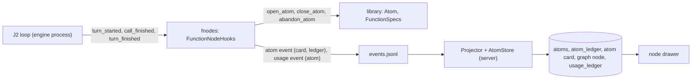

# S2 models: ownership of the models and the function-node runtime

_Batch S2-models · 2026-11-04 · decided by the architect for the owner, no questions asked · machine record with the exact patch instructions, work packages and diagram labels: `S2-models.json` (same folder)._

**Read.** library.md (all), orchestrator.md (1, 3, 4, 5.2 to 5.6, 6 to 10), engine.md (1 to 4, 6, 10 to 12), ui.md (0, 4.1, 6, 8, 11), connectors.md (2, 3.3, 3.6 to 3.10, 8), sections.json, DECISIONS.md D1 to D12, the box names in gen.py, J2 `j2_schema.py` and `j2_artifact_models.py`, the plugin `bin/sutra-atom`, and the function-node architect draft with its three critic reports (`spec-function-nodes.json` did not exist). Decision order used: keep J2 behaviour, fewest moving parts, already prototyped or measured, one owner per concept; every rejected option is named.

**Checked here.**
- A copy of J2's `_clean` (`j2_artifact_models.py:415-457`) run on pydantic 2.14.2 turns a `dict[str, str]` field into `{additionalProperties: false, required: []}` (an object that accepts no key) and leaves a discriminated union as `oneOf` plus `discriminator` with `const` stripped. This is the basis of S2-models-04.
- Function atom ids `a-<10 hex>-<nn>`, step node ids `s-<10 hex>` and `<dept>.<fn>` match the library patterns AtomId and Node.id; a one-digit sequence does not (two digits at least).
- The current orchestrator.md already adopts most of the library (Value/Record, GATE, OrgChart, apply_change, carry_links, the Node family). Library section 18 describes the earlier draft, so only the residual differences are settled below.
- The plan with this batch applied (42 work packages + L10, E6, E7) passes `scripts/plan_tools.validate`: no file owned twice, no cycle, no protected file, every dependency known. Waves: L10 in wave 3, E6 in wave 4, ORCH-6 and E7 in wave 5.

**Shared names compared, no conflict found.** Goal and Evaluation (only the library defines them; the engine validates J2's files against them through `gate_record`); usage rows (connectors 3.8 `UsageIn`, orchestrator `UsageIn/UsageOut`, the engine `usage` event and the `usage_ledger` columns agree field by field; this batch only adds `atom_id`); graph view (the UI and orchestrator `GraphView` have the same shape once S2-models-02 and 03 fix ids, edge kinds and statuses); Template (see 12); Workflow, Step, Department, chat message (see 13, 14, 15).

**Not checked.** No real model or CLI was called (D8). Items that depend on that are in the Unresolved list.

| Id | Topic | In one line |
|---|---|---|
| S2-models-01 | Chart models, ChartChange, base classes, write gate | The library owns all of them; the orchestrator keeps tables and policy; ids are assigned by code |
| S2-models-02 | Node ids, step key, edge kinds | Library ids; step key (task_id, step_ref); contains, has_function, has_step are derived, never stored |
| S2-models-03 | L-1 Node.state | One field, J2's nine map words; no outcome column; node atom list becomes open_atom + atom_count |
| S2-models-04 | L-2 chart ops in the transport schema | Union stays (anyOf), live test decides, flat class only as a fallback; free-key dict banned |
| S2-models-05 | Function-node runtime: owner, package, tables, WPs | A layer inside the engine process emits atom events; the server stores them |
| S2-models-06 | Atom lifecycle in a node | One atom per turn, code-run checks, 3 attempts, observe-only |
| S2-models-07 | Events, tables, cards, ledger, cost | Extended atom and usage events, per-schema state check, card per transition |
| S2-models-08 | Names: AgentNode, WorkAtom, FunctionSpec; goal, task, context | Library names win; one meaning per word |
| S2-models-09 | How the UI reads it | Library Atom names, five pills, capped list, atom cards |
| S2-models-10 | Atom ids and refused atoms | Two forms, no third; refused is stored and ledgered; J2 atoms keyed by run |
| S2-models-11 | Chat links on merge and split | Library rule, store executes, archived sessions filed under the survivor |
| S2-models-12 | Artifact models, rules, templates, helpers | Library owns the definitions; engine copy gated by a parity test and a switch phase |
| S2-models-13 | Workflow, Step, assignments | AssignmentPlan converts to the library TaskWorkflow, gated, not stored |
| S2-models-14 | Department record | Three fields; everything else has another owner |
| S2-models-15 | Chat message families | run_message (J2 line) and chat_message (server row); one MessageMeta in the library |

## S2-models-01 · One owner for the chart models, ChartChange, base classes and the write gate
- **Decision.** The library (L1, L2) owns Value, Record, GATE, OrgNode, OrgChart, the five ops, ChartChangeRequest, ChartChange (one family, kinds reuse, add, rearrange), apply_change, carry_links, slug_id. The orchestrator defines none of them. Ruling per difference: base and gate are the library's only (every `orchestrator/models.py` class derives from Value); OrgNode has no parent_id, position, state, merged_into, keywords or slug (the wire ChartView derives parent_id and position); a merged-away division leaves the chart and survives only as a retired `org_nodes` row; model field `revision`, wire name `version`; chart node ids are assigned by code from `$ref` placeholders (slug_id, never reused), so `bad_id` and `retired_id` are deleted; "ChartReuse/Add/Rearrange" are kinds of one ChartChange; the limit is 8 ops, not 50; violation codes are the library's plus reuse_candidate, busy, bad_assignment, not_plain; the library's `org_changes` DDL is dropped for `chart_changes`; the orchestrator gets a `StoreContext` for the gate, and the write-path test scans an explicit file list because no orchestrator store is named `store*.py`.
- **Why.** One owner per concept; library section 4 was prototyped and orchestrator 1.3 already adopts it; code ids end the invent-collide-retry loop; the glob would have scanned nothing.
- **Rejected.** A parallel chart model, Closed base or `gate()`; archived/merged_into/position/keywords as OrgNode fields; model-chosen ids with retries; two DDLs for the change log.
- **Changes.** library 18, 11, 14/15 (L8) · orchestrator 1.2, 1.3, 3.3, 3.4, 4.1, 5.2 to 5.4, 7, 9 (ORCH-D6) · ui 6.3, 8 · diagram: Interface library and org chart boxes.

## S2-models-02 · Graph vocabulary: ids, step key, edge kinds
- **Decision.** Ids are the library's and opaque: `sales`, `sales.identity`, `s-<10 hex of sha1(task_id:step_ref)>`; the prefixes `n:`, `f:`, `s:` and `org_<hex>` are dead. Step key is (task_id, step_ref) with step_ref `task`, `W-<n>` or `team:<role>` (library fields workflow_id/step_id renamed). Seven edge kinds: contains, has_function, has_step (derived on read, never stored) and handoff, step, speaks_to, depends_on (stored, each with a source). `reads` and `rework` are fields of the step event only: depends_on edges labelled "reads" and "revises".
- **Why.** One vocabulary from J2's map to the UI; the tree has one writer; builders and personas have no assignment id.
- **Rejected.** Prefixed ids with a mapping layer; a stored contains edge; reads/rework as kinds; steps keyed to a TaskWorkflow; a UI-only `feeds`.
- **Changes.** library 8.1, 8.2 · orchestrator 3.3, 4.1, 5.6 · ui 0, 4.1, 6.1, 8 · diagram: Workflow graph store.

## S2-models-03 · L-1: Node.state against J2's box results
- **Decision.** `Node.state` holds J2's nine map/1 statuses (idle, running, waiting, waiting_on_you, fault, filed, done_unchecked, left_open, not_made); function nodes use the first five, structure nodes four, steps all nine. The `outcome` column, `archived` and the rule "outcome else state" are removed; wire status = state. `Node.detail` is added so every indexed column is a projection of the model. `FunctionNode.atoms` (capped at 500, would crash at the 501st atom) becomes `open_atom` + `atom_count`; G6 moves to the unique index.
- **Why.** J2 has one status field with nine words; a column the model cannot produce breaks "projections come from Checked.model".
- **Rejected.** A separate outcome field; a five-word state with a wire mapping; `archived` as a node state; the capped id list.
- **Changes.** library 8.1, 8.2 (G6), 14, 16 (DL7) · orchestrator 1.3, 3.3, 4.1, 5.4, 5.6, 7, 9 · ui 0, 6.1 · diagram: graph store and function cards.

## S2-models-04 · L-2: ChartChangeRequest.ops, union or flat
- **Decision.** The union stays and is sent as `anyOf` of five closed objects with one-value `op` enums. No flat class is built now. The only unverified part (do the CLIs accept anyOf of objects) is covered three ways: the connector falls back to prompted and the Router remembers the failure per schema sha (one wasted call per process), ReplyParser validates the same union either way, and offline tests check the schema. Found by running J2's `_clean`: a free-key dict becomes an object that accepts no key, so `SplitOp.move_children` becomes `moves: [ChildMove]` and `transport_schema` raises `transport_dict` for any free-key dict. **Live check:** `test_chart_change_request_native` (live, `SUTRA_LIVE=1`): 5 trials per CLI through `call_json` with the real schema; pass = `how == native` and a valid reply in at least 4 of 5 on each CLI. On failure set `CHART_OPS_TRANSPORT = 'flat'` and add `ChartOpFlat` (about 60 lines, owned by L2).
- **Why.** The union is prototyped, has no converter and no null padding, and fails softly; the live check is cheap.
- **Rejected.** Building the flat class now; ops grouped by type (changes ordering and the 300-step test); calling the prompted path "the design".
- **Changes.** library 3.5, 4, 14/15 (L2 owns a new test file), 17 · orchestrator 1.3, 9 (ORCH-D4) · connectors 3.6, 7 (CN-7 test) · diagram: router line.
- **WP.** change L2.

## S2-models-05 · Function-node runtime: owner, package, tables, work packages
- **Decision.** Two modules, one per process, one event contract. In the engine process: new package `sutra_app/engine/fnodes/` (WPs E6, E7), whose `FunctionNodeHooks(EventHooks)` is on by default through `SUTRA_HOOKS` (`SUTRA_NODES=off` disables; `enforce` is reserved and refused) and turns turn_started, call_finished, turn_finished, run_status and run_error into work-atom transitions with the library lifecycle, runs the checks in code, and writes one `atom` event per transition. In the server process: Projector (ORCH-6) and AtomStore (ORCH-3) store them. Tables: `atoms` (schema `work-atom/0.3`), `atom_ledger`, `chat_messages` (cards, in the node's own session), `graph_nodes` (open_atom, atom_count), `usage_ledger.atom_id`. The library supplies the data and pure functions (FunctionSpecs seed file = new WP L10, Atom lifecycle L4, reply families L5, FunctionNode L6). Version 1 is observe-only: no J2 prompt, reply, route or outcome changes.
- **Order.** L1; L4 + L6 + L2; L5; L10; E0 (needs L1); E6; ORCH-1/3/4/5, then ORCH-6 (needs E6); E3 default hooks; E7 whole-run proof; UI-6.
- **Why.** Turns are visible only in the engine process, so "declare before the work" and "code runs the check" are possible only there; the server stays the only SQLite writer; no j2.py patch is needed (P8 hooks exist).
- **Rejected.** Deriving atoms on the server from say/usage/trace lines; the layer in the library, the orchestrator or j2.py; a new top-level package; one atom per call; enforcing from day one.
- **Changes.** engine 3.3, 4.3, 4.4, 4.7, 10, 11 (ENG-D8), 12 · library 8.4, 15 · orchestrator 1.3, 9 (ORCH-D10), 10 · repo: `pyproject.toml` package-data `library/specs/*.json` (chassis file, by hand) · diagram: function cards.
- **WPs.** add L10, E6, E7.

## S2-models-06 · Atom lifecycle inside a function node
- **Decision.** One atom per function turn; the turn's `agent_turn` model calls are its attempts (planner and judge calls are charged to it); only the five function names open function atoms. Declare from the library template for (function, kind), else the function's `generic` one: goal with placeholders, constraints = first 20 of `may_not` (check null), context = `<kind>: 
`, work llm/AI or bash/code, verify = the template's checks. Refusal at open is stored, carded, ledgered, and the turn goes on. After each call the runner executes the checks and `close_atom` runs: pass closes, failure keeps it open with a VERIFY FAILED card, at most 3 attempts; at turn end an open atom is abandoned with a reason; at run end every open atom is abandoned. Version 1 checks: `reply-valid [family, kind]` (the reply validates in the library reply class through ReplyParser) and `turn-posted`; exit codes 0, 1, 127; pure Python, no subprocess. J2's own recovery stays and only produces more attempts. Not in v1: write-scope enforcement, J2's named code checks as atom checks, enforce mode, builder atoms.
- **Why.** A turn is the plugin's unit of work; attempts map onto J2's re-asks so behaviour is unchanged; reply-valid reuses the reply classes that already carry J2's role rules.
- **Rejected.** One atom per call; hard write scope or named J2 checks in v1; blocking or retrying turns; a shell runner with a 30 s alarm; node state derived from atoms.
- **Changes.** library 7 (CheckTemplate, `Atom.task_id`, `atom_display_state`), 8.4 (stages, generic template), 14 · engine new 4.3a, 4.5 trace types · diagram: function cards.
- **WP.** change L4.

## S2-models-07 · Data path: events, tables, cards, ledger, cost
- **Decision.** The `atom` event keeps its J2 fields; for `work-atom/0.3` it carries status = stored state, body = Checked[Atom] JSON, epoch times, and the optional `outcome`, `card`, `ledger`. The `usage` event gains `atom`, stored as `usage_ledger.atom_id`. One `atoms` table with a per-schema state check; unique `atom_ledger.atom_id`; a chat card (`type atom`) per transition in the node's own session; the node body takes open_atom/atom_count in the same transaction. Projector: gate the body, forward moves only, ledger row, card, put_node, `atom.updated`; run end and reconcile abandon open atoms. `AtomOut.state` has five words (`atom_display_state`); `AtomOut.usage` is summed by atom_id. A contract test in E7 imports `RunEvent` unconditionally and checks every builder output and a golden event file.
- **Why.** One definition keeps the closed union safe; per-schema checks keep two vocabularies honest in one table; cards are the plugin's own rule; unique ledger rows make replay harmless.
- **Rejected.** A second event type; storing verify_failed for plugin atoms; separate tables; cards in the department session; a contract test that only runs "if it imports".
- **Changes.** engine 4.5, 3.3, 9 · orchestrator 3.3, 4.1, 5.6, 7, 8 · diagram: runtime to graph store arrow.
- **WPs.** change ORCH-1 (depends L1, L3, L4), ORCH-6 (new test, depends E6).

## S2-models-08 · Names and vocabulary
- **Decision.** Library names stay: AgentNode = FunctionNode (five children), WorkAtom = Atom, `<org>/<kind>` = `<dept>.<fn>`, org_node_id = department_id, session_id = chat_session_id; the draft's reads/writes/never/stages/routes/reply_model/checks map to FunctionSpec reads, writes, may_not, stages (new), HANDOFFS, TaskKind, AtomTemplate.checks. FunctionSpec, FunctionSpecs, TaskKind, AtomTemplate, load_function_specs, new_function_node keep their names; the final spec file, when it lands, changes only fields, loader and L10 data. One meaning per word: node GOAL = standing sentence from the spec (never set by an event); node TASK = the hand-off in hand `{id, kind, summary, inputs, set_by, ts}`; atom GOAL = observable outcome of one turn. `TurnInfo.goal` is deleted (it duplicated step_label) and the node event carries `task{id, kind, summary, state, set_by}` and string context, no goal. Glossary: request (`req-N`), task (`tsk_...`, one run), step node, loop step (J2.a to h), output stage (website, prd, hld, lld).
- **Why.** The stores, wire and tests already use the library names; the engine's "goal" was really the draft's TASK.
- **Rejected.** Renaming library classes; atoms embedded in the node; node state derived from atoms; renaming ChartChange.task_id.
- **Changes.** library 8.1, 8.4, 17 · engine 4.3 (TurnInfo), 4.5 (node row and example) · orchestrator 3.3, 5.6 · ui 6.4.

## S2-models-09 · How the UI reads function nodes
- **Decision.** The drawer (UI 6.4) keeps its design and reads library names through `FnodeView.normalize`: constraints[].text, context[], work, verify.checks[].results[], attempt of 3, refusal; five pills from AtomOut.state (open, verify_failed, closed, refused, abandoned); cost line from `AtomOut.usage`; open atom first plus the 20 newest, "Show all" pages `/api/atoms`; atom/1 ids shown after the last colon; `atom` chat cards only in function-node sessions, so the Simple view stays Identity-only.
- **Why.** The UI follows the stored model, not the plugin CLI's file layout; five pills show all owner verbs.
- **Rejected.** The plugin's ASCII card in the browser; loading every atom; showing refused as abandoned.
- **Changes.** ui 6.4, 6.5, 6.6, 8, UI-0 fixtures · orchestrator 3.3 (NodeDetail), 6.2 · diagram: Detailed view box.

## S2-models-10 · Atom ids and refused atoms
- **Decision.** One AtomId pattern, two forms with one meaning each: `a-<sid>-<nn>` function-node atom, `W-<n>.a<k>` J2 workflow atom; no third. `atom_sid(run_id, node_id)` and `function_atom_id(sid, n)` in library `types.py` are the only builders; n counts per (run, node) and refused attempts consume a number (gaps are fine). J2 restarts workflow ids at W-1 every run, so the orchestrator keys an atom/1 row `<run_id>:<id>` (the body keeps J2's id). Refused atoms are stored, ledgered (status `refused`, a declared addition to atom-ledger-v0.3) and carded.
- **Why.** The owner names four verbs with cards and a ledger row; the plugin header promises a card on every transition including refuse; without the run in the key two runs overwrite each other.
- **Rejected.** Not storing refused atoms; a third id scheme; renumbering; `W-n.ak` as the primary key.
- **Changes.** library 3.2, 7, 15 (L1), 17 · orchestrator 4.1, 5.6, 7 · engine 3.3 (`fnodes/ids.py`).
- **WP.** change L1.

## S2-models-11 · Chat links on merge and split
- **Decision.** Rule: library `carry_links`. Executor: `ChatStore.apply_links(tx, plan, names)` (replaces `archive`). In the app every node has a session, so a merge gives keep (survivor) and archive (each merged-away node): the session becomes `archived`, read-only, note "Merged into X", `filed_under` = survivor, `node_id` unchanged (the division's filtered view keeps working); earlier archived sessions are re-filed; the merged-away graph node is deleted and its steps re-parented; `org_nodes` keeps a retired row. A split keeps the node and its session; new parts get theirs through `ensure_node`. Schema: no UNIQUE on `chat_sessions.node_id`, a partial unique index on active sessions, new `filed_under`; NodeDetail lists `archived_chats`.
- **Why.** One owner for the rule and one for the execution; filing under the survivor is what LinkPlan.archive says; no archived node state needed.
- **Rejected.** Archiving in place on a kept graph node; re-pointing node_id; dropping sessions; the rule in the orchestrator.
- **Changes.** library 4 (C11), 17 · orchestrator 3.3, 3.4, 4.1, 5.4, 6.2, 7 · ui 6.5 · diagram: Chat sessions box.

## S2-models-12 · Artifact models, rules, templates and helpers: one owner, a gate
- **Decision.** The library owns the definitions. Imports run one way: engine, connectors and orchestrator import the library; the library imports none of them. `extract_json` and `close_json` get one copy now (library `replies.py`; engine `llm.py` re-exports, connectors `jsonio.py` imports), so E0 and CN-1 depend on L1. Artifact models, rules and template bases: the engine keeps its vendored J2 files as the runtime copy (they define J2's lax behaviour, ENG-01) and `tests/library/test_lib_engine_parity.py` (L8) must stay green: schema shas, verdicts on a shared corpus (explicit allow-list), `run_rules`, `certainty_zone`, helper identity. Switch = phase E1-c of E1 after L7, L8, E5: shim modules re-exporting the library's, kept only if the six prompt goldens and three legacy scripts stay green and the allow-list is empty or accepted; otherwise the parity test stays permanent.
- **Why.** Pure helpers can be one copy today; strict library models differ from J2's lax ones on purpose, so the swap must be a test result, not a leap.
- **Rejected.** Two copies with only a drift test; importing the strict models into the engine at once; the library importing the engine; patching `j2_realization.py`.
- **Changes.** library 2, 6, 9.2/9.3, 14/15, 16 (DL9) · engine 3.1, 4.2, 4.9, 10, 12 · connectors 2 (jsonio.py), CN-1 · diagram: Artifact schemas chip.
- **WPs.** change L8, E0 (depends L1), CN-1 (depends E0, L1).

## S2-models-13 · Workflow, Step and the chat agent's assignments
- **Decision.** The reply classes stay flat and orchestrator-owned (ChatDecision, AssignmentDraft, AssignmentPlan). `AssignmentPlan.to_task_workflow(request_id)` builds the library `TaskWorkflow` of `AssignmentStep`s; `TurnRunner` gates it before any `TaskService.create`; it is not stored (its projection is the tasks rows and the step nodes). Limits are aligned so a valid draft always passes (follows pattern, depends_on at most 4, ids a1 to a5). `DeptWorkflow` with AIStep/CodeStep stays J2's department level.
- **Why.** The owner's Workflow and Step base classes need a user: the chat agent that "builds workflow + graph".
- **Rejected.** Dropping TaskWorkflow; storing it; letting the model fill it (a union); a second assignment model.
- **Changes.** orchestrator 3.2, 5.2 (T7) · library 9.1.

## S2-models-14 · Department record
- **Decision.** `Department` = `{id, home_dir, ts_created}`. Name and purpose come from the chart, the charter from the run folder (`goal.json`), runs from `tasks`, the budget from the run summary; `Budget` leaves L3. `departments` loses name, status and goal columns; `DepartmentOut` loses status; `DeptRow` loses archived and merged_into_name (departments never archive, move or merge). `ChartStore.apply` is the only writer.
- **Why.** Every dropped field duplicated another owner or had no writer or reader.
- **Rejected.** Keeping goal/budget/run_ids and inventing writers; an unchangeable status column; a copied name that would drift after a rename.
- **Changes.** library 5, 10, 14, L3 · orchestrator 3.3, 4.1, 5.4, 5.6 · engine 4.9 · ui 4.1.

## S2-models-15 · Chat message families
- **Decision.** `run_message` (library Payload) is J2's `chat.jsonl` line; `chat_message` (library Record, orchestrator-owned) is the stored server row. `MessageMeta` is defined once in new `library/chat.py` (L3) and imported by the orchestrator; `RECORD_FAMILIES` maps `chat.jsonl` to `run_message`. The engine process never imports the orchestrator.
- **Why.** `gate_record` runs in the engine process; the two shapes differ.
- **Rejected.** Registering from the orchestrator; one class for both; two MessageMeta definitions.
- **Changes.** library 2, 10, 15 · orchestrator 2, 3.2 · engine 4.3.
- **WP.** change L3.

## Work packages touched

| Action | Id | Why |
|---|---|---|
| add | L10 | Function specs seed data and tests (05) |
| add | E6 | Function-node layer in the engine process (05) |
| add | E7 | Whole-run golden, event contract test (05) |
| change | L1 | atom id helpers and test (10) |
| change | L2 | `moves` list and transport test (04) |
| change | L3 | `chat.py` (15) |
| change | L4 | `atom_display_state`, new check templates, test (06) |
| change | L8 | parity test, write-path list, depends on L10 (12) |
| change | E0 | depends on L1 (12) |
| change | CN-1 | depends on E0, L1 (12) |
| change | ORCH-1 | depends on L1, L3, L4 (07) |
| change | ORCH-6 | new test, depends on E6 (07) |

## Unresolved (each has a fallback in the JSON)
1. Whether the real CLIs accept `anyOf` of objects: needs a live call; fallback = prompted path + blocklist, then the flat class (04).
2. The final function-node spec file: absent; fallback = the names above, a data change when it lands (08).
3. Whether real J2 replies validate against the strict reply classes: measured by the E7 golden and the live test; atoms only record the result in observe mode (06).
4. Whether the engine can switch to the library's strict artifact models without changing verdicts: parity test and phase E1-c decide (12).
5. Enforce mode and write-scope enforcement: reserved, not designed (06).
6. Reply kind for every J2 task kind: `|` alternatives and the `generic` template cover gaps (06, L10).
7. Volume of atoms and cards per run: capped lists and node-session-only cards; E7 records the counts (07, 09).
