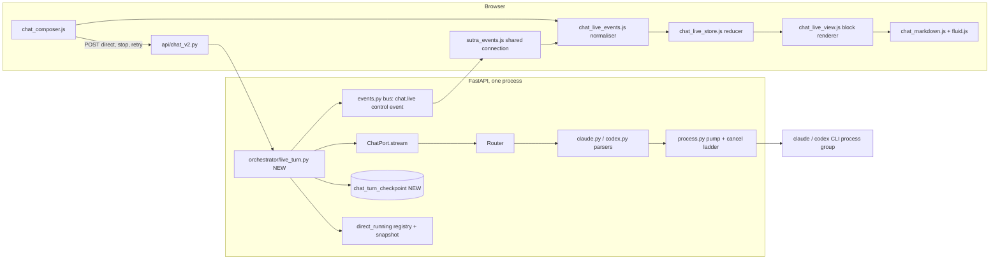
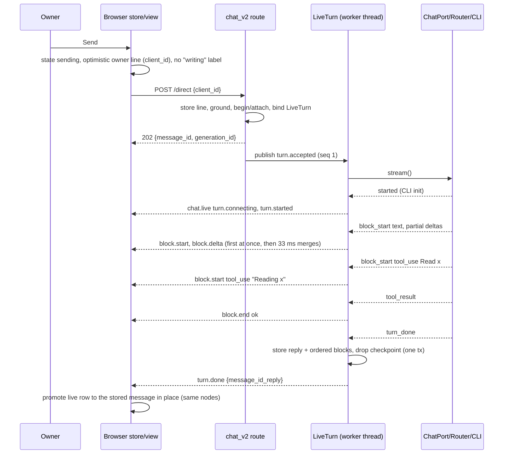
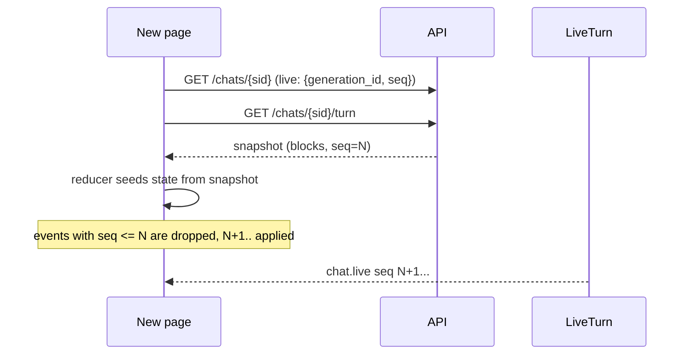

# Streaming chat: architecture

Status: proposed design, no code changed. Date: 2026-11-14. Input: `analysis.md` (same folder; its section numbers and RC ids are used here). Paths are relative to `sutra-pro/sutra_app` unless noted. Decisions: D201 to D214 in `docs/DECISIONS.md`.

Product goal: the chat feels instant, fluid, informative and real. Real means: every pixel of live text comes from a provider byte, every activity line from a provider event, nothing is invented, Stop really stops the process group, and a provider that cannot stream is labelled as such.

Scope fences (from analysis section 7): `engine/` and the J2 cumulative-snapshot contract stay untouched; the AI-worker live view (`agent_live.json`, `chat.partial reset:true`) stays as it is; the org chat staged path and `agent_ask.py` stay as they are. All new work is in `connectors/`, `orchestrator/`, `ui/static`.

## Context



The deployment is real and small: one local FastAPI process, the browser is the window (D12; `desktop.py` is a tray plus server thread, no Electron, no webview shell), one owner, loopback, token auth. That removes the usual transport worries (proxies, CDNs, multi-node fan-out) and leaves two real constraints: the HTTP/1.1 six-connection limit per origin in the browser, and the single global event stream that every page already holds.

## Approach

1. **Keep the pipe, stop dropping and batching** (analysis RC1 to RC4). The provider chain is already genuinely incremental. We add a server-side `LiveTurn` (new, `orchestrator/live_turn.py`) that consumes every `ChatEvent` from `ChatPort.stream`, assigns stable block ids and per-generation sequence numbers, runs a hold-back redactor and a time-based coalescer, and publishes one new control event type `chat.live` on the existing bus and SSE stream. `_answer` becomes a thin driver of `LiveTurn`.
2. **One typed event envelope, mapped onto the ABS-5 blocks.** `chat.live` carries `turn.*`, `block.*`, `heartbeat`, `usage`, `switched`, `attempt.restart` events. A `block` is exactly an ABS-5 `ChatBlock` (`text | thinking | tool_use | tool_result`, `kind`, `is_error`, `truncated`) plus a stable `block_id`, so the live view and the stored message are the same model.
3. **Client in three layers** (transport, normaliser plus reducer, presentation), each testable alone. The reducer is a pure function; the DOM is a patch of keyed blocks, one repaint per animation frame.
4. **Catch-up by snapshot, not replay.** `GET /api/chats/{sid}/turn` returns the live turn's whole current state with its `seq`; the client drops events with `seq <=` snapshot seq. Reload, second tab, gap and reconnect all use this one path. The bus ring is not used (it would force `gap` resyncs on every topic, analysis risk 4).
5. **Honest states only.** Sending, accepted, connecting, thinking, writing, using a tool, stalled, stopping are each driven by a real event or a real absence of events.
6. **Durability by checkpoint.** A side table is written at block boundaries and at most about every 1.5 s while text flows; never per token, never `chat_messages.text` (FTS trigger). A crash restores the partial turn.
7. **Rollback switch.** `SUTRA_LIVE_V1` (config, default on). Off keeps the legacy `chat.partial` path of today verbatim, one release.

## Alternatives considered

| Option | For | Against | Verdict |
|---|---|---|---|
| A. Extend the existing global SSE with one new control event type `chat.live` (chosen) | No new connection; same auth, redaction (`_frame`), reconnect, and backoff; the pipe is proven incremental; minimal change in `sutra_events.js` (`TYPES`) | No per-stream backpressure; no replay, so catch-up needs a snapshot route; every page receives every chat's events | Chosen. The two gaps are closed by seq plus snapshot (D202, D203) |
| B. Per-turn SSE endpoint (`GET /chats/{sid}/turn/stream`, `EventSource`) | Natural `Last-Event-ID` replay, no cross-chat fan-out, ends with the turn | One more long-lived connection per active turn on top of one EventSource per mounted view and per open panel (analysis: H six-connection pressure); second lifecycle to authorise, test and reconnect; two mechanisms in the app | Rejected for now. Revisit only if measurements show the global stream hurting |
| C. `fetch()` + `ReadableStream` on the POST response (NDJSON) | Request and stream in one round trip; no EventSource limits; POST body carried | Ties the turn's visibility to one HTTP response: reload or second tab cannot attach; reconnect semantics hand-written; response buffering on any intermediary breaks it silently; the app already has a working SSE client with backoff and polling fallback; would duplicate it | Rejected |
| D. WebSocket | Bidirectional | New server surface, new auth path, no need (stop is a plain POST), none in the repo | Rejected |
| E. Keep `chat.partial` and add fields | Smallest diff | Cannot carry typed blocks without overloading a text event; legacy guards (`message_id`, 4000 cap) assume text only | Rejected for the direct route; `chat.partial` stays only for the agent/J2 polled path |

Also considered for the settle step: cross-fading a separate stream row into the stored bubble (cheap, still a jump) versus promoting the live row to a transcript item that keeps its DOM nodes (chosen, D207).

## Components

### Server

| Component | Status | Files | Responsibility and interface |
|---|---|---|---|
| `LiveTurn` | NEW | `orchestrator/live_turn.py` | One per direct turn. `LiveTurn(services, sid, message_id, generation_id, provider_hint)`. `.on_event(ChatEvent)` maps connector/ChatPort events to envelope events; `.tick(now)` (heartbeat, flush, checkpoint); `.request_stop()`; `.finish(done) / .stopped() / .failed(msg)` return the endings consumed by `direct_turns`; `.snapshot() -> dict`. Holds: block table (id, type, kind, title, target, text, status), attempt counter, seq counter, state, `side_effects_possible`, `stop_requested`. Thread-safe (one lock; snapshot is read from the event loop thread) |
| `HoldBackRedactor` | NEW | in `live_turn.py` | Per text block: append delta, emit the redacted text up to the last whitespace (a secret shape contains no whitespace), keep the trailing token held until whitespace, block end, or a length bound (the longest shape span, read from `services.redact` as a constant; new test pins it). Stored text is the concatenation of what was emitted, so a stop stores exactly what the owner saw (analysis risk 9) |
| Coalescer | NEW | in `live_turn.py` | Time based: the first delta of a block goes out at once; later deltas are merged for at most 33 ms (about 30 frames per second per turn). No character threshold (RC3) |
| `direct_running` | CHANGED | `orchestrator/direct_running.py` | Add `live` registry: `bind(sid, live_turn)`, `live_of(sid)`; `begin` creates the stop-flag slot so an early Stop is never lost (closes the `begin` to `_chat_busy` window). `ChatSessionOut` gains optional `live: {generation_id, seq, state}` (additive; `direct_turn` stays) |
| `_answer` | CHANGED | `orchestrator/api/chat_v2.py` | Drives `LiveTurn`; legacy path kept as `_answer_legacy` behind `SUTRA_LIVE_V1`. Publishes `turn.accepted` from the route before the 202 returns; keeps a strong reference to the worker task (analysis step 4) |
| Routes | CHANGED | `orchestrator/api/chat_v2.py` | `POST /chats/{sid}/direct` accepts `client_id` (idempotency, D209); `POST /chats/{sid}/direct/stop` publishes `turn.stopping` at once and sets the early flag; NEW `GET /chats/{sid}/turn` (snapshot); NEW `POST /chats/{sid}/direct/retry` |
| `ChatPort._map` | CHANGED | `connectors/chat_port.py`, `chat_models.py` | Stops swallowing `started` (emits `ChatEvent kind="started"`); `EVENT_KINDS` gains `started`, `block_start`, `block_delta`, `block_end`; unknown kinds from engine paths are ignored by `ModelPort` consumers (test). `ChatEvent.kind` Literal extended; `Router` passes them through unchanged |
| `ConnectorEvent` kinds | CHANGED | `connectors/models.py` or `base.py` (where the kind set lives), `claude.py` | New kinds: `block_start {index, type, tool_id, name}`, `block_stop {index}`, `thinking` (presence only, no text, D206), `message_boundary`. `ClaudeParser._on_stream_event` handles `content_block_start/stop`, `thinking_delta`, `message_start/stop`; gated on `plan.partials`; existing kinds unchanged so engine paths are unaffected |
| Codex parser | CHANGED | `connectors/codex.py` | Handle `item.started` and `item.updated`; keep `command`, `exit_code`, capped `aggregated_output` on `item.completed`. Scope depends on WP-0 capture (D205). Never chunk `agent_message` |
| `tool_kinds` | CHANGED | `connectors/tool_kinds.py` | `describe(name, input, workroot) -> (kind, title, target)`: target is a redacted path relative to the work root (or basename) or a command cut at 200 chars; never raw input JSON |
| Checkpoint store | NEW | `orchestrator/live_checkpoint.py`, `schema.py` (migration v5) | `save(generation)`, `load(sid)`, `drop(generation)`; used by `LiveTurn` and `recover_interrupted` |
| Event types | CHANGED | `orchestrator/events.py` | `CONTROL_TYPES += ("chat.live",)`; constant `LIVE = "chat.live"`; seq of the SSE id stays 0 (own seq is inside the payload) |

### Client

| Component | Status | File | Responsibility and interface |
|---|---|---|---|
| Transport | CHANGED | `ui/static/js/sutra_events.js` | Add `chat.live` to `TYPES`; `SutraEvents.shared(url)` returns one page-wide connection with `subscribe(type, fn)` and ref counting; `connect` stays as a thin wrapper so `home.js`, `node_panel.js`, `dept_ext.js`, `console_view.js` migrate one at a time. Exposes `onState(cb)` (open, retrying, polling) for the "live updates paused" state |
| Event normaliser | NEW | `ui/static/js/chat_live_events.js` | `normalise(raw, ctx) -> Action[]`. Validates envelope and `v`, drops events of other conversations, ignores unknown `type` (but advances seq), dedupes by `(generation_id, seq)`, detects gaps (`seq` jump or `offset` mismatch) and returns a `{type:"gap"}` action. No DOM, no network, no store |
| Store and reducer | NEW | `ui/static/js/chat_live_store.js` | `reduce(state, action) -> state` (pure) and `createStore(reduce, onChange)`; selectors `activity(state)`, `label(state)`, `blocks(state)`, `canStop(state)`. Holds per-conversation `turn` with the state machine below |
| Block renderer | NEW | `ui/static/js/chat_live_view.js` | `createView(host, deps)`, `.update(turnState)` patches a keyed list of block nodes (key `block_id`), delegating text blocks to `Fluid.paintStream` (settled sub-blocks kept, tail redrawn), tool blocks to a one-line activity item, thinking to a presence indicator. Same code paints a settled message from `blocks`, so settle is a state change, not a node swap |
| Activity timeline | NEW | `ui/static/js/chat_live_activity.js` | `timeline(state) -> [{id, kind, title, target, status, startedAt, endedAt}]` derived from block events only; `ChatFold` summarises the same list when settled |
| Composer | CHANGED | `ui/static/js/chat_composer.js` | `turn` becomes a projection of the store (`state().turn` keeps `active, stopping, text, messageId` derived, so existing tests keep passing); adds optimistic owner line, `client_id`, snapshot resync, retry |
| Pill and scroll | CHANGED | `chat_pill.js`, `chat_scroll.js` | `MAX_SHOWN` cap removed for the live view (D207); scroll counts stream growth inside the scroller |
| Pages | CHANGED | `home.js`, `node_panel.js`, `home.html` | Move the stream row into the transcript list as a keyed item; Home reconciles and paints in one step like the panel |
| Motion | CHANGED | `ui/static/css/sutra-panel.css` | Tokens and rules in "Cross-cutting: motion" |

## Data model

### Event envelope (`chat.live`, schema version 1)

Published through `bus.publish_one(LIVE, payload)`; SSE `event: chat.live`, `data:` JSON.

| Field | Type | Meaning |
|---|---|---|
| `v` | int | Schema version, 1. A client that sees a higher `v` keeps the turn row and shows "This app needs a refresh to show live updates"; the final message still arrives through `chat.message` |
| `id` | string | `"<generation_id>:<seq>"`, unique, used for dedupe |
| `conversation_id` | string | The chat session id (`sid`) |
| `message_id` | int | The owner's line id the turn answers (the existing `turn` link of the stored reply) |
| `generation_id` | string | uuid4 hex, one per turn start and per retry; the unit of seq |
| `attempt` | int | 1 at start, plus 1 per router `restart` (retry or provider fallback) |
| `seq` | int | 1,2,3... per generation, gap free; set under the `LiveTurn` lock at publish time |
| `ts` | string | Server time, ISO 8601 UTC with milliseconds; used for elapsed display and ordering checks, never for logic |
| `type` | string | One of the types below |
| `block_id` | string or absent | `b1`, `b2`... per generation (not reset on restart; `attempt` scopes it) |
| `payload` | object | Type specific, additive only within a version |

Event types:

| `type` | Payload | Emitted from (real source) |
|---|---|---|
| `turn.accepted` | `{}` | Route, after the owner line is stored and grounding written, before the 202 returns |
| `turn.connecting` | `{provider, model, stream_mode}` | `ChatPort` `started`-adjacent: the provider was chosen and the process is being spawned |
| `turn.started` | `{provider, model, session_id, stream_mode}` | Connector `started` event (the CLI's own init line). First honest "connected" signal |
| `block.start` | `{type, kind, title, target}` | Claude `content_block_start` (text, thinking, tool_use with name); Codex `item.started`; for providers without start events, synthesised only from the first real byte of that block |
| `block.delta` | `{delta, offset}` | Text deltas, `offset` = characters already emitted for this block (gap detection). Tool blocks carry no deltas (input JSON is not streamed, D210). Thinking carries none (D206) |
| `block.end` | `{status: "ok" \| "error" \| "interrupted", is_error, truncated, size?, text?}` | Block stop, tool result, or stop/failure. `text` present only for a block that never streamed (Codex whole message, non-streaming provider) |
| `heartbeat` | `{idle_ms}` | The `LiveTurn` ticker, every 5 s with no provider event. Proves the server worker is alive and how long the provider was silent; does not claim the model is "thinking" |
| `usage` | existing `usage` ChatEvent data | `ChatPort` |
| `switched` | `{from, to, plan}` | `ChatPort` |
| `attempt.restart` | `{reason, after_side_effects}` | Router `restart`; `reason` is the real error class message already shown today as a note; `after_side_effects` is true if an earlier attempt had a `tool_use` of kind edit or run |
| `turn.stopping` | `{}` | Stop route, at request time |
| `turn.done` | `{state:"ok", message_id_reply, blocks, text_len}` | After the reply is stored (carries the stored reply's id so the client can settle without a refetch race) |
| `turn.stopped` | `{message_id_reply, exit}` | After the process group is gone and the stopped message is stored |
| `turn.failed` | `{message, code, message_id_reply}` | Failure ending, message already user-safe (`user_message()`) |

`stream_mode` (in `connecting` and `started`): `"tokens"` (Claude), `"activity"` (provider streams tool or item events but the answer text arrives whole; Codex if WP-0 confirms `item.started`), `"final"` (nothing live except heartbeat), `"simulated"` (stub provider and `ScriptedPort`, labelled "Demo provider").

Unknown-event tolerance: the normaliser ignores unknown `type` and unknown payload fields; it still records `seq` so gap detection stays exact. A `block.*` for an unknown `block_id` creates the block (a client that joined mid-turn without snapshot degrades, it does not throw).

### Mapping to ABS-5 typed blocks

| ChatBlock (`library/chat.py`) | Live events | Notes |
|---|---|---|
| `text` | `block.start type=text`, `block.delta`*, `block.end` | Stored `text` of the block is the emitted (redacted) text |
| `thinking` | `block.start type=thinking`, `block.end` | Presence and duration only. The type already exists and was never produced |
| `tool_use` (`kind`, `name`) | `block.start type=tool_use kind title target`, `block.end` (status of the matching result) | `name` stored as today; `title` and `target` are display fields derived from `tool_kinds` |
| `tool_result` (`is_error`, `truncated`) | folded into the `tool_use` block's `block.end` live; stored as its own block as today (store shape unchanged) | Live view pairs result to call by `tool_id` |

Stored blocks gain no new field (ChatBlock is closed). `block_id`s are not stored: the settled renderer keys by index (`b<index>`), and the live view's promotion (D207) keys by the same index scheme at settle, so no node identity is lost because live nodes are re-keyed in place, not recreated (see Key flows).

### Stored turn shape

New turns (`meta_json.ordered = true`) store the ordered block list including `text` blocks, so a settled message renders from `blocks` in order (text, tools, text) exactly as the live view showed it. `text` (the column) stays `result.result`, so search, carry-over and `ChatTranscripts` are unchanged. Legacy messages (no `ordered`) render as today (`ChatFold` plus text). Open item analysis 9.2 (is `result.result` only the last assistant message) is settled by WP-0 and only affects the `text` column's value, not the design.

Block cap: the producer folds beyond 400 blocks into one trailing `tool_use` block `kind:"other"`, `name:"more tool calls"`, `text:"N more tool calls not listed"`, `truncated:true`, so the 500-element read-model cap (`models.py:409`) can never fail a store (D212).

### Checkpoint table (migration v5, additive)

```
CREATE TABLE chat_turn_checkpoint (
  generation_id TEXT PRIMARY KEY,
  session_id    TEXT NOT NULL,
  message_id    INTEGER NOT NULL,
  attempt       INTEGER NOT NULL,
  state         TEXT NOT NULL,       -- the turn state at save
  seq           INTEGER NOT NULL,
  blocks_json   TEXT NOT NULL,       -- ordered blocks as emitted (redacted), capped
  updated_at    REAL NOT NULL
)
CREATE INDEX chat_turn_checkpoint_session ON chat_turn_checkpoint(session_id)
```

Appended to `schema.MIGRATIONS` (never edit old steps); `TABLES` and the schema tests updated. No change to `chat_messages` or its FTS trigger. A downgrade ignores the table. The row is deleted in the same transaction that stores the final reply.

## Interfaces / APIs

| Route | Request | Response | Errors |
|---|---|---|---|
| `POST /api/chats/{sid}/direct` | existing body plus `client_id` (uuid, optional; 8 to 64 chars `[A-Za-z0-9_-]`) | 202 `{message_id, turn:"started", generation_id, duplicate?:true}` | 409 `busy` (a different turn is answering); 404; 422 on a bad `client_id`. A repeated `client_id` for the same chat returns the same body with `duplicate:true` and starts nothing |
| `POST /api/chats/{sid}/direct/stop` | none | `{session_id, stopped, state}`; `stopped:true` also when the turn had not spawned yet (early flag) | 404; token. `stopped:false` only when no turn is answering |
| `GET /api/chats/{sid}/turn` | none | 200 `{generation_id, message_id, attempt, state, seq, stream_mode, elapsed_ms, blocks:[{block_id, type, kind, title, target, text, status, is_error, truncated, attempt}], usage?, switched?}` or 200 `{live:false, last_reply_id?}` | 404 unknown chat; token. Redacted like every response |
| `POST /api/chats/{sid}/direct/retry` | `{message_id, client_id}` | 202 as `/direct`, new `generation_id`, no new owner line | 409 `busy`; 409 `not_retryable` if the owner line already has a stored `ok` reply or is not the chat's newest owner line; 404 |
| `GET /api/events` | unchanged | adds `chat.live` frames | unchanged |

Python seams: `ChatPort.stream(sid, turn)` unchanged signature; yields the extended `ChatEvent` kinds. `LiveTurn` is internal; the only route-level contract is above.

## Key flows

### Send, stream, settle



### Stop

```mermaid
sequenceDiagram
  participant B as Browser
  participant A as stop route
  participant L as LiveTurn
  participant R as Router/process
  B->>B: state stopping at once (text frozen, button "Stopping...")
  B->>A: POST /direct/stop
  A->>L: request_stop (early flag if not yet spawned)
  A-->>B: chat.live turn.stopping
  A->>R: chat_stop -> connector.stop
  R->>R: SIGINT 5 s, SIGTERM 5 s, SIGKILL 2 s on the process group (tools included)
  R-->>L: CallCancelledError
  L->>L: open tool blocks end as interrupted; store shown text + blocks; drop checkpoint
  L-->>B: turn.stopped {exit}
  B->>B: state stopped; final label only now
```

### Refresh or second tab mid-turn



### Gap or reconnect

The normaliser sees `seq` jump or `offset` mismatch, or `SutraEvents.onState` reports retrying for more than 3 s: the store enters `resyncing` (rows keep showing, label "Catching up"), fetches the snapshot, replaces state, and resumes. While polling fallback is active the snapshot route is polled every 1 s (honest, labelled "Live updates paused, checking every second").

### Crash recovery

At server start `recover_interrupted` finds owner lines without a reply. If a checkpoint exists for the line, it stores one agent message from the checkpoint (partial text, blocks marked `interrupted`, `state="error"`, `meta ordered`), plus the existing "Interrupted: the app closed..." line, then drops the checkpoint. Otherwise behaviour is unchanged.

## Message state machine

Turn state (server `LiveTurn.state`; the client reducer mirrors it, adding the two client-only states `sending` and `resyncing`):

| State | Meaning | Entered by |
|---|---|---|
| `sending` (client only) | POST in flight | Send pressed |
| `accepted` | Owner line stored, turn bound | `turn.accepted` / 202 |
| `connecting` | Provider chosen, process spawning | `turn.connecting` |
| `running` | Provider init seen; activity is derived (see below) | `turn.started` |
| `stopping` | Stop requested, process leaving | Stop press (client), `turn.stopping` |
| `done` | Reply stored | `turn.done` |
| `stopped` | Stopped reply stored | `turn.stopped` |
| `failed` | Failure reply stored | `turn.failed` |
| `interrupted` | Found after a crash/restart, from checkpoint | `recover_interrupted` (no live event; read from the stored message) |

Legal transitions (anything else is ignored by the reducer and logged in dev builds; terminal states never change):

| From | To | Trigger |
|---|---|---|
| (none) | `sending` | Send |
| `sending` | `accepted` | 202 or `turn.accepted` |
| `sending` | `failed` | POST refused or network error (optimistic line marked failed, nothing stored) |
| `accepted` | `connecting`, `running`, `stopping`, `failed` | event; `running` may skip `connecting` for providers without a spawn event |
| `connecting` | `running`, `stopping`, `failed` | `turn.started`; Stop; spawn failure |
| `running` | `running` (restart: attempt+1), `stopping`, `done`, `failed`, `stopped` | `attempt.restart`; Stop; terminal events (`stopped` here covers a stop issued from another tab) |
| `stopping` | `stopped`, `done` (the turn finished before the signal landed), `failed` | terminal events |
| `done`, `stopped`, `failed` | none | terminal |

Derived `activity` while `running` (selector, not stored state; first match wins):

1. `stalled`: no event of any type (heartbeat included) for 15 s on the client: "Live updates paused", triggers resync; or a heartbeat with `idle_ms >= 20000`: "Still working, no output for N s" (real number)
2. `tool`: a `tool_use` block open: its title ("Reading file x")
3. `writing`: a `text` block open
4. `thinking`: a `thinking` block open
5. `waiting`: otherwise (provider connected, nothing yet): "Waiting for <provider>"

Labels by state: `sending` shows nothing but the optimistic owner line (no provider claim), `accepted` "Sent", `connecting` "Connecting to <provider>", `running` the activity label above, `stopping` "Stopping", terminal states show no label.

## Cross-cutting

### Frontend store and layering

`SutraEvents.shared` (transport) -> `ChatLiveEvents.normalise` -> `ChatLiveStore.reduce` -> `ChatLiveView.update`. Each layer has one input and one output, none imports a later one. Composer wires them and owns the network calls (POST, snapshot). The reducer never reads the clock: `now` comes in via the action (`tick` action every second while a turn is active, for the stalled rule and elapsed display), so tests are deterministic.

### Block rendering with stable ids

The view keeps a `Map<block_id, node>`. Text block nodes use `Fluid.splitStream` and keep settled sub-blocks (paragraph, fence, list, table) as DOM that is never rewritten; only the tail node is re-rendered. A tool block node is created on `block.start` and mutated (status icon, duration) on `block.end`; it is never recreated. A restart groups the earlier attempt's blocks under a collapsed "Earlier try" item when it had any tool block, otherwise removes them with a short fade. Promotion at settle (D207): the live row is a transcript item keyed `"m"+reply_id` from `turn.done` onward (the key is remapped in the keyed list, not re-created), the markdown renderer's final pass only re-renders the tail and any held (unfinished table) region.

### Activity timeline

Derived from block events only. Each entry: kind icon (read, edit, run, search, web, other; already known to `ChatFold`), title, target, status (`running`, `ok`, `error`, `interrupted`), duration from `ts` deltas. No counts or percentages that the wire does not carry; "N tool calls" is a count of real blocks. Thinking shows a presence indicator and elapsed time, never text. While settling, `ChatFold.fold` renders the same entries as the existing summary; live turns show the list open, collapsed into the summary after `turn.done`.

### Motion tokens and reduced motion

Reuse `--dur-fast`, `--dur-base`, `--dur-slow`, `--ease-out` from `sutra-panel.css`. New rules, all inside `@media (prefers-reduced-motion: no-preference)`:

| Token use | Element |
|---|---|
| `--dur-fast` opacity+translateY(4px) | New block node, new owner line (`.nmsg-in` gets its missing keyframes) |
| `--dur-base` fade | Whole-block text arrival for non-streaming providers (a fade, never a typewriter) |
| 1.2 s steady pulse (opacity only) | Presence dot while `waiting`, `thinking`, `connecting`; stops when text flows |
| `--dur-base` height transition | Tool item expand/collapse |

Under `prefers-reduced-motion: reduce` all of these are none; state still changes (labels, icons), only motion is removed. The existing kill rules stay. `role=status aria-live` moves from the growing text to a short label node that updates on state changes only, so screen readers are not told every append.

### Scroll-follow rules

1. Follow while the reader is at the bottom (existing `ChatScroll` intent machine). The live row is inside the scroller, so its growth counts.
2. A wheel, touch, keyboard scroll or drag away from the bottom parks following (existing). While parked, new content raises the existing "N new messages below" pill, with the live row counting as one ("Reply in progress").
3. Sending a message always scrolls to the bottom and resumes following.
4. Following uses `behavior: auto` while streaming (smooth scrolling per frame stutters); `ChatScroll.behavior()` still returns `auto` under reduced motion.
5. A block insertion above the viewport while parked must not move the reader's content (scroll anchoring through the existing `pin`/`ResizeObserver` logic, tested).
6. Settle promotion keeps node identity, so there is no jump to compensate for.

### Cancellation propagation

UI to server: Stop sets client `stopping` immediately (text frozen, button disabled "Stopping"), POST stop. Server: route sets the early stop flag on the `LiveTurn` (checked before spawn, between ChatPort events, and by `Router.chat_stop` as today), publishes `turn.stopping`, calls `port.stop`. Provider: `process._terminate` runs the existing SIGINT/SIGTERM/SIGKILL ladder on the process group, which also reaches tools the CLI spawned (they are in its group; Windows has no SIGINT step, existing behaviour). Tool blocks still open end as `interrupted` with the explicit label "Interrupted, may have partly run", never "failed" and never "cancelled cleanly". The terminal `turn.stopped` is published only after the process has exited and the stopped message is stored; the button never says Stopped before that. If Stop races a finishing turn the result is `done` and the UI shows done (legal transition `stopping` to `done`).

### Retry without duplicated side effects

1. Duplicate protection: `client_id` on send and retry; the owner-line `src_ref` becomes `direct-ask:<client_id>` so a double POST (double click, network retry) cannot store two lines or start two turns (the unique `src_ref` plus `direct_running` already refuse; the route turns that into the `duplicate:true` answer).
2. Retry reuses the owner line (no second owner line) and starts a new `generation_id`; it is offered only for a failed or stopped newest line.
3. Router-level retry (`restart`) keeps today's behaviour but its event carries `after_side_effects`. The UI never hides an attempt that could have changed files: it stays as a collapsed "Earlier try" with its tool list, and the retry banner says "The earlier try may already have changed files, see what it did". No automatic re-run after an `edit` or `run` tool block in the owner-driven retry: the retry button shows that same warning first (one line, no extra click when no side effects were possible).
4. The stored message of a failed or stopped turn keeps its blocks (today `blocks=[]`), so the owner can see what ran.

### Persistence checkpoints

`LiveTurn` marks itself dirty on every emitted event and saves when: state changes, a block ends, or 1.5 s passed and at least 256 new characters exist. One INSERT OR REPLACE of the blocks JSON capped at 256 KB (older text blocks trimmed head-first with `truncated`). The write is on the worker thread between pulls, a single small statement, so the provider pump is not blocked (the pump has its own reader thread and queue). Never an UPDATE of `chat_messages`. Refresh while the process lives uses the snapshot (memory), not the checkpoint; the checkpoint is for crash and restart only.

### Providers that cannot stream

The capability is read from `Capabilities.partials` plus the WP-0 result and sent as `stream_mode`. For `activity` and `final`: the live row shows a small stable note "<Provider> sends its answer in one piece" and the activity timeline when events exist; the answer appears whole at `block.end` with the fade only; no chunking, no fake caret travelling through text, no percentages. For `simulated` (stub): note "Demo provider, simulated". Heartbeats still prove liveness. The non-streaming provider's elapsed time is shown ("Working, 14 s") because it is a true measurement.

### Security

1. Ownership: all routes require the token and a known `sid` (`chats.session`). `chat.live` rides the global stream which any authenticated page of the single owner can read (as `chat.partial` does today); the payload contains `conversation_id`, pages filter by it. If per-chat topics are wanted later, `events.py` `topic_of` already exists (not in scope, risk noted).
2. Redaction: three layers. (a) Hold-back redactor on text deltas (D204), (b) `_frame` scrub on every frame (existing), (c) every response through `RedactedJSONResponse`. Tool `target` and `title` pass `services.redact` and are cut to 200 chars; paths are shown relative to the work root or as a basename (no home paths). Raw tool input JSON, tool output text and thinking text are never sent live. Stored tool blocks keep today's caps and redaction. The snapshot is built from the same redacted accumulation, never from raw provider text.
3. Client: every string goes through `esc`/`safeText`/`ChatMarkdown` (no `innerHTML` of wire strings); the normaliser bounds sizes (delta 16 KB, title 200, block count 500) and drops oversize events.
4. Fixtures must pass `scripts/ownership-audit.sh` (no owner name, login or home paths).

### Performance

Server: at most about 30 `chat.live` frames per second per turn (33 ms coalescer), delta merging never delays the first delta; frames are small; `MAX_PENDING = 2000` is about 66 s of a stalled tab at full rate, and a gap is recovered by snapshot. Checkpoint write at most 1 per 1.5 s. Client: reducer is O(event); text append is string concatenation per block (no whole-message copy); render is one `Fluid.frame` job per conversation key per animation frame; the view re-renders only the tail sub-block of an open text block and mutates tool nodes in place; no whole-tree markdown re-parse (settled sub-blocks cached by index and content length). Budget (tests assert, not hope): a 200 KB reply streamed in 4,000 deltas causes no more than one tail re-render per frame and zero re-renders of settled sub-blocks.

### Logging and config

`SUTRA_LIVE_V1` (default `1`), `SUTRA_LIVE_HEARTBEAT_S` (5), `SUTRA_LIVE_COALESCE_MS` (33), `SUTRA_LIVE_CHECKPOINT_S` (1.5): read once in `config.py`, documented in `docs/design/streaming/architecture.md` only. Server logs per turn: generation id, stream_mode, time to `accepted`, `started`, first delta, end (real measurements, answering analysis item 9.3); no content, no tool args.

### Concurrency

One `LiveTurn` per chat (the existing one-turn-per-chat rule). `LiveTurn` has one lock; the ticker is a daemon thread started with the turn and joined at end; publishing uses `bus.publish_one` (already thread-safe via `call_soon_threadsafe`). Snapshot is read under the same lock. The worker task reference is kept in the registry.

## Migration and back-compat

| Item | Plan |
|---|---|
| `chat.partial` | Unchanged for the agent/J2 polled path and for `SUTRA_LIVE_V1=0`. The direct route stops sending it when the flag is on. Composer still handles `chat.partial` for those paths until a later cleanup decision |
| Stored messages | Old messages render unchanged. New messages carry `meta_json.ordered=true`. `text` column semantics unchanged |
| `ChatSessionOut` | `live` field additive; `direct_turn` kept |
| `state().turn` in `ChatComposer` | Same keys as today plus additions; the 43 composer tests must pass unmodified before new ones are added |
| `ChatEvent` kinds | Extended; consumers that match on known kinds ignore others; engine paths (`ModelPort`) never see them |
| Parser events | New `ConnectorEvent` kinds additive; `test_claude_parse.py` expectations for existing kinds stay |
| DB | Migration v5 additive |
| Non-streaming providers, departments, connectors, AI workers, J2 runs | Same code paths; only the direct chat route and its UI change |
| Page scripts | `home.html` is the only page loading the chat stack; new scripts added there and in `node_panel` host pages that load it; dual export pattern (global plus node `require`) kept |

## Test strategy

| Level | What | Covers |
|---|---|---|
| Unit Python | `live_turn`: seq gap free, first delta immediate, merge cadence under a fake clock, block ids, restart grouping, stop ends open tool as interrupted, checkpoint cadence, block fold at 400, snapshot equals replay of events | FR stream, stop, persist |
| Unit Python | `HoldBackRedactor`: secret split across every possible boundary never appears; stored text equals emitted text; length bound equals the redact shape span | redaction |
| Unit Python | `ClaudeParser` new kinds against recorded fixtures (`content_block_start`, `thinking_delta`, `message_start`), Codex `item.started` fixtures; existing parser tests unchanged | provider events |
| Unit Python | `ChatPort._map` extended kinds; unknown kinds ignored on engine paths; `chat_models` closed | seam |
| API Python | `/direct` with `client_id` duplicate; early Stop before spawn returns `stopped:true`; snapshot route; retry route 409s; `chat.live` frames through SSE with `_frame` redaction; flag off equals legacy payloads (existing tests unchanged) | routes |
| Integration | `ScriptedPort` and fake CLI scenarios (`tests/e2e/test_scenario_*`): tool then text then tool; restart; stop mid tool; crash and `recover_interrupted` restoring the checkpoint | flows |
| Unit JS | normaliser (unknown type, dedupe, gap, version), reducer transitions table (every legal and illegal pair), selectors (activity precedence, stalled), view patch (stable nodes, tail-only redraw, restart grouping), activity timeline, motion class gating, scroll rules, composer back-compat of `state().turn` | client |
| Perf JS | 200 KB stream test with a DOM counter | performance |
| Browser e2e | `tests/e2e/test_browser_chat_composer.py` extended (CDP): first visible state before first token, stream, tool line appears at `block.start`, Stop freezes then settles with no node swap, reload mid-turn reattaches, reduced-motion emulation, no layout jump at settle (bounding box compare), Home and panel both | UX, regressions |
| Real-provider checks (manual or `RUN_REAL=1`, only if the CLI is installed) | WP-0 capture of Claude and Codex streams; time to first token and Stop latency logged | analysis 9.1 to 9.3. Not claimed in CI |

## Rollout and risk

Order: WP-0 measurement, then server contract (flag on in tests, default off until the client lands), then client, then default on, then legacy removal in a later release. Rollback: set `SUTRA_LIVE_V1=0` (no data change; checkpoint table is ignored). Risks: (1) Codex may emit less than assumed: design degrades to `activity` or `final` by `stream_mode`, no UI change. (2) Hold-back redaction adds up to one word of latency: accepted. (3) Moving the stream row into the scroller touches `home.html`, `home.js`, `node_panel.js` together: one package, both pages tested. (4) Shared connection refactor touches four views: done last, behind `connect` wrapper compatibility. (5) The unverified layout hypotheses (analysis 9.4) are tested in the browser e2e before they are "fixed".

## Traceability

The spec for this work is the owner's product goal plus analysis sections 3 and 5. Ids used: S1 first honest state, S2 genuine streaming, S3 honest activity, S4 real stop, S5 retry safety, S6 persistence and refresh, S7 non-streaming providers, S8 security, S9 performance, S10 no regression.

| Need | Component | Package | Test |
|---|---|---|---|
| S1 sending/accepted/connecting states, optimistic line | store, composer, `turn.accepted/connecting` | WP-4, WP-5 | reducer transitions, composer back-compat, browser e2e |
| S2 genuine tokens, no 60-char quantum, no head cap | `LiveTurn` coalescer, view, MAX_SHOWN removal | WP-2, WP-5, WP-6 | live_turn cadence, perf JS, e2e |
| S3 tool and thinking activity from real events | parser kinds, `ChatPort._map`, timeline | WP-1, WP-2, WP-6 | parser fixtures, timeline unit |
| S4 stop cancels process and tools, honest labels | stop route, early flag, ladder, interrupted blocks | WP-3, WP-7 | API early stop, e2e stop mid tool |
| S5 retry safe | `client_id`, retry route, `after_side_effects`, kept blocks | WP-3, WP-7 | API duplicate, retry 409s |
| S6 persistence and refresh | checkpoint, snapshot route, `recover_interrupted` | WP-2, WP-3 | recovery test, reload e2e |
| S7 non-streaming providers | `stream_mode`, labels | WP-1, WP-6 | Codex fixture, stub label test |
| S8 redaction and ownership | hold-back redactor, `tool_kinds.describe`, token routes | WP-2, WP-3 | boundary-split secret test, route auth |
| S9 performance | coalescer, rAF, tail-only render | WP-2, WP-6 | perf JS |
| S10 no regression | flag, legacy path, additive fields | all | existing 177 node and 121 Python tests stay green per package |

## Decisions

Recorded as D201 to D214 in `docs/DECISIONS.md` with Sources, Decided, Why, Rejected. One line each here:

| Id | Decision | Consequence |
|---|---|---|
| D201 | Transport stays SSE on the existing global stream; one new control event `chat.live` | No new connection; no replay |
| D202 | `chat.live` envelope v1 with generation id, per-generation seq, block ids, ts, additive payloads, unknown types ignored | Gap detection exact; older clients safe |
| D203 | Catch-up is a snapshot route plus seq dedupe, not ring replay | Reload, tab, gap use one path |
| D204 | `LiveTurn` owns coalescing (time, 33 ms, first delta at once) and hold-back redaction; the 60-char rule goes | Up to one word of hold-back; stored text equals shown |
| D205 | Provider honesty: `stream_mode` per turn; Codex scope fixed by a real capture first (WP-0); never chunk a whole message | Codex may show activity only |
| D206 | Thinking is shown as presence and elapsed time only, never text | No leakage of reasoning; honest |
| D207 | The live row is a transcript item promoted in place at settle; no head cap in the live view | One DOM identity from first byte to settled |
| D208 | Client layering: shared transport, normaliser, pure reducer, keyed block view; state machine table fixed | Deterministic tests |
| D209 | Idempotency by `client_id`; retry reuses the owner line with a new generation | No duplicated line or turn |
| D210 | Live tool data is title, kind, redacted target, status; never raw input or output | Redaction by construction |
| D211 | In-flight durability by a side checkpoint table (v5), never `chat_messages` updates | FTS unaffected; crash keeps partial |
| D212 | Ordered block list stored for new turns, 400-block fold at the producer | Settled view equals live view; the 500 cap cannot fail a store |
| D213 | Stop is two-phase: client `stopping` at once, terminal `stopped` only after the process exited; early-stop window closed; open tools end `interrupted` | No false "stopped" claim |
| D214 | Rollback flag `SUTRA_LIVE_V1`; legacy `chat.partial` path kept one release | Safe rollout |

## Work packages and file-level plan

Each package is one coherent commit, leaves the build green (full Python and node suites), and lists its tests. Foundational and risky first.

| Pkg | Title | Files | Tests |
|---|---|---|---|
| WP-0 | Measure and capture (no behaviour change): a script that records real `claude` and `codex exec --json` streams (scrubbed fixtures), time to first token, stop latency, multi-step `result.result` shape | `scripts/capture_provider_stream.py` (new), `tests/fixtures/connectors/derived/*` (scrubbed), `docs/design/streaming/capture-notes.md` | fixtures pass `ownership-audit.sh`; parser tests replay them |
| WP-1 | Provider events: Claude `content_block_start/stop`, `thinking`, `message` kinds; Codex `item.started/updated` and kept command/exit code; `tool_kinds.describe`; `ChatPort._map` extended kinds and `started` | `connectors/claude.py`, `codex.py`, `chat_port.py`, `chat_models.py`, `tool_kinds.py`, base/models for kinds | `test_claude_parse.py`, Codex parser tests, `test_chat_port.py`, engine-path ignore-unknown test |
| WP-2 | `LiveTurn`, hold-back redactor, coalescer, checkpoint store and migration v5, `chat.live` control type | `orchestrator/live_turn.py`, `live_checkpoint.py`, `schema.py`, `events.py`, `config.py` | new `test_live_turn.py`, `test_live_redaction.py`, `test_live_checkpoint.py`, `test_events_bus.py` (control type), schema tests |
| WP-3 | Routes and wiring: `_answer` drives `LiveTurn` (flag), snapshot route, `client_id`, stop early flag and `turn.stopping`, retry route, `direct_running.live`, `recover_interrupted` from checkpoint, block fold, ordered store | `api/chat_v2.py`, `direct_running.py`, `direct_turns.py`, `chats.py`, `models.py` (`live`) | `test_api_chat_v2.py`, `test_direct_turn_endings.py`, `test_direct_recovery.py`, `test_events_sse.py`, new stop-early and retry tests; flag-off equals legacy |
| WP-4 | Client core: shared transport, normaliser, reducer and state machine (no UI change yet) | `sutra_events.js`, `chat_live_events.js`, `chat_live_store.js` | `events.test.js`, new `chat_live_events.test.js`, `chat_live_store.test.js` (transition table) |
| WP-5 | Composer integration: store projection, optimistic line, `client_id`, snapshot resync, honest labels; `state().turn` back-compat | `chat_composer.js`, `chat_pill.js`, `home.js`, `node_panel.js` | existing `chat_composer.test.js` and `chat_pill.test.js` unchanged and green, plus new cases |
| WP-6 | Block renderer and activity timeline; stream row moves into the transcript; in-place promotion; `ChatFold` live; remove `MAX_SHOWN` for live | `chat_live_view.js`, `chat_live_activity.js`, `chat_fold.js`, `fluid.js`, `chat_view.js`, `home.html`, `home.js`, `node_panel.js` | new view and activity tests, `fluid.test.js`, `chat_view.test.js`, perf JS |
| WP-7 | Stop and retry UX: freeze, labels, interrupted blocks, retry warning, earlier-try grouping | `chat_composer.js`, `chat_live_view.js`, `chat_view.js` | composer and view tests |
| WP-8 | Motion and scroll: tokens, `.nmsg-in` keyframes, presence dot, reduced motion, live row counted in the pill, anchoring | `sutra-panel.css`, `chat_scroll.js`, `chat_live_view.js` | `chat_scroll.test.js`, CSS contrast and reduced-motion test |
| WP-9 | Browser e2e and real-provider checks: no layout jump at settle, reload mid-turn, stop mid tool, both pages, reduced motion | `tests/e2e/test_browser_chat_composer.py`, `tests/ui/fake_backend.py` | the e2e suite; real-CLI checks only where installed |
| WP-10 | Default on and cleanup of docs: `SUTRA_LIVE_V1` default 1, `docs/design/ui.md`, `orchestrator.md`, `connectors.md` notes, decision-index refresh | config, docs | full suites, `scripts/ownership-audit.sh` |

Open items that WP-0 settles before WP-1 is final: what `codex exec --json` really emits; whether `result.result` is only the last assistant message; measured first-token and Stop latency. None changes the transport or the event contract; they change which `stream_mode` Codex reports.
