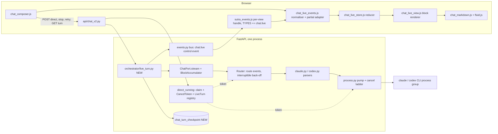

# Streaming chat: architecture

Status: revision 2 of the design, with the backend packages STR-1 to STR-7 and the client packages STR-8 to STR-14 built (see "Backend implementation notes" and "Client implementation notes" below). Date: 2026-11-14. Input: `analysis.md` (same folder; its section numbers and RC ids are used here). Paths are relative to `sutra-pro/sutra_app` unless noted. Decisions: D201 to D222 in `docs/DECISIONS.md` (D201 to D214 revised in place, D215 to D222 new). Work packages are STR-1 to STR-14 (see the last section).

Product goal: the chat feels instant, fluid, informative and real. Real means: every pixel of live text comes from a provider byte, every activity line from a provider or router event, nothing is invented, Stop really stops the process group, and a provider that cannot stream is labelled as such.

Scope fences (analysis section 7): `engine/` and the J2 cumulative-snapshot contract stay untouched; the AI-worker live view (`agent_live.json`, `chat.partial reset:true`) keeps its server side as it is but gets a client adapter (D221); the org chat staged path and `agent_ask.py` stay as they are. All new work is in `connectors/`, `orchestrator/`, `ui/static`.

## Revision 2: what the critique changed

The critique (19 points) was checked against the code. Every blocker and major point held, with the small premise corrections listed in "Critique points not taken as written" at the end of this section. The table says where each point landed.

| # | Point | Resolution in this design | Decision |
|---|---|---|---|
| 1 | Stop lost between `_chat_active` and `_track` | One owner: a per-turn `CancelToken` created by `direct_running`, passed `ChatPort.stream` to `Router` to `base._events`, bound to the process right after `_track`; `stopped:false` means only "no turn is running" | D215, D213 |
| 2 | Retry reuses `direct:<id>` refs and loses its reply | Attempt-scoped refs (`.N` suffix from attempt 2), all four places and `reconcile` updated together; earlier replies are `superseded` and kept out of the model's history | D216 |
| 3 | Hold-back redactor premise false | Hold back only a trailing suffix that is a prefix of a current secret (`redact.secrets()`); multi-word and multi-line secrets tested | D204 |
| 4 | `connecting` and `restart` have no source | Router emits `route.*` events (plan, attempt, failed with reason and delay) before the sleep and before the spawn; `usage` and `switched` leave the live set and ride `turn.done` | D217 |
| 5 | In-place settle unreachable; restart breaks keys | The stored-message refetch defers to the live store until the terminal event; the stored message holds the final attempt's blocks, earlier tries are a stored note; `turn.done` carries `stored_order` | D207, D219 |
| 6 | Idempotency in wrong order; `None` crash; ids not exposed | `client_id` lookup and claim before `begin`; `_post` handles `None`; `ChatMessageOut` exposes `client_id`, `attempt`, `superseded`, `ordered` | D220 |
| 7 | Tool lines dishonest at `block.start`; two accumulators | `block.start` shows the tool name only; title and target arrive in `block.update` at block stop; `BlockAccumulator` is the single owner, used by `ChatPort` and `LiveTurn` | D218 |
| 8 | AI workers and `chat.partial` unspecified | `chat_live_events.fromPartial` adapter, `stream_mode:"snapshot"`, no server change | D221 |
| 9 | Behaviour after Stop undefined | `LiveTurn` freezes at `request_stop`; stop route does not block; `stopped:false` resyncs; `sending` to `stopping` defined | D213 |
| 10 | Catch-up holes | SSE open first, buffer, then snapshot; resync on every reconnect; seq and publish under one lock, route events go through `LiveTurn`; `client_id` in `turn.accepted` | D222, D203 |
| 11 | Coalescer needs a timer | One condition-variable ticker per turn with real deadlines; checkpoint JSON serialised outside the lock | D204, D211 |
| 12 | Drop `SutraEvents.shared` | Dropped; only the `TYPES` entry; real state names (live, polling, offline) | D208 |
| 13 | `ordered` home, fold, double text | Sibling key in `meta_json`, `ChatMessageOut.ordered`; the fold counts call plus result as one unit; double text kept and bounded | D212 |
| 14 | Tool targets relative to wrong root | Relative to the turn's `folder`, basename outside; resolved in the connector so no root leaves it | D210 |
| 15 | Capture must go through connectors | Extend `scripts/capture_connector_fixtures.py` with a recording runner behind the connector; scrub; `ownership-audit.sh` before commit | D205 |
| 16 | Windows | No Windows claim anywhere | D213 |
| 17 | "Stalled" copy | Heartbeat carries `idle_limit_s`; copy shows the real limit; failure text names it | D213 |
| 18 | Back-off cannot be interrupted | The back-off wait becomes the token's wait, so Stop ends it at once | D215 |
| 19 | Ticker lifecycle | `ChatPort.stream` forwards `started` before its `continue`; `LiveTurn.close()` in a `finally`, join with timeout | D204 |

### Critique points not taken as written

1. Point 6 says `direct_running.begin()` raises `Busy`. Verified: `begin` returns `False` and the route raises `Busy` (`api/chat_v2.py:230`). The effect the critique describes (a double POST gets 409, never `duplicate:true`) is real and is fixed.
2. Point 10 says the existing reconnect delivers `server.resync`. Verified: the server sends that frame only when the last id cannot be replayed (`api/events.py`); the one the page sees on every reconnect is synthesised by `sutra_events.js` (hello after an error, lines 56 to 57 and 157 to 161). The design reuses that client-side one, which is what the critique wants.
3. Point 9 asks the client to stay frozen. This design goes one step further for exactness: the client does not drop deltas locally; the server freezes at the `turn.stopping` seq and every tab applies exactly up to it, so the stored text equals what every tab showed (a client-side freeze would still differ from a server stopped a few milliseconds later).
4. Point 13 notes the text is stored twice. Kept on purpose: the `text` column feeds search, carry-over and `ChatTranscripts`; the ordered text blocks feed the settled view. Bound: both are capped at `MAX_TEXT` (200,000), so at worst 2x per message, asserted by a test. Emptying the column would break FTS.
5. Point 15 asks that the capture go through connectors. `scripts/capture_connector_fixtures.py` already does for status and probe steps (connector flags, environment allowlist, scrubbing); the design extends it, it does not add a second script.
6. Point 18 is treated as a defect to remove, not a limit to accept (interruptible wait, D215).

### What was verified in code for this revision, and what was not

Verified: `Router._chat` clears the early flag on entry and `_chat_turn` registers `_chat_active` before `connector.stream` (`router.py` 875 to 882, 970 to 975); `base._events` tracks the process only after `runner.start` (`base.py` 535 to 542); `Router.chat_stop` returns `False` when no process is tracked and the turn is not in `_chat_busy`; `Router._drive` sleeps with `self._sleep` and only notes the failure after the turn; `ChatPort.stream` clears blocks on restart and `continue`s past `started`; `Redactor.secrets()` returns whole env and `.env` values (min 8 characters, longest first, `whole_line` values included, explicit extras any length); the ladder differs by platform (`process.py` 47 to 50: SIGTERM and SIGKILL only on one branch); `sutra_events.js` state names are `live`, `polling`, `offline`; the recovery SQL is in `orchestrator/chat_v2.py:250` (not `api/`) and matches `'direct:' || m.id`; `docs/diagram/decisions.json` stops at D200, so the earlier commit left `tests/test_diagram_decisions.py` failing (fixed here).

Not verified, so flagged as tasks with a check, never assumed: the exact stream shapes of Claude `content_block_start` ordering against the later `assistant` message and of Codex `item.*` (STR-1 captures them); that the parser can reach the turn's `folder` through `TurnPlan` (STR-5 adds the field if not); where the carry-over reader (`resume_info`, limit 20) lives, to add the `superseded` filter (STR-3 locates it, test proves it); the exact text of the idle-timeout error (STR-5 test asserts it names the limit); anything on Windows.

## Backend implementation notes (STR-1 to STR-7)

What was built, and where it differs from revision 2 because the real capture or the code said otherwise. Decisions D223 to D225 record the three that change a rule.

| Topic | Revision 2 said | What is built | Why |
|---|---|---|---|
| Tool title and target | computed at `content_block_stop` from the buffered `input_json_delta` | computed at the `tool_call` event (matched by `tool_id`); `block_stop` carries the buffered input only as a fallback | Real Claude sends the complete `assistant` message before `content_block_stop` (capture notes). D223 |
| Computing it | in the parser, with the turn's folder | in `BlockAccumulator`, with the folder read once from the router by `ChatPort`; the parser adds only new event kinds | The older parser tests assert `tool_call` data exactly. D223 |
| Event kinds | `block_start`, `block_stop`, `thinking`, `message_boundary`, `route` | the same without `thinking`: a thinking block is a `block_start` of type `thinking` and a `block_stop`; `thinking_delta` is dropped | Presence only; a separate kind carried nothing |
| Locks | `_pub_lock` outside, a data lock inside | one re-entrant lock for accumulator, seq and publish; checkpoint JSON and SQL outside it on a writer thread | A snapshot needs the pair consistent. D224 |
| Who sees the new kinds | every `ChatPort.stream` and `Router.chat_stream` caller | only a caller that passes `acc=` (ChatPort) or `routes=True` (Router) | Keeps every older caller and its tests as they were. D224 |
| Ref pattern | `\.[2-9][0-9]?` | `\.([2-9]\|[1-9][0-9])`, attempts 2 to 99 | The STR-3 table test found that attempts 10 to 19 were refused |
| Stop | route returns at once | the same; `stopped` true iff a turn was running; response `{session_id, stopped, state}` with the flag on and unchanged with it off | D225 |
| Refusal of a retry | `409 not_retryable` | the code is added to the closed list and to TROUBLESHOOTING | D225 |
| Idle timeout words | "No output from <provider> for L s" | "<Provider> did not answer within L s: it sent no output for that long, so it was stopped" | Older tests assert the first words |
| Stored text blocks | one block per streamed text | cut into blocks of at most 100,000 characters (the `ChatBlock` limit), the total capped at 200,000 | The record refuses a longer text block |
| Stopped or failed with no text | note only | the note (or error) carries the blocks that ran, so tools stay visible | A note may carry blocks |
| Recovery | "owner lines with no reply of any attempt" | checkpoints first (a retry whose first try has a reply is recovered under its own attempt), then owner lines with no reply | A retry that crashes is otherwise never marked |
| Codex | `item.started`, `item.updated` | `item.started` (command text present) and `item.completed` (exit code, capped output); `item.updated` was never seen and is ignored | STR-1 capture |

Not built at that stage: the client (STR-8 to STR-14, built later: see below), anything on Windows, the real-provider checks beyond the STR-1 capture and the fake-CLI end-to-end tests.

## Client implementation notes (STR-8 to STR-14)

What was built, and where it differs from the Client table above because the code or the browser said otherwise. Decisions D227 to D235 record them.

| Topic | The design said | What is built | Why |
|---|---|---|---|
| Files | `chat_live_events.js`, `chat_live_store.js`, `chat_live_view.js`, `chat_live_activity.js` | the same four, plus `chat_live_client.js` (snapshot, reconnect, polling, the clock, cleanup) | the composer needed one place for the network side; the reducer stays pure. D227 |
| Transport | the page's own `SutraEvents` handle | the same: an EventSource, so the browser frames the bytes; the intake judges each whole frame (de-duplicate, gaps, text offsets in code points, snapshot catch-up). No second SSE parser | `chat.live` has SSE id 0, so there is no byte cursor to resume from; the cursor is the `seq` of the snapshot. D227 |
| Composer | `state().turn` is a projection of the store | opt-in: `create({live: true})` (the pages pass it); without it every older caller and test sees the composer it had (the 43 older composer tests pass unmodified) | twenty tests assign and compare the plain turn object. D228 |
| The reply | a keyed list of block nodes in the transcript | one shell per reply, key `turn:<owner line>:<try>`, html constant per key, painted by `ChatLiveView` from a live or a stored model; status and actions in one row under the blocks | the stored message must take the live node over without a swap, and nothing above the footer may move at settle. D229 |
| Text | `Fluid.paintStream` per block | `Fluid.paintText`: segments (text and fences) reconciled; a fence is one `<pre>` kept through settle; highlight once, on settle | a fuzz of 300 random cuts found every case where the first version recreated a fence. D230 |
| AI workers | read through `fromPartial` (D221) | unchanged `AgentChats` live row; `fromPartial` serves the direct chat's flag-off path only | the worker row has a tool line and a raw-JSON rule the adapter would lose. D235 |
| Retry | `superseded` read from the server | also worked out on the page from the rows it has, because the page never re-reads old rows | a first try stayed uncollapsed until a reload. D233 |
| Label clock | one label | a stable state label (announced) and a clock (`aria-hidden`) | a number that changes every second must not be read out every second. D231 |
| Bus | not mentioned | `Event.data` keeps its white space (`Value` stripped every string) | the browser test found "aprice in rupees" on the wire. D232 |
| Node tests | jsdom | none in the repo: `tests/ui/js/helpers/fake_dom.js`, a small DOM that counts every node it creates | "no node recreated" needs a count, not a look |

Verified in a real Chrome (17 scenarios, with the fake CLIs replaying JSONL built from the real capture): normal, long (table, list, fence), tool, multi-stage with a reload mid-turn, cancel (the text shown equals the text stored), a network drop (no word repeated or lost, one reply), a turn that ended while the stream was down, error with Retry, backoff with Stop during the wait, an existing conversation, the flag off, the node panel, reduced motion, phone width, scrolling (follow, park, the pill, return), the reply item not moving at settle. Not run: the real-provider check (`tests/e2e/test_real_provider_live_chat.py`, opt-in, costs plan usage), anything on Windows.


## Context



The deployment is real and small: one local FastAPI process, the browser is the window (D12), one owner, loopback, token auth. That removes proxy, CDN and multi-node worries and leaves two real constraints: the HTTP/1.1 six-connection limit per origin, and the single global event stream every page already holds.

## Approach

1. **Keep the pipe, stop dropping and batching** (RC1 to RC4). The provider chain is already incremental. A server-side `LiveTurn` (new) consumes the events `ChatPort.stream` yields, assigns the envelope (seq, generation, attempt), runs the hold-back redactor and a timer-driven coalescer, and publishes one new control event type `chat.live` on the existing bus. All publishing for a turn, including the route's `turn.accepted` and `turn.stopping`, goes through `LiveTurn`, so seq and publish happen under one lock.
2. **One owner for block structure.** `BlockAccumulator` (new, `connectors/chat_blocks.py`, pure, no IO) owns block ids, per-message index scoping, tool-id matching, restart, redaction hook and the 400-unit fold. `ChatPort.stream` uses it for every caller (its `turn_done.blocks` come from it); `LiveTurn` consumes its output and adds only envelope, timing, checkpoint and publishing. There is no second implementation to diverge.
3. **One owner for stop.** A per-turn `CancelToken` is created at `direct_running.begin_turn`, and travels `ChatPort.stream` to `Router` to `base._events`. It is the only stop flag for a direct turn. Whoever asks for Stop sets the token; the process binds to it the moment it is tracked, and a token already set cancels the process at once.
4. **Router events are the source of honest "connecting" and "retrying".** The Router emits `route.plan`, `route.attempt`, `route.failed` (with reason, action, delay) before it sleeps or spawns. No UI state is invented.
5. **Client in three layers** (normaliser with a partial adapter, pure reducer, keyed block view). Transport stays each view's own `SutraEvents.connect` handle; only the `TYPES` list gains `chat.live`.
6. **Catch-up by snapshot, ordered safely.** Open the stream first, buffer, fetch the snapshot, apply events after the snapshot's seq. Reload, second tab, gap and every reconnect use this path.
7. **Honest states only**, each driven by a real event or a real absence of events, with the real idle limit shown.
8. **Durability by checkpoint** in a side table, written outside the lock; never `chat_messages.text` (FTS trigger).
9. **Rollback switch** `SUTRA_LIVE_V1` (default on at the end). Off keeps the legacy `chat.partial` path; the same `fromPartial` adapter reads it.

## Alternatives considered

| Option | For | Against | Verdict |
|---|---|---|---|
| A. Extend the global SSE with one control event `chat.live` (chosen) | No new connection; same auth, redaction (`_frame`), reconnect and backoff; proven incremental pipe; minimal `sutra_events.js` change (`TYPES`) | No per-stream backpressure; no replay, so snapshot catch-up; every page receives every chat's events | Chosen. Gaps closed by seq plus snapshot (D202, D203, D222) |
| B. Per-turn SSE endpoint | Natural `Last-Event-ID` replay, no fan-out | One more long-lived connection per turn on top of the per-view ones (six-connection pressure); second lifecycle to auth, test and reconnect | Rejected for now; revisit if measurements show the global stream hurting |
| C. `fetch()` + `ReadableStream` NDJSON on the POST | Request and stream in one trip | A reload or second tab cannot attach; hand-written reconnect; buffering intermediaries break it silently; duplicates the SSE client | Rejected |
| D. WebSocket | Bidirectional | New surface and auth path; Stop is a plain POST; none in the repo | Rejected |
| E. Keep `chat.partial` and add fields | Smallest diff | Cannot carry typed blocks; legacy guards assume text only | Rejected for the direct route; `chat.partial` stays for the agent path (adapter, D221) |
| F. `LiveTurn` re-implements block accumulation next to `ChatPort` (revision 1) | Fewer files touched | Two accumulators diverge on restart, tool ids, per-message indexes (critique 7) | Rejected; `BlockAccumulator` is the single owner (D218) |
| G. Stop flag kept as the Router's `_chat_stop_early` set | No new type | Cleared by `_chat` on entry; checked only before spawn; not reachable from `base._events` (critique 1) | Rejected; token (D215) |
| H. Whitespace-split hold-back (revision 1) | Simple | Secrets contain spaces and newlines; leaks (critique 3) | Rejected; secret-prefix hold-back |
| I. Shared ref-counted `SutraEvents.shared` (revision 1) | One connection per page | Undefined topics, `pollFn`, `ignoreHello` per subscriber; touches four views for no streaming benefit (critique 12) | Rejected and removed |

Also considered for the settle step: cross-fading a separate stream row into the stored bubble (cheap, still a jump) versus promoting the live row in place (chosen, D207, now with a refetch deferral so it is reachable).

## Components

### Server

| Component | Status | Files | Responsibility and interface |
|---|---|---|---|
| `CancelToken` | NEW | `connectors/cancel.py` | The single stop flag of a turn. `request() -> bool` (True the first time), `requested`, `wait(timeout) -> bool` (an Event wait, used by the back-off), `bind(proc)` (called by `base._events` right after `_track`; if already requested, calls `proc.cancel()` at once), `unbind(proc)`. Thread-safe; knows nothing about HTTP |
| Cancel threading | CHANGED | `connectors/base.py`, `connectors/router.py`, `connectors/chat_port.py` | `ModelConnector.stream(..., cancel=None)`; `base._events` checks the token before `runner.start`, binds after `_track` (inside `with proc`), and checks between events. `Router._chat`/`_chat_turn` take the token, check it before `_new_session`, before `connector.stream`, and no longer let `_chat` entry erase it (the old `_chat_stop_early` set stays only for callers without a token). `Router._drive` waits with `cancel.wait(delay)` when a token exists and raises `CallCancelledError` if it was set. `Router.chat_stop(sid)` sets the token if one exists for the sid, then cancels the bound process, and returns True iff a turn is running |
| Route events | CHANGED | `connectors/router.py` (chat path only) | `_drive` yields `ConnectorEvent(kind="route", data=...)`: `plan {order, model}` once; `attempt {provider, model, n, idle_limit_s}` right before `connector.stream`; `failed {provider, code, reason, retryable, action: "retry"\|"fallback"\|"fail", delay_s, next_provider}` before the sleep. Emitted only when `state.kind == "chat"`; engine and `ask` paths never see them. `reason` is the user-safe message |
| `BlockAccumulator` | NEW | `connectors/chat_blocks.py` | `feed(ConnectorEvent) -> list[BlockEvent]` (`start`, `delta`, `update`, `end`, `restart`); `stored_blocks() -> list[dict]` (final attempt, ABS-5 shape, folded); `earlier_attempts() -> list[Summary]`; `stored_order() -> list[block_id]`; `freeze()`. Rules: (a) block state is keyed by `(message_ordinal, index)`; `message_ordinal` increments on the parser's `message_boundary`, so indexes restarting in each assistant message never collide; (b) `saw_partial` is per message ordinal, and only suppresses the whole-text event of that same message; (c) a `tool_call` event from the later `assistant` message is matched to an open block by `tool_id` and updates it, never creates a second; (d) `restart` moves the current attempt's blocks to `earlier_attempts()` and starts a fresh list (block ids keep counting up); (e) `text_filter` factory (the hold-back redactor) is applied to each text block, stored text is the emitted text; (f) the fold: see Stored turn shape; (g) after `freeze()` text deltas are dropped, open tool blocks end `interrupted` |
| `ChatPort.stream` | CHANGED | `connectors/chat_port.py`, `chat_models.py` | `stream(session_id, turn, *, cancel=None, text_filter=None)`. Forwards `started` and `route` before its existing `continue` (today `started` is swallowed before `_map`); feeds every connector event to one `BlockAccumulator` and yields its `block_*` events as `ChatEvent` kinds `block_start`, `block_update`, `block_delta`, `block_end`; yields `restart` with data `{reason, provider}` taken from the preceding `route.failed`; `turn_done.blocks` = `acc.stored_blocks()`. `EVENT_KINDS` extended; consumers that match known kinds ignore the rest (test); `ModelPort` and engine paths never see them |
| `LiveTurn` | NEW | `orchestrator/live_turn.py` | One per direct turn. `LiveTurn(services, sid, message_id, generation_id, client_id, attempt_no, token)`. `.start()` starts the ticker; `.publish(type, payload, block_id=None)` takes `_pub_lock`, assigns `seq`, calls `bus.publish_one`, releases (one lock for both, so order on the bus equals seq order); `.on_event(ChatEvent)` maps to envelope events and coalesces; `.request_stop()` (sets token, freezes accumulator, publishes `turn.stopping` through `publish`, in that order); `.finish/.stopped/.failed` return the endings; `.snapshot()`; `.close()` (idempotent, called in `finally`, sets closed, notifies, joins the ticker with a 2 s timeout, so an exception in `_answer` cannot leak the thread). State, block table and counters sit under a short inner data lock (lock order and rules in Cross-cutting: Concurrency); never held during JSON serialisation or SQL |
| Ticker | NEW | in `live_turn.py` | One daemon thread per turn waiting on a `threading.Condition` with `timeout = earliest deadline` of: coalesce flush (first unflushed delta time + `SUTRA_LIVE_COALESCE_MS`, default 33), heartbeat (last provider event + 5 s), checkpoint (1.5 s and at least 256 new characters, or a block end or state change). The worker notifies the condition when it queues a delta, so a trailing delta is flushed on its deadline, not on the next provider event. Checkpoint: copy block table under the data lock (strings are immutable, so a shallow copy is cheap), serialise and write outside every lock, skip if the previous write is still running |
| Hold-back redactor | NEW | `orchestrator/live_redact.py` | Per text block. Described under Cross-cutting: Redaction |
| `direct_running` | CHANGED | `orchestrator/direct_running.py` | `begin_turn(sid, client_id) -> Claim` where `Claim` is `Started(token)` or `Busy(existing_client_id)`; `begin(sid)` stays as a thin wrapper for the team route. `bind(sid, live_turn)`, `live_of(sid)`, `token_of(sid)`, `end(sid)` (drops all three). `ChatSessionOut.live: {generation_id, seq, state, attempt_no}` additive; `direct_turn` stays |
| Routes | CHANGED | `orchestrator/api/chat_v2.py` | `direct`: validate, then `client_id` lookup, then `begin_turn`, then store (order in Key flows). `stop`: `request_stop`, schedule `port.stop` on a background task, return at once. `GET /chats/{sid}/turn` snapshot. `POST /chats/{sid}/direct/retry`. `_answer` drives `LiveTurn` in a `try/finally` that always calls `live.close()` and `direct_running.end`; legacy path kept as `_answer_legacy` behind `SUTRA_LIVE_V1`. `_post` returns `Optional[int]` and its callers treat `None` as a replayed ref, not an error |
| Refs and rows | CHANGED | `orchestrator/direct_turns.py`, `orchestrator/chats.py`, `orchestrator/chat_v2.py` (`recover_interrupted`), `orchestrator/models.py` | See Data model: Attempt-scoped refs |
| `ConnectorEvent` kinds | CHANGED | `connectors/models.py` or `base.py`, `claude.py` | New kinds: `block_start {index, type, tool_id, name}`, `block_stop {index, title?, target?}`, `thinking`, `message_boundary`, `route`. Claude parser handles `content_block_start/stop`, `thinking_delta`, `message_start/stop`, and accumulates `input_json_delta` into a private bounded buffer (8 KB) that is parsed at `content_block_stop` to compute title and target through `tool_kinds.describe`; the buffer is never sent. Gated on `plan.partials`; existing kinds unchanged |
| Codex parser | CHANGED | `connectors/codex.py` | `item.started` and `item.updated`; keep `command`, `exit_code`, capped `aggregated_output` on `item.completed`. Scope fixed by STR-1 capture. Never chunk `agent_message` |
| `tool_kinds` | CHANGED | `connectors/tool_kinds.py` | `describe(name, input, folder) -> (kind, title, target)`; `folder` is the turn's folder (the one `Router._chat_turn` passes to `connector.stream(folder=)`); target is relative to it when inside it, else a basename; a command is cut at 200; redacted by the caller. The root never leaves the connector |
| Checkpoint store | NEW | `orchestrator/live_checkpoint.py`, `schema.py` (migration v5) | `save`, `load(sid)`, `drop`; used by `LiveTurn` and `recover_interrupted` |
| Event types | CHANGED | `orchestrator/events.py` | `CONTROL_TYPES += ("chat.live",)`; constant `LIVE`; SSE id stays 0 (own seq in the payload) |

### Client

| Component | Status | File | Responsibility and interface |
|---|---|---|---|
| Transport | CHANGED (one line) | `ui/static/js/sutra_events.js` | `TYPES` gains `"chat.live"`. Nothing else: `home.js` and `node_panel.js` keep their own `connect` handle with their own topics, `pollFn`, `ignoreHello`. `onState` values stay `live`, `polling`, `offline` |
| Event normaliser | NEW | `ui/static/js/chat_live_events.js` | `normalise(raw, ctx) -> Action[]` and `fromPartial(raw, ctx) -> Action[]`. Validates envelope and `v`, drops other conversations, ignores unknown `type` (but advances seq), dedupes by `(generation_id, seq)`, detects seq gaps and `offset` mismatches (returns `{type:"gap"}`), matches `turn.accepted` to a pending send by `client_id`, buffers events while a snapshot is being fetched. `fromPartial` turns `chat.partial {text, reset, message_id}` into `partial.snapshot` actions (D221). No DOM, network or store |
| Store and reducer | NEW | `ui/static/js/chat_live_store.js` | `reduce(state, action)` (pure), `createStore`; selectors `activity`, `label`, `blocks`, `canStop`, `holds(messageId, attempt)` (true while a live generation for that owner line has no terminal event). State per conversation: `source: "live" \| "partial"`, the turn state machine below, `stash` of stored replies held back until the terminal event |
| Block renderer | NEW | `ui/static/js/chat_live_view.js` | `createView(host, deps)`, `.update(turnState)` patches a keyed list (key `block_id`); text via `Fluid.paintStream`, tool to a one-line item (generic "Using <name>" until `block.update`), thinking to a presence indicator. Settled messages paint from `blocks` by the same code; at settle the keys are remapped through `stored_order` (no node recreated) |
| Activity timeline | NEW | `ui/static/js/chat_live_activity.js` | `timeline(state)` from block events only; `ChatFold` summarises the same list when settled |
| Composer | CHANGED | `ui/static/js/chat_composer.js` | `state().turn` is a projection of the store (same keys, existing tests unmodified); optimistic owner line reconciled by `client_id`; `reconcile` ends a turn only on an agent row with `turn === id` and `attempt === running attempt`, and not while `holds()`; snapshot resync; stop and retry; `server.resync` always triggers a resync |
| Pill and scroll | CHANGED | `chat_pill.js`, `chat_scroll.js` | `MAX_SHOWN` removed for the live view; stream growth inside the scroller counts |
| Pages | CHANGED | `home.js`, `node_panel.js`, `home.html` | Stream row becomes a keyed transcript item; the chat refetch handler calls `composer.holds(...)` and skips rows it returns true for |
| Motion | CHANGED | `ui/static/css/sutra-panel.css` | Tokens and rules in Cross-cutting: motion |

## Data model

### Event envelope (`chat.live`, schema version 1)

Published through `bus.publish_one(LIVE, payload)` by `LiveTurn.publish` only; SSE `event: chat.live`.

| Field | Type | Meaning |
|---|---|---|
| `v` | int | Schema version, 1. A higher `v` keeps the turn row and shows "This app needs a refresh to show live updates"; the final message still arrives through `chat.message` |
| `id` | string | `"<generation_id>:<seq>"` |
| `conversation_id` | string | The chat session id |
| `message_id` | int | The owner's line the turn answers |
| `generation_id` | string | uuid4 hex, one per turn start and per owner-driven retry |
| `attempt` | int | 1, plus 1 per router restart (retry or fallback) inside this generation |
| `seq` | int | 1,2,3... per generation, gap free, assigned under `_pub_lock` together with the publish |
| `ts` | string | Server time ISO 8601 UTC with milliseconds; elapsed display and ordering checks only |
| `type` | string | See below |
| `block_id` | string or absent | `b1`, `b2`... per generation, not reset on restart |
| `payload` | object | Type specific, additive only within a version |

Event types and their real sources:

| `type` | Payload | Emitted from (real source) |
|---|---|---|
| `turn.accepted` | `{client_id, attempt_no, stream_mode?}` | `LiveTurn.publish` called by the route after the owner line is stored and grounding written, before the 202 returns. `client_id` lets the sender match it before it knows `generation_id` |
| `turn.connecting` | `{provider, model, stream_mode}` | Router `route.attempt` (provider and model chosen, process about to be spawned). Label is "Starting <provider>", not "connected" |
| `turn.started` | `{provider, model, session_id, stream_mode, idle_limit_s}` | Connector `started` event (the CLI's own init line). First honest "connected" |
| `attempt.failed` | `{provider, code, reason, action, delay_s, next_provider}` | Router `route.failed`, emitted before the sleep. `reason` is the user-safe message. The client shows "<provider> failed: <reason>. Retrying in N s" or "Trying <next>" using `delay_s` (real: the wait is exactly that long and Stop ends it) |
| `attempt.restart` | `{attempt, provider, after_side_effects}` | `ChatPort` `restart`, emitted when the next attempt begins (after the wait). `after_side_effects` is computed by the accumulator: an earlier attempt had a `tool_use` of kind edit or run |
| `block.start` | `{type, kind, name}` | Claude `content_block_start`; Codex `item.started`; for providers without start events, synthesised only from the first real byte. A tool block starts with the tool name only |
| `block.update` | `{title, target}` | Tool block at `content_block_stop` (input complete), or the matching `tool_call` event; Codex `item.updated`. Redacted, cut to 200, relative to the turn's folder |
| `block.delta` | `{delta, offset}` | Text deltas after hold-back; `offset` = characters already emitted for the block. No tool or thinking deltas |
| `block.end` | `{status: "ok"\|"error"\|"interrupted", is_error, truncated, size?, text?}` | Block stop, tool result, or stop/failure. `text` only for a block that never streamed (Codex whole message, non-streaming provider) |
| `heartbeat` | `{idle_ms, idle_limit_s}` | Ticker, when no provider event for 5 s. `idle_limit_s` is the connector's idle timeout (null when the plan has none) |
| `turn.stopping` | `{}` | `LiveTurn.request_stop`, in the same locked step that freezes the accumulator. Last event that can carry text |
| `turn.done` | `{message_id_reply, attempt_no, text_len, stored_order, usage?, switched?}` | After the reply is stored. `stored_order` lists the live `block_id`s in stored-block order (the settle map). `usage` and `switched` appear here only; they are not live events |
| `turn.stopped` | `{message_id_reply, attempt_no, exit, stored_order}` | After the process group is gone and the stopped message is stored |
| `turn.failed` | `{message, code, message_id_reply, attempt_no, stored_order}` | Failure ending, message user-safe; for an idle timeout it names the limit |

`stream_mode`: `"tokens"` (Claude), `"activity"` (tool or item events stream but the answer arrives whole; Codex if STR-1 confirms), `"final"` (heartbeat only), `"simulated"` (stub and `ScriptedPort`, "Demo provider"), `"snapshot"` (AI-worker and flag-off `chat.partial`: cumulative text only, no activity, no claim).

Unknown-event tolerance: unknown `type` and fields are ignored but seq is recorded. A `block.*` for an unknown `block_id` creates the block (a client that joined mid-turn degrades, it does not throw); a first event with `seq > 1` for an unknown generation triggers a snapshot resync.

### Mapping to ABS-5 typed blocks

| ChatBlock | Live events | Notes |
|---|---|---|
| `text` | `block.start`, `block.delta`*, `block.end` | Stored text is the emitted (redacted) text |
| `thinking` | `block.start`, `block.end` | Presence and duration only (D206) |
| `tool_use` (`kind`, `name`) | `block.start` (name), `block.update` (title, target), `block.end` | `title` and `target` are display fields |
| `tool_result` (`is_error`, `truncated`) | folded into the `tool_use` block's `block.end` live; stored as its own block as today | Live view pairs by `tool_id`; the stored order is call then result |

Stored blocks gain no field (ChatBlock is closed). Live `block_id`s are not stored; `turn.done.stored_order` maps them (see Cross-cutting: Settle).

### Stored turn shape

New turns write the ordered block list including text blocks, so a settled message renders in order (text, tools, text) as the live view did. The marker is not in `MessageMeta` (J2's closed key set). Blocks are already written as a sibling key of the meta (`chats.py` near 241); `ordered: true` is a second sibling key written the same way, read by `chats` into a new additive `ChatMessageOut.ordered: bool = False`. The `text` column stays `result.result`; text is therefore stored twice (column and text blocks), bounded by `MAX_TEXT`. Legacy messages render as today.

What is stored for a turn with restarts: the final attempt's blocks only (matching the `text` column, carry-over and the live view's promoted item). Earlier attempts are summarised in the existing notice message (`direct-switch:<id>[.N]`): the router's fallback note plus one line per earlier attempt that had tool blocks ("Earlier try (claude, failed: <reason>) ran: Read a.py, Edited b.py", at most 20 lines, from block titles, redacted). So an earlier try that could have changed files stays visible after reload, as text, and never as blocks that would break the index mapping.

Fold (D212): the cap counts stored elements, where a `tool_use` and its `tool_result` are one unit of two elements and are never separated. When the next unit would take the list past 400 elements, the accumulator closes the list with one `tool_use` block `kind:"other"`, `name:"more tool calls"`, `text:"N more tool calls not listed"`, `truncated:true`, where N counts units folded; further tool units only increase N (live and stored the same, the fold block updates via `block.update`). A use whose result has not arrived is reserved as two elements. Text beyond the cap is appended to the last text block. Total stays below the 500 read-model cap (`models.py:409`).

### Attempt-scoped refs (D216)

`chat_messages_src` is unique on `(session_id, src_ref)`, so a retry must not reuse a ref that an earlier attempt stored.

| Row | Attempt 1 (unchanged, historical rows stay valid) | Attempt N >= 2 |
|---|---|---|
| Owner line | `direct-ask:<client_id>` (today `DIRECT_ASK` + a random 16 hex; a client-supplied id replaces the random part) | not re-stored |
| Reply | `direct:<id>` | `direct:<id>.<N>` |
| Note, error, switch | `direct-note:<id>`, `direct-error:<id>`, `direct-switch:<id>` | same with `.<N>` |

`<N>` is the server-computed ordinal: one more than the number of replies already stored for that owner line, fixed when the generation starts and returned in the 202 as `attempt_no`. Four places change together in STR-3, with a table test over every ref shape:

1. `direct_turns.Ending.src_ref` pattern becomes `^direct(-(note|error|switch))?:[1-9][0-9]{0,15}(\.([2-9]|[1-9][0-9]))?$` (revision 2 wrote `[2-9][0-9]?`, which refuses attempts 10 to 19; the STR-3 table test found it).
2. `chats._turn_of` regex gains `(?:\.[0-9]+)?` after the id (it returns the owner id as before); a new `chats._attempt_of(src_ref)` returns 1 or N and feeds `ChatMessageOut.attempt`.
3. `recover_interrupted` (`orchestrator/chat_v2.py:250`) counts any reply of the owner line: `r.src_ref = 'direct:' || m.id OR r.src_ref LIKE 'direct:' || m.id || '.%'` (ids are digits, so the `.` cannot widen the match to another owner line).
4. Composer `reconcile` ends the turn only on an agent row with `turn === id` and `attempt === state.turn.attempt` (the attempt from the 202 or the snapshot). Without this the first attempt's stored partial reply would end the retry instantly.

Superseded replies: a reply (and its note, error, switch rows) of attempt k is `superseded` when a stored row of the same owner line has a higher attempt. `ChatMessageOut.superseded` is computed in the same SQL read as `answered_by`. The transcript shows superseded replies collapsed under "Earlier try" (kept: it may have changed files); `resume_info` (the carry-over reader, limit 20) and the model history exclude them, so the model is not told about a reply the owner replaced. STR-3 locates the carry-over reader and tests this.

`ChatMessageOut` gains four additive fields: `client_id` (parsed from `direct-ask:` refs, else null), `attempt`, `superseded`, `ordered`. The raw `src_ref` is not exposed.

### Checkpoint table (migration v5, additive)

```
CREATE TABLE chat_turn_checkpoint (
  generation_id TEXT PRIMARY KEY,
  session_id    TEXT NOT NULL,
  message_id    INTEGER NOT NULL,
  attempt       INTEGER NOT NULL,
  attempt_no    INTEGER NOT NULL,
  state         TEXT NOT NULL,
  seq           INTEGER NOT NULL,
  blocks_json   TEXT NOT NULL,       -- current attempt blocks as emitted (redacted), capped 256 KB
  updated_at    REAL NOT NULL
)
CREATE INDEX chat_turn_checkpoint_session ON chat_turn_checkpoint(session_id)
```

Appended to `schema.MIGRATIONS` (never edit old steps); `TABLES` and schema tests updated. No change to `chat_messages` or its FTS trigger. Downgrade ignores the table. The row is deleted in the transaction that stores the final reply.

## Interfaces / APIs

| Route | Request | Response | Errors |
|---|---|---|---|
| `POST /api/chats/{sid}/direct` | existing body plus `client_id` (optional; 8 to 64 chars `[A-Za-z0-9_-]`) | 202 `{message_id, turn:"started", generation_id, attempt_no:1, client_id}`. A repeated `client_id` for the same chat returns 200 `{duplicate:true, turn:"started"\|"done", message_id\|null, generation_id\|null, client_id}` and starts nothing (ids null only while the first request is still storing its line; the client matches by `client_id`) | 409 `busy` only when a turn with a different `client_id` is answering; 404; 422 bad `client_id` |
| `POST /api/chats/{sid}/direct/stop` | none | 200 `{session_id, stopped, state}` returned at once; the process cancel runs on a background task. `stopped:true` means a turn was running and Stop is now requested; `stopped:false` means no turn is running (so the UI resyncs from the snapshot, never clears `stopping` itself) | 404; token |
| `GET /api/chats/{sid}/turn` | none | 200 `{generation_id, message_id, attempt, attempt_no, state, seq, stream_mode, elapsed_ms, idle_limit_s, blocks:[...], earlier:[{provider, reason, blocks:[...]}]}` or 200 `{live:false, last_reply_id?, last_attempt_no?}` | 404; token; redacted like every response |
| `POST /api/chats/{sid}/direct/retry` | `{message_id, client_id}` | 202 as `/direct`, new `generation_id`, `attempt_no = N`, no new owner line | 409 `busy`; 409 `not_retryable` when the owner line has a stored `ok` reply or is not the chat's newest owner line; 404 |
| `GET /api/events` | unchanged | adds `chat.live` frames | unchanged |

Python seams: `ChatPort.stream(sid, turn, *, cancel=None, text_filter=None)` (defaults keep every old caller as is); `Router.chat_stop(sid) -> bool` (True iff a turn is running).

## Key flows

### Send (idempotent), stream, settle

```mermaid
sequenceDiagram
  participant U as Owner
  participant B as Browser store/view
  participant A as chat_v2 route
  participant L as LiveTurn
  participant P as ChatPort/Router/CLI
  U->>B: Send
  B->>B: state sending, optimistic owner line keyed by client_id, no provider claim
  B->>A: POST /direct {client_id}
  A->>A: validate; client_id lookup (stored line or running claim) -> duplicate, else begin_turn (token); store line; ground
  A->>L: LiveTurn created, bound; publish turn.accepted {client_id} (seq 1)
  A-->>B: 202 {message_id, generation_id, attempt_no}
  L->>P: stream(cancel=token, text_filter=holdback)
  P-->>L: route.plan, route.attempt
  L-->>B: turn.connecting "Starting claude"
  P-->>L: started (CLI init)
  L-->>B: turn.started
  P-->>L: block_start tool_use Read (name only)
  L-->>B: block.start "Using Read"
  P-->>L: content_block_stop (input complete)
  L-->>B: block.update "Reading src/x.py" (relative to folder)
  P-->>L: tool_result
  L-->>B: block.end ok
  P-->>L: block_start text, deltas
  L-->>B: block.start, block.delta (first at once, then timer flush within 33 ms)
  P-->>L: turn_done
  L->>L: one tx: store reply + ordered blocks + earlier-try note, drop checkpoint
  Note over B: chat.message for the reply arrives before turn.done: composer stashes it (holds), no re-render
  L-->>B: turn.done {message_id_reply, stored_order}
  B->>B: install the stashed row; remap live keys through stored_order; same nodes
```

### Stop (any window)

```mermaid
sequenceDiagram
  participant B as Browser
  participant A as stop route
  participant L as LiveTurn
  participant T as CancelToken
  participant R as Router/base/process
  B->>B: label Stopping at once, button disabled, text still applies up to turn.stopping
  B->>A: POST /direct/stop
  A->>L: request_stop(): token.request(), accumulator.freeze(), publish turn.stopping (one locked step)
  A-->>B: 200 {stopped: true} at once (UI does not wait on it)
  A->>R: background: Router.chat_stop -> proc.cancel() if bound
  alt process not yet tracked (before spawn, in session setup, or between _chat_active and _track)
    R->>T: base._events binds proc right after _track
    T->>R: already requested: proc.cancel() immediately
  else back-off sleep
    R->>T: cancel.wait(delay) returns early -> CallCancelledError
  end
  R->>R: SIGINT 5 s, SIGTERM 5 s, SIGKILL 2 s where the platform has them (see Cross-cutting)
  R-->>L: CallCancelledError
  L->>L: open tool blocks end interrupted; store the frozen text + blocks
  L-->>B: turn.stopped {message_id_reply, stored_order}
```

The server stops emitting and accumulating at `request_stop`, so what is stored equals what every tab received (the last text event is before `turn.stopping`). While the CLI keeps printing during its grace period, those bytes are read and dropped.

### Open the page mid-turn, second tab, reconnect

```mermaid
sequenceDiagram
  participant B as Page
  participant S as SSE (own handle)
  participant A as API
  participant L as LiveTurn
  B->>S: open stream first (chat.live frames buffered by the normaliser)
  B->>A: GET /chats/{sid} (live: {generation_id, seq})
  B->>A: GET /chats/{sid}/turn
  A-->>B: snapshot (blocks, earlier, seq=N) or {live:false, last_reply_id}
  B->>B: seed state; drop buffered events seq <= N; apply N+1..; live:false -> fetch messages, no stall wait
  L-->>S: chat.live seq N+1...
```

Resync rules: a seq jump or offset mismatch, a `server.resync` (the page's own handle synthesises one on every reconnect, with no 3 s threshold), a `stalled` heartbeat gap, or the polling state all run the same sequence (rows keep showing, label "Catching up", snapshot, resume). While `onState` is `polling`, the snapshot route is polled every second with the label "Live updates paused, checking every second". A lost `turn.done` is found by the snapshot's `live:false` at the first resync, not by the 15 s rule.

### Router retry with back-off

`route.failed` is emitted, the UI shows the failure reason and a countdown from `delay_s`, the wait ends early on Stop, then `route.attempt` and `attempt.restart` mark the new attempt; the earlier attempt's blocks move under "Earlier try", and the text area starts fresh. There is no stale "Writing" and no frozen text during the wait.

### Crash recovery

At server start `recover_interrupted` (`orchestrator/chat_v2.py`) finds owner lines with no reply of any attempt (the LIKE form above). If a checkpoint exists it stores one agent message from it (partial text, blocks `interrupted`, `state="error"`, sibling `ordered`) plus the existing "Interrupted: the app closed..." line, then drops the checkpoint. Otherwise unchanged.

## Message state machine

Turn state (server `LiveTurn.state`; the reducer mirrors it and adds the client-only `sending` and `resyncing`):

| State | Meaning | Entered by |
|---|---|---|
| `sending` (client) | POST in flight | Send |
| `accepted` | Owner line stored, turn bound | `turn.accepted` or the 202 |
| `connecting` | Provider chosen, process starting | `turn.connecting` |
| `running` | Provider init seen | `turn.started` |
| `backoff` | An attempt failed and the router is waiting or switching | `attempt.failed` (left by `attempt.restart` or a terminal event) |
| `stopping` | Stop requested | Stop press (client), `turn.stopping` |
| `done` / `stopped` / `failed` | Reply stored | terminal events |
| `interrupted` | Found after a crash, from the checkpoint | read from the stored message |

Legal transitions (anything else is ignored and logged in dev builds; terminal states never change):

| From | To | Trigger |
|---|---|---|
| (none) | `sending` | Send |
| `sending` | `accepted` | 202 or `turn.accepted` |
| `sending` | `stopping` | Stop pressed while the POST is in flight: the label shows Stopping at once, `stopQueued` is set, and the stop POST is sent as soon as the 202 gives the turn an id (never before, so it cannot reach a chat with no turn) |
| `sending` | `failed` | POST refused or network error (optimistic line marked failed; with `stopQueued` it simply ends, nothing to stop) |
| `accepted` | `connecting`, `running`, `backoff`, `stopping`, `failed` | event; `running` may skip `connecting` |
| `connecting` | `running`, `backoff`, `stopping`, `failed` | `turn.started`; `attempt.failed`; Stop; spawn failure |
| `running` | `running` (restart), `backoff`, `stopping`, `done`, `failed`, `stopped` | events; `stopped` covers a Stop from another tab |
| `backoff` | `connecting`, `running`, `stopping`, `failed`, `stopped` | `attempt.restart`; Stop (ends the wait at once); terminal |
| `stopping` | `stopped`, `done`, `failed` | terminal events (`done` when the turn finished before the signal landed) |
| any non-terminal | `resyncing` and back | gap, `server.resync`, polling |

A stop response of `stopped:false` never changes state by itself: it triggers the snapshot resync, which reports either the terminal state or `live:false`.

Derived `activity` while `running` (selector; first match wins):

1. `stalled`: no event of any type for 15 s on the client: "Live updates paused", triggers resync; or a heartbeat with `idle_ms >= 20000`: "Still working, no output for N s. The provider is stopped after L s without output" with the real N (from `idle_ms` plus elapsed since the heartbeat) and the real L (`idle_limit_s`; if null, no limit is stated). The eventual failure message says "No output from <provider> for L s, so it was stopped" (a STR-5 test asserts the text names the limit)
2. `tool`: an open `tool_use` block: its title, or "Using <name>" before `block.update`
3. `writing`: an open `text` block
4. `thinking`: an open `thinking` block
5. `waiting`: "Waiting for <provider>"

Labels by state: `sending` nothing but the owner line, `accepted` "Sent", `connecting` "Starting <provider>", `running` the activity label, `backoff` "<provider> failed: <reason>. Retrying in N s" or "Trying <next provider>", `stopping` "Stopping", terminal none.

## Cross-cutting

### Redaction: hold back only what could still become a secret

`services.redact` replaces exact secret values (environment values whose names contain KEY, TOKEN, SECRET, PASSWORD or AUTH, every `.env` value including `whole_line` values, minimum 8 characters, longest first, plus explicit extras of any length). A value can contain spaces and newlines, and the set is read on every call. So the redactor never splits on whitespace and never uses a constant length.

Per text block, `HoldBack.push(delta) -> emit_text`: let `text = held + delta`; read `secrets = redact.secrets()` now; find the longest suffix of `text` that is a proper prefix of any secret (candidate start positions found by searching for each secret's first character in the last `max_len - 1` characters; a suffix that equals a whole secret is not held, it is redacted); `held` becomes that suffix and `emit_text = redact(text[:-len(held)])`. At block end or turn end the held remainder goes through `redact` and is emitted (a partial prefix is not a secret). The stored text is the concatenation of what was emitted. Properties: correct for any value (multi-word, multi-line); no added latency when the trailing characters are not the start of a secret (the normal case: held is empty); at most `max secret length - 1` characters held when they are. A secret added to the environment mid-turn applies from the next push; text already emitted is not retroactively changed (documented, tested). Tests: a multi-word secret and a secret with a newline split at every possible boundary never appears in any emitted frame, the stored text, or a snapshot; a short text with a trailing `s` is emitted at once when no secret starts with `s`.

### Frontend store and layering

Per view handle `SutraEvents.connect` -> `ChatLiveEvents.normalise` (or `fromPartial`) -> `ChatLiveStore.reduce` -> `ChatLiveView.update`. Each layer has one input and one output. The composer wires them and owns the network calls. The reducer never reads the clock: a `tick` action every second while a turn is active carries `now`.

### AI workers and the polled path (D221)

The composer's `state().turn` is a projection of the store, so the store must also be fed by the agent path, which sends `chat.partial` with `reset:true` and no seq, generation or blocks. `fromPartial` converts each frame into `partial.snapshot {text, reset, message_id}`; the reducer keeps a synthetic generation `partial:<sid>:<message_id>` with one text block, replaces its text on each snapshot (cumulative, as J2 sends it), starts a fresh block on `reset`, sets `stream_mode:"snapshot"`, and sets `source:"partial"` (gap detection and snapshot resync are off for it; the existing reconcile and polling behaviour apply). The turn ends as today (reply row with matching `turn`). No tool activity, no label claim beyond what the text shows. The flag-off direct path uses the same adapter, so legacy behaviour is covered by the same tests. The existing composer tests (which exercise `chat.partial`) pass unmodified; new adapter tests cover reset, a repeated snapshot, an older shorter snapshot and an unknown conversation.

### Settle in place (D207, D219)

Why revision 1 could not settle: the reply's `chat.message` (from the DB commit) arrives before `turn.done`, and the composer's `reconcile` and the page refetch would replace the live row first. Now:

1. While `holds(messageId, attempt)` is true (a live generation exists for the owner line and has no terminal event), the composer's `reconcile` does not end the turn, and the page refetch skips any row with that `turn` and `attempt`; such rows go to the store's `stash`. The `chat.message` event for them is also stashed.
2. At the terminal event the store installs the stashed (or, if absent, fetched) row for `message_id_reply` and remaps keys: live block `stored_order[i]` becomes stored block `i`; the row key becomes `"m"+reply_id`. Nodes are re-keyed, not recreated; only the tail text node and a held (unfinished) table region re-render.
3. Safety valve: if the terminal event never comes, the snapshot's `live:false` (first resync) releases the hold and the page shows the stored message normally. Release also happens when the stashed reply is more than one stall window old with no events.
4. Earlier tries: the live "Earlier try" group is converted into the stored switch note row (written in the same transaction), which is a different item from the reply; the no-jump guarantee is for the reply item (bounding box test), not for the collapsed earlier-try item.

### Block rendering with stable ids

Map of `block_id` to node. Text nodes keep settled sub-blocks (paragraph, fence, list, table) as DOM never rewritten; only the tail re-renders. A tool node is created at `block.start` ("Using Read"), updated at `block.update` (title, target) and `block.end` (status, duration), never recreated.

### Activity timeline

From block events only. Each entry: kind icon, title, target, status (`running`, `ok`, `error`, `interrupted`), duration from `ts` deltas. No counts or percentages the wire does not carry; "N tool calls" counts real units. Thinking shows presence and elapsed time. After `turn.done` the list collapses into the existing `ChatFold` summary.

### Motion tokens and reduced motion

Reuse `--dur-fast`, `--dur-base`, `--dur-slow`, `--ease-out`. New rules inside `@media (prefers-reduced-motion: no-preference)`:

| Token use | Element |
|---|---|
| `--dur-fast` opacity + translateY(4px) | New block node, new owner line (`.nmsg-in` gets its missing keyframes) |
| `--dur-base` fade | Whole-block text arrival for non-streaming providers (a fade, never a typewriter) |
| 1.2 s opacity pulse | Presence dot while `waiting`, `thinking`, `connecting`, `backoff`; stops when text flows |
| `--dur-base` height transition | Tool item expand and collapse |

Under `reduce` all are none; state still changes. `role=status aria-live` moves from the growing text to a short label node updated on state changes only.

### Scroll-follow rules

1. Follow while at the bottom (existing `ChatScroll` intent machine); the live row is inside the scroller.
2. Scrolling away parks following; new content raises the pill, the live row counts as one ("Reply in progress").
3. Sending always scrolls to the bottom and resumes following.
4. `behavior: auto` while streaming.
5. A block insertion above the viewport while parked must not move the reader's content (existing `pin` and `ResizeObserver`, tested).
6. Settle keeps node identity, so no jump to compensate for.

### Cancellation propagation (D213, D215)

1. One owner. `CancelToken` is created by `direct_running.begin_turn` and is the only stop flag of a direct turn. It reaches `base._events` through `ChatPort.stream(cancel=)` and `Router`. Checks: before `_new_session`, before `connector.stream`, before `runner.start`, immediately after `_track` (via `bind`, which cancels at once if already requested), between events, and in the back-off wait. The window between `_chat_active[sid]` being set and `_track` is closed by `bind`, not by a flag read earlier. `_chat`'s entry `discard` cannot erase a token. The legacy `_chat_stop_early` set remains for non-token callers (org chat staged path).
2. Truthful result. `Router.chat_stop` returns True iff a turn is running (token exists and its `end` has not run). It never reports `False` because the process is not tracked yet.
3. Non-blocking route. The stop route calls `LiveTurn.request_stop()` (token set, accumulator frozen, `turn.stopping` published, all in order) and schedules `port.stop` on a background task; the response does not wait for the up to 12 s ladder. The UI does not depend on the response: success or `stopped:false` both end in the snapshot resync, and the terminal event is the only thing that ends `stopping`.
4. After Stop is requested `LiveTurn` neither emits nor accumulates text; the stored text equals what all tabs received; open tool blocks end `interrupted` with the label "Interrupted, may have partly run".
5. Platform claim. On POSIX the ladder is SIGINT (5 s), SIGTERM (5 s), SIGKILL (2 s) on the process group, which also reaches tools in that group. Windows is not claimed: per the code the ladder differs there (no SIGINT step; the job object ends tools after the child exits), there is no verified graceful flush, so Stop may be abrupt, and timer granularity (about 15 ms) may stretch the 33 ms coalescer. None of this is verified on Windows; no timing or "graceful" wording is shown there, and the tests that depend on it are POSIX-marked.
6. If Stop races a finishing turn the result is `done` and the UI shows done (legal `stopping` to `done`).
7. `Router` retry back-off is interruptible (`cancel.wait`), so Stop does not sit at "Stopping" for the length of the back-off.

### Retry without duplicated side effects

1. `client_id` on send and retry; the owner-line ref is `direct-ask:<client_id>`; lookup and claim precede `begin_turn`, so a double POST returns `duplicate:true` (never 409, never a second turn). A concurrent double POST is caught by the claim in `direct_running` (same `client_id`).
2. Owner retry reuses the owner line, starts a new generation, and uses attempt-scoped refs; offered only for a failed or stopped newest line.
3. Router restarts carry `after_side_effects`; an earlier try that may have changed files stays visible ("Earlier try", stored as the switch note) and the banner says so. The owner-driven retry shows that warning first when side effects were possible.
4. A failed or stopped turn keeps its blocks.
5. The first attempt's kept partial reply stays in the transcript, collapsed under "Earlier try", and is excluded from the model's history (`superseded`).

### Persistence checkpoints

`LiveTurn` saves when state changes, a block ends, or 1.5 s passed with at least 256 new characters. One INSERT OR REPLACE of the blocks JSON capped at 256 KB (older text trimmed head-first, `truncated`). The data is copied under the data lock and serialised and written by the ticker thread outside every lock, skipped while the previous write runs. Never an UPDATE of `chat_messages`. Refresh while the process lives uses the snapshot (memory); the checkpoint is for crash and restart.

### Providers that cannot stream

`stream_mode` comes from `Capabilities.partials` plus the STR-1 result. For `activity` and `final`: a stable note "<Provider> sends its answer in one piece" and the timeline when events exist; the answer appears whole at `block.end` with a fade only; no chunking, no travelling caret, no percentages. `simulated`: "Demo provider, simulated". `snapshot`: no note. Heartbeats still prove liveness; elapsed time shown as "Working, 14 s" is a true measurement.

### Security

1. Ownership: all routes need the token and a known `sid`. `chat.live` rides the global stream any authenticated page of the single owner can read (as `chat.partial` does); pages filter by `conversation_id`. `topic_of` exists for per-chat topics later (not in scope).
2. Redaction: (a) secret-prefix hold-back on text deltas, (b) `_frame` scrub on every frame, (c) `RedactedJSONResponse` on every response. Tool `title` and `target` pass `services.redact` and are cut to 200; targets are relative to the turn's `folder` or a basename, so neither the work root nor a home path is sent. Raw tool input, tool output and thinking text are never sent live. The snapshot is built from the same redacted accumulation. `input_json_delta` is buffered server-side only, bounded at 8 KB, parsed at block stop, discarded.
3. Client: every string through `esc`/`safeText`/`ChatMarkdown`; the normaliser bounds sizes (delta 16 KB, title 200, blocks 500) and drops oversize events.
4. Fixtures: every captured fixture is scrubbed and passes `scripts/ownership-audit.sh` before commit (D205).

### Performance

Server: at most about 30 `chat.live` frames per second per turn; the first delta of a block is never delayed; checkpoint at most one per 1.5 s, off the data lock; `MAX_PENDING = 2000` is about 66 s of a stalled tab at full rate, recovered by snapshot. Hold-back cost is bounded by the number of secrets times the tail window. Client: reducer O(event); one `Fluid.frame` job per conversation per animation frame; tail-only re-render. Budget asserted by tests: a 200 KB reply in 4,000 deltas gives at most one tail re-render per frame and zero re-renders of settled sub-blocks.

### Logging and config

`SUTRA_LIVE_V1` (default `1` at STR-14, `0` before), `SUTRA_LIVE_HEARTBEAT_S` (5), `SUTRA_LIVE_COALESCE_MS` (33), `SUTRA_LIVE_CHECKPOINT_S` (1.5): read once in `config.py`. Server logs per turn: generation id, stream_mode, time to `accepted`, `started`, first delta, end; no content, no tool args.

### Concurrency

One `LiveTurn` per chat. Two locks with a fixed order: `_pub_lock` (outer) and the data lock (inner, short). Anything that produces an event (the worker mapping a provider event, the ticker flushing the coalescer buffer, the route's `turn.accepted`, `request_stop`) takes `_pub_lock`, reads or pops what it needs under the data lock, assigns `seq` and calls `bus.publish_one` (non-blocking, `call_soon_threadsafe`) before releasing `_pub_lock`; so bus order equals seq order and a flushed text delta can never overtake a later one. The data lock is never held during JSON serialisation or SQL (the checkpoint copies under it and writes after releasing both). Every event of a turn, including the route's `turn.accepted` and `turn.stopping`, is published through `LiveTurn.publish`. The ticker is a daemon thread started by `start()` and joined by `close()` in the `finally` of `_answer` (join timeout 2 s, so a raising `_answer` cannot leak it or hang). The worker task reference is kept in the registry (analysis step 4). `direct_running.end` runs in the same `finally`, dropping claim, token and `LiveTurn` together.

## Migration and back-compat

| Item | Plan |
|---|---|
| `chat.partial` | Unchanged server side for the agent and J2 polled path and for `SUTRA_LIVE_V1=0`; read on the client by `fromPartial` (D221) |
| Stored messages | Old messages render unchanged. Historical refs (`direct:<id>`, etc.) are attempt 1 by definition. New messages carry the sibling `ordered` key. `text` column semantics unchanged |
| `ChatMessageOut` / `ChatSessionOut` | Additive fields only (`client_id`, `attempt`, `superseded`, `ordered`; `live`); `direct_turn` kept; `src_ref` not exposed |
| `state().turn` in `ChatComposer` | Same keys plus additions; the existing composer tests pass unmodified before new ones are added |
| `ChatEvent` and `ConnectorEvent` kinds | Extended; consumers matching known kinds ignore others; route events only on the chat path; engine paths never see them |
| `ModelConnector.stream` | New optional `cancel=None`; fakes and stubs updated; default keeps every caller |
| DB | Migration v5 additive |
| Non-streaming providers, departments, connectors, AI workers, J2 runs | Same code paths; only the direct chat route and its UI change |
| Page scripts | `home.html` is the only page loading the chat stack; new scripts there and in node_panel host pages; dual export pattern kept; the other three `SutraEvents` users are untouched |

## Test strategy

Ids: S1 first honest state, S2 genuine streaming, S3 honest activity, S4 real stop, S5 retry safety, S6 persistence and refresh, S7 non-streaming providers, S8 security, S9 performance, S10 no regression.

| Level | What | Covers |
|---|---|---|
| Unit Python | `CancelToken`: bind after request cancels at once; `wait` returns on request; concurrent request and bind in both orders | S4 |
| Unit Python (connector) | Fake runner whose `start` blocks: Stop requested during `_new_session`, between `_chat_active` and `_track`, and during `runner.start` always ends with the process cancelled; `chat_stop` returns True throughout the turn and False only after it ended; `_chat` entry does not erase a token; back-off wait ends early; no process left running | S4 (critique 1, 18) |
| Unit Python | `BlockAccumulator`: per-message index scoping (two assistant messages both with index 0); `saw_partial` per message; `tool_call` matched by `tool_id` creates no second block; restart moves blocks to earlier; fold counts call plus result as one unit, never splits a pair, total under 500; freeze drops deltas and ends tools `interrupted`; stored order map | S2, S3 |
| Unit Python | `LiveTurn`: seq gap free and equal to bus order with a thread racing route events; first delta immediate; trailing delta flushed by the timer with no further provider event (fake clock and a real-timer smoke); `request_stop` freezes before `turn.stopping`; close joins even when `_answer` raises; checkpoint serialised outside the lock (lock-held probe); snapshot equals replay of events | S1, S2, S4, S6 |
| Unit Python | Hold-back: multi-word and newline-containing secrets split at every boundary never appear in a frame, the stored text or a snapshot; extras shorter than 8; empty held in the normal case; stored text equals emitted text | S8 |
| Unit Python | Parsers: Claude `content_block_start/stop`, `thinking_delta`, `message_start`, `input_json_delta` buffer to title and target (relative to `folder`, basename outside), buffer bound and never emitted; Codex `item.*`; existing parser tests unchanged | S3, S7, S8 |
| Unit Python | `ChatPort`: `started` forwarded; route kinds; unknown kinds ignored on engine paths; `usage` and `switched` only in `turn_done`; restart carries the reason from `route.failed` | S3 |
| Data Python | Ref table test over every shape; `_turn_of`, `_attempt_of`, `Ending` pattern, `recover_interrupted` LIKE; retry after a failed and after a stopped turn stores its reply (no `None`); `superseded` excluded from `resume_info` and the model history; `ChatMessageOut` fields; `ordered` sibling key round trip; text stored twice stays under the bound | S5, S6, S10 |
| API Python | `/direct` double POST during the turn returns `duplicate:true` (not 409); concurrent double POST; different `client_id` gets 409; `_post` duplicate does not 500; Stop in each window returns `stopped:true` and ends the turn; Stop with nothing running returns `stopped:false`; stop route returns before the ladder finishes; snapshot route; retry 409s; `chat.live` through SSE with `_frame` scrub; flag off equals legacy payloads | S1, S4, S5, S6 |
| Integration | `ScriptedPort` and fake CLI scenarios (`tests/e2e/test_scenario_*`): tool then text then tool; restart with back-off and Stop during the back-off; stop mid tool and the grace-period output not stored; idle-timeout failure text names the limit; crash and `recover_interrupted` restoring the checkpoint | S3, S4, S6 |
| Unit JS | Normaliser (unknown type, dedupe, gap, version, `client_id` match, buffering around the snapshot, first event `seq > 1`), `fromPartial` (reset, repeated, shorter, other conversation); reducer transition table including `sending` to `stopping`, `backoff`, every illegal pair; selectors (activity precedence, stalled with the real limit); view patch (stable nodes, tool block updated by `block.update`, tail-only redraw, earlier-try grouping, key remap through `stored_order`); `holds` and stash: a `chat.message` before `turn.done` does not replace the live row; composer `reconcile` ignores a superseded attempt row; optimistic line reconciled by `client_id` (one bubble, also with a second tab); stop response `stopped:false` resyncs and does not clear `stopping`; every reconnect resyncs; existing composer tests unmodified | S1 to S6, S10 |
| Perf JS | 200 KB stream with a DOM counter | S9 |
| Browser e2e | CDP: first visible state before first token; tool line "Using Read" then its target; Stop freezes at `turn.stopping` and settles with no node swap; reload mid-turn reattaches (stream first, then snapshot); lost `turn.done` found at the first resync; reduced-motion emulation; no layout jump of the reply item at settle (bounding box); Home and panel; AI-worker chat still streams via the adapter | S1 to S6, S10 |
| Real-provider checks | Manual or `RUN_REAL=1` where the CLI exists; capture through connectors; time to first token and Stop latency logged; POSIX only. Not claimed in CI, nothing claimed for Windows | analysis 9 |
| Repo gates | `tests/test_diagram_decisions.py` (decisions.json in step with DECISIONS.md), `scripts/ownership-audit.sh` for `sutra-pro/`, engine byte-for-byte gate | S8, S10 |

## Rollout and risk

Order: capture first, then the stop owner and the data foundations (the riskiest, touching `router.py`, `base.py`, refs), then events and `LiveTurn`, routes (flag default off), client, flag on, cleanup. Rollback: `SUTRA_LIVE_V1=0`, no data change (the checkpoint table is ignored; superseded and ref changes are additive and read the same either way). Risks: (1) Codex may emit less than assumed: degrades to `activity` or `final` by `stream_mode`. (2) Touching `router.py` and `base.py` for the token: kept to an optional kwarg, all existing connector tests run unchanged in STR-2. (3) Ref change touches four places: one package, one table test. (4) The stream row moves into the scroller (`home.html`, `home.js`, `node_panel.js` together): both pages tested. (5) The hold-back secret scan runs per flush: bounded by secrets times tail window, measured in the perf test. (6) Unverified layout hypotheses (analysis 9.4): tested in the browser before they are "fixed". (7) Windows behaviour is unverified and unclaimed.

## Traceability

| Need | Component | Package | Test |
|---|---|---|---|
| S1 sending/accepted/connecting states, optimistic line by `client_id` | store, composer, `turn.accepted/connecting`, route order | STR-7, STR-8, STR-9 | reducer transitions, composer back-compat, API duplicate, browser e2e |
| S2 genuine tokens, no 60-char quantum, no head cap | `LiveTurn` ticker coalescer, view, `MAX_SHOWN` removal | STR-6, STR-9, STR-10 | live_turn cadence with no provider event, perf JS, e2e |
| S3 honest tool, thinking and retry activity | parser kinds, `BlockAccumulator`, route events, timeline | STR-5, STR-10 | parser fixtures, accumulator, route-event tests, timeline unit |
| S4 stop cancels process and tools, in every window | `CancelToken`, router/base threading, interruptible back-off, non-blocking route, freeze | STR-2, STR-7, STR-11 | connector window tests, API stop, e2e stop mid tool |
| S5 retry safe, no lost reply, no duplicate | attempt refs, `superseded`, `client_id` order | STR-3, STR-7, STR-11 | ref table test, API duplicate, retry tests |
| S6 persistence, refresh, catch-up | checkpoint, snapshot, SSE-first order, resync on reconnect | STR-6, STR-7, STR-8, STR-9 | recovery test, reload e2e, normaliser tests |
| S7 non-streaming providers and AI workers | `stream_mode`, `fromPartial` | STR-5, STR-8, STR-10 | Codex fixture, adapter tests, e2e AI-worker chat |
| S8 security | secret-prefix hold-back, `describe(folder)`, scrubbed fixtures, token routes | STR-1, STR-4, STR-5, STR-7 | split-secret tests, folder-relative test, audit |
| S9 performance | ticker, rAF, tail-only render | STR-6, STR-10 | perf JS |
| S10 no regression | flag, legacy path, additive fields, optional kwargs | all | existing suites green per package, decisions test, engine gate |

## Decisions

Recorded as D201 to D222 in `docs/DECISIONS.md` with Sources, Decided, Why, Rejected, and in `docs/diagram/decisions.json`.

| Id | Decision | Consequence |
|---|---|---|
| D201 | Transport stays SSE on the existing global stream; one new control event `chat.live` | No new connection; no replay |
| D202 | Envelope v1: generation id, per-generation seq, block ids, ts, additive payloads; live types limited to those with a real source | Gap detection exact; `usage` and `switched` only in `turn.done` |
| D203 | Catch-up is a snapshot route plus seq dedupe, opened stream-first | One path for reload, tab, gap, reconnect |
| D204 | `LiveTurn` owns a timer-driven 33 ms coalescer and a secret-prefix hold-back; the 60-character rule goes | No whitespace assumption; no latency in the normal case |
| D205 | Provider honesty: `stream_mode` per turn, including `snapshot`; capture through the connectors, scrubbed and audited | Codex may show activity only |
| D206 | Thinking is presence and elapsed time only | No reasoning leakage |
| D207 | Live row promoted in place at settle, reachable through the refetch deferral; no head cap | One DOM identity, no swap |
| D208 | Client layered: normaliser (with partial adapter), pure reducer, keyed view; transport unchanged except `TYPES` | Deterministic tests; no four-view refactor |
| D209 | Sends carry `client_id`; retry reuses the owner line with a new generation | No duplicated line or turn |
| D210 | Live tool data: name at start, title and target at block stop; relative to the turn's folder; never raw input or output | Redaction by construction; no root leaves the connector |
| D211 | In-flight turns checkpointed in a side table, written outside the lock | FTS unaffected; crash keeps the partial |
| D212 | New turns store ordered blocks (sibling `ordered` key); fold counts call plus result as one unit | Settled equals live; the 500 cap cannot fail a store |
| D213 | Stop is two-phase and honest; server freezes at request; stop route never blocks; no Windows claim; stall copy shows the real limit | No false "stopped"; stored equals shown |
| D214 | Rollback flag `SUTRA_LIVE_V1`, legacy path one release | Safe rollout |
| D215 | One stop owner: `CancelToken` through `ChatPort`, `Router`, `base._events`; truthful `stopped`; interruptible back-off | No lost Stop |
| D216 | Attempt-scoped refs, `superseded` replies excluded from history | Retry always lands its reply |
| D217 | Router emits `route.*` events; connecting, failed and restart come from them | No invented live state |
| D218 | `BlockAccumulator` is the sole block owner; tool title at block stop | One accumulator, honest tool lines |
| D219 | Stored message is the final attempt; earlier tries are a stored note; `stored_order` maps live keys | Index keys match at settle |
| D220 | Idempotency: lookup and claim before `begin`; `_post` handles `None`; ids exposed as `client_id` and `attempt` | Duplicate is 200, not 409 or 500 |
| D221 | AI-worker and legacy path read through `fromPartial`, `stream_mode:"snapshot"` | No regression for AI workers |
| D222 | Seq and publish under one lock, route events through `LiveTurn`, `client_id` in `turn.accepted`, resync on every reconnect | No reordering, no stuck UI |

## Work packages and file-level plan (ordered)

Each package is one coherent commit, leaves the build green (full Python and node suites), and lists its tests. Foundational and risky first. "Deps" are hard prerequisites; packages without a dependency between them may be built in either order.

| Pkg | Title | Deps | Files | Acceptance checks |
|---|---|---|---|---|
| STR-1 | Capture real streams through the connectors (no behaviour change) | none | `scripts/capture_connector_fixtures.py` (new `--stream` step with a recording runner wrapping `connector.runner`, so `build_command`, flags, environment allowlist and the `api_key` billing refusal run as in product), `tests/fixtures/connectors/derived/*`, `docs/design/streaming/capture-notes.md` | Scrub (home paths, tool output stubbed, e-mail, org) runs before write and the script refuses to write if `scripts/ownership-audit.sh` reports a hit; audit clean on `sutra-pro/`; `--plan` prints the step without running a model; parser tests replay the fixtures; notes record the real Claude `content_block_*` ordering against the `assistant` message, `result.result` shape, Codex `item.*` shape, first-token and Stop latency (POSIX) |
| STR-2 | One stop owner: `CancelToken`, Router and base threading, interruptible back-off, truthful `chat_stop` | none | `connectors/cancel.py`, `connectors/base.py`, `connectors/router.py`, `connectors/chat_port.py`, `orchestrator/direct_running.py` (`begin_turn`, token registry), test fakes | Stop during session setup, between `_chat_active` and `_track`, and during `runner.start` always cancels the process (fake blocking runner); `chat_stop` True for the whole turn and False only after it; `_chat` entry cannot erase a token; back-off wait ends on Stop; all existing connector, router and chat tests pass unmodified; no new behaviour when `cancel=None` |
| STR-3 | Attempt-scoped refs, idempotency data layer, `ChatMessageOut` fields, `superseded` | none | `orchestrator/direct_turns.py`, `chats.py`, `orchestrator/chat_v2.py` (`recover_interrupted`, `_post` Optional), `models.py`, carry-over reader (`resume_info`, located here) | Ref table test over every shape; retry after failed and after stopped stores its reply; `recover_interrupted` matches any attempt; `superseded` excluded from carry-over and model history; `client_id` lookup helper; `ChatMessageOut` additive fields and `ordered` sibling round trip; existing direct-turn tests unmodified |
| STR-4 | Secret-prefix hold-back redactor | none | `orchestrator/live_redact.py` | Multi-word and newline secrets split at every boundary never appear; extras under 8; empty hold in the normal case; stored equals emitted; mid-turn secret change documented by test |
| STR-5 | Provider events, `BlockAccumulator`, route events, `tool_kinds.describe(folder)` | STR-1, STR-2 | `connectors/claude.py`, `codex.py`, `base.py`/`models.py` (kinds, `TurnPlan.folder` if missing), `chat_blocks.py`, `chat_port.py`, `chat_models.py`, `tool_kinds.py`, `router.py` (route events, chat path only) | Accumulator tests (message scoping, `tool_id` match, restart, fold by pairs, freeze); parser fixtures; `started` forwarded; `route.*` only on the chat path; folder-relative and basename targets; idle-timeout error text names the limit; engine paths ignore new kinds; existing parser and port tests unchanged |
| STR-6 | `LiveTurn`, ticker, checkpoint store and migration v5, `chat.live` control type | STR-2, STR-3, STR-4, STR-5 | `orchestrator/live_turn.py`, `live_checkpoint.py`, `schema.py`, `events.py`, `config.py` | Seq equals bus order under a racing thread; timer flush of a trailing delta with no further provider event; `request_stop` freezes then publishes; `close` joins when `_answer` raises; checkpoint written outside the lock; snapshot equals replay; schema and events tests |
| STR-7 | Routes and wiring behind `SUTRA_LIVE_V1` | STR-3, STR-6 | `orchestrator/api/chat_v2.py`, `direct_running.py`, `direct_turns.py`, `chats.py`, `models.py` | Double POST is `duplicate:true`, different id 409; stop in every window `stopped:true`, nothing running `stopped:false`, route returns before the ladder ends; snapshot route; retry route and 409s; ordered store with earlier-try note and `stored_order`; recovery from checkpoint; flag off equals legacy payloads |
| STR-8 | Client core: `TYPES`, normaliser with `fromPartial`, reducer and state machine | STR-6 (envelope frozen) | `sutra_events.js` (one `TYPES` entry), `chat_live_events.js`, `chat_live_store.js` | Normaliser and reducer tests listed above, including `sending` to `stopping`, `backoff`, buffering around the snapshot, `client_id` match; `events.test.js` unchanged and green |
| STR-9 | Composer integration | STR-7, STR-8 | `chat_composer.js`, `chat_pill.js`, `home.js`, `node_panel.js` | Existing composer and pill tests unchanged and green; `holds` and stash; attempt-aware `reconcile`; one bubble by `client_id`; resync on every reconnect and on `stopped:false`; AI-worker path through the adapter |
| STR-10 | Block renderer, activity timeline, in-place promotion, stream row into the transcript | STR-9 | `chat_live_view.js`, `chat_live_activity.js`, `chat_fold.js`, `fluid.js`, `chat_view.js`, `home.html`, `home.js`, `node_panel.js` | View and activity tests; key remap through `stored_order`; tail-only redraw; `MAX_SHOWN` not applied to live; perf JS budget |
| STR-11 | Stop and retry UX, honest labels | STR-10 | `chat_composer.js`, `chat_live_view.js`, `chat_view.js` | Stopping label, interrupted blocks, backoff countdown from `delay_s`, stalled copy with the real limit, earlier-try grouping and warning, retry flow |
| STR-12 | Motion and scroll | STR-10 | `sutra-panel.css`, `chat_scroll.js`, `chat_live_view.js` | Scroll and reduced-motion tests; contrast test |
| STR-13 | Browser e2e and real-provider checks | STR-11, STR-12 | `tests/e2e/test_browser_chat_composer.py`, `tests/ui/fake_backend.py` | The e2e list above; real-CLI checks only where installed, POSIX only, logged not claimed |
| STR-14 | Default on and docs | STR-13 | config, `docs/design/ui.md`, `orchestrator.md`, `connectors.md`, decision index and `decisions.json` refresh | Full suites, `scripts/ownership-audit.sh`, `tests/test_diagram_decisions.py` |

Open items that STR-1 settles before STR-5 is final: what `codex exec --json` really emits; whether `result.result` is only the last assistant message; the real ordering of Claude stream events against the `assistant` message; measured first-token and Stop latency on POSIX. None changes the transport or the event contract; they change which `stream_mode` Codex reports and how the accumulator matches tool ids.
