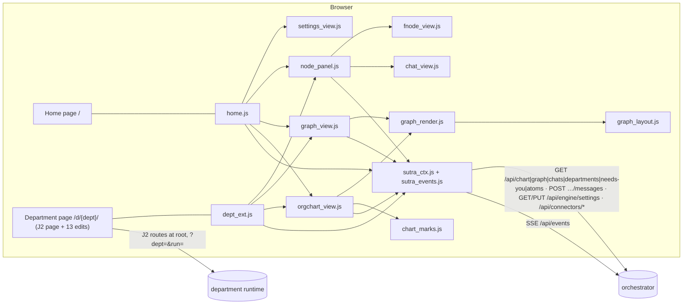

# UI design: the J2 UI served as is, plus the new views
_Section `ui.md` of `docs/design/` · UI architect · 2026-11-04 · status: proposed, for the consolidator. Decision ids here are `UI-D1…UI-D13`; the consolidator numbers them D13 and later._
_Read: J2 `j2_ui.html`, `j2_server.py`, `j2_ui_render.js`, `j2_graph_layout.js`, `j2_check.py`, `vendor/`, `docs/map-schema.md`, `docs/atom-schema.md`, `docs/ui-*.png`, `docs/mocks`; plugin `bin/sutra-atom`; draw.io page 3; `arch/gen.py`; `docs/DECISIONS.md` D1 to D12; and, after the first draft, the sections `orchestrator.md`, `library.md` and `engine.md` (cited as ORCH §n, LIB §n, ENG §n). The old sutra-ui was not read._
_The final function-node spec has landed (`docs/design/function-nodes-spec.json`; after the S4 settlement its design is `docs/design/function-nodes.md`): the function-node fields follow S3-web-04 and S4-fnodes-14 and sit behind one adapter (`FnodeView.normalize`) [S3-web-04] [S4-fnodes-14]._
_Settlements applied 2026-11-04 (`docs/design/settlements/`: S1 contracts, S2 models, S3 web, S4 function nodes). Every paragraph, table row or block they changed carries the settlement id in square brackets, for example `[S1-contracts-03]`, `[S2-models-09]`, `[S3-web-05]`, `[S4-fnodes-10]`. Find them with `grep -n '\[S[1-4]-' docs/design/ui.md`. Where S4 supersedes a part of S1 to S3, only the S4 text stands; section 13 lists the three places where two of S1 to S3 disagreed about the UI and which text was kept._

## 0. Reconciliation with the other sections
Adopted as the authority (the UI conforms, nothing is renamed):
- ORCH §1.1: the chat agent is **one** rolling session `cs_org` (the Root node's chat), so Home has no task picker. Every node has one session (`GraphNodeOut.chat_session_id`); department and division sessions are writable (Identity's voice), function and step sessions are read-only (`403 read_only`).
- ORCH §3.3 and §6: endpoints, error envelope (`bad_token` is **401**), SSE names (`chat.turn`, `chat.message`, `chart.changed`, `graph.updated`, `needs_you.changed`, …), graph `level=chart|full`, edge kinds `contains|has_function|has_step|handoff|depends_on|speaks_to|step`, node statuses `idle running waiting waiting_on_you fault filed done_unchecked left_open not_made` (J2's nine map words; a merged-away node is deleted, so the server never sends `archived`, and the UI does not draw such a node if one arrives), chat cards `chart_change|task|approval|choice|needs_you|done` and `atom` (function-node sessions only), `GET /api/needs-you`, `GET /api/departments`. [S2-models-02] [S2-models-03] [S2-models-09] [S3-web-13]
- ORCH §5.5 / D19: J2's 28 data routes keep their **root** paths and take `?run=<run id>` (global) and `?dept=<dept id>`, which is the only way to name the department (missing or malformed gives 400 `dept_required`, unknown 404 `not_found`). So the page keeps the department in its own **path** `/d/{dept id}/` and a `fetch` wrapper adds `dept=` to every J2 call (UI-D2). [S1-contracts-01]
- LIB §8.1 and §8.2 as patched by S3-web-04 and S4-fnodes-14: the function node's wire keys are `goal` (the standing J2 role sentence), `task` (the standing J2 ROLE line, a string), `context[]` (names of the slice), `constraints[]`, `wait_on`, `hands_to[]` (from `HANDOFFS`, who may hand to whom) and `stats`; there is no `Task` object and no `last_seen` (J2's `detail` carries it). LIB §7: the library `Atom` (`work-atom/0.3`) and the plugin `atom/1` view for J2's builders. [S3-web-04] [S4-fnodes-14]
- ENG §7.1 and §7.2: J2's 28 data routes (23 GET, 5 POST; its own index and d3 routes belong to the UI) keep their paths, queries and shapes at the root, mounted once; the department is `?dept=<id>` only (no `X-Sutra-Dept` header, no `sutra_dept` cookie, no `/d/{dept}/api/...` copy), and `run=<id>` is always a read-only saved view; ENG §4.9 (6) asks the UI to add `scopeQ()` next to `runQ()` and to the five POST calls: UI-D2 does the same with one `runQ` edit (E4) and one fetch wrapper. [S1-contracts-01] ENG §4.3 with S4-fnodes-03: a function's turn is one work atom (`Atom.goal` = the template's observable outcome, `Atom.context` = the turn's references as `kind: summary` strings); the node's own goal, task and context are static and no event carries them (S3-web-04). [S2-models-08] [S4-fnodes-03]

Requests to those sections were collected in section 13; the settlements resolved all of them. Where the sections disagreed with each other, the settlements decided; what the UI does: [S3-web-04]
- **Who serves the J2 page.** Settled by S3-web-01. The UI package serves `/` (Home) and `/d/{dept}/` (J2 page, boot block by `render_page`). The engine has no page route, no `pages.py`, no `ui_dir()`, no cookie and no default department. `GET /?dept=<id>` is a 308 shim to `/d/<id>/`. [S3-web-01] [S1-contracts-01]
- **The web package and the boot injector.** Settled by S3-web-02: one package, `sutra_app.ui` (`mount(app, services)`, `build_router`, `mount_static`, `render_page`, `inline_script_hashes`, `csp_header`, `BootContext`, `PAGES_DIR`, `STATIC_DIR`); the alias `sutra_app/web.py` is not created; one boot injector, `render_page(html, boot)` (`inject_boot` exists nowhere); `mount` reads exactly three `Services` members, `settings.token`, `version` and `department`. [S3-web-02]
- **The write token.** Settled by S3-web-03: header `X-Sutra-Token` only, injected through the boot block, sent on every non-GET; no cookie. [S3-web-03]
- **Graph store.** Settled by S2-models-02 and S3-web-13: ids are the library's and opaque (`root`, `web`, `web.identity`, `s-3f9a1c2b7d`); the edge kinds are the library's seven; the UI draws any non-structural edge kind it does not know as a plain blue link. [S2-models-02] [S3-web-13]

## 1. Purpose and scope
In scope:
1. Serve the J2 page (Simple and Detailed views, Map Tree / Line / Solar system / Constellation, Agent drawer, every tab) once per department, offline, with J2's look and behaviour unchanged.
2. A new **Home** page: the chat agent entry (the owner's steps 1 to 7 as the user sees them), the workflow graph, the org chart, a list of teams, and Settings (appearance, connectors with Test and Codex Sign in, engine switches). [S1-contracts-03] [S1-contracts-08]
3. New views in J2's look: (a) Workflow graph, (b) Global org chart, (c) Function-node drawer, (d) per-node chat panel, (e) hand-over from the chat agent to a department's Simple view, (f) rail integration in light, dark and system themes.
4. Client module interfaces, API calls, tests, work packages, decisions, risks.

Out of scope, with reasons: server handlers (ORCH and the engine own them; section 8 lists what the UI calls) · the connector logic and provider switching (connector section; Settings shows `GET /api/health` and offers a Test button per provider and, for Codex only, Sign in, with the server's words; no session pin control in v1) [S1-contracts-08] · hand-editing the org chart (the owner's rule: tasks reuse, add to or rearrange it, so only the chat agent changes it) · drag-to-pin in the new graph and org chart views and `?embed=1`: decided OUT of v1 (the layout is recomputed on every `graph.updated`, the chart is read-only, no step of the owner needs either); if added later the key is `sutra:pins:<graph|chart>:<dept|all>` [S3-web-11] · vendored web fonts (no grounded source; stacks fall back, F4) · a desktop shell (D12) · `?run=` on the root URL (use `/d/{dept}/?run=`).

## 2. Facts that shape the design (checked in the files; J2 line numbers are commit ce2631f)

| # | Fact | Where |
|---|---|---|
| F1 | `j2_ui.html` is one file of 3,346 lines: `<style>` 8-319, first-paint theme script 320-321, markup 323-426, `vendor/d3.min.js` 427, the page script (inline, one scope) 428-3344. | j2_ui.html |
| F2 | `j2_ui_render.js` and `j2_graph_layout.js` are node **test harnesses**, not libraries: both run the page's last inline `<script>` in a stub DOM. The layout code (`mapTree` 1697, `treeLayout` 1698, `consOf` 2819, `consTeamOf` 2921) lives inside the page. | j2_ui_render.js:1-2,16-19; j2_graph_layout.js:1-4,13-14; j2_flow_test.py:3329-3337,8006-8010 |
| F3 | Every J2 call is root-relative: 28 `fetch` sites (26 with a literal path, 2 through `artUrl`) and 15 URL-in-HTML sites on 12 lines, all built with `runQ()` (457-459, 802-803 via `q = runQ().replace("&","?")` at 800, 939, 1116-1117, 1134, 1244, 1262, 1454), plus two iframes with a bare `src="/site/latest"` (334, 368). `vendor/d3.min.js` is relative (427). Counted by script. | j2_ui.html; j2_server.py:70-77 |
| F4 | The only external resource is the Google Fonts `<link>` (line 7). `--display/--body/--mono` already fall back to Arial / Menlo. | j2_ui.html:7,24 |
| F5 | Theme: every colour is a token (dark default, `:root[data-theme=light]`), key `j2theme`, `system` resolved by `matchMedia`. Computed here: every text token has at least 5.1:1 on `--bg/--panel/--panel2` in both themes, `--ink/--muted` at least 4.9:1 on the map sky. `docs/ui-simple-*.png` show an older teal Simple view; the tokens and screenshots of the current page taken here are the look to follow. | 11-36, 320-321, 3223-3233 |
| F6 | Rail `nav.rail.tabs` 339-362. Sections come from `RAILSEC`/`RAILORDER`; `railPaint` moves only buttons inside `#railsub`, so buttons placed directly in the nav (like Map) are never touched. | 3236-3239, 3326-3334 |
| F7 | `showTab` hides panes from a hard-coded list; Map also hides the title bar; `?tab=<name>` deep-links any `.tabs [data-tab]` button. | 1307-1314 (list 1313), 1318-1320 |
| F8 | Agent drawer: `aside#agentdrawer`, fixed right, 50vw; `openAgent` fetches `/api/agent`; Esc closes; `body.agentopen` hides the map panel. Artifact iframes already use `sandbox=""`. | 53-56, 423, 2355-2366, 1459 |
| F9 | The page polls `/api/state` every 700 ms; there is no SSE. J2 itself sets `location.search = …` on run change and reset, which would drop a `?dept=` on the page URL. | 1204-1261; 3212, 3222 |
| F10 | The edge look is generic CSS on `svg path[data-edge]`, `.earr.e-*`, `ehot/hot/dim` and tokens `--e-reads/--e-makes/--e-fix`. The runtime router and motion engine are keyed to class tables `EDGEV` (1989) and `MVIEWS` (2050) and need `getBBox` (2007). | 20, 308-312, 1989-2050 |
| F11 | J2 status vocabulary (map/1): filed, done_unchecked, running, left_open, fault, waiting, waiting_on_you, not_made, idle; look `mapLook` 1607; words `MAPW` 1598, `MAPS` 1599, `mapState` 1606; personas Client Lead, Strategist, Prioritiser, Scheduler, Quality Reviewer (1590). | docs/map-schema.md "Statuses"; 1588-1618 |
| F12 | Work atom: atom/1 states open, closed, verify_failed, abandoned. The plugin atom declares GOAL / CONSTRAINTS / CONTEXT / WORK, "verify is the teeth"; its cards use Goal, Done when, Done by, Limits, Using, Ref and the outcomes CLOSED, VERIFY FAILED, ABANDONED; `done when` is spelled from the verify template (file-exists, grep-count, named-test). The drawer does not use these labels; it uses J2's atom-card labels (6.4). [S3-web-05] | docs/atom-schema.md; bin/sutra-atom:14, 88-93, 95-113, 115-146, 267-277 |
| F13 | The owner's steps 1 to 7; the diagram's experience boxes, org chart legend (Reuse, Add, Rearrange) and flow key. | diagram.xml page 3 (cell `…-33`); gen.py:53-70, 84-107, 187-199 |
| F14 | This machine: Node v25.6.1 (`node --test` takes files or a quoted glob; a directory argument **fails**, tried). Chrome 156.0.8078.80 in /Applications, driven headless over CDP with `websockets` 17.4 (tried: navigate, evaluate, screenshot, light theme, `system` with emulated `prefers-color-scheme`, 390 px width, zero console errors). Playwright browser cache present (`chromium-1234`, `chromium_headless_shell-1234`; no driver package; not tried). `httpx` 0.28.1 in the venv. No selenium or playwright package; chromedriver, geckodriver, firefox absent; `safaridriver` present, not tried. | local checks |
| F15 | `docs/mocks/team-solar-mock.html` is the mock the page's team solar system was built from; nothing here depends on it. | docs/mocks |

## 3. Page and module map
### 3.1 Two pages, one look (UI-D1)

- **Home** `/` (new, `home.html`): the J2 Simple skeleton (`#sview`, plus `#dview` holding only the rail). Left column = the org chat (`cs_org`). Right column (J2's preview slot `.sprev`) = Workflow graph | Org chart | Settings, chosen from the rail. Phone: J2's Chat | Preview toggle (`.stoggle`, `has-site`, `sp-preview`) reused by class name. One layout, no Detailed twin: rail items switch the right pane and the chat column never goes away.
- **Department page** `/d/{dept}/` (the copied J2 page): Simple and Detailed views exactly as J2. The rail gains `← All teams`, Workflow graph, Org chart; node chats and the function drawer open in `#nodepanel`.

### 3.2 Files (under `~/Desktop/development/sutra-pro/`)

| Path | Responsibility | WP |
|---|---|---|
| `sutra_app/ui/__init__.py` | `mount(app, services)` (ORCH §3.5 plug-in rule), `build_router`, `mount_static`, `render_page`, `inline_script_hashes`, `csp_header`, `BootContext`, `PAGES_DIR`, `STATIC_DIR` [S3-web-02] [S3-web-09] | UI-1 |
| `sutra_app/ui/boot.py` | `BootContext`, the `DeptLike` protocol, `render_page` (fills the boot block), `inline_script_hashes`, `csp_header` [S3-web-02] [S3-web-09] | UI-1 |
| `sutra_app/ui/routes.py` | pages `/`, `/d/{dept}`, `/d/{dept}/`, `/d/{dept}/library` (sync 4, D141), `/favicon.ico`; static mount `/ui`; headers (the CSP is built from the final HTML once per page file, cached by mtime) [S3-web-09] | UI-1 |
| `sutra_app/ui/pages/j2_ui.html` | the J2 page after the 33 edits of sync 4 (5.1; 13 at the first import); produced by the port script, never hand-edited [S3-web-10] | UI-2 |
| `sutra_app/ui/pages/j2_ui_render.js`, `pages/j2_graph_layout.js` | J2's two node harnesses (three small changes to the first, one to the second, section 5), kept beside the page because `scripts/port_j2_ui.py` and `tests/ui/js/page_render.test.js` use them; the engine's legacy tests read J2's own copies through `SUTRA_J2_CHECKOUT` (ENG §3.1 and §9); the `pages/*` package-data glob ships them in the wheel, which is harmless [S3-web-01] | UI-2 |
| `sutra_app/ui/pages/home.html` | Home markup | UI-7 |
| `sutra_app/ui/static/css/j2.css` | J2's `<style>` block, byte for byte (UI-D3); the team page links it | UI-2 |
| `sutra_app/ui/static/css/j2-shell.css` | sync 4 (D138): a frozen byte copy of the previous sync's `j2.css` that Home and the console link; Sutra owns it, the port never writes it, its sha256 is pinned | UI-2 |
| `sutra_app/ui/static/css/sutra-graph.css` | `.wgsvg`, org chart, change log, legend, live chip, `--e-org` | UI-5 |
| `sutra_app/ui/static/css/sutra-panel.css` | node panel, function sections, atom cards, chat, rail additions; since sync 4 also the strips (`#rail .railhome`, `#sview>.steamstrip`), the output choice, the Ask box, the node panel's own bubbles and the motion overrides for the Studio sheet (D155) | UI-6 |
| `sutra_app/ui/static/css/sutra-shell.css` | Home deltas (`.sright`, start page, teams list, Settings groups) [S1-contracts-03] [S1-contracts-08] | UI-7 |
| `sutra_app/ui/static/js/sutra_ctx.js` | context, J2 fetch wrapper, `api` (get, post, put, del), `esc`, `paint`, `tab`, `currentTab`; since sync 4 `pagePath`, `libraryPath` and `onLibrary()` (D141) and `J2_EXACT` with 33 names [S1-contracts-03] [S3-web-10] | UI-3 |
| `sutra_app/ui/static/js/sutra_events.js` | SSE client with polling fallback, `coalesce` | UI-3 |
| `sutra_app/ui/static/js/graph_layout.js` | pure: validate (GraphView to tree), layered layout, edge paths, diff | UI-4 |
| `sutra_app/ui/static/js/chart_marks.js` | pure: OrgChart to graph, reuse/add/move marks, change log html | UI-4 |
| `sutra_app/ui/static/js/graph_render.js` | pure: SVG string, outline list, status look and words | UI-4 |
| `sutra_app/ui/static/js/graph_view.js` | DOM: mount, update, select, fit, zoom, live region | UI-5 |
| `sutra_app/ui/static/js/orgchart_view.js` | DOM: chart view and change log | UI-5 |
| `sutra_app/ui/static/js/fnode_view.js` | pure: function drawer html, atom cards, adapter `normalize` | UI-6 |
| `sutra_app/ui/static/js/chat_view.js` | pure: transcript, cards, composer state, safe text | UI-6 |
| `sutra_app/ui/static/js/node_panel.js` | DOM: `#nodepanel` drawer with Chat and Details tabs | UI-6 |
| `sutra_app/ui/static/js/home.js` | Home controller: org chat, hand-over, rail, theme, panes, Settings wiring [S1-contracts-03] [S1-contracts-08] | UI-7 |
| `sutra_app/ui/static/js/settings_view.js` | pure: Settings pane html and bodies: Engine group (editable and locked fields, the `{set, unset}` body), Connectors rows (Test, Codex Sign in state) [S1-contracts-03] [S1-contracts-08] | UI-7 |
| `sutra_app/ui/static/js/dept_ext.js` | department-page glue: tab hook, both team chips (`#deptchip`, `#deptchip-s`), mounting, events | UI-8 |
| `sutra_app/ui/static/js/output_pick.js`, `function_chat.js` | sync 4: the start page's output choice (D139); J2's question list filled from the function's own session, and the route the node panel's Ask box posts to (D148) | UI-8 |
| `sutra_app/ui/static/vendor/{d3.min.js,d3-LICENSE,README.md}` | d3 7.9.0 copied from J2 `vendor/` by the port script | UI-2 |
| `scripts/port_j2_ui.py` · `scripts/capture_j2_fixtures.py` | reproducible port and drift check · fixtures and goldens from a J2 mock run | UI-2 · UI-0 |

Tests (all under `tests/ui/`; what each asserts is in section 10):

| Path | Responsibility | WP |
|---|---|---|
| `conftest.py`, `cdp.py`, `fake_backend.py`, `fixtures/**`, `screens/.gitignore`, `test_fake_backend.py` | marker and fixtures, the Chrome driver, the fake of ORCH §6 (with the Settings, connector and Atom log routes), JSON and mount pages and J2 captures, ignore file for screenshots, the fake's own test [S1-contracts-03] [S1-contracts-08] [S4-fnodes-08] | UI-0 |
| `test_serve.py` | routes, boot block, headers, static files, offline check | UI-1 |
| `test_port_edits.py`, `js/page_render.test.js` | the 13 edits, byte parity with J2's harness (E13 pairs applied to the goldens) [S3-web-10] | UI-2 |
| `test_node_suite.py`, `js/ctx.test.js`, `js/events.test.js` | pytest wrapper for all node tests, context, events | UI-3 |
| `js/graph_layout.test.js`, `js/graph_render.test.js`, `js/chart_marks.test.js` | pure graph and chart code | UI-4 |
| `test_view_graph.py` | graph and org chart views in a browser | UI-5 |
| `js/fnode_view.test.js`, `js/chat_view.test.js`, `test_view_panel.py` | drawer and chat, pure and in a browser | UI-6 |
| `test_home.py`, `js/settings_engine.test.js`, `js/settings_connectors.test.js` | Home page; the Settings Engine group and the Connectors Test and Sign in (pure, from fixtures) [S1-contracts-03] [S1-contracts-08] | UI-7 |
| `test_dept_page.py` | department page glue | UI-8 |
| `test_browser_smoke.py`, `test_visual.py`, `js/contrast.test.js` | the scripted walk, screenshots in both themes, token contrast | UI-9 |

Browser storage (the UI's only local data):

| Key | Written by | Meaning |
|---|---|---|
| `j2theme` | J2 page, Home | `light`, `dark` or `system`; one choice for both pages |
| `j2view`, `j2bar`, `j2railopen`, `j2mapview`, `j2maplay` | J2 page (`j2bar` also Home) | Simple or Detailed view, rail open, open rail sections, Map view, legend |
| `j2pos:<dept>:<run or live>:<view>` | J2 page (E10) | pinned Map nodes, per department |
| `sutra:seen:<session>` | new views | last message id seen in a session (unread dots) |
| `sutra:graph:<dept or all>` | `GraphView` | `{level, scope, view}` last chosen |

The new views store nothing about node positions. [S3-web-11]

### 3.3 CSS and DOM hooks the tests rely on
Graph: `svg.wgsvg[data-w][data-h]` > `g.wview` > `g.wedges` (`path.wedge.e-<kind>[data-edge][data-from][data-to]`) and `g.wnodes` > `g.wnode.k-<kind>.st-<status>[data-id][tabindex][role=button]` (children `rect.shape`, `text.tlab`, `text.tsub`, `circle.wbadge`, `circle.wunread`; `.sel`, `.wnew`). Pane: `.maphead`, `.mapviews` (Graph | List and Overview | Detail), `.wlive`, `.wlist`, `.wlegend`, `.wsr` (live region). Chart: `.chglog > .chgrow[data-change]`, node marks `.mk-reuse|.mk-add|.mk-move`. Panel: `#nodepanel .nptabs [data-nptab=chat|details]`, `.npbody`, `.fnsec[data-sec=goal|task|context|atoms|constraints|hands]`, `.fncounts`, `.atomlegend`, `.fngo` (the Go-to-tab button), `details.atomcard[data-state=open|verify_failed|closed|refused|abandoned]`, `.nchat .nmsg[data-id]`, `.nlens` (the division header and its link), `.nearlier` (Earlier chats), `.fnfuncs [data-fn]` (the five chips of "Functions of <Department>"), `.ncomposer`. Settings: `#pane-settings .setgrp[data-group=appearance|connectors|engine]`, `.setfield[data-field][data-locked]`, `.setconn[data-provider] [data-act=test|signin|cancel]`. Rail: `.railhome`, `#to-home`, `#deptchip`. Body classes: `nodeopen` (like J2's `agentopen`), `archived`. [S3-web-05] [S3-web-10] [S4-fnodes-06] [S4-fnodes-10] [S1-contracts-03] [S1-contracts-08] [S2-models-11]

## 4. Serving and addressing
### 4.1 Routes and interfaces (`sutra_app/ui/routes.py`)

| Route | Behaviour |
|---|---|
| `GET /` | `pages/home.html` with the boot block (`page:"home"`). `GET /?dept=<id>[&run=&view=&tab=]` answers 308 to `/d/<id>/` with the other parameters, as a compatibility shim only (no section generates that link form any more). The 308 answers (also for `GET /d/{dept}`) carry `Cache-Control: no-store`. For `GET /?dept=<id>` the id must pass the same checks as the path form (generic id rule, then `Services.department`); if it does not, Home is served and `dept` is ignored. [S1-contracts-01] [S3-web-01] |
| `GET /d/{dept}` | 308 to `/d/{dept}/`, query string kept, `Cache-Control: no-store` [S3-web-01] |
| `GET /d/{dept}/` | `pages/j2_ui.html` with the boot block (`page:"dept"`). `dept` must pass the generic id rule `^[A-Za-z0-9_.:-]{1,120}$` and `Services.department(dept)` must return a row (`id`, `name`), else a small 404 page ("No team called …", link to `/`). The strict department rule (`DEPT_ID_RE`, `^[a-z][a-z0-9-]{1,39}$`) belongs to the engine's `?dept=` dependency and to the orchestrator; every real department id passes both. A row that carries `archived` still opens, with a banner (v1 rows do not carry it: a department is never archived, library DL5). [S1-contracts-01] [S2-models-02] [S2-models-14] [S3-web-02] [S3-web-13] |
| `GET /ui/{path}` | `StaticFiles(static/)`: `css/`, `js/`, `vendor/`. Pages live outside it, so a raw page is never served. JS and CSS: `Cache-Control: no-cache` (ETag). `vendor/`: `max-age=3600`, as J2 (j2_server.py:75) |
| `GET /favicon.ico` | 204 |
| `/api/*` (J2 routes, ORCH routes), `/site/*`, `/file/*`, `/shot/*` | **not mine**: the orchestrator and the engine register them (j2_server.py:65-268, ORCH §6, ENG §7). The engine registers no page, `GET /` or `/vendor/` route; the page loads d3 from `/ui/vendor/`. Generated HTML (`/site/*`, html artifacts) comes with the engine's sandbox header, not with the page's CSP. [S3-web-01] [S3-web-14] |

```python
def mount(app: FastAPI, services) -> None: ...        # reads services.settings.token, services.version, services.department and nothing else: include_router(build_router(...)); mount_static(app)   [S3-web-02]
def build_router(*, token: str, department: Callable[[str], DeptLike | None], version: str, pages_dir: Path = PAGES_DIR) -> APIRouter: ...   # [S3-web-02]
def mount_static(app: FastAPI, static_dir: Path = STATIC_DIR) -> None: ...      # app.mount("/ui", ...)
def render_page(html: str, boot: BootContext) -> str: ...   # replaces the single <!--SUTRA-BOOT--> marker; BootMarkerError if count != 1; the one boot injector, no inject_boot [S3-web-02]
def inline_script_hashes(html: str) -> list[str]: ...       # "'sha256-…'" for each <script>…</script> with NO attributes, CRLF normalised to LF, sha256, base64 [S3-web-09]
def csp_header(hashes: list[str]) -> str: ...               # the Content-Security-Policy value of "Page headers" below [S3-web-09]
class DeptLike(Protocol):      id: str; name: str           # the row of Services.department(dept_id); build_router also reads archived and merged_into_name with getattr(row, name, default) when a row has them [S2-models-14] [S3-web-02]
class BootContext(BaseModel):  model_config = ConfigDict(extra="forbid"); page: Literal["home", "dept"]; token: str; \
                               dept: str = ""; dept_label: str = ""; archived: bool = False; note: str = ""; version: str
                               # dept_label = row.name; note = "This team was merged into {merged_into_name}. Its history stays available." when archived (never in v1) [S3-web-02]
```
Validators: `BootContext.token` at least 16 characters (`Settings.token` has the same minimum, also from `SUTRA_TOKEN`); `page == "dept"` needs `dept` to match the generic id rule `^[A-Za-z0-9_.:-]{1,120}$` and `dept_label` non-empty; `page == "home"` needs `dept == ""`. `render_page` escapes every string it writes. `mount` is idempotent (a second call raises nothing and adds nothing). [S3-web-02] [S3-web-13]

Page headers: `Cache-Control: no-store`; `X-Content-Type-Options: nosniff`; `Referrer-Policy: no-referrer`; `Content-Security-Policy: default-src 'self'; script-src 'self' <'sha256-…' for each attribute-less inline script of the served page>; style-src 'self' 'unsafe-inline'; img-src 'self' data: blob:; frame-src 'self'; connect-src 'self'; object-src 'none'; base-uri 'self'; form-action 'self'; frame-ancestors 'self'`. They are set on the two page routes, `/` and `/d/{dept}/`; the redirects carry `Cache-Control: no-store` only. `routes.py` computes the hashes with `inline_script_hashes` from the final HTML once per page file (cache by mtime) and builds the header with `csp_header`; the JSON boot block has a `type` attribute, is not executable and is not hashed. `style-src` keeps `'unsafe-inline'` because J2 builds 43 style attributes and one inline `<style>` in generated SVG; `script-src` needs no `'unsafe-inline'` because the page has no inline event handlers (measured, S3-web-09). `pages_dir` and `static_dir` are parameters so UI-1 tests run on a temp tree before any other package lands. The orchestrator's Host and Origin checks (ORCH §6) apply to every route; pages are same-origin. [S3-web-09]

### 4.2 How the page learns the department and the run (UI-D2, UI-D9)
- The server writes `<script type="application/json" id="sutra-boot">{"page":"dept","token":"…","dept":"web","dept_label":"Web","version":"0.1.0"}</script>` at the marker, every `<` replaced by the JSON escape `\u003c`. The token is D11's per-launch token, sent as the header `X-Sutra-Token` only (no cookie exists anywhere, ORCH §6). [S3-web-03] [S3-web-13]
- `sutra_ctx.js` (in `<head>`, first) parses it; with no block (tests, a file opened by hand, J2's stub DOM) `boot` is `{}` and it takes `dept` from `location.pathname` (`^/d/([A-Za-z0-9_.:-]{1,120})`) when there is one. It exposes `SutraCtx.boot|dept` and `run()` = `?run=` or `""` (the live run, as J2's `viewRun`, j2_ui.html:465). With `SutraCtx.dept` empty (J2's own page, the harness) the wrapper and the `runQ` edit add nothing, so J2's own server and tests are unaffected. [S3-web-07] [S3-web-13]
- On `page:"dept"` it installs a `fetch` wrapper: a root-relative URL whose path matches `J2_PATHS` gets `dept=<id>` appended unless it already carries one, and every non-GET gets `X-Sutra-Token`. `J2_PATHS` matches whole pathnames exactly for the 23 listed `/api/` paths of j2_server.py:65-268 (`/api/{state,runs,call,preview,docs,map,plan,library,run-templates,artifacts,artifacts/tree,artifact,agent,code,story,board,audits,refs,say,output,reset,playbooks/clear,lessons/clear}`) and by prefix only for `/api/library/`, `/site/`, `/file/`, `/shot/`, so the orchestrator's `/api/runs/{run_id}` never gets a `dept` parameter. The 28 J2 `fetch` sites need **no edit**. New modules call ORCH endpoints through `SutraCtx.api`, which never adds `dept`, and `/api/chart|graph|chats|departments|needs-you|atoms|events|health|schemas|tasks|engine/settings|connectors` match no J2 path (the Settings pane passes `dept` in the query itself). [S3-web-15] [S1-contracts-03]
- The URL-in-HTML sites all use `runQ()`; one edit (E4) makes it carry `&dept=`, and E2 sets the two iframes from JS. The run and department thus travel as `?run=<run id>&dept=<dept id>`, exactly the pair ORCH D19 serves.
- Why the department is in the page **path** and not in `?dept=` on the page URL: J2 assigns `location.search` on run change and on reset (F9) and would drop it; a path survives. Why not `<base href>`: it changes how the 14 `href="#"` anchors resolve and gains nothing here.
- Home's links carry `run=` only for a finished run, never for the live one: j2_server.py:79-81 treats the live id as a saved, read-only view once its folder exists. A step node opens `/d/{dept_id}/?view=detail` plus `&run={meta.run_id}` when its status is terminal.

### 4.3 Offline and safety
No CDN anywhere: both pages and all CSS and JS are `'self'` (UI-D3). A test fails on any `http(s)://` in `src`, `href` or `url()` (J2 makes the same check, j2_check.py:146-152). Text from models or the graph store is always `esc`-aped (`& < > " '`); chat text goes through `ChatView.safeText` (escape, then `**bold**`, `` `code` ``, line breaks; no links, no HTML), except a model's reply to a direct line (`ChatMessageOut.turn` set) and the streaming row, which go through `ChatMarkdown.render` (`chat_markdown.js`, GAP-markdown: escape first, then paragraphs, lists, fenced code, tables, headings, quotes, rules, `**bold**`, `*italic*`, `~~struck~~`, `` `code` ``; still no links, no images, no HTML, so a link or an address stays text). Node and session ids are opaque: the UI never parses them.

## 5. Edits to the copied `j2_ui.html` (13 at the first import; since sync 4 the table is 33, in 5.1; each guarded by a test) [S3-web-10]
_Since sync 4 (D137) the page is J2's at `025e265c` and `scripts/port_j2_ui.py` applies the 33 edits of 5.1. E14 to E18 and `run-settings.css` are retired (J2's own Run settings is the design they copied). The text below is the history of the first 13 edits, kept for its reasons; E1 to E13 mean the same in 5.1._
`scripts/port_j2_ui.py --j2 <J2 checkout> [--check]` applies them to J2's `j2_ui.html`. Each edit is a tuple `(id, literal or regex, replacement, expected_count)`; a count mismatch stops the port (J2 drifted). It writes `pages/j2_ui.html`, `static/css/j2.css`, `static/vendor/*`; `--check` fails when the committed files differ from a fresh port. J2 itself is never touched.

**E1 · 7-319 · stylesheets, no CDN, boot marker, context script**
```diff
- <link rel="stylesheet" href="https://fonts.googleapis.com/css2?family=Bricolage+Grotesque:opsz,wght@12..96,600;…&display=swap">
- <style> … 310 lines … </style>
+ <link rel="stylesheet" href="/ui/css/j2.css">
+ <link rel="stylesheet" href="/ui/css/sutra-graph.css"><link rel="stylesheet" href="/ui/css/sutra-panel.css">
+ <!--SUTRA-BOOT-->
+ <script src="/ui/js/sutra_ctx.js"></script>
```
`j2.css` is the removed block's inner text, byte for byte. Lines 320-321 (first-paint theme script) follow unchanged.

**E2 · 334, 368 · the two preview iframes, with a sandbox** (`sutra_ctx.js` sets `src` from `data-src` plus `?dept=` on DOMContentLoaded, only when the iframe has no `src` yet, so J2's own later assignment is never overwritten; the `sandbox` attribute is the second layer behind the engine's sandbox header on generated HTML, so a generated site cannot read the page's boot token) [S3-web-10] [S3-web-14]
```diff
- <iframe id="sframe" title="Your website" src="/site/latest"></iframe>
+ <iframe id="sframe" title="Your website" data-src="/site/latest" sandbox="allow-scripts allow-forms allow-popups"></iframe>
- <iframe id="frame" title="Website preview" src="/site/latest"></iframe>
+ <iframe id="frame" title="Website preview" data-src="/site/latest" sandbox="allow-scripts allow-forms allow-popups"></iframe>
```

**E3 · 427 · d3** `- <script src="vendor/d3.min.js"></script>` → `+ <script src="/ui/vendor/d3.min.js"></script>` (relative, it would resolve to `/d/{dept}/vendor/`).

**E4 · 467 · the one place every URL-in-HTML site takes the run from** (15 sites on 12 lines use `runQ()`, directly or as `runQ().replace("&", "?")`)
```diff
- const runQ = () => viewRun ? "&run=" + encodeURIComponent(viewRun) : "";
+ const runQ = () => (viewRun ? "&run=" + encodeURIComponent(viewRun) : "") + (SutraCtx.dept ? "&dept=" + encodeURIComponent(SutraCtx.dept) : "");
```

**E5 · 1124 · the Simple view title shows the department**
```diff
- $("stitle").textContent = s.doc ? "Your document team" : "Your website team";
+ $("stitle").textContent = SutraCtx.boot.dept_label || (s.doc ? "Your document team" : "Your website team");
```

**E6 · 1312-1313 · two new panes in `showTab`**
```diff
- $("backmap").hidden = name === "map"; document.querySelector("#dview .wbar").hidden = name === "map"; document.querySelector("#dview .work").classList.toggle("mapfit", name === "map"); if (name !== "map") railReveal(name);
+ const full = name === "map" || name === "graph" || name === "orgchart";
+ $("backmap").hidden = full; document.querySelector("#dview .wbar").hidden = full; document.querySelector("#dview .work").classList.toggle("mapfit", full); if (name !== "map") railReveal(name);
- ["preview","goal",…,"runsettings"].forEach(t => $("pane-"+t).hidden = t !== name);
+ ["preview","goal",…,"runsettings","graph","orgchart"].forEach(t => $("pane-"+t).hidden = t !== name);
+ SutraCtx.tab(name);
```
`SutraCtx.tab(name)` first sets `SutraCtx.currentTab = name` (also without `document.dispatchEvent`), then dispatches the `sutra:tab` event only when `document.dispatchEvent` and `CustomEvent` exist. J2's stub DOM has neither: an inline `document.dispatchEvent(new CustomEvent(…))` made both harnesses throw in the probe below, so the guard lives in `sutra_ctx.js`. J2 itself calls `showTab` for `?tab=…` and `#hash` at parse time (j2_ui.html:1318-1320), before the E12 module scripts run, so that first `sutra:tab` has no listener; `currentTab` is what `dept_ext.js` `init()` reads (6.7). [S3-web-10]

**E7 · 339-341 · rail** (J2's own wiring at 1315 and the `?tab=` deep link at 1318 pick the new buttons up; they sit outside `#railsub`, so `RAILSEC` needs no edit)
```diff
  <nav class="rail tabs" id="rail" role="tablist" aria-label="Sections" aria-orientation="vertical">
+   <div class="railhome"><a href="/" id="to-home">← All teams</a><b id="deptchip"></b></div>
    <button role="tab" data-tab="map" aria-selected="true"><span>Map</span></button>
+   <button role="tab" data-tab="graph" aria-selected="false"><span>Workflow graph</span></button>
+   <button role="tab" data-tab="orgchart" aria-selected="false"><span>Org chart</span></button>
```

**E8 · 381 · panes** `+ <div class="pane" id="pane-graph" hidden></div><div class="pane" id="pane-orgchart" hidden></div>` after `#pane-map`.

**E9 · 423 · panel** `+ <aside id="nodepanel" class="agentdrawer" hidden role="dialog" aria-labelledby="nptitle"></aside>` after `#agentdrawer`.

**E10 · 2062 · pins per department** (two departments' live runs must not share pins)
```diff
- return `j2pos:${(typeof viewRun !== "undefined" && viewRun) || "live"}:${v}`;
+ return `j2pos:${SutraCtx.dept}:${(typeof viewRun !== "undefined" && viewRun) || "live"}:${v}`;
```

**E11 · 2355 · function chips open the node panel**
```diff
  async function openAgent(id){
+   if (window.NodePanel && NodePanel.wants(id)) return NodePanel.openFunction(id);
```

**E12 · 3344-3345 · modules, after the main script, before `</body>`**: `<script src>` for `sutra_events, graph_layout, chart_marks, graph_render, graph_view, orgchart_view, fnode_view, chat_view, node_panel, dept_ext`, in that order, all under `/ui/js/`.

**E13 · 1298, 3251, 3267, 3270, 3273 · Priorities wording** (the final spec's FN-28, owner rule "Priority prices, never orders": J2's Priorities tab says "ranked"). Four literal pairs, each with its expected count; the port script stops on any other count; internal names (`ranked`, `TRANK`, `rank`) are not touched; the script exports the pairs as `E13_WORDS`. [S3-web-10]

**E14 to E18 · Run settings (J2 sync 3, patch P13; `docs/design/j2-sync-3.md`)** The old repository's copy of the prototype (commit `e7800503`) has a newer Run settings tab than J2's own repository: two cards, Appearance (three swatch cards) and Runs (status chips with counts, a search over title, brief and run id, rows grouped by date, 20 at a time), fed by `GET /api/runlist`. Five edits: E14 the pane's markup, E15 the poll lines that filled the "What to build" select (the Simple view's start page keeps its own `.outsel` and `POST /api/output`), E16 the "Back to simple view" link (the rail's Chat item is that way), E17 the saved-runs select becomes the run list (opening a run keeps the URL's other parameters), E18 the tab's hint. The styles are a fifth written file, `static/css/run-settings.css`, so `j2.css` stays J2's `<style>` block byte for byte; `sutra_ctx.js` gives `/api/runlist` and `/api/changes` the `dept` parameter (`J2_PATHS.patched`). The old copy's Simple-view redesign is not ported. [S3-web-10]
```diff
- How the Prioritiser ranked the work each cycle                 (1 · line 1298)
+ How the Prioritiser priced the work each cycle
- no ranking records                                              (2 · lines 3251 and 3267)
+ no pricing records
- No ranking records in this run                                  (1 · line 3270)
+ No pricing records in this run
- Funded, in the order it ranked them                             (1 · line 3273)
+ Funded, in registration order; Coordination sets the run order
```

Invariants the tests keep: the J2 main script stays the **last inline `<script>` without attributes** (the harness takes `scripts[scripts.length-1]`, j2_ui_render.js:19); exactly two attribute-less inline scripts (theme, main); the marker occurs once; no `http(s)://` in `src|href`; the query-only link (`href='?view=detail'` line 325; the second, `href='?view=simple'`, went with E14) stays relative, because they stay inside `/d/{dept}/`; both preview iframes carry the `sandbox` attribute. With `SutraCtx.dept === ""` every edit except E13 (wording) and the `sandbox` attribute of E2 is a no-op, so the ported page must render **byte-identical** output to J2's original page for the same state fixture once the E13 pairs are applied to J2's goldens (`page_render.test.js`, section 10); J2's own flow test still asserts the old words against J2's own page (ENG legacy, `SUTRA_J2_CHECKOUT`). [S3-web-10]

**The two harnesses** (`pages/j2_ui_render.js`, `pages/j2_graph_layout.js`; used by `scripts/port_j2_ui.py` and `page_render.test.js`; the engine's legacy tests read J2's own copies through `SUTRA_J2_CHECKOUT`, ENG §3.1 and §9) are copied by the same port script. [S3-web-01] `j2_ui_render.js` gets three changes: (1) `sutra_ctx.js` is run in the stub context before the page script, so `SutraCtx` exists (`dept` stays `""`: the stub `getElementById` returns an empty element and `location` has no `pathname`, and `sutra_ctx.js` must tolerate both); (2) d3 is read from `../static/vendor/d3.min.js`; (3) the d3 tag test matches `/ui/vendor/d3.min.js`. `j2_graph_layout.js` gets only (1). Their command lines and JSON output are unchanged.

**Tried here** (scratch copy, nothing in the repo; S3-web-10 later re-checked all 12 anchors and counts at ce2631f and added E13) [S3-web-10]: the first 12 edits applied to J2's page with exactly the match counts above (E2 twice, E6 on two lines, the rest once); with an empty department `pages/j2_ui_render.js` printed output byte-identical to J2's own harness on J2's own page, 5,893 bytes for an empty state and 612,427 bytes for the finished 31-workflow run's state, and `pages/j2_graph_layout.js` printed 152,504 bytes of layout JSON identical to J2's. In headless Chrome 156 the ported page was served at `/d/org_3f9a1c2b7d10/` (a stand-in id of the earlier `org_<12 hex>` form; the real ids are the library's, S3-web-13) by a small FastAPI app (a stand-in `sutra_ctx.js`, assets under `/ui/`, the CSP of 4.1 as first drafted, with `'unsafe-inline'` for scripts; S3-web-09 re-measured it with the two script hashes and got the same result, J2's routes proxied from a J2 mock server): zero CSP messages and zero failed loads (J2's original page: the same); the Map Tree drew its 10 nodes; the rail showed `← All teams`, Map, Workflow graph, Org chart; `showTab("graph")` showed `#pane-graph`; all 49 proxied J2 calls carried `dept=org_3f9a1c2b7d10`; the iframes loaded `/site/…?…&run=…&dept=…`; a POST carried `X-Sutra-Token`; `/api/chart` was left alone.

### 5.1 The 33 page edits of J2 sync 4 (D137; `scripts/port_j2_ui.py`, `tests/ui/test_port_edits.py`)
Each is an `Edit(id, old, new, count)` checked on J2's own text first; a missed count stops the port and names every edit; `--check` fails when the seven generated files differ from a fresh port. `scripts/port_j2_ui.py --j2 <extraction> --commit <sha>` takes an extraction of `prototypes/j2` (a `git archive` folder is not a repository).

| Edits | What | Decision |
|---|---|---|
| E1 | three style links (`j2.css`, `sutra-graph.css`, `sutra-panel.css`), the boot marker and `sutra_ctx.js`; J2's own `data:` favicon link stays | D137 |
| E2a, E2b, E2c | the sandbox, with no `allow-same-origin`, on `frame`, `sframe` and the Studio's second frame `sframe2` (a new version loads behind the visible one and the ids swap) | D83, D153 |
| E3, E4 | d3 under `/ui/vendor/`; `runQ()` carries the team into every URL the page builds | D76 |
| E5 | a strip above the Simple view: `div.steamstrip` with `#to-home-s` and `#deptchip-s` (not `.shome`: J2's New project button uses that class) | D137 |
| E6a, E6b | graph and org chart use the whole work area; `SutraCtx.tab(name)` | D137 |
| E7 | a strip at the top of the icon rail, `div.railhome`: back to All teams (`#to-home`), the team chip (`#deptchip`) and the two `role=tab` buttons | D137 |
| E8 to E12, E9b | the two Sutra panes, the node panel, Esc closes only the node panel when it is open, pins per team, `NodePanel.wants`, and the modules `function_chat` and `output_pick` before `dept_ext` | D139, D148 |
| E13a to E13d | the Priorities wording (the four pairs of the first import; "no ranking records" is three places) | |
| E19 | `div#soutpick` is the first child of the start page's row of options (`div.slrow`), beside Decide for me | D139 |
| E20a to E20i | the template library and the page's own address come from `SutraCtx` (`libraryPath`, `pagePath`, `onLibrary()`): `/d/<team>/library`, Recent work, New project; the Start page's Template library link is relative (`library?view=detail`) | D141 |
| E21 | `loadFeed` fills J2's question list from the function's session (`FunctionChat.hydrate`) before it paints | D148 |
| E22 | the Run settings hint no longer says it has "what to build" | D139 |
| E23 | the Studio's Google Fonts injection into a readable frame becomes a comment: no CDN and no web font (UI-D3) | D137 |

- **The Studio and the sandbox (D153).** The preview frames keep Sutra's sandbox (D83). The Studio reads its frames' documents (`sDoc`, `sFrameSetup`, `sDecorate`: tags on the parts of a preview, a glow on a new version, scroll restore across versions, link interception); under the sandbox it cannot, so those features are off. The code is guarded and the frames still show the output.
- **Style sheets (D138, D155).** The team page links the regenerated `j2.css`, `sutra-graph.css` and `sutra-panel.css`; Home and the console link `j2-shell.css`, the frozen copy of the previous `j2.css` (`test_port_edits.py` pins its sha256, `tests/ui/test_shared_css.py` fails when a class a page uses is styled only by a sheet that page does not load). The Studio sheet scopes the chat bubbles and answer buttons to `#sview` and breaks D122's motion rules; `sutra-panel.css` restores the bubbles for the node panel (`.nmsg`) and overrides each offending declaration, and `motion_css.test.js` proves the coverage.
- **Routes and the page's list.** `GET /d/{dept}/library` (HEAD too; `/d/{dept}/library/` redirects with 308) answers with the page, the CSP and the boot block of `/d/{dept}/` (D141). `J2_EXACT` of `sutra_ctx.js` has 33 names and `J2_PREFIXES` five (`/api/record`, `/api/settings`, `/view` and `/doc/` are the Studio's); it equals the routes of J2's own server file, which an opt-in test of `ctx.test.js` checks against an extraction.
- **New and changed modules.** `output_pick.js` (D139) and `function_chat.js` (D148) are new; the box of a live function chat in `node_panel.js` and `agent_chats.js` has two modes, Note and Ask (Ask posts `POST /api/ask?dept=`); `chat_view.js` draws the ask lines ("You asked", "From its records, no AI call", "AI answer from its records"); `dept_ext.js` fills both team chips and raises no unread dot for an ask line.
- **Usage by purpose (0.3.3, D159).** The Agents tab draws "judging N calls, $x" and "questions N calls, $x" under an agent's usage (`agent_chats.js`, `.agent-purposes` in `sutra-panel.css`; the words of the two lines are the page's, the numbers are `usage.by_purpose` of the row), and the console draws a table "Usage by purpose" under its table by team and function (`console_view.js`; `console.html` is unchanged, the panel is drawn by the script). The Agents tab reloads on the events it always did (a session, a choice, a task), not on `usage.recorded`, so its usage lines, the old one and the new ones, are as fresh as its last load.
- **Known difference.** J2's page paints light first (a viewer who never chose gets light on the team page and dark on Home); not changed, it is J2's design.

## 6. The new views
### 6.1 Shared rules
**Graph data in** is ORCH's `GraphView {version, chart_version, nodes[GraphNodeOut], edges[{src,dst,kind,label}]}` (ORCH §3.3). `GraphLayout.validate` builds the tree: the **parent** of a node is the `src` of its incoming `contains`, `has_function` or `has_step` edge; every other edge kind (`handoff`, `depends_on`, `speaks_to`, `step`, and any kind the UI does not know) is a cross link. A node with no incoming structural edge is a root; `status: archived` nodes are not drawn (the server deletes merged-away nodes and never sends the word). Sibling order is the array order of `nodes`, which the server sends as a depth-first pre-order: a node's chart children by position, then its five function nodes in the order identity, adaptation, priority, coordination, audit, then its steps by creation. The UI indexes all nodes before it reads edges, so the order decides only the display order among siblings. [S2-models-02] [S3-web-04] [S3-web-13]

**Status** (`GraphRender.statusLook`): the wire carries J2's nine map words (`idle running waiting waiting_on_you fault filed done_unchecked left_open not_made`; a function node uses the first five), so one colour means one thing everywhere and nothing is mapped; an unknown value is drawn as idle and counted in `warnings`. [S2-models-03] [S3-web-13] Look: fault red 4 px with a "!" badge; waiting and waiting_on_you amber 4 px with "?"; filed green ring with a 14% green tint; running double ring; left_open dashed; done_unchecked amber dotted; not_made hollow; idle `--line` (mapLook 1607, badge 1618). Words: J2's `mapState` for function nodes ("waiting on you", "blocked", "idle", "running now") and `MAPS` for the rest (1599, 1606).

**Node look**: department 168×54, division 150×46 with the five-dot team glyph, function 168×50 (line 1 the persona, a UI constant copied from J2, line 2 "<Function> · <open> open · <closed> closed", just the function name when `meta.stats.atoms_total` is 0, cut with an ellipsis if it does not fit; the tooltip is "<calls> calls · <seconds> s · <tokens> tokens" with <tokens> = `tokens_in` + `tokens_out`, plus " · <n> failed" when `atoms_failed` > 0; the node's `label` on the wire is the function name; the outline is J2's status look, unchanged) [S4-fnodes-10], step 140×40, root 96×34. Second line: department and division show `detail`, a step its `detail` or `step_ref`. A node whose session received a message since it was last opened shows an unread dot (`--accent`); the last seen message id per session is kept in `localStorage` key `sutra:seen:{session}`.

**Edge kinds**, drawn as J2 draws them (cubic, gradient source to target, rounded arrowhead, loop dashed, a `data-edge` attribute so the generic CSS at j2_ui.html:308-312 applies): `org` (the tree links `contains`, `has_function`, `has_step`; new token `--e-org: var(--edge)`); cross links `handoff` amber (`--e-makes`, solid), `depends_on` blue (`--e-reads`) and terracotta (`--e-fix`) when its label is `revises`, `speaks_to` blue and dotted with the message count as its label, `step` and any unknown kind blue. A dashed loop is drawn only for a reverse twin of the same kind. [S2-models-02] [S3-web-13]

**Layout** (`GraphLayout.layout`, pure and deterministic, UI-D4):
1. Index nodes; drop a node with no id or a repeated id; a missing, self or cyclic parent makes the node a root (a cycle is cut at its lowest id); each case adds a warning.
2. `y = pad + depth × (tallest node + 78)`. `x` by post-order: a leaf takes one slot (178 px); a parent is centred over its first and last child; trees sit side by side with one empty slot between; left edge at `pad` (40).
3. Tree links: S-curve from parent bottom to child top. Cross links: on different rows an S-curve border to border; on the same row an arc rising `min(60, 0.3·dx)` above both tops.
4. Output `{nodes[{id,kind,x,y,w,h,depth}], links[{from,to,d}], edges[{id,from,to,kind,d,loop}], width, height, warnings[]}`. The same input gives byte-identical output; 500 nodes lay out in under 200 ms.

Labels are not routed round (a layered tree rarely needs it). J2's runtime router and spring engine are **not** reused: they need `getBBox`, are keyed to J2's class tables and are absent on Home (UI-D4). `d3.zoom` (scale 0.25 to 4, as j2_ui.html:2209) is the only d3 use; the first view is 1:1, centred on the top middle (labels keep their size, as `treeFloor` 2215), larger graphs pan, Fit returns to it.

### 6.2 (a) Workflow graph view (`GraphView`; hosts `#pane-graph` and Home's graph pane)
- **Header** (J2 `.maphead` look): title, pills (`2 teams · 10 function nodes · 1 waiting on you`), a `● live` / `○ polling` chip, `Graph | List`, `Overview | Detail` (Overview = `level=chart`: root, departments, divisions and one task step per live or recent task; Detail = `level=full`, which adds function nodes and workflow steps), `This team | All teams` (department page only: the subtree of `dept_id === dept`), Fit. Under it the SVG `.wgsvg` (sky from `--mapdots`, `--sky0/--sky1`), then a `<details>` legend (shapes, edge colours, and the owner's seven steps in plain words).
- **Interactions**: drag pans, wheel and pinch zoom. Hover or focus lights the node and its edges (`.hot`, `svg.ehot`) and fades the rest (`.dim`). Click, Enter or Space on a node calls `onOpen(node)`, which opens `#nodepanel` on the Chat tab (owner steps 5 and 7); the root node focuses the org chat instead. Tab order is depth first. Nodes are `role="button"` with an `aria-label` such as "Identity, Client Lead, waiting on you. Open chat." Esc closes the panel.
- **List view and phone**: `GraphRender.outline` renders the same graph as a nested `<ul role="tree">` with the same click targets; below 600 px it replaces the SVG (J2 also gives its Map up to cards there, map-schema.md "The page").
- **Live updates**: on `graph.updated` the view refetches, diffs by id (`GraphLayout.diff`), repaints through `SutraCtx.paint`, keeps selection and zoom, marks new nodes `.wnew` for 1.2 s (none with reduced motion) and writes one sentence to the `aria-live="polite"` region ("Quotes was added under Web", "Identity is waiting on you").
- **API calls**: `GET /api/graph?level=&dept=` on mount, on each `graph.updated`, on `server.resync` and when the toggle changes; nothing else. Empty: "Nothing to draw yet. Tell the chat agent what you need and the graph appears here." (Home) or "This team has no graph yet." Error: banner "Showing the last good version. [Try again]".

### 6.3 (b) Global org chart view (`OrgChartView`; Home pane `chart`, department tab `orgchart`)
- Data: `GET /api/chart` → `OrgChart {version, nodes[{id, kind, name, purpose, parent_id, position}]}` (ORCH §3.2; `version` = `OrgChart.revision`; `parent_id` is read from the chart's edges and `position` is the index among siblings; no slug, keywords, state or merged_into) [S2-models-01] and `GET /api/chart/changes?limit=50&newest=true` → `ChartChangeOut[]` (the newest 50, oldest first on the wire; `newest` is what keeps a log of more than 50 changes showing the latest ones), drawn newest first. Each change carries `seq, id` (`chg-NNNN`), `at, actor` (`chat_agent|user|system`), `decision` (`reuse|add|rearrange`; the first row of the log, the bootstrap, is `add` by `system`), `status` (`applied|pending_approval|rejected|stale|failed`), `summary, reason, task_id` (`req-<message id>`), `task_title, revision` and the node-id lists `added, moved, archived, reused`; for a row that is not `applied` the lists hold the plan and the UI draws no marks for them. [S3-web-04]
- Drawing: the one tree through `ChartMarks.toGraph` (`name`→label, `parent_id`→parent, `position`→order) and the same layout and renderer as 6.2. Marks come from the selected change (default newest) and follow the diagram's legend (gen.py:100-106): **reuse** plain node; **add** dashed outline, soft `--accent` tint, tag "added by task: <task_title>" (or "by change N" without a title); **rearrange** (moved) 2.4 px accent outline, tag "moved by …". `archived` nodes are not in the chart; a merge shows in the log row. The department being viewed has a ring.
- **Change log** under the tree (`.chglog`): one row per change: "Change 12 · Added the Web team · 09:12 · for 'Coffee shop landing page'", the status word when not `applied` ("waiting for your yes or no" for `pending_approval`, "not applied" for `rejected`, `stale` or `failed`; those rows carry no marks) [S3-web-04]. A click selects the change, re-marks and shows its `reason` (the row for a fallback plan ends "(planned by keywords)", ORCH §5.2 T5); nothing else changes.
- A node click opens a small card: name, purpose, **Open team page** (departments, `/d/{id}/`), **Show in graph**, **Open chat** (when the graph holds a node with that `org_node_id`). Read-only by design (UI-D7).
- Calls: `GET /api/chart` and `GET /api/chart/changes` on mount and on each `chart.changed` (Home also reads `/api/departments` and `/api/needs-you` again then, so a renamed team changes in the rail and the Needs-you lines). Empty chart: the root only and "No teams yet. The chat agent adds one when you ask for something."

### 6.4 (c) Function-node drawer (Details tab of `#nodepanel`; the Agent-drawer pattern)
Same look as J2's drawer (`aside.agentdrawer`, `.adhead`, `.adsec`, `.adrow`, `details.adtalk`). Data: `GET /api/graph/nodes/{id}` → `{node, session, atoms, usage_total, task, archived_chats}` (ORCH §6); `node.meta` of a function node is exactly `goal, task, context, constraints, wait_on, hands_to, stats` [S3-web-04] [S4-fnodes-14]. A division node has no function drawer: its Details tab lists "Functions of <Department>" as five chips that open `<dept>.<fn>` panels. [S4-fnodes-06] [S4-fnodes-10] Sections, in order: [S3-web-05]
1. **Head**: persona and function ("Client Lead · Identity"), status chip, Close (Esc), a Chat button (switches tab), the line `node.detail` (J2's "last seen: …" or what the node is doing), a usage line "12 calls · $0.42 · 7,000 in / 2,120 out tokens" from `usage_total` with null parts left out (usd is null for Codex, tokens for Claude may be, ORCH §4.1), and the counts from `meta.stats`: "12 calls, 41 s, 1 atom open, 5 closed", plus ", 1 failed" when `atoms_failed` > 0 (a node has at most one open atom). [S3-web-05] [S4-fnodes-10]
2. **Goal**: `node.meta.goal`, always the standing sentence (the J2 role sentence), never the text of an event. [S2-models-08] [S3-web-05]
3. **Task**: `node.meta.task`, the standing task line (a string such as "J2.c prices, checks run limits"); its leading J2 step code shows in small grey `.code` text, as `renderSteps` does (506-509). Under it "Working for: <title> (<status>)" from `NodeDetail.task`, and "Waiting on you" or "Waiting on <persona>" from `meta.wait_on`. [S2-models-08] [S3-web-05]
4. **Context**, headed "What this function is given": `node.meta.context[]` (the names of the node's slice), worded with J2's `GIVEN` names (2312-2313: "the charter", "the budget", "the workflow list", …) as `agentGiven` does; "nothing on record" when empty (as J2's `ctxRow`). [S3-web-05]
5. **Work atoms (n)**, n = `meta.stats.atoms_total`, under the strip's legend "open > work > verify, close; exits: refuse, abandon" [S4-fnodes-10]: one `details.atomcard` per atom in J2's atom-card layout, the open atom first, then the 20 newest; "Show all" calls `GET /api/atoms?node_id=&limit=100&offset=`. [S2-models-09] The summary is the status line (OPEN, CLOSED, VERIFY FAILED, ABANDONED or REFUSED, with "attempt n of 3") and the goal. The plain-words pill is the text of the Result row and the tooltip of the status line: open "in progress" ("in progress, attempt n" after a failed try), verify_failed "the check did not pass, so nothing is marked done", closed "goal reached, and checked", refused "not started: <refusal.message>", abandoned "stopped on purpose, reason kept". The lifecycle is read from `atom.state` (the five display words; `status` is only a fallback for old fixtures). [S3-web-05] [S3-web-13] [S4-fnodes-05] [S4-fnodes-08] Rows use J2's labels, and the plugin's "Limits" label is not used because in J2 it means Priority's envelope: [S3-web-05]
   - Goal; Constraints (`constraints[].text`); Context (`context[]`). [S3-web-05] [S2-models-09]
   - How (`work.dispatch_kind`): llm = the model(s) from `AtomOut.usage`, for example "Claude (sonnet)" (`body.model` when `usage` names none); bash = "code, no AI call"; manual = "you". [S4-fnodes-03]
   - Expected output (`outputs[0]`). [S4-fnodes-10]
   - Verification: per check its sentence (`Check.text`, shown first; `verifySentence` spells file-exists, grep-count and named-test of plugin atoms and uses `Check.text` when present; an unknown template shows its name), then every try ("attempt 1: failed, <evidence>"), and the next try as "pending" while the atom is open. [S4-fnodes-02] [S4-fnodes-10]
   - Result: the pill text, a "Concern on record" row when the last evidence starts RECOVERED: or WAIVED:, and the cost line from `AtomOut.usage`, null parts left out. [S2-models-09] [S4-fnodes-10]
   - The adapter reads the library Atom's names: `constraints[].text`, `context[]`, `work.dispatch_kind`, `work.agent`, `verify.checks[]` (`template, args, text, relevance, results[]` with `attempt, exit_code, evidence`), `touches`, `outputs`, `attempt`, `closed_by`, `reason`, `refusal{code, message}`, `model`; the plugin CLI names `verify.template`, `last_result`, `stderr_tail` and `context_refs` are dropped. A `schema: "atom/1"` body (J2's builders) is read through its own names (`verification[]`, `defined_output`, `how`); its id is shown after the last ":" (the stored key is `<run_id>:<id>`). [S2-models-09]
6. **Constraints**: `node.meta.constraints` (J2's "You may not" lines). [S3-web-05]
7. **Hands to**: `node.meta.hands_to`, each a chip that opens that function's panel; Identity also shows the word "you". "Handed from" is the inverse. Actual conversations (who talked to whom) are in J2's own block below. [S3-web-05]
8. On the department page, below the sections: the button "Go to the <function> tab", which calls `showTab` with J2's `FN_TAB` (identity → charter, adaptation → workflows, priority → conflicts, coordination → timeline, audit → audit; j2_map.py:27), and J2's `renderAgent` Summary, Conversations and Thinking for the same function (`/api/agent?who=…&dept=`, its head hidden by CSS). Home shows neither; it shows the line "Full conversations and thinking: open the team page." [S3-web-05]
- Calls: `GET /api/graph/nodes/{id}` on open; the same call again on each `atom.updated` whose `atom.node_id` matches. A function chip on the Map reaches the drawer through E11: `NodePanel.wants(id)` is true for the five function names and the node is found by `(dept, fn)` in the cached graph, never by parsing an id.
- **Plug-in point**: `FnodeView.normalize(raw)` is the only code that knows these field names. It reads exactly `goal, task, context, constraints, wait_on, hands_to, stats`; `task` is a string or an object with `summary`; missing `stats` keys count as 0 (`atoms_failed`, `atoms_total`) and `atom_count` is ignored; unknown keys are ignored. The spec has landed; `normalize` and the fixtures follow S3-web-04 and S4-fnodes-10. `tests/ui/js/fnode_view.test.js` covers the five states and an `atom/1` body. [S2-models-09] [S3-web-05] [S4-fnodes-10] [S4-fnodes-14]

### 6.5 (d) Per-node chat panel (Chat tab of `#nodepanel`)
- One panel for every node kind: `aside#nodepanel.agentdrawer`, 50vw, full screen on phones; one drawer at a time (opening it closes the Agent drawer and the reverse); body class `nodeopen` hides the map panel as `agentopen` does. On open, focus moves to Close; on close it returns to the node that opened it.
- Header: node label, provider chip from `ChatSessionOut.connector` (Claude / Codex / stub), status, and the session `note` ("Merged into Web") for an archived session. Under the header of a node whose `NodeDetail.archived_chats` is not empty the panel shows "Earlier chats (n)"; a click opens that session read-only with its note. [S2-models-11] **Division panel**: the header "<Division> is part of <Department>. This is <Department>'s Identity, showing the work for <Division>" and the link "Show everything for <Department>" (selects the department session); the composer is on. [S4-fnodes-06] Body: transcript in J2's bubble look (`.sb.team`, `.sb.me`, `.opts`) with the cards of 6.6 and, in function-node sessions only, the `atom` card (`{atom_id, outcome, label, goal, rows}`: label as title, goal, rows as a definition list; other unknown card types render as plain text) [S2-models-09], newest at the bottom, grown by `GET /api/chats/{sid}/messages?after=<last id>`; names from the message `who` through `ChatView.whoLabel(who, ctx)`, where `ctx` carries the department name: `user` "You"; `sutra` "Sutra"; `identity` "Client Lead (Identity)", prefixed "<department name> · " in the org chat and on cards; `adaptation` "Strategist (Adaptation)"; `priority` "Prioritiser (Priority)"; `coordination` "Scheduler (Coordination)"; `audit` "Quality Reviewer (Audit)"; `W-n` "W-n Builder"; `validator` "Validator"; `system` "System". The labels after `identity` show only in function-node logs and J2's Detailed view: the owner reads prose from an Identity only, and everything else is a record written by code and labelled "Sutra". [S4-fnodes-12]
- **Who can write** follows `ChatSessionOut.writable` (ORCH §1.1): department and division sessions have a composer (textarea and Send, Enter sends, as J2 1146-1147); function and step sessions show "Read-only: this is the working log of <persona>" and no composer. Opening the Identity function node shows the department's session (writable) in the Chat tab, found through the department node's `chat_session_id` (`NodePanel.chatSessionFor`); the other four function nodes show their own read-only session, and the Identity chip and the department node open the same session. [S3-web-05] [S4-fnodes-06] A department's session is the same conversation as J2's Simple view; its panel carries **Open the team page** (`/d/{id}/?view=simple`) for the richer J2 view (progress bar, preview, ready card; UI-D6).
- `POST /api/chats/{sid}/messages {text}` answers 200 `{message_id, delivered: "answer"|"follow_up", task_id}` for department and division sessions. The box keeps its text until the POST answers 2xx (J2 clears first, line 3169; a failure here must not lose the text). A question's option button posts `Option N` (J2's convention, 1105; ORCH §5.4).
- Errors: 409 `busy` shows the server's sentence ("The team is working. You can write again when it asks you something or is done") and keeps the text; 403 `read_only` hides the composer; 401 `bad_token` shows "This page was opened without its access token. Reload it from the app."; 404 shows "This chat is gone." with a Close button; an `error` message (`kind: "error"`) renders as an `.oops` card.

### 6.6 (e) Home: the chat agent entry and the hand-over
Skeleton (J2 ids and classes kept so `j2.css` applies as is):
```html
<body class="simple home"><div id="sview">
 <header class="shead"><b id="stitle">Sutra</b><span class="meta" id="sotype">· your teams</span><span class="spacer"></span></header>
 <main class="smain"><div class="stoggle">…Chat | Graph…</div>
  <section class="schat"><div class="sprog" id="sprog"></div><div class="smsgs" id="smsgs" aria-live="polite"></div>
   <div class="sstatus" id="sstatus"></div><div class="scompose"><div class="row"><textarea id="sbox"></textarea><button class="send" id="ssend">Send</button></div></div></section>
  <section class="sprev sright" id="sright"><section class="needs" id="needs"></section>
   <div class="pane" id="pane-graph"></div><div class="pane" id="pane-chart" hidden></div><div class="pane" id="pane-settings" hidden>…Appearance, Connectors, Engine…</div></section>  <!-- [S1-contracts-03] [S1-contracts-08] -->
 </main></div>
<div id="dview"><button id="railtoggle">…</button><nav class="rail tabs" id="rail">…</nav></div><aside id="nodepanel" class="agentdrawer" hidden></aside>
```
```
+------+------------------------------------------------------------------+
| rail |  Sutra · your teams                                              |
| Chat |  +-----------------------------+-------------------------------+ |
| Graph|  | [=====][==][==][==][==]     | Needs you [1]  Web: asks about| |
| Chart|  | Sutra: Hello, tell me ...   |   the menu   [Answer in Chat] | |
| Teams|  |           You: A website .. | Workflow graph  o live        | |
|  Web |  | Sutra: I set up a Web team  | [Graph|List] [Overview|Detail]| |
| Sett.|  | [ Web is on it: Open team ] |          (Root)               | |
|      |  | [ Web asks: ...  (1)(2) ]   |         /      \              | |
|      |  | [Write to Sutra...  ][Send] |      (Web)    (Support)       | |
+------+------------------------------------------------------------------+
```
- **The chat** is session `cs_org`: `GET /api/chats/cs_org/messages?after=0&limit=200` on load (the first line is the server's fixed greeting from "Sutra", ORCH §5.1), then `?after=<last id>`. **Start page** (J2's, 1099-1102): until the owner has written, the greeting bubble is followed by J2's example briefs (445-447) as `data-brief` buttons. Nothing is created on the server until the first Send.
- **Sending**: `POST /api/chats/cs_org/messages {text}` → 202 `{message_id, turn: "started"|"queued"}`. The bubble appears at once (`state: pending`, dimmed) and is replaced by the stored message. The composer stays open while a turn runs (later messages queue, ORCH §5.2); 429 `too_many_pending` shows "Too many messages are waiting. I answer them one at a time." No usable connector at send time: the POST answers 503 `provider_unavailable` or `cli_missing` before anything is stored, so the composer keeps its text and a banner shows `error.message` with a link to Settings; a failure inside a turn answers 202 first and then turns the message into `state: error` with a Retry button (below). Department and division chats never answer 503. A card button posts `choice = {message_id, option}` with the option text as `text`. [S3-web-13]
- **Progress** (`sprog`, five J2 segments) follows `chat.turn` for `cs_org`: `reading_chart` (owner step 1), `consulting_library` (2), `planning` (3), `applying` + `handing_off` (3 to 5, 7), `done`; labelled "Reading the org chart · Checking the model library · Planning · Setting up the team · Done". `sstatus` shows the matching plain sentence ("Reading the org chart…"); `error` clears it. The bar is hidden while no turn has run.
- **Cards** (ORCH §3.3), inside a message:
  - `task {task_id, dept_id, dept_name, title, status}`: the hand-over, a green `.ready`-style card "Your <dept_name> team is on it" with **Open the team** (`/d/{dept_id}/?view=simple`) and **See it on the graph** (selects the node);
  - `chart_change {seq, decision, summary, added, moved, archived, pending}`: the summary line with **Show in the org chart** (switches the pane and selects that change); when `pending`, the `approval` card follows;
  - `approval {change_seq, question, options}` and `choice {question, options}`: option buttons (Yes / No) as `.opts`, like J2's `optButtons`; after a click the card shows the chosen answer; a request that fits no team clearly is a `choice` card "Which team fits best?" with up to three teams and "None of these" [S4-fnodes-12];
  - `team_chat {node_id, name, kind, session_id, about: started|question, question_message_id?}` (D123): the org chat's pointer to a team's own chat, "Started <name>: open its chat", or, when the team's Identity asks, a pointer to that question with none of its words; its button opens the team's chat inline on Home. New questions never write a `needs_you` card into the org chat;
  - `needs_you {dept_id, dept_name, question_message_id, text, options}` (an older shape, still read and drawn when one is stored, D123): the team's Identity question, verbatim, with its option buttons and a text box. The answer is posted to that **department's** session (the department's graph node `<dept id>` → `chat_session_id`, else `GET /api/departments/{id}`), never to `cs_org` (ORCH §1.1) [S2-models-02] [S3-web-13]; once `GET /api/needs-you` no longer lists `message_id` the card reads "Answered";
  - `done {task_id, dept_name, title, status, outcome, receipt?, report?}`: green when `done`, amber for `done_with_open_items`, red when crashed or stopped, with **Open the team**. The receipt line (`p.creceipt`, GAP-model-quality) reads "Attempt 2 · Took 6 min · about $0.42 · 7 of 8 items passed their checks": the attempt only for a retry, no dollars under half a cent (then the tokens, as for a Codex-only task), "about" because the figure is a floor, no checks part when the team recorded no atoms; a card without a receipt is drawn as before.
  - `deliverable {task_id, run_id, dept_id, label, file, text, cut, changes?}` (D135, in the TEAM's chat, one per run that leaves a file for the owner): the finished report as the team wrote it, drawn with the existing markdown renderer (`ChatMarkdown`: no html, no link, no image from the text) and folded into one `details` row (`ChatFold.longText`, "Read the report (Findings, Changes, ...)") when it is longer than 1,400 characters; then the files git saw change in the owner's folder (`changes.files`, a word for each: changed, new, deleted, back to the committed version; `more` counts the ones not named), or "No file in your folder changed during this run (checked with git)" when git looked and nothing changed, and not a word about changes when `changes` is absent (no git work tree, read only, git could not say); a cut report (`cut`) says the whole opens from the link. **Open the full report** is a real link to the team page's Preview tab for that run, `/d/{dept_id}/?view=detail&tab=preview&run={run_id}`, made only from ids the page knows. The done card gets **Open the report**, the same link, when `report {dept_id, run_id, label}` is there.
- **First graph**: the first non-empty graph after a turn switches the right pane to Workflow graph; on a phone the Graph toggle appears (`has-site`).
- **Needs you** strip (J2 `.needs`, line 219): one row per item of `GET /api/needs-you` with the team name and **Answer in Chat** (opens that team's chat inline with the question focused, D123; J2's `focusQuestion` 1291 scrolled to a card in the one chat); the count drives the hamburger badge (`#barbadge`) and is refreshed by `needs_you.changed`.
- **Rail** (J2 classes): `Chat` (current), `Workflow graph`, `Org chart`, section `Teams` (one row per `GET /api/departments` entry: name and status line from `node_status`, link to `/d/{id}/`) [S2-models-14], section `Settings` with three groups:
  - **Appearance**: Light / Dark / System, key `j2theme`, so one choice covers both pages.
  - **Connectors**: claude and codex rows from `GET /api/health`, refetched on `connector.health`, `connector.switch` and `connector.mode` [S3-web-06]. Each row has a **Test** button (`POST /api/connectors/{provider}/test`; it shows the seconds, or the error's `message`, the server's `user_message()`); the codex row alone has **Sign in** (`POST /api/connectors/codex/sign-in` shows the link and the one-time code, `GET …/sign-in/{id}` is polled until `signed_in`, `failed` or `expired`, and **Cancel** sends `DELETE …/sign-in/{id}`). There is no session pin control in v1. [S1-contracts-08]
  - **Engine**: toggles and number fields for the `editable` fields of `GET /api/engine/settings[?dept=<id>]`, a scope select (all teams, or one team from `GET /api/departments`), saved with `PUT /api/engine/settings[?dept=<id>]` and the body `{set, unset}` (no `dept` means all teams; the pane passes `dept` itself because these paths are outside `J2_PATHS`). The fields in `locked` are shown read-only with the note "edit data/engine.json", and the group says "changes apply to the next run". A 422 `validation` names the field it refused. [S1-contracts-03]
- **Failure of a turn** (ORCH F1): a user message with `state: error` shows its error line and a **Retry** button (`POST /api/chats/cs_org/retry`).
- Deep links: `/?pane=graph|chart&node=<graph node id>&change=<seq>`. `home.js` functions: `boot()`, `loadAll()`, `renderChat()`, `send(text, choice?)`, `answerNeeds(card, text)`, `selectPane(name)`, `renderRail()`, `renderNeeds()`, `onEvent(topic, data)`, `themeApply()`, `barSet(open)` (J2's logic, keys `j2theme`, `j2bar`), `renderSettings()`, `saveEngine(scope, changes)`, `testConnector(provider)`, `signIn()` (the Settings html and bodies come from `SettingsView`, section 7). [S1-contracts-03] [S1-contracts-08]

### 6.7 (f) Rail, themes, responsive, accessibility
- **Department rail** (E7): `← All teams` and the department chip, then Map, **Workflow graph**, **Org chart**, Chat, then J2's sections untouched. `?tab=graph` and `?tab=orgchart` deep-link (F7). `dept_ext.js` functions: `init()` (after DOMContentLoaded: if `SutraCtx.currentTab` is `graph` or `orgchart`, mount that view, because J2 shows `?tab=` panes at parse time, before the E12 scripts run, so the `sutra:tab` event of E6 had no listener), `chip()` (label, and when the boot block says the team is archived: the banner "This team was merged into <label>. Its history stays available." and `document.body.classList.add('archived')`), `title()` (document title "Web · Sutra"), `onTab(name)` (lazy mount, then update on events), `events()` (connect, filtered to this department), `drawers()` (one open at a time). `sutra-panel.css`: `body.archived .scompose, body.archived #sbox, body.archived #ssend, body.archived #box, body.archived #send, body.archived .outsel {display:none}`, because J2's say, output and reset fetches ignore non-2xx answers (j2_ui.html:1141, 3170, 3175), so a refused write would vanish silently; the engine refuses such writes with 403 `read_only` (S3-web-12). No v1 department row carries `archived` (S2-models-14), so the class is set only when a row does. [S3-web-10] [S2-models-14]
- **Themes**: only tokens. New CSS may use text tokens `--ink --muted --ok --bad --validator --accent --warm1 --warm3` on `--bg --panel --panel2` and the sky; aliases such as `--chg-add: var(--accent)` follow `data-theme` automatically. Light, dark and system (resolved by `matchMedia`, repainted on change) are exercised by the visual test. Home reuses J2's first-paint script and `themeApply` logic.
- **Motion**: every animation stops under `prefers-reduced-motion` (J2 pattern, line 318). **Responsive**: J2's breakpoints 600, 900, 1199. **Keyboard**: every node and rail item reachable, visible focus ring (`--accent`), Esc closes the drawer. **Performance**: events coalesced to at most 6 refetches a second; a pane repaints only when its HTML changed (`paint`); a graph over 500 nodes opens in List view with a note.

## 7. JavaScript module interfaces
Classic scripts, one global per file; each pure file also does `module.exports` (UMD-lite) so `node --test` loads it. DOM files need `SutraCtx`; on the department page they use J2's globals only where noted (`renderAgent`).
```js
SutraCtx   // sutra_ctx.js
  boot, dept, currentTab, run(), esc(s), paint(el, html), tab(name)   // paint = J2's: skip if unchanged, keep <details data-key> open; tab(name) first sets currentTab = name (also without document.dispatchEvent), then dispatches `sutra:tab` when it can; currentTab defaults to '' [S3-web-10]
  api.get(path, query?) -> Promise<json>   api.post(path, body?)   api.put(path, body?)   api.del(path)   // ORCH endpoints, never get dept (the Settings pane puts dept in the query itself); every non-GET carries X-Sutra-Token; reject ApiError{status, code, message, details} [S1-contracts-03] [S1-contracts-08] [S3-web-03]
  installFetch(win), withDept(url), J2_PATHS (23 exact pathnames and the prefixes /api/library/, /site/, /file/, /shot/), ApiError   // [S3-web-15]
SutraEvents // sutra_events.js
  TYPES = ["server.hello","server.resync","chat.turn","chat.message","chart.changed","chart.approval","graph.updated","task.updated","atom.updated","usage.recorded","needs_you.changed","connector.health","connector.switch","connector.mode"]   // 14 names [S3-web-06]
  connect({url="/api/events", topics?, onEvent(type, data), onState("live"|"polling"|"offline"), EventSourceCtor?, pollFn?, pollMs=2000}) -> {close(), state()}
                                                                     // within one handle the first server.hello is ignored; each later server.hello calls onEvent("server.resync") semantics; a manual reconnect creates a new EventSource without `after` [S3-web-06]
  coalesce(fn, ms) -> fn                                             // named events need addEventListener per type; Last-Event-ID is the browser's own
GraphLayout // graph_layout.js
  validate(graphView) -> {graph{nodes, links, cross}, warnings}   layout(graph, opts?) -> Layout   diff(prev, next) -> {added[], removed[], status[{id, from, to}]}
ChartMarks  // chart_marks.js
  toGraph(orgChart) -> graph   marks(changes, changeSeq?) -> {[orgId]: {mark: "reuse"|"add"|"move", tag}}   logHtml(changes, selectedSeq) -> html
GraphRender // graph_render.js
  svg(layout, view{selected, hot, marks, unread}) -> html   outline(graph, view) -> html   summary(graph) -> {line, waiting}
  statusLook(status) -> {stroke, width, fill, dash, badge}   statusWord(status, kind)   PERSONA   kindWord(kind)   // statusLook is keyed by the nine J2 words; an unknown word is idle plus a warning [S2-models-03] [S3-web-13]
  chipText(node) -> {line1, line2, tip}                                                                         // function chip: persona, "<Function> · n open · m closed", tooltip with calls, seconds, tokens and failed [S4-fnodes-10]
GraphView   // graph_view.js     create(host, {mode: "graph"|"chart", scope, level, onOpen(node), onSelect(node)}) -> {update(graphView), select(id), fit(), setView("graph"|"list"), setLive(state), destroy()}
OrgChartView// orgchart_view.js  create(host, {onOpen(node), dept?}) -> {update(orgChart, changes), selectChange(seq), destroy()}
FnodeView   // fnode_view.js     normalize(raw) -> view   render(view, {withAgent}) -> html   atomHtml(atom) -> html   verifySentence(check) -> text   stateWord(state)   functionsOf(department, nodes) -> html
                                //   normalize reads exactly goal, task, context, constraints, wait_on, hands_to, stats; task is a string or {summary}; missing stats keys count as 0; unknown keys and atom_count are ignored. withAgent = department page: adds the J2 block and the "Go to the <function> tab" button. functionsOf = the five "Functions of <Department>" chips of a division [S3-web-05] [S4-fnodes-02] [S4-fnodes-06] [S4-fnodes-10] [S4-fnodes-14]
ChatView    // chat_view.js      transcript(session, messages, opts) -> html   card(card, ctx) -> html   composerState(session, turn) -> {hidden, disabled, placeholder, note}   safeText(text) -> html   whoLabel(who, ctx)   // ctx {deptName?}: the department name prefixes identity in the org chat and on cards; card() also renders type "atom" [S2-models-09] [S4-fnodes-12]
ChatMarkdown// chat_markdown.js  render(text, {streaming}) -> html   hold(text) -> text   fenceAt(text) -> "```" | ""   // a direct reply (turn set) and the streaming row only; escape first, no link, no image, no HTML (GAP-markdown)
NodePanel   // node_panel.js     mount(root, {getGraph(), navigate(url)}) -> {open(nodeId, tab="chat"), openFunction(fn), wants(id), chatSessionFor(node, graph), close(), isOpen()}   // chatSessionFor: identity -> the department's session [S3-web-05]
SettingsView// settings_view.js  engineHtml(settings, {scope, departments, errors?}) -> html   engineBody(settings, form) -> {set, unset}   connectorsHtml(health, state) -> html   signInState(prev, answer) -> {step, url, code, expires_in, message}   // pure, Home only: the Engine group (editable and locked fields) and the Connectors rows (Test; Codex Sign in) [S1-contracts-03] [S1-contracts-08]
```
`GraphView` state: `{graph, layout, selected, view, zoom, prevIds}`. On the department page the `sutra:tab` event (E6) makes `dept_ext.js` create `GraphView` and `OrgChartView` in their panes the first time their tab shows; for a `?tab=` deep link that event has no listener yet, so `dept_ext.js` `init()` reads `SutraCtx.currentTab`. [S3-web-10]

## 8. UI to server contract
The UI calls exactly what ORCH §6 defines, as patched by S1 to S4 (the requests the first draft marked **req** are all resolved, section 13). The fake backend (UI-0) implements these paths and shapes and is the executable form of this table. [S3-web-04]

| Call | Used by | Response used | Errors the UI handles |
|---|---|---|---|
| `GET /api/chart` · `GET /api/chart/changes?after=&limit=` | org chart, Home rail | `OrgChart` (nodes `{id, kind, name, purpose, parent_id, position}`) [S2-models-01] · `ChartChangeOut[]` (the lists and `task_title`) [S3-web-04] | 5xx or bad JSON: keep last data |
| `GET /api/graph?level=chart\|full&dept=&task=` | graph view | `GraphView` (nodes in depth-first pre-order [S3-web-04]), `GraphNodeOut.meta.run_id` for the Open-run link; a function node's `meta` is exactly `{stats, wait_on}` [S4-fnodes-10] | same |
| `GET /api/graph/nodes/{id}` | function drawer | `{node, session, atoms, usage_total, task, archived_chats}`; `node.meta` of a function node is exactly `goal, task, context, constraints, wait_on, hands_to, stats` [S4-fnodes-10] [S2-models-11] | 404 |
| `GET /api/chats/{sid}` · `GET /api/chats/{sid}/messages?after=&limit=` | node panel, Home | `ChatSessionOut` · `{messages[ChatMessageOut], next_after}` | 404 gone |
| `POST /api/chats/{sid}/messages` `{text, choice?}` | node panel, Home | org: 202 `{message_id, turn}`; department or division: 200 `{message_id, delivered, task_id}` | 409 `busy`, 403 `read_only`, 429 `too_many_pending`, 401 `bad_token`, 422; org only: 503 `provider_unavailable` or `cli_missing`, before anything is stored (department and division never preflight) [S3-web-13] |
| `POST /api/chats/cs_org/retry` | Home | 202 | |
| `GET /api/needs-you` | Home strip and cards | `NeedsYouOut[]` | |
| `GET /api/departments` · `GET /api/departments/{id}` | Home rail, answers | `DepartmentOut` (name, `node_status`, session id, function nodes with session ids; no `status`) [S2-models-14] | |
| `GET /api/atoms?node_id=&limit=100&offset=` | drawer "Show all" | `AtomOut[]` (`id, schema, node_id, task_id, state` = the display word, `goal, attempt, ts_open, ts_closed, body, usage`) [S2-models-09] [S4-fnodes-10] | |
| `GET /api/atoms/log?node_id=&after=&limit=` | no view in v1; the fake backend serves it so the contract test sees the whole path list | `AtomLogRow[]` (the append-only Atom log) [S4-fnodes-08] | |
| `GET /api/teams/{dept}/agents?run=` | node panel, Agents tab | `[{agent, label, kind, title, session_id, node_id, run_id, state, live, status, own, effective, usage: {calls, usd, tokens_in, tokens_out, by_purpose: {purpose: {calls, usd}}}, last_at}]`: a row is the agent's state, its model chip and its usage; under the usage the tab says "judging N calls, $x" (the purposes `plan` and `judge`) and "questions N calls, $x" (`agent_chat`), each only when N is above zero, and a row with no `by_purpose` (an older server) has neither (`AgentChats.purposeLines`, D159) | 404 |
| `GET /api/ops/usage?period=today\|7d\|30d\|all&include_stub=0\|1` | the console, Usage and cost | `{period, since, include_stub, totals, providers, days, teams, functions, purposes: [{key, calls, usd, tokens_in, tokens_out}], atoms}`; `purposes` (the dearest first) is the table "Usage by purpose": each purpose in the owner's words (`PURPOSE_WORDS` of `console_view.js`; a word it does not know shows as itself), its calls, dollars (blank when no call had a price) and tokens in and out (D159) | an error line in the panel |
| `GET /api/usage/summary?by=&session_id=&since=&include_stub=` | no page; the fake backend serves it (all seven groupings, `since` read as the real route reads it) so the contract tests see the whole path list | `{groups:[{key, calls, usd, tokens_in, tokens_out}]}` (D159 added `by=purpose` and `since`) | 422 |
| `GET /api/health` | Home settings | `{ok, version, connectors:{claude, codex}}`, refetched on `connector.health`, `connector.switch`, `connector.mode` [S3-web-06] | |
| `GET /api/engine/settings[?dept=<id>]` | Home Settings, Engine group | `{schema:"engine-settings/1", defaults, global, department (only with dept), effective, editable:[fields], locked:[fields]}` [S1-contracts-03] | 5xx or bad JSON: keep last data |
| `PUT /api/engine/settings[?dept=<id>]` `{set:{field:value}, unset:[field]}` | Home Settings, Engine group | answers like the GET [S1-contracts-03] | 422 `validation` (unknown, locked or invalid field): shown beside the field; 401 `bad_token` |
| `POST /api/connectors/{provider}/test` | Home Settings, Connectors rows | `{ok, seconds, …}`; shown as seconds [S1-contracts-08] | the error envelope: `error.message` is shown |
| `POST /api/connectors/codex/sign-in` · `GET …/sign-in/{id}` · `DELETE …/sign-in/{id}` | Home Settings, codex row | `{id, url, code, expires_in}` · `{state: pending\|signed_in\|failed\|expired}` · 204 [S1-contracts-08] | the error envelope |
| `GET /api/events?topics=` (SSE) | everything live | `id:` = seq (process-local, from 1 each launch); `server.hello` and `server.resync` are control events with no `id:` line; replay by `Last-Event-ID` or `?after=n` (`server.resync {reason:"restart"}` when n is past the head, `{reason:"gap"}` when older than the 1000-event ring); 14 names, bodies as ORCH §6; the ping is an SSE comment every 15 s; a later `server.hello` is handled like `server.resync` (refetch everything shown) [S3-web-06] | stream error: polling |
| J2 routes, root paths, `?dept=&run=` | department page | exactly j2_server.py:65-268, shapes unchanged (ORCH §5.5, D19) | as J2 |

Every non-GET (POST, PUT, DELETE) carries `X-Sutra-Token`; GETs and `EventSource` carry none; no cookie exists. Error bodies of the new routes are `{"error": {code, message, details}}`; J2's own routes keep J2's bodies (text `not found`, `{error: "no such run"}`, `{ok: false}`), and the only orchestrator-shaped errors there are 401/403 from the guard and 403 `read_only`. Unknown card types render as plain text. [S3-web-03] [S3-web-15]

**Payload examples** (ids are the library's; the fixtures are built from these): [S3-web-13]
```json
// GET /api/graph?level=chart&dept=web          [S2-models-02] [S3-web-13] [S4-fnodes-10]: library ids, J2 status words, a function node's meta is {stats, wait_on}
{"version":42,"chart_version":2,"nodes":[
 {"id":"root","kind":"root","label":"Root","status":"running","detail":"","chat_session_id":"cs_org","org_node_id":"root","dept_id":null,"task_id":null,"fn":null,"step_ref":null,"version":3,"meta":{}},
 {"id":"web","kind":"department","label":"Web","status":"waiting_on_you","detail":"Identity asks about the menu","chat_session_id":"cs_5e0a77b19c3d","org_node_id":"web","dept_id":"web","task_id":null,"fn":null,"step_ref":null,"version":9,"meta":{"run_id":"j2-20261104-100004-7f3a"}},
 {"id":"web.identity","kind":"function","label":"Identity","status":"waiting_on_you","detail":"last seen: asked about the menu","chat_session_id":"cs_77aa10c2e9b4","org_node_id":null,"dept_id":"web","task_id":null,"fn":"identity","step_ref":null,"version":4,
  "meta":{"stats":{"calls":12,"seconds":41.0,"tokens_in":7000,"tokens_out":2120,"atoms_open":1,"atoms_closed":5,"atoms_failed":1,"atoms_total":8},"wait_on":"you"}},
 {"id":"s-3f9a1c2b7d","kind":"step","label":"Coffee shop landing page","status":"running","detail":"","chat_session_id":"cs_0c91d4aa3e77","org_node_id":null,"dept_id":"web","task_id":"tsk_a1b2c3d4e5f6","fn":null,"step_ref":"task","version":2,"meta":{"run_id":"j2-20261104-100004-7f3a"}}],
 "edges":[{"src":"root","dst":"web","kind":"contains","label":""},
  {"src":"web","dst":"web.identity","kind":"has_function","label":""},
  {"src":"web","dst":"s-3f9a1c2b7d","kind":"has_step","label":""}]}
// GET /api/chart            and          GET /api/chart/changes          [S2-models-01] [S3-web-04]: no slug, keywords, state or merged_into; the change carries id, revision, task_id req-<n>
{"version":2,"nodes":[{"id":"root","kind":"root","name":"Root","purpose":"","parent_id":null,"position":0},
 {"id":"web","kind":"department","name":"Web","purpose":"Websites and landing pages","parent_id":"root","position":0}]}
[{"seq":2,"id":"chg-0002","at":"2026-11-04T10:00:03Z","actor":"chat_agent","decision":"add","status":"applied","summary":"Added the Web team","reason":"No team makes websites",
  "task_id":"req-17","task_title":"Coffee shop landing page","revision":2,"added":["web"],"moved":[],"archived":[],"reused":[]}]
// GET /api/graph/nodes/web.identity     [S2-models-09] [S3-web-04] [S3-web-13] [S4-fnodes-08] [S4-fnodes-10]: meta is exactly goal, task (a string), context, constraints, wait_on, hands_to, stats; atoms are the library Atom (abridged to three of the 8; the fixture node-identity.json holds all five display states)
{"node":{"id":"web.identity","kind":"function","fn":"identity","label":"Identity","status":"waiting_on_you","detail":"last seen: asked about the menu","chat_session_id":"cs_77aa10c2e9b4",
   "meta":{"goal":"Keep the department aligned with its goal, done-when condition, rules and authority boundary","task":"J2.a charter, rulings, done",
           "context":["the charter","the chat"],"constraints":["invent a new goal or rule","choose tools or implementation steps"],"wait_on":"you",
           "hands_to":["adaptation","priority","coordination","audit"],
           "stats":{"calls":12,"seconds":41.0,"tokens_in":7000,"tokens_out":2120,"atoms_open":1,"atoms_closed":5,"atoms_failed":1,"atoms_total":8}}},
 "session":{"id":"cs_77aa10c2e9b4","node_id":"web.identity","kind":"function","title":"Identity","writable":false,"status":"active","connector":"claude","provider_session_id":null,"last_message_id":14,"note":""},
 "atoms":[
  {"id":"a-77aa10c2e9-03","schema":"work-atom/0.3","node_id":"web.identity","task_id":"tsk_a1b2c3d4e5f6","state":"open","goal":"the brief becomes a charter that passes the stamp, or the owner is asked what is missing","attempt":2,"ts_open":"2026-11-04T10:00:40Z","ts_closed":null,
   "body":{"constraints":[{"text":"invent a new goal or rule","check":null}],"context":["brief: A website for my cafe"],"work":{"dispatch_kind":"llm","agent":"identity","steps":["J2.a Identity takes the brief"]},"model":"sonnet",
           "verify":{"checks":[{"template":"charter-stamp","args":[],"text":"the charter has a statement and at least 3 done-when items that can be checked",
                      "results":[{"attempt":1,"exit_code":1,"evidence":"2 done-when items, needs 3"},{"attempt":2,"exit_code":1,"evidence":"done-when item 2 is not checkable"}]}]},"outputs":["goal.json"]},
   "usage":{"calls":7,"usd":0.25,"tokens_in":4200,"tokens_out":1300}},
  {"id":"a-77aa10c2e9-02","schema":"work-atom/0.3","node_id":"web.identity","task_id":"tsk_a1b2c3d4e5f6","state":"closed","goal":"the owner's answer is read and passed on","attempt":2,"ts_open":"2026-11-04T10:00:21Z","ts_closed":"2026-11-04T10:00:33Z",
   "body":{"work":{"dispatch_kind":"llm","agent":"identity","steps":["J2.a Identity reads the answer"]},"model":"sonnet","closed_by":"verify",
           "verify":{"checks":[{"template":"audience-split","args":[],"text":"the text to the owner names no file, code or agent",
                      "results":[{"attempt":1,"exit_code":1,"evidence":"to_requester names goal.json"},{"attempt":2,"exit_code":0,"evidence":"RECOVERED: template, the bad part became the default text"}]}]},"outputs":["to_user"]},
   "usage":{"calls":5,"usd":0.17,"tokens_in":2800,"tokens_out":820}},
  {"id":"a-77aa10c2e9-01","schema":"work-atom/0.3","node_id":"web.identity","task_id":"tsk_a1b2c3d4e5f6","state":"refused","goal":"done","attempt":0,"ts_open":"2026-11-04T10:00:12Z","ts_closed":"2026-11-04T10:00:12Z",
   "body":{"refusal":{"code":"goal_banal","message":"goal is banal ('done'): state the observable outcome"}},"usage":{"calls":0,"usd":null,"tokens_in":null,"tokens_out":null}}],     // the refused atom is fixture-only: production templates never refuse (S4-fnodes-05)
 "usage_total":{"calls":12,"usd":0.42,"tokens_in":7000,"tokens_out":2120},"task":{"id":"tsk_a1b2c3d4e5f6","title":"Coffee shop landing page","status":"waiting_user"},"archived_chats":[]}
// GET /api/chats/cs_org/messages?after=0          [S3-web-13]: the task card carries the library department id
{"messages":[{"id":1,"session_id":"cs_org","role":"agent","who":"sutra","kind":"text","text":"Hello. Tell me what you need and I will find the right team.","card":null,"pause":null,"answered_by":null,"task_id":null,"state":"ok","at":"2026-11-04T10:00:00Z"},
 {"id":2,"session_id":"cs_org","role":"user","who":"user","kind":"text","text":"A website for my cafe","card":null,"pause":null,"answered_by":null,"task_id":null,"state":"ok","at":"2026-11-04T10:00:02Z"},
 {"id":3,"session_id":"cs_org","role":"agent","who":"sutra","kind":"text","text":"I set up a Web team and gave it your request.","card":null,"pause":null,"answered_by":null,"task_id":null,"state":"ok","at":"2026-11-04T10:00:03Z"},
 {"id":4,"session_id":"cs_org","role":"agent","who":"sutra","kind":"card","text":"","card":{"type":"task","task_id":"tsk_a1b2c3d4e5f6","dept_id":"web","dept_name":"Web","title":"Coffee shop landing page","status":"running"},"pause":null,"answered_by":null,"task_id":"tsk_a1b2c3d4e5f6","state":"ok","at":"2026-11-04T10:00:03Z"}],"next_after":4}
// GET /api/chats/cs_77aa10c2e9b4/messages?after=12     (a function node's session: the atom card is a record written by code, labelled Sutra)   [S2-models-09] [S4-fnodes-12]
{"messages":[{"id":13,"session_id":"cs_77aa10c2e9b4","role":"agent","who":"sutra","kind":"card","text":"","card":{"type":"atom","atom_id":"a-77aa10c2e9-03","outcome":"verify_failed","label":"VERIFY FAILED","goal":"the brief becomes a charter that passes the stamp, or the owner is asked what is missing","rows":[{"label":"Result","text":"attempt 2 of 3: done-when item 2 is not checkable"}]},"pause":null,"answered_by":null,"task_id":"tsk_a1b2c3d4e5f6","state":"ok","at":"2026-11-04T10:01:12Z"}],"next_after":13}
// GET /api/events   (wire: event, id, data; one per transaction; server.hello and server.resync carry no id line)   [S3-web-06]
id: 18
event: graph.updated
data: {"version":43,"nodes":[{"id":"web.identity","kind":"function","label":"Identity","status":"running", …}],"edges_added":0,"edges_removed":0}
```

## 9. Flows
**First task from Home**
```mermaid
sequenceDiagram
  participant U as User
  participant H as Home (home.js)
  participant S as Server
  U->>H: open /
  H->>S: GET /api/chats/cs_org/messages, /api/chart, /api/chart/changes, /api/graph?level=chart, /api/departments, /api/needs-you; SSE /api/events
  U->>H: send "A website for my cafe"
  H->>S: POST /api/chats/cs_org/messages
  S-->>H: 202 {message_id, turn:"started"}
  S-->>H: SSE chat.turn (reading_chart, consulting_library, planning, applying, handing_off, done)
  S-->>H: SSE chart.changed, graph.updated, task.updated, chat.message
  H->>S: GET /api/chart, /api/chart/changes, /api/graph?level=chart, /api/chats/cs_org/messages?after=3
  Note over H: reply, chart_change card, task card; chart marks "added"; graph draws
  U->>H: Open the team (task card)
  %% [S3-web-13] the department id is the library's (web), not org_<12 hex>
  H->>S: navigate /d/web/?view=simple (J2 page; J2 polling as before, with ?dept=)
```
1. First task: as the diagram. The progress bar follows `chat.turn` (a page opened while a turn runs takes the phase word of `GET /api/chats/cs_org`, reading, planning or building, until the first event arrives, and reads it again every 2.5 s so a turn that ended unseen does not leave the bar up); the first non-empty graph switches the pane; the task card is the hand-over.
2. Open a node's chat: click node → `NodePanel.open(id)` → `GET /api/graph/nodes/{id}` and `GET /api/chats/{sid}/messages?after=0` (`{sid}` from `NodePanel.chatSessionFor`: the Identity chip and a department open the department's session, a division its lens session, the other four functions their own log) [S3-web-05] [S4-fnodes-06] → transcript, composer when writable; send → `POST …/messages`; later `chat.message` events refetch with `after`; sessions not on screen get an unread dot on their node.
3. Agents work: `graph.updated` → coalesce 150 ms → `GET /api/graph` → `diff` → repaint, `.wnew`, live sentence; `atom.updated` for the open node → `GET /api/graph/nodes/{id}`; `task.updated` → team status line; `needs_you.changed` → `GET /api/needs-you`.
4. Org chart after a task: `chart.changed` → `GET /api/chart` and `/api/chart/changes` → newest row on top and its marks; a click on an older row re-marks.
5. Answering a team's question from Home: the `team_chat` pointer (or the Heads up lane's **Answer in Chat**) opens the team's chat (D123), whose own box → `POST /api/chats/{department session}/messages` → 200 `{delivered:"answer"}` → `needs_you.changed` → the pointer is marked answered.
6. Department page: `/d/{dept}/` → boot, fetch wrapper installed → J2 polls `/api/state?dept=…` every 700 ms as before. Workflow graph tab → `sutra:tab` → `GraphView` mounts → `GET /api/graph?level=chart&dept=`.

**Failure paths** (the first four are ORCH §5.6 F1, F2, F6, F7 as the user sees them)

| # | Case | UI behaviour |
|---|---|---|
| X1 | No usable connector at send time (Claude and Codex both unavailable or not signed in, F1) | `POST /api/chats/cs_org/messages` answers 503 `provider_unavailable` or `cli_missing` and nothing is stored: the composer keeps its text, a banner shows `error.message` and a link to Settings (connector rows from `/api/health`). A failure inside a turn: 202 first, then the message turns `state: error` with a **Retry** button (`POST /api/chats/cs_org/retry`). Department and division chats never answer 503. [S3-web-13] |
| X2 | Model call fails, bad JSON, rule violation (F2) | the server retries and falls back; the UI sees only a normal reply; the change log's `reason` says "planned by keywords" |
| X3 | The engine will not start, or a run crashes (F6, F7) | node status `fault`, red ring and "!" [S2-models-03]; an error note with Retry in the org chat; the department chat says "Something went wrong. Try again." (J2's wording); the drawer shows the task outcome |
| X4 | SSE drops | three errors → chip `○ polling`; every 2 s (no token): `GET /api/graph` (version), `/api/chart` (version) and `/api/chart/changes?after=<last seq>`, `/api/needs-you`, `/api/departments` (Home rail), `/api/chats/{sid}/messages?after=<last id>` for each session on screen, `/api/graph/nodes/{id}` while `#nodepanel` is open; a `server.hello` ends the polling; reconnect with the browser's own `Last-Event-ID`, then a manual backoff 1, 2, 4, 8, 15 s after a hard close; a manual re-create sends no `after`, and its `server.hello` triggers the refetch; `server.resync` refetches everything shown [S3-web-06] |
| X5 | JSON invalid or wrong shape | `ApiError("bad_payload")`, last good data stays, banner "Showing the last good version. [Try again]"; an unknown kind or status is drawn as step or idle; `warnings` counted in the pills |
| X6 | `401 bad_token` | banner, composers disabled, reads still work |
| X7 | Unknown department | 404 page with a link to `/` |
| X8 | Server stopped | banner "The app is not responding. [Retry]", composers disabled; J2's own poll catch still shows its message |
| X9 | `EventSource` or `d3` missing | polling only; graph drawn without zoom, scrollable |
| X10 | `409 stale_chart`, `already_decided`, `422 rules` | not shown by the UI (no chart writes from the page, UI-D7); an approval card answered twice shows the first answer |

## 10. Tests
The default suite calls no model and needs no browser. Browser tests carry `@pytest.mark.browser` (registered in `tests/ui/conftest.py` with `pytest_configure`, no pyproject edit) and run only with `SUTRA_BROWSER=1`; they skip when Chrome is absent.

**Node unit tests**: `node --test tests/ui/js/<file>`; the quoted glob `"tests/ui/js/*.test.js"` also works, a directory does not (F14).

| File | Asserts |
|---|---|
| `ctx.test.js` (UI-3) | boot parsed from the JSON block and from `location.pathname` (the example id is `web`, the generic id rule) [S3-web-13]; `J2_PATHS` matches whole pathnames exactly for the 23 J2 `/api/` paths of j2_server.py:65-268 and by prefix only `/api/library/`, `/site/`, `/file/`, `/shot/`, and none of `/api/chart`, `/api/graph`, `/api/chats`, `/api/departments`, `/api/needs-you`, `/api/atoms`, `/api/events`, `/api/health`, `/api/engine/settings`, `/api/connectors/…`; `/api/runs/j2-20261104-100004-7f3a`, `/api/schemas/atom/1` and `/api/tasks` get no `dept`, while `/api/runs` and `/api/library/x/y/z/v1` do [S3-web-15]; the wrapper turns `/api/state?x` into `/api/state?x&dept=web` once, leaves URLs that already have `dept=`, `/ui/…` and `http://…` alone, adds the token on POST, PUT and DELETE only [S1-contracts-03]; `runQ`-style strings survive; `tab(name)` sets `currentTab` even without `document.dispatchEvent` or `CustomEvent` and dispatches `sutra:tab` with them [S3-web-10]; a stub `document` whose `getElementById` returns an empty element gives `boot` `{}`; `esc` escapes `' " < > &` |
| `events.test.js` (UI-3) | fake `EventSource`: every one of the 14 names in `TYPES` reaches `onEvent`; the first `server.hello` of a handle is ignored and the second acts as `server.resync`; `coalesce` merges bursts; three errors → `polling` and `pollFn` runs the polling list of X4 until a hello arrives; `server.resync` is forwarded; on Home one `connector.*` event triggers one `/api/health` refetch; `close()` stops timers [S3-web-06] |
| `graph_layout.test.js` (UI-4) | `validate` builds parents from `contains`, `has_function`, `has_step` and keeps `handoff`, `depends_on`, `speaks_to` and `step` as cross links [S3-web-13]; archived nodes dropped; byte-identical twice; parent centred over children; no two boxes overlap; function order; orphan, self-parent, cycle, duplicate id each warn and never throw; 500 nodes under 200 ms; `diff` finds added, removed and status changes; same-row cross link arcs above |
| `graph_render.test.js` (UI-4) | one `.wnode` per node with `data-id`; each of the nine J2 status words has a look and a word, and an unknown word is drawn as idle with a warning [S2-models-03] [S3-web-13]; the edge kinds `handoff` amber, `depends_on` blue (terracotta for `revises`), `speaks_to` dotted with its count, `step` and unknown blue, and a dashed loop only for a reverse twin of the same kind [S3-web-13]; the function chip: persona, `Identity · 1 open · 5 closed` (just the function name when `atoms_total` is 0), and the tooltip `12 calls · 41 s · 9,120 tokens` with ` · 1 failed` only when `atoms_failed` > 0 [S4-fnodes-10]; a label with `<script>` and quotes is escaped; edge `d` well formed, `data-edge` kinds, markers present; `outline` nests like the tree; `summary` counts waiting |
| `chart_marks.test.js` (UI-4) | `toGraph` maps `name`, `parent_id`, `position` of nodes `{id, kind, name, purpose, parent_id, position}` [S2-models-01]; reuse/add/move marks and tags; an older change selected; a change with status `rejected`, `stale`, `failed` or `pending_approval` gives no marks [S3-web-04]; missing lists tolerated; log newest first with the status words |
| `fnode_view.test.js` (UI-6) | on the `NodeDetail` fixture: the section order of 6.4 and the legend text; J2's atom labels (Goal, Constraints, Context, How, Expected output, Verification, Result) and no `Limits` label; the five states with their status lines (OPEN, CLOSED, VERIFY FAILED, ABANDONED, REFUSED) and pills, the tries of Verification, the `Concern on record` row for RECOVERED and WAIVED; `How` for llm, bash and manual; the stats line with and without failures; `task` as a string and as an object with `summary`; `verifySentence` for file-exists, grep-count, named-test, `Check.text` and an unknown template; `work-atom/0.3` and `atom/1` bodies; usage line with null `usd`; the division's "Functions of <Department>" chips; `normalize` ignores unknown keys and `atom_count` and counts missing `stats` keys as 0 [S3-web-05] [S4-fnodes-02] [S4-fnodes-03] [S4-fnodes-05] [S4-fnodes-08] [S4-fnodes-10] [S4-fnodes-11] |
| `chat_view.test.js` (UI-6) | text, `task`, `chart_change`, `approval`, `choice`, `needs_you`, `done` cards and the `atom` card (function-node sessions only); the `needs_you` card answers to the department session; `composerState` for writable, read-only, busy, archived; `whoLabel` asserts every label of 6.5, with the department prefix on `identity` in the org chat and on cards; `safeText` never emits a tag [S2-models-09] [S4-fnodes-11] [S4-fnodes-12] |
| `chat_markdown.test.js` (GAP-markdown) | a hostile corpus and a 3 000-case fuzz give well formed XML made of the authored tags only (no `a`, `img`, `script`, no attribute but `class` and an ordered list's digit `start`); links, images and addresses stay text; paragraphs, fenced code (an unclosed fence while streaming equals the closed block; a longer fence holds a shorter one), headings h3 to h6, lists nested by indent (six deep at most, numbering kept across blank lines), tables (alignment, no padding, 50 columns at most), quotes (four deep); `hold` keeps a table from jumping; 100 KB of backticks, pipes, stars and indents each under a second; only a direct reply in a transcript is markdown; the streaming row and its cut keep an open fence |
| `page_render.test.js` (UI-2) | runs `pages/j2_ui_render.js` on the ported page. With `dept=""` the `simple`, `sprog`, `workflows`, `rail`, `needs`, `map`, `agent` outputs equal the goldens captured once from J2's own harness on J2's own page (`tests/ui/fixtures/j2/golden-*.json`) after the E13 word pairs (`E13_WORDS`, exported by `port_j2_ui.py`) are applied to the goldens [S3-web-10]; with a department only URLs gain `dept=`; `showTab("graph")` reveals `#pane-graph` and fires `sutra:tab`; `pages/j2_graph_layout.js` still prints its JSON for a map fixture |
| `contrast.test.js` (UI-9) | parses `j2.css` and the three `sutra-*.css`, both themes: every text token used by the new CSS is at least 4.5:1 on its backgrounds, line tokens at least 3:1 |
| `js/settings_engine.test.js` (UI-7) | from the `engine-settings.json` fixture: the editable fields render as toggles and number fields, the `locked` fields render read-only with the note "edit data/engine.json", and the line "changes apply to the next run" is there; the save body is `{set, unset}` (only changed fields; a field returned to its default goes to `unset`); `dept` is passed explicitly and left out for all teams; a 422 names the field [S1-contracts-03] |
| `js/settings_connectors.test.js` (UI-7) | Test posts `/api/connectors/{provider}/test` and shows the seconds or the error's message; Sign in exists for codex only, shows the link and the one-time code of the start answer, polls `GET …/sign-in/{id}` until `signed_in`, `failed` or `expired`, and Cancel sends DELETE; there is no pin control; the rows refetch `/api/health` on `connector.health`, `connector.switch` and `connector.mode` [S1-contracts-08] [S3-web-06] |

**Python tests**

| File | Asserts |
|---|---|
| `tests/ui/test_serve.py` (UI-1) | `/` and `/d/web/` 200 with the boot fields, `no-store` and the CSP [S3-web-13]; `/d/<id>` 308 with the query kept and `no-store`; `/?dept=<id>&view=detail` 308 to `/d/<id>/?view=detail` (also `no-store`), and a `/?dept=` that fails the id rule or `Services.department` serves Home and ignores `dept` [S3-web-01]; unknown or malformed dept 404 (`nosuchteam`, `..%2fx`, `a%20b`) [S3-web-13]; a stub row with `archived=True` opens with `archived` true and the banner (no v1 row has the field) [S2-models-14] [S3-web-02]; the CSP header's hash list equals the page's attribute-less inline scripts (J2 page: exactly 2; Home: as many as `home.html` has, expected 1), `'unsafe-inline'` is absent from `script-src` and present in `style-src`, and a tampered inline script is not covered [S3-web-09]; `mount` reads only `settings.token`, `version` and `department`: a stub services object with those three attributes is enough, and a second `mount` call adds nothing [S3-web-02]; `/ui/js/sutra_ctx.js` 200 `no-cache`, `/ui/vendor/d3.min.js` `max-age=3600`; `/ui/%2e%2e/pages/home.html` and variants 404; no external URL in either page or any CSS; `render_page` fails without the marker and escapes `</script>` in labels; `HEAD /` 200 |
| `tests/ui/test_port_edits.py` (UI-2) | each of E1 to E13: after-text present the expected number of times (E13: 1, 2, 1, 1), before-text absent; the `sandbox` attribute on both iframes; the two relative `?view=` links; no `http(s)://` in `src` or `href`; every `fetch(` first argument is a J2 path or `artUrl(…)`; the invariants of section 5 (including exactly two attribute-less inline scripts); `j2.css` begins with J2's theme comment [S3-web-10] |
| `tests/ui/test_node_suite.py` (UI-3) | runs `node --test` over every `tests/ui/js/*.test.js`; skipped when `node` is missing |
| `tests/ui/test_fake_backend.py` (UI-0) | every fixture parses; each ORCH path of section 8 answers 200 with the keys used (including `GET`/`PUT /api/engine/settings`, the connector test and sign-in paths and `/api/atoms/log`); `/api/events` yields `server.hello`, then a scripted `graph.updated` after `/__fake/emit`; `/__fake/fail` forces a status; the UI router is mounted [S1-contracts-03] [S1-contracts-08] [S4-fnodes-08] |
| `test_view_graph.py` (UI-5) · `test_view_panel.py` (UI-6) · `test_home.py` (UI-7) · `test_dept_page.py` (UI-8) | browser, against the fake backend: node counts and status classes; a click opens the panel; an update adds a node without losing zoom; the Identity chip shows a composer (the department's session) and the other four function chips show "Read-only"; a division click shows the lens header, the link "Show everything for <Department>", the composer and, in Details, the five function chips; the department page shows the "Go to the <function> tab" button and Home does not [S3-web-05] [S4-fnodes-06] [S4-fnodes-11]; Home start page, send, task card and link, needs-you answer, and the Settings pane with the Engine group (locked fields read-only) and the connector rows (Test; Sign in for codex only) [S1-contracts-03] [S1-contracts-08]; the department page boots with zero console errors and zero failed requests, both new tabs show, a fresh load of `/d/{dept}/?tab=orgchart` (and `?tab=graph`, and `#orgchart`) shows the org chart or graph without a click, a page whose boot block says `archived` hides the composers and shows the banner, and the Agent chips open the node panel [S3-web-10] |
| `tests/ui/test_browser_smoke.py` (UI-9) | the scripted walk below; zero console errors on both pages, which fails on any CSP violation [S3-web-09] |
| `tests/ui/test_visual.py` (UI-9) | the visual matrix below |

**Tooling (UI-0)**
- `tests/ui/cdp.py`: headless Chrome over the DevTools protocol with `websockets` (already installed through `uvicorn[standard]`, used as a context manager; nothing new to install). `find_chrome()` tries `SUTRA_CHROME`, `/Applications/Google Chrome.app/Contents/MacOS/Google Chrome`, `google-chrome`, `chromium`, then the Playwright cache. `Browser` offers `goto`, `js`, `wait_for(expr, timeout)`, `click(selector)`, `shot(path)`, `set_theme(light|dark|system, scheme)`, `set_size(w, h)`, `console_errors`, `failed_requests` (a `Network` listener: any 4xx, 5xx or failed request except the favicon fails the test). `scripts/py tests/ui/cdp.py --self-test` prints `chrome ok`, or `chrome missing` and exits 0.
- `tests/ui/fake_backend.py`: `make_app(fixtures_dir)` returns a FastAPI app that mounts the real UI router and static files, serves the fixtures at the ORCH paths of section 8 (including the `{error:{…}}` envelope, `GET`/`PUT /api/engine/settings`, the connector test and sign-in paths and `GET /api/atoms/log`) and a scripted SSE stream (with the `connector.*` events), plus test-only controls `POST /__fake/emit {event, data}`, `POST /__fake/fixture {name, version}` (switch the chart or graph version), `POST /__fake/fail {path, status}`, `GET /__fake/log` (requests seen, to assert "one `GET /api/graph` per event"), and `/__fake/mount/<name>.html` pages that load a single module for the view tests. `run_in_thread(app)` starts uvicorn on port 0 and returns the URL and a stop function. [S1-contracts-03] [S1-contracts-08] [S3-web-06] [S4-fnodes-08]
- `tests/ui/fixtures/`: `chart.v1.json`, `chart.v2.json`, `changes.v1.json`, `changes.v2.json` (after the Web team is added), `graph.v1.json` (`level=chart`), `graph.v2.json` (adds the department's function nodes and steps), `graph.v3.json` (Identity filed, Adaptation running), `graph-full.json` (adds a division node with its lens session), `node-identity.json` (atoms in all five display states: one open at attempt 2, one verify_failed with two tries, one closed with a RECOVERED row, one refused, one abandoned), `chat-org.json`, `chat-identity.json` (read-only), `chat-dept.json` (writable), `chat-division.json` (the lens: its notes and the department's lines for the division; writable), `departments.json`, `needs-you.json`, `health.json`, `engine-settings.json` (defaults, global, department, effective, editable and locked), `connectors.json` (test answers and the sign-in sequence), `events.script.json`, `mount_graph.html`, `mount_panel.html`, and `j2/` (state, map, runs, docs and the rest of the J2 reads, plus `golden-*.json`) captured by `scripts/capture_j2_fixtures.py --j2 <checkout> --j2-python <python>` from a J2 **mock** run (`STUDIO_MOCK=1`); pick a state under about 150 KB. Every fixture and the fake backend use the library ids (`root`, `web`, `web.identity`, `s-3f9a1c2b7d`, `cs_org`, `chg-0002`, `req-17`), J2's status words, the edge kinds of S3-web-13 and atom `state` (five display words); `graph_render.test.js` asserts that each J2 status word has a look. [S3-web-13] [S4-fnodes-08] [S1-contracts-03] [S1-contracts-08]

**Scripted smoke** (`test_browser_smoke.py`): Home start page and four example briefs → send a brief → `chat.turn` progress, reply, `chart_change` and `task` cards, chart marks "added", graph draws → click a function node (not Identity) → read-only chat → Details lists goal, task, context, atoms, constraints and hands to → click the Identity chip → the department's chat with its composer → `/__fake/emit` an `atom.updated` closed and a `graph.updated`: the node turns green with no reload → a `needs_you` card is answered and reads "Answered" → **Open the team** → `/d/web/` loads the J2 page offline with zero console errors (which fails on any CSP violation, S3-web-09) → Workflow graph tab draws → Org chart tab shows marks → Esc closes the drawer. A second run drops the SSE stream and checks the `○ polling` chip. When ORCH-7 and ORCH-8 have merged, the same walk also runs against `create_app(settings, connector=ScriptedConnector(...), launcher=FakeLauncher(...))` (ORCH §3.5, §6, §7; `-k real`, UI-9). [S3-web-09] [S4-fnodes-11]

**Visual checks** (`test_visual.py`): PNGs go to `tests/ui/screens/` (its `.gitignore` holds `*`, so they are never committed) for pages {home-start, home-graph, home-chart, dept-simple, dept-detail-map, dept-graph, dept-orgchart, fnode-drawer, node-chat} × themes {light via `localStorage j2theme=light` set with `Page.addScriptToEvaluateOnNewDocument`; dark; system with `Emulation.setEmulatedMedia prefers-color-scheme` light and dark} × widths {1440, 900, 390}. Automatic assertions: no console errors; `scrollWidth <= innerWidth` at 390 and 900; a page-side audit of the contrast of visible text in the new views is empty; `data-theme` is the expected value. The developer then opens every PNG with the image reader and writes one line per file in `tests/ui/screens/REVIEW.md` (also ignored).

## 11. Work packages (no two packages own the same file)

| ID | Title | Owns | Depends on | Acceptance |
|---|---|---|---|---|
| UI-1 | Serving and boot (Services.department lookup, no `sutra_app/web.py` alias, hash-based `script-src`, page headers) [S3-web-02] [S3-web-09] | `sutra_app/ui/__init__.py`, `boot.py`, `routes.py`, `tests/ui/test_serve.py` | none | `scripts/py -m pytest tests/ui/test_serve.py -q` |
| UI-3 | Client core (exact `J2_PATHS`, `SutraCtx.currentTab`, fetch wrapper with `api.put` and `api.del`, events: 14 names, hello-resync rule) [S3-web-06] [S3-web-10] [S3-web-15] [S1-contracts-03] | `static/js/sutra_ctx.js`, `sutra_events.js`, `tests/ui/js/ctx.test.js`, `events.test.js`, `tests/ui/test_node_suite.py` | none | `node --test tests/ui/js/ctx.test.js tests/ui/js/events.test.js` |
| UI-4 | Graph pure core (J2 status words, edge kinds handoff/depends_on/speaks_to, same-kind loops, function chip with atom counts) [S3-web-13] [S4-fnodes-10] | `static/js/graph_layout.js`, `chart_marks.js`, `graph_render.js`, `tests/ui/js/graph_layout.test.js`, `graph_render.test.js`, `chart_marks.test.js` | UI-3 | `node --test tests/ui/js/graph_layout.test.js tests/ui/js/graph_render.test.js tests/ui/js/chart_marks.test.js` |
| UI-0 | Test tooling (fixtures and fake backend use LIB ids, J2 status words, five atom words, a division lens and whoLabel cases) [S3-web-13] [S4-fnodes-08] | `tests/ui/conftest.py`, `cdp.py`, `fake_backend.py`, `fixtures/**`, `screens/.gitignore`, `test_fake_backend.py`, `scripts/capture_j2_fixtures.py` | UI-1 | `scripts/py -m pytest tests/ui/test_fake_backend.py -q`; `scripts/py tests/ui/cdp.py --self-test` |
| UI-2 | Port of the J2 page (13 edits incl. E13 wording and the sandbox attribute, harness copies, parity) [S3-web-10] [J2 SYNC 2026-11-04: baseline 33aeeda, read docs/design/j2-sync.md] | `scripts/port_j2_ui.py`, `pages/j2_ui.html`, `static/css/j2.css`, `static/vendor/{d3.min.js,d3-LICENSE,README.md}`, `pages/j2_ui_render.js`, `pages/j2_graph_layout.js`, `tests/ui/test_port_edits.py`, `tests/ui/js/page_render.test.js` | UI-3, UI-0 | `scripts/py scripts/port_j2_ui.py --j2 ~/Desktop/development/J2_Prototype --check`; `scripts/py -m pytest tests/ui/test_port_edits.py -q`; `node --test tests/ui/js/page_render.test.js` |
| UI-5 | Workflow graph and org chart views | `static/js/graph_view.js`, `orgchart_view.js`, `static/css/sutra-graph.css`, `tests/ui/test_view_graph.py` | UI-0, UI-3, UI-4 | `SUTRA_BROWSER=1 scripts/py -m pytest tests/ui/test_view_graph.py -q` |
| UI-6 | Node panel: function-node drawer (final labels, five atom states, tries, legend), division lens panel, whoLabel, Identity chip opens the department chat, Go-to-tab, per-node chat [S3-web-05] [S4-fnodes-06] [S4-fnodes-10] [S4-fnodes-12] | `static/js/fnode_view.js`, `chat_view.js`, `node_panel.js`, `static/css/sutra-panel.css`, `tests/ui/js/fnode_view.test.js`, `chat_view.test.js`, `tests/ui/test_view_panel.py` | UI-0, UI-3 | `node --test tests/ui/js/fnode_view.test.js tests/ui/js/chat_view.test.js`; `SUTRA_BROWSER=1 scripts/py -m pytest tests/ui/test_view_panel.py -q` |
| UI-7 | Home page: start page, org chat, rail, panes; Settings with the Engine group, Connectors Test and Codex Sign in [S1-contracts-03] [S1-contracts-08] | `pages/home.html`, `static/js/home.js`, `static/js/settings_view.js`, `static/css/sutra-shell.css`, `tests/ui/test_home.py`, `tests/ui/js/settings_engine.test.js`, `tests/ui/js/settings_connectors.test.js` | UI-0, UI-3, UI-4, UI-5, UI-6 | `SUTRA_BROWSER=1 scripts/py -m pytest tests/ui/test_home.py -q`; `node --test tests/ui/js/settings_engine.test.js`; `node --test tests/ui/js/settings_connectors.test.js` |
| UI-8 | Department page glue (init mounts the `?tab=` view, archived class) [S3-web-10] | `static/js/dept_ext.js`, `tests/ui/test_dept_page.py` | UI-0, UI-2, UI-5, UI-6 | `SUTRA_BROWSER=1 scripts/py -m pytest tests/ui/test_dept_page.py -q` |
| UI-9 | Scripted smoke, visual checks, token contrast | `tests/ui/test_browser_smoke.py`, `tests/ui/test_visual.py`, `tests/ui/js/contrast.test.js` | UI-0 to UI-8 | `node --test tests/ui/js/contrast.test.js`; `SUTRA_BROWSER=1 scripts/py -m pytest tests/ui/test_browser_smoke.py tests/ui/test_visual.py -q` |

Branch per package (`scripts/wt.sh`); merge gate `scripts/gate.sh`. No two packages own the same path; each package also owns its hand-over note `docs/notes/<WP>.md` (a rule of `scripts/plan_tools.py`). Acceptance uses `scripts/py`, which runs the checkout's own code from any worktree. UI-7 lists the Home test and both Settings node tests: S1-contracts-03 and S1-contracts-08 append to its acceptance, they do not replace it. Paths under `static/` and `pages/` are relative to `sutra_app/ui/`. Order: UI-1, UI-3 and UI-4 start together; UI-0 follows UI-1; UI-2 needs UI-3 and UI-0; UI-5 and UI-6 in parallel; UI-7 and UI-8; UI-9 last. When the orchestrator and engine packages exist UI-9 adds the real-app run of the smoke. [S1-contracts-03] [S1-contracts-08]

## 12. Decision proposals (final numbers D13 and later by the consolidator) and what the diagram shows

| Id | Decision | Why | Rejected | Diagram |
|---|---|---|---|---|
| UI-D1 | Two pages: a new Home (`/`) and the J2 page per department (`/d/{dept id}/`) | The chat agent works above departments; J2's single-run page cannot hold it; Home reuses J2's Simple skeleton so the look is one | A home mode inside the J2 page (guards in `poll`, `loadMap`, `railPaint`); an iframe shell; a front-end framework (D6) | Experience band: label the User chat interface box "Home / · org chat + graph" and the Detailed view box "/d/{dept}/", badge UI-D1 |
| UI-D2 | The department lives in the page path; J2 API paths stay at the root and a `fetch` wrapper adds `?dept=`; `runQ` carries it for HTML links | Matches ORCH D19 (J2 paths, `?run=`, `?dept=`) with one fetch wrapper and one `runQ` edit instead of 28 + 15 URL edits; J2's own `location.search = …` (3212, 3222) cannot drop it; two tabs on two departments work | `?dept=` on the page URL (J2 rewrites it); `<base href>`; prefixing all J2 API paths (clashes with D19, 15 more edits); a `dept` cookie (two tabs collide) | arrow "department views (read)": label `/api/…?dept=&run=`, badge UI-D2 |
| UI-D3 | One stylesheet: J2's `<style>` moved byte for byte to `j2.css`, plus three small new files; no CDN, no web fonts; scripts are allowed by hash, not by `'unsafe-inline'` [S3-web-09] | One token set for both pages and both themes; offline; a pure move is mechanical to re-port; the page has no inline event handlers, so the two inline scripts can be hashed (measured in Chrome 156) | Copying tokens into the Home page (drift); inline styles in the new page; vendoring fonts now (no grounded source); `'unsafe-inline'` for scripts | key: "no CDN · script hashes" |
| UI-D4 | The graph is drawn by pure functions (layered tree layout, SVG string) using J2's edge CSS hooks; J2's runtime router and spring engine are not reused; `j2_graph_layout.js` is a test harness, not a library | Testable in node, works on Home and on the department page, deterministic so live updates never reshuffle | Registering with `EDGEV`/`MVIEWS` (needs `getBBox`, absent on Home, couples to J2 globals); a force layout (nodes would move on every event) | Workflow graph view box: "pure layout · SVG · live", badge UI-D4 |
| UI-D5 | SSE events are invalidations; the page refetches, coalesced; polling every 2 s when the stream is down | One source of truth (the GET), no partial-state bugs, D10 kept; `graph.updated` carries nodes but a refetch is simpler and cannot drift | Applying event payloads as patches; WebSocket | arrow "live": add "event, then refetch · polls if SSE drops", badge UI-D5 |
| UI-D6 | One drawer `#nodepanel` (Chat and Details tabs) in the Agent-drawer pattern; the composer follows `writable`; a department's panel offers the J2 Simple view; the Identity chip opens the department's writable session and a division panel is a lens on its department's Identity [S3-web-05] [S4-fnodes-06] | Owner steps 5 and 7 with J2's own drawer; function and step chats are read-only by ORCH D13; a department's conversation already is the Simple view | Separate drawers per kind; embedding the Simple view in an iframe (more edits, a later option) | arrow "node opens its chat": label "drawer · chat or details", badge UI-D6 |
| UI-D7 | The org chart view is read-only; marks and the change log come from `chart/changes`, newest first | Owner rule: tasks reuse, add to or rearrange the one chart; ORCH D14 has one writer | Drag to reparent in the UI; one chart per task | Experience band gets a fourth label "Org chart view", badge UI-D7 |
| UI-D8 | UI tests: `node --test` on pure modules, string guards on the 13 edits [S3-web-10], byte parity with J2's own harness, headless Chrome over CDP with `websockets`, a fake backend that mirrors ORCH §6, screenshots under `tests/ui/screens/` | Nothing new to install; deterministic; J2's page is protected from drift; the UI packages build in parallel with the server | Playwright or Selenium (not installed, no offline install); manual checks only | key: "UI tests" |
| UI-D9 | Both pages go through `render_page`, which injects the boot block (token, department, label) | D11's token has to reach the page without a cookie; the department label has to reach the title | Token in the URL; a `/api/boot` call before first paint | key: "loopback + token" |
| UI-D10 | The page asks `Services.department` only for `id` and `name`; `archived` and `merged_into_name` are optional extras (banner, `body.archived`, hidden composers) that no v1 row carries [S2-models-14] [S3-web-02] [S3-web-10] | S2-models-14 says a department is never archived and `DeptRow` is `{id, name}`; S3-web-02, S3-web-10 and S3-web-12 say an archived department opens with a banner and refuses writes with 403 `read_only`. A UI that needs only `id` and `name` works whichever way the orchestrator resolves it, and J2's page would swallow a refused write silently | Requiring `archived` and `merged_into_name` (breaks on a `{id, name}` row); deleting the banner and the class (the engine's 403 `read_only` would then have no UI) | key: "team row: id + name" |
| UI-D11 | The UI knows the status word `archived` (it does not draw such a node) beside J2's nine, and draws `speaks_to` blue and dotted with its count, `step` blue [S2-models-03] [S3-web-13] | S2-models-03 removes `archived` from the wire and S2-models-02 draws `step` and `speaks_to` neutral; S3-web-13 is the web settlement and gives the label rule. Knowing a word the server never sends costs nothing | Treating `archived` as unknown (idle plus a warning); neutral dotted `speaks_to` | key: "UI tolerates archived" |
| UI-D12 | The Settings pane logic is a pure module, `settings_view.js` (Engine group, Connectors rows); `SutraCtx.api` gains `put` and `del` [S1-contracts-03] [S1-contracts-08] | S1-contracts-03 and S1-contracts-08 name two node tests (`settings_engine.test.js`, `settings_connectors.test.js`) but no module; a pure file loads in `node --test` like the other pure files and `home.js` stays a DOM controller; PUT and DELETE are non-GET and carry the token (S3-web-03) | Settings code inside `home.js` (not loadable in node); a separate Settings page | arrow "settings": label "Engine + Connectors", badge UI-D12 |
| UI-D13 | A function chip is 168×50: line 1 the persona, line 2 `<Function> · n open · m closed`, tooltip with calls, seconds, tokens (in plus out) and failed [S4-fnodes-10] | S4-fnodes-10 puts the atom counts on the chip; a 35-character second line ("Coordination · 12 open · 120 closed") does not fit 150 px; 168 still fits the 178 px slot of the layout | Keeping 150×50 and clipping the counts; counts only in the drawer; atoms as dots (rejected by S4-fnodes-10) | Workflow graph view box: "chip: persona + atom counts", badge UI-D13 |

## 13. Open points for the consolidator, requests, and risks
Requests (**req**) to the other sections. The settlements resolved every one; the numbers stay, the fallbacks are gone. [S3-web-04]
- **Request 1, ORCH `ChartChangeOut`** (`task_title` and the node-id lists `added`, `moved`, `archived`, `reused`): resolved by S3-web-04, accepted with storage.
- **Request 2, ORCH `GraphView.nodes` order**: resolved by S3-web-04, a depth-first pre-order of the whole graph.
- **Request 3, ORCH/LIB function node data**: resolved by S3-web-04 and S4-fnodes-10/14: `meta` carries `goal`, `task`, `context`, `constraints`, `wait_on`, `hands_to`, `stats` and no `last_seen`.
- **Request 5, ORCH `choice.option`**: resolved by ORCH 3.3: `option` is the option's id or its label text; the UI sends the label text.
- **Request 7, the function-node spec file**: resolved by S3-web-05: the spec has landed.

Requests 4, 6, 8 and 9 are resolved by S3-web-02, S3-web-08, S3-web-01 and S3-web-03. [S3-web-01] [S3-web-02] [S3-web-03] [S3-web-08]

**Where two settlements disagreed about the UI, this file keeps** (decisions UI-D10 and UI-D11 in section 12):
- **The department id rule.** S1-contracts-01 and S2-models-02 name the strict `DEPT_ID_RE` (`^[a-z][a-z0-9-]{1,39}$`) for the UI route; S3-web-13 has the UI validate `/d/{dept}/` with the generic URL-id rule and then ask `Services.department`. The S3 text is kept: the UI treats ids as opaque; the strict rule stays with the engine's `?dept=` dependency and the orchestrator's `bad_id` check, and every real department id passes both. [S1-contracts-01] [S2-models-02] [S3-web-13]
- **Archived departments.** S2-models-14 says a department is never archived and `DeptRow` is `{id, name}`; S3-web-02, S3-web-10 and S3-web-12 give an archived department a banner, `body.archived` and 403 `read_only` for writes. Both are kept in a form that cannot clash: `DeptLike` requires only `id` and `name`, the banner and the class run on an optional `archived` flag that no v1 row sets, and a stub row covers them in the tests. [S2-models-14] [S3-web-02] [S3-web-10]
- **Node statuses and edge colours.** S2-models-03 gives nine status words and no `archived`; S3-web-13 adds `archived`; S2-models-02 draws `step` and `speaks_to` neutral and dotted, S3-web-13 draws `speaks_to` blue and dotted with its count and `step` blue. The UI knows `archived` and does not draw it, and uses the S3-web-13 colours because it is the web settlement and gives the label rule. [S2-models-02] [S2-models-03] [S3-web-13]

Risks and unverified points:
- R1 Contracts of section 8 follow ORCH as written. [S3-web-04]
- R2 The final function-node spec has landed; `FnodeView.normalize` reads the S3-web-04 keys with the S4-fnodes-10 additions (`stats.atoms_failed`, `stats.atoms_total`). [S3-web-04] [S4-fnodes-10]
- R3 J2's page is still changing (latest commit 2026-11-03); mitigation: per-edit match counts and `--check`; re-port instead of hand-merging. Re-verified at ce2631f in S3-web-10: all 12 anchors and counts hold; E13 added. [S3-web-10]
- R4 The parity test needs goldens captured once with J2 present, from a small state (a finished 31-workflow run is 856 KB, its agent view 870 KB).
- R5 Fonts are not vendored: offline typography falls back to Arial and Menlo (F4); a later step may add the three font families (files go to `sutra_app/ui/static/fonts/` with `@font-face` rules in `sutra-shell.css`, inside the existing `ui/static/**` glob, no code change). [S3-web-09]
- R6 CDP driver: `websockets` 17 warns when `connect()` is not used as a context manager (seen); Chrome 156 is the only browser tried; the Playwright headless shell and `safaridriver` are untried. ORCH's own note that `EventSource` reconnect with `Last-Event-ID` was not tested in a browser applies: the smoke test is the first to try it.
- R7 The department page polls a large state every 700 ms (J2 behaviour); several open tabs cost CPU. Not changed: no behaviour change is allowed.
- R9 Two sources of one conversation (J2's run folder and the department session): the UI shows each as the server gives it; if they differ, the J2 pane and the node panel may differ in length.
- R10 CSP: `script-src` uses the hashes of the inline scripts; `style-src` keeps `'unsafe-inline'` (S3-web-09); measured in Chrome 156 only. The framed generated site is governed by the engine's sandbox header (S3-web-14). [S3-web-09] [S3-web-14]
- R11 A graph above 500 nodes falls back to the List view; no virtualisation.
- R12 Decided OUT of v1 and accepted: drag-to-pin in the new views and `?embed=1` (the Simple view inside Home; the later key is `sutra:pins:<graph|chart>:<dept|all>`, and `frame-ancestors 'self'` already allows a same-origin frame), font vendoring and chart editing. [S3-web-11]
- R13 J2's stdlib server compares POST paths exactly (j2_server.py:250-263); the app never serves the page from it (S3-web-07); the engine's adapter routes on the parsed path. [S3-web-07]
