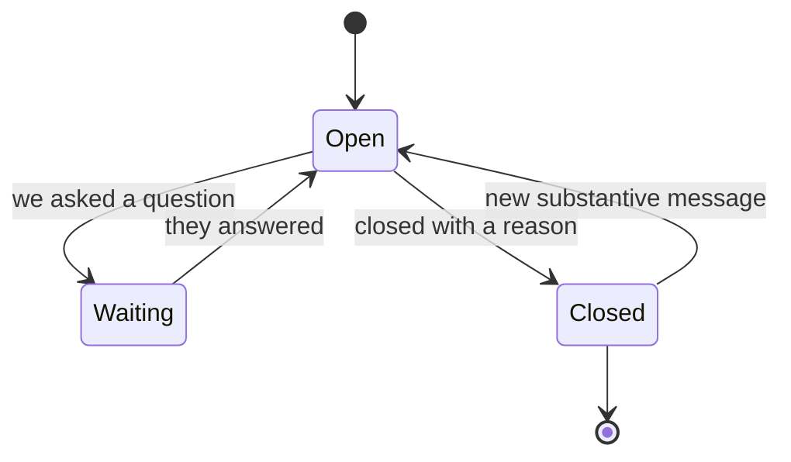
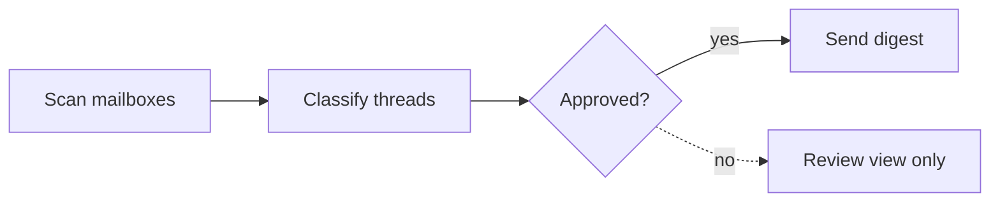

# Fixture — Reader PRD

A labelled test fixture for the document reader (D455). It is not a real product and holds no live data.

## Problem

Threads go quiet. The reader must show this paragraph as written, with **bold**, *italic*, `code` and a [link](https://example.com/docs).

> [!NOTE]
> A callout written by the author stays beside the text it explains.

## Goals

- **G1**: Find the threads that still need an answer.
- **G2**: Send one private digest a day (see R2).

## Approach

**Open or resolved.** A thread is open while the last substantive message came from outside.
Tradeoff: judging "substantive" costs a model call.



**How often to check mail.**
Assumption: every 2 hours during working hours.

### Key flow



```digest-example
Pulse · 3 threads need a reply
1. akash@ · data-access request · waiting 2 days · Gmail link
2. omkar@ · payment question · waiting 1 day · Gmail link
```

## Requirements

1. **R1**: Pulse reads the whole thread before deciding (must). Accepted when each classified thread records the messages read. Checked by test_run. Serves G1.
2. **R2**: The digest goes to one person only (must). Accepted when the rendered digest has one recipient. Checked by code. Serves G2.

## Nested lists

- Pilot mailboxes:
  - one@example.com
  - two@example.com
- Lead: one person
  Assumption: the lead is confirmed before delivery.

## Mailboxes

| Id | Mailbox | Result |
|---|---|---|
| X1 | m1@example.com | example row |
| X2 | m2@example.com | example row |
| X3 | m3@example.com | example row |
| X4 | m4@example.com | example row |
| X5 | m5@example.com | example row |
| X6 | m6@example.com | example row |
| X7 | m7@example.com | example row |
| X8 | m8@example.com | example row |

```python
print("code stays code")
```
